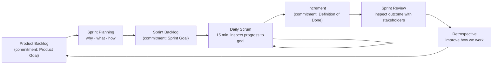
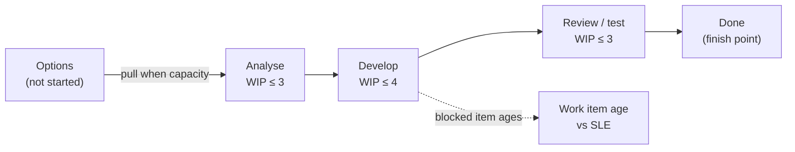
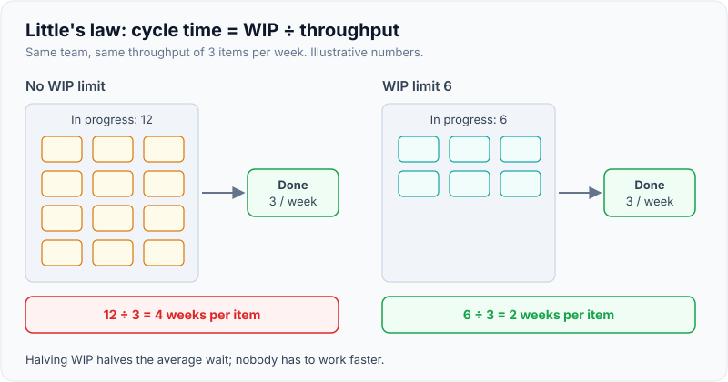

# Scrum vs Kanban

!!! abstract "Key takeaways"
    - **Scrum** is built on **timeboxed Sprints** (≤ one month): **three accountabilities** (Product Owner, Scrum Master, Developers), **five events** and **three artifacts**, each with a commitment: **Product Goal**, **Sprint Goal**, **Definition of Done** (2020 Scrum Guide).
    - **Kanban** optimises flow and adds no roles or events: **visualise the workflow**, **limit and manage WIP**, **improve**, measured by **WIP, throughput, work item age and cycle time**.
    - The core difference is **cadence vs flow**: Scrum commits to a goal for a fixed timebox; Kanban pulls work continuously and limits how much is in progress. Both are empirical: inspect, adapt, make work visible.
    - **Little's law** (average cycle time = average WIP ÷ average throughput) explains why limiting WIP shortens delivery time without anyone working faster.
    - Choose by the **shape of the work**: Scrum for goal-driven product work with a review rhythm; Kanban for interrupt-driven work (support, ops). Many teams blend them (Scrumban, or Scrum with flow metrics).

## Why it matters

"Scrum or Kanban, which do you prefer and why?" is a staple for tech leads because the honest answer shows whether you understand **why** the ceremonies exist or just run them. Weak answers recite the meetings. Strong answers talk about feedback loops, batch size, predictability and the type of work, and admit where each one goes wrong.

Both come from Lean and empirical process control. Scrum's guide was last revised in November 2020; the Kanban Guide (Vacanti, Coleman and others) in May 2025.

## Core concepts

### Scrum in one picture


*Notice that every event is an inspect-and-adapt point, and every artifact has a commitment that says what "good" means: the goal for the product, the goal for this sprint, and the quality bar for anything called done.*

Points interviewers probe:

- **Accountabilities, not job titles.** The Product Owner is accountable for maximising value and ordering the backlog. The Scrum Master is accountable for the team's effectiveness (coaching, removing impediments), not for running status meetings. **Developers** are everyone doing the work, including QA and design. A Scrum Team is typically **10 or fewer** people.
- **Sprint Planning answers three topics**: *why* is this Sprint valuable (the Sprint Goal), *what* can be done, and *how* will it be done. Timebox: up to 8 hours for a one-month Sprint, shorter for shorter Sprints.
- **The Sprint Goal is the commitment, not every item.** Scope may be renegotiated with the PO during the Sprint as long as the goal holds and quality doesn't drop.
- **The Daily Scrum is for the Developers**, 15 minutes, about progress toward the Sprint Goal. The 2020 guide dropped the "three questions".
- **Increments can be released any time.** The Sprint Review is not a release gate.

### Kanban in one picture


*Notice that work is **pulled** only when a column has room under its WIP limit. The board defines where the clock starts and stops, which is what makes cycle time measurable.*

The Kanban Guide's **Definition of Workflow** names: the unit of work, where the clock starts and stops, the states, the WIP limits, explicit policies (for example "a story needs a reviewer before entering Review") and a **service level expectation** (SLE), such as "85% of items finish within 8 days".

### Cadence vs flow

{ loading=lazy }
*Watch where value lands: Scrum batches feedback at sprint boundaries; Kanban delivers whenever an item is done, so lead time depends on WIP, not on the calendar.*

| Dimension | Scrum | Kanban |
|---|---|---|
| Rhythm | Fixed-length Sprints (≤ 1 month) | Continuous flow; cadences optional (replenishment, reviews) |
| Roles | PO, Scrum Master, Developers | None prescribed; keep existing roles |
| Planning unit | Sprint Goal + forecast of backlog items | Pull next item when WIP allows |
| Limit on work | Implicit: what fits in the Sprint | Explicit WIP limits per state |
| Change mid-way | Allowed if Sprint Goal is not endangered | Any time; reorder the queue |
| Primary metrics | Sprint Goal met, velocity (team-internal), increment quality | WIP, throughput, cycle time, work item age |
| Forecasting | Velocity or throughput per Sprint | Throughput history + Monte Carlo, SLE |
| Best at | Goal-driven product work, regular stakeholder feedback | Interrupt-driven, variable-size work: support, ops, platform |

### Little's law: why WIP limits work

For a stable system, **average cycle time = average WIP ÷ average throughput**. If a team finishes 3 items a week and has 12 in progress, each item takes about 4 weeks. Cut WIP to 6 and, at the same throughput, items take about 2 weeks. Nobody typed faster; there's simply less waiting, less context switching and earlier feedback.

{ loading=lazy }
*Same team, same throughput: halving WIP halves the time each item waits. Starting less is the fastest way to finish more.*

It is also why a Scrum team that starts all 15 stories on day one ends the Sprint with 10 half-done. The DORA research makes the same point at the deployment level: small batches go together with both speed and stability (see [DORA metrics](../engineering-practices/05-dora-metrics-and-engineering-effectiveness.md)).

### Scrumban and hybrids

- **Scrum + Kanban practices:** keep Sprints, goals and reviews, but visualise flow, set WIP limits and track cycle time and work item age. Scrum.org published *The Kanban Guide for Scrum Teams* (Vacanti and Yeret) for exactly this.
- **Scrumban:** Kanban flow with some Scrum cadences (replenishment, review, retro).
- **Split lanes:** a product lane planned in Sprints and an expedite or support lane with its own WIP limit, so incidents don't silently eat the Sprint.

## In practice: running the board

=== "❌ Common mistake"
    ```text
    "We do Scrum":
    - Sprint "commitment" = every ticket; client adds scope mid-sprint, bypassing the PO
    - Daily stand-up = status report to the lead, 30+ minutes
    - Production support handled ad hoc; velocity swings 20 → 45 → 18
    "We do Kanban":
    - Columns but no WIP limits, 25 items "In progress"; blocked items age unseen
    ```

=== "✅ Correct approach"
    ```text
    Scrum, two-week Sprints:
    - One-sentence Sprint Goal; forecast from recent throughput minus ~20% support capacity
    - Daily Scrum: Developers walk the board right-to-left, oldest item first, 15 min
    - Support lane: WIP limit 2, rotating owner; counted, not hidden
    Kanban:
    - Explicit policies; clock starts at "Analyse", stops at "Done in production"
    - SLE: 85% of items in ≤ 8 days; items older than the SLE are discussed first
    ```

## Real-world usage

- **Product teams** on client programmes (typical of consulting delivery) mostly run **Scrum with two-week Sprints**, because clients expect a review rhythm and plan funding around increments.
- **Platform, SRE and support teams** lean towards **Kanban**: work arrives unpredictably, and timeboxing a queue of incidents adds overhead without value.
- **At scale**, SAFe, LeSS and Nexus layer coordination on top of team-level Scrum or Kanban; interviewers mostly want to hear that coordination is about dependencies and integration.
- **Failure modes:** "Dark Scrum" or "zombie Scrum" (ceremonies without empiricism), mini-waterfalls inside a Sprint (all testing on the last two days), Kanban boards that are just to-do lists, and velocity used to compare teams.

## Trade-offs & gotchas

| Option | Main risk | Use when |
|---|---|---|
| Scrum | Timebox overhead; work batched to Sprint end; interrupts break goals | Goal-driven product work; new teams that need structure |
| Kanban | No built-in goal or review rhythm; needs disciplined limits and policies | Support, ops, platform, mature teams |
| Scrum + flow practices | Becomes "neither" without explicit policies | Product team that also owns production |

!!! warning "Gotchas"
    - **Velocity is a planning aid for one team**, not a productivity score. Comparing teams on story points invites inflation (see [estimation](02-estimation-techniques-and-planning.md)).
    - **A Sprint is not a release cadence.** Tie releases to readiness and risk, not to the Sprint calendar (see [release management](03-release-and-risk-management.md)).
    - **WIP limits that are never hit are decoration.** Set them low enough to cause conversations.

## How this connects to my experience

- **Where I used it:** "Led Agile teams of 8–10 engineers across backend, frontend, and QA functions" and "Led sprint planning, estimation, stakeholder communication, release management, and production support" (Leadership highlights); OptumRx Meteor at Publicis Sapient.
- **Talking points:**
    - The team ran Sprint-based delivery with a client-side product owner *[confirm Sprint length and who held the PO accountability]*.
    - A team of 8–10 that also owns production support needs an explicit support lane or capacity reservation; otherwise velocity swings and goals slip *[confirm how support was handled]*.
    - Cross-functional team (backend, frontend, QA): testing inside the Sprint, not after it, is what makes the Definition of Done real.
- **Likely follow-up chain:** "Scrum or Kanban?" → "What did your team use and why?" → "What would you change?" → "How did you handle production issues mid-Sprint?" Answer: work type decides → Scrum for client product delivery → add flow metrics and WIP limits → a support lane with a WIP limit and rotating owner, and the PO renegotiates scope if the goal is threatened. For team leadership detail, see [leading a team of 8–10](../leadership-behavioral/03-leading-a-team-of-8-10-delegation-ownership-accountability.md).

## Interview questions

### Fundamentals

??? question "Q1. What are the main differences between Scrum and Kanban?"
    **Answer:** Scrum is a framework with fixed-length Sprints, three accountabilities (PO, Scrum Master, Developers), five events and three artifacts with commitments (Product Goal, Sprint Goal, Definition of Done). Kanban is a flow strategy with no prescribed roles or timeboxes: visualise the workflow, limit WIP, manage flow and improve, measured by WIP, throughput, cycle time and work item age. Scrum limits work by the timebox; Kanban limits it explicitly per state.

    **Interviewer listens for:** cadence vs flow, how each limits work, empiricism common to both.

    **Common wrong answer:** "Scrum has sprints and Kanban has a board." Scrum teams use boards too.

??? question "Q2. What changed in the 2020 Scrum Guide?"
    **Answer:** Roles became **accountabilities**, and "Development Team" became **Developers** in one Scrum Team. The **Product Goal** was added, and each artifact gained a commitment (Product Goal, Sprint Goal, Definition of Done). Sprint Planning gained a third topic, **why** the Sprint is valuable. The guide became less prescriptive: the Daily Scrum's three questions were dropped and the language became less software-specific.

    **Interviewer listens for:** accountabilities, Product Goal, commitments.

    **Common wrong answer:** describing the 2017 three-question stand-up as required.

??? question "Q3. What is a WIP limit and why does it help?"
    **Answer:** A cap on how many items may be in a workflow state at once. By Little's law, average cycle time equals WIP divided by throughput, so lowering WIP at the same throughput shortens cycle time. It also exposes bottlenecks (a full column blocks upstream pulling), reduces context switching and encourages finishing over starting.

    **Interviewer listens for:** Little's law, bottleneck visibility, stop starting/start finishing.

    **Common wrong answer:** "It stops people being overloaded." True, but it misses the flow effect.

### Intermediate

??? question "Q4. Can you change scope during a Sprint?"
    **Answer:** Yes, within limits. The Sprint Goal is fixed; the Sprint Backlog can be clarified and renegotiated with the Product Owner as more is learned, as long as the goal isn't endangered and quality doesn't decrease. If the goal becomes obsolete, only the PO can cancel the Sprint. Urgent production work should go through an agreed policy (a support lane or reserved capacity) rather than silent scope creep.

    **Interviewer listens for:** goal is the commitment, PO negotiation, explicit policy for interrupts.

    **Common wrong answer:** "No, the sprint is locked" or "yes, the client can add anything".

??? question "Q5. Which Kanban metrics would you track and what do they tell you?"
    **Answer:** WIP (how much is started), throughput (items finished per week), cycle time (start to finish, shown as a scatterplot with percentiles) and work item age (how long current items have been in progress). Age is the leading indicator: an item older than the SLE needs attention now, while cycle time only tells you after the fact. A cumulative flow diagram shows WIP growth and bottlenecks.

    **Interviewer listens for:** work item age as a leading indicator, percentiles not averages.

    **Common wrong answer:** "Velocity and burndown."

??? question "Q6. What is Scrumban and when would you use it?"
    **Answer:** A blend: Kanban's pull system, WIP limits and flow metrics with some Scrum cadences (replenishment, reviews, retros). Useful when a Scrum team takes on support work, or when work items vary too much for Sprint commitments but stakeholders still want a review rhythm. The risk is losing both goals and discipline, so make policies explicit.

    **Interviewer listens for:** a concrete trigger, explicit policies.

    **Common wrong answer:** "Doing Scrum without the rules."

### Senior

??? question "Q7. Your team's velocity swings wildly every Sprint. How do you diagnose it?"
    **Answer:** Check what enters mid-Sprint (support, client requests), whether stories are too large (carry-over), and whether testing happens at the end. Fixes: reserve capacity or a WIP-limited support lane, split stories to a few days each, swarm within the Sprint, and forecast from a range of recent throughput.

    **Interviewer listens for:** root causes in flow, not "estimate better".

    **Common wrong answer:** "Push the team to commit to more points."

??? question "Q8. Leadership wants to compare teams using velocity. What do you say?"
    **Answer:** Story points are a team-relative unit, so comparisons are meaningless and quickly lead to point inflation (Goodhart's law). Offer outcome and flow measures instead: Sprint Goal hit rate, cycle time, throughput trends per team against their own history, and DORA delivery metrics, used for improvement, not ranking.

    **Interviewer listens for:** relative units, Goodhart, constructive alternative.

    **Common wrong answer:** "Normalise points across teams."

### Scenario-based

??? question "Q9. You lead a team of 9 that builds features and also owns production support. Scrum or Kanban?"
    **Answer:** Keep Scrum's goal and review rhythm for client-facing feature work, run with Kanban practices: a visible support lane with a WIP limit and rotating owner, capacity reserved from historical support load, and work item age reviewed daily. If support grows past about half the work, split into a flow-based support stream and a Sprint-based feature stream.

    **Interviewer listens for:** an explicit policy for interrupts, data-driven capacity, a threshold for changing approach.

    **Common wrong answer:** "Scrum, and production issues go into the next Sprint."

## Cheat sheet

| Concept | Remember |
|---|---|
| Scrum accountabilities | Product Owner, Scrum Master, Developers (team ≤ 10) |
| Scrum events | Sprint, Planning (why/what/how), Daily Scrum (15 min), Review, Retrospective |
| Artifacts → commitments | Product Backlog → Product Goal; Sprint Backlog → Sprint Goal; Increment → DoD |
| Kanban practices | Define and visualise workflow, actively manage items (WIP), improve |
| Flow metrics | WIP, throughput, cycle time, work item age (+ SLE) |
| Little's law | Cycle time = WIP ÷ throughput |
| Choose | Goal-driven product work → Scrum; interrupt-driven → Kanban; product + support → Scrum with flow practices |
| Don't | Compare velocity across teams; tie releases to Sprint ends; WIP limits nobody hits |

## Sources
1. [The Scrum Guide (2020), Schwaber and Sutherland](https://scrumguides.org/scrum-guide.html): accountabilities, events, timeboxes, artifacts and commitments, Sprint Planning topics.
2. [The Kanban Guide (v2025.5), Vacanti, Coleman et al.](https://kanbanguides.org/english/): Definition of Workflow, practices, the four flow measures.
3. [Scrum.org: The Kanban Guide for Scrum Teams](https://www.scrum.org/resources/kanban-guide-scrum-teams): applying flow metrics and WIP limits inside Scrum.
4. [Mountain Goat Software: Top 5 changes in the 2020 Scrum Guide](https://www.mountaingoatsoftware.com/blog/top-5-changes-in-the-2020-version-of-the-scrum-guide): Product Goal, commitments, accountabilities.
5. David J. Anderson, *Kanban: Successful Evolutionary Change for Your Technology Business* (Blue Hole Press, 2010): origins of Kanban for knowledge work.
6. Daniel Vacanti, *Actionable Agile Metrics for Predictability* (2015): Little's law, cycle-time scatterplots, work item age.
7. [Atlassian: Kanban vs Scrum](https://www.atlassian.com/agile/kanban/kanban-vs-scrum): practical comparison and hybrids.
