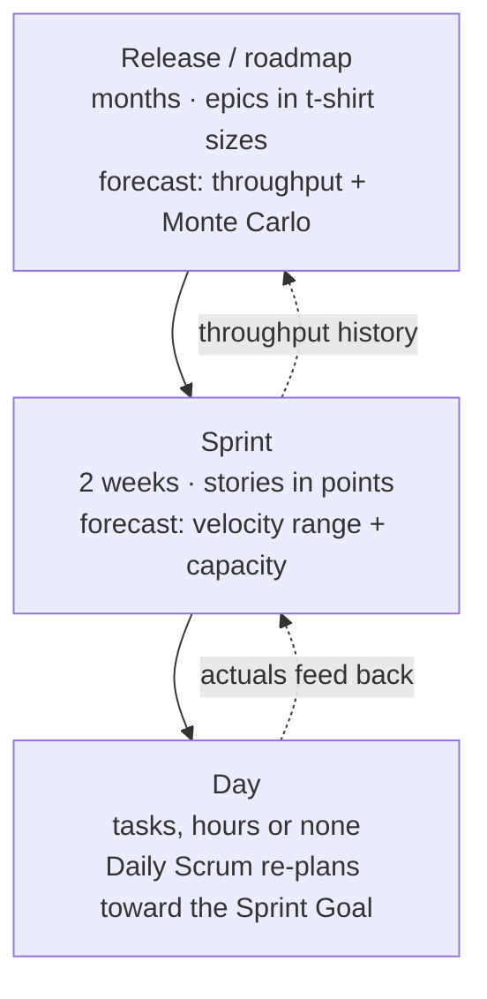
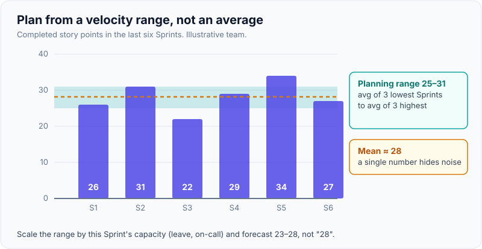
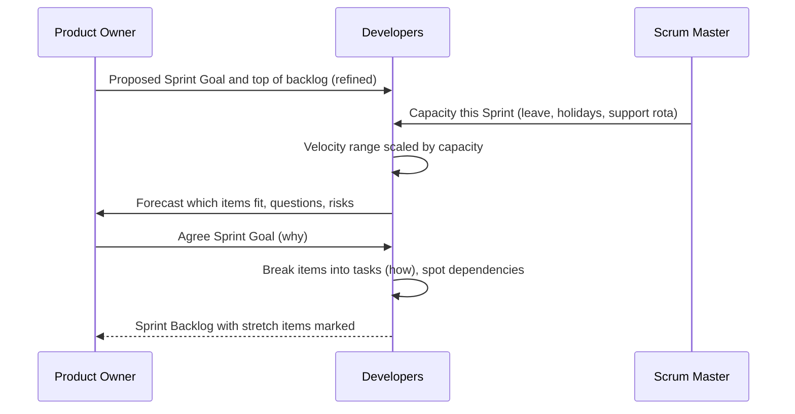

# Estimation Techniques & Planning

!!! abstract "Key takeaways"
    - **Estimate to make decisions**, not to fill a field: ordering the backlog, deciding what fits in a Sprint, answering "when will it be done?". The answer should always be a **range with a confidence level**.
    - **Story points** are a team-relative size (effort, complexity, uncertainty) agreed through **planning poker**. They only mean something inside one team, combined with that team's **velocity**.
    - **Sprint Planning** uses **capacity** (people-days minus leave, ceremonies and support) and a **velocity range** from recent Sprints, never a single average.
    - For releases, **count items and use throughput**: a **Monte Carlo** simulation over historical weekly throughput gives dates at 50/85/95% confidence. Teams with consistently small stories can skip points altogether (**#NoEstimates**).
    - Good estimates start with good **splitting**: vertical slices that meet **INVEST**, split with patterns such as **SPIDR**. Most stories should take a few days.

!!! info "Related pages"
    The cone of uncertainty, three-point/PERT estimates, deadline trade-offs and stakeholder communication are covered in [Estimation, deadlines & stakeholder management](../leadership-behavioral/07-estimation-deadlines-and-stakeholder-management.md). Cutting scope under time pressure is in [Prioritisation & cutting scope](../fde-decomposition-scoping/04-prioritisation-trade-off-calls-and-cutting-scope-under-time.md). This page is about the planning mechanics.

## Why it matters

"Led sprint planning, estimation, stakeholder communication, release management" is on the resume, so expect "walk me through your Sprint Planning", "points or hours?" and "how do you forecast a release?". Interviewers want to hear that you know what each technique is *for*, that you forecast with ranges from data, and that you don't turn estimates into a stick to beat the team with.

## Core concepts

### Planning happens at three levels


*Notice that precision rises as the horizon shrinks, and that each level is fed by actuals from the level below, not by guesses made at the top.*

### Relative sizing and planning poker

People are poor at absolute estimates but good at comparisons ("this is about twice that"). Story points exploit this:

- Pick a **reference story** everyone knows (for example "add a field to the member profile API and UI = 3").
- Use a coarse scale (1, 2, 3, 5, 8, 13). The gaps grow because uncertainty grows with size; anything above 13 is a signal to split.
- **Planning poker** (James Grenning, popularised by Mike Cohn): the PO explains the story, everyone reveals a card at once, the highest and lowest explain, re-vote. The point is the **conversation**, which surfaces hidden work (a migration, an upstream change, test data). Simultaneous reveal avoids anchoring on the lead's number.
- For a large backlog, **affinity estimation** (silently sort cards into size buckets) or **t-shirt sizes** are much faster.

Points include effort, complexity and risk, and the whole team (backend, frontend, QA) estimates together, so testing isn't forgotten. They are **not** hours in disguise: once a team converts "1 point = 4 hours", it has lost the benefit and invited micromanagement.

### Velocity and capacity in Sprint Planning

**Velocity** is the points of stories completed to the Definition of Done per Sprint. It is a forecasting input for one team, not a target.

{ loading=lazy }
*Plan from the band, not the line: a forecast of "25–31 points" is honest; "28 points" pretends the noise isn't there.*

A practical Sprint Planning flow:


*Notice that capacity comes before selection and that the team, not the PO or the lead, decides how much it can forecast.*

**Capacity** adjusts velocity for the Sprint ahead. Example for a team of 8 in a 10-day Sprint: 80 person-days minus 6 days of leave is 74, about 92% of a normal Sprint, so plan about 90% of the usual velocity range (25–31 becomes roughly 23–28). Ceremonies and a steady support load are already inside historical velocity; adjust only for what's different this time, such as a heavier on-call rota or a release week.

!!! tip "Yesterday's weather"
    The simplest reliable forecast is "we'll do about what we did recently". Use the last 3–6 Sprints; drop outliers only with a reason (for example a Sprint lost to an incident).

### Throughput and Monte Carlo forecasting

For "when will these 40 stories be done?", averaging is misleading because Sprints vary. **Monte Carlo** simulation samples your own historical throughput thousands of times:

1. Record items finished per week for recent weeks, for example 3, 5, 4, 6, 2, 5, 4, 3.
2. For one trial, draw a random week from that history repeatedly until the remaining 40 items are finished; note how many weeks it took.
3. Repeat 10,000 times and read percentiles from the distribution.

{ loading=lazy }
*Watch the spread: "10 weeks" is a coin flip; "11 weeks at 85%" is a forecast you can commit to.*

It counts items, not points, which works once stories are split small enough that sizes average out, and it refreshes every week as data arrives. Backlogs usually grow during delivery, so add an explicit allowance for **scope growth** based on your own history.

### #NoEstimates

The #NoEstimates movement (Woody Zuill, Vasco Duarte, Neil Killick) argues that if stories are consistently split small, counting them predicts as well as pointing them, and the time spent estimating is better spent splitting. It is not "no forecasting"; it is forecasting from throughput. It works best for stable teams with a healthy flow. Clients on fixed-price contracts usually still need an up-front size.

### Splitting stories well

A story is ready to estimate when it meets **INVEST** (Bill Wake): Independent, Negotiable, Valuable, Estimable, Small, Testable. Split **vertically** (a thin slice through UI, API and data that a user can see), not horizontally (a "backend story" and a "frontend story").

Mike Cohn's **SPIDR** patterns:

| Pattern | Split by | Example (refill feature) |
|---|---|---|
| **S**pike | Do a timeboxed investigation first | Spike the pharmacy refill API's sandbox |
| **P**aths | Different user paths | Mail-order refills first, retail later |
| **I**nterfaces | Channel or device | Web first, mobile next |
| **D**ata | Subsets of data | Single-prescription refills before multi-Rx orders |
| **R**ules | Business rules deferred | Basic eligibility now, controlled-substance rules next |

## In practice: forecasting with data

=== "❌ Common mistake"
    ```java
    // "Average velocity is 28, backlog is 140 points, so 5 Sprints. Tell the client the 10th."
    double avgVelocity = 28.0;
    int sprintsNeeded = (int) Math.ceil(140 / avgVelocity);   // single number, ~50% confidence at best
    LocalDate promise = start.plusWeeks(sprintsNeeded * 2L);  // no range, no scope growth, no support load
    ```

=== "✅ Correct approach"
    ```java
    // Monte Carlo over real weekly throughput (items done per week), Java 21
    record Forecast(int p50, int p85, int p95) {}

    static Forecast weeksToFinish(int remainingItems, List<Integer> weeklyThroughput, int trials) {
        var rnd = new SplittableRandom(42);                   // seeded so the forecast is reproducible
        int[] results = new int[trials];
        for (int t = 0; t < trials; t++) {
            int done = 0, weeks = 0;
            while (done < remainingItems) {                   // sample a historical week until finished
                done += weeklyThroughput.get(rnd.nextInt(weeklyThroughput.size()));
                weeks++;
            }
            results[t] = weeks;
        }
        Arrays.sort(results);
        return new Forecast(results[trials / 2], results[(int) (trials * 0.85)], results[(int) (trials * 0.95)]);
    }
    // weeksToFinish(40, List.of(3, 5, 4, 6, 2, 5, 4, 3), 10_000) -> about Forecast[p50=10, p85=11, p95=12]
    // Guard against a history of all zeros before calling, or the loop never ends.
    ```

## Real-world usage

- **Most Scrum teams** use points and velocity for Sprints; **forecasting tools** (Jira plug-ins, ActionableAgile) offer Monte Carlo on throughput for releases.
- **Consulting engagements** often need an up-front estimate for a statement of work: t-shirt sizing of epics, calibrated against similar past projects (reference class), then refined after discovery.
- **Scaled frameworks** add a planning layer: SAFe's PI Planning has teams plan 8–12 weeks of work together and surface cross-team dependencies on a board.
- **Failure modes:** points converted to hours, velocity used as a target or to compare teams (points inflate), estimates made by the lead alone, and "commitments" that ignore support load.

## Trade-offs & gotchas

| Technique | Pros | Cons | Use when |
|---|---|---|---|
| Story points + velocity | Fast, relative, team conversation | Team-specific; inflates under pressure | Sprint-level planning |
| Ideal days / hours | Intuitive for stakeholders | Anchors on precision; easy to micromanage | Small teams, task breakdown |
| T-shirt / affinity | Very fast for many items | Coarse | Roadmaps, early backlog sizing |
| Item count + Monte Carlo | Data-driven ranges, cheap to update | Needs history and small, consistent stories | Release and date forecasts |
| Three-point / PERT | Makes uncertainty explicit per item | Slow; individual guesses | Large one-off items ([see here](../leadership-behavioral/07-estimation-deadlines-and-stakeholder-management.md)) |

!!! warning "Gotchas"
    - **Estimate before you hear the target date**, or the date becomes the estimate (anchoring).
    - **Only "done" counts** toward velocity; partially finished stories carry over with zero credit.
    - **Don't re-point finished stories** to make velocity look stable; the noise is information.
    - **Unplanned work is real work.** Track it so capacity reflects reality.

## How this connects to my experience

- **Where I used it:** "Led sprint planning, estimation, stakeholder communication, release management, and production support" (Leadership highlights); a cross-functional team of 8–10 on OptumRx Meteor with 5 upstream systems.
- **Talking points:**
    - The whole team, including QA and frontend, sized stories together so testing and integration effort were visible *[confirm: planning poker or another technique]*.
    - Capacity planning had to include production support for a service used by 750K+ users *[confirm the support share]*.
    - Upstream dependencies were the biggest estimation risk; spikes against upstream sandboxes before committing is the SPIDR "Spike" pattern in practice *[confirm an example]*.
- **Likely follow-up chain:** "How do you estimate?" → "Points or hours, and why?" → "How did you forecast the release date?" → "What happened when you were wrong?" Answer: team-based relative sizing → points for conversation and Sprint fit, never converted to hours → ranges from velocity or throughput with confidence → an honest example of re-forecasting early and presenting options *[confirm story]*.

## Interview questions

### Fundamentals

??? question "Q1. What is a story point, and why not just estimate in hours?"
    **Answer:** A relative unit of size covering effort, complexity and uncertainty, agreed by the team against reference stories. Relative comparisons are more accurate than absolute ones, points don't depend on who does the work, and they avoid false precision. Combined with velocity, they still forecast in time. Hours tend to become commitments per person and invite micromanagement.

    **Interviewer listens for:** relative, team-specific, combined with velocity.

    **Common wrong answer:** "One point is half a day."

??? question "Q2. How does planning poker work and why the simultaneous reveal?"
    **Answer:** The PO presents a story, the team asks questions, everyone picks a card privately and reveals at once. The high and low voters explain, then the team re-votes until it converges. Simultaneous reveal prevents anchoring on the most senior person; the discussion surfaces hidden work and assumptions, which is the main value.

    **Interviewer listens for:** anchoring, conversation over the number.

    **Common wrong answer:** "The lead estimates and the team agrees."

??? question "Q3. What is velocity, and what is it not?"
    **Answer:** Points of work completed to the Definition of Done per Sprint, used by one team to forecast. It isn't a productivity measure, a target or comparable across teams; using it that way inflates points (Goodhart's law).

    **Interviewer listens for:** forecasting input only.

    **Common wrong answer:** "We aim to increase velocity every Sprint."

### Intermediate

??? question "Q4. Walk me through how you run Sprint Planning."
    **Answer:** Before: backlog refined so the top items meet INVEST and are sized. In the session: capacity first (leave, support rota), then the PO proposes a goal, the team forecasts items using the recent velocity range scaled by capacity, agrees the Sprint Goal, and breaks items into tasks, flagging dependencies. Stretch items are labelled as such. Timebox it.

    **Interviewer listens for:** refinement before, capacity, goal, team-owned forecast.

    **Common wrong answer:** "The PO assigns tickets to fill everyone's hours."

??? question "Q5. How do you forecast when a 40-story release will be done?"
    **Answer:** Use throughput history and a Monte Carlo simulation to get a distribution of finish dates, then quote percentiles: for example 10 weeks at 50%, 11 at 85%, 12 at 95%. Add explicit allowance for scope growth, re-run weekly as data arrives and communicate the range, not a single date.

    **Interviewer listens for:** distribution, percentiles, re-forecasting.

    **Common wrong answer:** "Divide backlog points by average velocity."

??? question "Q6. A story is estimated at 21 points. What do you do?"
    **Answer:** Split it. Large estimates carry the most error and rarely finish in one Sprint. Split vertically with SPIDR: a spike for the unknown, one path or channel first, a data subset, or simpler rules first. Each slice should be independently valuable and testable.

    **Interviewer listens for:** vertical slicing, a named technique.

    **Common wrong answer:** "Split into backend and frontend stories."

### Senior

??? question "Q7. What's your view on #NoEstimates?"
    **Answer:** It's a valid choice once stories are consistently small: counting items and forecasting from throughput is about as accurate as points with less effort. Keep the refinement conversation, because that's where splitting happens. It suits stable product teams; fixed-price consulting work usually still needs an initial size.

    **Interviewer listens for:** forecasting still happens, context-dependent.

    **Common wrong answer:** "It means we never commit to dates."

??? question "Q8. Management notices velocity rising every Sprint and wants to use it as the team's KPI. Your response?"
    **Answer:** Explain that rising velocity often means point inflation, not more value, and that making it a KPI will accelerate that. Suggest outcome measures (goals met, customer impact) and flow or delivery measures (cycle time, throughput trends, DORA metrics) reviewed by the team for improvement.

    **Interviewer listens for:** Goodhart, alternatives tied to outcomes.

    **Common wrong answer:** "Great, we'll keep pushing it up."

### Scenario-based

??? question "Q9. The client wants a fixed date for a new feature that depends on an upstream team you've never worked with. How do you plan it?"
    **Answer:** Split out a spike against the upstream API first and size the rest with the team. Give a range with confidence and name the dependency as the main risk with a decision date ("if we don't have sandbox access by the 10th, the range moves by two weeks"). Plan the riskiest slice early, track it in the RAID log, and offer scope options for the date (see the [stakeholder page](../leadership-behavioral/07-estimation-deadlines-and-stakeholder-management.md) and [release & risk management](03-release-and-risk-management.md)).

    **Interviewer listens for:** spike, range, named risk with trigger, scope options.

    **Common wrong answer:** "Pad by 50% and promise the date."

## Cheat sheet

| Concept | Remember |
|---|---|
| Purpose | Estimates support decisions; always a range + confidence |
| Story points | Relative (effort, complexity, risk); team-specific; never hours |
| Planning poker | Simultaneous reveal → avoid anchoring; discussion is the value |
| Velocity | Done points per Sprint; forecasting only; plan from a range |
| Capacity | People-days − leave − ceremonies − support → scale velocity |
| Monte Carlo | Sample historical throughput → P50/P85/P95 dates |
| #NoEstimates | Small stories + throughput; still forecasts |
| Splitting | INVEST; vertical slices; SPIDR (Spike, Paths, Interfaces, Data, Rules) |
| Anti-patterns | Points→hours, velocity as KPI, lead-only estimates, ignoring support |

## Sources
1. Mike Cohn, *Agile Estimating and Planning* (Prentice Hall, 2005): story points, planning poker, velocity, planning levels.
2. [Mountain Goat Software: SPIDR, five simple techniques for splitting user stories](https://www.mountaingoatsoftware.com/blog/five-simple-but-powerful-ways-to-split-user-stories): splitting patterns.
3. [Bill Wake: INVEST in good stories](https://xp123.com/articles/invest-in-good-stories-and-smart-tasks/): the INVEST criteria.
4. [The Scrum Guide (2020)](https://scrumguides.org/scrum-guide.html): Sprint Planning topics; forecasting is the Developers' call.
5. Daniel Vacanti, *When Will It Be Done?* (2020): Monte Carlo forecasting from throughput.
6. [Atlassian: Story points and estimation](https://www.atlassian.com/agile/project-management/estimation): practical guidance, velocity caveats.
7. Vasco Duarte, *NoEstimates: How to Measure Project Progress Without Estimating* (2016): throughput-based forecasting.
8. [Scaled Agile Framework: PI Planning](https://scaledagileframework.com/pi-planning/): cross-team planning and dependency boards.
