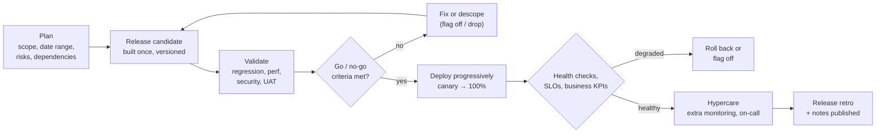
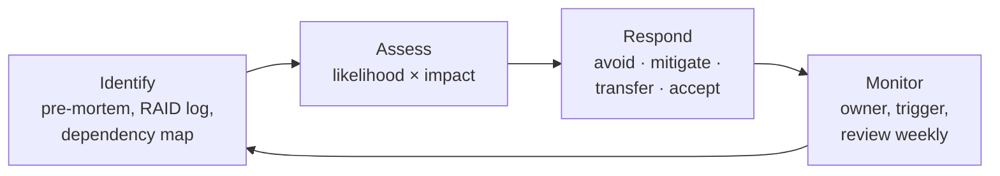

# Release & Risk Management

!!! abstract "Key takeaways"
    - **Deploy ≠ release.** Deployment puts code in production; release exposes behaviour to users. Separate them with **feature flags** and progressive rollout so the business decides *when*, and engineering decides *how safely*.
    - Pick a **release cadence** that matches the context: **release train** (fixed dates, scope flexes), **feature-based** (ship when a feature is ready) or **continuous delivery** (every change deployable). Smaller, more frequent releases are less risky, not more.
    - Every release needs **explicit readiness criteria** agreed in advance, a **go/no-go** decision by named people, a tested **rollback or roll-forward plan**, monitoring and a **hypercare** window after go-live.
    - Manage risk as a loop: **identify → assess (likelihood × impact) → respond (avoid, mitigate, transfer, accept) → monitor triggers**. Each risk has an **owner**, a **trigger** and a **due date**, and the riskiest work goes first.
    - In regulated domains, **automate the evidence** (reviews, tests, scans, approvals, audit trail) rather than adding manual gates. Use standard, normal and emergency change types to keep low-risk changes fast.

!!! info "Related pages"
    Deployment mechanics (blue-green, canary, feature flags, expand/contract) are in [Deployment strategies](../microservices/11-deployment-strategies-blue-green-canary-feature-flags.md) and [GitOps & deployment strategies](../cicd-devops/04-gitops-and-deployment-strategies.md). Incident handling is in [Production incidents & postmortems](../leadership-behavioral/08-production-incidents-and-postmortems.md). The RAID log and deadline trade-offs are in [Estimation & stakeholder management](../leadership-behavioral/07-estimation-deadlines-and-stakeholder-management.md). Measuring delivery is in [DORA metrics](../engineering-practices/05-dora-metrics-and-engineering-effectiveness.md).

## Why it matters

"Release management and production support" is a resume claim, so expect "walk me through a release", "what's on your go/no-go checklist?", "a release went wrong, what did you do?" and "how do you manage risk on a project?". The interviewer wants to see that releases are boring and predictable because risk was reduced *before* release day, not handled heroically on the night.

## Core concepts

### Release vs deployment

| Term | Meaning | Who decides |
|---|---|---|
| **Deployment** | New version running in an environment | Engineering, via the pipeline |
| **Release** | Users can use the new behaviour | Product/business, often by switching a flag |
| **Rollout** | Gradually widening exposure (internal users → 5% → 100%) | Engineering + product, guided by metrics |

Coupled, every deploy is a business event, so teams deploy rarely and in big batches. Decoupled, code ships dark daily and the release is a reversible flag change.

### Release cadence

| Model | How it works | Fits |
|---|---|---|
| **Release train** | Fixed schedule (for example every 2 or 4 weeks); whatever is ready and passes criteria boards the train, the rest waits for the next one | Multiple teams, client UAT cycles, mobile apps, regulated change windows |
| **Feature-based** | Release when a defined scope is done | Small products, contractual milestones; risk of slipping dates and big batches |
| **Continuous delivery** | Every merged change is deployable; deploy on demand, release by flag | Mature pipelines and test automation |

A **Sprint is not a release cadence**: Scrum allows releasing any time during the Sprint ([Scrum vs Kanban](01-scrum-vs-kanban.md)).

**Versioning and branching:** use **Semantic Versioning** (MAJOR.MINOR.PATCH, where MAJOR means a breaking change) for APIs and libraries, and prefer trunk-based development with short-lived **release branches** only when you must stabilise or patch an old version (see [branching strategies](../engineering-practices/01-git-internals-and-branching-strategies.md)). Fixes go to trunk first and are cherry-picked to the release branch, so they're never lost in the next release.

### The release lifecycle


*Notice that the same artifact moves through every stage ("build once, deploy many"), and that both exits from trouble (descope before, roll back after) are planned paths, not improvisation.*

{ loading=lazy }
*Watch exposure grow only while the error rate stays below the threshold: rollout speed is set by evidence, not by the calendar.*

### Go/no-go readiness

Agree the criteria **before** release week, so the meeting checks facts instead of negotiating. A typical list:

- **Quality:** no open blocker or critical defects; regression and contract tests green; performance test within budget.
- **Security and compliance:** SAST/dependency scans clean or accepted with a ticket; data-protection review for changes touching PHI or PII; approvals recorded.
- **Operability:** runbook updated; dashboards and alerts for new features; feature flags default off; on-call and hypercare rota named.
- **Reversibility:** rollback tested in staging; database migrations backward compatible (expand/contract); a decision point and owner for "roll back vs fix forward".
- **Dependencies and people:** upstream and downstream teams ready; support and business informed; release notes drafted; change ticket approved.

Decision makers are named in advance (typically product owner, tech lead, QA lead, ops/SRE). A **no-go is a success** of the process, not a failure of the team.

### Change management in practice

ITIL-style change management distinguishes **standard** changes (low-risk, pre-approved: most pipeline deploys), **normal** changes (assessed, possibly by a change advisory board) and **emergency** changes (expedited, reviewed afterwards). DORA found heavyweight external approval slows delivery without improving stability, so make the pipeline produce the evidence a CAB wants and get routine deploys classified as standard.

**Hotfixes** follow a shorter path, not a skipped one: fix on trunk (or the release branch if trunk has moved on), the same pipeline and tests, a smaller approval group, and a follow-up postmortem if it was caused by a release.

### Risk management


*Notice that this is a loop reviewed every week, not a register filled once at kick-off and forgotten.*

- **Identify** with a **pre-mortem** (Gary Klein): "it's three months from now and the release failed. Why?" Delivery risks cluster around **dependencies** (upstream APIs, other teams, approvals), **new technology**, **data and migrations**, **performance**, **compliance** and **people** (key-person dependency).
- **Assess** each by likelihood and impact on a small scale (1–5) to rank them; the exact numbers matter less than the ordering and the conversation.

{ loading=lazy }
*Low-likelihood, severe-impact risks (data exposure) still deserve mitigation; the matrix ranks attention, it doesn't excuse ignoring the top-left.*

- **Respond** with one of four strategies:

| Response | Meaning | Example |
|---|---|---|
| **Avoid** | Change the plan so the risk can't happen | Drop a risky migration from this release; use an existing proven library |
| **Mitigate** | Reduce likelihood or impact | Spike the upstream API early, contract tests, canary + flag kill switch, load test |
| **Transfer** | Shift impact to another party | Managed service with an SLA, vendor support contract, insurance |
| **Accept** | Consciously live with it, with a contingency | Minor UI issue known at launch, documented and approved |

- **Monitor**: every risk has an **owner**, a **trigger** ("if no sandbox by the 10th…") and a **contingency**. Retire risks as they pass, and do **risk-first sequencing**: build the riskiest slice early, while there's still time to change course.

## In practice: release runbook

=== "❌ Common mistake"
    ```text
    Friday 6 pm "big bang" release of six weeks of work:
    - Readiness decided in the meeting ("looks fine?"); QA still testing on the night
    - Schema migration drops a column the old version still reads → rollback impossible
    - New features on for everyone at once; no dashboards for them
    - Whoever is online handles issues; client hears about problems from users
    - Risk register written at kick-off, never reopened
    ```

=== "✅ Correct approach"
    ```text
    Tuesday release, train every 2 weeks:
    T-5 days  RC built once (v2.14.0), regression + contract + perf tests, security scan
    T-3 days  UAT sign-off; risk review: open risks have owner + trigger + contingency
    T-1 day   Go/no-go against pre-agreed criteria (PO, tech lead, QA lead, SRE)
    T-0       Deploy with expand-only migration; canary 5% → 25% → 100% gated on error rate
              and p95 latency vs SLO; new features dark, flags enabled per segment later
              Rollback owner named; "roll back if error rate > 1% for 10 min"
    T+1..5    Hypercare: daily check-in, dashboards, on-call rota; release notes published
    T+5       Release retro: what slowed us, what nearly broke, risk register updated
    ```

## Real-world usage

- **Release trains** are common where many teams ship into one product, clients run UAT, or app stores review builds (SAFe's Agile Release Train is the scaled version).
- **Web platforms** with strong automation deploy continuously and release by flag (Google's SRE book treats release engineering as its own discipline).
- **Healthcare and banking** add change windows, data-protection reviews and audit trails; the fast teams there automate evidence and keep changes small.
- **Failure modes:** "watermelon" go/no-go (green on paper, red underneath), releases timed to Sprint ends, irreversible migrations, flags left on forever (flag debt), and hotfixes that skip tests and cause a second incident.

## Trade-offs & gotchas

| Choice | Pros | Cons |
|---|---|---|
| Roll back | Fast return to known state | Hard if data or schema changed |
| Fix forward | Keeps new data shape | Only safe when the cause is clear and the pipeline is fast |
| Manual CAB for all changes | Familiar to auditors | Slow, batches risk, little stability benefit (DORA) |

!!! warning "Gotchas"
    - **Test the rollback**, including the database. A rollback plan never exercised is a hope.
    - **Name a decision owner** for roll back vs fix forward before the release starts; arguing at 2 am costs minutes of impact.
    - **Retire flags** once fully released, or the codebase fills with dead branches.

## How this connects to my experience

- **Where I used it:** "Led sprint planning, estimation, stakeholder communication, release management, and production support" (Leadership highlights); "Established engineering standards around testing, CI/CD, code quality, and deployment practices" (OptumRx Meteor, 750K+ users, 5 upstream systems); "automated deployments through GitLab CI/CD pipelines" (CipherTrust CCKM); Terraform-automated deployment at Deloitte.
- **Talking points:**
    - Release cadence and who made the go/no-go call on Meteor *[confirm: train length, client UAT, approvers]*.
    - Five upstream systems made dependency risk the top item: contract tests, early integration and Kafka retry/DLQ handling reduce the blast radius of upstream changes *[confirm how upstream release coordination worked]*.
    - Healthcare context: PHI-aware readiness checks and audit evidence from the pipeline *[confirm specific controls]*.
    - A release that went wrong or was called off at go/no-go, and what changed afterwards *[confirm story]*.
- **Likely follow-up chain:** "How did releases work on your project?" → "What was on the go/no-go list?" → "Tell me about a release that went wrong" → "How did you roll back with a schema change?" → "What would you improve?" Answer: cadence + roles → criteria grouped as quality, security, operability, reversibility, dependencies → honest story with detection, decision, rollback and comms → expand/contract → smaller releases, flags and automated canary analysis.

## Interview questions

### Fundamentals

??? question "Q1. What's the difference between deploying and releasing?"
    **Answer:** Deploying puts a new version into an environment; releasing makes new behaviour available to users. Feature flags and progressive rollout separate them, so code can ship dark and be enabled by segment and turned off instantly without a redeploy.

    **Interviewer listens for:** decoupling, flags, business control of exposure.

    **Common wrong answer:** "They're the same thing."

??? question "Q2. What's on your go/no-go checklist?"
    **Answer:** Criteria agreed before release week: no open blockers; regression, contract and performance tests green; security scans clean or accepted; compliance review where data is affected; runbook, dashboards and alerts ready; rollback tested and migrations backward compatible; dependencies ready; on-call and hypercare named; stakeholders and support informed. Named decision makers.

    **Interviewer listens for:** pre-agreed, reversibility, operability, named owners.

    **Common wrong answer:** "QA signs off."

??? question "Q3. What are the four risk response strategies?"
    **Answer:** Avoid (change the plan to remove the risk), mitigate (reduce likelihood or impact), transfer (shift impact to another party, for example a vendor SLA) and accept (live with it consciously, with a contingency). Each risk gets an owner, a trigger and a review date.

    **Interviewer listens for:** all four with examples, owner and trigger.

    **Common wrong answer:** listing only "mitigate".

### Intermediate

??? question "Q4. Release train or continuous delivery: how do you choose?"
    **Answer:** Continuous delivery when the pipeline, test automation and flags are mature and the domain allows it; it gives the smallest batches. A release train when several teams integrate into one product, clients run UAT cycles, or change windows are mandated; it gives predictability. Many teams combine them: deploy continuously, release to users on a train.

    **Interviewer listens for:** context-driven choice, the hybrid.

    **Common wrong answer:** "Always release at the end of each Sprint."

??? question "Q5. How do you identify risks on a new project?"
    **Answer:** A pre-mortem with the team and key stakeholders, a dependency map (upstream and downstream systems, other teams, approvals), a review of unknowns (new tech, data volume, migrations, compliance), and the team's history of past incidents. Record in a RAID log, rank by likelihood × impact, and schedule spikes for the top items.

    **Interviewer listens for:** pre-mortem, dependencies, turning risks into early work.

    **Common wrong answer:** "We handle issues as they come."

??? question "Q6. Roll back or fix forward?"
    **Answer:** Default to rolling back (or flag off) when the cause isn't clear and the previous version is compatible with current data, because it restores service fastest. Fix forward when rollback is unsafe (schema or data already changed), the cause is understood and the pipeline can ship a tested fix quickly. Decide the owner and threshold before the release.

    **Interviewer listens for:** restore first, data compatibility, pre-decided threshold.

    **Common wrong answer:** "Always fix forward, rollbacks are embarrassing."

### Senior

??? question "Q7. The client requires a weekly CAB for every production change. How do you speed delivery without losing control?"
    **Answer:** Give the CAB the evidence it needs automatically: protected branches with peer review, pipeline test and scan results, linked tickets, deployment audit logs and tested rollback. Propose classifying routine pipeline deploys as standard pre-approved changes and reserving the CAB for high-risk ones. Show before/after lead time and change fail rate; DORA's research supports lightweight approval with automated checks.

    **Interviewer listens for:** automate evidence, standard changes, data.

    **Common wrong answer:** "Bypass the CAB" or "nothing can change in a regulated domain."

### Scenario-based

??? question "Q8. Fifteen minutes after a release, error rates rise on one endpoint used by a downstream system. Walk me through it."
    **Answer:** Stop the rollout and, per the pre-agreed threshold, flag off or roll back the change while checking dashboards and traces to confirm the endpoint and version. Tell the downstream team and stakeholders what's happening and the expected recovery time. Once stable, find the cause (often a contract change that a consumer depended on), add a contract test, and hold a blameless review with action items. See [incidents & postmortems](../leadership-behavioral/08-production-incidents-and-postmortems.md).

    **Interviewer listens for:** mitigate first, communicate, contract tests, blameless follow-up.

    **Common wrong answer:** "Debug in production until we find the bug."

## Cheat sheet

| Concept | Remember |
|---|---|
| Deploy vs release | Deploy = code running; release = users see it; flags separate them |
| Cadence | Train (fixed date, flexible scope), feature-based, continuous delivery |
| Versioning | SemVer MAJOR.MINOR.PATCH; release branches only to stabilise or patch |
| Lifecycle | Plan → RC (build once) → validate → go/no-go → progressive deploy → verify → hypercare → retro |
| Go/no-go | Quality, security/compliance, operability, reversibility, dependencies; pre-agreed; named owners |
| Change types | Standard (pre-approved), normal, emergency |
| Risk loop | Identify (pre-mortem) → assess (L × I) → respond → monitor (owner, trigger) |
| Responses | Avoid, mitigate, transfer, accept |
| Rollback | Test it; expand/contract migrations; decide thresholds beforehand |

## Sources
1. [Martin Fowler / Pete Hodgson: Feature Toggles](https://martinfowler.com/articles/feature-toggles.html): separating deploy from release, toggle categories and debt.
2. [Google SRE book: Release Engineering](https://sre.google/sre-book/release-engineering/): build once, hermetic builds, progressive rollout.
3. [Semantic Versioning 2.0.0](https://semver.org/): MAJOR.MINOR.PATCH rules.
4. [DORA capabilities: Streamlining change approval](https://dora.dev/capabilities/streamlining-change-approval/): external approval vs peer review and automation.
5. [Atlassian: Change management (ITIL change types)](https://www.atlassian.com/itsm/change-management): standard, normal and emergency changes, CAB.
6. [Gary Klein: Performing a Project Premortem (HBR, 2007)](https://hbr.org/2007/09/performing-a-project-premortem): pre-mortem technique.
7. PMI, *A Guide to the Project Management Body of Knowledge (PMBOK Guide)*: risk identification, qualitative analysis and response strategies.
8. [Scaled Agile Framework: Agile Release Train](https://scaledagileframework.com/agile-release-train/): release trains at scale.
