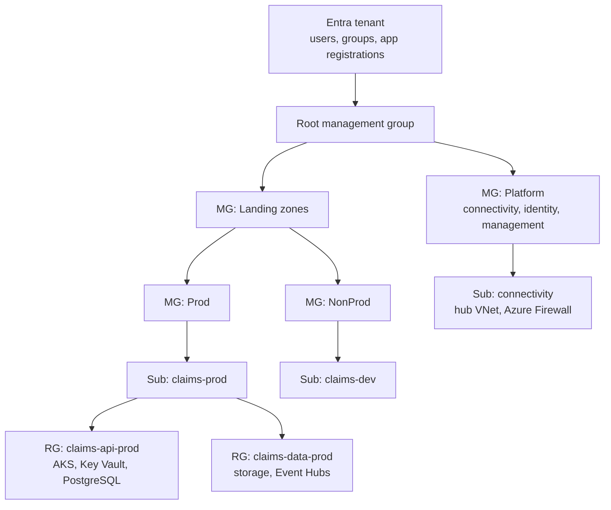
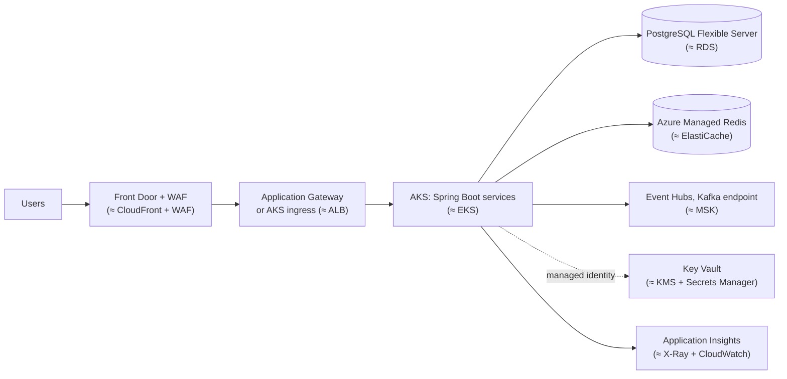

# Core services mapped to AWS equivalents

!!! abstract "Key takeaways"
    - **Learn Azure through AWS, then learn the differences.** Most services map one to one (Blob ≈ S3, AKS ≈ EKS, Functions ≈ Lambda, Cosmos DB ≈ DynamoDB, Service Bus ≈ SQS + SNS). The interview signal is knowing **where the mapping breaks**.
    - **Hierarchy:** **Entra tenant** (identity) → **management groups** (≈ OUs) → **subscriptions** (≈ accounts) → **resource groups** (no real AWS equivalent) → resources. Azure Policy and RBAC inherit down the tree, like SCPs.
    - **Networking:** a **VNet subnet is regional and spans zones**. In AWS a subnet is pinned to one AZ. In Azure you choose the zone on the VM or scale set. **NSGs** are stateful like security groups but have **allow and deny rules with priorities**, and attach to subnets or NICs.
    - **Storage redundancy is your choice:** Blob **LRS** keeps three copies in **one datacenter**. S3 Standard is multi-AZ by default. Pick **ZRS/GZRS** for zone resilience.
    - **Identity is the biggest shift:** one Entra tenant sits above all subscriptions, and workloads authenticate with **managed identities** (≈ IAM roles for EC2/ECS). See [Entra ID & Key Vault](03-entra-id-and-key-vault.md).

## Why it matters

My hands-on cloud depth is AWS, but my resume lists Azure and AKS, and CipherTrust CCKM worked against Azure Key Vault. Interviewers in multi-cloud shops (banks, healthcare, Microsoft-heavy enterprises) ask "how would this look on Azure?" A good answer translates the design and then calls out the three or four places where a direct copy fails: identity, subnet and zone placement, storage redundancy and the permission planes.

This page is the translation layer. The deep content stays in the [AWS topic](../aws/index.md). Here we cover what's different.

## Core concepts

### Organising resources

{ loading=lazy }
*The rows line up until resource groups. They are a lifecycle container (delete the group, delete everything in it) that AWS doesn't have.*


*Notice this is the **Azure landing zone** shape. It is the same idea as an AWS Control Tower layout with OUs and one account per workload environment. Policies set on "Prod" apply to every subscription below it.*

Rules worth remembering:

- **Subscription ≈ AWS account.** It is the billing, quota and access boundary. Use one per workload per environment, as you would with AWS accounts.
- **Resource group:** every resource belongs to exactly one. Its location only says where the metadata lives, so resources inside can be in other regions. RBAC can be scoped to it, and deleting it deletes its contents. The nearest AWS ideas are tag-based Resource Groups and CloudFormation stacks.
- **Azure Policy ≈ SCPs + AWS Config rules.** Its effects are `deny`, `audit`, `modify` and `deployIfNotExists`. For example: "deny public IPs in Prod", "require tag `cost-centre`", "deploy diagnostic settings to Log Analytics".
- **ARM (Azure Resource Manager)** is the single control-plane API. **Bicep** and ARM templates ≈ CloudFormation. Terraform's `azurerm` provider is the multi-cloud option.

### Regions, zones and the subnet difference

Azure regions offer **three availability zones** where zones are supported. Many regions also have a **paired region** used for sequenced platform updates and some geo-replication, although newer regions often have no pair. As in AWS, the zone numbers are **logical per subscription**: zone 1 in your subscription may not be zone 1 in mine. Compare zone IDs, just as you compare AZ IDs (`use1-az1`) in AWS.

The key difference is the **subnet**. In AWS you place an instance in an AZ by choosing a subnet. In Azure the subnet covers the whole region, and you set `zones = ["1"]` on the VM, or `zones = ["1","2","3"]` on a scale set, an AKS node pool or Application Gateway. **Zone-redundant** services (ZRS storage, zone-redundant SQL Database or PostgreSQL, Standard Load Balancer) spread across zones for you.

{ loading=lazy }
*The blast radius is the same. What differs is where the zone choice lives in your Terraform.*

### Networking

| Concept | AWS | Azure | Difference that matters |
|---|---|---|---|
| Private network | VPC | Virtual Network (VNet) | Subnets are regional, not per zone |
| Firewall per resource | Security group (stateful, allow only) | **NSG** (stateful, **allow + deny**, priority 100–4096) | NSG attaches to a subnet and/or NIC. Default rules allow VNet-internal traffic |
| Group-based rules | SG referencing SG | Application Security Groups | Same idea: rules by role, not IP |
| Stateless subnet ACL | NACL | None (NSG on the subnet covers it) | One fewer layer to debug |
| Egress to the internet | NAT gateway | NAT Gateway / Azure Firewall | Implicit "default outbound access" is being retired, so plan explicit egress |
| Hub-and-spoke | Transit Gateway | VNet peering to a hub (non-transitive) or **Virtual WAN** | Peering isn't transitive in either cloud |
| Private access to PaaS | PrivateLink interface endpoint | **Private Endpoint** + `privatelink.*` private DNS zone | DNS is the usual failure point |
| L7 load balancer | ALB (+ WAF) | Application Gateway (+ WAF) | Regional |
| L4 load balancer | NLB | Azure Load Balancer (Standard) | |
| Global edge + CDN | CloudFront (+ Global Accelerator) | **Front Door** (CDN, global L7 routing, WAF) | One service covers both roles |
| DNS | Route 53 | Azure DNS + Traffic Manager (DNS-based routing) | Routing policies live in Traffic Manager |
| Private line | Direct Connect | ExpressRoute | |

Deep dive on the AWS side: [Networking: VPC, subnets, SGs vs NACLs](../aws/09-networking-vpc-subnets-security-groups-vs-nacls-route-53-clo.md). For private endpoints and egress allowlists in customer environments, see [Network & data constraints](../fde-enterprise-deployment/03-network-and-data-constraints-private-endpoints-proxies-egres.md).

### Compute, storage, data, messaging and operations

| Area | AWS | Azure | Watch out for |
|---|---|---|---|
| VMs | EC2, Auto Scaling groups | Virtual Machines, **VM Scale Sets** | Spot VMs ≈ Spot instances |
| Kubernetes | EKS | **AKS** | Control plane free on the Free tier, SLA on Standard. See [page 02](02-aks-app-service-and-azure-functions.md) |
| Serverless containers | ECS on Fargate, App Runner | **Container Apps** (KEDA, Dapr, scale to zero), ACI for single containers | |
| PaaS web apps | Elastic Beanstalk, App Runner | **App Service** | Deployment slots are a first-class feature |
| Functions | Lambda | **Azure Functions** (Flex Consumption) | HTTP triggers max out at 230 s |
| Registry | ECR | Azure Container Registry (ACR) | |
| Object storage | S3 | **Blob Storage** in a storage account | Redundancy (LRS/ZRS/GRS/GZRS) is chosen per account |
| Tiers | S3 Standard / IA / Glacier | Hot / Cool / Cold / Archive | Archive needs rehydration (hours) |
| Block / file | EBS / EFS, FSx | Managed Disks / Azure Files, Azure NetApp Files | |
| Relational | RDS, Aurora | Azure SQL Database, **Database for PostgreSQL Flexible Server**, MySQL Flexible Server | |
| NoSQL | DynamoDB | **Cosmos DB** (RU/s, five consistency levels, multi-region writes) | Default consistency is **session** |
| Cache | ElastiCache | **Azure Managed Redis** | Azure Cache for Redis is retiring (Basic–Premium on 30 Sep 2028) |
| Queue | SQS | **Service Bus queues** (sessions = FIFO, DLQ, duplicate detection) or Storage Queues | |
| Pub/sub | SNS | Service Bus **topics + subscriptions** | Subscriptions have filters and their own DLQ |
| Event bus | EventBridge | **Event Grid** | |
| Streaming | Kinesis, MSK | **Event Hubs** (has a **Kafka endpoint**) | Kafka clients connect by changing the bootstrap server and SASL config |
| Keys and secrets | KMS + Secrets Manager + ACM | **Key Vault** (keys, secrets, certificates), Managed HSM | See [page 03](03-entra-id-and-key-vault.md) |
| Identity | IAM, Identity Center, Cognito | **Entra ID**, managed identities, Entra External ID | |
| Monitoring | CloudWatch, Logs Insights | **Azure Monitor**, Log Analytics (**KQL**) | |
| Tracing / APM | X-Ray, Application Signals | **Application Insights** (OpenTelemetry Java agent) | |
| Audit | CloudTrail | **Activity log** (control plane) + resource diagnostic logs (data plane) | Data-plane logs must be switched on per resource |
| Posture / threats | Security Hub, GuardDuty | **Defender for Cloud**, Microsoft Sentinel (SIEM) | |
| API front door | API Gateway | **API Management** | |
| IaC | CloudFormation, CDK | ARM templates, **Bicep**, Terraform `azurerm` | |


*Notice the same three-tier microservice design maps box for box. The dotted line is what changes the most: the workload reaches Key Vault with a **managed identity** and no stored credential.*

## In practice: code & configuration

The most common AWS habit to break is "one subnet per AZ". In Azure that adds subnets but doesn't pin anything to a zone.

=== "❌ Common mistake"
    ```hcl
    # Copying the AWS pattern: three "zonal" subnets.
    # Azure subnets are regional, so these names promise zone isolation that doesn't exist.
    resource "azurerm_subnet" "app_az1" {
      name                 = "snet-app-az1"
      resource_group_name  = azurerm_resource_group.rg.name
      virtual_network_name = azurerm_virtual_network.vnet.name
      address_prefixes     = ["10.20.1.0/24"]
    }
    # ...app_az2, app_az3. The scale set below still lands in one zone (or none).
    resource "azurerm_linux_virtual_machine_scale_set" "app" {
      name      = "vmss-claims"
      subnet_id = azurerm_subnet.app_az1.id   # zones not set: no zone resilience
      # ...
    }
    ```

=== "✅ Correct approach"
    ```hcl
    # One subnet per tier, sized for growth. Zone placement goes on the compute.
    resource "azurerm_subnet" "app" {
      name                            = "snet-app"
      resource_group_name             = azurerm_resource_group.rg.name
      virtual_network_name            = azurerm_virtual_network.vnet.name
      address_prefixes                = ["10.20.0.0/22"]
      default_outbound_access_enabled = false  # private subnet: egress via NAT Gateway/Firewall
    }

    resource "azurerm_linux_virtual_machine_scale_set" "app" {
      name         = "vmss-claims"
      zones        = ["1", "2", "3"]          # spread across zones
      zone_balance = true
      # ... network_interface { ip_configuration { subnet_id = azurerm_subnet.app.id } }
    }

    resource "azurerm_storage_account" "docs" {
      name                     = "stclaimsdocsprod"
      account_tier             = "Standard"
      account_replication_type = "ZRS"        # LRS = one datacenter; ZRS ≈ S3 Standard's multi-AZ
      # ...
    }
    ```

## Real-world usage

- **Landing zones:** enterprises follow the Microsoft **Cloud Adoption Framework** landing-zone layout. It has platform subscriptions (connectivity hub with Azure Firewall, identity, management/logging) and application landing zones under Prod and NonProd management groups, with Azure Policy guardrails. It is the Azure counterpart of AWS Control Tower with Organizations.
- **Hybrid identity is why many companies run on Azure.** On-premises Active Directory syncs to Entra ID (Entra Connect), so Microsoft 365, VPN and cloud resources share one identity. Banks and healthcare organisations that already run Microsoft 365 often choose Azure for this reason.
- **Kafka without running Kafka:** Event Hubs' Kafka endpoint lets existing Kafka producers and consumers connect with configuration changes only. Kafka Streams, transactions and compacted topics have tier and feature limits, so check before you promise "drop-in".
- **Spring on Azure:** **Azure Spring Apps is retiring** (all plans on 31 March 2028). Microsoft recommends **Container Apps** (or AKS) for Spring Boot workloads, which is worth knowing if an interviewer mentions it.

## Trade-offs & production gotchas

| Decision | Option A | Option B | Use when |
|---|---|---|---|
| Storage redundancy | LRS (cheapest, one datacenter) | ZRS / GZRS (zones, plus a second region) | Production data: ZRS at least. GZRS or RA-GZRS for DR |
| Messaging | Service Bus (transactions, sessions, DLQ) | Event Hubs (partitioned log, replay) | Commands and work queues vs event streams and analytics |
| Container platform | Container Apps (no cluster) | AKS (full Kubernetes) | Small team, standard HTTP/event apps vs platform team, custom operators |
| IaC | Bicep (Azure-native, day-zero features) | Terraform (multi-cloud, one workflow) | Azure-only shop vs multi-cloud team |

!!! warning "Gotchas AWS engineers hit"
    - **Subnets aren't zonal.** Set `zones` on the compute and use zone-redundant SKUs.
    - **LRS isn't multi-AZ.** S3 Standard's durability across AZs is not the Azure default.
    - **Private Endpoint without private DNS** still resolves the public IP, so traffic is blocked or leaves the VNet. Link the `privatelink.*` zone to every VNet that needs it.
    - **NSG deny rules exist.** A low-priority-number deny beats a higher-number allow, which surprises people used to allow-only security groups.
    - **Data-plane logs are off by default** on many resources. Add diagnostic settings (via Azure Policy) or you'll have no audit trail of who read which secret.
    - **Retirements move fast:** Azure Spring Apps (2028), Azure Cache for Redis (2027–2028), Linux Consumption Functions (2028). Check the service's lifecycle before designing on it.

## How this connects to my experience

- **Where I used it:** the professional summary and skills list **Azure** and **Kubernetes (EKS/AKS)**. At Coriolis, CipherTrust CCKM "developed enterprise key management capabilities supporting AWS, Azure, and GCP". Most of my hands-on infrastructure work (Deloitte, Terraform, Lambda/ECS/EKS/RDS) was on AWS.
- **Talking points:**
    - "I design in AWS terms and translate. On Azure, the parts I check first are identity (managed identities instead of keys), subnet and zone placement, storage redundancy, and Key Vault's permission model."
    - "From CCKM I know Azure's key model first-hand: Key Vault keys and versions, Premium HSM-backed keys, and how customer-managed keys work across clouds." *[confirm: which Azure APIs and auth method CCKM used]*
    - "My Terraform experience carries over: the `azurerm` provider, remote state in a storage account, and policy guardrails." *[confirm: any Azure Terraform written]*
- **Likely follow-up chain:** "What did you run on Azure?" → "How does Azure organise accounts?" → "How would you put your Deloitte AWS architecture on Azure?" Be honest that the depth is AWS, give the mapping table, then show the differences (subnets, LRS, managed identity, Event Hubs for Kafka). *[confirm where Azure/AKS was used and at what depth]*

## Interview questions

### Fundamentals

??? question "Q1. Map an AWS account structure to Azure."
    **Answer:** AWS Organizations → OUs → accounts maps to an Entra tenant with a root management group → management groups → subscriptions. Subscriptions are the billing, quota and access boundary, like accounts. Azure adds **resource groups** inside subscriptions as lifecycle and RBAC containers. AWS has no direct equivalent (tags or stacks come closest). SCPs map to **Azure Policy** set at management-group level, and Identity Center maps to Entra ID, which already sits above every subscription.

    **Interviewer listens for:** subscription ≈ account (not resource group ≈ account), and the policy inheritance.

    **Common wrong answer:** "A resource group is like an AWS account."

??? question "Q2. What's the Azure equivalent of S3, and what default should you change?"
    **Answer:** Blob Storage in a **storage account** (one namespace that also hosts Files, Queues and Tables). Access tiers Hot/Cool/Cold/Archive ≈ S3 storage classes. The default to check is **redundancy**: LRS keeps three copies in one datacenter, while S3 Standard spans at least three AZs. Use ZRS for zone resilience and GZRS/RA-GZRS for a second region. Also disable public blob access and shared-key auth, and use Entra ID with private endpoints.

    **Interviewer listens for:** LRS vs ZRS, and identity-based access instead of account keys.

    **Common wrong answer:** "Blob is the same as S3, the defaults are fine."

??? question "Q3. SQS, SNS, EventBridge and Kinesis: what are the Azure equivalents?"
    **Answer:** SQS → **Service Bus queues** (or Storage Queues for simple, cheap cases). SNS → **Service Bus topics and subscriptions** with filter rules, or Event Grid for push events. EventBridge → **Event Grid**. Kinesis/MSK → **Event Hubs**, which also exposes a **Kafka endpoint**. Service Bus has sessions (ordered FIFO per key), a dead-letter queue, duplicate detection and transactions.

    **Interviewer listens for:** Service Bus (broker) vs Event Hubs (log) as the key distinction. See [AWS messaging](../aws/08-messaging-sqs-vs-sns-vs-eventbridge-vs-kinesis.md).

    **Common wrong answer:** "Event Hubs is a queue like SQS."

### Intermediate

??? question "Q4. How do subnets and availability zones differ between AWS and Azure?"
    **Answer:** An AWS subnet lives in exactly one AZ, so you get zone spread by putting instances in subnets in different AZs. An Azure VNet subnet is **regional**. Zone placement is a property of the resource (`zones` on VMs, scale sets, AKS node pools, gateways), or the service is zone-redundant. Both clouds map zone numbers per account or subscription, so compare physical zone IDs across subscriptions.

    **Interviewer listens for:** "zone is set on the resource" and the logical-zone mapping detail.

    **Common wrong answer:** "Create one subnet per zone, like AWS."

??? question "Q5. Security groups vs NSGs?"
    **Answer:** Both are stateful. NSGs have **both allow and deny** rules evaluated by priority (lower number first, 100–4096), with default rules (allow VNet and load-balancer traffic in, deny everything else). They attach to a **subnet and/or a NIC**, and both apply when both exist. **Application Security Groups** let rules target a workload role, like SG-to-SG references. There is no separate stateless NACL layer. Azure Firewall covers central egress and FQDN filtering (≈ AWS Network Firewall).

    **Interviewer listens for:** deny rules, priorities, subnet + NIC evaluation.

    **Common wrong answer:** "NSGs are stateless like NACLs."

??? question "Q6. What is a Private Endpoint and why does DNS matter?"
    **Answer:** A Private Endpoint is a NIC with a private IP in your subnet, mapped to one PaaS resource (a Key Vault, storage account or database), ≈ an AWS PrivateLink interface endpoint. Clients still use the public hostname (`myvault.vault.azure.net`), so you need a private DNS zone (`privatelink.vaultcore.azure.net`) linked to the VNet, or conditional forwarders from on-prem DNS, so the name resolves to the private IP. Then disable public network access on the resource.

    **Interviewer listens for:** the DNS piece and turning off public access.

    **Common wrong answer:** "Create the endpoint and you're done."

### Senior

??? question "Q7. Translate a Kafka-based AWS architecture (MSK + EKS + RDS + ElastiCache) to Azure."
    **Answer:** EKS → AKS. RDS PostgreSQL → PostgreSQL Flexible Server (zone-redundant HA). ElastiCache → Azure Managed Redis. MSK → either **Event Hubs with the Kafka endpoint** (no brokers to run, but check feature support for Kafka Streams state stores, transactions and compaction per tier, plus partition and throughput-unit limits) or self-managed Kafka/Confluent Cloud on Azure if you need full Kafka semantics. Secrets go to Key Vault with workload identity. Ingress uses Application Gateway for Containers or managed NGINX, with Front Door at the edge. Observability uses Application Insights through the OpenTelemetry agent. Identity is where the work is: replace IAM roles with managed identities and Azure RBAC role assignments.

    **Interviewer listens for:** a structured mapping plus the Event Hubs caveats and the identity rework.

    **Common wrong answer:** a straight table with no caveats.

??? question "Q8. How do you enforce guardrails across many subscriptions?"
    **Answer:** Use a management-group hierarchy (platform vs landing zones, Prod vs NonProd) and assign **Azure Policy** initiatives at management-group scope. Examples: deny public IPs and public network access on PaaS, allowed regions, required tags, deploy diagnostic settings to a central Log Analytics workspace (`deployIfNotExists`), and require private endpoints. Assign RBAC to Entra groups at management-group or subscription scope, use **PIM** for just-in-time elevation, and Defender for Cloud for posture. On AWS this is SCPs plus Config rules plus Control Tower guardrails.

    **Interviewer listens for:** inheritance, policy effects (deny vs audit vs remediate), central logging.

    **Common wrong answer:** "Give each team Owner and review manually."

### Scenario-based

??? question "Q9. A bank wants your AWS-built claims service on Azure for data-residency reasons. What do you check first?"
    **Answer:** (1) Region and residency: an Azure region in the required geography, paired-region behaviour for geo-redundant storage (GRS copies data to the pair, which may break residency). (2) Identity: Entra tenant, managed identities, RBAC model, Conditional Access for humans. (3) Network: private endpoints for every PaaS service, hub-and-spoke with Azure Firewall, ExpressRoute to on-prem. (4) Keys: customer-managed keys in Key Vault Premium or Managed HSM, possibly BYOK. (5) Service gaps: Event Hubs vs Kafka features, Cosmos vs DynamoDB semantics. (6) IaC: port Terraform modules to `azurerm`. Then run a pilot.

    **Interviewer listens for:** residency and the GRS pair trap, identity first, a pilot.

    **Common wrong answer:** "Lift and shift the containers and change the endpoints."

??? question "Q10. Your service on Azure can't reach Key Vault after you added a private endpoint. Debug it."
    **Answer:** From the pod or VM, run `nslookup myvault.vault.azure.net`. If it returns a public IP, the `privatelink.vaultcore.azure.net` zone isn't linked to this VNet (or custom DNS doesn't forward to Azure DNS at 168.63.129.16). If it resolves privately, check NSG rules on the subnet and NIC, UDRs sending traffic through a firewall, and the vault's firewall (public access disabled is fine for private endpoint traffic). Then check auth: a 403 means the network is fine and the identity lacks a data-plane role.

    **Interviewer listens for:** DNS first, then network, then identity, and reading 403 vs timeout correctly.

    **Common wrong answer:** "Restart the app and regenerate the access key."

## Cheat sheet

| Concept | Remember |
|---|---|
| Hierarchy | Tenant → management groups (≈ OUs) → subscriptions (≈ accounts) → resource groups → resources |
| Guardrails | Azure Policy (deny/audit/modify/deployIfNotExists) ≈ SCPs + Config |
| Zones | Subnets are regional. Set `zones` on compute. Zone numbers are per subscription |
| NSG | Stateful, allow + deny, priority 100–4096, subnet and/or NIC |
| Private access | Private Endpoint + `privatelink.*` DNS zone ≈ interface endpoint |
| Storage | Blob ≈ S3. LRS = 1 datacenter, ZRS = zones, GZRS = zones + paired region |
| Data | SQL DB / PG Flexible ≈ RDS. Cosmos DB ≈ DynamoDB (session consistency default) |
| Messaging | Service Bus ≈ SQS + SNS. Event Grid ≈ EventBridge. Event Hubs ≈ Kinesis/MSK (Kafka endpoint) |
| Compute | VMSS ≈ ASG, AKS ≈ EKS, Container Apps ≈ Fargate/App Runner, Functions ≈ Lambda |
| Ops | Azure Monitor + Log Analytics (KQL) ≈ CloudWatch. App Insights ≈ X-Ray. Activity log ≈ CloudTrail |
| Retiring | Spring Apps (31 Mar 2028), Azure Cache for Redis, Linux Consumption Functions (30 Sep 2028) |

## Sources
1. [Azure for AWS professionals](https://learn.microsoft.com/en-us/azure/architecture/aws-professional/): Microsoft's official service mapping and account/subscription comparison.
2. [Azure landing zones (Cloud Adoption Framework)](https://learn.microsoft.com/en-us/azure/cloud-adoption-framework/ready/landing-zone/): management groups, platform and application landing zones.
3. [What are availability zones?](https://learn.microsoft.com/en-us/azure/reliability/availability-zones-overview): zonal vs zone-redundant resources and logical zone mapping.
4. [Network security groups overview](https://learn.microsoft.com/en-us/azure/virtual-network/network-security-groups-overview): rule priorities, default rules, subnet and NIC association.
5. [Azure Storage redundancy](https://learn.microsoft.com/en-us/azure/storage/common/storage-redundancy): LRS, ZRS, GRS and GZRS behaviour.
6. [What is a private endpoint?](https://learn.microsoft.com/en-us/azure/private-link/private-endpoint-overview) and [private endpoint DNS](https://learn.microsoft.com/en-us/azure/private-link/private-endpoint-dns): DNS zone requirements.
7. [Event Hubs for Apache Kafka](https://learn.microsoft.com/en-us/azure/event-hubs/azure-event-hubs-kafka-overview): Kafka endpoint and feature differences.
8. [Azure Spring Apps retirement announcement](https://learn.microsoft.com/en-us/azure/spring-apps/basic-standard/retirement-announcement): retirement on 31 March 2028 and Container Apps as the target.
9. [Azure Cache for Redis retirement (Tech Community)](https://techcommunity.microsoft.com/blog/azure-managed-redis/-/4458721): retirement dates and Azure Managed Redis.
10. [Azure Policy effects](https://learn.microsoft.com/en-us/azure/governance/policy/concepts/effect-basics): deny, audit, modify, deployIfNotExists.
