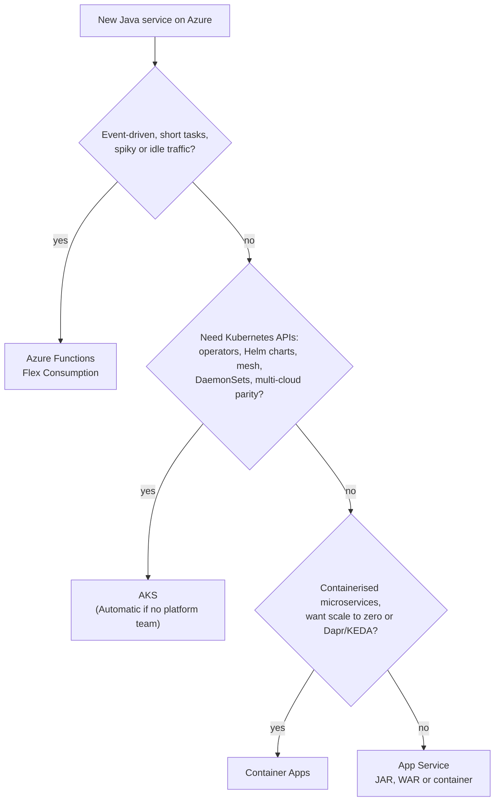
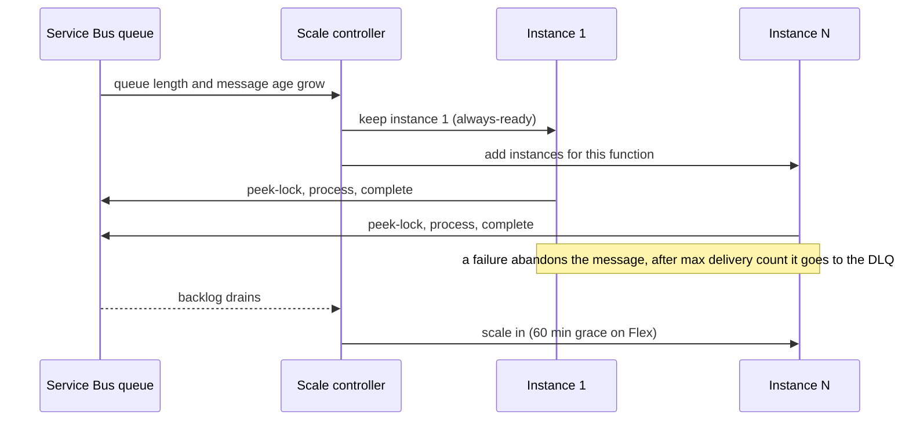

# AKS, App Service & Azure Functions

!!! abstract "Key takeaways"
    - **AKS ≈ EKS:** managed Kubernetes control plane. Tiers are **Free** (no SLA), **Standard** (uptime SLA, production) and **Premium** (adds long-term support). **AKS Automatic** preconfigures node provisioning, scaling and security defaults, like EKS Auto Mode.
    - **App Service ≈ Elastic Beanstalk / App Runner:** you deploy a JAR, WAR or container to an **App Service plan** (the VMs you pay for). **Deployment slots** give warm blue/green swaps and instant rollback.
    - **Functions ≈ Lambda:** triggers and bindings. Use **Flex Consumption** for new serverless apps (Linux, per-function scaling up to 1,000 instances, VNet, always-ready instances). **HTTP triggers must respond within 230 s** whatever the timeout. Use Durable Functions (≈ Step Functions) for long workflows.
    - **Container Apps** sits in the middle: serverless containers on managed Kubernetes with KEDA scaling and scale to zero. It is Microsoft's recommended home for Spring Boot now that **Azure Spring Apps retires on 31 March 2028**.
    - **Choose by what you're willing to operate:** the rightmost option (Functions → App Service → Container Apps → AKS → VMs) that still meets your runtime, networking and scaling needs.

## Why it matters

"How would you host this Spring Boot service on Azure?" is the practical Azure question. Answering "AKS" by default sounds like hype. A senior answer weighs team skills and operational load, the same way you'd compare ECS and EKS on AWS. This page covers Azure's options and links to the AWS equivalents: [ECS vs EKS vs Fargate](../aws/04-containers-ecs-vs-eks-vs-fargate.md) and [Lambda & API Gateway](../aws/05-serverless-lambda-api-gateway.md). Kubernetes internals and AKS troubleshooting are in [EKS/AKS specifics](../docker-kubernetes/08-eks-aks-specifics-and-troubleshooting-pods.md).

## Core concepts

{ loading=lazy }
*Each step to the right hands more work to Azure and takes away some control. Only Container Apps and Functions scale to zero.*


*Notice that AKS is chosen for **Kubernetes-specific needs**, not for "containers" in general. Container Apps and App Service both run containers with far less to operate.*

### AKS: managed Kubernetes

What Azure runs: the control plane (API server, etcd, scheduler), its patching and, on Standard and Premium tiers, its uptime SLA. What you run: node pools, add-on versions, upgrades and workloads.

| AKS concept | Meaning | EKS equivalent |
|---|---|---|
| Pricing tier | Free (dev/test, no SLA), Standard (SLA, up to 5,000 nodes), Premium (Standard + long-term support) | Standard vs extended support |
| **System vs user node pools** | System pool hosts CoreDNS, metrics-server and others. User pools host apps. Each is a VM Scale Set | Managed node groups |
| Node Auto Provisioning / **AKS Automatic** | Karpenter-based provisioning. Automatic adds opinionated defaults and runs on the Standard tier | Karpenter / EKS Auto Mode |
| Networking | **Azure CNI Overlay** (pods get IPs from an overlay CIDR, so VNet IPs aren't used up) or Azure CNI with VNet IPs | VPC CNI (+ prefix delegation) |
| Human access | Entra ID sign-in (kubelogin) with Kubernetes RBAC or Azure RBAC for Kubernetes | Access entries |
| Pod → Azure access | **Workload Identity**: service account federated with an Entra identity | Pod Identity / IRSA |
| Ingress | App routing add-on (managed NGINX), Application Gateway for Containers | AWS Load Balancer Controller |
| Registry | ACR attached to the cluster (`az aks update --attach-acr`) | ECR + node role |
| Upgrades | Auto-upgrade channels plus a separate node OS image channel, with planned maintenance windows | Manual or managed versions |

### App Service: PaaS web hosting

- **App Service plan** = the compute (SKU × instance count). Several apps can share a plan, and they compete for its CPU and memory. Scale **up** by changing the SKU, and **out** by adding instances (manually or with autoscale rules).
- **Java stacks:** Java SE (runs your Spring Boot fat JAR on embedded Tomcat), Tomcat (WAR), JBoss EAP, or any Linux container.
- **Deployment slots** (Standard, Premium and Isolated tiers; Standard allows 5): live apps with their own hostnames. A swap warms the source slot with production's settings, then switches routing, so no requests are dropped. Swapping again is your rollback. You can also send a percentage of traffic to a slot (`x-ms-routing-name` cookie pins users).
- **Health check path:** instances failing it are taken out of the load balancer. **Always On** keeps the app loaded.
- **Networking:** **VNet integration** for outbound traffic into your VNet, **private endpoints** for private inbound, and access restrictions.

{ loading=lazy }
*All warm-up happens on the source slot while production keeps serving. That is why a swap has no cold start and rollback is just another swap.*

### Azure Functions: event-driven serverless

A function is code plus a **trigger** (HTTP, Service Bus, Event Hubs, Blob, Timer, Cosmos DB change feed) and optional input and output **bindings**, so you don't write SDK plumbing for common sources.

| Plan | Scale | Timeout (default / max) | VNet | Cold start | Use when |
|---|---|---|---|---|---|
| **Flex Consumption** | Per-function scaling, up to 1,000 instances; 512 MB / 2 GB / 4 GB instance sizes | 30 min / unbounded | Yes | Reduced, plus **always-ready** instances | Default for new serverless apps (Linux only) |
| Premium | Pre-warmed workers, up to 100 instances | 30 min / unbounded | Yes | None (always ready) | Steady load, bigger instances, custom containers |
| Dedicated (App Service plan) | Manual or autoscale | 30 min / unbounded (Always On) | Yes | None | Spare App Service capacity, predictable billing |
| Container Apps | KEDA, up to 1,000 replicas | Unbounded with min replicas ≥ 1 | Yes | Depends on min replicas | Functions next to other containers, GPUs |
| Consumption (legacy) | Up to 200 (Windows) | 5 / 10 min | No | Yes | Existing Windows apps only. **Linux Consumption retires 30 Sep 2028** |

Whatever the plan, an **HTTP-triggered function must respond within 230 seconds** (the front-end load balancer's idle timeout). For longer work, return `202 Accepted` and use a queue, or the **Durable Functions** async HTTP pattern.


*Notice the scale controller watches the **event source** (queue backlog), not CPU. That matches Lambda's event source mapping. Concurrency per instance is a setting you tune.*

## In practice: code & configuration

A Java 21 function processing orders from Service Bus. The classic mistakes are creating clients on every invocation and authenticating with connection strings.

=== "❌ Common mistake"
    ```java
    public class OrderFunction {
        @FunctionName("processOrder")
        public void run(
                @ServiceBusQueueTrigger(name = "msg", queueName = "orders",
                        connection = "ServiceBusConnectionString") String msg, // secret in app settings
                ExecutionContext ctx) {
            // New client, connection pool and TLS handshakes on EVERY message:
            // slow, and exhausts outbound sockets under load.
            CosmosClient cosmos = new CosmosClientBuilder()
                    .endpoint(System.getenv("COSMOS_URL"))
                    .key(System.getenv("COSMOS_KEY"))                       // another long-lived key
                    .buildClient();
            cosmos.getDatabase("orders").getContainer("orders")
                  .createItem(Json.parse(msg, Order.class));
            // No idempotency: a redelivered message creates a duplicate order.
        }
    }
    ```

=== "✅ Correct approach"
    ```java
    public class OrderFunction {
        // Built once per worker process and reused across invocations.
        private static final CosmosContainer ORDERS = new CosmosClientBuilder()
                .endpoint(System.getenv("COSMOS_URL"))
                .credential(new DefaultAzureCredentialBuilder().build()) // managed identity
                .buildClient()
                .getDatabase("orders").getContainer("orders");

        @FunctionName("processOrder")
        public void run(
                @ServiceBusQueueTrigger(name = "msg", queueName = "orders",
                        connection = "ServiceBus") String msg,  // identity-based, see settings below
                @BindingName("MessageId") String messageId,
                ExecutionContext ctx) {
            Order order = Json.parse(msg, Order.class);
            // Idempotent write: the id comes from the business key, so a redelivery overwrites
            // instead of duplicating. Throwing lets Service Bus retry, then dead-letter.
            ORDERS.upsertItem(order.withId(order.orderId()));
            ctx.getLogger().info(() -> "processed order " + order.orderId() + " msg " + messageId);
        }
    }
    ```

    ```bash
    # Identity-based trigger connection: no connection string anywhere.
    az functionapp config appsettings set -g rg-orders -n func-orders --settings \
      "ServiceBus__fullyQualifiedNamespace=sb-orders-prod.servicebus.windows.net"
    # Grant the function app's managed identity the data-plane role on the namespace.
    az role assignment create --assignee <principal-id> \
      --role "Azure Service Bus Data Receiver" --scope <servicebus-namespace-id>
    ```

App Service slot settings that must **not** move with a swap (environment-specific values):

```bash
az webapp config appsettings set -g rg-claims -n app-claims --slot staging \
  --settings SPRING_PROFILES_ACTIVE=staging DB_URL=jdbc:postgresql://pg-claims-stg... \
  --slot-settings SPRING_PROFILES_ACTIVE DB_URL          # sticky to the staging slot
az webapp config appsettings set -g rg-claims -n app-claims --slot staging \
  --settings WEBSITE_SWAP_WARMUP_PING_PATH=/actuator/health/readiness \
             WEBSITE_SWAP_WARMUP_PING_STATUSES=200       # swap only after Spring is ready
az webapp deployment slot swap -g rg-claims -n app-claims --slot staging --target-slot production
```

## Real-world usage

- **Enterprise Java on App Service:** many teams run Spring Boot JARs on App Service Premium v3 plans with slots for blue/green and VNet integration into a hub-and-spoke network. It is the "boring and reliable" choice when you don't need Kubernetes.
- **Platform teams on AKS:** a shared AKS fleet with system and user node pools per workload class, GitOps (Flux is a built-in AKS extension), Workload Identity for every service and Azure Policy for Kubernetes guardrails. This mirrors EKS platforms on AWS.
- **Spring Apps migrations:** with Azure Spring Apps retiring on 31 March 2028, Microsoft's migration guides target Container Apps, which has Java-specific features (managed Config Server and Eureka components, JVM metrics).
- **Functions for glue:** Blob-triggered document processing, Event Grid reactions, scheduled jobs, and Service Bus consumers. In healthcare and banking, VNet-integrated plans (Flex or Premium) are the norm so functions can reach private endpoints.

## Trade-offs & production gotchas

| Option | Pros | Cons | Use when |
|---|---|---|---|
| AKS | Full Kubernetes, ecosystem, portability with EKS | Upgrades, add-ons, node pools, YAML, skills | Platform team, many services, Kubernetes-native tooling |
| Container Apps | Containers without a cluster, KEDA, scale to zero, revisions with traffic split | Less control (no DaemonSets, limited node tuning) | Microservices and Spring Boot without a platform team |
| App Service | Simplest for web apps, slots, built-in auth and certificates | Plan-based cost, no scale to zero, less flexible networking | A handful of HTTP services |
| Functions (Flex) | Pay per use, event-driven scaling, bindings | 230 s HTTP limit, cold starts (JVM), per-function quirks | Spiky, event-driven, glue code |

!!! warning "Gotchas"
    - **JVM cold starts** on Functions: use Flex always-ready instances or Premium, keep dependencies lean, and consider CDS/CRaC-style startup tuning. The same advice applies to Lambda SnapStart.
    - **Managed identities don't swap.** Each App Service slot has its own identity, so the staging slot needs its own Key Vault and database role assignments, or the first request after a swap fails with 403.
    - **Shared App Service plans** mean noisy neighbours: one memory-hungry app restarts the others. Separate plans for critical services.
    - **AKS Free tier in production** has no uptime SLA. Use Standard.
    - **AKS system pool sizing:** running apps on the system pool, or putting it on spot VMs, takes CoreDNS down with it.
    - **Long-running work in HTTP triggers** hits the 230 s limit even when `functionTimeout` is longer.

## How this connects to my experience

- **Where I used it:** skills list **Kubernetes (EKS/AKS)** and **Azure**. At Deloitte I built microservices on **Lambda, ECS and EKS** with Terraform, so the AWS side of every mapping on this page is hands-on.
- **Talking points:**
    - "I'd pick the platform the same way on both clouds: least operational load that meets the requirements. Lambda → Functions, ECS/Fargate → Container Apps, EKS → AKS."
    - "On EKS I relied on IRSA-style per-pod identity. The AKS equivalent is Workload Identity, and the same least-privilege thinking applies." *[confirm: AKS usage and depth]*
    - "For Kafka consumers I'd use KEDA-driven scaling on lag, whether on AKS or Container Apps, since Kafka retry and DLQ handling was core to the OptumRx Meteor project."
- **Likely follow-up chain:** "Have you run AKS in production?" → "How does pod identity work there?" → "How would you deploy without downtime?" Be honest about depth, explain Workload Identity vs IRSA, then rolling updates with readiness probes and PDBs (AKS) or slot swaps (App Service).

## Interview questions

### Fundamentals

??? question "Q1. Map AKS, App Service and Functions to AWS services."
    **Answer:** AKS ≈ EKS (managed Kubernetes control plane, you run node pools). App Service ≈ Elastic Beanstalk or App Runner (PaaS for web apps and containers, on a plan you size). Functions ≈ Lambda (event-triggered code, pay per execution on Flex Consumption). Container Apps ≈ ECS on Fargate or App Runner (serverless containers). VM Scale Sets ≈ EC2 Auto Scaling groups.

    **Interviewer listens for:** a correct mapping, including Container Apps.

    **Common wrong answer:** "App Service is like EC2."

??? question "Q2. What is an App Service plan?"
    **Answer:** The compute that hosts your apps: OS, region, SKU (instance size and features) and instance count. All apps in a plan share those VMs. Scale up by changing the SKU, out by adding instances. Slots run on the same plan. Cost depends on the plan, not on the number of apps or requests.

    **Interviewer listens for:** plan = VMs, apps share it, and the noisy-neighbour risk.

    **Common wrong answer:** "Each app gets its own servers automatically."

??? question "Q3. What are deployment slots and how does a swap avoid downtime?"
    **Answer:** Slots are live copies of the app with their own hostnames (Standard tier and above). A swap applies the target slot's sticky settings to the source slot's instances, restarts them and warms them up (`WEBSITE_SWAP_WARMUP_PING_PATH` or the application root). Only then does it switch routing, so production never serves a cold instance. The previous version stays in the other slot, so rolling back is another swap. Sticky (slot) settings, managed identities, custom domains and scale settings don't move.

    **Interviewer listens for:** warm-up before the routing switch, sticky settings, instant rollback.

    **Common wrong answer:** "It copies files from staging to production."

### Intermediate

??? question "Q4. Which Azure Functions hosting plan would you choose, and why?"
    **Answer:** Flex Consumption for new serverless apps: per-function scaling up to 1,000 instances, VNet integration, configurable instance memory, always-ready instances to cut cold starts, pay per use (Linux only). Premium for steady load, larger workers, custom containers or no cold start at all. Dedicated when you already pay for App Service capacity. Container Apps hosting when functions sit next to other containers or need GPUs. Avoid legacy Consumption for new work (Linux Consumption retires 30 Sep 2028, 10-minute max timeout, no VNet).

    **Interviewer listens for:** Flex as the current default, the VNet and cold-start reasoning.

    **Common wrong answer:** "Consumption plan, it's the cheapest."

??? question "Q5. An HTTP-triggered function fails at about 4 minutes even though functionTimeout is 30 minutes. Why?"
    **Answer:** HTTP triggers must respond within 230 seconds because of the Azure front-end load balancer's idle timeout, regardless of `functionTimeout`. Fix: accept the request, enqueue the work (Service Bus) and return `202` with a status URL, or use the Durable Functions async HTTP pattern (orchestrator plus status endpoint).

    **Interviewer listens for:** 230 s and the async pattern.

    **Common wrong answer:** "Raise functionTimeout."

??? question "Q6. How do pods on AKS access Key Vault or Storage without secrets?"
    **Answer:** Workload Identity. Enable the OIDC issuer and workload identity on the cluster, create a user-assigned managed identity (or app registration), add a **federated credential** trusting the cluster's issuer for `system:serviceaccount:<ns>:<sa>`, and annotate the service account with the identity's client ID. The pod gets a projected token that the Azure SDK exchanges with Entra ID for an access token. Then grant data-plane roles (Key Vault Secrets User) to that identity. It's the same pattern as IRSA on EKS.

    **Interviewer listens for:** federation, a per-service-account scope, data-plane roles.

    **Common wrong answer:** "Mount the Key Vault secret as a Kubernetes secret from a CI variable."

### Senior

??? question "Q7. AKS vs Container Apps for 10 Spring Boot microservices?"
    **Answer:** With no dedicated platform team, standard HTTP and Kafka/Service Bus consumers, and a wish to scale idle services to zero, choose Container Apps: revisions with traffic splitting, KEDA scalers, managed identity, Dapr if wanted, and Java features, all without a cluster to upgrade. Choose AKS when you need Kubernetes-native tooling (operators, Helm-packaged vendor software, service mesh, DaemonSets, GPU node tuning), portability with existing EKS manifests, or there's already a platform team. Mention that Microsoft points Azure Spring Apps users to Container Apps.

    **Interviewer listens for:** an operational-cost argument, not features alone.

    **Common wrong answer:** "Always AKS, it's the enterprise option."

??? question "Q8. How do you upgrade AKS safely?"
    **Answer:** Check deprecated APIs and release notes. Upgrade non-prod first. Use auto-upgrade channels (`patch` or `stable`) with **planned maintenance windows**, plus the separate node OS image channel. Set max surge on node pools and have PodDisruptionBudgets that allow progress. Upgrade the control plane, then node pools. Watch workloads and alerts. Use the Standard tier for the SLA, and Premium if you need long-term support. For risky jumps, use blue/green clusters. The details are in [EKS/AKS specifics](../docker-kubernetes/08-eks-aks-specifics-and-troubleshooting-pods.md).

    **Interviewer listens for:** channels, maintenance windows, PDBs, surge.

    **Common wrong answer:** "Click upgrade in the portal."

### Scenario-based

??? question "Q9. After a slot swap, production returns 403 from Key Vault. Staging worked. Why?"
    **Answer:** Managed identities are slot-specific and don't swap. While the new build ran in staging, it used the staging slot's identity, which had a Key Vault role. After the swap the same code runs in the production slot under production's identity, and that identity lacks the role (or the new code reads a new vault or secret that only staging was granted). Fix: give each slot's identity the roles it needs (or use one user-assigned identity attached to both slots), and test with **swap with preview**, which applies production's settings to staging before routing switches.

    **Interviewer listens for:** "identities don't swap", and swap with preview.

    **Common wrong answer:** "Key Vault is caching old permissions."

??? question "Q10. Java functions on Flex Consumption show 6–8 s latency on the first request after idle. What do you do?"
    **Answer:** That is a JVM cold start (instance allocation, JVM start, Spring or DI context, first connections). Options: configure **always-ready instances** for the HTTP group, trim dependencies and avoid heavy frameworks inside functions, initialise clients statically, use a larger instance size (more CPU), or move latency-critical APIs to App Service or Container Apps with minimum replicas ≥ 1. Measure p99 in Application Insights before and after.

    **Interviewer listens for:** always-ready, static clients, measuring, and knowing when serverless is the wrong fit.

    **Common wrong answer:** "Add a timer trigger that pings it every 5 minutes." (That's a fragile hack, and it doesn't warm new instances during scale-out.)

## Cheat sheet

| Concept | Remember |
|---|---|
| Mapping | AKS ≈ EKS. App Service ≈ Beanstalk/App Runner. Functions ≈ Lambda. Container Apps ≈ Fargate/App Runner |
| AKS tiers | Free (no SLA), Standard (SLA, prod), Premium (+ LTS). Automatic = opinionated, Standard tier |
| AKS identity | Entra ID + RBAC for humans. Workload Identity (federated) for pods ≈ IRSA |
| AKS network | Azure CNI Overlay avoids VNet IP exhaustion |
| App Service | Plan = VMs. Slots (Standard: 5). Swap = warm then route. Rollback = swap again |
| Sticky | Slot settings, managed identities, domains and scale stay with the slot |
| Functions plans | Flex (default, VNet, 1,000 instances, always-ready), Premium, Dedicated, Container Apps |
| Limits | HTTP response ≤ 230 s. Legacy Consumption 5/10 min. Linux Consumption retires 30 Sep 2028 |
| Connections | Identity-based: `<name>__fullyQualifiedNamespace` + data-plane role |
| Spring | Spring Apps retires 31 Mar 2028 → Container Apps |

## Sources
1. [Azure Functions hosting options](https://learn.microsoft.com/en-us/azure/azure-functions/functions-scale): plans, timeouts, 230 s HTTP limit, scale limits, Linux Consumption retirement.
2. [Flex Consumption plan](https://learn.microsoft.com/en-us/azure/azure-functions/flex-consumption-plan): per-function scaling, instance sizes, always-ready instances.
3. [Identity-based connections in Azure Functions](https://learn.microsoft.com/en-us/azure/azure-functions/functions-reference#configure-an-identity-based-connection): `__fullyQualifiedNamespace` settings.
4. [Set up staging environments in App Service](https://learn.microsoft.com/en-us/azure/app-service/deploy-staging-slots): swap steps, swapped vs sticky settings, warm-up settings.
5. [AKS pricing tiers](https://learn.microsoft.com/en-us/azure/aks/free-standard-pricing-tiers): Free, Standard, Premium and the uptime SLA.
6. [AKS Automatic](https://learn.microsoft.com/en-us/azure/aks/intro-aks-automatic): managed defaults and node provisioning.
7. [Microsoft Entra Workload ID with AKS](https://learn.microsoft.com/en-us/azure/aks/workload-identity-overview): federated credentials for pods.
8. [Azure Container Apps overview](https://learn.microsoft.com/en-us/azure/container-apps/overview): revisions, KEDA scaling, Java features.
9. [Azure Spring Apps retirement](https://learn.microsoft.com/en-us/azure/spring-apps/basic-standard/retirement-announcement) and [migration to Container Apps](https://learn.microsoft.com/en-us/azure/spring-apps/migration/migrate-to-azure-container-apps-overview).
10. [Azure for AWS professionals: compute](https://learn.microsoft.com/en-us/azure/architecture/aws-professional/compute): service mapping.
