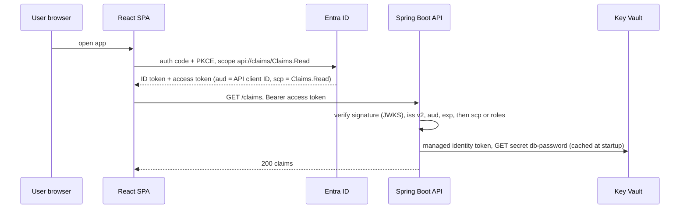

# Entra ID & Key Vault

!!! abstract "Key takeaways"
    - **Entra ID (renamed from Azure AD in 2023) is the identity provider for everything**: workforce sign-in (OIDC/SAML), API tokens (OAuth 2.0) and workload identities. AWS splits these roles across IAM, IAM Identity Center and Cognito.
    - **App registration** = the global definition of an app (client ID, redirect URIs, exposed scopes, app roles). **Enterprise application / service principal** = its instance in a tenant, which is what gets permissions. A **managed identity** is a service principal whose credential Azure holds and rotates (≈ an IAM role for EC2/ECS/Lambda).
    - **No secrets for workloads:** managed identities inside Azure, and **workload identity federation** (GitHub Actions, AKS, other clouds) outside it. It is the same idea as AWS OIDC role assumption.
    - **Key Vault ≈ KMS + Secrets Manager + ACM-style certificate lifecycle.** Use the **Azure RBAC** permission model (the default for new vaults from API version 2026-02-01), with **soft delete** (7–90 days, default 90) and **purge protection** for anything holding encryption keys.
    - **Three permission planes:** Entra roles (directory), Azure RBAC on ARM (control plane) and Key Vault data roles (data plane). Contributor on a vault does **not** let you read its secrets under RBAC, but under legacy access policies it effectively can.

## Why it matters

This page is ★: my resume lists **Active Directory integration** and OAuth2/PingFederate (Optum), JWT and SSO (Johnson Controls), and **Azure key management in CipherTrust CCKM** (Coriolis). Azure interviews for backend leads probe exactly here: "how does your Spring Boot API validate Entra tokens?", "how does the app get its database password?", "who can read the secrets?".

Background on keys, HSMs and BYOK lives in [Cloud KMS](../cryptography-key-management/04-cloud-kms.md#azure-key-vault-and-managed-hsm), [HSMs & BYOK/HYOK](../cryptography-key-management/05-hsms-and-byok-hyok.md) and [Secrets management](../cryptography-key-management/07-password-hashing-and-secrets-management.md). The AWS side is in [IAM](../aws/02-iam-users-roles-policies-least-privilege.md) and [KMS & Secrets Manager](../aws/10-security-kms-secrets-manager-encryption-at-rest-in-transit.md). This page focuses on what Azure does differently.

## Core concepts

### Entra ID objects

| Entra object | What it is | AWS nearest |
|---|---|---|
| Tenant | One directory: users, groups, apps. Sits above all subscriptions linked to it | Organization + Identity Center |
| User / group | Human identities, often synced from on-prem AD (Entra Connect) | Identity Center users and groups |
| **App registration** | App definition: client ID, redirect URIs, credentials, **exposed scopes**, **app roles**, token version | Cognito app client / OIDC client |
| **Service principal** (enterprise app) | The app's identity in a tenant: role assignments, consent, user assignment | IAM role assumed by an app |
| **Managed identity** | Service principal tied to an Azure resource. **System-assigned** (lives and dies with the resource) or **user-assigned** (standalone, reusable) | Instance profile, ECS task role, Lambda execution role |
| Federated credential | Trust for an external OIDC token (GitHub, AKS, GCP, AWS) instead of a secret | IAM OIDC identity provider + `AssumeRoleWithWebIdentity` |
| Conditional Access, PIM | Policy on sign-in (MFA, device, location). Just-in-time role elevation | IAM conditions, Identity Center permission sets (no direct PIM equivalent) |
| Entra External ID | Customer identity (CIAM) | Cognito user pools |

### Tokens your API receives

- **Two token versions.** v1 tokens have issuer `https://sts.windows.net/{tenant}/`. v2 tokens have issuer `https://login.microsoftonline.com/{tenant}/v2.0`. The version comes from the **API's** app registration (`accessTokenAcceptedVersion` / `requestedAccessTokenVersion`), not from the endpoint the client called. Set it to 2, and validate against the v2 issuer. With v2, `aud` is the API's **client ID**.
- **Delegated vs application permissions.** A user calling through a client gets **scopes** in `scp` (for example `Claims.Read`). A daemon using client credentials gets **app roles** in `roles` (for example `Claims.Sync`). Users can also be assigned app roles, which appear in `roles`.
- **Groups overage:** more than **200** groups (150 for SAML) and the `groups` claim is replaced by an overage indicator. Prefer app roles, or "groups assigned to the application", over raw group IDs.
- **Don't validate Microsoft Graph tokens** in your own API. They aren't meant for you. Request a token for your API's scope instead.


*Notice the two identities: the **user's** delegated token authorises the request, while the **API's own managed identity** reads the secret. Mixing them up (passing the user token to Key Vault, or using the app's identity to bypass user permissions) is the classic design error.*

### Key Vault

**Objects:** **keys** (RSA/EC, for wrap/unwrap, sign/verify, never exported unless marked exportable for secure key release), **secrets** (any string up to 25 KB: passwords, connection strings) and **certificates** (X.509 with lifecycle and auto-renewal from integrated CAs; the private key is backed by a key and a secret). Every object is **versioned**. A versionless URI means "latest".

**Tiers:** Standard (software-protected keys), Premium (HSM-protected keys, FIPS 140 Level 3) and **Managed HSM** (single-tenant, keys only, you own the security domain). See the comparison table in [Cloud KMS](../cryptography-key-management/04-cloud-kms.md#azure-key-vault-and-managed-hsm).

**Permission model:**

- **Azure RBAC (use this):** data-plane roles such as *Key Vault Secrets User* (read secret values), *Key Vault Crypto User* (use keys), *Key Vault Certificates Officer* and *Key Vault Administrator*. They can be scoped down to a **single secret or key**, and assigned through the same IAM as everything else. Starting with API version **2026-02-01**, new vaults are created with RBAC enabled by default. Existing vaults keep their model.
- **Access policies (legacy):** permissions set per vault, not per object. Anyone with `Microsoft.KeyVault/vaults/write` (for example **Contributor**) can edit the policies, and so grant themselves data access.

{ loading=lazy }
*"Owner of the subscription" and "can read the secret" are different questions. Under RBAC, the data-plane role must be granted explicitly.*

**Protection:** **soft delete** is always on. Deleted vaults and objects are kept for 7–90 days (90 by default) and can be recovered. **Purge protection** blocks permanent deletion during that retention, even by an admin. It can't be turned off once on, and it is required when the vault holds customer-managed keys for services such as Storage or SQL. This compares with AWS KMS's 7–30 day pending-deletion window and Secrets Manager's recovery window.

**Networking:** vault firewall plus **private endpoint** (`privatelink.vaultcore.azure.net`), with public network access disabled. Allow "trusted Microsoft services" only where a platform service needs it.

**Throttling:** limits apply per vault per region per 10 seconds. Secret GETs and most transactions allow 4,000, RSA-2048 HSM key operations 2,000, and RSA-4096 HSM key operations only 250. Calling Key Vault on every request will hit them. **Cache secrets** in the app, and for bulk encryption use envelope encryption with a local data key rather than calling `encrypt` per record (see [Envelope encryption](../cryptography-key-management/03-envelope-encryption-and-data-keys.md)).

**Rotation:**

- **Keys:** a **rotation policy** creates new versions automatically (for example every 90 days, with notification before expiry). Services configured with a versionless key URI pick up the new version.
- **Secrets:** Key Vault doesn't rotate database passwords itself, unlike Secrets Manager's rotation Lambdas. The pattern is Event Grid `SecretNearExpiry` → an Azure Function that sets a new credential on the database and writes a new secret version, or better, **remove the secret** by using Entra authentication to Azure SQL, PostgreSQL, Storage or Service Bus with the managed identity.
- **Consumers:** App Service and Functions **Key Vault references** (`@Microsoft.KeyVault(SecretUri=...)`) re-fetch versionless secrets periodically (within 24 hours) or on restart. Spring Cloud Azure property sources can refresh on an interval.

{ loading=lazy }
*No credential appears anywhere in the app's configuration. Compare an EC2 instance profile: same idea, same local metadata endpoint.*

## In practice: code & configuration

A Spring Boot 3 API that validates Entra v2 tokens and reads its database password from Key Vault with a managed identity.

=== "❌ Common mistake"
    ```yaml
    spring:
      security:
        oauth2:
          resourceserver:
            jwt:
              # v1 issuer while the API registration issues v2 tokens (or the other way round):
              # every request fails with "iss claim is not valid". No audience check either,
              # so any token from this tenant for ANY app is accepted.
              issuer-uri: https://sts.windows.net/${TENANT_ID}/
    azure:
      client-id: 3f1c...            # app registration used by the API
      client-secret: ${CLIENT_SECRET}  # long-lived secret in a pipeline variable: leaks, expires, nobody rotates
    db:
      password: ${DB_PASSWORD}      # copied from the portal into app settings
    ```

=== "✅ Correct approach"
    ```yaml
    spring:
      security:
        oauth2:
          resourceserver:
            jwt:
              issuer-uri: https://login.microsoftonline.com/${TENANT_ID}/v2.0
              audiences: ${API_CLIENT_ID}         # v2 tokens: aud = this API's client ID
      cloud:
        azure:
          # No credential configured: DefaultAzureCredential uses the managed identity in Azure
          # and your developer login (az login) locally. For a user-assigned identity:
          # credential.client-id: ${AZURE_CLIENT_ID}
          keyvault:
            secret:
              property-sources:
                - name: claims-kv
                  endpoint: https://kv-claims-prod.vault.azure.net/
      datasource:
        password: ${db-password}                  # resolved from the Key Vault secret "db-password"
    ```

    ```java
    @Configuration
    @EnableMethodSecurity
    class SecurityConfig {

        @Bean
        SecurityFilterChain api(HttpSecurity http) throws Exception {
            return http
                .authorizeHttpRequests(a -> a
                    .requestMatchers(HttpMethod.GET, "/claims/**").hasAnyAuthority("SCOPE_Claims.Read", "ROLE_Claims.Sync")
                    .anyRequest().authenticated())
                .oauth2ResourceServer(o -> o.jwt(j -> j.jwtAuthenticationConverter(entraConverter())))
                .build();
        }

        // Map delegated scopes (scp) to SCOPE_* and app roles (roles) to ROLE_*.
        private JwtAuthenticationConverter entraConverter() {
            var scopes = new JwtGrantedAuthoritiesConverter();           // reads "scp" by default
            var roles = new JwtGrantedAuthoritiesConverter();
            roles.setAuthoritiesClaimName("roles");
            roles.setAuthorityPrefix("ROLE_");
            var converter = new JwtAuthenticationConverter();
            converter.setJwtGrantedAuthoritiesConverter(jwt -> {
                var all = new ArrayList<GrantedAuthority>(scopes.convert(jwt));
                all.addAll(roles.convert(jwt));
                return all;
            });
            converter.setPrincipalClaimName("oid");                       // stable object ID, not the email
            return converter;
        }
    }
    ```

    ```hcl
    # Vault with RBAC, purge protection and no public access; least-privilege role on one secret.
    resource "azurerm_key_vault" "kv" {
      name                          = "kv-claims-prod"
      sku_name                      = "premium"
      tenant_id                     = var.tenant_id
      rbac_authorization_enabled    = true      # (enable_rbac_authorization in azurerm < 4.x)
      purge_protection_enabled      = true
      soft_delete_retention_days    = 90
      public_network_access_enabled = false     # reach it through a private endpoint
      # location, resource_group_name ...
    }
    resource "azurerm_role_assignment" "api_reads_db_secret" {
      scope                = "${azurerm_key_vault.kv.id}/secrets/db-password"
      role_definition_name = "Key Vault Secrets User"
      principal_id         = azurerm_user_assigned_identity.claims_api.principal_id
    }
    ```

For CI/CD, replace the pipeline's client secret with **workload identity federation**: add a federated credential on the deployment identity trusting `repo:org/claims:environment:prod` from GitHub's OIDC issuer. `azure/login` then exchanges the GitHub token, as `aws-actions/configure-aws-credentials` does with an IAM OIDC role.

## Real-world usage

- **Hybrid enterprises:** on-prem Active Directory syncs to Entra ID, workforce apps use Entra SSO with Conditional Access (MFA, compliant device), and some organisations federate Entra with another IdP such as PingFederate. It is the same pattern as Optum's AD + PingFederate stack.
- **Banks and healthcare:** customer-managed keys in Key Vault Premium or Managed HSM for Storage, SQL and Disk encryption, often with **BYOK** from an on-prem HSM (Thales Luna), and central key lifecycle tools such as CipherTrust CCKM managing Azure, AWS and GCP keys from one console.
- **Secretless architectures:** managed identity to Azure SQL, PostgreSQL, Service Bus, Storage and Key Vault. The only remaining secrets are third-party API keys, which stay in Key Vault.
- **Failure modes seen in practice:** expired client secrets on app registrations taking down integrations (no alert set), access-policy vaults where too many people had `get/list` on secrets, Key Vault 429s from per-request secret reads, and private endpoint DNS gaps after network changes.

## Trade-offs & production gotchas

| Choice | Option A | Option B | Use when |
|---|---|---|---|
| Identity type | System-assigned (lifecycle tied to the resource) | User-assigned (shared, pre-provisioned, survives redeploys) | One resource, simple / many replicas, slots, or roles granted before deploy |
| Vault tier | Standard / Premium (multi-tenant, cheap) | Managed HSM (single-tenant, you own the security domain) | Most apps / strict regulatory or key-custody needs |
| Secret delivery | Key Vault references or env injection at start | SDK fetch with caching and refresh | Simple config / rotation without restarts |
| App credential | Client secret or certificate | Federated credential / managed identity | Only for legacy third-party tools / everything you control |

!!! warning "Gotchas"
    - **Issuer mismatch v1/v2** is the number one Entra token validation bug. Check `ver` and `iss` in a decoded token, and set `accessTokenAcceptedVersion: 2`.
    - **Missing audience check** accepts tokens minted for other apps in the same tenant.
    - **Role assignments take time to propagate** (minutes). A deploy that assigns a role and immediately reads a secret can get a 403 on the first try.
    - **Purge protection is irreversible**, and a soft-deleted vault **reserves its name**. Redeploying the same vault name in Terraform fails until you recover or purge it.
    - **One vault per app per environment** keeps blast radius and throttling contained. A shared "company vault" is both a security and a 429 risk.
    - **Client secrets on app registrations expire** (maximum two years in the portal). Monitor expiry or, better, eliminate them.

## How this connects to my experience

- **Where I used it:**
    - **Coriolis, CipherTrust CCKM:** "enterprise key management capabilities supporting AWS, **Azure**, and GCP", "automated key rotation workflows and HSM integrations using Thales Luna and SafeNet".
    - **Publicis Sapient, OptumRx Meteor:** "secure enterprise APIs using OAuth2, PingFederate, and **Active Directory** integration".
    - **Johnson Controls:** JWT authentication and SSO end to end.
- **Talking points:**
    - "In CCKM, Azure Key Vault was one of the key stores we managed: creating keys and versions, BYOK uploads from Luna HSMs into HSM-backed vaults, and rotation schedules alongside AWS KMS and GCP." *[confirm: exact Key Vault operations, Premium vs Managed HSM, and how CCKM authenticated to Azure (service principal with secret or certificate)]*
    - "On Optum, APIs validated OAuth2 JWTs from PingFederate backed by Active Directory. The same Spring resource-server setup works against Entra: issuer, audience, then scopes and roles." *[confirm: whether Entra ID was in the Optum identity chain]*
    - "My rule for workloads is no long-lived secrets: managed or workload identity, data-plane roles scoped to the specific secret, and cached reads to stay under Key Vault limits."
- **Likely follow-up chain:** "How did CCKM talk to Azure?" → "What's the difference between Key Vault Premium and Managed HSM?" → "How does BYOK work on Azure?" (KEK generated in the vault, key material wrapped by the on-prem HSM, imported with the BYOK tool, as in [HSMs & BYOK](../cryptography-key-management/05-hsms-and-byok-hyok.md)) → "How would your Spring API validate Entra tokens?" Answer from the code above.

## Interview questions

### Fundamentals

??? question "Q1. App registration vs service principal vs managed identity?"
    **Answer:** An app registration is the global definition of an application in its home tenant: client ID, redirect URIs, credentials, exposed scopes and app roles. A service principal (enterprise application) is that app's instance in a specific tenant, and it is what receives role assignments and consent. A managed identity is a special service principal bound to an Azure resource, with credentials Azure creates and rotates. System-assigned identities share the resource's lifecycle. User-assigned ones are standalone and reusable.

    **Interviewer listens for:** definition vs instance, and who holds the credential.

    **Common wrong answer:** "They're three names for the same thing."

??? question "Q2. Map Key Vault and Entra ID to AWS."
    **Answer:** Key Vault keys ≈ KMS keys (Premium/Managed HSM ≈ KMS with HSM backing / CloudHSM). Key Vault secrets ≈ Secrets Manager (without native rotation functions). Certificates ≈ ACM-style lifecycle. Entra ID ≈ IAM Identity Center (workforce SSO) + Cognito (via External ID) + IAM roles for workloads (managed identities). Azure RBAC role assignments ≈ IAM policies attached to principals, but Key Vault data access also needs data-plane roles, similar to KMS key policies being a separate gate.

    **Interviewer listens for:** the split mapping, and the secret-rotation difference.

    **Common wrong answer:** "Entra ID is just Active Directory in the cloud." (No LDAP or Kerberos by default. It's an OAuth/OIDC/SAML identity platform.)

??? question "Q3. What are soft delete and purge protection?"
    **Answer:** Soft delete keeps deleted vaults and objects recoverable for a retention period of 7–90 days (90 by default). It is always enabled now. Purge protection prevents permanent deletion (purge) until the retention period ends, even by privileged users. Once enabled, it can't be disabled. It is required for customer-managed-key scenarios, because purging a key would make the data unrecoverable. AWS comparison: KMS's scheduled deletion window (7–30 days).

    **Interviewer listens for:** irreversibility, the CMK requirement, the vault name being reserved.

    **Common wrong answer:** "Soft delete is a backup."

### Intermediate

??? question "Q4. RBAC vs access policies on Key Vault: which and why?"
    **Answer:** RBAC. It uses the same role-assignment system as the rest of Azure (PIM, Conditional Access for admins, audit), it can be scoped to an individual secret or key, and it separates control-plane rights from data access. Under access policies, permissions are vault-wide, and anyone who can write the vault (Contributor) can add a policy granting themselves secret access. From API version 2026-02-01, new vaults default to RBAC. Migrate legacy vaults by mapping each policy to a role assignment, then flip the setting.

    **Interviewer listens for:** the Contributor escalation path, per-object scope.

    **Common wrong answer:** "They're equivalent, it's a preference."

??? question "Q5. How should a Spring Boot API validate Entra access tokens?"
    **Answer:** As a resource server: fetch keys from the tenant's JWKS (through `issuer-uri` discovery), validate the signature, `exp`/`nbf`, the **v2 issuer** `https://login.microsoftonline.com/{tenant}/v2.0` (set the API registration's accepted token version to 2), and the **audience** (the API's client ID). Then authorise on `scp` for delegated calls and `roles` for app-only calls, mapped to authorities. Use `oid` (or `sub`) as the stable user key, never email or `upn`. For multi-tenant apps, validate `tid` against an allow list. See [Resource server configuration](../spring-security-oauth2/07-resource-server-and-client-configuration-in-spring.md).

    **Interviewer listens for:** issuer version, audience, scp vs roles, oid.

    **Common wrong answer:** "Decode the JWT and check the email domain."

??? question "Q6. How do you deploy from GitHub Actions to Azure without storing a secret?"
    **Answer:** Workload identity federation: create a user-assigned managed identity (or app registration) for deployment, add a federated credential trusting GitHub's OIDC issuer with subject `repo:org/repo:environment:prod`, grant it RBAC on the target scope, and use `azure/login` with client ID, tenant ID and subscription ID. GitHub mints a short-lived OIDC token per job, which Entra exchanges for an access token. It's the equivalent of an IAM OIDC provider with a role trust policy on `token.actions.githubusercontent.com:sub`.

    **Interviewer listens for:** subject scoping to environment or branch, no secret stored.

    **Common wrong answer:** "Store a service principal secret in GitHub secrets and rotate yearly."

### Senior

??? question "Q7. Design secret handling for 30 microservices on AKS."
    **Answer:** First remove secrets where possible: Entra authentication with workload identity for Azure SQL/PostgreSQL, Service Bus, Event Hubs, Storage and Key Vault. For the rest (third-party API keys), use one vault per domain and environment, RBAC model, purge protection, private endpoint, diagnostic logs to Log Analytics with alerts on unusual reads. Give each service its own user-assigned identity federated to its service account, with **Key Vault Secrets User scoped to its own secrets**. Deliver secrets via the Secrets Store CSI driver (mounted, optional sync) or the SDK with caching. Rotate through Event Grid near-expiry events plus a function, and have apps reload on version change. Watch throttling: cache, don't fetch per request.

    **Interviewer listens for:** secretless first, per-service identity, per-secret scope, rotation and throttling.

    **Common wrong answer:** "One shared vault and one identity for the cluster."

??? question "Q8. How would you implement BYOK for Azure Storage encryption, and what are the risks?"
    **Answer:** Create a Key Vault Premium or Managed HSM with purge protection. Generate a key exchange key (KEK) in the vault, generate the customer key in the on-prem HSM, wrap it with the KEK using the vendor's BYOK tooling, and import it, so it never leaves an HSM in plaintext. Configure the storage account with customer-managed keys using a **versionless key URI** for automatic rotation pickup, and a managed identity with *Key Vault Crypto Service Encryption User*. Risks: disabling or deleting the key makes data unavailable, purge protection is mandatory, there are cross-region DR needs (backup and restore the key only within the same geography), and access to the key needs audit and alerting. CCKM-style tools automate the uploads and rotation across clouds.

    **Interviewer listens for:** KEK flow, versionless URI, availability risk.

    **Common wrong answer:** "Upload the key file to Key Vault through the portal."

### Scenario-based

??? question "Q9. After moving a Spring API to v2 tokens, every call returns 401 'invalid issuer'. Debug it."
    **Answer:** Decode a failing token and read `ver` and `iss`. If `ver` is 1.0 with `iss = https://sts.windows.net/{tid}/`, the API's app registration still accepts v1 tokens: set `accessTokenAcceptedVersion` (`requestedAccessTokenVersion`) to 2. The token version follows the API registration, not the client's endpoint. Alternatively, align `issuer-uri` with the version actually issued. Check that `aud` now equals the client ID (v2) rather than `api://...` (v1), and update `audiences`. Also confirm the client isn't sending a Graph token.

    **Interviewer listens for:** reading the token, knowing the version is set on the API side.

    **Common wrong answer:** "Turn off issuer validation."

??? question "Q10. Key Vault returns 429s during peak traffic. What's happening and what do you change?"
    **Answer:** The service is exceeding per-vault limits (for example 4,000 secret transactions or 2,000 RSA-2048 HSM operations per 10 s per vault per region), usually because it reads a secret or calls `decrypt` on every request. Fix: cache secrets in memory with a refresh interval, use envelope encryption (unwrap a data key once, encrypt locally), honour `Retry-After` with exponential backoff (the Azure SDK does this), split hot workloads across vaults, and move heavy crypto to Managed HSM if needed. Add a metric alert on `ServiceApiResult` with status 429.

    **Interviewer listens for:** caching and envelope encryption over "raise the limit".

    **Common wrong answer:** "Ask Microsoft to increase the quota."

## Cheat sheet

| Concept | Remember |
|---|---|
| Entra ID | Formerly Azure AD (2023). OIDC/OAuth/SAML IdP above all subscriptions |
| App objects | App registration = definition. Service principal = instance in a tenant. Managed identity = SP with an Azure-held credential |
| MI types | System-assigned (tied to the resource) vs user-assigned (reusable) ≈ IAM role for compute |
| Federation | Federated credential trusts an external OIDC subject (GitHub, AKS) ≈ AssumeRoleWithWebIdentity |
| Tokens | v2 iss `login.microsoftonline.com/{tid}/v2.0`, aud = API client ID. `scp` = delegated, `roles` = app roles |
| Groups | Over 200 groups → overage. Prefer app roles |
| Key Vault | Keys + secrets (≤ 25 KB) + certificates, versioned. Standard / Premium (HSM) / Managed HSM |
| Permissions | RBAC (default from API 2026-02-01), per-object scope. Access policies are legacy (Contributor escalation) |
| Protection | Soft delete 7–90 days (default 90). Purge protection is irreversible and required for CMK |
| Limits | Per vault per region per 10 s: 4,000 secret ops, 2,000 RSA-2048 HSM ops. Cache |
| Rotation | Key rotation policy (native). Secrets: Event Grid near-expiry + function, or go secretless |

## Sources
1. [What is Microsoft Entra ID?](https://learn.microsoft.com/en-us/entra/fundamentals/whatis) and [the new name for Azure AD](https://learn.microsoft.com/en-us/entra/fundamentals/new-name): scope and the 2023 rename.
2. [Application and service principal objects](https://learn.microsoft.com/en-us/entra/identity-platform/app-objects-and-service-principals): app registration vs service principal.
3. [Managed identities for Azure resources](https://learn.microsoft.com/en-us/entra/identity/managed-identities-azure-resources/overview): system vs user-assigned.
4. [Workload identity federation](https://learn.microsoft.com/en-us/entra/workload-id/workload-identity-federation): federated credentials for GitHub and Kubernetes.
5. [Access token claims reference](https://learn.microsoft.com/en-us/entra/identity-platform/access-token-claims-reference): v1/v2 issuers, `aud`, `scp`, `roles`, groups overage.
6. [Key Vault access control default (API 2026-02-01)](https://learn.microsoft.com/en-us/azure/key-vault/general/access-control-default) and [RBAC guide](https://learn.microsoft.com/en-us/azure/key-vault/general/rbac-guide): RBAC default and data-plane roles.
7. [Key Vault soft delete](https://learn.microsoft.com/en-us/azure/key-vault/general/soft-delete-overview): retention and purge protection.
8. [Key Vault service limits](https://learn.microsoft.com/en-us/azure/key-vault/general/service-limits) and [throttling guidance](https://learn.microsoft.com/en-us/azure/key-vault/general/overview-throttling).
9. [Configure key auto-rotation](https://learn.microsoft.com/en-us/azure/key-vault/keys/how-to-configure-key-rotation) and [Key Vault references in App Service](https://learn.microsoft.com/en-us/azure/app-service/app-service-key-vault-references).
10. [Spring Cloud Azure Key Vault secrets](https://learn.microsoft.com/en-us/azure/developer/java/spring-framework/configure-spring-boot-starter-java-app-with-azure-key-vault) and [Spring Security resource server](https://docs.spring.io/spring-security/reference/servlet/oauth2/resource-server/jwt.html).
