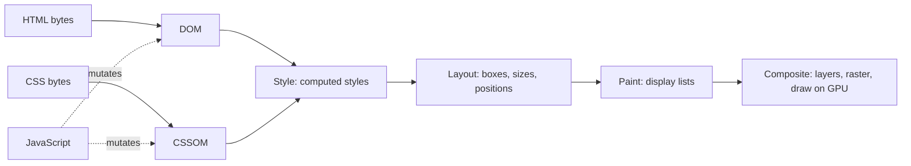

# Browser rendering pipeline, reflow vs repaint

!!! abstract "Key takeaways"
    - Every frame runs some prefix of **JavaScript → Style → Layout → Paint → Composite**. HTML builds the **DOM**, CSS builds the **CSSOM**, style matching produces computed styles, **layout** computes geometry, **paint** records drawing commands, and the **compositor** rasterises layers into tiles and draws them on the GPU.
    - **Reflow** (Chrome DevTools calls it *Layout*) recomputes size and position and is always followed by repaint. **Repaint** redraws pixels without moving boxes (`color`, `background-color`, `box-shadow`). **Composite-only** changes (`transform`, `opacity`) skip both and can run on the compositor thread.
    - **Forced synchronous layout**: reading a geometry API (`offsetHeight`, `getBoundingClientRect()`, `scrollTop`, `getComputedStyle()` for some properties) after a DOM write makes the browser lay out *now*. Doing it in a loop is **layout thrashing**. Fix: read everything first, then write.
    - At 60 Hz a frame has **16.7 ms**, shared by your code and the browser. `requestAnimationFrame` callbacks run **just before** style and layout, so they are the right place for visual writes. Long tasks delay the next paint and hurt **INP**.
    - Tools beyond "write less JS": animate `transform`/`opacity` (or `translate`, `scale`, `rotate`), use **CSS containment** and `content-visibility: auto` to limit layout scope, use `will-change` only as a targeted last resort, and find culprits with the DevTools Performance panel and the **Long Animation Frames** API.

## Why it matters

Users judge a page by two things: how quickly something useful appears, and whether it responds and moves smoothly afterwards. Both depend on the rendering pipeline. Load speed depends on the **critical rendering path** (the browser cannot paint until it has the HTML it needs and *all* render-blocking CSS). Smoothness depends on the **per-frame pipeline**: a display refreshing at 60 Hz shows a new frame every 16.7 ms, and if the main thread is still busy with JavaScript, style or layout when the next frame is due, the frame is dropped and the user sees jank.

Early web pages were mostly static, so a full reflow on a rare change was cheap. Single-page apps changed that: React, Angular or plain DOM code now mutates the page many times a second, often in response to scroll, drag or typing. Since March 2024, **Interaction to Next Paint (INP)** is a Core Web Vital, so "how long until the browser could paint after the user clicked" is now a ranking and business metric, and much of that time is style, layout and paint, not only your event handler. The details of INP and the other vitals are on [Core Web Vitals & performance optimisation](04-core-web-vitals-and-performance-optimisation.md).

Interviewers ask this topic to see whether you can explain *why* one CSS change is cheap and another is expensive, spot layout thrashing in code, and debug a janky screen with real tools.

## Core concepts

### From bytes to the first frame: the critical rendering path

The parser turns HTML bytes into tokens and then into the **DOM** tree, incrementally. When it meets a classic `<script>` without `async` or `defer`, it pauses because the script may call `document.write` or change the DOM. A **preload scanner** looks ahead in the raw HTML and starts fetching CSS, scripts, fonts and images early, so the pause costs less.

CSS is parsed into the **CSSOM**. Unlike the DOM, it is **render-blocking**: a later rule can override an earlier one, so the browser will not paint until all render-blocking stylesheets are in. Style calculation then matches selectors to elements and produces **computed styles**. Elements with `display: none` (and everything in `<head>`) have no box; the result is what older articles call the **render tree** and Chromium calls the layout tree.


*Notice that JavaScript can invalidate both inputs at any time; everything to the right of the change has to be redone before the next frame.*

### The per-frame pipeline

After first paint, the same stages run on every update. Chromium's RenderingNG architecture splits them more finely: **animate, style, layout, pre-paint, scroll, paint, commit, layerize, raster, activate, aggregate, draw**. Style, layout, pre-paint and paint run on the renderer's **main thread** (the same thread as your JavaScript). Commit hands the paint results to the **compositor thread**, which splits layers into tiles, has them rasterised and sends a compositor frame to the GPU (Viz) process. The useful simplification for interviews is the five-stage model:

| Stage | What it does | Output |
|---|---|---|
| JavaScript | Handlers, timers, `requestAnimationFrame`, framework rendering | DOM / style changes |
| Style | Match selectors, cascade, compute values | Computed styles |
| Layout | Compute geometry of every affected box | Layout (fragment) tree |
| Paint | Record drawing commands in paint order | Display lists |
| Composite | Layerise, raster tiles, draw layers with transforms, opacity, clips | Pixels on screen |

The HTML specification defines when this happens. In each "update the rendering" step of the event loop, the browser runs resize and scroll steps, media queries, web animations, then **`requestAnimationFrame` callbacks**, then **recalculates styles and updates layout** (looping for `ResizeObserver` callbacks), and then paints. That ordering is why visual writes belong in `requestAnimationFrame`: they land right before the browser would do style and layout anyway.

### Reflow, repaint and composite-only

The key interview idea is that **stages can be skipped** when nothing upstream changed.

{ loading=lazy }
*Watch how many boxes light up per row: that count is roughly the cost of the change.*

- **Reflow (layout).** Anything that can change geometry: `width`, `height`, `padding`, `margin`, `top`/`left`, `font-size`, `display`, adding or removing nodes, changing text, loading an image without reserved dimensions, resizing the window. The browser recomputes the box and anything whose geometry depends on it (often ancestors and following siblings; in the worst case the whole document), then repaints and composites. MDN's definition: the first computation is *layout*; any later recomputation is *reflow*. Firefox uses "reflow", Chrome DevTools shows "Layout".
- **Repaint.** Visual-only properties such as `color`, `background-color`, `background-image`, `box-shadow`, `outline`, `visibility`. Layout is skipped; the affected area is repainted and composited. Paint is usually cheaper than layout, but large blurred shadows or filters can make it expensive.
- **Composite-only.** `transform` (including the individual properties `translate`, `scale`, `rotate`) and `opacity`, plus `filter` in some cases. If the element is on its own compositing layer, the browser just moves or fades an already-rasterised texture. A declarative CSS animation or transition of these properties can be **ticked on the compositor thread**, so it stays smooth even while the main thread is blocked.

{ loading=lazy }
*The red band is the main thread being busy; only the transform-driven box ignores it.*

### Layers and their cost

Paint can split content into **layers** that are rasterised separately and combined by the compositor. Chromium promotes an element when it has a 3D transform, an active `transform`/`opacity` animation, `will-change: transform` or `opacity`, `<video>`, `<canvas>`, fixed positioning in some cases, or when it overlaps another composited layer. Layers make scrolling and composite-only animation cheap, but each costs GPU memory and management time. Too many is a real failure mode ("layer explosion"), especially on mobile. MDN is explicit that `will-change` is a **last resort** for an existing problem, not something to sprinkle in advance; it also creates a stacking context, which can change how `z-index` behaves.

### Forced synchronous layout and layout thrashing

Normally the browser is lazy: a DOM write only marks style and layout **dirty**, and the work happens once, at the next rendering update. But some APIs must return up-to-date geometry, so if layout is dirty they force style and layout **synchronously, inside your JavaScript**. Paul Irish's widely cited list (built from Blink source) includes:

- `offsetTop/Left/Width/Height`, `clientTop/Left/Width/Height`, `getBoundingClientRect()`, `getClientRects()`
- `scrollTop`, `scrollLeft`, `scrollWidth`, `scrollHeight`, `scrollIntoView()`, `scrollTo()`
- `innerText`, `focus()`, `window.innerWidth/innerHeight`, `window.scrollX/scrollY`, `elementFromPoint()`
- `getComputedStyle()`: always forces style; forces layout for geometry properties such as `width`, `height`, `top`, `transform`

A single forced layout is not a problem. **Layout thrashing** is when a loop alternates writes and reads, so every read after a write pays a full layout.

{ loading=lazy }
*Each red block is layout the browser would have done once; interleaving made it pay three extra times.*

### Limiting how far a change spreads: containment

The cost of layout depends on how much of the tree is dirty. **CSS containment** tells the engine that a subtree is independent:

- `contain: layout` (internal layout cannot affect outside), `paint` (descendants do not paint outside its box), `size` / `inline-size` (its size does not depend on children), `style` (counters and quotes stay inside). `contain: content` is shorthand for layout, paint and style.
- `content-visibility: auto` applies layout, style and paint containment, and when the element is **off-screen** it skips layout and paint of its contents entirely. Pair it with `contain-intrinsic-size: auto <estimate>` so the skipped box keeps a placeholder height and the scrollbar doesn't jump. Content stays available to find-in-page and keyboard navigation (unlike `content-visibility: hidden`). It has been Baseline (all major engines) since September 2025, and degrades to normal rendering elsewhere.

On visible regions such as Kanban columns or grid panels, the containment alone helps: a change inside one column cannot reflow the rest of the board.

### Frame budget and INP

At 60 Hz the browser has 16.7 ms per frame for everything: your code, style, layout, paint and its own housekeeping; on 120 Hz displays it is 8.3 ms. A **long task** (over 50 ms) blocks input processing and rendering. The **Long Animation Frames (LoAF)** API reports rendering updates delayed beyond 50 ms with a breakdown of script time and `styleAndLayoutStart`/`renderStart`, so you can see whether a slow interaction was your handler or the forced layout it caused. The cure for long JavaScript is splitting work and **yielding** (`scheduler.yield()` where supported, with a `setTimeout` fallback); the cure for rendering cost is everything on this page.

## In practice: code & configuration

The classic bug: a "make all cards the same height" or "measure then position tooltips" loop.

=== "❌ Common mistake"
    ```ts
    // Equalise card heights. Each iteration WRITES then the next iteration READS:
    // every offsetHeight after the first finds layout dirty and forces a synchronous layout.
    function equaliseCards(cards: HTMLElement[]): void {
      for (const card of cards) {
        const h = card.offsetHeight;          // READ: forces layout if anything was written
        card.style.height = `${h + 8}px`;     // WRITE: invalidates layout again
      }
    }

    // Animating geometry: every frame runs style -> layout -> paint on the main thread.
    panel.animate([{ left: "0px" }, { left: "320px" }], { duration: 300 });
    ```

=== "✅ Correct approach"
    ```ts
    // Batch: all reads first (one layout at most), then all writes inside rAF,
    // which runs just before the browser's own style + layout for the frame.
    function equaliseCards(cards: HTMLElement[]): void {
      const heights = cards.map((c) => c.offsetHeight);   // READ phase
      requestAnimationFrame(() => {
        cards.forEach((c, i) => {
          c.style.height = `${heights[i] + 8}px`;          // WRITE phase, no reads in between
        });
      });
    }

    // Composite-only animation: can run on the compositor thread, survives a busy main thread.
    panel.animate([{ translate: "0" }, { translate: "320px 0" }], {
      duration: 300,
      easing: "ease-out",
    });
    ```

CSS for a long, data-heavy page (for example a claims list or an admin dashboard):

```css
/* Off-screen sections skip layout and paint until they approach the viewport. */
.claim-group {
  content-visibility: auto;
  contain-intrinsic-size: auto 480px;   /* placeholder height; 'auto' remembers the real size once rendered */
}

/* An isolated widget: changes inside cannot reflow or repaint the rest of the page. */
.live-ticker { contain: content; }

/* Promote only while the interaction is about to happen, not permanently. */
.drawer.is-opening { will-change: transform; }

@media (prefers-reduced-motion: reduce) {
  .drawer { transition: none; }
}
```

Finding the culprit in the field and in DevTools:

```ts
// Long Animation Frames: which scripts and how much forced style/layout delayed a frame.
new PerformanceObserver((list) => {
  for (const f of list.getEntries() as PerformanceLongAnimationFrameTiming[]) {
    const forced = f.scripts.reduce((ms, s) => ms + s.forcedStyleAndLayoutDuration, 0);
    if (forced > 10) {
      console.warn("LoAF", Math.round(f.duration), "ms; forced layout", Math.round(forced), "ms",
        f.scripts.map((s) => s.sourceURL));
    }
  }
}).observe({ type: "long-animation-frame", buffered: true });
```

In the Chrome DevTools **Performance** panel, purple *Layout* blocks inside a yellow script block, flagged "Forced reflow is a likely performance bottleneck", are the signature of thrashing. **Rendering → Paint flashing** shows what repaints, and the **Layers** panel shows what was promoted and why.

## Real-world usage

- **Third-party scripts** are frequent offenders. Paul Irish's trace of The Guardian showed an ad/recommendation widget forcing layout repeatedly in a loop. Tag managers and A/B testing snippets that measure the DOM on load cause the same problem, outside your own code review.
- **Libraries encode the read/write discipline.** FastDOM batches reads and writes into separate phases per frame. React applies DOM mutations in one commit phase, but `useLayoutEffect` runs synchronously after the commit and before paint, so measuring there (`getBoundingClientRect()`) forces a layout; that is fine once, harmful per list item. See [React rendering behaviour](../react/03-rendering-behaviour-re-render-triggers-keys-batching.md) and [React performance optimisation](../react/06-performance-optimisation-memoization-code-splitting-lazy-loa.md).
- **Virtualised lists and `content-visibility`.** Large tables (react-window, TanStack Virtual, AG Grid) keep the DOM small so each reflow is cheap; `content-visibility: auto` gets part of the benefit without JavaScript for long documents.
- **Domain angle.** Healthcare and banking front ends are often dense: claims or transaction grids, dashboards with live updates, forms with dozens of fields. A grid that recalculates column widths on every keystroke, or a live ticker that changes text inside an unconstrained layout, turns into poor INP for exactly the users (pharmacists, call-centre agents) who use the app all day.

## Trade-offs & production gotchas

| Option | Pros | Cons | Use when |
|---|---|---|---|
| Animate `transform` / `opacity` | Skips layout and paint; can run on compositor | Doesn't move surrounding content; needs a layer | Slides, fades, drawers, carousels |
| Animate `width` / `top` / `height` | Neighbours reflow naturally | Layout + paint every frame on main thread | Rarely; prefer FLIP or View Transitions |
| `will-change` | Pre-promotes, avoids first-frame hitch | GPU memory, stacking context; harmful if global | A known janky animation, applied just before it |
| `contain` / `content-visibility` | Limits layout scope; skips off-screen work | Needs size estimates; can clip overflow (`paint`) | Long pages, independent widgets, big boards |
| Virtualisation | Tiny DOM, cheap layout | Complexity; find-in-page and a11y need care | Thousands of rows |
| Batch reads/writes (rAF, FastDOM) | Removes thrashing | Code must be structured in phases | Any code that measures and mutates |

!!! warning "Gotcha: hidden forced layouts"
    `focus()`, `scrollIntoView()`, `innerText` and `getComputedStyle()` look harmless but can force layout. Calling `el.focus()` right after inserting a large list forces the whole insertion to lay out synchronously. Profile before guessing.

!!! warning "Gotcha: layer explosion"
    `* { will-change: transform; }` or `transform: translateZ(0)` on every list item creates hundreds of layers. Memory rises, compositing gets slower, and low-end phones may drop layers or crash the GPU process. Promote only the few elements that actually animate.

!!! warning "Gotcha: images and fonts cause reflows too"
    An `` without `width`/`height` (or `aspect-ratio`) reflows the page when it loads, and a late web font swap can reflow text. These also show up as layout shifts (CLS).

!!! tip "Measure first"
    MDN's advice on paint applies to the whole pipeline: measure in the Performance panel before optimising. Selector complexity rarely matters; DOM size, thrashing and unscoped layout usually do.

## How this connects to my experience

- **Where I used it:** not a ★ resume claim; position as transferable front-end knowledge. The closest fit is **building the ReactJS application from the ground up and establishing a micro-frontend architecture** on OptumRx Meteor (750K+ users), with **Material UI** and **React Query** listed in my skills. Any React screen that measures DOM (tooltips, sticky headers, auto-sizing tables) lives or dies on the read/write discipline described here.
- **Talking points:**
    - Why `transform`/`opacity` animations stay smooth when the main thread is busy, and why that does not fix INP (input still needs the main thread).
    - How I'd profile a janky screen: Performance panel, look for forced reflow warnings and long Layout blocks, Paint flashing, then LoAF in the field.
    - Micro-frontends add risk: several independently deployed bundles share one main thread and one layout, so one team's thrashing hurts everyone's INP. See [micro-frontend approaches](../frontend-architecture/01-micro-frontends-approaches-and-trade-offs.md).
    - Specific rendering problems I fixed in the Meteor app (e.g. large tables, virtualisation, layout-heavy components) and any before/after numbers: *[confirm]*.
- **Likely follow-up chain:** "What is the difference between reflow and repaint?" → geometry vs pixels, composite-only as the third case → "Why is reading `offsetHeight` in a loop slow?" → forced synchronous layout after each write, batch reads then writes → "A drag-and-drop board is janky in production. Walk me through it." → Performance trace, forced layout in the drag handler, move writes into rAF, `transform` for the dragged card, `content-visibility`/`contain` on columns, virtualise long columns.

## Interview questions

### Fundamentals

??? question "Q1. Walk me through how a browser renders a page from HTML to pixels."
    **Answer:** HTML is parsed incrementally into the DOM; CSS into the CSSOM, which is render-blocking. Style calculation combines them into computed styles for each element that generates a box. Layout computes each box's size and position. Paint records drawing commands into display lists. The compositor splits content into layers, rasterises tiles and draws them on the GPU. Synchronous scripts pause parsing; the preload scanner fetches resources early. After first paint, updates rerun the pipeline from the first affected stage.

    **Interviewer listens for:** DOM + CSSOM, CSS render-blocking, layout vs paint vs composite, main thread vs compositor.

    **Common wrong answer:** "The browser draws the DOM directly", skipping style and layout, or treating paint and composite as one step.

??? question "Q2. What is the difference between reflow and repaint? Give examples."
    **Answer:** Reflow (layout) recomputes geometry: changing `width`, `margin`, `font-size`, `display`, adding nodes or resizing the window. It is always followed by a repaint. Repaint redraws pixels without changing geometry: `color`, `background-color`, `box-shadow`, `visibility`. There is a third, cheapest case: `transform` and `opacity` changes are composite-only and skip both.

    **Interviewer listens for:** geometry vs appearance, reflow implies repaint, the composite-only case.

    **Common wrong answer:** "`visibility: hidden` causes reflow." It doesn't (the box keeps its space); `display: none` does.

??? question "Q3. Why are `transform` and `opacity` recommended for animations?"
    **Answer:** They don't affect layout or require repainting the element's contents; if the element has its own layer, the compositor just moves or fades an existing texture. A CSS animation or transition of them can be ticked on the compositor thread, so it stays smooth even if JavaScript blocks the main thread. Animating `left` or `width` needs style, layout and paint on the main thread every frame.

    **Interviewer listens for:** skipped stages, compositor thread, layers.

    **Common wrong answer:** "Because they use the GPU and everything else uses the CPU", which misses the point that layout and paint are skipped.

### Intermediate

??? question "Q4. What is layout thrashing and how do you fix it?"
    **Answer:** A write invalidates layout; a subsequent read of a geometry API (`offsetHeight`, `getBoundingClientRect`, `scrollTop`) forces the browser to run style and layout synchronously to return a correct value. Alternating writes and reads in a loop makes it lay out once per iteration. Fix by reading everything first and writing afterwards, ideally doing writes in `requestAnimationFrame`, or using a batching library (FastDOM). Also cache measurements and avoid measuring at all where CSS (flex/grid, `aspect-ratio`) can do the job.

    **Interviewer listens for:** dirty flag + forced synchronous layout, read/write batching, rAF.

    **Common wrong answer:** "Use `setTimeout` to make it async"; the reads and writes still interleave.

??? question "Q5. Where does `requestAnimationFrame` run in the event loop, and why use it?"
    **Answer:** In the HTML event loop's "update the rendering" step, rAF callbacks run after resize, scroll, media-query and animation steps and immediately before the browser recalculates style and layout and paints. Writes made there are applied in the frame being prepared, once. Unlike `setTimeout`, rAF is aligned with the display's refresh and paused in background tabs. Reads made at the start of a rAF callback, before any writes, see clean layout.

    **Interviewer listens for:** before style/layout/paint, refresh-aligned, batching visual writes.

    **Common wrong answer:** "rAF runs after paint"; reading layout in rAF after writing still forces layout.

??? question "Q6. What does `will-change` do, and when is it harmful?"
    **Answer:** It hints that a property will change, so the browser may promote the element to its own layer ahead of time and avoid a hitch on the first frame. It costs GPU memory, creates a stacking context, and if applied broadly creates many layers that slow compositing. MDN calls it a last resort for an existing problem: add it shortly before an animation (e.g. on hover or an `is-opening` class) and remove it afterwards.

    **Interviewer listens for:** layer promotion, memory, stacking context, last resort.

    **Common wrong answer:** "Put `will-change: transform` on everything to enable GPU acceleration."

### Senior

??? question "Q7. How do CSS containment and `content-visibility` improve rendering performance?"
    **Answer:** `contain: layout paint style` declares that a subtree's internals cannot affect the outside, so a change inside only dirties that subtree and paint can be clipped to it. `content-visibility: auto` applies that containment and also skips layout and paint of the contents while the element is off-screen, which speeds initial render of long pages and makes interactions in big layouts cheaper. It needs `contain-intrinsic-size` for a placeholder size, otherwise skipped sections collapse and the scrollbar jumps. Content stays searchable and focusable; it is Baseline since 2025 and harmless where unsupported.

    **Interviewer listens for:** scope of invalidation, off-screen skip, intrinsic size, accessibility preserved.

    **Common wrong answer:** "It's the same as lazy loading" or "it's like `display: none`".

??? question "Q8. How does this relate to INP, and what would you do if INP is poor?"
    **Answer:** INP measures from the input to the next paint, so it includes input delay (main thread busy), processing time (handlers) and presentation delay (style, layout, paint after the handler). Use field data with LoAF attribution and a DevTools trace to see which part dominates. For long handlers, split the work and yield; for presentation delay, remove forced layouts, reduce DOM size, scope layout with containment, and avoid re-rendering large subtrees. Compositor-only animations help smoothness but not INP, because input handling and the next paint still need the main thread.

    **Interviewer listens for:** three INP phases, LoAF, rendering cost as part of INP.

    **Common wrong answer:** "INP is only about JavaScript execution time."

### Scenario-based

??? question "Q9. A drag-and-drop board with 500 cards drops frames while dragging. How do you diagnose and fix it?"
    **Answer:** Record a Performance trace while dragging. Typical findings: the `pointermove` handler reads `getBoundingClientRect()` of cards after updating styles (forced reflow warnings), and the dragged card moves via `top`/`left`, reflowing the column every event. Fixes: read positions once at drag start and cache them; apply moves in rAF; move the dragged card with `transform: translate()`; put `contain: content` or `content-visibility: auto` (with `contain-intrinsic-size`) on columns so a drop only reflows one column; virtualise very long columns. Verify with the trace and Paint flashing.

    **Interviewer listens for:** measure first, cache reads, transform, containment, verify.

    **Common wrong answer:** "Add `will-change` to all cards."

??? question "Q10. A page jumps when a third-party script loads, and INP regressed after a tag-manager change. What do you check?"
    **Answer:** Check whether the script measures layout in loops (LoAF `scripts` entries show its `sourceURL` and forced style and layout time), inserts content without reserved space (causing reflow and CLS), or runs long tasks during interactions. Mitigations: load it `async`/deferred or after interaction, reserve space with fixed dimensions or `aspect-ratio`, isolate it in a contained container or iframe, and set a performance budget for third parties in review.

    **Interviewer listens for:** attribution to third party, reserved space, containment/isolation, governance.

    **Common wrong answer:** "It's third-party, we can't do anything."

## Cheat sheet

| Concept | Remember |
|---|---|
| Pipeline | JS → Style → Layout → Paint → Composite |
| Render-blocking | CSS (and parser-blocking scripts without `async`/`defer`) |
| Reflow | Geometry changed; always followed by repaint |
| Repaint | Pixels changed, boxes didn't (`color`, `background`, `box-shadow`) |
| Composite-only | `transform`, `opacity`; can run on the compositor thread |
| Forced layout | Geometry read after a write: `offsetHeight`, `getBoundingClientRect`, `scrollTop`, `getComputedStyle` |
| Thrashing fix | Read all, then write all; writes in `requestAnimationFrame` |
| rAF | Runs right before style, layout and paint in each rendering update |
| Frame budget | 16.7 ms at 60 Hz, 8.3 ms at 120 Hz; long task > 50 ms |
| `will-change` | Last resort; memory and stacking context |
| Containment | `contain: content`; `content-visibility: auto` + `contain-intrinsic-size` |
| Tools | Performance panel (forced reflow), Paint flashing, Layers, LoAF |

## Sources
1. [MDN: Critical rendering path](https://developer.mozilla.org/en-US/docs/Web/Performance/Guides/Critical_rendering_path): DOM, CSSOM, render tree, layout, paint; CSS as render-blocking.
2. [MDN: How browsers work](https://developer.mozilla.org/en-US/docs/Web/Performance/Guides/How_browsers_work): preload scanner, layout vs reflow, layers, 16.67 ms budget.
3. [MDN glossary: Reflow](https://developer.mozilla.org/en-US/docs/Glossary/Reflow) and [Repaint](https://developer.mozilla.org/en-US/docs/Glossary/Repaint): definitions.
4. [Chrome for Developers: Overview of the RenderingNG architecture](https://developer.chrome.com/docs/chromium/renderingng-architecture): pipeline stages, main vs compositor thread, Viz, skipping stages for visual effects.
5. [Chrome for Developers: Inside look at modern web browser (part 3)](https://developer.chrome.com/blog/inside-browser-part3): layers, tiling, raster threads, compositor frames.
6. [HTML Standard: event loop processing model, "update the rendering"](https://html.spec.whatwg.org/multipage/webappapis.html#update-the-rendering): order of rAF callbacks, style and layout, `ResizeObserver`, paint.
7. [Paul Irish: What forces layout/reflow](https://gist.github.com/paulirish/5d52fb081b3570c81e3a): APIs that force synchronous layout; Guardian trace.
8. [MDN: will-change](https://developer.mozilla.org/en-US/docs/Web/CSS/will-change), [contain](https://developer.mozilla.org/en-US/docs/Web/CSS/contain) and [content-visibility](https://developer.mozilla.org/en-US/docs/Web/CSS/content-visibility): last-resort guidance, containment types, skipped contents.
9. [MDN: requestAnimationFrame](https://developer.mozilla.org/en-US/docs/Web/API/Window/requestAnimationFrame) and [Long animation frame timing](https://developer.mozilla.org/en-US/docs/Web/API/Performance_API/Long_animation_frame_timing): refresh alignment, background-tab pausing, LoAF fields.
10. [web.dev: Rendering performance](https://web.dev/articles/rendering-performance), [Avoid large, complex layouts and layout thrashing](https://web.dev/articles/avoid-large-complex-layouts-and-layout-thrashing) and [Stick to compositor-only properties](https://web.dev/articles/stick-to-compositor-only-properties-and-manage-layer-count): pixel pipeline paths, forced layout, layer count.
11. [web.dev: Interaction to Next Paint](https://web.dev/articles/inp): INP phases and thresholds.
