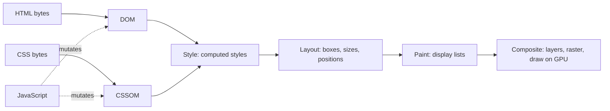

# Browser rendering pipeline, reflow vs repaint

!!! abstract "Key takeaways"
    - Every update runs some suffix of **JavaScript → Style → Layout → Paint → Composite**: DOM + CSSOM give computed styles, **layout** computes geometry, **paint** records drawing commands, the **compositor** rasterises layers and draws them on the GPU.
    - **Reflow** (DevTools: *Layout*) recomputes geometry and is always followed by repaint. **Repaint** redraws pixels without moving boxes (`color`, `box-shadow`). **Composite-only** changes (`transform`, `opacity`) skip both and can run on the compositor thread.
    - **Forced synchronous layout**: reading geometry (`offsetHeight`, `getBoundingClientRect()`, `scrollTop`) after a DOM write makes the browser lay out *now*. In a loop that is **layout thrashing**. Fix: read everything, then write.
    - A 60 Hz frame has **16.7 ms** for your code and the browser's. `requestAnimationFrame` runs **just before** style and layout, so visual writes belong there. Rendering work counts toward **INP**.
    - Levers: animate `transform`/`opacity`, scope layout with **`contain`** and **`content-visibility: auto`**, use `will-change` only as a last resort, and find culprits with the Performance panel and the **Long Animation Frames** API.

## Why it matters

Load speed depends on the **critical rendering path**: nothing paints until the needed HTML and *all* render-blocking CSS have arrived. Smoothness depends on the **per-frame pipeline**: at 60 Hz a new frame is due every 16.7 ms, and if the main thread is still busy with JavaScript, style or layout, the frame is dropped and the user sees jank.

Static pages rarely reflowed. Single-page apps mutate the DOM many times a second in response to scroll, drag and typing. Since March 2024 **Interaction to Next Paint (INP)** is a Core Web Vital, and much of an interaction's latency is style, layout and paint, not only the handler (see [Core Web Vitals & performance optimisation](04-core-web-vitals-and-performance-optimisation.md)).

Interviewers use the topic to check you can explain *why* one CSS change is cheap and another expensive, spot layout thrashing in code, and debug a janky screen with real tools.

## Core concepts

### From bytes to the first frame: the critical rendering path

HTML is parsed incrementally into the **DOM**. A classic `<script>` without `async` or `defer` pauses the parser; the **preload scanner** looks ahead and fetches CSS, scripts, fonts and images early. CSS becomes the **CSSOM**, which is **render-blocking** because a later rule can override an earlier one. Style calculation matches selectors and produces **computed styles**; elements with `display: none` get no box. The result is what older articles call the **render tree**.


*Notice that JavaScript can invalidate both inputs at any time; everything to the right of the change has to be redone before the next frame.*

### The per-frame pipeline

Chromium's RenderingNG splits the pipeline into **animate, style, layout, pre-paint, scroll, paint, commit, layerize, raster, activate, aggregate, draw**. Style through paint run on the renderer's **main thread**, the same thread as your JavaScript. Commit hands the results to the **compositor thread**, which rasterises tiles and sends a frame to the GPU (Viz) process. For interviews, five stages are enough:

| Stage | What it does | Output |
|---|---|---|
| JavaScript | Handlers, timers, `requestAnimationFrame`, framework rendering | DOM / style changes |
| Style | Match selectors, cascade, compute values | Computed styles |
| Layout | Compute geometry of every affected box | Layout (fragment) tree |
| Paint | Record drawing commands in paint order | Display lists |
| Composite | Layerise, raster tiles, draw layers with transforms, opacity, clips | Pixels on screen |

The HTML spec's "update the rendering" step runs resize and scroll steps, media queries and animations, then **`requestAnimationFrame` callbacks**, then **style and layout** (looping for `ResizeObserver`), then paint. So writes made in rAF land just before the browser's own style and layout.

### Reflow, repaint and composite-only

The key idea: **stages are skipped** when nothing they depend on changed.

{ loading=lazy }
*Watch how many boxes light up per row: that count is roughly the cost of the change.*

- **Reflow.** Anything that can change geometry: `width`, `margin`, `top`, `font-size`, `display`, adding nodes, changing text, an image arriving without reserved dimensions, resizing the window. The browser recomputes the box and whatever depends on it (often ancestors and siblings, at worst the whole document), then repaints. MDN: the first computation is *layout*, later ones are *reflows*.
- **Repaint.** `color`, `background-color`, `box-shadow`, `outline`, `visibility`. Layout is skipped; the affected area is repainted. Usually cheaper than layout, though big blurs and filters are not free.
- **Composite-only.** `transform` (and `translate`, `scale`, `rotate`) and `opacity`. On its own layer, the element's existing texture is just moved or faded. A CSS animation or transition of these can be **ticked on the compositor thread**, so it stays smooth while the main thread is blocked.

{ loading=lazy }
*The red band is the main thread being busy; only the transform-driven box ignores it.*

### Layers and their cost

Content is split into **layers** rasterised separately. Elements are promoted for a 3D transform, an active `transform`/`opacity` animation, `will-change`, `<video>`, `<canvas>`, or overlapping another layer. Layers make scrolling and composite-only animation cheap, but each costs GPU memory; too many ("layer explosion") slows everything, especially on phones. MDN calls `will-change` a **last resort** for an existing problem; it also creates a stacking context.

### Forced synchronous layout and layout thrashing

A DOM write only marks style and layout **dirty**; the work normally happens once, at the next rendering update. APIs that must return current geometry force style and layout **synchronously, inside your JavaScript** if anything is dirty. Paul Irish's list (from Blink source) includes:

- `offsetTop/Left/Width/Height`, `clientTop/Left/Width/Height`, `getBoundingClientRect()`, `getClientRects()`
- `scrollTop`, `scrollLeft`, `scrollWidth`, `scrollHeight`, `scrollIntoView()`, `scrollTo()`
- `innerText`, `focus()`, `window.innerWidth/innerHeight`, `window.scrollX/scrollY`, `elementFromPoint()`
- `getComputedStyle()`: always forces style; forces layout for geometry properties such as `width`, `height`, `top`, `transform`

One forced layout is fine. **Layout thrashing** is a loop alternating writes and reads, paying a layout per iteration.

{ loading=lazy }
*Each red block is layout the browser would have done once; interleaving made it pay three extra times.*

### Limiting how far a change spreads: containment

Layout cost depends on how much of the tree is dirty. **CSS containment** declares a subtree independent:

- `contain: layout` / `paint` / `size` / `style`; `contain: content` = layout + paint + style. A change inside cannot reflow the outside.
- `content-visibility: auto` applies that containment and, while the element is **off-screen**, skips layout and paint of its contents. Pair it with `contain-intrinsic-size: auto <estimate>` so the scrollbar doesn't jump. Content stays searchable and focusable. Baseline since September 2025; ignored safely elsewhere. On visible regions (Kanban columns, grid panels) the containment alone keeps a change from reflowing the whole board.

### Frame budget and INP

A frame is 16.7 ms at 60 Hz, 8.3 ms at 120 Hz, for everything. A **long task** (over 50 ms) blocks input and rendering. The **Long Animation Frames (LoAF)** API reports updates delayed beyond 50 ms, with script attribution and forced style-and-layout time. Long JavaScript is fixed by splitting work and **yielding** (`scheduler.yield()` where supported, `setTimeout` fallback); rendering cost by everything on this page.

## In practice: code & configuration

The classic bug: a "make all cards the same height" or "measure then position tooltips" loop.

=== "❌ Common mistake"
    ```ts
    // Equalise card heights. Each iteration WRITES then the next iteration READS:
    // every offsetHeight after the first finds layout dirty and forces a synchronous layout.
    function equaliseCards(cards: HTMLElement[]): void {
      for (const card of cards) {
        const h = card.offsetHeight;          // READ: forces layout if anything was written
        card.style.height = `${h + 8}px`;     // WRITE: invalidates layout again
      }
    }

    // Animating geometry: every frame runs style -> layout -> paint on the main thread.
    panel.animate([{ left: "0px" }, { left: "320px" }], { duration: 300 });
    ```

=== "✅ Correct approach"
    ```ts
    // Batch: all reads first (one layout at most), then all writes inside rAF,
    // which runs just before the browser's own style + layout for the frame.
    function equaliseCards(cards: HTMLElement[]): void {
      const heights = cards.map((c) => c.offsetHeight);   // READ phase
      requestAnimationFrame(() => {
        cards.forEach((c, i) => {
          c.style.height = `${heights[i] + 8}px`;          // WRITE phase, no reads in between
        });
      });
    }

    // Composite-only animation: can run on the compositor thread, survives a busy main thread.
    panel.animate([{ translate: "0" }, { translate: "320px 0" }], {
      duration: 300,
      easing: "ease-out",
    });
    ```

CSS for a long, data-heavy page (for example a claims list or an admin dashboard):

```css
/* Off-screen sections skip layout and paint until they approach the viewport. */
.claim-group {
  content-visibility: auto;
  contain-intrinsic-size: auto 480px;   /* placeholder height; 'auto' remembers the real size once rendered */
}

/* An isolated widget: changes inside cannot reflow or repaint the rest of the page. */
.live-ticker { contain: content; }

/* Promote only while the interaction is about to happen, not permanently. */
.drawer.is-opening { will-change: transform; }

@media (prefers-reduced-motion: reduce) {
  .drawer { transition: none; }
}
```

Finding the culprit in the field and in DevTools:

```ts
// Long Animation Frames: which scripts and how much forced style/layout delayed a frame.
new PerformanceObserver((list) => {
  for (const f of list.getEntries() as PerformanceLongAnimationFrameTiming[]) {
    const forced = f.scripts.reduce((ms, s) => ms + s.forcedStyleAndLayoutDuration, 0);
    if (forced > 10) {
      console.warn("LoAF", Math.round(f.duration), "ms; forced layout", Math.round(forced), "ms",
        f.scripts.map((s) => s.sourceURL));
    }
  }
}).observe({ type: "long-animation-frame", buffered: true });
```

In the DevTools **Performance** panel, purple *Layout* blocks nested under a script, flagged as forced reflow, are the signature of thrashing. **Rendering → Paint flashing** shows repaints; the **Layers** panel shows promoted layers.

## Real-world usage

- **Third-party scripts** are frequent offenders: Paul Irish's trace of The Guardian showed a recommendation widget forcing layout repeatedly in a loop. Tag managers and A/B snippets do the same outside your code review.
- **Libraries encode read/write phases.** FastDOM batches them per frame. React commits DOM mutations in one phase, but `useLayoutEffect` runs before paint, so measuring there forces layout: fine once, harmful per list item. See [React rendering behaviour](../react/03-rendering-behaviour-re-render-triggers-keys-batching.md) and [React performance optimisation](../react/06-performance-optimisation-memoization-code-splitting-lazy-loa.md).
- **Virtualisation** (react-window, TanStack Virtual, AG Grid) keeps the DOM small so each reflow is cheap.
- **Domain angle:** claims and transaction grids, live dashboards and long forms in healthcare and banking are used all day by staff; a grid that remeasures columns on every keystroke becomes poor INP for exactly those users.

## Trade-offs & production gotchas

| Option | Pros | Cons | Use when |
|---|---|---|---|
| Animate `transform` / `opacity` | Skips layout and paint; can run on compositor | Doesn't move surrounding content; needs a layer | Slides, fades, drawers, carousels |
| Animate `width` / `top` / `height` | Neighbours reflow naturally | Layout + paint every frame on main thread | Rarely; prefer FLIP or View Transitions |
| `will-change` | Pre-promotes, avoids first-frame hitch | GPU memory, stacking context; harmful if global | A known janky animation, applied just before it |
| `contain` / `content-visibility` | Limits layout scope; skips off-screen work | Needs size estimates; can clip overflow (`paint`) | Long pages, independent widgets, big boards |
| Virtualisation | Tiny DOM, cheap layout | Complexity; find-in-page and a11y need care | Thousands of rows |
| Batch reads/writes (rAF, FastDOM) | Removes thrashing | Code must be structured in phases | Any code that measures and mutates |

!!! warning "Gotcha: hidden forced layouts"
    `focus()`, `scrollIntoView()`, `innerText` and `getComputedStyle()` can force layout. `el.focus()` right after inserting a large list lays the whole insertion out synchronously.

!!! warning "Gotcha: layer explosion"
    `will-change: transform` or `translateZ(0)` on every list item creates hundreds of layers: more memory, slower compositing, and trouble on low-end phones. Promote only what actually animates.

!!! tip "Measure first"
    Profile before optimising. Selector complexity rarely matters; DOM size, thrashing and unscoped layout usually do. Images without `width`/`height` and late font swaps also reflow (and show up as CLS).

## How this connects to my experience

- **Where I used it:** not a ★ claim; position as transferable knowledge. Closest fit: **building the ReactJS application from the ground up and establishing a micro-frontend architecture** on OptumRx Meteor (750K+ users), with Material UI. Any screen that measures DOM (tooltips, sticky headers, auto-sizing tables) depends on the read/write discipline here.
- **Talking points:**
    - Why `transform`/`opacity` animations survive a busy main thread, and why that doesn't fix INP.
    - How I'd profile jank: Performance panel (forced reflow, long Layout), Paint flashing, then LoAF in the field.
    - Micro-frontends share one main thread and one layout, so one team's thrashing hurts everyone's INP ([micro-frontend approaches](../frontend-architecture/01-micro-frontends-approaches-and-trade-offs.md)).
    - Specific rendering problems fixed in the Meteor app (large tables, virtualisation) and before/after numbers: *[confirm]*.
- **Likely follow-up chain:** "What is the difference between reflow and repaint?" → geometry vs pixels, composite-only as the third case → "Why is reading `offsetHeight` in a loop slow?" → forced synchronous layout after each write, batch reads then writes → "A drag-and-drop board is janky in production. Walk me through it." → Performance trace, forced layout in the drag handler, move writes into rAF, `transform` for the dragged card, `content-visibility`/`contain` on columns, virtualise long columns.

## Interview questions

### Fundamentals

??? question "Q1. Walk me through how a browser renders a page from HTML to pixels."
    **Answer:** HTML is parsed incrementally into the DOM; CSS into the CSSOM, which is render-blocking. Style calculation combines them into computed styles for each element that generates a box. Layout computes each box's size and position. Paint records drawing commands into display lists. The compositor splits content into layers, rasterises tiles and draws them on the GPU. Synchronous scripts pause parsing; the preload scanner fetches resources early. After first paint, updates rerun the pipeline from the first affected stage.

    **Interviewer listens for:** DOM + CSSOM, CSS render-blocking, layout vs paint vs composite, main thread vs compositor.

    **Common wrong answer:** "The browser draws the DOM directly", skipping style and layout, or treating paint and composite as one step.

??? question "Q2. What is the difference between reflow and repaint? Give examples."
    **Answer:** Reflow (layout) recomputes geometry: changing `width`, `margin`, `font-size`, `display`, adding nodes or resizing the window. It is always followed by a repaint. Repaint redraws pixels without changing geometry: `color`, `background-color`, `box-shadow`, `visibility`. There is a third, cheapest case: `transform` and `opacity` changes are composite-only and skip both.

    **Interviewer listens for:** geometry vs appearance, reflow implies repaint, the composite-only case.

    **Common wrong answer:** "`visibility: hidden` causes reflow." It doesn't (the box keeps its space); `display: none` does.

??? question "Q3. Why are `transform` and `opacity` recommended for animations?"
    **Answer:** They don't affect layout or require repainting the element's contents; if the element has its own layer, the compositor just moves or fades an existing texture. A CSS animation or transition of them can be ticked on the compositor thread, so it stays smooth even if JavaScript blocks the main thread. Animating `left` or `width` needs style, layout and paint on the main thread every frame.

    **Interviewer listens for:** skipped stages, compositor thread, layers.

    **Common wrong answer:** "Because they use the GPU and everything else uses the CPU", which misses the point that layout and paint are skipped.

### Intermediate

??? question "Q4. What is layout thrashing and how do you fix it?"
    **Answer:** A write invalidates layout; a subsequent read of a geometry API (`offsetHeight`, `getBoundingClientRect`, `scrollTop`) forces the browser to run style and layout synchronously to return a correct value. Alternating writes and reads in a loop makes it lay out once per iteration. Fix by reading everything first and writing afterwards, ideally doing writes in `requestAnimationFrame`, or using a batching library (FastDOM). Also cache measurements and avoid measuring at all where CSS (flex/grid, `aspect-ratio`) can do the job.

    **Interviewer listens for:** dirty flag + forced synchronous layout, read/write batching, rAF.

    **Common wrong answer:** "Use `setTimeout` to make it async"; the reads and writes still interleave.

??? question "Q5. Where does `requestAnimationFrame` run in the event loop, and why use it?"
    **Answer:** In the HTML event loop's "update the rendering" step, rAF callbacks run after resize, scroll, media-query and animation steps and immediately before the browser recalculates style and layout and paints. Writes made there are applied in the frame being prepared, once. Unlike `setTimeout`, rAF is aligned with the display's refresh and paused in background tabs. Reads made at the start of a rAF callback, before any writes, see clean layout.

    **Interviewer listens for:** before style/layout/paint, refresh-aligned, batching visual writes.

    **Common wrong answer:** "rAF runs after paint"; reading layout in rAF after writing still forces layout.

??? question "Q6. What does `will-change` do, and when is it harmful?"
    **Answer:** It hints that a property will change, so the browser may promote the element to its own layer ahead of time and avoid a hitch on the first frame. It costs GPU memory, creates a stacking context, and if applied broadly creates many layers that slow compositing. MDN calls it a last resort for an existing problem: add it shortly before an animation (e.g. on hover or an `is-opening` class) and remove it afterwards.

    **Interviewer listens for:** layer promotion, memory, stacking context, last resort.

    **Common wrong answer:** "Put `will-change: transform` on everything to enable GPU acceleration."

### Senior

??? question "Q7. How do CSS containment and `content-visibility` improve rendering performance?"
    **Answer:** `contain: layout paint style` declares that a subtree's internals cannot affect the outside, so a change inside only dirties that subtree and paint can be clipped to it. `content-visibility: auto` applies that containment and also skips layout and paint of the contents while the element is off-screen, which speeds initial render of long pages and makes interactions in big layouts cheaper. It needs `contain-intrinsic-size` for a placeholder size, otherwise skipped sections collapse and the scrollbar jumps. Content stays searchable and focusable; it is Baseline since 2025 and harmless where unsupported.

    **Interviewer listens for:** scope of invalidation, off-screen skip, intrinsic size, accessibility preserved.

    **Common wrong answer:** "It's the same as lazy loading" or "it's like `display: none`".

??? question "Q8. How does this relate to INP, and what would you do if INP is poor?"
    **Answer:** INP measures from the input to the next paint, so it includes input delay (main thread busy), processing time (handlers) and presentation delay (style, layout, paint after the handler). Use field data with LoAF attribution and a DevTools trace to see which part dominates. For long handlers, split the work and yield; for presentation delay, remove forced layouts, reduce DOM size, scope layout with containment, and avoid re-rendering large subtrees. Compositor-only animations help smoothness but not INP, because input handling and the next paint still need the main thread.

    **Interviewer listens for:** three INP phases, LoAF, rendering cost as part of INP.

    **Common wrong answer:** "INP is only about JavaScript execution time."

### Scenario-based

??? question "Q9. A drag-and-drop board with 500 cards drops frames while dragging. How do you diagnose and fix it?"
    **Answer:** Record a Performance trace while dragging. Typical findings: the `pointermove` handler reads `getBoundingClientRect()` of cards after updating styles (forced reflow warnings), and the dragged card moves via `top`/`left`, reflowing the column every event. Fixes: read positions once at drag start and cache them; apply moves in rAF; move the dragged card with `transform: translate()`; put `contain: content` or `content-visibility: auto` (with `contain-intrinsic-size`) on columns so a drop only reflows one column; virtualise very long columns. Verify with the trace and Paint flashing.

    **Interviewer listens for:** measure first, cache reads, transform, containment, verify.

    **Common wrong answer:** "Add `will-change` to all cards."

## Cheat sheet

| Concept | Remember |
|---|---|
| Pipeline | JS → Style → Layout → Paint → Composite |
| Render-blocking | CSS (and parser-blocking scripts without `async`/`defer`) |
| Reflow | Geometry changed; always followed by repaint |
| Repaint | Pixels changed, boxes didn't (`color`, `background`, `box-shadow`) |
| Composite-only | `transform`, `opacity`; can run on the compositor thread |
| Forced layout | Geometry read after a write: `offsetHeight`, `getBoundingClientRect`, `scrollTop`, `getComputedStyle` |
| Thrashing fix | Read all, then write all; writes in `requestAnimationFrame` |
| rAF | Runs right before style, layout and paint in each rendering update |
| Frame budget | 16.7 ms at 60 Hz, 8.3 ms at 120 Hz; long task > 50 ms |
| `will-change` | Last resort; memory and stacking context |
| Containment | `contain: content`; `content-visibility: auto` + `contain-intrinsic-size` |
| Tools | Performance panel (forced reflow), Paint flashing, Layers, LoAF |

## Sources
1. [MDN: Critical rendering path](https://developer.mozilla.org/en-US/docs/Web/Performance/Guides/Critical_rendering_path): DOM, CSSOM, render tree, layout, paint; CSS as render-blocking.
2. [MDN: How browsers work](https://developer.mozilla.org/en-US/docs/Web/Performance/Guides/How_browsers_work): preload scanner, layout vs reflow, layers, 16.67 ms budget.
3. [MDN glossary: Reflow](https://developer.mozilla.org/en-US/docs/Glossary/Reflow) and [Repaint](https://developer.mozilla.org/en-US/docs/Glossary/Repaint): definitions.
4. [Chrome for Developers: Overview of the RenderingNG architecture](https://developer.chrome.com/docs/chromium/renderingng-architecture): pipeline stages, main vs compositor thread, Viz, skipping stages for visual effects.
5. [Chrome for Developers: Inside look at modern web browser (part 3)](https://developer.chrome.com/blog/inside-browser-part3): layers, tiling, raster threads, compositor frames.
6. [HTML Standard: event loop processing model, "update the rendering"](https://html.spec.whatwg.org/multipage/webappapis.html#update-the-rendering): order of rAF callbacks, style and layout, `ResizeObserver`, paint.
7. [Paul Irish: What forces layout/reflow](https://gist.github.com/paulirish/5d52fb081b3570c81e3a): APIs that force synchronous layout; Guardian trace.
8. [MDN: will-change](https://developer.mozilla.org/en-US/docs/Web/CSS/will-change), [contain](https://developer.mozilla.org/en-US/docs/Web/CSS/contain) and [content-visibility](https://developer.mozilla.org/en-US/docs/Web/CSS/content-visibility): last-resort guidance, containment types, skipped contents.
9. [MDN: requestAnimationFrame](https://developer.mozilla.org/en-US/docs/Web/API/Window/requestAnimationFrame) and [Long animation frame timing](https://developer.mozilla.org/en-US/docs/Web/API/Performance_API/Long_animation_frame_timing): refresh alignment, background-tab pausing, LoAF fields.
10. [web.dev: Rendering performance](https://web.dev/articles/rendering-performance), [Avoid large, complex layouts and layout thrashing](https://web.dev/articles/avoid-large-complex-layouts-and-layout-thrashing) and [Stick to compositor-only properties](https://web.dev/articles/stick-to-compositor-only-properties-and-manage-layer-count): pixel pipeline paths, forced layout, layer count.
11. [web.dev: Interaction to Next Paint](https://web.dev/articles/inp): INP phases and thresholds.
