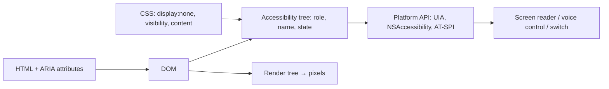
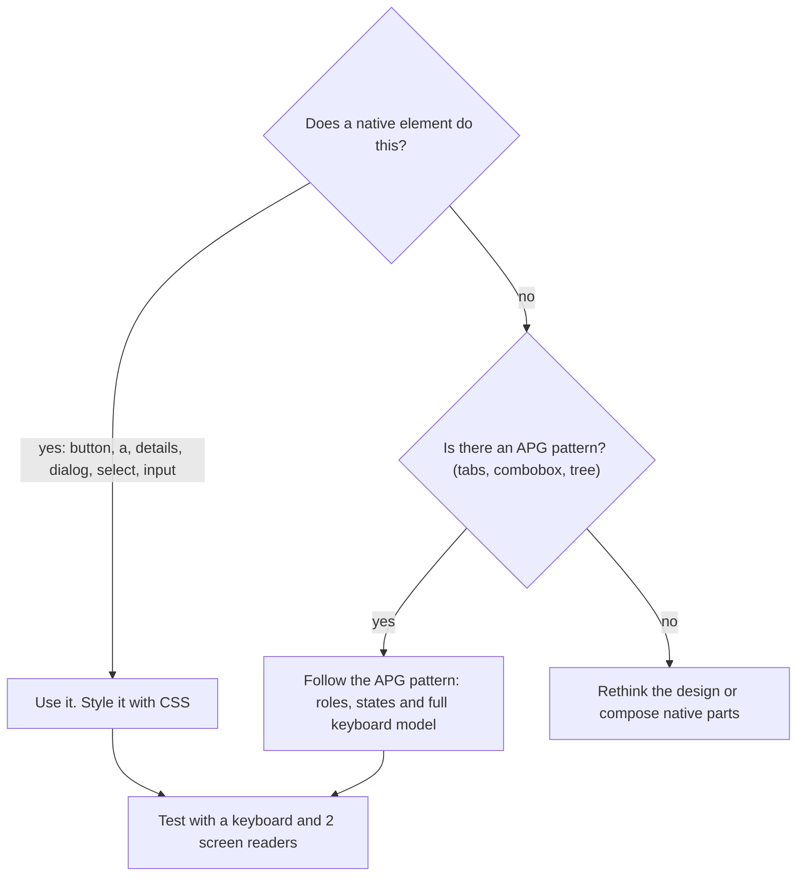

# HTML semantics & accessibility (WCAG, ARIA)

!!! abstract "Key takeaways"
    - Screen readers, voice control and switch devices read the **accessibility tree**, which the browser builds from the DOM. Each node has a **role, a name, states and properties**. Semantic HTML fills it in for free; a `<div>` with a click handler exposes nothing useful.
    - **WCAG 2.2** (W3C Recommendation, October 2023; also ISO/IEC 40500:2025) is the current standard. It is organised as **POUR** (Perceivable, Operable, Understandable, Robust) with levels A, AA and AAA. **AA is the target** in contracts and laws. 2.2 added 9 criteria, such as **Focus Not Obscured**, **Target Size (24×24 CSS px)** and **Accessible Authentication**, and removed 4.1.1 Parsing.
    - **First rule of ARIA:** use a native element if one exists. ARIA only changes what the tree *says*. It adds no keyboard behaviour, focus or styling. Pages with ARIA have *more* detected errors on average than pages without.
    - The patterns that fail most often in real apps are icon buttons with no name, inputs with no label, low contrast, missing focus styles, custom modals that leak focus, and SPA route changes that no one announces. A native `<dialog>` with `showModal()` makes the rest of the page **inert** and handles Esc for you.
    - Automated tools (axe, Lighthouse, `eslint-plugin-jsx-a11y`) catch only part of the problem. A **keyboard-only pass and a screen-reader pass** are still needed. Accessibility is now a legal requirement too: the European Accessibility Act, the US ADA Title II rule and the HHS Section 504 rule all reference WCAG 2.1 AA.

## Why it matters

Roughly one in six people has a significant disability (WHO estimate). Many more are temporarily or situationally limited: a broken arm, glare on a phone, a noisy room. They use assistive technology (AT) such as screen readers (JAWS, NVDA, VoiceOver, TalkBack), screen magnifiers, voice control and switch access, or simply a keyboard. All of these depend on the page exposing correct semantics.

The web is still bad at this. The **WebAIM Million 2026** survey found detectable WCAG failures on **95.9%** of the top million home pages, an average of **56.1 errors per page**. Six error types (low-contrast text, missing alt text, missing form labels, empty links, empty buttons and missing page language) make up about 96% of the errors it detected. None of these are hard to fix.

The legal pressure is real and is aimed at sectors like healthcare and banking:

| Regulation | Applies to | Standard | Dates |
|---|---|---|---|
| European Accessibility Act (Directive 2019/882) | Banking, e-commerce, transport, e-books and more, across the EU | EN 301 549 → WCAG 2.1 AA | In force since 28 June 2025 |
| US ADA Title II rule (DOJ, 2024) | State and local government web and mobile apps | WCAG 2.1 AA | Extended in April 2026 to 26 April 2027 (large entities) and 26 April 2028 (smaller entities) |
| HHS Section 504 rule (2024) | Recipients of HHS funding: hospitals, providers, health plans | WCAG 2.1 AA | Extended by one year to 11 May 2027 (15+ employees) and 10 May 2028 (smaller organisations) |
| Section 508 | US federal agencies | WCAG 2.0 AA | In force |

Interviewers ask about accessibility to find out whether you understand *why* semantic HTML matters, rather than treating it as a lint rule.

## Core concepts

### From DOM to accessibility tree

The browser builds a second tree next to the render tree (see [Browser rendering pipeline](01-browser-rendering-pipeline-reflow-vs-repaint.md)). The **accessibility tree** keeps only nodes that carry meaning and gives each one:

- **Role:** what it is (`button`, `link`, `heading` level 2, `textbox`, `dialog`, `navigation`).
- **Name:** what it is called. The *accessible name computation* (W3C AccName) works through `aria-labelledby`, then `aria-label`, then the native label (`<label>`, `alt`, `<caption>`, `<legend>`), then text content for roles that allow it, and only then `title`.
- **Description:** extra help text, usually from `aria-describedby`.
- **States and properties:** `checked`, `expanded`, `disabled`, `invalid`, `required`, `current`, `level`.

The OS accessibility API then exposes this tree to AT: UI Automation on Windows, NSAccessibility on macOS, AT-SPI on Linux. You can inspect it in the Accessibility pane of Chrome or Firefox DevTools.


*Notice that the screen reader never sees pixels. CSS does matter, because `display:none` removes nodes from the tree, but colours and shapes are invisible to it.*

{ loading=lazy }
*The two controls look the same on screen. Only one of them exists for keyboard and screen-reader users.*

### Semantic HTML: the free 80%

- **Landmarks:** `<header>`, `<nav>`, `<main>` (one per page), `<aside>`, `<footer>`. Screen-reader users jump between landmarks. A `<section>` becomes a `region` landmark only when it has a name, so don't label every section.
- **Headings:** one `<h1>`, then go down in order without skipping levels. Many screen-reader users navigate a page by its headings first.
- **Interactive elements:** `<button>` for actions and `<a href>` for navigation. Both are focusable and keyboard-operable by default. A `<button>` inside a form submits it unless you set `type="button"`.
- **Forms:** `<label for>`, `<fieldset>` + `<legend>` for groups of radios, the `required` attribute, the right `type` (`email`, `tel`) and `autocomplete` tokens (WCAG 1.3.5 Identify Input Purpose).
- **Lists and tables:** `<ul>`/`<ol>` tell users how many items there are. Data tables need `<th scope>` and `<caption>`. Never use a table for layout.
- **Language and title:** `<html lang="en">` sets the screen reader's pronunciation. A unique `<title>` is the first thing announced on each page.
- **Images:** `alt` describes the purpose ("Search", not "magnifying glass"). Decorative images use `alt=""`. Inline icon SVGs get `aria-hidden="true"`.

### WCAG 2.2 in one screen

WCAG has 4 principles, 13 guidelines and **86 success criteria**, each of which can be tested. Conformance is all-or-nothing per page at a given level. "AA" means every A and AA criterion passes.

| Principle | Criteria interviewers ask about |
|---|---|
| **Perceivable** | 1.1.1 Non-text content (alt); 1.3.1 Info and relationships (semantics); 1.4.3 Contrast ≥ **4.5:1** for text, **3:1** for large text; 1.4.11 Non-text contrast ≥ 3:1 for UI parts and focus rings; 1.4.10 Reflow at 320 CSS px; 1.4.4 Resize text to 200% |
| **Operable** | 2.1.1 Keyboard; 2.1.2 No keyboard trap; 2.4.3 Focus order; 2.4.7 Focus visible; **2.4.11 Focus not obscured (AA, new)**; **2.5.7 Dragging movements (AA, new)**; **2.5.8 Target size minimum 24×24 CSS px (AA, new)** |
| **Understandable** | 3.1.1 Language of page; 3.2.2 On input (no surprise context change); 3.3.1 Error identification; 3.3.2 Labels or instructions; **3.2.6 Consistent help (A, new)**; **3.3.7 Redundant entry (A, new)**; **3.3.8 Accessible authentication (AA, new)** |
| **Robust** | 4.1.2 Name, role, value; 4.1.3 Status messages (live regions). 4.1.1 Parsing is **obsolete** in 2.2 |

The other two new criteria (2.4.12 and 2.4.13 on focus appearance, and 3.3.9 enhanced authentication) are AAA. The new criteria in plain words:

- **Focus not obscured:** a sticky header, cookie banner or chat widget must not *completely* hide the focused element. `scroll-padding-top` fixes most cases.
- **Dragging movements:** a drag-and-drop list also needs a single-pointer alternative, such as "Move up" buttons.
- **Target size:** pointer targets must be at least 24×24 CSS px, or have enough spacing around them.
- **Accessible authentication:** don't make users remember or transcribe something with no alternative. Allow paste and password managers. Don't block paste on a one-time code field. Puzzle CAPTCHAs need an alternative.
- **Redundant entry:** don't ask for the same information twice in one process. For example, offer "billing address same as shipping".

**WCAG 3.0** is still a Working Draft with a different scoring model. 2.2 is the version to target.

### ARIA: what it is and isn't

WAI-ARIA (1.2 is the current Recommendation) adds `role`, `aria-*` states and properties, and live regions for cases HTML cannot express: tabs, tree views, comboboxes, a "current page" marker, async status messages. The *Using ARIA* rules:

1. If a native element or attribute does the job, use it.
2. Don't change native semantics (`<h2 role="button">`). Wrap the element instead.
3. Every interactive ARIA control must work with the keyboard.
4. Never put `aria-hidden="true"` or `role="presentation"` on something focusable.
5. Every interactive element needs an accessible name.

ARIA only changes the accessibility tree. `role="button"` does not make a `<div>` focusable, and it doesn't make Enter or Space activate it. That is why "no ARIA is better than bad ARIA". WebAIM keeps finding that pages using ARIA average *more* errors than pages without it, though it notes that ARIA-heavy pages also tend to be more complex.


*Notice that ARIA is the second choice, and that choosing it commits you to implementing the keyboard behaviour yourself.*

Useful ARIA that has no native equivalent: `aria-expanded` and `aria-controls` on disclosure buttons, `aria-current="page"` in nav, `aria-describedby` for hints, `aria-invalid` with `aria-errormessage` for errors, `aria-live="polite"` or `role="status"` for "3 results found", and `role="alert"` (assertive) only for urgent messages.

### Focus management

- **Tab order follows DOM order.** Never use a positive `tabindex`. Use `tabindex="0"` to make a custom widget focusable and `tabindex="-1"` for elements you focus from script, such as an `<h1>` after a route change.
- **Visible focus:** style `:focus-visible` (keyboard focus) and don't remove outlines without a replacement. Use `outline` rather than `box-shadow`, because forced-colors (Windows High Contrast) mode removes shadows.
- **Modals:** focus moves into the dialog, stays there, Esc closes it, and focus *returns to the trigger*. The native `<dialog>` opened with `showModal()` does all of this: everything outside becomes **inert**, the dialog gets `aria-modal="true"` and Esc sends a close request. Put `autofocus` on the element that should receive focus first. Use the `inert` attribute for custom overlays that can't use `<dialog>`.
- **SPA navigation:** a client-side route change does not trigger a page load, so screen readers announce nothing. Update `document.title` and move focus to the new `<h1>`, or announce the change through a live region.

{ loading=lazy }
*Watch frame 3: in the div overlay, focus lands on a link the user cannot see. In the native dialog it can't leave the dialog.*

Current platform features worth knowing (2026):

| Feature | Status | Accessibility benefit |
|---|---|---|
| `<dialog>` + `showModal()` | Baseline widely available | Inert background, Esc, top layer, `aria-modal` |
| `inert` attribute | Baseline widely available | Removes a subtree from focus and the accessibility tree |
| Popover API (`popover`) | Baseline since January 2025 | Light dismiss and focus handling for menus and tooltips |
| Invoker commands (`commandfor`/`command`) | Baseline (newly available) since December 2025 | Open dialogs and popovers without JavaScript; sets `aria-expanded` |
| `:user-invalid` | Baseline widely available | Show errors only after the user has interacted with a field |
| `<dialog closedby="any">` | Chrome 134+, Firefox 141+, not yet in Safari | Light dismiss for modal dialogs |

## In practice: code & configuration

### Icon button, form field and modal in React

=== "❌ Common mistake"
    ```tsx
    // Looks fine with a mouse. Broken for keyboard and screen-reader users.
    export function ClaimRow({ claim, onDelete }: Props) {
      const [open, setOpen] = useState(false);
      return (
        <>
          {/* div: not focusable, no role. Icon only: no accessible name */}
          <div className="icon-btn" onClick={() => setOpen(true)}>
            <TrashIcon />
          </div>

          {/* placeholder is not a label. Error shown in red only */}
          <input placeholder="Reason" className={err ? "red" : ""} />

          {/* custom overlay: focus leaks to the page behind, no Esc,
              focus is lost when it closes */}
          {open && (
            <div className="backdrop">
              <div className="modal">
                <p>Delete claim {claim.id}?</p>
                <div onClick={() => onDelete(claim.id)}>Delete</div>
              </div>
            </div>
          )}
        </>
      );
    }
    ```

=== "✅ Correct approach"
    ```tsx
    export function ClaimRow({ claim, onDelete }: Props) {
      const dialogRef = useRef<HTMLDialogElement>(null);
      const reasonId = useId();                       // stable ids for label/hint/error
      const [error, setError] = useState<string | null>(null);

      return (
        <>
          {/* native button: focusable, Enter/Space, role=button.
              Name includes the claim id so each "Delete" is distinct */}
          <button type="button" className="icon-btn"
                  aria-label={`Delete claim ${claim.id}`}
                  onClick={() => dialogRef.current?.showModal()}>
            <TrashIcon aria-hidden="true" focusable="false" />
          </button>

          <label htmlFor={reasonId}>Reason for deletion</label>
          <p id={`${reasonId}-hint`}>Visible to the member.</p>
          <input id={reasonId} required
                 aria-describedby={`${reasonId}-hint`}
                 aria-invalid={error ? true : undefined}
                 aria-errormessage={error ? `${reasonId}-err` : undefined} />
          {/* text plus icon, not colour alone (WCAG 1.4.1) */}
          {error && <p id={`${reasonId}-err`} className="error">⚠ {error}</p>}

          {/* showModal(): page becomes inert, Esc closes,
              focus goes back to the trigger button on close */}
          <dialog ref={dialogRef} aria-labelledby={`dlg-${claim.id}`}>
            <h2 id={`dlg-${claim.id}`}>Delete claim {claim.id}?</h2>
            <form method="dialog">                   {/* buttons close the dialog */}
              <button value="cancel" autoFocus>Cancel</button>
              <button value="delete" onClick={() => onDelete(claim.id)}>Delete</button>
            </form>
          </dialog>
        </>
      );
    }
    ```

### Focus styles and target size

```css
:where(a, button, input, select, textarea, [tabindex]):focus-visible {
  outline: 3px solid var(--focus, #4f46e5);   /* outline survives forced-colors mode */
  outline-offset: 2px;                         /* contrast ≥ 3:1 against both neighbours */
}
.icon-btn { min-inline-size: 24px; min-block-size: 24px; }  /* WCAG 2.5.8 AA (44px is better) */
html { scroll-padding-top: 4rem; }  /* sticky header can't hide focused items (2.4.11) */
@media (prefers-reduced-motion: reduce) {
  *, *::before, *::after { animation-duration: .01ms !important; transition-duration: .01ms !important; }
}
```

### SPA route announcement and automated checks

```tsx
// After a client-side navigation: update the title and move focus to the new h1.
export function PageHeading({ title }: { title: string }) {
  const ref = useRef<HTMLHeadingElement>(null);
  useEffect(() => {
    document.title = `${title} | Member portal`;
    ref.current?.focus();                 // the screen reader announces the heading
  }, [title]);
  return <h1 ref={ref} tabIndex={-1}>{title}</h1>;  // -1: focusable from script only
}

// Testing Library: query by role and name, which also tests accessibility.
expect(screen.getByRole("button", { name: /delete claim c-1042/i })).toBeEnabled();

// Playwright + axe in CI: fail the build on WCAG 2.2 A/AA violations.
const results = await new AxeBuilder({ page })
  .withTags(["wcag2a", "wcag2aa", "wcag21aa", "wcag22aa"]).analyze();
expect(results.violations).toEqual([]);
```

## Real-world usage

- **Design systems carry most of the load.** Shared components (MUI, Radix, React Aria, GOV.UK Frontend) encode the hard patterns once: dialogs, menus, comboboxes, focus rings. An app can still break them through wrappers that drop `aria-*` props, icon buttons with no label, or overridden focus styles. See [Design systems & component libraries](../frontend-architecture/04-design-systems-and-component-libraries.md).
- **Healthcare and banking** are the sectors these laws target first. Patient portals, pharmacy refill flows, appointment schedulers, payment and online-banking journeys are all covered by HHS 504, the ADA or the EAA. Procurement often requires a **VPAT/ACR** (accessibility conformance report) for third-party widgets.
- **Overlays don't fix sites.** "One line of JavaScript" accessibility overlay widgets have drawn criticism from disabled users and accessibility practitioners, and have attracted lawsuits and regulatory action. Fix the source code instead.
- **Common failure modes in production:** cookie banners and chat widgets that trap focus or cover it, toasts that are never announced, infinite scroll with no way to reach the footer, CAPTCHAs with no alternative, PDFs with no tags, and time-outs with no warning (2.2.1).

## Trade-offs & production gotchas

| Option | Pros | Cons | Use when |
|---|---|---|---|
| Native element (`button`, `dialog`, `details`, `select`) | Correct semantics, keyboard support and AT support for free | Styling limits, though customisable `<select>` is arriving | Always the default |
| Headless accessible library (React Aria, Radix) | Tested APG patterns, you own the styling | Dependency, learning curve | Comboboxes, date pickers, tree grids |
| Hand-rolled ARIA widget | Full control | Easy to get the keyboard model and AT support wrong | Only with APG + screen-reader testing |
| Automated checks only (axe, Lighthouse) | Cheap, fast, runs on every PR | Miss focus order, meaning of alt text, usability | Baseline gate on every PR |
| Manual keyboard + screen-reader audit | Finds real blockers | Slow, needs skill | Before releases and for key journeys |

!!! warning "Gotcha: `aria-label` overrides visible text"
    `<button aria-label="Submit form">Send</button>` is announced as "Submit form", but a voice-control user says "click Send" and nothing happens. WCAG 2.5.3 *Label in Name* requires the accessible name to **contain the visible text**. Prefer `aria-labelledby` pointing at the visible text, or leave the native name alone.

!!! warning "Gotcha: `display:none` vs visually hidden"
    `display:none` and `hidden` remove content from *everyone*. To keep text for screen readers only (for example "(opens in new tab)"), use a `.visually-hidden` clip pattern. Never put `aria-hidden="true"` on a focusable element: keyboard users land on something that screen readers say doesn't exist.

!!! warning "Gotcha: Safari and list semantics"
    Safari/VoiceOver drops list semantics from `<ul>` styled with `list-style: none` outside `<nav>`. Adding `role="list"` there is a deliberate exception to the "no redundant ARIA" rule.

!!! tip "Performance overlap"
    Accessibility and [Core Web Vitals](04-core-web-vitals-and-performance-optimisation.md) work together. Semantic HTML means less JavaScript. `alt` text and reserved image dimensions both serve readers and prevent layout shift. A slow INP hurts switch and screen-reader users most, because each key press waits for the main thread.

## How this connects to my experience

- **Where I used it:** not a specific resume claim. Position it as transferable knowledge from front-end work. On **OptumRx Meteor** I **built the ReactJS application from the ground up and set up a micro-frontend architecture** for a healthcare platform serving **750K+ users**, with **Material UI and Storybook** listed in my skills. A pharmacy and healthcare front end is exactly the kind of product the HHS Section 504 and ADA rules target.
- **Talking points:**
    - Getting semantics right in shared components: MUI gives accessible primitives, and the risks are in wrappers, icon buttons and custom overlays. Whether we ran axe or Storybook a11y checks in CI, and which WCAG level we targeted: *[confirm]*.
    - Micro-frontends make focus and announcements harder: each MFE must update the title and focus on route change, and the shell must own landmarks and the skip link. Whether we did this: *[confirm]*.
    - As the engineer who set the testing standards, I could push `getByRole` queries in React Testing Library, which test accessibility as a side effect. See [Frontend testing](../testing/06-frontend-testing-jest-react-testing-library-e2e.md).
    - Accessible authentication (3.3.8) links to the PingFederate/OAuth2 login work: allow paste and password managers, and avoid cognitive puzzles.
- **Likely follow-up chain:** "How did you make the React app accessible?" → semantic components from MUI, label and error patterns, focus styles, automated checks *[confirm what was in place]* → "How would you test a modal?" → keyboard-only pass (Tab, Shift+Tab, Esc, focus return) plus a screen reader, and axe in Playwright → "A user reports they can't complete a refill with a screen reader. What do you do?" → reproduce with NVDA + Chrome or VoiceOver + Safari, inspect the accessibility tree, fix at the component level, and add a regression test.

## Interview questions

### Fundamentals

??? question "Q1. What is semantic HTML and why does it matter for accessibility?"
    **Answer:** Using elements for their meaning (`button`, `nav`, `main`, `h1`–`h6`, `label`, `table`) rather than generic `div`s. The browser maps them to roles, names and states in the accessibility tree, which AT reads. Native interactive elements also come with focusability and keyboard behaviour. The same semantics help SEO, reader modes and maintainability.

    **Interviewer listens for:** accessibility tree, built-in keyboard support, landmarks and headings for navigation.

    **Common wrong answer:** "It's mainly for SEO" or "it's just cleaner markup."

??? question "Q2. What are WCAG's levels and principles, and what's new in 2.2?"
    **Answer:** Four principles, POUR: Perceivable, Operable, Understandable, Robust. Success criteria are at level A, AA or AAA, and **AA** is the usual legal and contract target. WCAG 2.2 (2023) added nine criteria. The A/AA ones are Focus Not Obscured (Minimum), Dragging Movements, Target Size (Minimum) 24×24 CSS px, Consistent Help, Redundant Entry and Accessible Authentication (Minimum). It also made 4.1.1 Parsing obsolete. WCAG 2.2 is backward compatible: content that meets 2.2 AA also meets 2.1 AA.

    **Interviewer listens for:** AA as the target, a few concrete 2.2 additions, backward compatibility.

    **Common wrong answer:** "AAA is what everyone should target" (not even W3C recommends requiring AAA for whole sites).

??? question "Q3. When should you use ARIA?"
    **Answer:** Only when native HTML can't express the semantics: tabs, comboboxes, tree views, live regions, `aria-expanded`, `aria-current`, `aria-describedby`. ARIA changes only the accessibility tree. It adds no focus or keyboard behaviour, so a custom widget must implement the APG keyboard model. Don't override native semantics, and never hide focusable elements with `aria-hidden`.

    **Interviewer listens for:** "first rule of ARIA", "ARIA adds no behaviour", "no ARIA is better than bad ARIA".

    **Common wrong answer:** "Add `role="button"` to the div and you're done."

### Intermediate

??? question "Q4. How is an element's accessible name calculated?"
    **Answer:** In order of precedence: `aria-labelledby` (references to visible text), then `aria-label`, then native labelling (`<label for>`, `alt`, `<legend>`, `<caption>`, `<figcaption>`), then text content for roles that allow naming from content (buttons, links), and finally `title` or `placeholder` as a last resort. Prefer visible labels and make sure the name contains the visible text (2.5.3 Label in Name).

    **Interviewer listens for:** precedence, `aria-labelledby` beating `aria-label`, placeholder not being a label.

    **Common wrong answer:** "The placeholder is the label."

??? question "Q5. How do you build an accessible modal?"
    **Answer:** Use `<dialog>` with `showModal()`. The browser renders it in the top layer, makes the rest of the page inert (no focus, hidden from AT), exposes `aria-modal="true"` and closes it on Esc. Give it a name with `aria-labelledby` pointing to its heading, set initial focus with `autofocus` on the safest control, and let focus return to the trigger on close. Without `<dialog>`, you must make the background `inert`, handle Esc and restore focus yourself.

    **Interviewer listens for:** inert background, Esc, initial focus, focus return, a name.

    **Common wrong answer:** "Write a focus trap that loops Tab", while leaving the background readable by a screen reader.

??? question "Q6. How do you make form validation errors accessible?"
    **Answer:** Every input has a visible `<label>`. Hints are linked with `aria-describedby`. On error, set `aria-invalid="true"` and link the message with `aria-errormessage` or `aria-describedby`. Show the error as text, not colour alone. On submit, move focus to the first invalid field or to an error summary. Show errors only after the user has interacted with the field: `:user-invalid` styles it, and you keep `aria-invalid` in step with it. Use `autocomplete` tokens and don't clear what the user entered.

    **Interviewer listens for:** label, programmatic link between field and error, focus on submit, not colour alone.

    **Common wrong answer:** "Turn the border red."

### Senior

??? question "Q7. What's different about accessibility in a single-page app?"
    **Answer:** Route changes don't load a new page, so nothing is announced and focus stays on a link that may no longer exist. On each navigation, update `document.title`, move focus to the new `<h1>` (with `tabindex="-1"`) or a container, or announce the change through a polite live region. Also handle loading states without spamming live regions, toasts through `role="status"`, focus after deleting a list item, and lazy-loaded content that keeps focus order intact. In micro-frontends, the shell owns landmarks, the skip link and the announcer, and every MFE uses them.

    **Interviewer listens for:** title, focus, live regions, and who owns them in a composed UI.

    **Common wrong answer:** "React Router handles it" (it doesn't manage focus for you).

??? question "Q8. How would you build accessibility into a team's process rather than fixing it at the end?"
    **Answer:** Accessible primitives in the design system (tested once with a keyboard and screen readers). Design reviews that check contrast, focus states, target size and reading order. `eslint-plugin-jsx-a11y` in the editor. Testing Library `getByRole` queries. axe in Storybook and Playwright as a CI gate on WCAG 2.2 AA tags. A manual keyboard and screen-reader checklist in the definition of done for user-facing stories. Periodic expert audits, plus an accessibility statement and feedback channel. Track defects like security bugs, with severity.

    **Interviewer listens for:** shift-left, automation plus manual testing, the design system as the lever, ownership.

    **Common wrong answer:** "Run Lighthouse before release and aim for 100."

### Scenario-based

??? question "Q9. Lighthouse scores 100 for accessibility, but a blind user can't complete checkout. How?"
    **Answer:** Automated rules test only part of WCAG. A perfect score still allows a custom dropdown with no keyboard support, focus that lands behind a modal, an `aria-label` that contradicts the visible text, a payment iframe with no title or an inaccessible inside, unannounced errors or totals, a time-out, or a CAPTCHA. Reproduce the journey with a screen reader and keyboard only, inspect the accessibility tree, fix the components and add regression tests.

    **Interviewer listens for:** the limits of automated tools, concrete failure modes, a process for reproducing.

    **Common wrong answer:** "Lighthouse must be wrong; the site is compliant."

??? question "Q10. A sticky header and a chat widget cover focused elements, and the icon buttons are 16 px. Which WCAG 2.2 criteria fail and how do you fix them?"
    **Answer:** 2.4.11 Focus Not Obscured (Minimum), because the focused element is completely hidden by author content. Fix it with `scroll-padding-top` equal to the header height, and a chat launcher that doesn't sit over content or can be collapsed. 2.5.8 Target Size (Minimum) needs 24×24 CSS px or enough spacing. Use `min-inline-size`/`min-block-size` or padding, and ideally 44 px on touch. Also check 1.4.11 contrast for the focus ring and icons.

    **Interviewer listens for:** naming the 2.2 criteria, CSS fixes, spacing exception.

    **Common wrong answer:** "Make the icons bigger" with no mention of the obscured focus.

## Cheat sheet

| Concept | Remember |
|---|---|
| Accessibility tree | Role, name, description, state. Built from the DOM; CSS `display:none` removes nodes |
| WCAG 2.2 | Oct 2023, ISO/IEC 40500:2025; POUR; target **AA**; 4.1.1 obsolete |
| New AA in 2.2 | 2.4.11 Focus not obscured, 2.5.7 Dragging, 2.5.8 Target 24×24, 3.3.8 Accessible auth |
| Contrast | Text 4.5:1, large text 3:1, UI parts and focus 3:1 |
| ARIA rule 1 | Native first. ARIA adds no keyboard or focus behaviour |
| Name precedence | `aria-labelledby` > `aria-label` > label/alt > content > title |
| Modal | `<dialog>.showModal()`: inert page, Esc, focus return; `autofocus` inside |
| Live regions | `role="status"` (polite) for results; `role="alert"` only for urgent messages |
| SPA | Update title, focus the `<h1 tabindex="-1">` on route change |
| Laws | EAA (June 2025), ADA Title II (Apr 2027), HHS 504 (May 2027): WCAG 2.1 AA |
| Testing | jsx-a11y + `getByRole` + axe in CI + keyboard + 2 screen readers |

## Sources
1. [W3C: Web Content Accessibility Guidelines (WCAG) 2.2](https://www.w3.org/TR/WCAG22/) and [What's New in WCAG 2.2](https://www.w3.org/WAI/standards-guidelines/wcag/new-in-22/): success criteria, levels, 4.1.1 removal. New criterion text checked against the [w3c/wcag source](https://github.com/w3c/wcag/tree/main/guidelines/sc/22).
2. [W3C: WCAG 2.2 approved as ISO/IEC 40500:2025](https://www.w3.org/WAI/news/2025-10-21/wcag22-iso): ISO standardisation.
3. [W3C: Using ARIA](https://w3c.github.io/using-aria/) and [MDN: ARIA](https://developer.mozilla.org/en-US/docs/Web/Accessibility/ARIA): the rules of ARIA, "no ARIA is better than bad ARIA".
4. [W3C: Accessible Name and Description Computation 1.2](https://www.w3.org/TR/accname-1.2/): name precedence.
5. [WAI-ARIA Authoring Practices Guide (APG)](https://www.w3.org/WAI/ARIA/apg/): keyboard models for tabs, combobox, dialog.
6. [MDN: `<dialog>`](https://developer.mozilla.org/en-US/docs/Web/HTML/Reference/Elements/dialog): `showModal()`, inert background, `aria-modal`, `autofocus`, `closedby`.
7. modern-web-guidance guides *accessibility*, *declarative-dialog-popover-control*, *platform-controls-dismiss-dialog* and *accessible-error-announcement* (Chrome DevRel, retrieved October 2026): Baseline status for popover, invoker commands, `closedby` and `:user-invalid`, and the focus and live-region guidance.
8. [WebAIM Million](https://webaim.org/projects/million/): 2026 failure rate, errors per page, the six most common errors, ARIA correlation (2026 figures via secondary coverage, e.g. [Priority Pixels](https://prioritypixels.co.uk/insights/web-accessibility-is-getting-worse-according-to-the-2026-webaim-million-report/)).
9. [EDUCAUSE Review: DOJ and HHS extend web accessibility deadlines to 2027–2028](https://er.educause.edu/articles/2026/6/doj-and-hhs-extend-web-accessibility-deadlines-to-2027-2028) and [Duane Morris: DOJ extends ADA Title II deadlines](https://www.duanemorris.com/alerts/doj_extends_ada_title_ii_digital_accessibility_deadlines_one_year_0426.html): the extended ADA Title II and HHS Section 504 dates.
10. [European Accessibility Act, Directive (EU) 2019/882](https://eur-lex.europa.eu/eli/dir/2019/882/oj): scope and the 28 June 2025 application date. EN 301 549 is the harmonised standard.
11. [Deque axe-core](https://github.com/dequelabs/axe-core) and [@axe-core/playwright](https://playwright.dev/docs/accessibility-testing): WCAG tags and CI integration.
