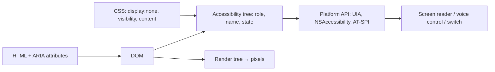
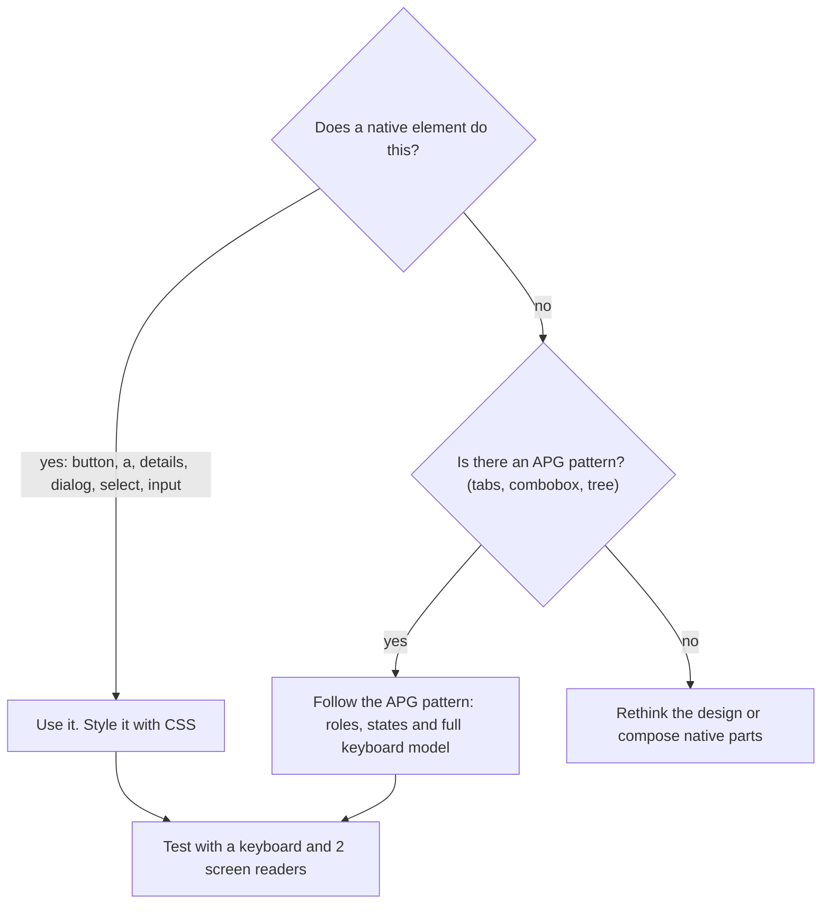

# HTML semantics & accessibility (WCAG, ARIA)

!!! abstract "Key takeaways"
    - Assistive technology reads the **accessibility tree**, which the browser builds from the DOM: each node has a **role, name and states**. Semantic HTML fills it in for free; a `<div>` with a click handler exposes nothing useful.
    - **WCAG 2.2** (W3C Recommendation October 2023, also ISO/IEC 40500:2025) is organised as **POUR** with levels A, AA and AAA. **AA is the target**. 2.2 added 9 criteria, including **Focus Not Obscured**, **Target Size 24×24 CSS px** and **Accessible Authentication**, and made 4.1.1 Parsing obsolete.
    - **First rule of ARIA:** use a native element if one exists. ARIA only changes what the tree *says*; it adds no focus, keyboard behaviour or styling.
    - The most common failures are unnamed icon buttons, unlabelled inputs, low contrast, missing focus styles, custom modals that leak focus and unannounced SPA route changes. `<dialog>` with `showModal()` makes the page **inert** and handles Esc for you.
    - Automated tools catch only part of the problem; a **keyboard pass and a screen-reader pass** are still needed. The EAA, the ADA Title II rule and the HHS Section 504 rule all require WCAG 2.1 AA.

## Why it matters

The WHO estimates that about one in six people has a significant disability, and many more are temporarily or situationally limited. They rely on screen readers (JAWS, NVDA, VoiceOver, TalkBack), magnifiers, voice control, switch access or just a keyboard, and all of these depend on correct semantics.

The web still does badly. The **WebAIM Million 2026** found detectable WCAG failures on **95.9%** of the top million home pages (**56.1 errors per page** on average). Six easy-to-fix types account for about 96% of them: low-contrast text, missing alt text, missing form labels, empty links, empty buttons and missing page language.

The legal pressure targets healthcare and banking directly:

| Regulation | Applies to | Standard | Dates |
|---|---|---|---|
| European Accessibility Act | EU banking, e-commerce, transport, e-books | EN 301 549 → WCAG 2.1 AA | Applies since 28 June 2025 |
| ADA Title II rule (DOJ, 2024) | US state and local government | WCAG 2.1 AA | Extended to April 2027 / April 2028 |
| HHS Section 504 rule (2024) | Hospitals, providers, health plans receiving HHS funds | WCAG 2.1 AA | Extended to May 2027 / May 2028 |

## Core concepts

### From DOM to accessibility tree

Alongside the render tree (see [Browser rendering pipeline](01-browser-rendering-pipeline-reflow-vs-repaint.md)), the browser builds an **accessibility tree** of meaningful nodes, each with:

- **Role:** `button`, `link`, `heading` (level 2), `textbox`, `dialog`, `navigation`.
- **Name:** computed by W3C AccName in this order: `aria-labelledby`, `aria-label`, native labels (`<label>`, `alt`, `<legend>`, `<caption>`), text content for roles that allow it, then `title`.
- **Description:** usually from `aria-describedby`.
- **States:** `checked`, `expanded`, `disabled`, `invalid`, `required`, `current`.

The OS accessibility API (UI Automation, NSAccessibility, AT-SPI) passes the tree to AT. You can inspect it in the DevTools Accessibility pane.


*Notice that the screen reader never sees pixels. CSS matters only where it changes the tree, such as `display:none`.*

{ loading=lazy }
*The two controls look the same on screen. Only one of them exists for keyboard and screen-reader users.*

### Semantic HTML: the free 80%

- **Landmarks:** `<header>`, `<nav>`, `<main>` (one per page), `<aside>`, `<footer>`. Users jump between them.
- **Headings:** one `<h1>`, then levels in order. Many screen-reader users skim a page by its headings.
- **Controls:** `<button>` for actions, `<a href>` for navigation. Both are focusable and keyboard-operable by default.
- **Forms:** `<label for>`, `<fieldset>` + `<legend>` for radio groups, `required`, the right `type`, and `autocomplete` tokens (1.3.5).
- **Images and language:** `alt` states the purpose, `alt=""` for decoration, `aria-hidden="true"` on icon SVGs, and `<html lang>` plus a unique `<title>` on every page.

### WCAG 2.2 in one screen

WCAG 2.2 has 4 principles and 86 testable success criteria. A page conforms to AA only if every A and AA criterion passes.

| Principle | Criteria interviewers ask about (**bold** = new in 2.2) |
|---|---|
| **Perceivable** | 1.1.1 Text alternatives; 1.3.1 Info and relationships; 1.4.3 Contrast **4.5:1** (large text 3:1); 1.4.11 Non-text contrast 3:1; 1.4.10 Reflow at 320 CSS px |
| **Operable** | 2.1.1 Keyboard; 2.1.2 No keyboard trap; 2.4.3 Focus order; 2.4.7 Focus visible; **2.4.11 Focus not obscured (AA)**; **2.5.7 Dragging movements (AA)**; **2.5.8 Target size 24×24 (AA)** |
| **Understandable** | 3.3.1 Error identification; 3.3.2 Labels or instructions; **3.2.6 Consistent help (A)**; **3.3.7 Redundant entry (A)**; **3.3.8 Accessible authentication (AA)** |
| **Robust** | 4.1.2 Name, role, value; 4.1.3 Status messages. 4.1.1 Parsing is obsolete |

In practice, 2.4.11 means sticky headers and chat widgets must not completely hide the focused element. 2.5.7 means a drag-and-drop list needs single-pointer buttons too. 3.3.8 means login must allow paste and password managers, with no puzzle-only CAPTCHA. The other three new criteria (2.4.12, 2.4.13, 3.3.9) are AAA. WCAG 3.0 is still a Working Draft.

### ARIA: what it is and isn't

WAI-ARIA 1.2 adds roles, states and live regions for things HTML can't express, such as tabs, comboboxes, `aria-expanded`, `aria-current="page"` and status messages. The *Using ARIA* rules:

1. If a native element or attribute does the job, use it.
2. Don't change native semantics (`<h2 role="button">`).
3. Every interactive ARIA control must be keyboard-operable.
4. Never put `aria-hidden="true"` or `role="presentation"` on something focusable.
5. Every interactive element needs an accessible name.

`role="button"` does not make a `<div>` focusable or respond to Enter, hence "no ARIA is better than bad ARIA". WebAIM finds that pages using ARIA average *more* errors than pages without it, partly because they are more complex.


*Notice that ARIA is the second choice, and choosing it means you implement the keyboard behaviour.*

For live regions, use `role="status"` (polite) for "3 results found" and keep `role="alert"` for urgent messages only.

### Focus management

- **Tab order follows the DOM.** Never use a positive `tabindex`. Use `0` for custom widgets and `-1` for elements you focus from script.
- **Visible focus:** style `:focus-visible` with `outline`, which survives forced-colors mode (box-shadow does not).
- **Modals:** focus moves in, stays in, Esc closes, and focus returns to the trigger. `<dialog>` with `showModal()` does all of this: the rest of the page becomes **inert** and the dialog gets `aria-modal="true"`. For overlays that can't use `<dialog>`, put `inert` on the background yourself.
- **SPA navigation:** a client-side route change announces nothing. Update `document.title` and move focus to the new `<h1>`.

{ loading=lazy }
*Watch frame 3: in the div overlay, focus lands on a link the user cannot see. In the native dialog it can't leave the dialog.*

Platform status in 2026:

| Feature | Status | Benefit |
|---|---|---|
| `<dialog>`, `inert`, `:user-invalid` | Baseline widely available | Native modal, background removal, errors only after interaction |
| Popover API | Baseline since January 2025 | Light-dismiss menus and tooltips |
| Invoker commands (`commandfor`) | Baseline since December 2025 | Open dialogs and popovers without JS, `aria-expanded` set for you |
| `<dialog closedby="any">` | Chrome 134+, Firefox 141+, not Safari | Light dismiss for modal dialogs |

## In practice: code & configuration

### Icon button, form field and modal in React

=== "❌ Common mistake"
    ```tsx
    // Looks fine with a mouse. Broken for keyboard and screen-reader users.
    export function ClaimRow({ claim, onDelete }: Props) {
      const [open, setOpen] = useState(false);
      return (
        <>
          {/* div: not focusable, no role. Icon only: no accessible name */}
          <div className="icon-btn" onClick={() => setOpen(true)}>
            <TrashIcon />
          </div>

          {/* placeholder is not a label. Error shown in red only */}
          <input placeholder="Reason" className={err ? "red" : ""} />

          {/* custom overlay: focus leaks to the page behind, no Esc,
              focus is lost when it closes */}
          {open && (
            <div className="backdrop">
              <div className="modal">
                <p>Delete claim {claim.id}?</p>
                <div onClick={() => onDelete(claim.id)}>Delete</div>
              </div>
            </div>
          )}
        </>
      );
    }
    ```

=== "✅ Correct approach"
    ```tsx
    export function ClaimRow({ claim, onDelete }: Props) {
      const dialogRef = useRef<HTMLDialogElement>(null);
      const reasonId = useId();                       // stable ids for label/hint/error
      const [error, setError] = useState<string | null>(null);

      return (
        <>
          {/* native button: focusable, Enter/Space, role=button.
              Name includes the claim id so each "Delete" is distinct */}
          <button type="button" className="icon-btn"
                  aria-label={`Delete claim ${claim.id}`}
                  onClick={() => dialogRef.current?.showModal()}>
            <TrashIcon aria-hidden="true" focusable="false" />
          </button>

          <label htmlFor={reasonId}>Reason for deletion</label>
          <p id={`${reasonId}-hint`}>Visible to the member.</p>
          <input id={reasonId} required
                 aria-describedby={`${reasonId}-hint`}
                 aria-invalid={error ? true : undefined}
                 aria-errormessage={error ? `${reasonId}-err` : undefined} />
          {/* text plus icon, not colour alone (WCAG 1.4.1) */}
          {error && <p id={`${reasonId}-err`} className="error">⚠ {error}</p>}

          {/* showModal(): page becomes inert, Esc closes,
              focus goes back to the trigger button on close */}
          <dialog ref={dialogRef} aria-labelledby={`dlg-${claim.id}`}>
            <h2 id={`dlg-${claim.id}`}>Delete claim {claim.id}?</h2>
            <form method="dialog">                   {/* buttons close the dialog */}
              <button value="cancel" autoFocus>Cancel</button>
              <button value="delete" onClick={() => onDelete(claim.id)}>Delete</button>
            </form>
          </dialog>
        </>
      );
    }
    ```

### Focus styles and target size

```css
:where(a, button, input, select, textarea, [tabindex]):focus-visible {
  outline: 3px solid var(--focus, #4f46e5);   /* outline survives forced-colors mode */
  outline-offset: 2px;                         /* contrast ≥ 3:1 against both neighbours */
}
.icon-btn { min-inline-size: 24px; min-block-size: 24px; }  /* WCAG 2.5.8 AA (44px is better) */
html { scroll-padding-top: 4rem; }  /* sticky header can't hide focused items (2.4.11) */
@media (prefers-reduced-motion: reduce) {
  *, *::before, *::after { animation-duration: .01ms !important; transition-duration: .01ms !important; }
}
```

### SPA route announcement and automated checks

```tsx
// After a client-side navigation: update the title and move focus to the new h1.
export function PageHeading({ title }: { title: string }) {
  const ref = useRef<HTMLHeadingElement>(null);
  useEffect(() => {
    document.title = `${title} | Member portal`;
    ref.current?.focus();                 // the screen reader announces the heading
  }, [title]);
  return <h1 ref={ref} tabIndex={-1}>{title}</h1>;  // -1: focusable from script only
}

// Testing Library: query by role and name, which also tests accessibility.
expect(screen.getByRole("button", { name: /delete claim c-1042/i })).toBeEnabled();

// Playwright + axe in CI: fail the build on WCAG 2.2 A/AA violations.
const results = await new AxeBuilder({ page })
  .withTags(["wcag2a", "wcag2aa", "wcag21aa", "wcag22aa"]).analyze();
expect(results.violations).toEqual([]);
```

## Real-world usage

- **Design systems do most of the work.** MUI, Radix, React Aria and GOV.UK Frontend encode dialogs, menus and comboboxes once. Apps break them with wrappers that drop `aria-*` props, unnamed icon buttons and overridden focus styles. See [Design systems & component libraries](../frontend-architecture/04-design-systems-and-component-libraries.md).
- **Healthcare and banking** journeys (refills, schedulers, payments) are what the HHS 504, ADA and EAA rules target. Procurement often asks vendors for a **VPAT/ACR** conformance report.
- **Overlay widgets don't fix sites.** Disabled users and practitioners criticise "one line of JavaScript" overlays, and some vendors have faced lawsuits and regulators. Fix the source.

## Trade-offs & production gotchas

| Option | Pros | Cons | Use when |
|---|---|---|---|
| Native element | Semantics, keyboard and AT support for free | Some styling limits | Always the default |
| Headless library (React Aria, Radix) | Tested APG patterns, your styling | Dependency | Comboboxes, date pickers, tree grids |
| Hand-rolled ARIA widget | Full control | Easy to get the keyboard model wrong | Only with APG and screen-reader testing |
| Automated checks (axe, Lighthouse) | Cheap, run on every PR | Miss focus order, meaning, usability | Baseline CI gate |
| Manual keyboard + screen-reader audit | Finds real blockers | Slow, needs skill | Key journeys, before releases |

!!! warning "Gotcha: `aria-label` overrides visible text"
    `<button aria-label="Submit form">Send</button>` is announced as "Submit form", so a voice-control user who says "click Send" gets nothing. WCAG 2.5.3 *Label in Name* requires the name to contain the visible text.

!!! warning "Gotcha: hiding things"
    `display:none` hides content from everyone. Use a `.visually-hidden` clip class for screen-reader-only text, and never put `aria-hidden="true"` on a focusable element. Safari also drops list semantics from `<ul>` with `list-style: none`, so `role="list"` is a justified exception there.

!!! tip "Performance overlap"
    Semantic HTML means less JavaScript, and reserved image dimensions help [Core Web Vitals](04-core-web-vitals-and-performance-optimisation.md). A slow INP hurts keyboard and switch users most, because every key press waits for the main thread.

## How this connects to my experience

- **Where I used it:** not a specific resume claim; position it as transferable front-end knowledge. On **OptumRx Meteor** I **built the ReactJS application from the ground up and set up a micro-frontend architecture** for a healthcare platform serving **750K+ users**, with Material UI and Storybook in my skills. Pharmacy portals are exactly what the HHS Section 504 rule targets.
- **Talking points:**
    - MUI provides accessible primitives. The risks are in wrappers, icon buttons and custom overlays. Whether we ran axe or Storybook a11y checks in CI, and which WCAG level we targeted: *[confirm]*.
    - In micro-frontends the shell owns landmarks, the skip link and the announcer, and each MFE updates the title and focus on route change. Whether we did this: *[confirm]*.
    - Having set testing standards, I can argue for `getByRole` queries, which test accessibility as a side effect. See [Frontend testing](../testing/06-frontend-testing-jest-react-testing-library-e2e.md).
- **Likely follow-up chain:** "How did you make the React app accessible?" → MUI components, label and error patterns, focus styles, automated checks *[confirm]* → "How would you test a modal?" → keyboard pass (Tab, Shift+Tab, Esc, focus return), a screen reader, axe in Playwright → "A screen-reader user can't finish a refill. What do you do?" → reproduce with NVDA + Chrome or VoiceOver + Safari, inspect the tree, fix the component, add a regression test.

## Interview questions

### Fundamentals

??? question "Q1. What is semantic HTML and why does it matter for accessibility?"
    **Answer:** Using elements for their meaning (`button`, `nav`, `main`, headings, `label`) instead of generic `div`s. The browser maps them to roles, names and states in the accessibility tree, and native controls bring focus and keyboard behaviour. SEO and maintainability benefit too.

    **Interviewer listens for:** accessibility tree, built-in keyboard support, landmarks and headings.

    **Common wrong answer:** "It's mainly for SEO."

??? question "Q2. What are WCAG's levels and principles, and what's new in 2.2?"
    **Answer:** POUR: Perceivable, Operable, Understandable, Robust. Criteria are A, AA or AAA, and **AA** is the legal and contract target. 2.2 added Focus Not Obscured, Dragging Movements, Target Size 24×24, Consistent Help, Redundant Entry and Accessible Authentication at A/AA, plus three AAA criteria, and made 4.1.1 Parsing obsolete. Meeting 2.2 AA also meets 2.1 AA.

    **Interviewer listens for:** AA as the target, concrete 2.2 additions, backward compatibility.

    **Common wrong answer:** "Everyone should target AAA."

??? question "Q3. When should you use ARIA?"
    **Answer:** Only when HTML can't express the semantics: tabs, comboboxes, live regions, `aria-expanded`, `aria-current`. ARIA changes only the tree, so custom widgets must implement the APG keyboard model. Never override native semantics or hide focusable elements.

    **Interviewer listens for:** first rule of ARIA, "ARIA adds no behaviour".

    **Common wrong answer:** "Add `role="button"` to the div and you're done."

### Intermediate

??? question "Q4. How is an element's accessible name calculated?"
    **Answer:** `aria-labelledby`, then `aria-label`, then native labelling (`<label>`, `alt`, `<legend>`, `<caption>`), then content for buttons and links, then `title` or `placeholder` as a last resort. Prefer visible labels, and keep the visible text inside the name (2.5.3).

    **Interviewer listens for:** precedence, placeholder is not a label.

    **Common wrong answer:** "The placeholder is the label."

??? question "Q5. How do you build an accessible modal?"
    **Answer:** `<dialog>` with `showModal()`: top layer, inert background, `aria-modal`, Esc to close. Name it with `aria-labelledby`, set initial focus with `autofocus`, and focus returns to the trigger on close. Without `<dialog>`, you must add `inert`, Esc handling and focus restore yourself.

    **Interviewer listens for:** inert background, Esc, initial focus, focus return, a name.

    **Common wrong answer:** "A focus trap that loops Tab", while the background stays readable by a screen reader.

??? question "Q6. How do you make form errors accessible?"
    **Answer:** A visible `<label>`, hints via `aria-describedby`, and on error `aria-invalid="true"` with the message linked via `aria-errormessage`. Use text, not colour alone. On submit, focus the first invalid field or an error summary. Use `:user-invalid` so errors appear only after interaction, and keep the user's input.

    **Interviewer listens for:** programmatic link, focus on submit, not colour alone.

    **Common wrong answer:** "Turn the border red."

### Senior

??? question "Q7. What's different about accessibility in a single-page app?"
    **Answer:** Route changes don't load a page, so nothing is announced and focus may sit on a removed node. On each navigation, update `document.title` and focus the new `<h1 tabindex="-1">` or announce through a polite live region. Also handle toasts with `role="status"`, focus after deleting items, and in micro-frontends a shared announcer owned by the shell.

    **Interviewer listens for:** title, focus, live regions, ownership.

    **Common wrong answer:** "The router handles it."

??? question "Q8. How do you build accessibility into a team's process?"
    **Answer:** Accessible primitives in the design system. Design reviews for contrast, focus, target size and order. `eslint-plugin-jsx-a11y`, `getByRole` tests, and axe in Storybook and Playwright as a CI gate on WCAG 2.2 AA tags. A manual keyboard and screen-reader check in the definition of done. Periodic expert audits, with defects triaged by severity like security bugs.

    **Interviewer listens for:** shift-left, automation plus manual testing, the design system as the lever.

    **Common wrong answer:** "Run Lighthouse before release and aim for 100."

### Scenario-based

??? question "Q9. Lighthouse scores 100, but a blind user can't complete checkout. How?"
    **Answer:** Automated rules cover only part of WCAG. A perfect score still allows a dropdown with no keyboard support, focus behind a modal, a misleading `aria-label`, an inaccessible payment iframe, unannounced errors, a time-out or a CAPTCHA. Reproduce the journey with a screen reader and keyboard, inspect the tree, fix the components, add tests.

    **Interviewer listens for:** limits of automation, concrete failure modes, a reproduction process.

    **Common wrong answer:** "Lighthouse says we're compliant."

??? question "Q10. A sticky header hides focused links and icon buttons are 16 px. What fails and how do you fix it?"
    **Answer:** 2.4.11 Focus Not Obscured: add `scroll-padding-top` equal to the header height and keep chat launchers off content. 2.5.8 Target Size: 24×24 CSS px or enough spacing, via `min-inline-size`/`min-block-size` or padding, ideally 44 px on touch. Also check focus-ring contrast (1.4.11).

    **Interviewer listens for:** naming the 2.2 criteria, the CSS fixes.

    **Common wrong answer:** "Make the icons bigger", with no mention of focus.

## Cheat sheet

| Concept | Remember |
|---|---|
| Accessibility tree | Role, name, state; `display:none` removes nodes |
| WCAG 2.2 | Oct 2023, ISO/IEC 40500:2025; POUR; target **AA**; 4.1.1 obsolete |
| New AA | Focus not obscured, Dragging, Target 24×24, Accessible auth |
| Contrast | Text 4.5:1, large text and UI parts 3:1 |
| ARIA | Native first; ARIA adds no behaviour |
| Name order | `labelledby` > `aria-label` > label/alt > content > title |
| Modal | `showModal()`: inert page, Esc, focus return |
| SPA | Update title, focus `<h1 tabindex="-1">` |
| Testing | jsx-a11y, `getByRole`, axe in CI, keyboard, 2 screen readers |

## Sources
1. [W3C: WCAG 2.2](https://www.w3.org/TR/WCAG22/) and [What's New in WCAG 2.2](https://www.w3.org/WAI/standards-guidelines/wcag/new-in-22/): criteria, levels, 4.1.1 removal (text checked in [w3c/wcag](https://github.com/w3c/wcag/tree/main/guidelines/sc/22)).
2. [W3C: WCAG 2.2 approved as ISO/IEC 40500:2025](https://www.w3.org/WAI/news/2025-10-21/wcag22-iso).
3. [W3C: Using ARIA](https://w3c.github.io/using-aria/) and [MDN: ARIA](https://developer.mozilla.org/en-US/docs/Web/Accessibility/ARIA): rules of ARIA.
4. [W3C: Accessible Name and Description Computation 1.2](https://www.w3.org/TR/accname-1.2/): name precedence.
5. [WAI-ARIA Authoring Practices Guide](https://www.w3.org/WAI/ARIA/apg/): widget keyboard models.
6. [MDN: `<dialog>`](https://developer.mozilla.org/en-US/docs/Web/HTML/Reference/Elements/dialog): `showModal()`, inert, `aria-modal`, `autofocus`, `closedby`.
7. modern-web-guidance guides *accessibility*, *declarative-dialog-popover-control*, *platform-controls-dismiss-dialog*, *accessible-error-announcement* (retrieved October 2026): Baseline status and focus and live-region guidance.
8. [WebAIM Million](https://webaim.org/projects/million/): failure rates and ARIA correlation. The 2026 figures are via [Priority Pixels](https://prioritypixels.co.uk/insights/web-accessibility-is-getting-worse-according-to-the-2026-webaim-million-report/).
9. [EDUCAUSE Review: DOJ and HHS extend deadlines to 2027–2028](https://er.educause.edu/articles/2026/6/doj-and-hhs-extend-web-accessibility-deadlines-to-2027-2028) and [Duane Morris alert](https://www.duanemorris.com/alerts/doj_extends_ada_title_ii_digital_accessibility_deadlines_one_year_0426.html): ADA Title II and HHS 504 dates.
10. [Directive (EU) 2019/882, European Accessibility Act](https://eur-lex.europa.eu/eli/dir/2019/882/oj): scope and the June 2025 date.
11. [axe-core](https://github.com/dequelabs/axe-core) and [Playwright accessibility testing](https://playwright.dev/docs/accessibility-testing): CI integration.
