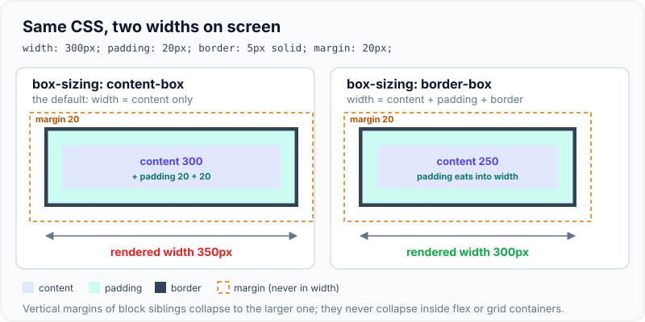
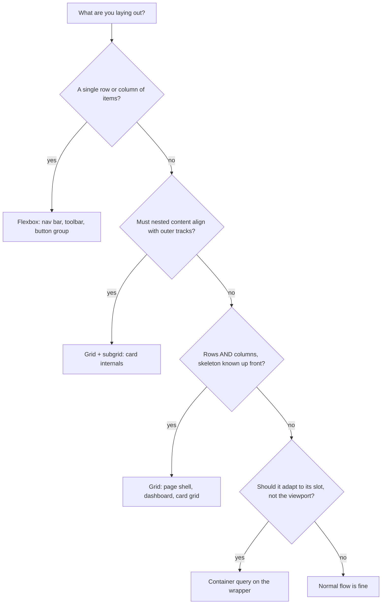
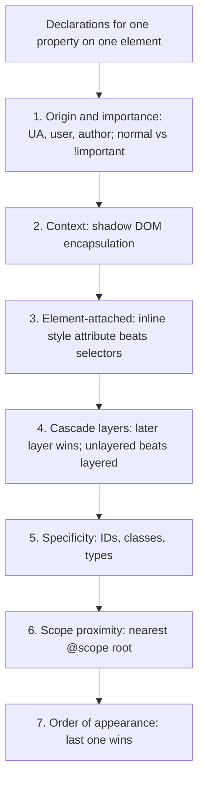

# CSS layout: box model, flexbox, grid, specificity

!!! abstract "Key takeaways"
    - Every element is a **box**: content, padding, border, margin. `width` means the **content** width by default (`content-box`); with `box-sizing: border-box` it includes padding and border. Vertical margins of block siblings **collapse**, but never inside flex or grid containers.
    - **Flexbox is one-dimensional and content-first**: items share free space along one axis using `flex: <grow> <shrink> <basis>`. **Grid is two-dimensional and layout-first**: you define tracks and items snap to them. **Subgrid** lets nested elements reuse the parent's tracks.
    - The cascade decides in order: **origin and importance → context → inline style → cascade layers → specificity → scope proximity → order of appearance**. Layers come **before** specificity, so a one-class unlayered rule beats an ID selector inside a layer.
    - Specificity is a triple **(IDs, classes/attributes/pseudo-classes, types/pseudo-elements)**, compared column by column. `:is()`, `:not()`, `:has()` and nesting take the weight of their most specific argument; `:where()` is always **0-0-0**.
    - Modern defaults (all Baseline): **`@layer`** and `:where()` instead of `!important` wars, **container queries** for components that adapt to their slot, **`:has()`** instead of JS-managed parent classes, **subgrid** for aligned card internals. `@scope` and container *style* queries are only newly Baseline (2026).

## Why it matters

Layout bugs are the most common front-end defects: a card that overflows on a long URL, a button that inherits the wrong colour from a third-party stylesheet, a footer that refuses to align across cards. Most come from three misunderstandings: what `width` measures, how flex items grow and shrink, and how the cascade picks a winner.

Tables and floats were hacks for page layout; flexbox (Baseline 2015) and grid (2017) replaced them. A second wave followed: cascade layers (2022), container queries and subgrid (2023), `:has()` and native nesting (Dec 2023). Interviewers use the topic to check whether you reason from first principles or stopped at Bootstrap-era CSS.

Layout also affects performance: changing geometry triggers **layout (reflow)** for the affected subtree, which is covered in [Browser rendering pipeline, reflow vs repaint](01-browser-rendering-pipeline-reflow-vs-repaint.md); unreserved space for late content causes layout shift, covered in [Core Web Vitals](04-core-web-vitals-and-performance-optimisation.md).

## Core concepts

### The box model

Each element generates a box with four areas: **content**, **padding**, **border**, **margin**. `box-sizing` decides what `width` and `height` measure:

- `content-box` (the initial value): `width` is the content only. Padding and border are added on top.
- `border-box`: `width` includes padding and border; the content shrinks to fit. Almost every codebase sets this globally because it matches how designers think.

{ loading=lazy }
*Same declarations, 50px difference on screen. Margin is never part of either width.*

**Margin collapsing:** vertical margins of adjacent block boxes (and of a parent and its first or last child) collapse into one margin equal to the larger. Margins of floats and absolutely positioned elements never collapse, nor do margins inside flex or grid containers. A new **block formatting context** (`display: flow-root`) stops parent–child collapsing.

### Flexbox: one axis, content first

A flex container lays items along a **main axis** (`flex-direction: row` by default) and aligns them on the **cross axis**. Sizing happens in three steps: each item starts at its **flex basis**; if there is free space, it is shared in proportion to `flex-grow`; if there is overflow, it is removed in proportion to `flex-shrink` × basis.

| Shorthand | Expands to | Meaning |
|---|---|---|
| `flex: initial` (default) | `0 1 auto` | Size from content/width, may shrink, never grows |
| `flex: auto` | `1 1 auto` | Start from content size, grow and shrink |
| `flex: 1` | `1 1 0%` | Ignore content size, share all space equally |
| `flex: none` | `0 0 auto` | Rigid |

`flex: 1` and `flex: auto` differ only in the basis: with `0%`, items end up equal width; with `auto`, longer content gets a wider item.

The classic surprise is the **automatic minimum size**: a flex item's `min-width` defaults to `auto`, which means "no smaller than its min-content width". A long URL or `<pre>` inside a flex item therefore refuses to shrink and overflows the container. The fix is `min-width: 0` (or `min-inline-size: 0`) on the item.

Use `gap` instead of child margins, and `margin-inline-start: auto` to push an item to the far end (there is no `justify-self` in flexbox).

### Grid: two axes, layout first

Grid defines **tracks** (rows and columns) first; items are placed into the cells. Key tools:

- `fr` shares leftover space; `minmax(min, max)` bounds a track; `repeat(auto-fit, minmax(240px, 1fr))` creates as many columns as fit: a responsive card grid with no media query. `auto-fill` keeps empty tracks; `auto-fit` collapses them so filled tracks stretch.
- `grid-template-areas` names regions (`"header header" "nav main"`), which reads like a picture of the layout.
- **Subgrid** (`grid-template-rows: subgrid`) makes a nested grid reuse its parent's tracks, so titles, bodies and buttons inside sibling cards line up even when their content heights differ (Baseline since September 2023).

The difference between the two models shows when content wraps:

{ loading=lazy }
*Each flex line is sized on its own; grid sizes columns once and every row shares them. If you want things to line up in both directions, you want grid.*


*Notice that the choice is per container: a grid page shell commonly holds flex toolbars and subgrid cards.*

### Responsive components: container queries

Media queries ask about the **viewport**; container queries ask about the **element's container**. A card used in a narrow sidebar and a wide main column can now lay itself out correctly in both, without knowing where it lives.

```css
.card-slot { container: card / inline-size; }   /* name + type: query width only */

.card { display: grid; gap: 1rem; }             /* stacked by default */
@container card (inline-size > 30rem) {
  .card { grid-template-columns: 10rem 1fr; }   /* side by side when the slot is wide */
}
.card h3 { font-size: clamp(1rem, 4cqi, 1.5rem); } /* cqi = 1% of container inline size */
```

`container-type: inline-size` applies size containment on the inline axis: the container's width can no longer depend on its children, which is what makes the query non-circular. Use `size` (both axes) only when the container has a definite height, otherwise it collapses. Size container queries are Baseline since February 2023; **style queries** (`@container style(--variant: compact)`) only became Baseline in May 2026.

### The cascade: how one declaration wins

When several declarations set the same property on the same element, the cascade sorts them by these criteria, stopping at the first that differs (CSS Cascade 5 and 6):


*Notice that specificity is fifth. Most "specificity wars" are really problems of origin, importance or layers.*

For **`!important`** the order inverts: important user-agent beats important user beats important author, and within author styles an important declaration in the **first** layer beats one in a later layer or unlayered. That is deliberate: a reset layer can protect a rule (`[hidden] { display: none !important }`) from everything above it.

{ loading=lazy }
*Rule A has an ID and still loses: layers are compared before specificity.*

### Specificity

Specificity is computed per selector as three columns, compared left to right (no carrying: 0-11-0 loses to 1-0-0):

| Column | Counts | Example |
|---|---|---|
| A (IDs) | `#id` | `#app` = 1-0-0 |
| B (classes) | `.class`, `[attr]`, `:hover` and other pseudo-classes | `.btn:hover` = 0-2-0 |
| C (types) | `div`, `::before` and other pseudo-elements | `ul li::marker` = 0-0-3 |
| None | `*`, combinators (`>`, `+`, `~`, space), `:where()` | `:where(#app) a` = 0-0-1 |

Special cases interviewers probe:

- `:is()`, `:not()` and `:has()` add the specificity of their **most specific argument**: `:is(#nav, .menu) a` is 1-0-1 even when it matched via `.menu`.
- **Nesting** behaves like `:is()`: `.card { & .title {} }` is `.card .title`, 0-2-0; with a selector list parent it takes the highest.
- `:where()` is always 0-0-0, which makes it ideal for library defaults that consumers can override with any selector.
- Inline `style=""` sits above all selector specificity (it is the element-attached step), and only `!important` beats it.

### Cascade layers, :where() and @scope

`@layer` gives you explicit priority zones, declared once at the top:

```css
@layer reset, base, vendor, components, utilities;   /* order = priority, last wins */
@import url("vendor/datepicker.css") layer(vendor);  /* third-party CSS boxed into a layer */
```

Any rule in `utilities` beats any rule in `components`, whatever the selectors' specificity, and unlayered rules beat all layers. Inside a layer, `:where()` keeps selectors flat so they compete only on meaningful signals. `revert-layer` rolls a property back to the value from the previous layer. Cascade layers are Baseline since March 2022.

`@scope (.card) to (.content) { … }` limits rules to a subtree and adds **scope proximity**: on a specificity tie, the closer scope root wins (useful for nested themes). It is Baseline only since March 2026, so treat it as progressive enhancement.

**`:has()`** matches an element by its descendants or following siblings (`form:has(:user-invalid)`, `.card:has(img)`), replacing many "add a class to the parent from JavaScript" patterns. It can't be nested or contain pseudo-elements; Baseline since December 2023.

## In practice: code & configuration

Overriding a component library is where most specificity pain appears. MUI with Emotion injects its styles at runtime, and teams historically fought it with IDs and `!important`.

=== "❌ Common mistake"
    ```css
    /* Escalation: each fix forces the next one to be stronger. */
    #root .MuiButton-root.MuiButton-containedPrimary {   /* 1-2-0 just to beat the library */
      background: #0b6e4f !important;                   /* and !important "to be sure" */
    }

    /* Media query couples the card to the viewport, not the slot it sits in. */
    @media (min-width: 900px) {
      .claim-card { display: flex; }                    /* breaks when placed in a 320px sidebar */
    }
    .claim-card .member-id { white-space: nowrap; }     /* long ID overflows the flex item */
    ```

=== "✅ Correct approach"
    ```css
    /* One declaration of priority, then plain selectors everywhere. */
    @layer reset, mui, components, utilities;           /* MUI's styles go into the mui layer */

    @layer components {
      .claim-card-slot { container: claim / inline-size; }
      .claim-card { display: grid; gap: 1rem; }
      @container claim (inline-size > 36rem) {
        .claim-card { grid-template-columns: 12rem 1fr; }  /* adapts to the slot */
      }
      .claim-card > * { min-inline-size: 0; }           /* allow long content to shrink */
      .claim-card:has(.status-denied) { border-color: var(--color-danger); } /* no JS class */
      .brand-button { background: var(--color-brand); } /* 0-1-0 beats any mui-layer rule */
    }
    ```

```tsx
// MUI v7 documents an enableCssLayer option that wraps all MUI styles in @layer mui.
// The layer-order statement must come first so "components" outranks "mui".
import { StyledEngineProvider } from '@mui/material/styles';
import GlobalStyles from '@mui/material/GlobalStyles';

export function AppStyles({ children }: { children: React.ReactNode }) {
  return (
    <StyledEngineProvider enableCssLayer>
      <GlobalStyles styles="@layer reset, mui, components, utilities;" />
      {children}
    </StyledEngineProvider>
  );
}
```

Subgrid for aligned card internals, with a same-cascade fallback for older browsers:

```css
.cards {
  display: grid;
  grid-template-columns: repeat(auto-fit, minmax(16rem, 1fr));
  gap: 1rem;
}
.card {
  grid-row: span 3;                 /* title, body, actions */
  display: grid;
  grid-template-rows: auto 1fr auto; /* fallback: ignored where subgrid works */
  grid-template-rows: subgrid;       /* titles and buttons align across cards */
}
```

## Real-world usage

- **Design systems and component libraries** are the main users of `@layer` and `:where()`: library defaults with zero or layered specificity let product teams override with a single class. Tailwind CSS v4 emits its output in `theme`, `base`, `components` and `utilities` layers, and MUI added an opt-in `@layer mui` so the two can coexist without `!important`.
- **Micro-frontends** share one document, so one team's global selector can restyle another team's widget. Defences: CSS Modules or CSS-in-JS generated class names, no global resets inside remotes, Shadow DOM for web components, and a shell that owns the layer order (see [Micro-frontends](../frontend-architecture/01-micro-frontends-approaches-and-trade-offs.md) and [Design systems](../frontend-architecture/04-design-systems-and-component-libraries.md)).
- **Dashboards and portals** (healthcare member portals, banking back-office screens) are grid-heavy: page shells with `grid-template-areas`, data panels that must work in a full-width page and in a drawer, which is exactly the container-query use case.
- **Known failure modes:** `overflow: hidden` used to hide a flex overflow bug, clipping focus rings and dropdowns; `order` or `flex-direction: row-reverse` making visual order differ from tab order (an accessibility failure under WCAG 2.4.3, see [HTML semantics & accessibility](02-html-semantics-and-accessibility.md)); `100vw` widths causing horizontal scroll because they include the scrollbar.

## Trade-offs & production gotchas

| Option | Pros | Cons | Use when |
|---|---|---|---|
| Flexbox | Content-driven sizing, easy alignment, wraps | Lines sized independently, no cross-row alignment | One row or column: nav, toolbar, chips |
| Grid | True 2D, tracks shared by all rows, named areas | More up-front structure | Page shells, card grids, forms with aligned labels |
| Subgrid | Aligns grandchildren to outer tracks | Needs fixed child count per axis | Card title/body/CTA alignment |
| Media queries | Viewport and user preferences | Component doesn't know its slot | Page-level breakpoints, `prefers-*` |
| Container queries | Component adapts wherever it is placed | Needs an explicit container with containment | Reusable cards, widgets, MFE components |
| `@layer` + `:where()` | Priority by intent, not selector weight | Must declare order early; unlayered CSS beats all layers | New design systems, taming vendor CSS |

!!! warning "Gotcha: unlayered CSS beats every layer"
    Adopting layers gradually can backfire: your old unlayered stylesheet now beats **everything** you move into layers, including utilities. Put legacy CSS into its own low-priority layer (`@import url(legacy.css) layer(legacy)`) rather than leaving it unlayered.

!!! warning "Gotcha: flex items won't shrink below their content"
    `min-width: auto` on flex items (and `minmax(auto, …)` behaviour on grid items) means a long token blows out the layout. Add `min-inline-size: 0` on the item or use `minmax(0, 1fr)` tracks, and `overflow-wrap: anywhere` for user-supplied strings such as IDs and URLs.

## How this connects to my experience

- **Where I used it:** not a ★ resume claim; position as transferable knowledge. The closest fit is OptumRx Meteor at Publicis Sapient: **"Built the ReactJS application from the ground up and established a micro-frontend architecture"**, with **Material UI** and **Storybook** listed in my frontend skills. Layout and style isolation between micro-frontends are the CSS problems that architecture creates.
- **Talking points:**
    - How MUI theming and overrides were done (theme `components` overrides, `sx`, `styled`) and whether we hit specificity fights with Emotion: *[confirm]*.
    - How styles were isolated between micro-frontends (CSS Modules, Emotion cache per remote, naming prefixes): *[confirm]*.
    - Responsive layout approach on the member-facing app (MUI `Grid`, breakpoints, any container queries): *[confirm]*.
    - What I'd do today: a shell-owned `@layer` order with MUI in `@layer mui`, design tokens as custom properties, container queries for widgets that render in more than one slot, Storybook stories at several container widths.
- **Likely follow-up chain:** "Your button override isn't applying, why?" → check the Styles pane: origin, `!important`, layer, then specificity → "How would you stop this across 5 teams' MFEs?" → shell declares layer order, libraries in low layers, scoped class names, no global resets in remotes, visual regression per MFE → "Why not just add `!important`?" → it inverts layer order, escalates, and can't be overridden by normal rules or consumers.

## Interview questions

### Fundamentals

??? question "Q1. Explain the CSS box model and box-sizing."
    **Answer:** Each box has content, padding, border and margin. With the default `content-box`, `width` sets the content width, so padding and border add to the rendered size (300 + 2×20 + 2×5 = 350px). With `border-box`, `width` includes padding and border and the content shrinks. Margin is outside both. Most codebases set `border-box` on all elements because it makes widths predictable.

    **Interviewer listens for:** which areas are inside `width` in each mode; margin is never included.

    **Common wrong answer:** "border-box includes the margin."

??? question "Q2. How is specificity calculated, and what doesn't count?"
    **Answer:** Three columns: IDs; classes, attributes and pseudo-classes; types and pseudo-elements. Compare left to right; any ID beats any number of classes. The universal selector, combinators and `:where()` add nothing. `:is()`, `:not()`, `:has()` and nesting add their most specific argument. Inline styles aren't part of specificity; they sit in an earlier cascade step, and only `!important` beats them.

    **Interviewer listens for:** column comparison without carrying, `:where()` zero, `:is()` max argument.

    **Common wrong answer:** "IDs are 100 points and classes 10, so 11 classes beat an ID."

??? question "Q3. When do you choose flexbox and when grid?"
    **Answer:** Flexbox for one-dimensional distribution where content drives size: nav bars, toolbars, button groups. Grid when you need rows and columns that line up, or want to define the skeleton first: page shells, card grids, forms. Wrapping flex lines are sized independently, so the last line stretches; an auto-fit grid keeps it aligned. They nest freely.

    **Interviewer listens for:** 1D vs 2D, content-first vs layout-first, the wrapping difference.

    **Common wrong answer:** "Grid replaced flexbox."

### Intermediate

??? question "Q4. What's the difference between flex: 1 and flex: auto?"
    **Answer:** `flex: 1` is `1 1 0%`: the basis is zero, so all space is shared by grow factor and items come out equal. `flex: auto` is `1 1 auto`: items start at their content or `width` size and only the leftover is shared, so longer content gets wider items. The initial value is `0 1 auto`: shrink but don't grow.

    **Interviewer listens for:** the basis is the difference.

    **Common wrong answer:** "They're the same."

??? question "Q5. A flex item with a long URL overflows its container. Why, and how do you fix it?"
    **Answer:** Flex items have `min-width: auto`, which resolves to their min-content size, so they can't shrink below the longest unbreakable string. Set `min-width: 0` (or `min-inline-size: 0`) on the item and allow wrapping with `overflow-wrap: anywhere`. In grid, use `minmax(0, 1fr)` instead of `1fr`.

    **Interviewer listens for:** the automatic minimum size; not "add overflow: hidden".

    **Common wrong answer:** "Add `overflow: hidden` to the container," which hides the bug and clips content.

??? question "Q6. What are cascade layers and how do they change specificity fights?"
    **Answer:** `@layer` groups rules into named layers whose priority is set by declaration order (`@layer reset, base, components, utilities;`). The cascade compares layers **before** specificity, so any rule in a later layer beats any rule in an earlier one regardless of selectors, and unlayered styles beat all layers. For `!important` the order reverses, so early layers can protect rules. You can import third-party CSS into a low layer with `@import … layer(vendor)`.

    **Interviewer listens for:** layers before specificity, unlayered wins, `!important` inversion.

    **Common wrong answer:** "Layers add specificity to their rules."

### Senior

??? question "Q7. Walk through how the browser decides which declaration wins."
    **Answer:** Filter to declarations that apply to the element (matching selector, active media/container condition). Then sort: origin and importance (UA, user, author; important reverses order), context (shadow DOM), element-attached inline styles, cascade layers, specificity, scope proximity for `@scope`, and finally order of appearance. The first criterion that differs decides. Animations sit above normal author styles and transitions above everything.

    **Interviewer listens for:** specificity isn't first; layers and `!important` placement; order last.

    **Common wrong answer:** "Highest specificity wins, then last one."

??? question "Q8. How would you prevent CSS collisions between micro-frontends on one page?"
    **Answer:** Locally scoped class names (CSS Modules, CSS-in-JS) so selectors can't leak; no global resets or element selectors in remotes; the shell owns global CSS and the `@layer` order, with shared libraries in a low layer; design tokens as custom properties from the shell; one shared instance of MUI/Emotion; Shadow DOM where widgets are web components. Enforce with stylelint rules and visual regression tests per MFE.

    **Interviewer listens for:** ownership of global CSS, scoping mechanism, layer order, governance.

    **Common wrong answer:** "Use more specific selectors or `!important` in each MFE."

### Scenario-based

??? question "Q9. Cards in a grid have different title lengths, so their buttons don't line up. Fix it without fixed heights."
    **Answer:** Make each card span the rows it needs (`grid-row: span 3`) and set `grid-template-rows: subgrid` on the card so title, body and actions use the parent's row tracks. Each row track sizes to the tallest item in that row across cards, so the buttons align. Put an explicit `grid-template-rows: auto 1fr auto` before it as a fallback. A flex-column card with `margin-top: auto` on the button only aligns the bottoms, not the titles.

    **Interviewer listens for:** subgrid, why fixed heights fail with real content, the fallback.

    **Common wrong answer:** "Set `min-height` on the titles" or "equalise heights with JavaScript."

## Cheat sheet

| Concept | Remember |
|---|---|
| `box-sizing` | `content-box` (default) adds padding + border; `border-box` includes them |
| Margin collapse | Vertical, block flow only; not in flex/grid; `display: flow-root` stops parent–child |
| `flex` | `initial` = `0 1 auto`, `auto` = `1 1 auto`, `1` = `1 1 0%`, `none` = `0 0 auto` |
| Flex overflow | `min-width: 0` on the item; grid uses `minmax(0, 1fr)` |
| Grid | `repeat(auto-fit, minmax(16rem, 1fr))`; `auto-fill` keeps empty tracks |
| Subgrid | `grid-template-rows: subgrid`; aligns card internals; Baseline 2023 |
| Cascade order | Origin/importance → context → inline → layers → specificity → scope → order |
| Specificity | (IDs, classes, types); `:where()` = 0; `:is/:not/:has` = max argument |
| `@layer` | Later layer wins; unlayered beats layers; `!important` reverses |
| Container query | `container: name / inline-size;` then `@container name (inline-size > 30rem)` |
| `:has()` | Parent/sibling-aware selector; no nesting, no pseudo-elements; Baseline Dec 2023 |
| Newly Baseline (2026) | `@scope`, container style queries; progressive enhancement |

## Sources
1. [MDN: Introduction to the CSS cascade](https://developer.mozilla.org/en-US/docs/Web/CSS/Guides/Cascade/Introduction): cascade sorting order, layered vs unlayered precedence, `!important` inversion, complete cascade order table.
2. [MDN: Specificity](https://developer.mozilla.org/en-US/docs/Web/CSS/Guides/Cascade/Specificity): weight columns, `:is()`/`:not()`/`:has()`/nesting exceptions, `:where()`, inline styles, `@scope` effect.
3. [W3C: CSS Cascading and Inheritance Level 6](https://www.w3.org/TR/css-cascade-6/): scope proximity placed after specificity in the cascade sort (read from the CSSWG editor's draft source).
4. [MDN: @layer](https://developer.mozilla.org/en-US/docs/Web/CSS/Reference/At-rules/@layer): layer ordering, important declarations in layers, `revert-layer`.
5. [MDN: flex](https://developer.mozilla.org/en-US/docs/Web/CSS/Reference/Properties/flex): shorthand expansions (`initial`, `auto`, `none`, `<number>` → basis `0%`).
6. [MDN: Mastering margin collapsing](https://developer.mozilla.org/en-US/docs/Web/CSS/Guides/Box_model/Margin_collapsing): collapse rules, floats/absolute, flex and grid exception, block formatting contexts.
7. [web-features / Baseline data](https://github.com/web-platform-dx/web-features): Baseline dates for cascade layers (2022), container queries (2023), subgrid (2023), `:has()` and nesting (Dec 2023), `@scope` (Mar 2026), container style queries (May 2026).
8. [modern-web-guidance: "css" and "css-layout" guides](https://www.npmjs.com/package/modern-web-guidance): current recommendations on layers, `:where()`, `:has()`, container queries, subgrid fallbacks, flexbox `min-inline-size: 0`.
9. [MUI: CSS Layers](https://mui.com/material-ui/customization/css-layers/): `enableCssLayer` on `StyledEngineProvider` and layer-order declaration with Tailwind v4.
10. [CSS Flexible Box Layout Module Level 1](https://www.w3.org/TR/css-flexbox-1/) and [CSS Grid Layout Module Level 2](https://www.w3.org/TR/css-grid-2/): flex sizing algorithm, automatic minimum size, subgrid.
