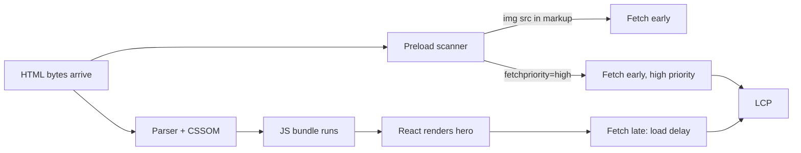
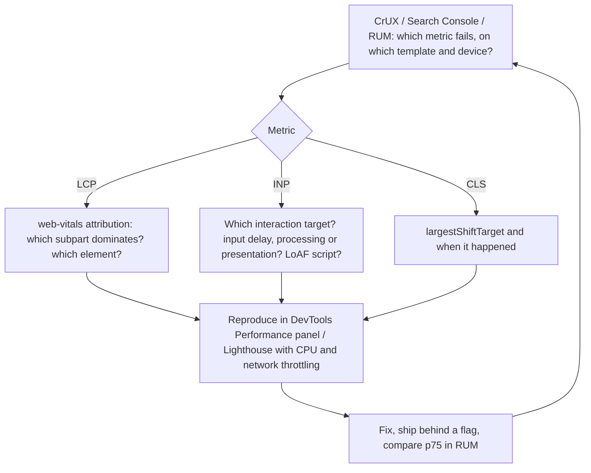

# Core Web Vitals & performance optimisation

!!! abstract "Key takeaways"
    - The three **Core Web Vitals** are **LCP** (loading: largest image or text block painted, good ≤ **2.5 s**, poor > 4 s), **INP** (responsiveness: worst click, tap or key interaction to the next paint, good ≤ **200 ms**, poor > 500 ms) and **CLS** (visual stability: largest burst of unexpected layout shifts, good ≤ **0.1**, poor > 0.25). A page passes when the **75th percentile** of real page views is good, for mobile and desktop separately.
    - **INP replaced FID** on 12 March 2024. FID only measured the input delay of the *first* interaction; INP covers every interaction and all three phases: **input delay + processing + presentation delay**.
    - Optimise LCP by its four **subparts**: TTFB, resource load delay, resource load duration, element render delay. The usual win is the **load delay**: put the LCP image in the server HTML, give it `fetchpriority="high"`, and never `loading="lazy"` it.
    - Optimise INP by keeping the main thread free: break tasks over **50 ms**, yield with `scheduler.yield()` (fallback `setTimeout`), do the visible update first and defer the rest, and use React transitions. Optimise CLS by **reserving space** (`width`/`height`, `aspect-ratio`, skeletons) and animating with `transform`.
    - **Field data decides, lab data explains.** CrUX and RUM (the `web-vitals` library with attribution) tell you which metric fails for whom; Lighthouse and DevTools traces tell you why. Lighthouse has no INP; Total Blocking Time is its lab proxy.

## Why it matters

Before 2020, teams optimised `onload`, DOMContentLoaded or "page weight", none of which says what the user sees. Google's Web Vitals initiative picked three user-centric metrics, set thresholds from research on perceived quality, and measured them on real Chrome users through the **Chrome UX Report (CrUX)**. Core Web Vitals are part of Google Search's page experience signals, but the stronger reason to care is conversion: in published web.dev case studies, Vodafone saw **8% more sales** from a 31% better LCP in an A/B test, and redBus reported about **7% more sales** after its INP work.

The metrics also map cleanly onto browser internals, which is why interviewers like them: LCP tests whether you understand the critical rendering path and resource priorities, INP tests the event loop and main thread (see [Browser rendering pipeline](01-browser-rendering-pipeline-reflow-vs-repaint.md)), and CLS tests layout.

## Core concepts

### The three metrics and how they are scored

| Metric | Measures | Good | Poor | Field APIs (2026) |
|---|---|---|---|---|
| **LCP** Largest Contentful Paint | Render time of the largest image, video poster or text block in the viewport | ≤ 2.5 s | > 4.0 s | Chromium, Firefox, Safari 26.2+ |
| **INP** Interaction to Next Paint | Latency from a click, tap or key press to the next frame, for (nearly) the worst interaction of the visit | ≤ 200 ms | > 500 ms | Chromium, Firefox, Safari 26.2+ (Event Timing) |
| **CLS** Cumulative Layout Shift | Largest session window of unexpected layout-shift scores | ≤ 0.1 | > 0.25 | Chromium only |

Supporting metrics: **TTFB** (good ≤ 0.8 s) and **FCP** (good ≤ 1.8 s) are diagnostics for LCP; **TBT** (Total Blocking Time) is the lab stand-in for INP.

Scoring rules worth knowing:

- **75th percentile** of page views, so a fix must help most users, not the median. CrUX reports a rolling 28-day window, so a deploy takes weeks to show fully. (Same reasoning as [latency percentiles](../performance-engineering/06-latency-percentiles-tail-latency.md).)
- **CrUX is Chrome-only and opt-in.** Your own RUM sees Safari and Firefox users too, which is why the numbers differ.
- **LCP stops** at the first user input; candidates are ``, `<image>` in SVG, video posters and first frames, CSS `background-image` via `url()`, and block-level text. Full-viewport and opacity-0 elements are excluded as "not contentful".
- **INP** reports the worst interaction, but ignores one highest interaction for every 50, so a single hiccup on a long-lived page doesn't dominate. Hover and scroll don't count. A page with no interactions has no INP.
- **CLS** groups shifts into **session windows** (gap < 1 s, window ≤ 5 s) and reports the largest window. Shifts within **500 ms** of a discrete input (`hadRecentInput`) and `transform` animations are excluded, because the user expected them.

### LCP: four subparts

LCP time is the sum of four consecutive parts. web.dev's guidance for a well-optimised page is roughly 40% TTFB, under 10% load delay, 40% load duration, under 10% render delay.

| Subpart | From → to | Typical cause when large | Fix |
|---|---|---|---|
| TTFB | Navigation start → first byte of HTML | Slow origin, redirects, no CDN | CDN, edge caching, streaming SSR, fewer redirects |
| Resource load delay | TTFB → LCP resource request starts | Image discovered late: injected by JS, CSS background, `loading="lazy"`, low priority | `` in server HTML, `fetchpriority="high"`, `preload` for CSS backgrounds |
| Resource load duration | Request → last byte | Big file, slow connection, cross-origin connection setup | AVIF/WebP, `srcset`+`sizes`, CDN, `preconnect` |
| Element render delay | Resource loaded → painted | Render-blocking CSS/JS, client-side rendering still running, hidden behind A/B test script | Inline critical CSS, `defer`/module scripts, SSR the hero, avoid anti-flicker snippets |

{ loading=lazy }
*Watch the amber bar: the server didn't get faster; the browser simply found and requested the image sooner.*

Why discovery matters: the browser's **preload scanner** reads raw HTML ahead of the parser and starts fetches early, but it cannot see images created by JavaScript or referenced only in CSS. Even when found, images start at low priority until layout proves they are in the viewport. `fetchpriority="high"` (Baseline since October 2024) tells the browser to request it at high priority straight away.


*Notice that a client-rendered hero waits for HTML, CSS, the bundle and a render before its image request even starts.*

### INP: three phases

An interaction's latency is **input delay** (the main thread is busy when the event arrives) + **processing** (your event handlers, including React state updates and re-render) + **presentation delay** (style, layout, paint and commit of the next frame). Any task over **50 ms** is a *long task* and a source of input delay for whatever the user does next.

{ loading=lazy }
*The total work is the same in both rows; yielding only changes when the user's input gets a turn.*

Fixes by phase:

- **Input delay:** split hydration and startup work, defer third-party scripts, avoid `setInterval` polling, code-split so less JavaScript is parsed and evaluated up front.
- **Processing:** do the visible update first, then yield and defer the rest (analytics, persistence); `debounce` rapid inputs; move heavy computation to a Web Worker; in React 18/19 mark non-urgent updates with `startTransition` or `useDeferredValue` so they are interruptible (see [React concurrent rendering](../react/08-react-18-19-concurrent-rendering-transitions-actions-use-rea.md)).
- **Presentation delay:** keep the DOM small, avoid layout thrashing (reading `offsetHeight` after writing styles), virtualise long lists, and use `content-visibility: auto` on large off-screen sections so the browser skips their layout and paint.

`scheduler.yield()` (Chrome 129+, Firefox 142+, not Safari) puts the continuation at the **front** of the task queue, unlike `setTimeout(0)`, which sends it to the back behind other scripts. Feature-detect and fall back.

### CLS: impact × distance

Each animation frame with shifting elements gets a score = **impact fraction** (share of the viewport covered by the union of the old and new positions of the moved elements) × **distance fraction** (largest move divided by the viewport's larger dimension).

{ loading=lazy }
*One late image without dimensions is enough to fail CLS on its own.*

Common causes: images, iframes and ads without reserved space; web fonts swapping to a fallback with different metrics; content injected above existing content (cookie banners, "new posts" bars); animating `top`/`height` instead of `transform`; and in SPAs, a route that renders an empty shell and then fills in data. Fixes: `width`/`height` or `aspect-ratio`, `min-height` slots for ads and late micro-frontends, skeletons with the final size, `font-size-adjust` or metric-compatible fallbacks, overlays instead of push-down banners, and `contain-intrinsic-size` whenever you use `content-visibility: auto` (without it the hidden section collapses to 0 height and the scrollbar jumps).

### Measure in the field, debug in the lab


*Notice that the loop starts and ends with field data: a green Lighthouse score on a developer laptop proves nothing about p75 on mid-range Android.*

The `web-vitals` attribution build reports the LCP subparts, the INP phases plus the longest script from the **Long Animation Frames (LoAF)** API (Chromium), and the largest CLS shift's target. It also re-reports after a **bfcache** restore, which is the cheapest performance win there is: a back/forward navigation from bfcache is instant. Pages are excluded from bfcache by `unload` handlers and, historically, by `Cache-Control: no-store` on the document.

## In practice: code & configuration

The classic React mistake is a client-rendered, lazy hero with no dimensions: it fails LCP (late discovery) and CLS (no reserved space) at once.

=== "❌ Common mistake"
    ```tsx
    // Hero.tsx: the LCP element only exists after the bundle runs and the API answers.
    export function Hero() {
      const { data } = useQuery({ queryKey: ['hero'], queryFn: fetchHero });
      if (!data) return <Spinner />;                    // empty shell, then a shift
      return (
        
      );
    }
    ```

=== "✅ Correct approach"
    ```tsx
    // Hero URL known at build/SSR time (CMS at render, or a stable path), so it is in the HTML.
    export function Hero({ hero }: { hero: { src: string; alt: string } }) {
      return (
        <picture>
          <source type="image/avif" srcSet={`${hero.src}-800.avif 800w, ${hero.src}-1600.avif 1600w`}
                  sizes="100vw" />
                                                       {/* no loading="lazy" on the LCP image */}
        </picture>
      );
    }
    // Below-the-fold images: loading="lazy" + width/height, and no fetchpriority.
    ```

Breaking up a long handler, with a fallback for Safari:

```ts
const yieldToMain = (): Promise<void> =>
  'scheduler' in globalThis && 'yield' in (globalThis as any).scheduler
    ? (globalThis as any).scheduler.yield()                 // continuation jumps the queue
    : new Promise(resolve => setTimeout(resolve, 0));     // fallback: back of the queue

async function onApplyFilter(rows: Claim[]) {
  setFilterChipActive(true);            // 1. visible feedback first
  await yieldToMain();                  // 2. let the browser paint it
  let deadline = performance.now() + 50;
  for (const row of rows) {             // 3. heavy work in ~50 ms slices
    index(row);
    if (performance.now() >= deadline) { await yieldToMain(); deadline = performance.now() + 50; }
  }
}
```

Field measurement with attribution, sent to your own endpoint:

```ts
import { onCLS, onINP, onLCP } from 'web-vitals/attribution';

function send(metric: { name: string; value: number; rating: string; attribution: unknown }) {
  navigator.sendBeacon('/rum', JSON.stringify({
    name: metric.name, value: metric.value, rating: metric.rating,
    route: location.pathname, attribution: metric.attribution,   // LCP subparts, INP phases + LoAF script, CLS target
  }));                                                             // sendBeacon survives page hide
}
onLCP(send); onINP(send); onCLS(send);                             // call once per page load
```

Skipping rendering for long, below-the-fold sections (Baseline since September 2025; ignored where unsupported):

```css
.claims-history > section {
  content-visibility: auto;                 /* skip layout/paint until near the viewport */
  contain-intrinsic-size: auto 40rem;       /* placeholder size; 'auto' remembers the real one */
}
```

## Real-world usage

- **E-commerce and media** track CWV per page template, because one template (product page, article) carries most traffic. Vodafone's A/B test (31% better LCP, 8% more sales) and redBus's INP work (about 7% more sales, mostly by cutting long tasks and re-renders) are the case studies interviewers quote.
- **Third parties** are the usual INP and CLS culprits in enterprise apps: tag managers, A/B testing "anti-flicker" snippets that hide the page until a script loads (hurting LCP), chat widgets and consent banners. Load them with `defer`, after the main content, and give injected UI a reserved slot.
- **SPAs** get one LCP per hard navigation, while every route change counts toward INP and CLS for the whole visit; CrUX doesn't treat client-side route changes as page views. Measuring Core Web Vitals for soft navigations is arriving in Chromium (the `web-vitals` library lists it for Chromium 151+).
- **Healthcare and banking portals** are dominated by authenticated, data-heavy screens: dashboards, claims tables, forms. INP (large tables re-rendering on every keystroke) and CLS (late data pushing layouts) usually matter more than LCP, and authenticated pages often send `no-store`, losing bfcache.

## Trade-offs & production gotchas

| Option | Pros | Cons | Use when |
|---|---|---|---|
| SSR / SSG of the above-the-fold content | LCP element in HTML; fast FCP/LCP | Hydration can add long tasks (INP); server cost | Public, content-led pages |
| Client-side rendering only | Simple hosting, rich interactivity | LCP waits for bundle + data; empty-shell CLS | Authenticated internal apps where users stay long |
| `fetchpriority="high"` | Cuts load delay for 1 critical image | Zero-sum: on many resources it helps none | The single LCP candidate |
| `loading="lazy"` | Saves bandwidth for off-screen media | Delays any image that is actually in view | Below-the-fold images and iframes |
| `content-visibility: auto` | Skips rendering of off-screen subtrees | Needs `contain-intrinsic-size`; scroll/keyboard edge cases | Long pages, feeds, heavy dashboards |
| Web Worker | Takes CPU work off the main thread | Copying data, no DOM access | Parsing, sorting, search indexing |
| `startTransition` / `useDeferredValue` | Keeps urgent updates (typing) responsive | Only helps React rendering work, not your own sync code | Filters and search over large lists |

!!! warning "Gotcha: lazy-loading everything"
    A blanket "add `loading="lazy"` to all images" lint rule or component default lazy-loads the hero too, adding load delay. Make lazy the default only for components rendered below the fold, and let the hero component opt into `fetchpriority="high"`.

!!! warning "Gotcha: lab green, field red"
    Lighthouse runs one cold load on an emulated device with no user input, so it can't see INP, post-load CLS (infinite scroll, late banners) or your real users' devices and networks. Trust CrUX and RUM p75 for "are we passing"; use the lab to reproduce.

!!! warning "Gotcha: micro-frontends multiply JavaScript"
    Each micro-frontend that bundles its own React, design system or date library adds parse and evaluation time to startup (input delay) and bytes to the critical path. Share framework dependencies as singletons (Module Federation `shared`), load remotes on route, and give each remote's mount point a reserved size (see [shared dependencies](../frontend-architecture/02-shared-dependencies-routing-and-communication-between-micro.md)).

!!! tip "Performance budgets in CI"
    Fail the build on bundle-size regressions and run Lighthouse CI on key templates, but treat both as early warnings. The release gate that matters is RUM p75 per template after rollout.

## How this connects to my experience

- **Where I used it:** not a specific resume claim; position as transferable knowledge. The closest fit is **OptumRx Meteor**, where I **built the ReactJS application from the ground up and established a micro-frontend architecture** for a platform serving **750K+ users**, and **implemented Redis-based caching for frequently accessed queries and UI reference data** behind the GraphQL Consumer Service. Whether we tracked Core Web Vitals, used Lighthouse CI or a RUM tool, and any before/after numbers: *[confirm]*.
- **Talking points:**
    - Micro-frontend performance: shared React singleton, route-level loading of remotes, reserved slots so late remotes don't shift the shell (CLS). Which bundler/federation setup we used: *[confirm]*.
    - Backend work shows up in LCP: GraphQL Consumer Service latency is part of TTFB (if server-rendered) or of render delay (if the client fetches before rendering); Redis caching of reference data shortens it.
    - INP in data-heavy healthcare screens: large tables and forms; memoisation, virtualisation, transitions and yielding (see [React performance optimisation](../react/06-performance-optimisation-memoization-code-splitting-lazy-loa.md)).
    - Engineering standards I set (testing, CI/CD, code quality) are the natural place for bundle budgets and Lighthouse CI: *[confirm whether performance checks were part of them]*.
- **Likely follow-up chain:** "What are Core Web Vitals?" → LCP/INP/CLS with thresholds and p75 → "Your LCP is 3.8 s at p75 on mobile. What do you do?" → field attribution, subparts, preload scanner, `fetchpriority`, no lazy hero, TTFB via CDN/caching → "And if INP is bad on the claims search page?" → INP phases, LoAF attribution, long tasks, transitions, yielding, workers → "How do you stop it regressing?" → budgets in CI, RUM p75 per template, alerting.

## Interview questions

### Fundamentals

??? question "Q1. What are the Core Web Vitals and their thresholds?"
    **Answer:** LCP (loading) good ≤ 2.5 s, poor > 4 s; INP (responsiveness) good ≤ 200 ms, poor > 500 ms; CLS (visual stability) good ≤ 0.1, poor > 0.25. Each is assessed at the 75th percentile of real page views, segmented by mobile and desktop, and a page passes only if all three are good. INP replaced FID in March 2024.

    **Interviewer listens for:** all three numbers, p75, field data, INP not FID.

    **Common wrong answer:** Listing FID, or quoting a Lighthouse score as "the Core Web Vitals".

??? question "Q2. Why was FID replaced by INP?"
    **Answer:** FID measured only the input delay of the first interaction. It ignored handler time and rendering, and most pages passed it even when later interactions were slow. INP observes every click, tap and key press for the whole visit, measures input delay + processing + presentation delay up to the next paint, and reports (nearly) the worst one, ignoring one outlier per 50 interactions.

    **Interviewer listens for:** first-only vs all interactions, the three phases, next paint.

    **Common wrong answer:** "INP is just FID renamed."

??? question "Q3. How is a layout-shift score calculated, and which shifts don't count?"
    **Answer:** Impact fraction (union of old and new positions of the shifting elements, as a share of the viewport) × distance fraction (largest move divided by the viewport's larger dimension). CLS is the largest session window: shifts less than 1 s apart, window capped at 5 s. Shifts within 500 ms of a discrete user input and changes made with `transform` don't count.

    **Interviewer listens for:** both fractions, session windows, expected shifts excluded.

    **Common wrong answer:** "CLS is the total of all shifts during the visit." That was the original definition; it changed to session windows in 2021.

### Intermediate

??? question "Q4. Walk through the four LCP subparts and a fix for each."
    **Answer:** TTFB (CDN, caching, fewer redirects, streaming SSR); resource load delay (image in HTML, `fetchpriority="high"`, preload for CSS backgrounds, no lazy loading); resource load duration (AVIF/WebP, responsive `srcset`/`sizes`, CDN, `preconnect` for a cross-origin image host); element render delay (inline critical CSS, defer scripts, SSR the hero, no anti-flicker hiding). Measure which dominates first, with `web-vitals` attribution or the DevTools LCP breakdown.

    **Interviewer listens for:** naming the subparts, measuring before fixing, load delay as the common culprit.

    **Common wrong answer:** "Compress the image", the only answer for one subpart of four.

??? question "Q5. When should you use `fetchpriority`, `preload` and `loading="lazy"`?"
    **Answer:** `fetchpriority="high"` on the one or two LCP candidates; `fetchpriority="low"` on images that are technically above the fold but hidden (carousel slides, mega menus). `<link rel="preload" as="image">` only when the LCP resource isn't discoverable in HTML, such as a CSS background. `loading="lazy"` for below-the-fold images and iframes, never on the LCP image, and don't combine it with `fetchpriority="high"`. Prioritisation is zero-sum: marking everything high helps nothing.

    **Interviewer listens for:** zero-sum, discoverability, not lazy-loading the hero.

    **Common wrong answer:** "Preload all images and fonts to be safe."

??? question "Q6. How do you fix a slow interaction in a React app?"
    **Answer:** Find it in the field (INP attribution: target, phase, LoAF script), reproduce with CPU throttling in the Performance panel. If input delay dominates, cut or split startup work and third parties. If processing dominates, render less (memoise, split context, virtualise), make non-urgent updates transitions, and yield or move work to a worker. If presentation dominates, shrink the DOM, avoid forced layouts, use `content-visibility` for off-screen sections. Always paint feedback first.

    **Interviewer listens for:** diagnosing the phase before choosing a fix; React-specific and platform-level tools.

    **Common wrong answer:** "Wrap everything in `useMemo`."

### Senior

??? question "Q7. Why do CrUX, your RUM tool and Lighthouse disagree, and which do you trust?"
    **Answer:** CrUX is opt-in Chrome users only, 28-day rolling p75, includes iframe content. RUM covers all browsers that support the APIs (CLS is Chromium-only; LCP and INP arrived in Safari 26.2), uses your own sampling and can't see into iframes. Lighthouse is a single synthetic cold load on emulated hardware with no interaction. Use CrUX/Search Console for "do we pass", RUM for segmentation and attribution, lab for reproduction and regression checks.

    **Interviewer listens for:** field vs lab, population differences, each tool's job.

    **Common wrong answer:** "Lighthouse 95, so we're fine."

??? question "Q8. How would you keep Core Web Vitals healthy in a micro-frontend platform owned by several teams?"
    **Answer:** Treat performance as a platform contract: shared framework singletons and a shared design system so React isn't shipped five times; per-remote bundle budgets enforced in CI; the shell owns the LCP element and server-renders it; remotes load per route and mount into reserved slots; third-party scripts go through a central, deferred loader. RUM tags metrics with route and owning team, and dashboards show p75 per team so regressions have an owner.

    **Interviewer listens for:** ownership, budgets, shared dependencies, reserved slots, attribution per team.

    **Common wrong answer:** "Each team optimises its own micro-frontend", which ignores that the user experiences the sum.

### Scenario-based

??? question "Q9. After a redesign, mobile LCP p75 went from 2.1 s to 3.6 s. TTFB didn't change. What happened?"
    **Answer:** With TTFB stable, look at load delay and render delay. Typical redesign causes: the hero became a carousel or CSS background (not discoverable), a component library applies `loading="lazy"` by default, the hero image is now client-rendered after a data fetch, a new web font or render-blocking stylesheet delays rendering, or the LCP element changed (a large text block waiting on a font). Confirm with attribution (which element, which subpart), then fix discovery and priority first.

    **Interviewer listens for:** reasoning from subparts, checking which element is LCP.

    **Common wrong answer:** "Scale up the servers."

??? question "Q10. A claims-history page has CLS 0.3 in the field but 0 in Lighthouse. How do you find and fix it?"
    **Answer:** Lighthouse measures only the initial load without scrolling, so the shifts happen later: infinite scroll inserting rows above the viewport, a banner or late micro-frontend pushing content, images without dimensions further down, or a `content-visibility: auto` section without `contain-intrinsic-size`. Use `largestShiftTarget` and timing from RUM, reproduce with the DevTools Layout Shift regions, then reserve space, insert content below the viewport or behind a "new items" button, and add intrinsic sizes.

    **Interviewer listens for:** post-load shifts, field attribution, concrete space-reservation fixes.

    **Common wrong answer:** "Lighthouse says 0, so the field data must be wrong."

## Cheat sheet

| Concept | Remember |
|---|---|
| Thresholds | LCP 2.5 s / 4 s, INP 200 ms / 500 ms, CLS 0.1 / 0.25, at p75, mobile and desktop separately |
| LCP subparts | TTFB, load delay, load duration, render delay; target ≈ 40 / <10 / 40 / <10 % |
| LCP fixes | Image in HTML, `fetchpriority="high"`, never lazy, AVIF + `srcset`, CDN |
| INP phases | Input delay + processing + presentation delay, to the next paint |
| INP fixes | Tasks < 50 ms, `scheduler.yield()` with fallback, feedback first, transitions, workers |
| CLS | Impact × distance; largest session window (1 s gap, 5 s cap); 500 ms input exclusion |
| CLS fixes | `width`/`height`, `aspect-ratio`, reserved slots, `transform` animations, font fallbacks |
| `content-visibility: auto` | Off-screen only, always with `contain-intrinsic-size: auto <size>` |
| Tools | CrUX/Search Console (pass?), `web-vitals` attribution (why?), DevTools/Lighthouse (reproduce) |
| bfcache | Instant back/forward; blocked by `unload` and (historically) `no-store` |

## Sources
1. [Web Vitals (web.dev)](https://web.dev/articles/vitals): the three Core Web Vitals, thresholds, 75th percentile, metric lifecycle.
2. [How the Core Web Vitals thresholds were defined (web.dev)](https://web.dev/articles/defining-core-web-vitals-thresholds): good/poor values and the p75 rule.
3. [Largest Contentful Paint](https://web.dev/articles/lcp) and [Optimize LCP (web.dev)](https://web.dev/articles/optimize-lcp): candidate elements, exclusions, the four subparts and target percentages.
4. [Interaction to Next Paint](https://web.dev/articles/inp) and [Optimize INP (web.dev)](https://web.dev/articles/optimize-inp): interactions counted, one-in-50 outlier rule, the three phases.
5. [Cumulative Layout Shift (web.dev)](https://web.dev/articles/cls): session windows (1 s / 5 s) and the 500 ms input exclusion.
6. [Layout Instability API (WICG spec and explainer)](https://wicg.github.io/layout-instability/): impact and distance fractions, transform and scroll exclusions, `hadRecentInput`.
7. [Event Timing API (W3C)](https://w3c.github.io/event-timing/): interaction grouping and duration thresholds behind INP.
8. [GoogleChrome/web-vitals README](https://github.com/GoogleChrome/web-vitals): threshold constants, attribution fields (LCP subparts, INP phases, LoAF), per-browser support, bfcache re-reporting, soft-navigation support.
9. [Introducing INP to Core Web Vitals (Google Search Central)](https://developers.google.com/search/blog/2023/05/introducing-inp) and [CrUX release notes](https://developer.chrome.com/docs/crux/release-notes): INP replaced FID on 12 March 2024.
10. [Back/forward cache (web.dev)](https://web.dev/articles/bfcache): `unload` and `Cache-Control: no-store` blocking bfcache.
11. [Modern Web Guidance: performance, optimize-image-priority, break-up-long-tasks, identify-inp-causes, defer-rendering-heavy-content (Chrome team skill)](https://www.npmjs.com/package/modern-web-guidance): current guidance and Baseline dates for `fetchpriority`, `scheduler.yield()`, Event Timing and `content-visibility`.
12. [Vodafone: a 31% improvement in LCP increased sales by 8%](https://web.dev/case-studies/vodafone) and [How redBus improved INP and increased sales by 7%](https://web.dev/case-studies/redbus-inp) (web.dev case studies).
13. [HTML Standard: fetch priority attribute](https://html.spec.whatwg.org/multipage/urls-and-fetching.html#fetch-priority-attributes) and [CSS Containment Level 2: content-visibility](https://www.w3.org/TR/css-contain-2/#content-visibility): normative definitions.
