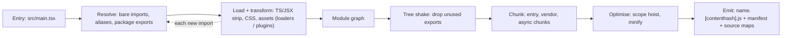
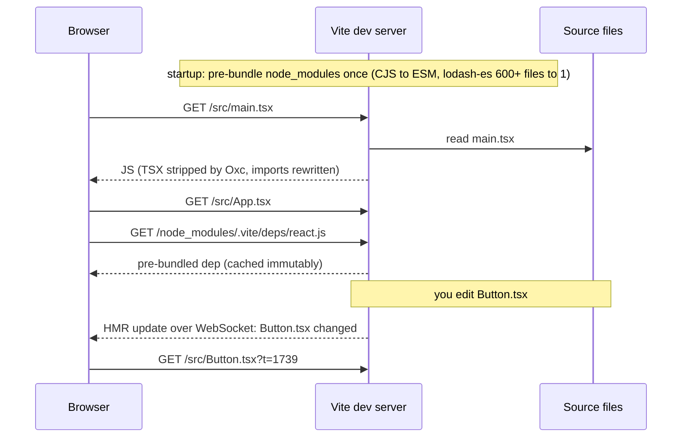

# Bundlers & build tooling (Vite, Webpack)

!!! abstract "Key takeaways"
    - A bundler starts from entry points, **resolves** every `import` into a **module graph**, **transforms** each file (TypeScript, JSX, CSS, assets), then **tree-shakes**, **splits** the graph into chunks, **minifies** and writes files with **content hashes** in their names. Bundling still pays off over HTTP/2: fewer requests and shallower import waterfalls, less code (scope hoisting, dead-code elimination) and better compression.
    - **webpack 5** bundles in dev and prod: config-heavy (loaders + plugins), very extensible, and the home of **Module Federation**. It is still actively developed (5.111, September 2026), with built-in CSS, HTML and TypeScript support arriving behind `"auto"` defaults.
    - **Vite** serves your source as **native ES modules** in dev (pre-bundling only `node_modules`) so startup doesn't grow with app size, and bundles for production. Since **Vite 8 (March 2026)** one Rust bundler, **Rolldown** (with the **Oxc** compiler), replaces the old esbuild-for-dev + Rollup-for-build split.
    - Long-term caching = `[contenthash]` file names + `Cache-Control: immutable` on assets + **`no-cache` on `index.html`**, a separate runtime/vendor chunk so one edit doesn't re-hash everything, and a plan for users holding an old HTML that points at deleted chunks.
    - Faster webpack-compatible options exist: **Rspack 2.0** (Rust, webpack API, April 2026) and **Turbopack** (the default bundler in current Next.js). Pick by ecosystem: new SPA → Vite; big webpack estate or Module Federation → webpack or Rspack.

## Why it matters

Browsers can load ES modules natively, so why build at all? Because real apps are written in TypeScript and JSX, import thousands of files from `node_modules` (often CommonJS), and must ship as little JavaScript as possible. Unbundled, a deep import tree becomes a **waterfall** of round trips: the browser only discovers `b.js` after parsing `a.js`. Rolldown's maintainers note that HTTP/2 doesn't remove this cost: browsers and servers cap concurrent streams (around 100 by default), each request has fixed overhead, and native ESM can't tree-shake.

History in one paragraph: **Browserify** (2011) brought CommonJS to the browser; **webpack** (2012) made *everything* (CSS, images) a module and added code splitting and HMR; **Rollup** (2015) popularised ES-module tree shaking for libraries; **Parcel** went zero-config; **esbuild** (Go, 2020) showed builds could be 10–100x faster; **Vite** (2020) used native ESM in dev; then Rust rewrites arrived (**SWC**, **Rspack**, **Turbopack**, **Rolldown**/**Oxc**). In February 2025 the React team **deprecated Create React App** (a webpack wrapper) and pointed new apps to frameworks or to Vite, Parcel or Rsbuild.

The build directly shapes what the [Core Web Vitals page](04-core-web-vitals-and-performance-optimisation.md) measures: bundle size and chunking drive LCP and INP, and file naming drives how well [HTTP caching](06-browser-storage-cookies-and-caching.md) works.

## Core concepts

### The pipeline every bundler runs


*Notice that resolution and transformation loop until the graph is complete; only then can the bundler know what is unused and how to split it.*

- **Resolve.** Turn `import 'react'` into a path, honouring `package.json` `exports`/`module`/`browser` fields, aliases and `tsconfig` paths. Picking the CommonJS build instead of the ESM one is a classic reason tree shaking stops working.
- **Transform.** webpack does this with **loaders** (`babel-loader`, `ts-loader`, `css-loader`) and hooks **plugins** into compilation; Vite and Rolldown use **Rollup-style plugin hooks** (`resolveId`, `load`, `transform`). TypeScript is *stripped*, not type-checked: run `tsc --noEmit` separately in CI.
- **Tree shaking** works on static `import`/`export`. The bundler marks unused exports, and the minifier deletes them. Whole modules can only be dropped if they're known to be free of **side effects**, which is what `"sideEffects": false` in `package.json` declares (list CSS files as side-effectful or they disappear).
- **Code splitting.** Every dynamic `import()` is a split point that becomes an async chunk (`React.lazy` routes). Shared modules move to common chunks; webpack's `SplitChunksPlugin` does this for async chunks by default (`chunks: "async"`, `minSize: 20000` bytes in production), Rolldown uses `output.codeSplitting.groups`.
- **Scope hoisting** concatenates ES modules into one function scope instead of wrapping each in a module function: smaller and faster to run.
- **Content hashing.** `main.3f9a1c.js` changes name only when its bytes change, so assets can be cached forever.

{ loading=lazy }
*Unused exports are removed only because `import`/`export` are static; a `require()` or a module with unknown side effects keeps everything.*

### webpack 5: bundle first, configure everything

In development `webpack serve` builds the whole graph into in-memory bundles, then serves them; HMR re-builds the changed module and pushes an update over a WebSocket. Cold start therefore grows with app size, which is the pain Vite was built to fix (mitigated by the persistent `cache: { type: 'filesystem' }`, added in webpack 5).

webpack 5 (October 2020) also added **Module Federation**, the `asset/*` module types replacing `file-loader`/`url-loader`, deterministic module and chunk IDs in production (stable hashes), and removed automatic Node.js polyfills. Its 2026 releases are moving common plugins into core: native CSS (`experiments.css`), HTML entries, TypeScript type-stripping and a `universal` target, defaulting to `"auto"` since 5.109 (enabled unless you already have a loader for that file type), and **stable ESM output** in 5.111. The roadmap says CSS support stops being experimental in webpack 6.

### Vite 8: native ESM in dev, Rolldown for everything


*Notice that the server only transforms the files the browser actually requests; an edit re-fetches one module, not a rebuilt bundle.*

Vite splits the work into **dependencies** (rarely change; pre-bundled once, converting CommonJS/UMD to ESM and collapsing many-file packages into one request) and **source** (served on demand as native ESM, transformed per request). Startup is near-instant regardless of app size and HMR stays fast because only the edited module (and its HMR boundary) is replaced.

For production Vite **bundles**, because unbundled ESM is a request waterfall. Until Vite 7 that meant two tools: esbuild for dev transforms and pre-bundling, Rollup for the build, with two plugin pipelines that sometimes behaved differently. **Vite 8** ships **Rolldown**, a Rust bundler with Rollup's plugin API, using **Oxc** for parsing, transforming and minifying, and **Lightning CSS** for CSS minification. Reported production build reductions in the announcement include Linear (46 s → 6 s) and Beehiiv (64%). A compatibility layer maps old `esbuild` and `build.rollupOptions` settings; new configs use `build.rolldownOptions`, and the object form of `manualChunks` is gone in favour of `codeSplitting`.

{ loading=lazy }
*Watch when "ready" appears in each column: after building everything on the left, immediately on the right.*

The unbundled model has its own ceiling: a page importing thousands of modules makes thousands of dev requests. Vite 8.1 (June 2026) added an experimental **bundled dev mode** (`experimental.bundledDev`), now that Rolldown is fast enough to bundle in dev; the team reports about 15x faster startup on a 10,000-component test app.

Two Vite defaults worth knowing: production output targets **Baseline Widely Available** browsers (Chrome/Edge 111, Firefox 114, Safari 16.4 for Vite 8; `@vitejs/plugin-legacy` for older ones), and only `VITE_`-prefixed env variables reach client code, inlined at build time.

### Long-term caching and hash cascades

The deploy contract is simple: hashed assets get `Cache-Control: public, max-age=31536000, immutable`; `index.html` gets `no-cache` so browsers always revalidate it and pick up new hashes. The trap is the **hash cascade**: a chunk embeds the hashed file names of chunks it imports, so editing a leaf re-hashes every importer up to the entry. Mitigations: a separate **runtime chunk** (`optimization.runtimeChunk: 'single'` in webpack), a stable **vendor** chunk, deterministic module IDs (webpack's production default), and in Vite 8.1 the experimental **chunk import map** (`build.chunkImportMap`), which moves hashes into an import map so importers stay byte-identical.

{ loading=lazy }
*Count the red files: three re-downloads for a one-line change on top, one below.*

### Module Federation and the rest of the field

**Module Federation** lets one build expose modules that another, independently deployed build loads at runtime through a `remoteEntry.js` (or an `mf-manifest.json` in MF 2.0), negotiating shared dependencies such as React as singletons. It started in webpack 5 and is now maintained as the `@module-federation/*` packages: **MF 2.0 went stable in February 2026** (`@module-federation/enhanced` 2.x), adding a manifest, runtime plugins, type hints, tree shaking of shared dependencies and SSR. Rspack supports it natively and Vite through `@module-federation/vite`. The micro-frontend side is covered in [Micro-frontends: approaches & trade-offs](../frontend-architecture/01-micro-frontends-approaches-and-trade-offs.md) and [shared dependencies](../frontend-architecture/02-shared-dependencies-routing-and-communication-between-micro.md).

| Tool (Oct 2026) | Written in | Dev model | Config style | Best fit |
|---|---|---|---|---|
| webpack 5.111 | JS | Bundled | Loaders + plugins, explicit | Large existing estates, maximal plugin ecosystem, Module Federation |
| Vite 8.3 (Rolldown 1.x, Oxc) | JS + Rust | Native ESM (bundled dev experimental) | Small config, Rollup-style plugins | New SPAs, libraries, frameworks (React Router, Nuxt, SvelteKit, Astro) |
| Rspack 2.2 / Rsbuild | Rust | Bundled | webpack-compatible API | Speeding up webpack apps with little rewrite |
| Turbopack | Rust | Bundled, incremental | Next.js config only | Next.js apps (default; `--webpack` opts out) |
| esbuild 0.28 | Go | n/a | Minimal | Fast transforms, simple bundles, tooling |
| Parcel | JS + Rust | Bundled | Zero-config | Small apps, quick prototypes |

## In practice: code & configuration

The most common production mistake: everything in one entry chunk, no hashing discipline, and secrets inlined through env variables.

=== "❌ Common mistake"
    ```ts
    // vite.config.ts
    import { defineConfig } from 'vite';
    import react from '@vitejs/plugin-react';

    export default defineConfig({
      plugins: [react()],
      build: { sourcemap: true },           // public .map files expose original source
    });

    // src/routes.tsx: every page imported eagerly -> one huge entry chunk
    import Claims from './pages/Claims';
    import Reports from './pages/Reports'; // pulls in a charting library for every user

    // src/api.ts
    const key = import.meta.env.VITE_PARTNER_API_KEY; // inlined into the bundle: anyone can read it
    ```

=== "✅ Correct approach"
    ```ts
    // vite.config.ts (Vite 8)
    import { defineConfig } from 'vite';
    import react from '@vitejs/plugin-react';             // v6: Oxc-based React Refresh, no Babel

    export default defineConfig({
      plugins: [react()],
      build: {
        sourcemap: 'hidden',                              // maps generated for error tracking, not referenced
        rolldownOptions: {
          output: {
            codeSplitting: {                              // replaces manualChunks in Vite 8
              groups: [{ name: 'vendor', test: /node_modules[\\/](react|react-dom|react-router)/ }],
            },
          },
        },
      },
    });

    // src/routes.tsx: route-level split points
    import { lazy } from 'react';
    const Claims = lazy(() => import('./pages/Claims'));   // separate async chunk
    const Reports = lazy(() => import('./pages/Reports'));  // chart library only loads here

    // Recover when an old index.html points at chunks removed by a new deploy
    window.addEventListener('vite:preloadError', () => window.location.reload());

    // src/api.ts: no secrets in VITE_*; call a BFF that holds the key server-side
    const res = await fetch('/api/partner/claims');
    ```

The webpack 5 equivalent for long-term caching:

```js
// webpack.config.js (webpack 5)
module.exports = {
  mode: 'production',                         // tree shaking, minification, deterministic ids
  output: {
    filename: '[name].[contenthash].js',      // name changes only when content changes
    chunkFilename: '[name].[contenthash].js',
    clean: true,
  },
  cache: { type: 'filesystem', buildDependencies: { config: [__filename] } }, // warm rebuilds
  optimization: {
    runtimeChunk: 'single',                   // chunk map lives here, so app chunks keep their hashes
    splitChunks: {
      chunks: 'all',                          // also split shared code out of initial chunks
      cacheGroups: { vendor: { test: /[\\/]node_modules[\\/]/, name: 'vendor' } },
    },
  },
};
```

```bash
# What is in the bundle and why?
npx vite-bundle-visualizer              # treemap of a Vite build
npx webpack --json > stats.json && npx webpack-bundle-analyzer stats.json
npx source-map-explorer dist/assets/*.js
```

## Real-world usage

- **Migrations to Vite and Rust bundlers** are the dominant 2024–2026 story: CRA's deprecation moved many React apps to Vite; companies cited in the Vite 8 announcement (Linear, Ramp, Mercedes-Benz.io, Beehiiv) cut build times by 38–87%; Rspack reports 5 million weekly downloads, much of it webpack estates switching for speed without rewriting config.
- **Module Federation at enterprise scale.** Banking, insurance and healthcare portals use a federated shell to let teams deploy independently; MF 2.0's manifest and type hints address its two classic pains, cache-busting `remoteEntry.js` and missing types across repos.
- **Stale-chunk errors after deploys.** A user with an old tab clicks a lazy route, the old chunk is gone, and `ChunkLoadError` (webpack) or "Failed to fetch dynamically imported module" (Vite) appears. Fix with `no-cache` on HTML, keeping the previous release's assets for a while, and a reload-on-preload-error handler.
- **Leaked secrets and source.** Anything in a client bundle is public: `VITE_*`/`process.env` values are inlined at build time, and public source maps reveal original code. In regulated domains (PHI, PCI) the build pipeline is part of the threat model (see [frontend CI/CD and monorepos](../frontend-architecture/06-frontend-ci-cd-and-monorepos.md)).
- **Supply chain.** Build tools run arbitrary plugin code with your CI credentials; lockfiles, pinned versions and reviewing new plugins matter as much as for backend dependencies.

## Trade-offs & production gotchas

| Option | Pros | Cons | Use when |
|---|---|---|---|
| Vite (native ESM dev) | Instant start, fast HMR, tiny config, same Rolldown pipeline for dev deps and build | Many dev requests on huge apps; some webpack-only plugins have no equivalent | Most new SPAs and libraries |
| webpack 5 | Most mature plugin ecosystem, fine-grained control, reference Module Federation | Slow cold starts on large apps, verbose config | Existing estates, unusual build needs |
| Rspack | webpack API at Rust speed, native MF | Not every webpack plugin is supported | Large webpack apps whose builds hurt |
| One entry bundle | Simple, one request | Every user downloads every route, any change invalidates all | Tiny apps only |
| Aggressive splitting | Small initial JS, good caching | Request waterfalls, more chunks to manage | Route-level splits plus one vendor chunk is a good default |

!!! warning "Gotcha: tree shaking silently disabled"
    Importing from a package's CommonJS build, `import * as _ from 'lodash'` instead of `lodash-es` named imports, Babel converting ES modules to CommonJS before the bundler sees them, or a package without `"sideEffects": false` all keep dead code. Check the treemap, not the config.

!!! warning "Gotcha: dev works, prod breaks"
    With Vite, dev and production historically ran through different tools (esbuild vs Rollup), so CommonJS interop or CSS ordering bugs appeared only after `vite build`. Rolldown narrows the gap but doesn't close it (dev is still unbundled by default). Always run `vite build && vite preview` in CI before deploying.

!!! tip "Measure the build like a service"
    Track bundle size per route in CI with a budget (fail the PR on regression), keep build time and cache hit rate on a dashboard, and run a bundle analyzer when a dependency is added.

## How this connects to my experience

- **Where I used it:** not a ★ subtopic, but closely tied to OptumRx Meteor (Publicis Sapient), where I **"built the ReactJS application from the ground up and established a micro-frontend architecture"** and **"established engineering standards around testing, CI/CD, code quality, and deployment practices"** (GitLab CI/CD on the resume). Which bundler the app used (webpack 5, Vite, Rspack), and whether micro-frontends were composed with Module Federation: *[confirm]*.
- **Talking points:**
    - Why route-level code splitting plus a shared vendor chunk kept initial JavaScript small for a 750K+ user healthcare portal. Actual bundle sizes or LCP gains: *[confirm]*.
    - For micro-frontends: sharing React, the router and the Material UI design system as singletons so each MFE doesn't ship its own copy; versioning `remoteEntry.js` with `no-cache` *[confirm mechanism]*.
    - Build standards I'd set as tech lead: bundle budgets in CI, `tsc --noEmit` alongside the bundler, no secrets in `VITE_*`/`process.env`, hidden source maps uploaded to error tracking.
    - If the app was on webpack: how I'd evaluate Vite 8 or Rspack 2 (measure cold start, HMR and CI build time; check plugin and MF support; migrate behind a branch build).
- **Likely follow-up chain:** "Why is Vite faster than webpack in dev?" → native ESM, only requested files transformed, deps pre-bundled → "Then why bundle for production at all?" → waterfalls, request overhead, tree shaking, compression → "Your MFE remote deployed and users got blank screens. What happened?" → stale `remoteEntry.js` or chunks, shared React version mismatch; cache headers, keep old assets, singleton `requiredVersion`.

## Interview questions

### Fundamentals

??? question "Q1. What does a bundler do, and why do we still need one with HTTP/2 and native ES modules?"
    **Answer:** It builds a module graph from entry points, transforms each file (TS, JSX, CSS, assets), removes unused code, splits the graph into chunks, minifies and emits content-hashed files plus a manifest. Unbundled ESM in production means the browser discovers imports level by level (a waterfall), pays per-request overhead even over HTTP/2 (streams are capped around 100), can't tree-shake and compresses worse. Bundling flattens the graph into a sensible number of chunks.

    **Interviewer listens for:** module graph, waterfall, tree shaking, compression, caching via hashes.

    **Common wrong answer:** "HTTP/2 multiplexing made bundling obsolete."

??? question "Q2. How does tree shaking work, and what breaks it?"
    **Answer:** ES module imports and exports are static, so the bundler can mark exports nobody imports and the minifier removes them; whole modules are skipped when the package declares `"sideEffects": false`. It breaks with CommonJS (`require` is dynamic), namespace usage the bundler can't analyse, Babel transpiling ESM to CJS first, top-level side effects, or a package resolving to its CJS build.

    **Interviewer listens for:** static ESM, `sideEffects`, CJS as the usual culprit.

    **Common wrong answer:** "The minifier removes functions that are never called at runtime."

??? question "Q3. Loaders vs plugins in webpack?"
    **Answer:** Loaders transform individual files as they're loaded into the graph (`ts-loader`, `css-loader`), chained right to left per rule. Plugins hook into the compiler and compilation lifecycle to do anything else: generate HTML, extract CSS, define constants, analyse or rewrite chunks, Module Federation. Vite and Rolldown merge both into one plugin interface with hooks like `resolveId`, `load` and `transform`.

    **Interviewer listens for:** per-file vs whole-build, Rollup-style hooks as the alternative.

    **Common wrong answer:** "They're the same thing configured in different places."

### Intermediate

??? question "Q4. Why is Vite's dev server faster than webpack's, and what changed in Vite 8?"
    **Answer:** webpack bundles the whole app before serving, so start-up grows with app size. Vite pre-bundles only dependencies and serves source as native ESM, transforming each file when the browser requests it, so start-up is near-constant and HMR replaces one module. Vite 8 replaced esbuild (dev) plus Rollup (build) with one Rust bundler, Rolldown, using Oxc, giving one plugin pipeline and much faster production builds. Vite 8.1 added an experimental bundled dev mode for very large apps where the number of dev requests becomes the bottleneck.

    **Interviewer listens for:** on-demand transforms, dep pre-bundling, one bundler in Vite 8, knowing the unbundled model's limit.

    **Common wrong answer:** "Vite is faster because it's written in Rust" (the dev speed came from the architecture first).

??? question "Q5. How do you set up long-term caching of static assets?"
    **Answer:** Content-hashed file names, `Cache-Control: max-age=31536000, immutable` on them, `no-cache` on `index.html`. Keep hashes stable: deterministic module IDs, a separate runtime chunk, a vendor chunk for slow-changing libraries, and in Vite 8.1 optionally the chunk import map to stop hash cascades. Keep the previous release's assets deployed for a while and handle chunk-load errors with a reload.

    **Interviewer listens for:** HTML not cached, cascade awareness, stale-chunk handling.

    **Common wrong answer:** "Add `?v=build-number` to every file."

??? question "Q6. What is Module Federation and where does it stand today?"
    **Answer:** A runtime mechanism that lets a host load modules exposed by independently deployed remotes, negotiating shared dependencies (React as a singleton with version ranges). It began in webpack 5; the `@module-federation` project now maintains it across bundlers, with MF 2.0 stable since February 2026 (manifest, runtime plugins, type hints, shared-dependency tree shaking). Rspack supports it natively, Vite through `@module-federation/vite`.

    **Interviewer listens for:** runtime vs build-time composition, shared singletons, cross-bundler status.

    **Common wrong answer:** "It's a way to share npm packages between repos at build time."

### Senior

??? question "Q7. The CI build of a large webpack app takes 12 minutes. How do you bring it down?"
    **Answer:** Profile first (`--profile`, speed measure, see which loaders dominate). Enable `cache: { type: 'filesystem' }` and persist it between CI runs; replace Babel/ts-loader transforms with SWC or esbuild loaders and move type-checking to a parallel `tsc --noEmit` job; skip source maps or use cheaper ones where not needed; build only affected packages in a monorepo with a remote cache. If that's not enough, trial Rspack (webpack-compatible, Rust) or Vite 8 on a branch and compare like-for-like.

    **Interviewer listens for:** measure first, caching, transform cost, type-check separation, migration as an option with evidence.

    **Common wrong answer:** "Just give the runner more CPU."

??? question "Q8. How would you choose between webpack, Vite and Rspack for a new enterprise React platform with micro-frontends?"
    **Answer:** Requirements first: runtime composition and independent deploys (Module Federation), SSR needs, plugin needs, team familiarity. Vite 8 is the default for a new SPA (fast DX, Rolldown builds) and works with MF through the Vite plugin; Rspack or webpack is safer when MF is central and you want the reference implementation, or when migrating an existing webpack estate. Run a spike measuring dev start, HMR, prod build time and bundle output on a realistic app, and standardise one toolchain across MFEs.

    **Interviewer listens for:** criteria, not fashion; MF maturity per tool; evidence via a spike.

    **Common wrong answer:** "Vite, because webpack is dead" (webpack shipped seven minors in 2026).

### Scenario-based

??? question "Q9. After a deploy, some users see a blank screen with 'Failed to fetch dynamically imported module'. Why, and how do you fix it?"
    **Answer:** They have an old `index.html` or old entry chunk that references hashed chunks removed by the new deploy (or a CDN served a stale HTML). Fix: `no-cache` on HTML, keep the last one or two releases' assets on the CDN, handle `vite:preloadError` / `ChunkLoadError` by reloading once, and for MFEs make `remoteEntry.js` or the manifest non-cacheable.

    **Interviewer listens for:** HTML caching, overlap of releases, graceful recovery.

    **Common wrong answer:** "Tell users to clear their cache."

??? question "Q10. The main bundle grew 400 KB after a small feature PR. How do you investigate?"
    **Answer:** Compare bundle-analyzer treemaps for the two builds. Typical causes: a new dependency imported eagerly in a shared module, a namespace or CommonJS import defeating tree shaking (`lodash` vs `lodash-es`), a heavy library (charts, date, PDF) not behind a dynamic `import()`, or duplicate versions of a package. Fix the import, lazy-load the feature, dedupe the lockfile, and add a CI size budget so it can't happen silently again.

    **Interviewer listens for:** analyzer-driven, tree-shaking and splitting causes, prevention with budgets.

    **Common wrong answer:** "Enable gzip."

## Cheat sheet

| Concept | Remember |
|---|---|
| Pipeline | resolve → transform → graph → tree shake → split → minify → emit hashed files |
| Tree shaking | Needs static ESM + `"sideEffects": false`; CommonJS defeats it |
| Code splitting | `import()` = split point; route-level + one vendor chunk |
| Caching | `[contenthash]` + `immutable`; HTML `no-cache`; runtime chunk; beware hash cascade |
| webpack 5 | Loaders + plugins, bundled dev, filesystem cache, Module Federation origin; 5.111 (Sep 2026) |
| Vite 8 | Native ESM dev + dep pre-bundling; Rolldown + Oxc for everything since Mar 2026; `build.rolldownOptions` |
| Rspack / Turbopack | Rust; webpack-compatible / Next.js default |
| Module Federation | Runtime remotes, shared singletons; MF 2.0 stable Feb 2026, works in webpack, Rspack, Vite |
| Env vars | `VITE_*` and `process.env.*` are inlined: never secrets |

## Sources

1. [Vite 8.0 is out!](https://vite.dev/blog/announcing-vite8) (March 12, 2026): Rolldown replaces esbuild + Rollup, Oxc, Lightning CSS, company build-time figures, compatibility layer, Node 20.19+/22.12+.
2. [Vite 8.1 is out!](https://vite.dev/blog/announcing-vite8-1): experimental bundled dev mode and chunk import map.
3. [Vite: Why Vite](https://vite.dev/guide/why), [Dependency pre-bundling](https://vite.dev/guide/dep-pre-bundling), [Building for production](https://vite.dev/guide/build), [Env variables and modes](https://vite.dev/guide/env-and-mode), [Migration from v7](https://vite.dev/guide/migration): dev model, Baseline targets, `codeSplitting`, `vite:preloadError`, `VITE_` exposure.
4. [Rolldown: Why do we still need bundlers?](https://rolldown.rs/in-depth/why-bundlers) and [Manual code splitting](https://rolldown.rs/in-depth/manual-code-splitting): waterfalls, HTTP/2 stream limits, `codeSplitting.groups`.
5. webpack docs: [Caching](https://webpack.js.org/guides/caching/), [Tree shaking](https://webpack.js.org/guides/tree-shaking/), [SplitChunksPlugin](https://webpack.js.org/plugins/split-chunks-plugin/), [cache](https://webpack.js.org/configuration/cache/): contenthash, runtimeChunk, deterministic ids, sideEffects, split defaults.
6. webpack blog: [Roadmap 2026](https://webpack.js.org/blog/2026-02-04-roadmap-2026/), [webpack 5.109](https://webpack.js.org/blog/2026-07-24-webpack-5-109/), [webpack 5.111](https://webpack.js.org/blog/2026-09-14-webpack-5-111/): built-in CSS/HTML/TS, `"auto"` defaults, stable ESM output, webpack 6 plans.
7. [Announcing Rspack 2.0](https://rspack.rs/blog/announcing-2-0) (April 22, 2026): performance, webpack compatibility, Module Federation tree shaking, download figures.
8. [Module Federation 2.0 stable release](https://module-federation.io/blog/v2-stable-version) and [Module Federation docs](https://module-federation.io/): MF 2.0 features; stable 2.0.0 publish date from the npm registry (February 6, 2026).
9. [Next.js CLI reference](https://nextjs.org/docs/app/api-reference/cli/next): Turbopack enabled by default, `--webpack` to opt out.
10. [React blog: Sunsetting Create React App](https://react.dev/blog/2025/02/14/sunsetting-create-react-app) (February 14, 2025).
11. npm registry (checked October 2026): vite 8.3.4, rolldown 1.2.x, webpack 5.111.1, @rspack/core 2.2.x, @module-federation/enhanced 2.9.x, esbuild 0.28.x.
