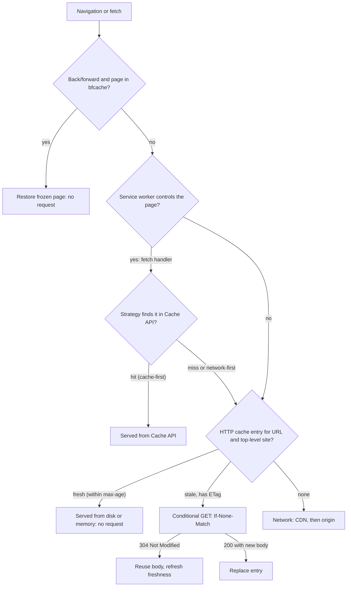
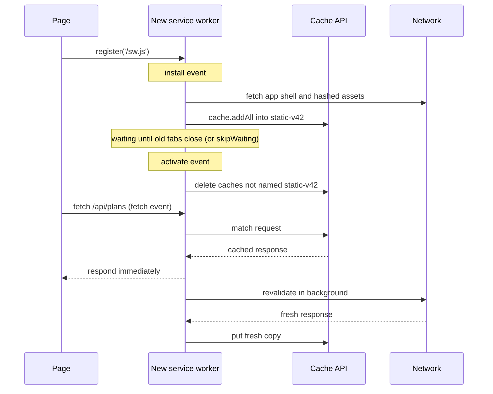

# Browser storage, cookies & caching

!!! abstract "Key takeaways"
    - **Cookies are for the server, storage APIs are for the page.** Cookies (~4 KB) ride on every matching request; `localStorage` / `sessionStorage` are synchronous, string-only and 5 MiB per origin; **IndexedDB**, the **Cache API** and **OPFS** are async and share one large per-origin quota.
    - A session cookie should be `__Host-` prefixed, `Secure`, `HttpOnly`, `SameSite=Lax` (or `Strict`) and short-lived. Only Chromium defaults a missing `SameSite` to `Lax`, so always set it.
    - **Third-party cookies in 2026:** Safari blocks and Firefox partitions them by default; **Chrome still allows them** (Google dropped its phase-out in April 2025) but backs **CHIPS** (`Partitioned`), the **Storage Access API** and **FedCM**. Design embeds as if unpartitioned third-party cookies don't exist.
    - Storage is **best-effort**: evicted per whole origin, LRU under disk pressure, and in Safari after **7 days without interaction**. `navigator.storage.persist()` opts out.
    - A request falls through **bfcache → service worker → HTTP cache → network**. Hashed assets get `max-age=31536000, immutable`, HTML gets `no-cache`, personal data `private` (`no-store` only if it must never touch disk). Service worker caches are versioned and expired by *you*.

## Why it matters

Every web app keeps state on the client: who the user is, what they chose, what they already downloaded and what works offline. The wrong place causes classic incidents: tokens stolen from `localStorage` via XSS, CSRF through a cookie without `SameSite`, an SSO iframe that silently breaks in Safari, users stuck on an old bundle after a deploy, or patient data left on a shared kiosk's disk.

The ground also moved: Chrome defaulted to `SameSite=Lax` (2020), Safari blocks all third-party cookies (13.1, 2020), Firefox partitions third-party state, and Chrome partitioned third-party storage (115, 2023). Interviewers check whether your model is from 2018 or today.

## Core concepts

### The storage map

| Mechanism | Scope | Size | API | Sent to server | Typical use |
|---|---|---|---|---|---|
| Cookie | Domain + path (+ partition) | ~4 KB each, dozens per domain | `Set-Cookie`, `document.cookie` | **Every matching request** | Session ID, CSRF token, consent flag |
| `localStorage` | Origin (+ partition) | 5 MiB | Sync, strings | No | Small preferences, feature flags |
| `sessionStorage` | Origin **and tab** | 5 MiB | Sync, strings | No | Per-tab wizard state |
| IndexedDB | Origin (+ partition) | Shared origin quota | Async, structured clone, transactions | No | Offline data, large caches, drafts |
| Cache API | Origin (+ partition) | Shared origin quota | Async, `Request` → `Response` | No | Service worker caches |
| OPFS | Origin | Shared origin quota | Async (sync in workers) | No | SQLite/WASM, large files |
| HTTP cache | Browser, keyed by URL **and top-level site** | Browser-managed | `Cache-Control` headers | Revalidation only | Every response |

Two words matter: an **origin** is scheme + host + port (`https://app.example.com:443`); a **site** is scheme + registrable domain (`https://example.com`). Storage APIs are per origin; `SameSite` and partitioning are about sites.

`localStorage` blocks the main thread and holds only strings, so keep it to a few small values; anything large or written often belongs in IndexedDB (via `idb` or Dexie).

### Cookies: anatomy and attributes

```http
Set-Cookie: __Host-SESSION=8f2c...; Path=/; Secure; HttpOnly; SameSite=Lax; Max-Age=1800
```

- **Scope:** without `Domain` the cookie is **host-only** (safest). `Domain=example.com` shares it with every subdomain.
- **Lifetime:** no `Expires`/`Max-Age` means a session cookie (which session restore can revive). Chrome clamps expiry to 400 days, per RFC 6265bis.
- **`Secure`:** HTTPS only. **`HttpOnly`:** invisible to `document.cookie`, but still sent with `fetch`, so it stops theft by XSS, not use by XSS.
- **`SameSite`:** `Strict`, `Lax` (plus cross-site top-level GETs) or `None` (requires `Secure`); full matrix and measurements in [Frontend security](../frontend-architecture/05-frontend-security.md#csrf-and-samesite).
- **Prefixes:** `__Secure-` requires `Secure`; `__Host-` also requires `Path=/` and no `Domain`, so a sibling subdomain can't overwrite it. Newer `__Http-` prefixes also require `HttpOnly`.

### Third-party cookies and partitioning

A cookie is "third-party" when its site differs from the site in the address bar (an `<iframe>` or cross-site `fetch`). The jar used to be keyed only by the cookie's host, so a tracker embedded on many sites saw one shared ID.

| Browser (2026) | Default behaviour |
|---|---|
| Safari (ITP) | Blocks all third-party cookies; caps script-written storage at 7 days without interaction |
| Firefox (Total Cookie Protection) | Third-party cookies and storage get a separate jar per top-level site |
| Chrome | Third-party cookies allowed (blocked in Incognito or by user setting); third-party *storage* partitioned since 115 |
| Edge, Brave | Block known trackers / tracking cookies |

The replacements for legitimate cross-site state:

- **CHIPS** (`Partitioned` attribute; default in Chrome 114+, and Google reports support in other browsers): the cookie is keyed by **(top-level site, cookie host)**, so a support-chat widget keeps its state on `shop.example` and its subdomains but can't correlate it with `news.example`.
- **Storage Access API:** an embedded iframe calls `document.requestStorageAccess()` after a user gesture to get its unpartitioned cookies, with a browser prompt or heuristics.
- **FedCM:** browser-mediated federated sign-in, replacing hidden IdP iframes that relied on third-party cookies.

{ loading=lazy }
*Watch the key under each jar: adding the top-level site to the key is the whole trick.*

!!! warning "Gotcha: silent SSO and OIDC renew in iframes"
    Hidden-iframe flows (`prompt=none` silent renew, "check session" iframes) depend on the IdP's third-party cookie and fail in Safari, Firefox and for Chrome users who block them. Use refresh-token rotation or a same-site **BFF**, and host the IdP on a subdomain of the app's site when you can.

### Quotas, persistence and eviction

IndexedDB, Cache API and OPFS share one per-origin quota:

| Browser | Per-origin quota | Eviction |
|---|---|---|
| Chrome / Edge | Up to 60% of total disk (browser uses at most 80%) | LRU by origin under storage pressure |
| Firefox | Best-effort: min(10% of disk, 10 GiB per site); persistent: 50% up to 8 TiB | LRU by origin |
| Safari 17+ | ~60% of disk for browser apps, ~15% for embedded WebViews; cross-origin frames ~1/10 of parent | LRU, plus 7-day no-interaction eviction of script-written data |

Data is **best-effort**: eviction deletes **all** of an origin's data at once. `navigator.storage.persist()` asks for exemption (Chrome and Safari decide from engagement; Firefox prompts) and `estimate()` reports padded usage. Over-quota writes, `localStorage.setItem` included, throw `QuotaExceededError`.

### The browser's cache layers


*Notice that the service worker sits in front of the HTTP cache: its `fetch()` calls still go through the HTTP cache, so a bad `Cache-Control` on the SW script or assets hurts twice.*

**HTTP cache (private cache).** A response is **fresh** for `max-age`, then **stale** and revalidated with `If-None-Match` / `If-Modified-Since`. Without `Cache-Control` the browser guesses (**heuristic freshness**), the root of many "works after a hard refresh" bugs. Since Chrome 86 and Firefox 85 the HTTP cache is **partitioned by top-level site**, so a public-CDN library is no longer shared across sites. Shared caches, `s-maxage`, `Vary` and purging are in [Load balancers, reverse proxies & CDNs](../networking/05-load-balancers-reverse-proxies-and-cdns.md#cdns-reverse-proxies-at-the-edge).

| Response | Header | Why |
|---|---|---|
| `app.3f9a1c.js`, fonts, hashed images | `public, max-age=31536000, immutable` | The URL changes when content changes ([bundlers](05-bundlers-and-build-tooling.md) add the hash) |
| `index.html`, SPA shell | `no-cache` (+ `ETag`) | Stored, but revalidated every time so new hashes are picked up |
| Per-user JSON | `private, no-cache` | Browser may keep it; CDNs may not |
| Sensitive (PHI, statements) | `no-store` | Never written to disk; costs bfcache eligibility |

`no-cache` means "revalidate before use", not "don't store". `no-store` is the one that forbids storage.

{ loading=lazy }
*Watch `index.html`: it is the only file that always talks to the server, and that small conversation is what makes `immutable` assets safe.*

**bfcache.** The back/forward cache keeps the whole page (JS heap included) in memory so Back is instant. `unload` handlers and (in most browsers) `Cache-Control: no-store` make a page ineligible. Restores fire `pageshow` with `event.persisted === true`: re-check auth there. It feeds directly into [Core Web Vitals](04-core-web-vitals-and-performance-optimisation.md).

### Service worker caching

A service worker is a script that intercepts its scope's requests. Its lifecycle drives caching:


*Notice that a new version only takes over after `activate`, and that cleaning old caches is your job: the Cache API never expires entries by itself.*

| Strategy | Behaviour | Use for |
|---|---|---|
| Cache first | Cache, else network (and store) | Hashed, immutable assets |
| Network first | Network, else cache when offline or slow | HTML, frequently changing data |
| Stale-while-revalidate | Cache now, refresh in background | Reference data, avatars, non-critical APIs |
| Network only | Never cache | Auth, payments, PHI |
| Cache only | Precached only | Offline fallback page |

{ loading=lazy }
*Compare when the page gets its response (green) against when the network is used: only stale-while-revalidate gets both speed and freshness, one request late.*

## In practice: code & configuration

The common mistake is storing a token where scripts can read it and caching everything the same way.

=== "❌ Common mistake"
    ```ts
    // Token readable by any injected or third-party script, never expires, survives logout on shared PCs
    localStorage.setItem('access_token', token);
    // Big object written synchronously on every keystroke: blocks the main thread
    localStorage.setItem('draft', JSON.stringify(hugeForm));
    ```
    ```http
    Set-Cookie: SESSION=8f2c...; Domain=example.com
    Cache-Control: max-age=86400          # on index.html: users run yesterday's bundle for a day
    ```

=== "✅ Correct approach"
    ```java
    // Spring Boot: host-only, HttpOnly session cookie (or let a BFF/Spring Session issue it)
    ResponseCookie cookie = ResponseCookie.from("__Host-SESSION", sessionId)
            .path("/").secure(true).httpOnly(true)
            .sameSite("Lax")                       // explicit: defaults differ across browsers
            .maxAge(Duration.ofMinutes(30))
            .build();                              // no domain(): host-only, required by __Host-
    response.addHeader(HttpHeaders.SET_COOKIE, cookie.toString());
    ```
    ```ts
    // Large or structured client data: async IndexedDB, quota-aware
    import { set } from 'idb-keyval';
    try {
      await set(`draft:${formId}`, form);          // structured clone, off the sync path
    } catch (e) {
      if (e instanceof DOMException && e.name === 'QuotaExceededError') await evictOldDrafts();
    }
    ```

Cache headers for a Spring Boot app serving a React build:

```yaml
spring:
  web:
    resources:
      chain:
        strategy:
          content:
            enabled: true            # content-hash URLs for resources Spring serves
            paths: /**
      cache:
        cachecontrol:
          max-age: 365d              # hashed assets: cache for a year
          cache-public: true
```

```java
@Bean
WebMvcConfigurer shellNoCache() {
    return new WebMvcConfigurer() {
        @Override public void addResourceHandlers(ResourceHandlerRegistry r) {
            r.addResourceHandler("/index.html")
             .addResourceLocations("classpath:/static/")
             .setCacheControl(CacheControl.noCache());   // always revalidate the shell
        }
    };
}
// PHI endpoints: CacheControl.noStore() on the ResponseEntity; logout: send Clear-Site-Data
```

A minimal versioned service worker (in production, Workbox generates the precache list and expiry):

```ts
const STATIC = 'static-v42';                       // bump with each release
const PRECACHE = ['/', '/index.html', '/assets/app.3f9a1c.js', '/offline.html'];

self.addEventListener('install', (e: ExtendableEvent) =>
  e.waitUntil(caches.open(STATIC).then(c => c.addAll(PRECACHE))));   // fails install if any fetch fails

self.addEventListener('activate', (e: ExtendableEvent) =>
  e.waitUntil(caches.keys().then(keys =>
    Promise.all(keys.filter(k => k !== STATIC).map(k => caches.delete(k))))));  // drop old versions

self.addEventListener('fetch', (e: FetchEvent) => {
  const url = new URL(e.request.url);
  if (e.request.method !== 'GET' || url.pathname.startsWith('/api/members')) return; // network only: PHI
  if (url.pathname.startsWith('/assets/')) {                                        // cache first
    e.respondWith(caches.match(e.request).then(hit => hit ?? fetch(e.request)));
    return;
  }
  if (e.request.mode === 'navigate') {                                              // network first
    e.respondWith(fetch(e.request).catch(() => caches.match('/offline.html') as Promise<Response>));
  }
});
```

On logout, clear what the browser holds for the origin:

```http
Clear-Site-Data: "cache", "cookies", "storage"
```

## Real-world usage

- **Healthcare and banking:** HIPAA and PCI reviews ask what stays on the device: no PHI or tokens in `localStorage`, `no-store` on PHI and statements, `HttpOnly` + `SameSite` session cookies, and `Clear-Site-Data` on logout for shared machines.
- **Embedded widgets:** chat, maps and payment frames moved to `Partitioned` cookies once Safari and Firefox partitioned third-party state; those relying on unpartitioned `SameSite=None` cookies broke inside iframes.
- **SSO:** after ITP, OIDC libraries dropped iframe silent renew for refresh-token rotation and BFFs ([BFF pattern](../frontend-architecture/05-frontend-security.md#oauth-20-for-spas-and-the-bff-pattern)).
- **Deploy-time breakage:** a long-cached `index.html` or stale service worker pins users to an old bundle whose chunks are gone (`ChunkLoadError`). Fix: `no-cache` on the shell, keep old assets for a while, and an "update available" prompt from the waiting worker.

## Trade-offs & production gotchas

| Option | Pros | Cons | Use when |
|---|---|---|---|
| `HttpOnly` session cookie | Hidden from JS; automatic | Needs CSRF defences; sent on every request | Same-site auth |
| `localStorage` | Simple, persistent | Sync; readable by any script | Small non-sensitive prefs |
| IndexedDB | Large, async, transactional | Verbose; best-effort eviction | Offline data, big caches |
| Service worker + Cache API | Offline; custom strategies | You own versioning and expiry | PWAs, repeat visits |
| HTTP cache only | Zero code; CDN-friendly | Mistakes can't be recalled | Default for every app |

!!! warning "Gotcha"
    A wrong `max-age` on `index.html` or `sw.js` lives in every browser that saw it. Serve both with `no-cache`; put long lifetimes only on hashed URLs.

!!! warning "Gotcha"
    Micro-frontends on one origin share `localStorage`, IndexedDB and cookies. Namespace keys per app (`claims:filters`); every bundle and third-party script on the page can read them.

## How this connects to my experience

- **Where I used it:** not a ★ resume claim; position as working knowledge from building the **OptumRx Meteor ReactJS application from the ground up with a micro-frontend architecture** (750K+ users) with **OAuth2 / PingFederate** login and server-side **Redis caching of UI reference data**, and owning **JWT authentication and SSO** at Johnson Controls.
- **Talking points:**
    - Layered caching: Redis behind the GraphQL Consumer Service, React Query in the browser, HTTP caching for the bundle. How UI reference data was cached client-side: *[confirm]*.
    - Where the session or tokens lived in Meteor (HttpOnly cookie, BFF, or SPA memory) and how logout cleared state: *[confirm]*.
    - Whether a service worker was used: *[confirm]*.
    - Shared-origin micro-frontends need namespaced storage keys and a single owner for auth cookies.
- **Likely follow-up chain:** "Where did you store the auth token?" → the actual choice and its XSS / CSRF trade-off → "How did you stop CSRF?" → `SameSite` plus CSRF token → "What if a partner portal embeds the app?" → `Lax` cookies aren't sent in a cross-site iframe; use a top-level redirect, CHIPS or the Storage Access API.

## Interview questions

### Fundamentals

??? question "Q1. Compare cookies, localStorage, sessionStorage and IndexedDB."
    **Answer:** Cookies (~4 KB) are scoped by domain and path and sent with every matching request: use them for session identity. `localStorage` (persistent) and `sessionStorage` (per tab) are synchronous, string-only, 5 MiB and never sent. IndexedDB is async, structured and transactional, sharing the large origin quota with the Cache API.

    **Interviewer listens for:** "sent with every request", sync vs async, per-tab scope, quota.

    **Common wrong answer:** "localStorage is more secure than cookies." Any script on the origin can read it.

??? question "Q2. Explain `Secure`, `HttpOnly` and `SameSite`."
    **Answer:** `Secure`: HTTPS only. `HttpOnly`: hidden from `document.cookie`, so XSS can't steal it, though it can still make requests carrying it. `SameSite`: `Strict` never cross-site, `Lax` only top-level GET navigations, `None` always (requires `Secure`). Only Chromium defaults to `Lax`; set it explicitly.

    **Interviewer listens for:** HttpOnly prevents theft not use; Lax allows top-level GET; None needs Secure.

    **Common wrong answer:** "SameSite replaces CSRF tokens entirely." Same-site subdomains and GET side effects still bite.

??? question "Q3. What's the difference between `no-cache` and `no-store`?"
    **Answer:** `no-cache` stores but revalidates before each reuse (often a cheap 304); use it for HTML. `no-store` forbids storage; reserve it for sensitive data, since it also costs bfcache eligibility.

    **Interviewer listens for:** revalidation vs storage, 304, bfcache cost.

    **Common wrong answer:** "`no-cache` means don't cache."

### Intermediate

??? question "Q4. What are third-party cookies today, and what is CHIPS?"
    **Answer:** Cookies sent where the top-level site differs from the cookie's site, such as an iframe. Safari blocks them, Firefox partitions them, Chrome allows them unless the user blocks them. CHIPS's `Partitioned` attribute keys the cookie by top-level site plus host, so an embed keeps state per embedding site but can't track across sites. Requires `Secure`.

    **Interviewer listens for:** double keying, per-browser status, Storage Access API as the unpartitioned escape hatch.

    **Common wrong answer:** "Chrome removed third-party cookies in 2024." It reversed that plan.

??? question "Q5. How do you cache a SPA's assets so deploys are instant but repeat visits are fast?"
    **Answer:** Content-hash filenames for JS, CSS and images, served with `max-age=31536000, immutable`; `index.html` with `no-cache` and an ETag so each visit revalidates and discovers new hashes. Keep old hashed assets on the CDN for a while so open tabs can still lazy-load chunks.

    **Interviewer listens for:** URL versioning instead of purging, revalidated shell, chunk-load errors.

    **Common wrong answer:** "Set a short max-age on everything."

??? question "Q6. When can the browser delete your IndexedDB data?"
    **Answer:** Under disk pressure or the browser's global limit, whole origins are evicted LRU; Safari also clears script-written data after 7 days of use without interaction. `navigator.storage.persist()` exempts the origin (the user can still clear it). Handle `QuotaExceededError` and keep the server as source of truth.

    **Interviewer listens for:** all-or-nothing per origin, persist(), Safari 7-day rule.

    **Common wrong answer:** "IndexedDB is permanent like a database."

### Senior

??? question "Q7. Walk through what happens when a page with a service worker requests an asset."
    **Answer:** A bfcache restore requests nothing. Otherwise the controlling worker's `fetch` handler applies a strategy against the Cache API; when it calls `fetch()`, the request goes through the HTTP cache (fresh hit, revalidation or miss), then CDN and origin. New worker versions install, wait, activate and delete old caches.

    **Interviewer listens for:** order of layers, SW does not bypass HTTP cache, lifecycle and versioning.

    **Common wrong answer:** "The service worker replaces the HTTP cache."

??? question "Q8. Where should a SPA keep auth state, and how do cookie changes affect that?"
    **Answer:** Prefer a same-site BFF issuing an `HttpOnly`, `Secure`, `SameSite=Lax`, `__Host-` session cookie plus CSRF protection, so the browser never holds OAuth tokens. If the SPA must hold tokens, keep them in memory, short-lived, with rotated refresh tokens. Avoid flows needing third-party cookies (iframe silent renew); they fail under ITP and partitioning.

    **Interviewer listens for:** XSS vs CSRF trade, BFF, third-party cookie breakage.

    **Common wrong answer:** "JWT in localStorage is standard practice."

### Scenario-based

??? question "Q9. After a release, some users see a blank page with `ChunkLoadError`. What happened?"
    **Answer:** A cached `index.html` or service worker precache references old hashed chunks that the deploy deleted. Check `Cache-Control` on `index.html` and `sw.js`, keep the previous release's assets, reload once on chunk-load failure, and prompt from the waiting worker.

    **Interviewer listens for:** cached shell vs deleted assets, SW update flow, retention of old assets.

    **Common wrong answer:** "Tell users to clear their cache."

??? question "Q10. A partner embeds our claims widget in an iframe and users are logged out in Safari. Fix it."
    **Answer:** Our session cookie is third-party there and Safari blocks it (a `Lax` cookie wouldn't be sent in any browser). Options: a top-level redirect instead of an iframe; `SameSite=None; Secure; Partitioned` for a per-partner session; or the Storage Access API after a user click to reach the main session. Also agree `frame-ancestors` with the partner.

    **Interviewer listens for:** third-party context diagnosis, CHIPS vs Storage Access trade-off, not "tell users to disable tracking prevention".

    **Common wrong answer:** "Set `SameSite=None` and it will work." Not in Safari or Firefox.

## Cheat sheet

| Concept | Remember |
|---|---|
| Safe session cookie | `__Host-` + `Secure; HttpOnly; SameSite=Lax; Path=/`, no `Domain` |
| SameSite default | `Lax` in Chromium (2-minute POST grace); varies elsewhere: set it |
| Third-party cookies | Safari blocks, Firefox partitions, Chrome allows by default (2026) |
| CHIPS | `Partitioned`: key = top-level site + host; requires `Secure` |
| Quota | IndexedDB + Cache + OPFS share it: Chromium/Safari ~60% disk, Firefox 10%/10 GiB |
| Eviction | Whole origin, LRU; Safari 7 days without interaction; `persist()` to opt out |
| Hashed assets | `max-age=31536000, immutable` |
| HTML shell | `no-cache` + ETag |
| Sensitive data | `no-store` (loses bfcache) |
| Order | bfcache → service worker → HTTP cache → CDN → origin |
| Logout | `Clear-Site-Data: "cache", "cookies", "storage"` |

## Sources
1. [MDN: Storage quotas and eviction criteria](https://developer.mozilla.org/en-US/docs/Web/API/Storage_API/Storage_quotas_and_eviction_criteria): per-browser quotas, Web Storage 5 MiB limits, best-effort vs persistent, LRU and Safari proactive eviction.
2. [MDN: Set-Cookie](https://developer.mozilla.org/en-US/docs/Web/HTTP/Reference/Headers/Set-Cookie) and [MDN: Using HTTP cookies](https://developer.mozilla.org/en-US/docs/Web/HTTP/Guides/Cookies): attributes, Lax-by-default 2-minute POST grace, cookie prefixes, session restore.
3. [MDN: Third-party cookies](https://developer.mozilla.org/en-US/docs/Web/Privacy/Guides/Third-party_cookies): per-browser blocking status and transition options.
4. [MDN: CHIPS](https://developer.mozilla.org/en-US/docs/Web/Privacy/Guides/Third-party_cookies/Partitioned_cookies) and [MDN: State Partitioning](https://developer.mozilla.org/en-US/docs/Web/Privacy/Guides/State_Partitioning): partition keys, Firefox storage and network partitioning.
5. [Privacy Sandbox: Next steps for Privacy Sandbox and tracking protections in Chrome (April 2025)](https://privacysandbox.google.com/blog/privacy-sandbox-next-steps) and [Update on plans for Privacy Sandbox technologies (October 2025)](https://privacysandbox.google.com/blog/update-on-plans-for-privacy-sandbox-technologies): Chrome keeps third-party cookie choice; CHIPS, FedCM and Storage Access continue.
6. [Chrome for Developers: Storage partitioning](https://developer.chrome.com/docs/privacy-sandbox/storage-partitioning): third-party storage partitioned from Chrome 115.
7. [Chrome for Developers: Cookie Expires and Max-Age 400-day limit](https://developer.chrome.com/blog/cookie-max-age-expires): Chrome 104 cap and RFC 6265bis recommendation.
8. [Chrome for Developers: Gaining security and privacy by partitioning the cache](https://developer.chrome.com/blog/http-cache-partitioning): HTTP cache keyed by top-level site (Chrome 86).
9. [WebKit: Full Third-Party Cookie Blocking and More](https://webkit.org/blog/10218/full-third-party-cookie-blocking-and-more/) and [WebKit: Updates to Storage Policy](https://webkit.org/blog/14403/updates-to-storage-policy/): Safari third-party cookie blocking, 7-day script-writable storage cap, Safari 17 quotas.
10. [MDN: HTTP caching](https://developer.mozilla.org/en-US/docs/Web/HTTP/Guides/Caching) and [RFC 9111: HTTP Caching](https://www.rfc-editor.org/rfc/rfc9111): private vs shared caches, heuristic freshness, `no-cache` vs `no-store`, bfcache caveat.
11. [MDN: PWA caching](https://developer.mozilla.org/en-US/docs/Web/Progressive_web_apps/Guides/Caching) and [web.dev: Back/forward cache](https://web.dev/articles/bfcache): service worker strategies and lifecycle; bfcache eligibility and `pageshow`.
12. [MDN: Clear-Site-Data](https://developer.mozilla.org/en-US/docs/Web/HTTP/Reference/Headers/Clear-Site-Data): clearing cache, cookies and storage on logout.
