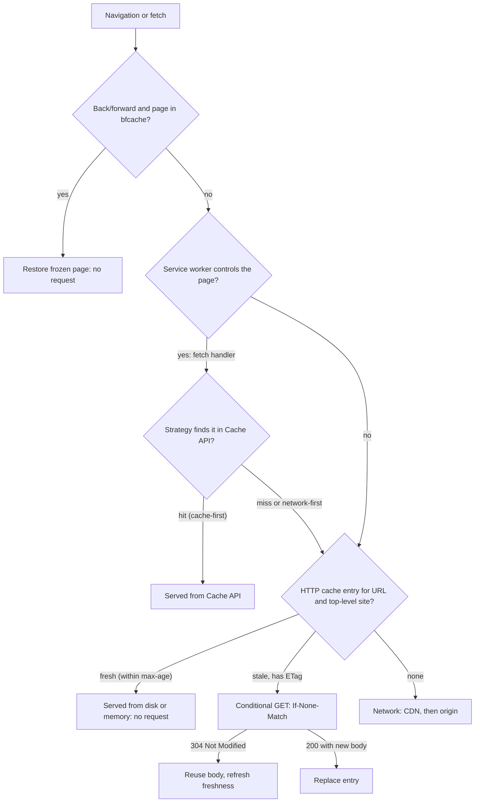
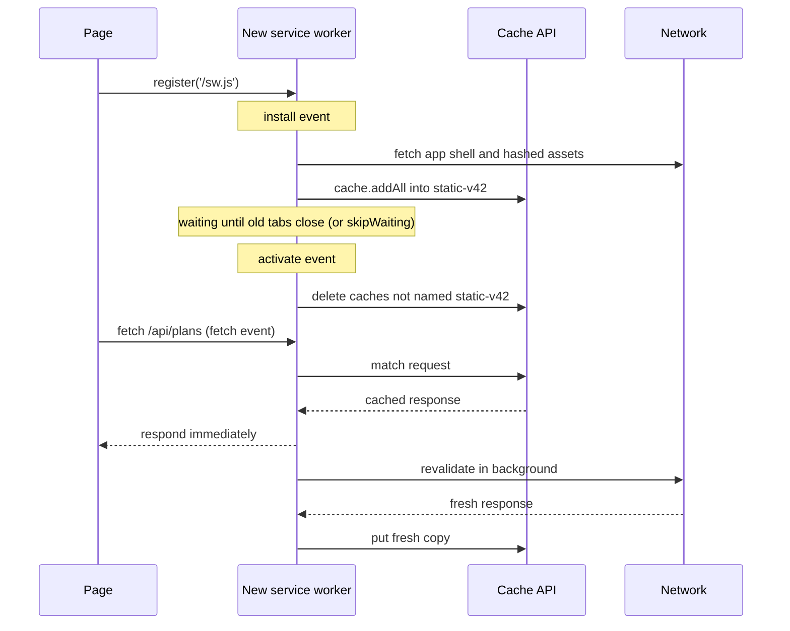

# Browser storage, cookies & caching

!!! abstract "Key takeaways"
    - **Cookies are for the server, storage APIs are for the page.** Cookies (about 4 KB each) ride on every matching request; `localStorage` / `sessionStorage` are synchronous, string-only and about 5 MiB per origin; **IndexedDB**, the **Cache API** and **OPFS** are async and share one per-origin quota (up to ~60% of disk in Chromium and Safari, best-effort 10% or 10 GiB in Firefox).
    - A session cookie should be `__Host-` prefixed, `Secure`, `HttpOnly`, `SameSite=Lax` (or `Strict`) and short-lived. Chromium treats a missing `SameSite` as `Lax`; other browsers differ, so always set it. Browsers cap cookie lifetime at **400 days** (Chrome since 104).
    - **Third-party cookies in 2026:** Safari and Firefox block or partition them by default; **Chrome still allows them by default** (Google dropped its phase-out in April 2025 and retired most Privacy Sandbox APIs in October 2025) but keeps **CHIPS** (`Partitioned`), the **Storage Access API** and **FedCM**. Design embeds as if unpartitioned third-party cookies don't exist.
    - All storage is **best-effort** by default: evicted per origin, all-or-nothing, LRU under disk pressure, and in Safari after **7 days without user interaction** for script-written data. `navigator.storage.persist()` opts out of automatic eviction.
    - A request falls through **bfcache → service worker → HTTP cache → network (CDN)**. Hashed assets get `max-age=31536000, immutable`; HTML gets `no-cache`; personal data gets `private` (or `no-store` only when it must never touch disk). Service workers add cache-first, network-first and stale-while-revalidate strategies that *you* version and expire.

## Why it matters

Every web app keeps some state on the client: who the user is (session cookie), what they chose (preferences, drafts), what they already downloaded (assets, reference data) and what they can use offline. Picking the wrong place causes the classic bugs and incidents: tokens stolen from `localStorage` via XSS, CSRF through a cookie without `SameSite`, a chat widget or SSO iframe that silently breaks in Safari, users stuck on an old bundle after a deploy, or patient data left on a shared kiosk's disk.

The ground also moved. Chrome made `SameSite=Lax` the default in 2020, Safari has blocked all third-party cookies since 13.1 (2020), Firefox partitions all third-party state by default (Total Cookie Protection), and Chrome partitioned third-party storage in 115 (2023). Interviewers test whether your mental model is from 2018 or from today.

## Core concepts

### The storage map

| Mechanism | Scope | Size | API | Sent to server | Typical use |
|---|---|---|---|---|---|
| Cookie | Domain + path (+ partition) | ~4 KB each, dozens per domain | `Set-Cookie`, `document.cookie` | **Every matching request** | Session ID, CSRF token, consent flag |
| `localStorage` | Origin (+ partition) | 5 MiB | Sync, strings | No | Small preferences, feature flags |
| `sessionStorage` | Origin **and tab** | 5 MiB | Sync, strings | No | Per-tab wizard state |
| IndexedDB | Origin (+ partition) | Shared origin quota | Async, structured clone, transactions | No | Offline data, large caches, drafts |
| Cache API | Origin (+ partition) | Shared origin quota | Async, `Request` → `Response` | No | Service worker caches |
| OPFS | Origin | Shared origin quota | Async (sync in workers) | No | SQLite/WASM, large files |
| HTTP cache | Browser, keyed by URL **and top-level site** | Browser-managed | `Cache-Control` headers | Revalidation only | Every response |

Two words matter: an **origin** is scheme + host + port (`https://app.example.com:443`); a **site** is scheme + registrable domain (`https://example.com`). Storage APIs are per origin; `SameSite` and partitioning are about sites.

`localStorage` blocks the main thread on every read and write, holds only strings and has no expiry, so it suits a few small values. Anything large, structured or written often belongs in IndexedDB (usually through a wrapper such as `idb` or Dexie).

### Cookies: anatomy and attributes

```http
Set-Cookie: __Host-SESSION=8f2c...; Path=/; Secure; HttpOnly; SameSite=Lax; Max-Age=1800
```

- **Scope:** without `Domain` the cookie is **host-only** (safest). `Domain=example.com` shares it with every subdomain, including the forgotten marketing site. `Path` is not a security boundary.
- **Lifetime:** no `Expires`/`Max-Age` means a session cookie, which "session restore" can keep alive indefinitely. Chrome clamps longer expiry to 400 days, as RFC 6265bis recommends.
- **`Secure`:** HTTPS only. **`HttpOnly`:** invisible to `document.cookie`, but still sent with `fetch`, so it stops theft by XSS, not use by XSS.
- **`SameSite`:** `Strict` (same-site requests only), `Lax` (plus cross-site top-level GET navigations), `None` (all contexts, requires `Secure`). The full matrix and measured browser behaviour are in [Frontend security](../frontend-architecture/05-frontend-security.md#csrf-and-samesite).
- **Prefixes:** `__Secure-` requires `Secure`; `__Host-` also requires `Path=/` and no `Domain`, so a sibling subdomain can't overwrite it (cookie tossing). Newer `__Http-` / `__Host-Http-` prefixes also require `HttpOnly`.

### Third-party cookies and partitioning

A cookie is "third-party" when the site that set it differs from the site in the address bar, typically an `<iframe>` or a cross-site `fetch`. Historically the cookie jar was keyed only by the cookie's host, so `tracker.example` embedded on news and shopping sites saw one shared ID. Browsers have attacked that in three ways:

| Browser (2026) | Default behaviour |
|---|---|
| Safari (ITP) | Blocks all third-party cookies; caps script-written storage at 7 days without interaction |
| Firefox (Total Cookie Protection) | Third-party cookies and storage get a separate jar per top-level site |
| Chrome | Third-party cookies allowed (blocked in Incognito or by user setting); third-party *storage* partitioned since 115 |
| Edge, Brave | Block known trackers / tracking cookies |

The replacements for legitimate cross-site state:

- **CHIPS** (`Partitioned` attribute, Chrome 114+, Firefox, Safari): the cookie is keyed by **(top-level site, cookie host)**, so a support-chat widget keeps its state on `shop.example` and its subdomains but can't correlate it with `news.example`.
- **Storage Access API:** an embedded iframe calls `document.requestStorageAccess()` after a user gesture to get its unpartitioned cookies, with a browser prompt or heuristics.
- **FedCM:** browser-mediated federated sign-in, replacing hidden IdP iframes that relied on third-party cookies.

{ loading=lazy }
*Watch the key under each jar: adding the top-level site to the key is the whole trick.*

!!! warning "Gotcha: silent SSO and OIDC renew in iframes"
    Hidden-iframe flows (`prompt=none` silent token renew, "check session" iframes, an IdP widget on a partner domain) depend on the IdP's third-party cookie. They fail in Safari and Firefox today and in Chrome for users who block third-party cookies. Use refresh-token rotation or a same-site **BFF**, and keep the IdP on a subdomain of the app's site (e.g. `login.example.com`) when you can.

### Quotas, persistence and eviction

IndexedDB, Cache API and OPFS share one per-origin quota:

| Browser | Per-origin quota | Eviction |
|---|---|---|
| Chrome / Edge | Up to 60% of total disk (browser uses at most 80%) | LRU by origin under storage pressure |
| Firefox | Best-effort: min(10% of disk, 10 GiB per site); persistent: 50% up to 8 TiB | LRU by origin |
| Safari 17+ | ~60% of disk for browser apps, ~15% for embedded WebViews; cross-origin frames ~1/10 of parent | LRU, plus 7-day no-interaction eviction of script-written data |

Data is **best-effort** by default. Eviction deletes **all** of an origin's data at once, so IndexedDB and Cache API never go half-missing. `navigator.storage.persist()` asks to be exempt (Chrome and Safari decide from engagement without a prompt; Firefox prompts), and `navigator.storage.estimate()` returns padded usage and quota. Writes beyond quota throw `QuotaExceededError`, including `localStorage.setItem`, so wrap them in `try/catch`. Private browsing uses separate, temporary storage.

### The browser's cache layers


*Notice that the service worker sits in front of the HTTP cache: its `fetch()` calls still go through the HTTP cache, so a bad `Cache-Control` on the SW script or assets hurts twice.*

**HTTP cache (private cache).** RFC 9111 rules apply in the browser too: a response is **fresh** for `max-age`, then **stale** and revalidated with `If-None-Match` / `If-Modified-Since`. Without `Cache-Control` the browser applies **heuristic freshness** (typically 10% of the age since `Last-Modified`), which is how "it worked after a hard refresh" bugs start. Since Chrome 86 and Firefox 85 the HTTP cache is **partitioned by top-level site**, so a shared CDN copy of a library is no longer reused across different sites. Shared caches, `s-maxage`, `Vary` and purging are covered in [Load balancers, reverse proxies & CDNs](../networking/05-load-balancers-reverse-proxies-and-cdns.md#cdns-reverse-proxies-at-the-edge).

| Response | Header | Why |
|---|---|---|
| `app.3f9a1c.js`, fonts, hashed images | `public, max-age=31536000, immutable` | The URL changes when content changes ([bundlers](05-bundlers-and-build-tooling.md) add the hash) |
| `index.html`, SPA shell | `no-cache` (+ `ETag`) | Stored, but revalidated every time so new hashes are picked up |
| Per-user JSON | `private, no-cache` | Browser may keep it; CDNs may not |
| Sensitive (PHI, statements) | `no-store` | Never written to disk; costs bfcache eligibility |

`no-cache` means "revalidate before use", not "don't store". `no-store` is the one that forbids storage.

{ loading=lazy }
*Watch `index.html`: it is the only file that always talks to the server, and that small conversation is what makes `immutable` assets safe.*

**bfcache.** The back/forward cache keeps the whole page (JS heap included) in memory when the user navigates away, making Back instant. Pages are ineligible if they use `unload` handlers, hold some open connections or (in most browsers) are served with `Cache-Control: no-store`. Restores fire `pageshow` with `event.persisted === true`, so re-check auth or refresh data there. It feeds directly into navigation speed and [Core Web Vitals](04-core-web-vitals-and-performance-optimisation.md).

### Service worker caching

A service worker is a script that intercepts its scope's requests. Its lifecycle drives caching:


*Notice that a new version only takes over after `activate`, and that cleaning old caches is your job: the Cache API never expires entries by itself.*

| Strategy | Behaviour | Use for |
|---|---|---|
| Cache first | Cache, else network (and store) | Hashed, immutable assets |
| Network first | Network, else cache when offline or slow | HTML, frequently changing data |
| Stale-while-revalidate | Cache now, refresh in background | Reference data, avatars, non-critical APIs |
| Network only | Never cache | Auth, payments, PHI |
| Cache only | Precached only | Offline fallback page |

{ loading=lazy }
*Compare when the page gets its response (green) against when the network is used: only stale-while-revalidate gets both speed and freshness, one request late.*

## In practice: code & configuration

The common mistake is storing a token where scripts can read it and caching everything the same way.

=== "❌ Common mistake"
    ```ts
    // Token readable by any injected or third-party script, never expires, survives logout on shared PCs
    localStorage.setItem('access_token', token);
    // Big object written synchronously on every keystroke: blocks the main thread
    localStorage.setItem('draft', JSON.stringify(hugeForm));
    ```
    ```http
    Set-Cookie: SESSION=8f2c...; Domain=example.com
    Cache-Control: max-age=86400          # on index.html: users run yesterday's bundle for a day
    ```

=== "✅ Correct approach"
    ```java
    // Spring Boot: host-only, HttpOnly session cookie (or let a BFF/Spring Session issue it)
    ResponseCookie cookie = ResponseCookie.from("__Host-SESSION", sessionId)
            .path("/").secure(true).httpOnly(true)
            .sameSite("Lax")                       // explicit: defaults differ across browsers
            .maxAge(Duration.ofMinutes(30))
            .build();                              // no domain(): host-only, required by __Host-
    response.addHeader(HttpHeaders.SET_COOKIE, cookie.toString());
    ```
    ```ts
    // Large or structured client data: async IndexedDB, quota-aware
    import { set } from 'idb-keyval';
    try {
      await set(`draft:${formId}`, form);          // structured clone, off the sync path
    } catch (e) {
      if (e instanceof DOMException && e.name === 'QuotaExceededError') await evictOldDrafts();
    }
    ```

Cache headers for a Spring Boot app serving a React build:

```yaml
spring:
  web:
    resources:
      chain:
        strategy:
          content:
            enabled: true            # content-hash URLs for resources Spring serves
            paths: /**
      cache:
        cachecontrol:
          max-age: 365d              # hashed assets: cache for a year
          cache-public: true
```

```java
@Bean
WebMvcConfigurer shellNoCache() {
    return new WebMvcConfigurer() {
        @Override public void addResourceHandlers(ResourceHandlerRegistry r) {
            r.addResourceHandler("/index.html")
             .addResourceLocations("classpath:/static/")
             .setCacheControl(CacheControl.noCache());   // always revalidate the shell
        }
    };
}
// PHI endpoints: CacheControl.noStore() on the ResponseEntity; logout: send Clear-Site-Data
```

A minimal versioned service worker (in production, Workbox generates the precache list and expiry):

```ts
const STATIC = 'static-v42';                       // bump with each release
const PRECACHE = ['/', '/index.html', '/assets/app.3f9a1c.js', '/offline.html'];

self.addEventListener('install', (e: ExtendableEvent) =>
  e.waitUntil(caches.open(STATIC).then(c => c.addAll(PRECACHE))));   // fails install if any fetch fails

self.addEventListener('activate', (e: ExtendableEvent) =>
  e.waitUntil(caches.keys().then(keys =>
    Promise.all(keys.filter(k => k !== STATIC).map(k => caches.delete(k))))));  // drop old versions

self.addEventListener('fetch', (e: FetchEvent) => {
  const url = new URL(e.request.url);
  if (e.request.method !== 'GET' || url.pathname.startsWith('/api/members')) return; // network only: PHI
  if (url.pathname.startsWith('/assets/')) {                                        // cache first
    e.respondWith(caches.match(e.request).then(hit => hit ?? fetch(e.request)));
    return;
  }
  if (e.request.mode === 'navigate') {                                              // network first
    e.respondWith(fetch(e.request).catch(() => caches.match('/offline.html') as Promise<Response>));
  }
});
```

On logout, clear what the browser holds for the origin:

```http
Clear-Site-Data: "cache", "cookies", "storage"
```

## Real-world usage

- **Healthcare and banking:** HIPAA and PCI reviews ask what stays on the device. Typical rules: no PHI or tokens in `localStorage`, `no-store` on PHI and statement responses, session cookies `HttpOnly` + `SameSite`, idle timeout, and `Clear-Site-Data` on logout for shared or kiosk machines.
- **Embedded widgets:** chat, maps, payment 3-D Secure frames and video players moved to `Partitioned` cookies or first-party storage when Safari and Firefox partitioned third-party state. Sites that kept unpartitioned `SameSite=None` cookies saw logins and carts break inside iframes.
- **SSO:** after Safari's ITP, OIDC libraries deprecated iframe-based silent renew in favour of refresh-token rotation and BFFs ([OAuth for SPAs and the BFF pattern](../frontend-architecture/05-frontend-security.md#oauth-20-for-spas-and-the-bff-pattern)).
- **Deploy-time breakage:** a long-cached `index.html` or a service worker that is never updated pins users to an old bundle whose chunks the CDN no longer has, producing `ChunkLoadError`s. Teams fix it with `no-cache` on the shell, keeping previous asset versions on the CDN for a while, and an "update available" prompt from the waiting service worker.

## Trade-offs & production gotchas

| Option | Pros | Cons | Use when |
|---|---|---|---|
| `HttpOnly` session cookie | Not readable by JS; automatic | CSRF needs `SameSite` + token; ~4 KB; sent on every request | Authentication for same-site apps |
| `localStorage` | Simple, persistent, sync | Blocks main thread; strings; readable by any script; 5 MiB | Small non-sensitive preferences |
| `sessionStorage` | Per tab, cleared when tab closes | Not shared across tabs; sync | Per-tab flow state |
| IndexedDB | Large, async, indexed, transactional | Verbose API; best-effort eviction | Offline data, big client caches |
| Cache API + service worker | Offline, full control of strategies | You own versioning and expiry; debugging complexity | PWAs, repeat-visit speed |
| HTTP cache only | Zero code; CDN-friendly | Header mistakes are sticky (you can't recall a cached response) | Default for every app |

!!! warning "Gotcha"
    A cached response can't be recalled. A wrong `max-age` on `index.html`, or on `sw.js` itself, lives in every browser that saw it. Browsers revalidate the service worker script at least every 24 hours, but serve it with `no-cache` anyway and put long lifetimes only on hashed URLs.

!!! warning "Gotcha"
    Micro-frontends on one origin share `localStorage`, IndexedDB and cookies. Namespace keys per app (`claims:filters`), and remember a key written by one team's bundle is readable by every other bundle and third-party script on the page.

## How this connects to my experience

- **Where I used it:** not a ★ resume claim; position as working knowledge from building the **OptumRx Meteor ReactJS application from the ground up with a micro-frontend architecture** (750K+ users), its **OAuth2 / PingFederate** login, and **Redis caching of frequently accessed queries and UI reference data** on the server side. Earlier, I owned **JWT-based authentication and SSO** at Johnson Controls.
- **Talking points:**
    - Layered caching: Redis behind the GraphQL Consumer Service, React Query's in-memory cache in the browser, and HTTP caching for the static bundle. How UI reference data was cached in the browser (React Query `staleTime`, HTTP headers or local storage): *[confirm]*.
    - Where the session or tokens lived in Meteor (HttpOnly cookie, BFF, or SPA memory) and how logout cleared state: *[confirm]*.
    - Whether a service worker was used: *[confirm]*; if not, say so and explain when you would add one.
    - Shared-origin micro-frontends need namespaced storage keys and a single owner for auth cookies.
- **Likely follow-up chain:** "Where did you store the auth token?" → explain the actual choice and the XSS / CSRF trade-off → "How did you stop CSRF?" → `SameSite` plus CSRF token or custom header → "Would that still work if the app were embedded in a partner portal?" → no for `Lax`/`Strict` cookies in a cross-site iframe; needs `SameSite=None; Partitioned` (CHIPS) or the Storage Access API, or better, a top-level redirect into the app.

## Interview questions

### Fundamentals

??? question "Q1. Compare cookies, localStorage, sessionStorage and IndexedDB."
    **Answer:** Cookies are small (~4 KB), set by server or script, scoped by domain and path, and sent with every matching request; use them for session identity. `localStorage` (5 MiB, origin-scoped, persistent) and `sessionStorage` (per tab) are synchronous, string-only and never sent to the server. IndexedDB is async, stores structured objects with indexes and transactions, and shares the large per-origin quota with the Cache API and OPFS.

    **Interviewer listens for:** "sent with every request", sync vs async, per-tab scope, quota.

    **Common wrong answer:** "localStorage is more secure than cookies." Any script on the origin can read it.

??? question "Q2. Explain `Secure`, `HttpOnly` and `SameSite`."
    **Answer:** `Secure` sends the cookie only over HTTPS. `HttpOnly` hides it from `document.cookie`, so XSS can't exfiltrate it, though XSS can still make requests that carry it. `SameSite` controls cross-site sending: `Strict` never, `Lax` only on top-level GET navigations, `None` always (requires `Secure`). Chromium defaults to `Lax` when absent; set it explicitly.

    **Interviewer listens for:** HttpOnly prevents theft not use; Lax allows top-level GET; None needs Secure.

    **Common wrong answer:** "SameSite replaces CSRF tokens entirely." Same-site subdomains and GET side effects still bite.

??? question "Q3. What's the difference between `no-cache` and `no-store`?"
    **Answer:** `no-cache` allows storing but requires revalidation (ETag / `If-None-Match`, often a cheap 304) before each reuse; use it for HTML shells. `no-store` forbids storing at all; use it only for sensitive data, because it also disqualifies the page from bfcache in most browsers.

    **Interviewer listens for:** revalidation vs storage, 304, bfcache cost.

    **Common wrong answer:** "`no-cache` means don't cache."

### Intermediate

??? question "Q4. What are third-party cookies today, and what is CHIPS?"
    **Answer:** Cookies sent in a context whose top-level site differs from the cookie's site, such as an embedded iframe. Safari blocks them, Firefox partitions them per top-level site, Chrome still allows them by default but supports user blocking. CHIPS adds a `Partitioned` attribute: the cookie is keyed by top-level site plus host, so an embed keeps state per embedding site but can't track across sites. Requires `Secure`; `__Host-` is recommended.

    **Interviewer listens for:** double keying, per-browser status, Storage Access API as the unpartitioned escape hatch.

    **Common wrong answer:** "Chrome removed third-party cookies in 2024." It reversed that plan.

??? question "Q5. How do you cache a SPA's assets so deploys are instant but repeat visits are fast?"
    **Answer:** Content-hash filenames for JS, CSS and images, served with `max-age=31536000, immutable`; `index.html` with `no-cache` and an ETag so each visit revalidates and discovers new hashes. Keep old hashed assets on the CDN for a while so open tabs can still lazy-load chunks.

    **Interviewer listens for:** URL versioning instead of purging, revalidated shell, chunk-load errors.

    **Common wrong answer:** "Set a short max-age on everything."

??? question "Q6. When can the browser delete your IndexedDB data?"
    **Answer:** Storage is best-effort by default. Browsers evict whole origins, LRU, under disk pressure or when the global limit is exceeded; Safari also clears script-written data after 7 days of browser use without user interaction. `navigator.storage.persist()` exempts the origin from automatic eviction; the user can still clear it. Handle `QuotaExceededError` and treat the server as source of truth.

    **Interviewer listens for:** all-or-nothing per origin, persist(), Safari 7-day rule.

    **Common wrong answer:** "IndexedDB is permanent like a database."

### Senior

??? question "Q7. Walk through what happens when a page with a service worker requests an asset."
    **Answer:** If the page is restored from bfcache, nothing is requested. Otherwise the controlling service worker's `fetch` handler runs and applies a strategy against the Cache API. If it calls `fetch()`, the request goes through the HTTP cache (fresh hit, conditional revalidation, or miss), then to the CDN and origin. New SW versions install, wait, then activate and delete old caches. The SW script itself is revalidated at least every 24 hours.

    **Interviewer listens for:** order of layers, SW does not bypass HTTP cache, lifecycle and versioning.

    **Common wrong answer:** "The service worker replaces the HTTP cache."

??? question "Q8. Where should a SPA keep auth state, and how do cookie changes affect that?"
    **Answer:** Prefer a same-site BFF issuing an `HttpOnly`, `Secure`, `SameSite=Lax`, `__Host-` session cookie, with CSRF protection; the browser never holds OAuth tokens. If the SPA must hold tokens, keep the access token in memory with short lifetime and rotated refresh tokens. Avoid flows that rely on third-party cookies (iframe silent renew, IdP on an unrelated site); they fail under ITP and partitioning.

    **Interviewer listens for:** XSS vs CSRF trade, BFF, third-party cookie breakage.

    **Common wrong answer:** "JWT in localStorage is standard practice."

### Scenario-based

??? question "Q9. After a release, some users see a blank page with `ChunkLoadError`. What happened?"
    **Answer:** Their `index.html` (or service worker precache) still references old hashed chunks, and the new deploy deleted them from the CDN. Check `Cache-Control` on `index.html` and `sw.js`, keep the previous release's assets available, catch chunk-load failures and reload once, and have the waiting service worker prompt for an update.

    **Interviewer listens for:** cached shell vs deleted assets, SW update flow, retention of old assets.

    **Common wrong answer:** "Tell users to clear their cache."

??? question "Q10. A partner embeds our claims widget in an iframe and users are logged out in Safari. Fix it."
    **Answer:** Our session cookie is third-party in that context and Safari blocks it (Chrome would block a `Lax` cookie too). Options: a top-level redirect into our site instead of an iframe; `SameSite=None; Secure; Partitioned` so the widget has its own session per partner site (user logs in once per partner); or the Storage Access API after a user click if we need the main session. For healthcare data, also confirm the partner's CSP `frame-ancestors` agreement.

    **Interviewer listens for:** third-party context diagnosis, CHIPS vs Storage Access trade-off, not "tell users to disable tracking prevention".

    **Common wrong answer:** "Set `SameSite=None` and it will work." Not in Safari or Firefox.

## Cheat sheet

| Concept | Remember |
|---|---|
| Cookie size / life | ~4 KB each; lifetime capped at 400 days |
| Safe session cookie | `__Host-` + `Secure; HttpOnly; SameSite=Lax; Path=/`, no `Domain` |
| SameSite default | `Lax` in Chromium (2-minute POST grace); varies elsewhere: set it |
| Third-party cookies | Safari blocks, Firefox partitions, Chrome allows by default (2026) |
| CHIPS | `Partitioned`: key = top-level site + host; requires `Secure` |
| Web Storage | Sync, strings, 5 MiB, readable by any script; `sessionStorage` per tab |
| Quota | IndexedDB + Cache + OPFS share it: Chromium/Safari ~60% disk, Firefox 10%/10 GiB |
| Eviction | Whole origin, LRU; Safari 7 days without interaction; `persist()` to opt out |
| Hashed assets | `max-age=31536000, immutable` |
| HTML shell | `no-cache` + ETag |
| Sensitive data | `no-store` (loses bfcache) |
| Order | bfcache → service worker → HTTP cache → CDN → origin |
| Logout | `Clear-Site-Data: "cache", "cookies", "storage"` |

## Sources
1. [MDN: Storage quotas and eviction criteria](https://developer.mozilla.org/en-US/docs/Web/API/Storage_API/Storage_quotas_and_eviction_criteria): per-browser quotas, Web Storage 5 MiB limits, best-effort vs persistent, LRU and Safari proactive eviction.
2. [MDN: Set-Cookie](https://developer.mozilla.org/en-US/docs/Web/HTTP/Reference/Headers/Set-Cookie) and [MDN: Using HTTP cookies](https://developer.mozilla.org/en-US/docs/Web/HTTP/Guides/Cookies): attributes, Lax-by-default 2-minute POST grace, cookie prefixes, session restore.
3. [MDN: Third-party cookies](https://developer.mozilla.org/en-US/docs/Web/Privacy/Guides/Third-party_cookies): per-browser blocking status and transition options.
4. [MDN: CHIPS](https://developer.mozilla.org/en-US/docs/Web/Privacy/Guides/Third-party_cookies/Partitioned_cookies) and [MDN: State Partitioning](https://developer.mozilla.org/en-US/docs/Web/Privacy/Guides/State_Partitioning): partition keys, Firefox storage and network partitioning.
5. [Privacy Sandbox: Next steps for Privacy Sandbox and tracking protections in Chrome (April 2025)](https://privacysandbox.google.com/blog/privacy-sandbox-next-steps) and [Update on plans for Privacy Sandbox technologies (October 2025)](https://privacysandbox.google.com/blog/update-on-plans-for-privacy-sandbox-technologies): Chrome keeps third-party cookie choice; CHIPS, FedCM and Storage Access continue.
6. [Chrome for Developers: Storage partitioning](https://developer.chrome.com/docs/privacy-sandbox/storage-partitioning): third-party storage partitioned from Chrome 115.
7. [Chrome for Developers: Cookie Expires and Max-Age 400-day limit](https://developer.chrome.com/blog/cookie-max-age-expires): Chrome 104 cap and RFC 6265bis recommendation.
8. [Chrome for Developers: Gaining security and privacy by partitioning the cache](https://developer.chrome.com/blog/http-cache-partitioning): HTTP cache keyed by top-level site (Chrome 86).
9. [WebKit: Full Third-Party Cookie Blocking and More](https://webkit.org/blog/10218/full-third-party-cookie-blocking-and-more/) and [WebKit: Updates to Storage Policy](https://webkit.org/blog/14403/updates-to-storage-policy/): Safari third-party cookie blocking, 7-day script-writable storage cap, Safari 17 quotas.
10. [MDN: HTTP caching](https://developer.mozilla.org/en-US/docs/Web/HTTP/Guides/Caching) and [RFC 9111: HTTP Caching](https://www.rfc-editor.org/rfc/rfc9111): private vs shared caches, heuristic freshness, `no-cache` vs `no-store`, bfcache caveat.
11. [MDN: PWA caching](https://developer.mozilla.org/en-US/docs/Web/Progressive_web_apps/Guides/Caching) and [web.dev: Back/forward cache](https://web.dev/articles/bfcache): service worker strategies and lifecycle; bfcache eligibility and `pageshow`.
12. [MDN: Clear-Site-Data](https://developer.mozilla.org/en-US/docs/Web/HTTP/Reference/Headers/Clear-Site-Data): clearing cache, cookies and storage on logout.
