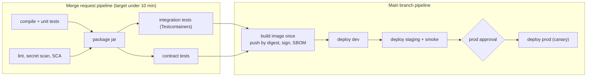

# CI/CD Pipeline Design (GitLab CI, Jenkins, GitHub Actions)

!!! abstract "Key takeaways"
    - **Continuous integration** merges small changes to trunk often, and each merge is built and tested automatically. **Continuous delivery** keeps every green build releasable, with a human deciding when it goes out. **Continuous deployment** removes that human step.
    - **Build once, promote many:** build one immutable artifact (a jar or image pinned by **digest**), then promote that same artifact through dev → staging → prod, with configuration injected per environment. Rebuilding per environment means you're testing one binary and shipping another.
    - Order the pipeline for **fast feedback**: cheap, high-signal checks first (compile, unit tests, lint, secret scan), slower ones later (integration, contract, image scan), and deploys last. Use **DAG dependencies** (`needs:`), caching and parallelism to keep merge-request pipelines under about 10 minutes.
    - The pipeline is a **production system with prod credentials**. Use OIDC federation instead of stored cloud keys, least-privilege job tokens, protected branches and environments, and third-party actions pinned to a **full commit SHA**.
    - GitLab CI, GitHub Actions and Jenkins differ mainly in syntax and where reuse lives (`include:` templates, reusable workflows, shared libraries). Learn the concepts, then map them.

## Why it matters

Every change to production passes through the pipeline, so its design decides how often you can release, how quickly a bad change is caught, and what an attacker gets if they compromise it. Slow pipelines push teams into big batches, and big batches make failures bigger. The DORA research ties delivery performance to throughput (deployment frequency, change lead time, failed-deployment recovery time) and instability (change fail rate, deployment rework rate, the fifth metric DORA added recently). Pipeline design moves all five.

## Core concepts

### CI, continuous delivery, continuous deployment

| Practice | What's automated | Human gate | Precondition |
|---|---|---|---|
| Continuous integration | Build and test on every push and merge | Code review | Trunk-based or short-lived branches, a fast reliable test suite |
| Continuous delivery | Everything up to a production-ready, deployable artifact, often an automatic deploy to staging | Someone clicks "deploy to prod" | Build once, automated environments, rollback |
| Continuous deployment | Every green change goes to production | None | Strong automated tests, progressive delivery, observability, feature flags |

Regulated healthcare and banking teams usually practise continuous delivery with a named approver on production. That's fine as long as the approval promotes an already-tested artifact rather than triggering a fresh build.

### The shape of a good pipeline


*Notice that the image is built once on main and every later box promotes the same digest. Tests that ran against it in staging are tests of what reaches production.*

Stages follow a cost-versus-signal order:

1. **Commit stage** (minutes): compile, unit tests, static analysis, formatting, secret scanning. Most failures happen here, so it must be fastest.
2. **Acceptance stage** (tens of minutes): integration tests against real dependencies, contract tests, container and dependency scans. See [Testcontainers](../testing/04-testcontainers.md), [contract testing](../testing/05-contract-testing.md) and [quality gates](../testing/07-tdd-coverage-and-quality-gates.md).
3. **Release stages**: deploy to environments, smoke tests, progressive rollout in production. Rollout mechanics are covered in [Rolling updates, rollbacks and Helm](../docker-kubernetes/07-rolling-updates-rollbacks-and-helm.md) and [GitOps and deployment strategies](04-gitops-and-deployment-strategies.md).

### Build once, promote many

Rebuilding for each environment invites drift: a base image tag moves, a dependency resolves to a newer patch, a build flag differs. The artifact that passed staging is then not the artifact in production. Build the image once, record its **digest** (`sha256:…`), and pass the digest to every later deploy job. Environment differences belong in configuration (Helm values, ConfigMaps, Spring profiles, a secrets manager), not in the binary.

{ loading=lazy }
*Watch the digest label: on the left it never changes, on the right production gets a digest nobody tested.*

### Keeping it fast

| Lever | GitLab CI | GitHub Actions | Jenkins |
|---|---|---|---|
| Run jobs as soon as their inputs exist | `needs:` (DAG) | `needs:` between jobs | `parallel` blocks, `stage` ordering |
| Reuse dependency downloads | `cache:` keyed on `pom.xml` / lockfile | `actions/cache` or `setup-java` with `cache: maven` | Persistent agent workspace, a Maven repo volume |
| Split a slow suite | `parallel: N` + test splitting | `strategy.matrix` | `parallel` + a test-splitting plugin |
| Skip what didn't change | `rules: changes:` | `on.push.paths` | `when { changeset }` |
| Cancel superseded runs | `interruptible: true` | `concurrency: cancel-in-progress` | `disableConcurrentBuilds(abortPrevious: true)` |

{ loading=lazy }
*Notice the idle gaps in the top row: with plain stages every job waits for the slowest job of the previous stage.*

### The pipeline as an attack surface

A CI runner that can deploy to production holds production power. The main controls:

- **No long-lived cloud keys.** GitLab `id_tokens:` and GitHub `permissions: id-token: write` mint a short-lived OIDC token per job. The cloud trusts it only for a specific project, branch or environment (`sub` claim), and exchanges it for temporary role credentials. The full flow is in [Secrets management](../application-security/05-secrets-management-and-secure-configuration.md).
- **Least-privilege job tokens.** In GitHub Actions set `permissions:` explicitly (the default `GITHUB_TOKEN` scope can be broad). In GitLab, restrict the CI job token's allowlist.
- **Pin third-party code.** In March 2025 attackers repointed the version tags of `tj-actions/changed-files` (CVE-2025-30066) to a commit that dumped runner secrets into build logs. A tag is mutable, a full commit SHA isn't. Pin actions to a SHA and let Dependabot or Renovate bump them.
- **Protect the deploy path.** Protected branches, protected environments with required approvers, and deploy jobs that run only on the default branch. Never run untrusted fork code with secrets (`pull_request_target` checking out the PR head is the classic GitHub mistake).
- **Supply-chain evidence.** SBOM, image signing (cosign) and dependency scanning: see [Security headers and dependency scanning](../application-security/06-security-headers-and-dependency-scanning.md).

### Tool mapping

| Concept | GitLab CI | GitHub Actions | Jenkins |
|---|---|---|---|
| Definition | `.gitlab-ci.yml` | `.github/workflows/*.yml` | `Jenkinsfile` (declarative or scripted Groovy) |
| Unit of work | job (in a stage) | job (made of steps) | stage / step |
| Executors | runners (shared, group, project; Docker, Kubernetes) | GitHub-hosted or self-hosted runners | controller + agents (often Kubernetes pods) |
| Reuse | `include:` templates, CI/CD components, `extends:` | reusable workflows (`workflow_call`), composite actions | shared libraries |
| Environments and approvals | `environment:`, protected environments, deployment approvals | `environment:` with protection rules and required reviewers | `input` step, plugins |
| Serialise deploys | `resource_group:` | `concurrency:` group | `lock` (Lockable Resources plugin) |
| Cloud auth | `id_tokens:` (OIDC) | `id-token: write` + cloud login actions | credentials plugin, or OIDC via plugins |


## In practice: code & configuration

=== "❌ Common mistake"
    ```yaml
    # .gitlab-ci.yml: rebuilds per environment, static keys, no gates
    variables:
      AWS_ACCESS_KEY_ID: AKIA...            # long-lived key in CI variables
      AWS_SECRET_ACCESS_KEY: $AWS_SECRET
    stages: [build, test, deploy]

    build:
      stage: build
      script: mvn package -DskipTests       # tests skipped "to save time"

    test:
      stage: test
      script: mvn verify                    # rebuilds everything again; no cache

    deploy-staging:
      stage: deploy
      script:
        - docker build -t claims-api:latest .         # new build per env, mutable tag
        - docker push $REGISTRY/claims-api:latest
        - kubectl set image deploy/claims-api app=$REGISTRY/claims-api:latest

    deploy-prod:
      stage: deploy
      script:
        - docker build -t claims-api:latest .         # a different image from staging
        - docker push $REGISTRY/claims-api:latest
        - kubectl set image deploy/claims-api app=$REGISTRY/claims-api:latest
      # runs on every branch, in parallel with staging, without approval
    ```

=== "✅ Correct approach"
    ```yaml
    # .gitlab-ci.yml: build once, promote by digest, OIDC, DAG, gated prod
    workflow:
      rules:
        - if: $CI_PIPELINE_SOURCE == "merge_request_event"
        - if: $CI_COMMIT_BRANCH == $CI_DEFAULT_BRANCH

    default:
      image: eclipse-temurin:21-jdk
      interruptible: true                    # newer pushes cancel older runs
      cache:
        key: { files: [pom.xml] }            # cache keyed on dependencies
        paths: [.m2/repository]
    variables:
      MAVEN_OPTS: -Dmaven.repo.local=.m2/repository

    unit:
      stage: test
      script: ./mvnw -B verify -DskipITs     # compile + unit tests + JaCoCo
      artifacts: { paths: [target/*.jar], reports: { junit: target/surefire-reports/*.xml } }

    integration:
      stage: test
      needs: [unit]                          # DAG: starts as soon as unit passes
      script: ./mvnw -B verify -Dsurefire.skip=true   # Testcontainers ITs

    image:
      stage: build
      needs: [unit]
      rules: [{ if: $CI_COMMIT_BRANCH == $CI_DEFAULT_BRANCH }]
      image: gcr.io/kaniko-project/executor:debug
      script:
        - /kaniko/executor --context . --destination $CI_REGISTRY_IMAGE:$CI_COMMIT_SHA
            --digest-file digest.txt
        - echo "IMAGE_DIGEST=$(cat digest.txt)" > build.env
      artifacts: { reports: { dotenv: build.env } }  # pass the digest to later jobs

    .deploy:
      image: alpine/helm:3.19.0
      id_tokens:
        AWS_OIDC_TOKEN: { aud: https://gitlab.example.com }  # short-lived, per job
      script:
        - ./ci/assume-role.sh "$DEPLOY_ROLE_ARN"   # STS AssumeRoleWithWebIdentity
        - helm upgrade --install claims-api ./chart -f values-$ENV.yaml
            --set image.digest=$IMAGE_DIGEST --wait --timeout 5m

    deploy-staging:
      extends: .deploy
      stage: deploy
      needs: [image, integration]
      variables: { ENV: staging }
      environment: { name: staging }
      resource_group: staging                # one deploy at a time per env

    deploy-prod:
      extends: .deploy
      stage: deploy
      needs: [image, deploy-staging]         # same digest that staging ran
      variables: { ENV: prod }
      environment: { name: production }      # protected env: approvers required
      resource_group: production
      when: manual
    ```

The same rules in GitHub Actions, focusing on the security-relevant lines:

```yaml
# .github/workflows/deploy.yml
on:
  push: { branches: [main] }
permissions:
  contents: read                     # least privilege by default
concurrency: { group: deploy-${{ github.ref }}, cancel-in-progress: false }
jobs:
  # build job (not shown) pushes the image and exposes outputs.digest
  deploy-prod:
    needs: build
    runs-on: ubuntu-latest
    environment: production          # required reviewers configured on the environment
    permissions:
      id-token: write                # allow this job to mint an OIDC token
      contents: read
    steps:
      - uses: actions/checkout@11bd71901bbe5b1630ceea73d27597364c9af683  # v4.2.2, pinned SHA
      - uses: aws-actions/configure-aws-credentials@b47578312673ae6fa5b5096b330d9fbac3d116df  # v4.2.1
        with:
          role-to-assume: arn:aws:iam::111122223333:role/gha-deploy-prod
          aws-region: eu-west-1
      - run: helm upgrade --install claims-api ./chart --set image.digest=${{ needs.build.outputs.digest }} --wait
```

In Jenkins the equivalent is a declarative `Jenkinsfile` that calls a shared library (`@Library('platform') _` then `deployService(env: 'prod')`), runs agents as Kubernetes pods, and gates prod with an `input` step limited to an approver group.

## Real-world usage

- **Platform templates.** Organisations with dozens of services publish one versioned pipeline template (GitLab CI/CD component, GitHub reusable workflow, Jenkins shared library). Each service repo has a ten-line file that includes it. Standards (scans, quality gates, signing) change in one place.
- **Monorepos** use path filters and build tools with dependency graphs (Nx, Bazel, Gradle) so a change rebuilds only affected projects.
- **Regulated domains** (healthcare, banking) keep an audit trail: who approved which digest into production and when. Protected environments and deployment history give that for free if prod deploys only happen through the pipeline.

## Trade-offs & production gotchas

| Option | Pros | Cons | Use when |
|---|---|---|---|
| GitLab CI | One product for repo, CI, registry, environments; strong DAG and `rules:` | Runner fleet to manage if self-hosted | Code already on GitLab; self-managed setups |
| GitHub Actions | Huge marketplace, reusable workflows, hosted runners | Third-party action supply chain; YAML expressions can get dense | Code on GitHub |
| Jenkins | Anything is possible; on-prem and air-gapped | Controller and plugin maintenance, Groovy sprawl, security patching | Legacy estates, unusual integrations |
| Continuous deployment | Smallest batches, fastest feedback | Needs excellent tests, flags and progressive delivery | Mature teams, low-regulation services |
| Continuous delivery with approval | Satisfies change management | A manual step can become a rubber stamp or a bottleneck | Regulated production |

!!! warning "Gotcha: flaky tests destroy trust"
    Once engineers learn to hit "retry" on red pipelines, a real failure gets retried too. Quarantine flaky tests with an owner and a deadline, track the flake rate, and never make retries automatic for whole jobs.

!!! warning "Gotcha: `latest` and mutable tags"
    `image: claims-api:latest` makes deploys and rollbacks non-deterministic: a rollback "to the previous version" may pull something new. Deploy by digest or by an immutable tag such as the commit SHA, and enable tag immutability in the registry.

## How this connects to my experience

- **Where I used it:** CipherTrust Cloud Key Management at Coriolis: "Built REST APIs using Spring Boot and automated deployments through GitLab CI/CD pipelines". OptumRx Meteor at Publicis Sapient: "Established engineering standards around testing, CI/CD, code quality, and deployment practices" and "Led sprint planning, estimation, stakeholder communication, release management, and production support". Skills list: GitLab CI/CD, Jenkins.
- **Talking points:**
    - The GitLab pipeline shape at Coriolis: stages, how the key-management service was tested (HSM integrations are hard to test in CI) and what was deployed where. *[confirm: stages, test approach for Luna/SafeNet, deploy target]*
    - The Meteor standard: what every service pipeline had to include (unit tests, coverage gate, SCA, image scan) and how it was shared across services (template, shared library). *[confirm: GitLab or Jenkins, template mechanism]*
    - Release management: how a release moved from staging to production, who approved it, and how rollbacks were done. *[confirm: approval flow, release cadence]*
    - How cloud credentials reached the pipeline (static keys vs OIDC or an instance role). Answer honestly and say what you'd change. *[confirm]*
- **Likely follow-up chain:** "Walk me through your pipeline" → "How long did it take, and how did you speed it up?" (DAG, cache, test split) → "How do you make sure staging and prod run the same build?" (digest promotion) → "How does the pipeline get AWS access?" (OIDC role trust on project and branch) → "What happens when prod deploy fails halfway?" (`--wait`/`--atomic`, rollback to previous digest, expand/contract migrations).

## Interview questions

### Fundamentals

??? question "Q1. What's the difference between continuous integration, continuous delivery and continuous deployment?"
    **Answer:** CI means developers merge small changes to trunk frequently and every merge is built and tested automatically. Continuous delivery extends that so every green build is a deployable artifact that has passed through automated environments; releasing to production is a business decision, often one click. Continuous deployment releases every green change to production automatically, which needs strong tests, progressive delivery and monitoring.

    **Interviewer listens for:** small batches and trunk; releasable vs released; the human gate is the difference.

    **Common wrong answer:** "CI is the build server and CD is the deploy script."

??? question "Q2. What does 'build once, deploy many' mean and why does it matter?"
    **Answer:** Build one immutable artifact per commit, identify it by digest, and promote that exact artifact through every environment, injecting environment-specific configuration at deploy time. Rebuilding per environment can produce a different binary (moved base image, new dependency patch, different flags), so staging tests stop being evidence about production. It also makes rollback precise: redeploy the previous digest.

    **Interviewer listens for:** digest, config outside the artifact, rollback benefit.

    **Common wrong answer:** "Build a separate image per environment with the config baked in, so each is self-contained."

??? question "Q3. How would you order the stages in a pipeline?"
    **Answer:** By cost against signal: fastest checks that catch the most problems first (compile, unit tests, lint, secret scan), then slower ones (integration with Testcontainers, contract tests, image and dependency scans), then build and publish the image, then deploys to environments with smoke tests and a progressive production rollout. Independent jobs run in parallel and use a DAG so nothing waits for unrelated work.

    **Interviewer listens for:** fail fast, parallelism, deploys last.

    **Common wrong answer:** Running E2E tests first "because they cover the most".

### Intermediate

??? question "Q4. Your merge-request pipeline takes 40 minutes. How do you bring it down?"
    **Answer:** Measure first: per-job durations and the critical path. Then: cache dependencies keyed on the lockfile; replace stage barriers with `needs:` so jobs start when their inputs exist; split slow test suites across parallel jobs; move slow, rarely failing checks (full E2E, DAST) to main or nightly; use path filters in monorepos; reuse built artifacts between jobs instead of rebuilding; right-size runners; cancel superseded pipelines. Fix flaky tests, because retries hide in duration too.

    **Interviewer listens for:** measure the critical path, then caching, DAG, parallelism and test placement.

    **Common wrong answer:** "Skip the tests on merge requests."

??? question "Q5. How should a pipeline authenticate to AWS or Azure?"
    **Answer:** With OIDC federation. The CI platform issues a signed, short-lived token per job with claims such as project path, branch and environment. The cloud has a trust policy for that issuer that only accepts specific `sub` claims (for example, only the `main` branch of one project, or only the production environment) and exchanges the token for temporary role credentials. Nothing long-lived is stored in CI. Separate roles per environment, with prod's role only assumable from the protected prod environment.

    **Interviewer listens for:** short-lived, claim-scoped trust, per-environment roles.

    **Common wrong answer:** "Store an access key as a masked CI variable." Masking hides it in logs, but it's still a long-lived key.

??? question "Q6. How do you share pipeline logic across 30 microservices without copy-paste?"
    **Answer:** A versioned template owned by a platform team: GitLab `include:` with CI/CD components, GitHub reusable workflows, or a Jenkins shared library. Services include a pinned version and pass a few inputs. Changes go through review and a version bump, with a changelog. Keep escape hatches for unusual services, but make the secure path the default.

    **Interviewer listens for:** versioning of the template, ownership, defaults over policing.

    **Common wrong answer:** "Each team copies the YAML from a wiki page."

### Senior

??? question "Q7. What are the main supply-chain risks in a CI/CD system and how do you mitigate them?"
    **Answer:** Compromised third-party actions or plugins (pin to commit SHAs, allowlist, update via Renovate), poisoned dependencies (lockfiles, private proxy registry, SCA), leaked secrets (OIDC, minimal token permissions, no secrets for fork PRs), tampered artifacts (sign images, verify signatures at admission, SBOM), and a compromised runner (ephemeral runners, isolated per trust level, no shared Docker socket). The tj-actions incident in 2025 showed a mutable tag turning into secret exfiltration across thousands of repositories.

    **Interviewer listens for:** tags vs SHAs, OIDC, signing and admission, ephemeral runners.

    **Common wrong answer:** "We use a private repo, so the pipeline is safe."

??? question "Q8. Design CI/CD for 30 Spring Boot services on EKS with a regulated production approval."
    **Answer:** One shared template; MR pipelines with unit, slice, integration and contract tests plus SCA and a quality gate; on main, build one image per service, push by digest, sign it and attach an SBOM; deploy automatically to dev and staging with smoke tests; production through a protected environment with named approvers, by GitOps (a PR bumping the digest in the config repo) or a Helm deploy job with `--wait`/`--atomic`; canary with metric checks; OIDC roles per environment; `can-i-deploy` for contracts; expand/contract database migrations so rollback is safe; DORA metrics on a dashboard.

    **Interviewer listens for:** promotion by digest, audit trail, progressive rollout, safe rollback including the database.

    **Common wrong answer:** A single pipeline that rebuilds and deploys all 30 services on every change.

### Scenario-based

??? question "Q9. A hotfix is urgent but the pipeline is red because of an unrelated flaky test. What do you do?"
    **Answer:** Don't bypass the pipeline or deploy from a laptop. Confirm the failure is unrelated, quarantine that test with an owner and ticket (or re-run once with a note), and let the hotfix go through the same path. If the organisation has an emergency change process, use it so there's an audit trail. Afterwards, fix the flake and review why it was blocking.

    **Interviewer listens for:** same path for hotfixes, audit, fix the root cause.

    **Common wrong answer:** "Push the jar straight to the server and fix the pipeline later."

??? question "Q10. Production deploys from two merged MRs ran at the same time and one overwrote the other. How do you prevent that?"
    **Answer:** Serialise deploys per environment: `resource_group:` in GitLab, a `concurrency:` group in GitHub Actions (without cancelling in-progress deploys), a lock in Jenkins. Deploy by digest from the pipeline of the newest commit, and make the deploy step idempotent. With GitOps, the config repo's history serialises changes and the controller reconciles to the latest commit.

    **Interviewer listens for:** a concurrency control per environment and why not cancel mid-deploy.

    **Common wrong answer:** "Tell people not to merge at the same time."

## Cheat sheet

| Concept | Remember |
|---|---|
| CI / delivery / deployment | Integrate often / always releasable / always released |
| Build once | One artifact, by digest, promoted; config per env outside the artifact |
| Stage order | Cheap and high-signal first, deploys last |
| Speed | `needs:` DAG, cache on lockfile, parallel test split, path filters, cancel superseded |
| Cloud auth | OIDC `id_tokens` / `id-token: write`, role trust on `sub` claim |
| Supply chain | Pin actions to SHA, sign images, SBOM, ephemeral runners |
| Serialise deploys | `resource_group` / `concurrency` / `lock` |
| Reuse | `include:` components / reusable workflows / shared libraries |
| DORA | Deploy frequency, lead time, recovery time, change fail rate, rework rate |

## Sources
1. [Martin Fowler: Continuous Integration](https://martinfowler.com/articles/continuousIntegration.html) and Jez Humble and David Farley, *Continuous Delivery* (Addison-Wesley, 2010): deployment pipeline, commit and acceptance stages, build once.
2. [DORA: Software delivery performance metrics](https://dora.dev/guides/dora-metrics/history/): the throughput and instability metrics, including rework rate.
3. [GitLab CI/CD YAML reference](https://docs.gitlab.com/ci/yaml/): `needs`, `rules`, `cache`, `resource_group`, `environment`, `id_tokens`, `interruptible`.
4. [GitLab: OpenID Connect in AWS](https://docs.gitlab.com/ci/cloud_services/aws/): OIDC trust and claim conditions.
5. [GitHub Docs: Security hardening for GitHub Actions](https://docs.github.com/en/actions/security-for-github-actions/security-guides/security-hardening-for-github-actions): pinning to full-length SHAs, token permissions, `pull_request_target`.
6. [GitHub Docs: OpenID Connect](https://docs.github.com/en/actions/security-for-github-actions/security-hardening-your-deployments/about-security-hardening-with-openid-connect): `id-token: write` and cloud trust.
7. [CISA: Supply chain compromise of third-party GitHub Action (CVE-2025-30066)](https://www.cisa.gov/news-events/alerts/2025/03/18/supply-chain-compromise-third-party-github-action-cve-2025-30066): the tj-actions incident.
8. [Jenkins: Pipeline syntax](https://www.jenkins.io/doc/book/pipeline/syntax/) and [Shared libraries](https://www.jenkins.io/doc/book/pipeline/shared-libraries/): declarative pipelines, `input`, reuse.
