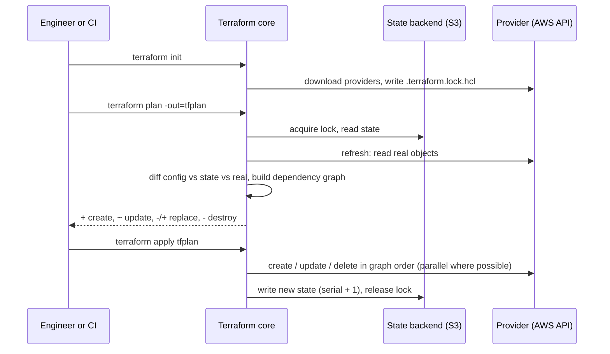

# Terraform Fundamentals: State, Modules, Plan/Apply

!!! abstract "Key takeaways"
    - Terraform compares three things: your **configuration** (desired state), the **state file** (what it created last time, mapped to real IDs) and the **real infrastructure** (read through providers). `plan` shows the difference, `apply` executes it and writes new state.
    - **State is critical and sensitive.** It maps `aws_s3_bucket.claims` to a real bucket, and it stores attribute values **in plain text**, including secrets (a `random_password` result sat in `terraform.tfstate` here). Keep it in a remote, encrypted, versioned, access-controlled backend, never in Git.
    - **Locking** stops two applies writing state at once. Running a plan during an apply failed with **`Error acquiring the state lock`**, showing the holder's ID and operation. On S3, use **`use_lockfile = true`** (native S3 locking, GA in Terraform 1.11); DynamoDB locking is deprecated.
    - A **saved plan** (`plan -out`) is applied exactly as reviewed, or not at all: after another apply changed state, `apply tfplan` failed with **`Saved plan is stale`**. That's what makes "plan on the PR, apply the saved plan" safe.
    - **Modules** are reusable directories with inputs and outputs. Address resources by **`for_each` keys, not `count` indexes** (removing the first of three `count` items changed two and destroyed one, where `for_each` destroyed only the removed key), and use **`moved` blocks** to rename without destroy/create.

## Why it matters

Before infrastructure as code, environments were built by clicking in consoles or running scripts, so nobody could say exactly how production was configured or rebuild it reliably. Terraform describes infrastructure declaratively, reviews changes as a diff before they happen, and works across AWS, Azure, GCP, Kubernetes and SaaS through providers. Interviewers probe state (what it is, where it lives, what goes wrong), the plan/apply workflow in CI, and module design. Best practices for layout, environments and pipelines are on [Infrastructure as Code best practices](03-infrastructure-as-code-best-practices.md).

The behaviour quoted on this page was observed with **Terraform 1.16.5** using the `local`, `random` and built-in `terraform_data` resources, which behave like cloud resources for state, locking and planning but need no cloud account.

!!! note "Terraform vs OpenTofu"
    HashiCorp moved Terraform to the Business Source License in August 2023. The community fork **OpenTofu** (MPL 2.0, a CNCF sandbox project since April 2025) stays largely compatible and adds features such as client-side state encryption (1.7). Interviewers may ask which you'd choose: it's mostly a licensing and vendor decision, and the concepts on this page apply to both.

## Core concepts

### The core workflow


*Notice that the refresh happens during plan: Terraform always reads reality before proposing changes, which is how it notices drift.*

- **`init`** installs providers and modules and configures the backend. It writes **`.terraform.lock.hcl`**, which pins exact provider versions and checksums. Commit it, just like a Maven or npm lockfile.
- **`plan`** proposes actions with symbols: `+` create, `~` update in place, `-/+` destroy then create (replacement, often because an immutable attribute changed: look for `# forces replacement`), `-` destroy.
- **`apply`** executes a saved plan, or plans again and asks for approval.
- **`plan -detailed-exitcode`** returns **0** for no changes, **1** for errors and **2** when changes are pending. Measured: 0 on a clean workspace, 2 after a managed file was edited by hand. Pipelines use this for drift detection.

{ loading=lazy }
*Watch the serial number: every successful apply that changes state bumps it, and that is what makes an older saved plan stale.*

### State

State is a JSON document. The one produced here started like this:

```text
version: 4   terraform_version: 1.16.5   serial: 4   lineage: 9c39639f-…
resources: random_password.db, terraform_data.release, module.claims.local_file.cfg
```

- **Mapping:** each resource address maps to a real object ID. Without state, Terraform can't tell that a bucket it sees is the one it manages.
- **Metadata:** dependencies, so deletes happen in the right order even after you remove the resource from code.
- **Performance:** cached attributes for large estates.
- **`serial`** increments on each change, and **`lineage`** identifies one state's history, so Terraform refuses to overwrite state from a different lineage.
- **Secrets:** marking an attribute sensitive only hides it in CLI output. The state held the full 20-character `random_password` result in plain text (listed under `sensitive_attributes`, but not encrypted). Treat the state bucket as a secret store: encryption with KMS, tight IAM, versioning, access logs. Terraform 1.10+ **ephemeral** values and write-only arguments avoid persisting some secrets at all.

```hcl
terraform {
  required_version = ">= 1.11"
  backend "s3" {
    bucket       = "acme-tfstate-prod"           # versioned, KMS-encrypted, public access blocked
    key          = "claims/prod/terraform.tfstate"
    region       = "eu-west-1"
    encrypt      = true
    use_lockfile = true                          # S3 native lock: writes a .tflock object
  }
}
```

### Locking

Measured: an `apply` was running (a provisioner slept 6 s) when a second `plan` started:

```text
Error: Error acquiring the state lock
Lock Info:
  ID:        0a8fb9af-4cbc-5ae5-c209-a068e066ad78
  Path:      terraform.tfstate
  Operation: OperationTypeApply
  Who:       root@vm
  Version:   1.16.5
```

Without a lock, two applies would each read state serial N, each write serial N+1, and the second would silently drop the first one's resources from state: they'd still exist and cost money, but Terraform would no longer manage them. `terraform force-unlock <ID>` exists for a lock left behind by a crashed run. Use it only after confirming nothing is running.

### Saved plans and stale plans

A plan was saved for `env=staging`, then a different apply (`env=qa`) moved state to serial 8. Applying the saved plan then failed:

```text
Error: Saved plan is stale
The given plan file can no longer be applied because the state was changed by
another operation after the plan was created.
```

This guarantee is why CI can show the plan on the pull request, have a human approve it, and apply **that file** after merge. If anything changed in between, apply refuses and you plan again.

### Drift

When a managed file was overwritten outside Terraform, the next plan printed `Note: Objects have changed outside of Terraform … has been deleted` and proposed `1 to add`. `terraform plan -refresh-only` reports drift without proposing to undo it, and `apply -refresh-only` accepts reality into state. Drift detection in CI is covered on [the best-practices page](03-infrastructure-as-code-best-practices.md).

### Modules

A module is a directory of `.tf` files with **variables** (inputs), **resources**, and **outputs**. The root module calls child modules:

```hcl
module "claims" {
  source = "./modules/bucket"        # or "git::https://…//bucket?ref=v1.4.0", or a registry module with version
  name   = "claims"
  env    = var.env
}
output "claims_path" { value = module.claims.path }   # outputs are the module's API
```

Pin module versions (`?ref=v1.4.0` or `version = "~> 1.4"`), keep modules small and focused, and don't hide providers inside reusable modules: pass them in from the root.

### count vs for_each

Three services were created both ways, then the first (`claims`) was removed from the list:

| Meta-argument | Addresses | Plan after removing `claims` |
|---|---|---|
| `count = length(var.svcs)` | `[0]`, `[1]`, `[2]` | `[0]` `claims → pharmacy`, `[1]` `pharmacy → members` (**2 changed**), `[2]` destroyed |
| `for_each = toset(var.svcs)` | `["claims"]`, `["pharmacy"]`, `["members"]` | only `["claims"]` destroyed |

With real resources whose name forces replacement (an SQS queue, an S3 bucket), the `count` version would **destroy and recreate** two healthy resources. Use `count` only for "0 or 1" toggles.

{ loading=lazy }
*Notice the arrows on the left: identity follows position, so deleting one item disturbs everything after it.*

### Refactoring: moved, import, removed

- **`moved`**: renaming `module "claims"` to `module "claims_store"` without it planned `1 to add, 1 to destroy`. With `moved { from = module.claims  to = module.claims_store }` the plan was `# … has moved to …` and **0 to add, 0 to destroy**.
- **`import`** blocks (Terraform 1.5+) bring existing resources under management in a reviewed plan; `terraform plan -generate-config-out=generated.tf` drafts the configuration.
- **`removed`** blocks (1.7+) stop managing a resource without destroying it.

### Lifecycle and dependencies

`lifecycle { prevent_destroy = true }` guards databases and state buckets; `create_before_destroy` avoids downtime when a replacement is needed; `ignore_changes` stops fighting with something else that manages an attribute (for example, an autoscaler changing `desired_count`). Terraform infers dependencies from references; `depends_on` is for hidden dependencies only, such as an IAM policy that must exist before a Lambda runs.

## In practice: code & configuration

=== "❌ Common mistake"
    ```hcl
    # Local state, secrets in tfvars, count over a list, no version pins
    provider "aws" { region = "eu-west-1" }                # any provider version

    variable "db_password" { default = "Sup3rSecret!" }    # committed to Git

    resource "aws_sqs_queue" "q" {
      count = length(var.services)                         # identity = list position
      name  = "${var.services[count.index]}-events"
    }

    resource "aws_db_instance" "claims" {
      password = var.db_password                           # also ends up in plain-text state
      # no prevent_destroy: a refactor can delete the database
    }
    # terraform.tfstate sits on a laptop and is shared via Slack
    ```

=== "✅ Correct approach"
    ```hcl
    terraform {
      required_version = ">= 1.11"
      required_providers {
        aws = { source = "hashicorp/aws", version = "~> 6.0" }   # lock file pins the exact build
      }
      backend "s3" {
        bucket       = "acme-tfstate-prod"
        key          = "claims/terraform.tfstate"
        region       = "eu-west-1"
        encrypt      = true
        use_lockfile = true
      }
    }

    resource "aws_sqs_queue" "events" {
      for_each = toset(var.services)                       # identity = service name
      name     = "${each.key}-events"
    }

    resource "aws_db_instance" "claims" {
      manage_master_user_password = true                   # RDS keeps it in Secrets Manager
      lifecycle { prevent_destroy = true }
    }

    moved {                                                # earlier refactor recorded, no recreate
      from = aws_sqs_queue.q
      to   = aws_sqs_queue.events
    }
    ```

## Real-world usage

- **AWS landing zones** are commonly built with Terraform (Control Tower Account Factory for Terraform, or in-house modules for VPCs, EKS, IAM).
- **CI-driven applies** with Atlantis, HCP Terraform, Spacelift or plain GitLab/GitHub pipelines: plan on the merge request, apply after approval.
- **Healthcare and banking**: Terraform plans and state history double as change evidence for auditors, and the state bucket's access controls come up in security reviews because state contains secrets.
- **Failure modes** seen in practice: an apply from a laptop with stale local state, a `count` reorder that recreates queues, a provider upgrade that changes a default, and someone fixing production in the console so the next apply reverts the fix.

## Trade-offs & production gotchas

| Option | Pros | Cons | Use when |
|---|---|---|---|
| Terraform / OpenTofu (HCL) | Multi-cloud, huge provider ecosystem, plan diff | HCL limits for complex logic; state to manage | Most cloud infrastructure |
| CloudFormation / Bicep | Native, state managed by the cloud | One cloud; slower feedback | Single-cloud shops wanting no state backend |
| Pulumi / CDK | Real languages, tests, loops | Easier to write unreviewable code | Teams with heavy logic and strong code review |
| `count` | Simple 0/1 toggles | Index-based identity | Optional single resources |
| `for_each` | Stable keys | Keys must be known at plan time | Collections |

!!! warning "Gotcha: values known only after apply"
    `for_each` keys and `count` must be known during plan. Using an attribute that is "(known after apply)", such as a generated ID, fails with an "Invalid for_each argument" error. Key collections by names from variables, not by computed IDs.

!!! warning "Gotcha: `-target` as a habit"
    `terraform apply -target=…` is for recovering from errors. Used routinely, it leaves the rest of the configuration unapplied and the state out of step with the code.

## How this connects to my experience

- **Where I used it:** ConvergeHealth Data Asset Explorer at Deloitte: "Automated infrastructure provisioning and deployment processes using Terraform" on AWS (Lambda, EC2, ECS, EKS, API Gateway, RDS, DynamoDB, SQS, SNS, S3), plus "security controls using IAM, KMS, and Secrets Manager". Terraform is in the skills list.
- **Talking points:**
    - What the Terraform code owned: which of those services, organised into which modules. *[confirm: modules, rough number of resources]*
    - Where state lived and how it was locked (S3 + DynamoDB was the norm then), and how environments were separated. *[confirm]*
    - How Terraform ran: from a pipeline with plan review, or from engineers' machines. Be honest; say what you'd change today (saved plans, OIDC role, native S3 locking). *[confirm]*
    - How secrets were handled given that state stores them (Secrets Manager, KMS-encrypted state bucket). *[confirm]*
- **Likely follow-up chain:** "What's in Terraform state?" → "Where did you keep it and why?" → "Two people apply at once: what happens?" (lock) → "You need to rename a module without recreating resources" (`moved`) → "Someone changed a security group in the console" (drift, refresh-only, fix the code or revert).

## Interview questions

### Fundamentals

??? question "Q1. What is Terraform state and why does it exist?"
    **Answer:** A JSON document that maps each resource address in the configuration to the real object it manages (IDs and attributes), records dependencies, and tracks a serial and lineage. Terraform needs it to know which real objects it owns, to compute diffs, and to delete things in the right order after they've been removed from code. It contains attribute values in plain text, secrets included, so it must be stored securely.

    **Interviewer listens for:** mapping to real IDs, sensitive contents, not just "a cache".

    **Common wrong answer:** "It's optional; Terraform can query the cloud for everything."

??? question "Q2. What happens during `terraform plan`?"
    **Answer:** Terraform loads configuration and state, acquires the state lock, refreshes by reading the real objects through providers, compares desired configuration with current reality and state, builds a dependency graph and prints the proposed actions: create, update in place, replace, destroy. With `-out` it saves an exact, applyable plan. Nothing is changed.

    **Interviewer listens for:** refresh, graph, the action symbols, saved plans.

    **Common wrong answer:** "It compares the code with the state file only."

??? question "Q3. Why use a remote backend with locking?"
    **Answer:** So the team shares one source of truth, state isn't lost with a laptop, it's encrypted and versioned, and concurrent runs are blocked. Without a lock, two applies read the same serial and the second write drops the first's changes from state. On AWS: an S3 bucket with versioning, KMS encryption, blocked public access and `use_lockfile = true`.

    **Interviewer listens for:** concurrency, versioning for recovery, encryption because of secrets.

    **Common wrong answer:** "Commit the state file to Git so everyone has it."

### Intermediate

??? question "Q4. `count` or `for_each`?"
    **Answer:** `for_each` for collections, because addresses are keyed by stable names. With `count`, identity is the index, so removing the first item shifts every later item: removing one of three changed two resources and destroyed the third, and with immutable names that means real replacements. Use `count` for a 0-or-1 toggle.

    **Interviewer listens for:** index shifting and its consequence.

    **Common wrong answer:** "They're equivalent; `count` is just simpler."

??? question "Q5. How do you rename a resource or module without destroying it?"
    **Answer:** Add a `moved` block from the old address to the new one. Plan then shows "has moved to" and no create or destroy. Keep the block for a while so every workspace and branch picks it up. The older approach is `terraform state mv`, which isn't reviewed in a plan.

    **Interviewer listens for:** `moved` in code, reviewable.

    **Common wrong answer:** "Delete and re-import."

??? question "Q6. What is a stale plan and why does it matter in CI?"
    **Answer:** A saved plan records the state serial and lineage it was made against. If state changes before it's applied, Terraform refuses: "Saved plan is stale". That lets a pipeline show a plan for review and apply exactly that plan later; if something else changed meanwhile, it fails safely and you re-plan.

    **Interviewer listens for:** plan-review-apply integrity.

    **Common wrong answer:** "Apply just re-plans, so a saved plan is cosmetic."

### Senior

??? question "Q7. How do you keep secrets safe in Terraform?"
    **Answer:** Don't put them in variables with defaults or in tfvars in Git. Prefer resources that let the cloud manage the secret (RDS `manage_master_user_password`, Secrets Manager rotation), read secrets at apply time with data sources, use ephemeral values and write-only arguments in newer versions, and treat state as sensitive: KMS-encrypted, versioned bucket with tight IAM and access logging. `sensitive = true` only redacts CLI output. OpenTofu also offers client-side state encryption.

    **Interviewer listens for:** state contains secrets; sensitive is only output redaction.

    **Common wrong answer:** "Mark it `sensitive` and it's encrypted."

??? question "Q8. Someone changed a production security group in the console. What now?"
    **Answer:** Detect it (scheduled `plan -detailed-exitcode` returns 2, or the next PR plan shows it). Decide whether the manual change was right. If it was an emergency fix, put it into code and merge, so the next apply keeps it. If not, apply the code to revert. Then remove console write access for that role or require break-glass, so it doesn't happen again.

    **Interviewer listens for:** don't blindly revert an emergency fix; codify; prevent.

    **Common wrong answer:** "Run apply to put it back" without checking why it changed.

### Scenario-based

??? question "Q9. A pipeline crashed mid-apply and now every run fails with a lock error. What do you do?"
    **Answer:** Read the lock info (who, operation, when). Confirm no apply is still running anywhere, including other runners. Then `terraform force-unlock <ID>`, run a plan to see what the crashed apply completed (state was written for finished resources), and apply again. Check whether any resource was created but not recorded and import it if needed.

    **Interviewer listens for:** verify before unlocking, then reconcile.

    **Common wrong answer:** "Delete the lock and run with `-lock=false`."

## Cheat sheet

| Concept | Remember |
|---|---|
| Inputs to plan | Config + state + real infrastructure (refresh) |
| Symbols | `+` create, `~` update, `-/+` replace, `-` destroy |
| Exit codes | `-detailed-exitcode`: 0 none, 1 error, 2 changes |
| State | Address → real ID, plain-text secrets, serial + lineage |
| Backend | S3 + versioning + KMS + `use_lockfile = true` (DynamoDB deprecated) |
| Lock error | `Error acquiring the state lock`; `force-unlock` only after checking |
| Saved plan | `plan -out` then `apply tfplan`; "Saved plan is stale" if state moved |
| Collections | `for_each` with stable keys; `count` for 0/1 |
| Refactor | `moved`, `import`, `removed` blocks |
| Lockfile | Commit `.terraform.lock.hcl` |

## Sources
1. [Terraform docs: State](https://developer.hashicorp.com/terraform/language/state) and [Sensitive data in state](https://developer.hashicorp.com/terraform/language/state/sensitive-data): purpose of state, plain-text values.
2. [Terraform docs: S3 backend](https://developer.hashicorp.com/terraform/language/backend/s3): `use_lockfile`, DynamoDB locking deprecation, required permissions.
3. [Upgrading to Terraform v1.11](https://developer.hashicorp.com/terraform/language/v1.11.x/upgrade-guides): S3 native locking generally available.
4. [Terraform CLI: plan](https://developer.hashicorp.com/terraform/cli/commands/plan): saved plans, `-detailed-exitcode`, `-refresh-only`.
5. [Terraform docs: The for_each meta-argument](https://developer.hashicorp.com/terraform/language/meta-arguments/for_each) and [count](https://developer.hashicorp.com/terraform/language/meta-arguments/count): when to use each.
6. [Terraform docs: Refactoring with moved blocks](https://developer.hashicorp.com/terraform/language/modules/develop/refactoring) and [import blocks](https://developer.hashicorp.com/terraform/language/import).
7. [Terraform docs: Dependency lock file](https://developer.hashicorp.com/terraform/language/files/dependency-lock).
8. [CNCF: OpenTofu project](https://www.cncf.io/projects/opentofu/) and [OpenTofu state encryption](https://opentofu.org/docs/language/state/encryption/): the fork and its encryption feature.
9. Yevgeniy Brikman, *Terraform: Up & Running*, 3rd ed. (O'Reilly, 2022): state, locking, module patterns.
