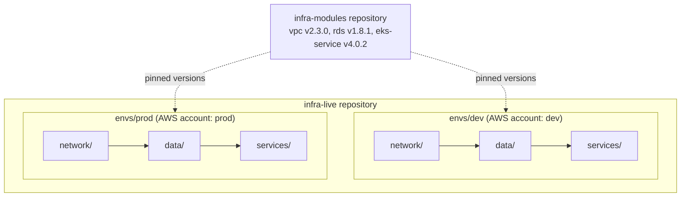
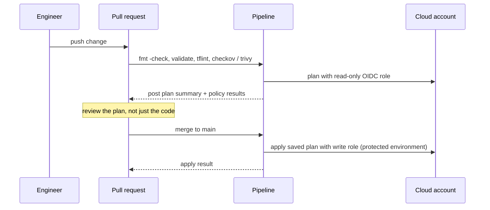

# Infrastructure as Code Best Practices

!!! abstract "Key takeaways"
    - **Split state by blast radius.** One state per environment and per layer (network, data, compute, app), so a bad apply or a corrupted state can only hurt one slice, and plans stay fast. Environments live in **separate directories or stacks** (often separate cloud accounts), not just separate workspaces of the same code.
    - **Everything goes through a pipeline:** `fmt` / `validate` / lint / security scan → **plan on the pull request** (posted for review) → **apply the saved plan after merge**, with a short-lived OIDC role. Humans don't apply to production from laptops.
    - **Modules are products:** small, single-purpose, versioned with semantic tags, documented inputs and outputs, sensible secure defaults, and examples. Pin module and provider versions and upgrade deliberately.
    - **Policy as code** (OPA/Conftest, Sentinel, Checkov, Trivy) rejects unsafe plans automatically: public buckets, unencrypted volumes, `0.0.0.0/0` on port 22, missing tags.
    - **Detect drift on a schedule** (`plan -detailed-exitcode` returns 2 when reality and code differ), restrict console write access, and prefer **immutable infrastructure**: replace servers and images rather than patching them in place.

## Why it matters

The fundamentals of a tool ([Terraform fundamentals](02-terraform-fundamentals-state-modules-plan-apply.md)) don't stop a team from building a single 3,000-resource state that takes 15 minutes to plan, letting five people apply from laptops, or copy-pasting the same VPC code into every environment until they diverge. Infrastructure code changes the most privileged things a company owns: networks, IAM, databases, encryption keys. The practices below are what interviewers mean by "how would you organise Terraform for a team?" and they show up in cloud-security, healthcare and banking reviews because they produce an audit trail.

## Core concepts

### Principles

| Principle | Means | Prevents |
|---|---|---|
| Declarative, version controlled | Desired state in Git; every change is a reviewed commit | "Who changed this and why?" |
| Idempotent | Applying the same code twice changes nothing the second time | Snowflake servers, scripts that fail on re-run |
| Immutable | Replace instead of mutate (new AMI, new image, new node group) | Configuration drift on long-lived servers |
| Small blast radius | Many small states and accounts | One mistake taking everything down |
| Least privilege | Separate plan (read) and apply (write) roles per environment | A compromised pipeline owning every account |
| Self-service with guardrails | Approved modules plus policy checks | A central team becoming the bottleneck |

### Layout: environments and layers


*Notice that each box under an environment is its own state with its own backend key. Prod can pin an older module version than dev while a change is being proven.*

- **Directories per environment** (or Terragrunt / HCP Terraform stacks) make differences explicit and reviewable, and let prod use a different backend, account and role. **Workspaces** share one configuration and backend config with different state; they suit short-lived copies (feature environments), but make it easy to apply to the wrong one and hard to give prod different access.
- **Layers** split by rate of change and blast radius: network and IAM change rarely and are dangerous; services change daily. Layers read each other's outputs through `terraform_remote_state` or, better, SSM parameters or data-source lookups, so a consumer doesn't need read access to another layer's whole state.
- **Separate cloud accounts or subscriptions per environment** are the strongest isolation: a dev credential can't touch prod even by mistake.

{ loading=lazy }
*Watch how far the red spreads: the same bad apply is a full outage on the left and a dev inconvenience on the right.*

### Module design

- **Single purpose.** A `service` module that creates an ECS service, its target group, alarms and IAM role is good. A `platform` module that creates everything is not reusable.
- **Secure by default.** Encryption on, public access off, logs on; make insecure options explicit and rare.
- **Small, typed interface.** `variable` blocks with `type`, `description` and `validation` rules; outputs for everything consumers need.
- **Versioned releases.** Tag the module repository (`v1.8.1`), keep a changelog, follow semantic versioning (a breaking input change is a major bump), and include `moved` blocks when refactoring so callers don't recreate resources.
- **Don't wrap one resource in a module** just to rename its arguments; that adds indirection without value.

### The IaC pipeline


*Notice the two roles: anyone's pull request can plan with read-only rights, but only the merged main branch, in a protected environment, can assume the role that changes infrastructure.*

Tools that implement this flow: Atlantis (plan/apply via PR comments), HCP Terraform, Spacelift, env0, or a GitLab/GitHub pipeline (the generic pipeline mechanics are on [CI/CD pipeline design](01-ci-cd-pipeline-design.md)).

### Static analysis and policy as code

| Check | Tool | Catches |
|---|---|---|
| Formatting | `terraform fmt -check -recursive` | Style noise in diffs (exit 3 with the files listed when unformatted) |
| Validity | `terraform validate` | Wrong types, missing arguments, bad references |
| Lint | TFLint (+ AWS ruleset) | Invalid instance types, deprecated syntax, unused variables |
| Misconfiguration | Checkov, Trivy (formerly tfsec), KICS | Public S3, unencrypted EBS, open security groups, missing logging |
| Organisation policy | OPA/Conftest on `terraform show -json plan`, Sentinel | "Prod RDS must be Multi-AZ", "tags `owner` and `data-classification` required", "only approved regions" |
| Cost | Infracost | The monthly cost change of this PR |

Policies on the **plan JSON** see the final resolved values, including what modules produce, so they catch more than scanning source files.

### Drift

Drift happens when someone changes infrastructure outside the code (console hotfix, a script, another tool). Detect it with a scheduled pipeline per state that runs `terraform plan -detailed-exitcode` and alerts on exit code **2**; exit **1** is an error and also needs attention. Then decide: codify the change or revert it. Reduce drift at the source: read-only console access in prod, break-glass roles with alerts, and `ignore_changes` only for attributes another system owns on purpose (for example, autoscaling's `desired_count`).

{ loading=lazy }
*Notice that exit code 2 is the signal: the job didn't fail, it found a difference worth a human decision.*

### Testing infrastructure code

- **`terraform test`** (1.6+) runs `.tftest.hcl` files with `plan` or `apply` runs and assertions, and can mock providers (1.7+), which makes module unit tests cheap.
- **Terratest** (Go) applies real infrastructure in a sandbox account, checks it (HTTP call, AWS API), then destroys it. Slow but realistic; use it for core modules.
- **Ephemeral environments** per PR for service stacks, destroyed automatically, with budget alarms.

### Hygiene

- **Tags/labels** on everything (`owner`, `service`, `environment`, `cost-center`, `data-classification`), enforced via provider `default_tags` and policy.
- **No secrets in code or tfvars**; reference a secrets manager. See [Secrets management](../application-security/05-secrets-management-and-secure-configuration.md).
- **Protect stateful resources** with `prevent_destroy`, deletion protection and backups; review any plan with `-/+` on a database very carefully.
- **Pin versions**: `required_version`, provider constraints, the committed `.terraform.lock.hcl`, module tags. Automate upgrades with Renovate so they arrive as reviewed PRs.

## In practice: code & configuration

=== "❌ Common mistake"
    ```text
    infra/
      main.tf            # VPC, EKS, RDS, every service, all in one state
      dev.tfvars
      prod.tfvars        # switched with -var-file and `terraform workspace select prod`
    # Applied from laptops with an admin access key. No plan review.
    # A 15-minute plan; one typo can touch the prod VPC.
    ```

=== "✅ Correct approach"
    ```text
    infra-live/
      envs/
        dev/  network/ data/ services/claims/    # each: backend.tf with its own key
        prod/ network/ data/ services/claims/    # separate AWS account and roles
      policy/                                     # Conftest/OPA rules run on plan JSON
      .gitlab-ci.yml                              # plan on MR, apply on main, nightly drift
    infra-modules/  (tagged releases)
      vpc/ rds/ eks-service/  each with variables.tf, outputs.tf, README, tests/*.tftest.hcl
    ```

A policy that every plan must pass, in Rego for Conftest:

```rego
package main
import rego.v1

# Deny security group rules that open SSH (port 22) to the whole internet
deny contains msg if {
  some rc in input.resource_changes
  rc.type == "aws_security_group_rule"
  rc.change.after.type == "ingress"
  rc.change.after.from_port <= 22
  rc.change.after.to_port >= 22
  "0.0.0.0/0" in rc.change.after.cidr_blocks
  msg := sprintf("%s opens SSH to the internet", [rc.address])
}

deny contains msg if {
  some rc in input.resource_changes
  some action in rc.change.actions
  action in {"create", "update"}
  tags := rc.change.after.tags_all              # only resources that support tags
  not tags.owner
  msg := sprintf("%s is missing the 'owner' tag", [rc.address])
}
```

The drift job in GitLab CI:

```yaml
drift:
  rules: [{ if: $CI_PIPELINE_SOURCE == "schedule" }]   # nightly schedule
  parallel:
    matrix: [{ STACK: [envs/prod/network, envs/prod/data, envs/prod/services/claims] }]
  id_tokens: { AWS_OIDC_TOKEN: { aud: https://gitlab.example.com } }   # read-only plan role
  script:
    - cd $STACK && terraform init -input=false
    - set +e; terraform plan -detailed-exitcode -input=false -lock=false; rc=$?; set -e
    - if [ $rc -eq 2 ]; then ./ci/alert.sh "Drift in $STACK"; exit 1; fi    # 2 = changes pending
    - exit $rc                                                              # 1 = error, 0 = clean
```

`-lock=false` is acceptable here only because the job never applies; it avoids blocking a real deploy.

## Real-world usage

- **Platform teams** publish a module catalogue and a "golden path" template, so product teams self-serve a service stack in a PR.
- **Atlantis** popularised PR-driven plan/apply, with locking per directory so two PRs can't plan the same stack at once.
- **Regulated industries** map these practices to controls: change approval (PR review), segregation of duties (plan vs apply roles), configuration baselines (policy as code), and evidence (pipeline logs and state history).
- **Typical incidents**: a console hotfix silently reverted by the next apply; a module upgrade that renamed resources without `moved` and recreated a load balancer; a wildcard IAM policy merged because nobody read the plan.

## Trade-offs & production gotchas

| Option | Pros | Cons | Use when |
|---|---|---|---|
| Directory per environment | Explicit, different backends and roles | Some duplication (reduce with modules or Terragrunt) | Long-lived environments, prod |
| Workspaces | One copy of code | Easy to target the wrong one; same backend and access | Short-lived or identical copies |
| Monolithic state | Simple references | Slow plans, huge blast radius, lock contention | Tiny projects only |
| Many small states | Fast, isolated | Cross-state references and ordering to manage | Teams and production |
| Atlantis / HCP Terraform | PR workflow, locking, policy built in | Another system to run or pay for | Many stacks, many contributors |
| Plain CI pipeline | Uses existing tooling | You build locking per stack, plan comments, drift jobs | A few stacks |

!!! warning "Gotcha: reviewing code instead of the plan"
    A one-line change to a module input can force replacement of a database. Make the plan output (or a summary of `-/+` and `-` actions) part of the review, and add a policy that blocks deletion of stateful resources without an explicit label.

!!! warning "Gotcha: one pipeline role for everything"
    If the merge-request plan job can assume the apply role, any pull request (including one from a compromised account) can change production. Split roles by environment and by plan vs apply, and scope the OIDC trust to the protected branch or environment.

## How this connects to my experience

- **Where I used it:** not a resume ★ subtopic, but it builds on the Deloitte bullet "Automated infrastructure provisioning and deployment processes using Terraform", the AWS security controls there (IAM, KMS, Secrets Manager), and "Established engineering standards around testing, CI/CD, code quality, and deployment practices" at OptumRx Meteor.
- **Talking points:**
    - How the Deloitte Terraform was laid out (environments, states, modules) and what you'd change knowing these practices. *[confirm: layout and environments]*
    - Whether plans were reviewed in merge requests and who could apply. *[confirm]*
    - Security controls that could be enforced as policy for a healthcare data platform: encryption with KMS, no public buckets, mandatory tags for data classification. *[confirm: which were enforced and how]*
- **Likely follow-up chain:** "How would you structure Terraform for 20 teams?" (modules repo, live repo, per-env accounts, layered states) → "How do changes reach prod?" (plan on PR, apply on merge, OIDC roles) → "How do you stop insecure infrastructure?" (policy on plan JSON) → "What about drift?" (nightly detailed exit code, codify or revert).

## Interview questions

### Fundamentals

??? question "Q1. What does idempotent mean for infrastructure code, and why does it matter?"
    **Answer:** Applying the same code to the same environment repeatedly converges to the same result; the second run makes no changes. It means you can re-run after a failure, run on a schedule to correct drift, and trust that "no changes" really means the environment matches the code. Declarative tools are idempotent by design; imperative scripts usually aren't ("create VPC" fails or duplicates on the second run).

    **Interviewer listens for:** convergence, safe re-runs, declarative vs imperative.

    **Common wrong answer:** "It means the code runs fast."

??? question "Q2. Workspaces or directories for environments?"
    **Answer:** For long-lived environments, directories (or stacks) per environment: each has its own backend, provider configuration, account and role, and differences are explicit in code review. Workspaces share configuration and backend settings and switch by a CLI flag, which makes it easy to apply to the wrong environment and hard to give prod stricter access. Workspaces fit ephemeral or identical copies.

    **Interviewer listens for:** access separation and explicit differences.

    **Common wrong answer:** "Workspaces are the official way to do environments."

??? question "Q3. What is immutable infrastructure?"
    **Answer:** Servers and containers are never patched in place: a change produces a new image (AMI, container image), new instances are created from it, and old ones are destroyed. It removes configuration drift, makes every deploy a tested artifact, and makes rollback a redeploy of the previous image. Stateful data lives outside (managed databases, volumes).

    **Interviewer listens for:** replace not mutate, state outside.

    **Common wrong answer:** "Infrastructure that can't be changed."

### Intermediate

??? question "Q4. How do you split Terraform state, and what do you gain?"
    **Answer:** By environment (ideally separate accounts) and by layer: network/IAM, data, compute, services. Gains: smaller blast radius, faster plans, less lock contention, finer access (a service team can apply its stack without rights on the VPC). Costs: cross-state references (use outputs published to SSM or data sources) and ordering between layers.

    **Interviewer listens for:** blast radius, access boundaries, how layers share values.

    **Common wrong answer:** "One state per resource type."

??? question "Q5. What would you check in an IaC pipeline before apply?"
    **Answer:** `fmt -check`, `validate`, TFLint, a misconfiguration scanner (Checkov or Trivy), organisation policy on the plan JSON (OPA/Conftest or Sentinel), and optionally Infracost. The plan is posted to the PR for human review, especially any replace or destroy actions. After merge, apply the saved plan with the write role in a protected environment.

    **Interviewer listens for:** policy on the plan, human review of destructive actions, separate roles.

    **Common wrong answer:** "Just run `terraform apply -auto-approve` on merge."

??? question "Q6. How do you design a reusable Terraform module?"
    **Answer:** Single purpose, secure defaults, typed and validated variables with descriptions, useful outputs, no hard-coded providers or regions, an example and a README, tests (`terraform test` with mocks for logic, Terratest for core modules), semantic version tags with a changelog, and `moved` blocks when refactoring so consumers don't recreate resources.

    **Interviewer listens for:** versioning and backwards compatibility.

    **Common wrong answer:** "A module per resource so everything is reusable."

### Senior

??? question "Q7. How do you detect and handle drift across 50 stacks?"
    **Answer:** A scheduled job per stack runs `plan -detailed-exitcode` with a read-only role and alerts on exit code 2 (and on 1). Results go to a dashboard with the owning team. Each drift gets a decision: codify the change through a PR or revert by applying. Prevent it by removing console write access in prod, using break-glass roles with alerts, and `ignore_changes` only where another system owns an attribute.

    **Interviewer listens for:** exit codes, ownership, prevention, not blindly reverting.

    **Common wrong answer:** "Run apply every night to overwrite any changes."

??? question "Q8. How do you enforce security standards on infrastructure for a healthcare platform?"
    **Answer:** Bake them into modules as defaults (KMS encryption, private subnets, logging, no public access), then enforce with policy as code in CI on the plan (encryption required, no public S3, approved regions, mandatory data-classification tags), plus cloud-side guardrails that catch anything outside Terraform (AWS SCPs, Config rules, Azure Policy). Keep evidence: PR approvals, pipeline logs, policy results.

    **Interviewer listens for:** layers: defaults, CI policy, cloud guardrails, evidence.

    **Common wrong answer:** "Review every PR carefully."

### Scenario-based

??? question "Q9. A module upgrade's plan shows the production load balancer will be destroyed and recreated. What do you do?"
    **Answer:** Stop and find out why: usually a renamed resource address (fix with `moved`), a changed immutable argument (name, scheme), or a `count` to `for_each` change. Fix the module or add `moved` blocks until plan shows no replacement. If replacement is truly needed, use `create_before_destroy` and plan a cut-over (DNS, target groups) in a maintenance window. Add a policy that flags replacement of critical resources.

    **Interviewer listens for:** read the plan, find the cause, `moved`, avoid downtime.

    **Common wrong answer:** "Apply it; Terraform will recreate it quickly."

??? question "Q10. Your team's single Terraform state for all of prod takes 15 minutes to plan and blocks everyone. How do you fix it?"
    **Answer:** Split it into layers and service stacks. Create the new root modules, then move resources between states without recreating them: `removed` blocks (with `destroy = false`) in the old configuration and `import` blocks in the new one, or `terraform state mv` with backups. Do it layer by layer, starting with low-risk stacks, and verify each new state plans "no changes". Publish shared values (VPC IDs, subnet IDs) through outputs or SSM parameters.

    **Interviewer listens for:** migration without recreation, verification by empty plan.

    **Common wrong answer:** "Delete the state and import everything again in one go."

## Cheat sheet

| Concept | Remember |
|---|---|
| Layout | `infra-live` (envs × layers) + `infra-modules` (tagged) |
| Environments | Directories/stacks + separate accounts; workspaces for ephemeral copies |
| Blast radius | Small states, separate accounts, plan vs apply roles |
| Pipeline | fmt → validate → TFLint → Checkov/Trivy → plan on PR → apply saved plan on main |
| Policy | OPA/Conftest or Sentinel on `terraform show -json` |
| Drift | Nightly `plan -detailed-exitcode`: 0 clean, 1 error, 2 drift |
| Modules | Single purpose, secure defaults, validated inputs, semver, `moved` |
| Testing | `terraform test` (mocks), Terratest for real infra |
| Hygiene | Tags via `default_tags`, no secrets in code, `prevent_destroy`, pinned versions |

## Sources
1. [HashiCorp: Terraform recommended practices](https://developer.hashicorp.com/terraform/cloud-docs/recommended-practices): workspace and repository organisation.
2. [Terraform docs: Workspaces](https://developer.hashicorp.com/terraform/language/state/workspaces): when workspaces fit and when they don't.
3. [Terraform CLI: plan](https://developer.hashicorp.com/terraform/cli/commands/plan): `-detailed-exitcode` and saved plans.
4. [Terraform docs: Tests](https://developer.hashicorp.com/terraform/language/tests) and [Mocks](https://developer.hashicorp.com/terraform/language/tests/mocking): `terraform test`, mock providers.
5. [Open Policy Agent: Terraform](https://www.openpolicyagent.org/docs/terraform) and [Conftest](https://www.conftest.dev/): policy on plan JSON.
6. [Checkov](https://www.checkov.io/) and [Trivy misconfiguration scanning](https://trivy.dev/latest/docs/scanner/misconfiguration/): IaC scanners.
7. [Atlantis](https://www.runatlantis.io/docs/): PR-driven plan/apply and locking.
8. [AWS Prescriptive Guidance: Terraform best practices](https://docs.aws.amazon.com/prescriptive-guidance/latest/terraform-aws-provider-best-practices/introduction.html): structure, security, backends.
9. Kief Morris, *Infrastructure as Code*, 2nd ed. (O'Reilly, 2020): stacks, blast radius, immutable infrastructure.
