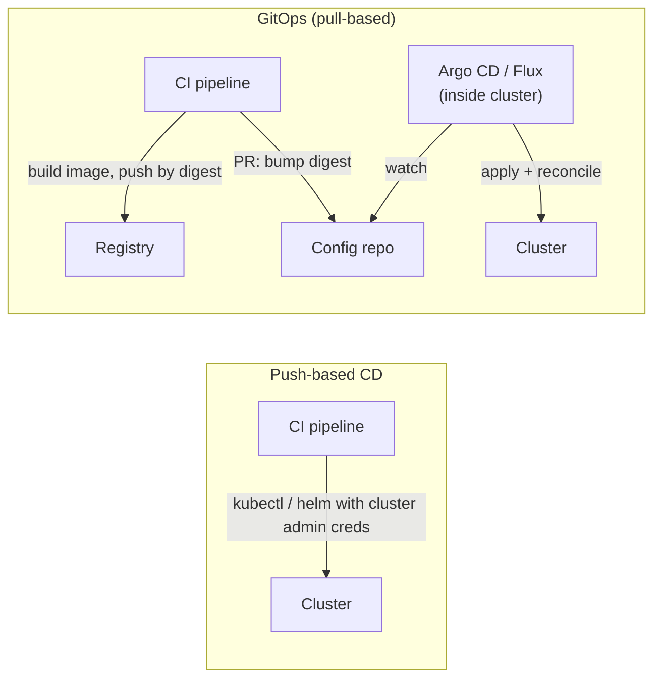
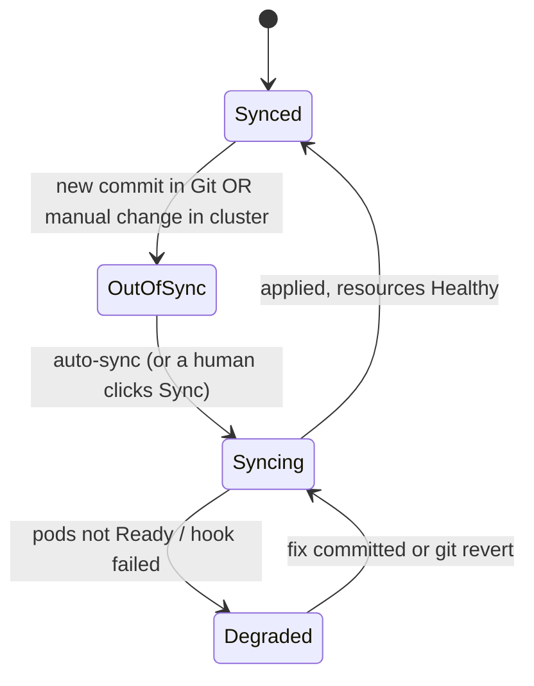

# GitOps & Deployment Strategies

!!! abstract "Key takeaways"
    - **GitOps** (OpenGitOps): desired state is **declarative**, **versioned and immutable** in Git, **pulled automatically** by an agent in the cluster, and **continuously reconciled** against what's actually running. Git becomes the deploy interface and the audit log.
    - **Pull vs push:** in push CD the pipeline holds cluster credentials and runs `kubectl`/`helm`. In GitOps the CI pipeline only builds the image and commits a new digest to a config repo; **Argo CD or Flux** inside the cluster applies it. Cluster credentials never leave the cluster.
    - **Continuous reconciliation** fixes drift: with self-heal on, a manual `kubectl scale` is reverted to what Git says. **Rollback = `git revert`.**
    - Keep **app code and environment config in separate repos** (or paths), and **promote by PR** (dev → staging → prod bumps the same digest). Secrets go in as references (External Secrets) or encrypted (Sealed Secrets, SOPS), never plain.
    - **Strategy choice:** rolling is the default; **blue-green** for instant switch-back; **canary** with automated metric analysis for risky changes at scale; **feature flags** separate deploy from release. All except recreate run two versions at once, so APIs, events and the database schema must be **backward compatible**.

## Why it matters

Push-based pipelines that run `kubectl apply` work until the cluster no longer matches any pipeline run: someone hot-fixes a Deployment, a failed job leaves half the resources updated, or ten pipelines each hold admin credentials to production. GitOps makes Git the single source of truth and puts a controller in charge of making the cluster match. Deployment strategies decide how much of your traffic a bad version can hurt before you notice. Interviewers combine them: "how do you deploy 30 services to EKS safely and roll back?"

Rolling-update mechanics, `maxSurge`/`maxUnavailable`, and Helm releases are covered in [Rolling updates, rollbacks and Helm](../docker-kubernetes/07-rolling-updates-rollbacks-and-helm.md). This page builds on them.

## Core concepts

### The four principles

| Principle (OpenGitOps) | Means in practice |
|---|---|
| Declarative | Kubernetes manifests, Helm values, Kustomize overlays: the *what*, not a script of steps |
| Versioned and immutable | Stored in Git with full history; every change is a commit, every deploy is traceable to one |
| Pulled automatically | An agent fetches desired state; nothing outside pushes into the cluster |
| Continuously reconciled | The agent keeps comparing actual with desired and corrects differences |

### Push vs pull


*Notice where the credentials live: in push CD every pipeline can change production directly; in GitOps only the in-cluster controller can, and it only applies what's merged in Git.*

| Aspect | Push | Pull (GitOps) |
|---|---|---|
| Credentials | CI holds cluster credentials | Controller in cluster; CI needs only Git and registry access |
| Drift | Undetected until next deploy | Detected and optionally self-healed |
| Rollback | Re-run an older pipeline | `git revert` the config change |
| Audit | Pipeline logs | Git history plus controller events |
| Multi-cluster | Pipeline must reach every cluster | Each cluster pulls; works behind firewalls |
| Non-Kubernetes targets | Natural | Needs a controller for that target (Crossplane, Terraform controllers) |

### How reconciliation works


*Notice that a manual change in the cluster and a new commit look the same to the controller: both make the cluster differ from Git.*

Argo CD's `Application` points at a repo path, revision and destination. Key sync options: **automated** (sync on new commits), **selfHeal** (revert manual changes), **prune** (delete resources removed from Git). Argo CD compares on a polling interval (3 minutes by default) or immediately on a Git webhook. **Sync waves and hooks** order things (a migration Job before the Deployment). **ApplicationSets** generate Applications per cluster or per directory. Flux does the same with `GitRepository` + `Kustomization` or `HelmRelease` objects, and Flux's image automation can commit new image tags back to Git.

{ loading=lazy }
*Watch the status chip: manual change and Git commit both cause OutOfSync, but only the Git change sticks.*

### Repositories and promotion

- **Separate app and config.** The app repo holds code and the Dockerfile; the config repo (or `deploy/` path with its own permissions) holds Helm values or Kustomize overlays per environment. Otherwise every config change triggers a build, and every build commit can loop back into CI.
- **Promotion is a PR.** CI updates `envs/dev/claims/values.yaml` with the new digest automatically; promotion to staging and prod is a PR that copies the same digest, reviewed by whoever owns that environment. The PR is your change record.
- **Prefer directories over branches per environment.** Long-lived `dev`/`staging`/`prod` branches drift apart and make merges painful; overlays in folders on one branch keep differences visible.

### Secrets in GitOps

Git must not contain plain secrets. Options: **External Secrets Operator** (Git holds an `ExternalSecret` reference; the operator reads AWS Secrets Manager or Key Vault), **Sealed Secrets** (encrypted with the controller's public key, only the cluster can decrypt), **SOPS** (values encrypted with KMS/age, decrypted by Flux or an Argo CD plugin). See [ConfigMaps, Secrets and volumes](../docker-kubernetes/05-configmaps-secrets-and-volumes.md) and [Secrets management](../application-security/05-secrets-management-and-secure-configuration.md).

### Deployment strategies

| Strategy | How | Rollback | Cost | Risk exposure | Use when |
|---|---|---|---|---|---|
| Recreate | Stop all old, start new | Redeploy old | 1× | 100%, with downtime | Can't run two versions (exclusive locks, incompatible schema) |
| Rolling | Replace pods gradually | Roll forward/back, minutes | ~1× + surge | Grows with rollout, little control | Default for stateless services |
| Blue-green | Full new stack beside old; switch traffic at once | Switch back, seconds | 2× during release | 100% at switch, short | Fast, clean cut-over and instant rollback |
| Canary | Small % of traffic to new, step up with metric checks | Shift traffic back, seconds | ~1× + canary | 1–5% at first | Risky changes at scale, good metrics |
| Shadow (mirroring) | Copy live traffic to new version, discard responses | Nothing to roll back | Extra capacity | None for users | Performance or correctness testing of read paths |
| Feature flags | Deploy code dark; enable per user or segment | Turn flag off | Flag tooling | Chosen cohort | Separate deploy from release, trunk-based development |
| A/B test | Route by user attribute, measure business metric | Flag off | Flag tooling | Chosen cohort | Product experiments (not a safety mechanism) |

{ loading=lazy }
*Notice that the abort happens at 25%: at most 25% of traffic ever reached the bad version, and only for a couple of analysis intervals.*

**Canary with automated analysis.** Plain Deployments can only approximate a canary by pod ratio. **Argo Rollouts** or **Flagger** shift exact traffic weights through an ingress, service mesh or Gateway API, run analysis queries (Prometheus, Datadog, CloudWatch) at each step, and abort automatically. Compare the canary against the stable baseline, not against a fixed number, when traffic patterns vary by time of day.

**Backward compatibility is the real precondition.** During any non-recreate rollout, old and new versions serve together, and a rollback runs the old version against whatever the new one wrote. Use expand/contract database migrations, tolerant readers for events, and additive API changes. See [API versioning](../api-design/04-versioning-strategies.md) and the expand/contract section of the [rolling updates page](../docker-kubernetes/07-rolling-updates-rollbacks-and-helm.md).

## In practice: code & configuration

=== "❌ Common mistake"
    ```yaml
    # Argo CD Application tracking a moving target, with drift tolerated
    apiVersion: argoproj.io/v1alpha1
    kind: Application
    metadata: { name: claims-api-prod, namespace: argocd }
    spec:
      project: default                       # no restrictions on what it may deploy
      source:
        repoURL: https://git.example.com/claims-api.git   # app repo: every code commit redeploys
        targetRevision: HEAD
        path: k8s
      destination: { server: https://kubernetes.default.svc, namespace: claims }
      syncPolicy: {}                          # manual sync only; kubectl hotfixes linger
    # values.yaml: image: claims-api:latest, plus a plain Secret with the DB password
    ```

=== "✅ Correct approach"
    ```yaml
    apiVersion: argoproj.io/v1alpha1
    kind: Application
    metadata: { name: claims-api-prod, namespace: argocd }
    spec:
      project: claims-prod                    # AppProject limits repos, namespaces, kinds
      source:
        repoURL: https://git.example.com/platform/deploy-config.git
        targetRevision: main
        path: envs/prod/claims-api            # Kustomize overlay or Helm values for prod
      destination: { server: https://kubernetes.default.svc, namespace: claims }
      syncPolicy:
        automated: { prune: true, selfHeal: true }   # Git wins; removed resources are deleted
        syncOptions: [CreateNamespace=false, ServerSideApply=true]
        retry: { limit: 3, backoff: { duration: 10s, factor: 2 } }
    # envs/prod/claims-api/values.yaml: image.digest: sha256:… (bumped by a promotion PR)
    # secrets via ExternalSecret -> AWS Secrets Manager; nothing sensitive in Git
    ```

A canary with automated analysis using Argo Rollouts:

```yaml
apiVersion: argoproj.io/v1alpha1
kind: Rollout
metadata: { name: claims-api }
spec:
  replicas: 10
  selector: { matchLabels: { app: claims-api } }
  template: { metadata: { labels: { app: claims-api } }, spec: { containers: [ { name: app, image: "registry.example.com/claims-api@sha256:..." } ] } }
  strategy:
    canary:
      canaryService: claims-api-canary
      stableService: claims-api-stable
      trafficRouting:
        nginx: { stableIngress: claims-api }     # exact weights, not pod ratios
      analysis:
        templates: [ { templateName: error-rate } ]
        startingStep: 1                          # analysis runs in the background from step 1
      steps:
        - setWeight: 5
        - pause: { duration: 5m }
        - setWeight: 25
        - pause: { duration: 10m }
        - setWeight: 50
        - pause: { duration: 10m }               # then 100% automatically
---
apiVersion: argoproj.io/v1alpha1
kind: AnalysisTemplate
metadata: { name: error-rate }
spec:
  metrics:
    - name: http-5xx-ratio
      interval: 1m
      failureLimit: 2                            # two bad readings abort and roll back
      successCondition: result[0] < 0.01         # under 1% server errors
      provider:
        prometheus:
          address: http://prometheus.monitoring:9090
          query: |
            sum(rate(http_server_requests_seconds_count{app="claims-api",role="canary",status=~"5.."}[2m]))
            / sum(rate(http_server_requests_seconds_count{app="claims-api",role="canary"}[2m]))
```

## Real-world usage

- **Argo CD and Flux** are both CNCF graduated projects and the common GitOps controllers on EKS and AKS. Argo CD's UI and multi-cluster ApplicationSets make it popular with platform teams; Flux is lighter and composes with Helm and Kustomize controllers.
- **Canary analysis** comes from large-scale practice: Netflix and Google published Kayenta, an automated canary judge comparing canary and baseline metrics, which inspired the analysis steps in Argo Rollouts and Flagger.
- **Feature flags** (LaunchDarkly, Unleash, OpenFeature SDKs) are how trunk-based teams ship unfinished work safely, and the fastest "rollback" for a behavioural change.
- **Regulated environments** like GitOps because the merged PR is the change record, and the controller's sync history shows exactly when production matched which commit.

## Trade-offs & production gotchas

| Option | Pros | Cons | Use when |
|---|---|---|---|
| Push CD from pipeline | Simple, one tool, works for non-K8s targets | Pipelines hold prod credentials; no drift correction | Small setups, VMs, serverless |
| GitOps (Argo CD / Flux) | Audit, drift correction, credentials stay in cluster, multi-cluster | Another system; promotion and secrets need design; debugging spans Git and cluster | Kubernetes at team scale |
| Blue-green | Instant rollback, clean cut-over | Double capacity; shared database still a single point | Large, infrequent releases |
| Canary + analysis | Smallest exposure, automated | Needs good metrics, enough traffic, traffic router | High-traffic, frequent releases |
| Feature flags | Release decoupled from deploy | Flag debt, combinatorial testing | Trunk-based teams |

!!! warning "Gotcha: self-heal versus emergency fixes"
    During an incident someone scales a Deployment by hand and Argo CD immediately reverts it. Make the emergency path a fast Git commit (or temporarily disable auto-sync for that app with a ticket), and teach on-call that `kubectl edit` won't stick.

!!! warning "Gotcha: autoscaler fights"
    If Git sets `replicas: 3` and an HPA scales to 8, self-heal keeps resetting it. Omit `replicas` from the manifest when an HPA owns it, or tell Argo CD to ignore that field (`ignoreDifferences`).

!!! warning "Gotcha: canaries with too little traffic"
    5% of 20 requests a minute is one request: the analysis has no statistical power and passes everything. Use longer steps, compare against a baseline, or use blue-green with synthetic checks for low-traffic services.

## How this connects to my experience

- **Where I used it:** not a resume ★ subtopic and GitOps tools aren't on the resume, so position it as transferable. Related bullets: "Established engineering standards around testing, CI/CD, code quality, and deployment practices" (OptumRx Meteor), release management and production support for 750K+ users, Kubernetes (EKS/AKS) in the skills list, and EKS at Deloitte.
- **Talking points:**
    - How production releases were rolled out on Meteor (rolling, blue-green, canary, feature flags) and how rollback worked. *[confirm]*
    - Whether deploys were pushed from pipelines (GitLab CI/Jenkins with Helm) or pulled by a controller. If push, explain what you'd gain from GitOps for audit in healthcare. *[confirm]*
    - Backward-compatible releases: how GraphQL schema changes and Kafka event changes were kept compatible while old and new versions ran together. *[confirm: specific example]*
- **Likely follow-up chain:** "How did you deploy?" → "How would you move that to GitOps?" (config repo, Argo CD, CI bumps digest) → "How do you roll back?" (`git revert`, previous digest) → "Canary or blue-green for the GraphQL service?" (traffic volume, metrics, schema compatibility) → "What about the database?" (expand/contract).

## Interview questions

### Fundamentals

??? question "Q1. What is GitOps?"
    **Answer:** An operating model where the desired state of a system is declared in Git, versioned and immutable, pulled by an agent running with the system, and continuously reconciled so the actual state matches. Changes happen by merging to Git; the controller applies them, detects drift and can self-heal. Argo CD and Flux are the common Kubernetes implementations.

    **Interviewer listens for:** the four principles, especially pull and continuous reconciliation.

    **Common wrong answer:** "Keeping YAML in Git and running `kubectl apply` from the pipeline." That's infrastructure in Git, but push-based and without reconciliation.

??? question "Q2. Blue-green vs canary?"
    **Answer:** Blue-green runs a full copy of the new version and switches all traffic at once, keeping the old one ready for an instant switch back; it costs double capacity briefly and exposes everyone at the switch. Canary sends a small share of traffic to the new version and increases it in steps while metrics are checked, aborting automatically on regression; it limits exposure but needs a traffic router, good metrics and enough traffic.

    **Interviewer listens for:** exposure vs speed of switch, preconditions for canary.

    **Common wrong answer:** "They're the same, canary just has a nicer name."

??? question "Q3. How do you roll back in a GitOps setup?"
    **Answer:** Revert the commit in the config repo (or merge a PR that sets the previous digest); the controller syncs the cluster to it. History stays intact and the rollback is itself audited. For an urgent case, Argo CD can sync to an earlier revision, but auto-sync must be paused or Git updated, or it will move forward again. Database changes must be backward compatible for any rollback to be safe.

    **Interviewer listens for:** `git revert`, the auto-sync interaction, the database caveat.

    **Common wrong answer:** "`kubectl rollout undo`." With self-heal on, the controller puts the new version straight back.

### Intermediate

??? question "Q4. Why separate the application repo from the deployment config repo?"
    **Answer:** Different change rates and owners, different permissions (prod config may need platform approval), no CI loops (a config commit shouldn't trigger a build), clean promotion PRs that touch only the digest for one environment, and a readable audit trail of what was deployed where.

    **Interviewer listens for:** permissions, promotion, loop avoidance.

    **Common wrong answer:** "It doesn't matter; one repo is always simpler."

??? question "Q5. How do you handle secrets with GitOps?"
    **Answer:** Never plain in Git. Either store references (External Secrets Operator pulls from AWS Secrets Manager or Key Vault into Kubernetes Secrets) or encrypted values (Sealed Secrets, or SOPS with KMS decrypted by the controller). References keep rotation in the secrets manager and are usually preferred in cloud setups.

    **Interviewer listens for:** references vs encryption, rotation.

    **Common wrong answer:** "Base64-encode them in the Secret manifest."

??? question "Q6. What does a canary analysis check, and what makes it reliable?"
    **Answer:** Service-level signals for the canary: error rate, latency percentiles, saturation, plus key business metrics if available, ideally compared with the stable baseline over the same window. Reliability needs enough traffic per step, metrics labelled by version, a failure limit rather than a single bad reading, and automatic abort that moves traffic back.

    **Interviewer listens for:** baseline comparison, statistical power, automatic abort.

    **Common wrong answer:** "Check that the pods are Running."

### Senior

??? question "Q7. Design deployments for 30 services across dev, staging and prod EKS clusters."
    **Answer:** CI per service builds and signs one image, pushes by digest and opens or auto-merges a PR to the config repo's dev overlay. Argo CD per cluster (or a central one with ApplicationSets) syncs with prune and self-heal; AppProjects restrict namespaces and repos per team. Promotion to staging and prod is a PR copying the same digest, with required reviewers on prod paths. Argo Rollouts canaries with Prometheus analysis for high-traffic services, rolling for the rest. Secrets via External Secrets. Dashboards for sync status, DORA metrics, and alerts on Degraded apps.

    **Interviewer listens for:** build once, promotion PRs, project boundaries, progressive delivery where it pays.

    **Common wrong answer:** One pipeline with admin credentials to all three clusters.

??? question "Q8. When would you not use GitOps?"
    **Answer:** Targets that aren't declaratively reconcilable or have no controller (some serverless or managed services, unless you add Crossplane or a Terraform controller), very small setups where a pipeline is simpler, or workloads that need imperative, ordered operations each time (some data migrations). Also when the team can't yet support another critical system: the controller becomes part of the production path.

    **Interviewer listens for:** honest limits, not GitOps for everything.

    **Common wrong answer:** "GitOps is always better."

### Scenario-based

??? question "Q9. A canary at 25% shows 0.4% errors while stable shows 0.1%. Promote or abort?"
    **Answer:** If the analysis threshold is an absolute 1%, it passes, but a fourfold relative increase is a regression worth stopping on. Pause, look at which endpoints and errors differ, check whether the canary got different traffic (new users, a region). If it's real, abort and fix. This is why baseline comparison beats a fixed threshold.

    **Interviewer listens for:** relative comparison, investigate before promote.

    **Common wrong answer:** "It's under 1%, ship it."

??? question "Q10. During an incident, on-call scaled the Deployment to 20 replicas, but it keeps going back to 6. Why, and what's the right fix?"
    **Answer:** Argo CD self-heal is restoring Git's `replicas: 6`. Short term: commit the change to Git (fastest legitimate path) or pause auto-sync for that app with a note. Long term: let an HPA own replicas and remove the field from the manifest or ignore it, and update the runbook so on-call scales through Git.

    **Interviewer listens for:** understanding reconciliation, a proper emergency path.

    **Common wrong answer:** "Disable Argo CD for good; it gets in the way."

## Cheat sheet

| Concept | Remember |
|---|---|
| OpenGitOps | Declarative, versioned and immutable, pulled automatically, continuously reconciled |
| Push vs pull | CI pushes with creds vs controller pulls from Git |
| Argo CD sync | `automated`, `selfHeal`, `prune`; 3-min poll or webhook; sync waves for order |
| Flux | `GitRepository` + `Kustomization` / `HelmRelease`; image automation |
| Repos | App repo ≠ config repo; directories per env, not branches |
| Promotion | PR copies the same digest dev → staging → prod |
| Rollback | `git revert`; pause auto-sync before manual sync to old revision |
| Secrets | External Secrets, Sealed Secrets, SOPS |
| Strategies | Recreate, rolling, blue-green, canary, shadow, flags, A/B |
| Canary | Weights via router, analysis vs baseline, failure limit, auto-abort |
| Precondition | Backward-compatible APIs, events, schema (expand/contract) |

## Sources
1. [OpenGitOps principles](https://opengitops.dev/): the four principles.
2. [Argo CD documentation](https://argo-cd.readthedocs.io/en/stable/): Applications, automated sync, self-heal, prune, sync waves, ApplicationSets.
3. [Flux documentation](https://fluxcd.io/flux/): GitRepository, Kustomization, HelmRelease, image automation.
4. [Argo Rollouts: Canary](https://argoproj.github.io/argo-rollouts/features/canary/) and [Analysis](https://argoproj.github.io/argo-rollouts/features/analysis/): steps, traffic routing, AnalysisTemplate.
5. [Flagger](https://docs.flagger.app/): progressive delivery with metric checks.
6. [Martin Fowler: BlueGreenDeployment](https://martinfowler.com/bliki/BlueGreenDeployment.html), [CanaryRelease](https://martinfowler.com/bliki/CanaryRelease.html) and [Feature Toggles (Pete Hodgson)](https://martinfowler.com/articles/feature-toggles.html).
7. [Google SRE Workbook: Canarying releases](https://sre.google/workbook/canarying-releases/): canary sizing and evaluation.
8. [Netflix Tech Blog: Automated canary analysis at Netflix with Kayenta](https://netflixtechblog.com/automated-canary-analysis-at-netflix-with-kayenta-3260bc7acc69): baseline vs canary comparison.
9. [External Secrets Operator](https://external-secrets.io/) and [Sealed Secrets](https://github.com/bitnami-labs/sealed-secrets): secrets in GitOps.
