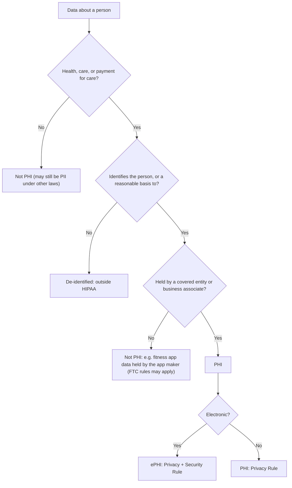
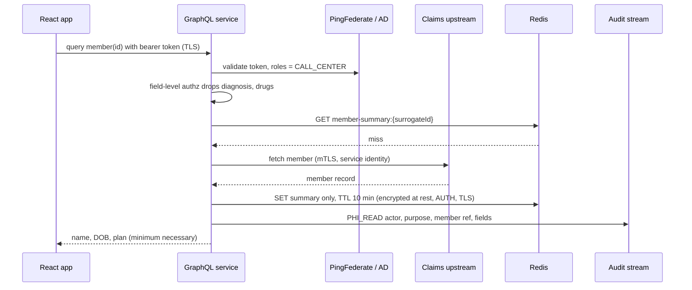

# HIPAA & PHI handling

!!! abstract "Key takeaways"
    - **PHI** is individually identifiable health information (health, care or *payment for care*, linked to a person) held by a **covered entity** (health plan, provider, clearinghouse) or its **business associate** (a vendor handling PHI for it, such as a PBM, a cloud host or you). A pharmacy claim with a member ID is PHI; the same counts with all 18 Safe Harbor identifiers removed are not.
    - Three rules matter to engineers: the **Privacy Rule** (who may use or disclose PHI, *minimum necessary*, patient rights), the **Security Rule** (administrative, physical and technical safeguards for *electronic* PHI) and the **Breach Notification Rule** (individuals within **60 days** of discovery; HHS and the media too when 500 or more are affected).
    - **"Addressable" is not "optional".** Encryption at rest is addressable in the current Security Rule: implement it, or document why not and what equivalent you did. In practice everyone encrypts, because PHI encrypted to NIST guidance is not "unsecured PHI" and a lost encrypted disk is not a reportable breach.
    - PHI leaks through the **side doors**: log lines, exception messages, URLs, Redis caches, Kafka DLQs, search indexes, analytics extracts and production copies in QA. Design for minimum necessary at the API, mask at the source, and keep identifiers out of anything you can't delete.
    - There is **no HIPAA certification**. You show compliance with a risk analysis, policies, BAAs, controls and evidence (audit logs, access reviews). This page is engineering guidance, not legal advice; the primary text is 45 CFR Parts 160 and 164.

## Why it matters

Healthcare is the most breached industry in the US by cost. The February 2024 ransomware attack on **Change Healthcare** (a UnitedHealth Group company, part of Optum) affected an estimated **192.7 million** people, the largest healthcare breach reported to HHS, and disrupted claims and pharmacy processing across the country. Earlier, Anthem's 2015 breach of 78.8 million records ended in a then-record $16 million HIPAA settlement with HHS's Office for Civil Rights (OCR).

For an engineer the law shows up as design constraints: which fields an API may return to which role, what a log line may contain, how long a cache keeps a member record, whether a QA database can be a copy of production, and who gets paged when a laptop goes missing. Interviewers for healthcare roles want to hear that you treat PHI as a data class with rules, not as "sensitive stuff we encrypt".

How this page relates to its neighbours: vendor security reviews, BAAs and SOC 2 are covered in [Security reviews & compliance questionnaires](../fde-enterprise-deployment/04-security-reviews-and-compliance-questionnaires-soc-2-hipaa-g.md); encryption mechanics in [Envelope encryption](../cryptography-key-management/03-envelope-encryption-and-data-keys.md) and [Cloud KMS](../cryptography-key-management/04-cloud-kms.md); log masking in [Structured logging](../observability/02-structured-logging-and-correlation-ids.md); what to record about PHI access in [Audit logging & data retention](03-audit-logging-and-data-retention.md).

## Core concepts

### The rules and where they live

HIPAA (1996) told HHS to write "Administrative Simplification" rules; the HITECH Act (2009) and the 2013 Omnibus Rule made business associates directly liable and added breach notification.

| Rule | Citation | What it governs | Engineer's version |
|---|---|---|---|
| Privacy Rule | 45 CFR 164 Subpart E (164.500–534) | Permitted uses and disclosures, minimum necessary, individual rights (access, amendment, accounting of disclosures) | Which roles see which fields; export and access-request features |
| Security Rule | 164 Subpart C (164.302–318) | Safeguards for **ePHI**: administrative, physical, technical | IAM, MFA, encryption, audit logs, backups, risk analysis |
| Breach Notification | 164 Subpart D (164.400–414) | What a breach is, who to tell, by when | Detection, forensics-ready logs, encryption that makes data "secured" |
| Enforcement | 45 CFR 160 Subparts C–E | Investigations, tiered civil money penalties | Evidence that controls existed and operated |

!!! warning "A proposed Security Rule update"
    In January 2025 HHS published a proposed rule that would remove the required/addressable distinction and make encryption of ePHI at rest and in transit, MFA, an asset inventory and network map, and annual compliance audits explicit requirements. Check the Federal Register for whether it has been finalised and its compliance date before quoting it as law. Either way, it describes what good practice already looks like.

### What is PHI?

45 CFR 160.103 defines **individually identifiable health information** as information, including demographics, that relates to a person's past, present or future physical or mental health, the provision of care, or **payment for care**, and identifies the person or could reasonably be used to. It becomes **PHI** when a covered entity or business associate holds or transmits it, in any form. **ePHI** is the electronic subset the Security Rule covers. Exclusions: employment records an employer holds, FERPA education records, and people dead for more than 50 years.


*Notice that "health" is broad (payment counts, so a claim or a copay is PHI) and that the same data can be PHI in a payer's system and not PHI in a consumer app.*

Examples from pharmacy benefit work: a prescription claim, a prior-authorisation request, a member's plan and copay tier, a refill reminder with a drug name, an address on a mail-order shipment. A drug formulary list with no member data is not PHI.

### Who is covered

- **Covered entities:** health plans, healthcare clearinghouses, and providers that bill electronically (hospitals, doctors, pharmacies).
- **Business associates (BAs):** anyone who creates, receives, maintains or transmits PHI on a covered entity's behalf: PBMs administering a plan's pharmacy benefit, claims processors, IT and consulting vendors, cloud hosts. A **subcontractor** of a BA that touches PHI is also a BA, and needs its own BAA.
- HHS cloud guidance: a cloud provider storing **encrypted** ePHI is still a business associate even if it never holds the key. Only the "conduit" exception (a courier or an ISP that transmits without storing) escapes.
- A BA is directly liable for Security Rule compliance and for uses not permitted by its BAA.

### The Privacy Rule in system design

- **Minimum necessary** (164.502(b), 164.514(d)): use, disclose and request only the PHI needed for the purpose. It does **not** apply to disclosures to a provider for treatment, to the individual, or as required by law. For systems this means **role-based field projections**: a call-centre agent verifying identity doesn't need diagnosis codes; a reporting job doesn't need names.
- **Individual rights:** access to their records within **30 days** (one 30-day extension) under 164.524, amendment, and an **accounting of disclosures** for the past six years (164.528). These become features: export, correction workflows, disclosure logs.
- **Uses for treatment, payment and operations** are permitted without authorisation; marketing and sale of PHI need authorisation.

{ loading=lazy }
*Same record, three projections: the API decides which fields leave, not the UI.*

### The Security Rule safeguards

The Security Rule is **risk-based and technology-neutral** (164.306). Each standard has implementation specifications marked **Required (R)** or **Addressable (A)**. Addressable means: assess, then implement it, or implement an equivalent, or document why neither is reasonable.

| Category | Key standards | Examples in a cloud stack |
|---|---|---|
| Administrative (164.308) | Risk analysis (R), risk management (R), sanction policy (R), **information system activity review** (R), workforce access, training, incident procedures, contingency plan, BA contracts | Threat model per service, quarterly access reviews, on-call runbooks, DR tests, BAA register |
| Physical (164.310) | Facility access, workstation security, device and media controls (disposal, re-use) | Inherited from AWS/Azure for data centres; laptop disk encryption and MDM are yours |
| Technical (164.312) | **Access control**: unique user ID (R), emergency access (R), automatic logoff (A), encryption at rest (A). **Audit controls** (R). **Integrity** (A). **Person or entity authentication** (R). **Transmission security**: integrity and encryption (A) | SSO with named accounts (no shared logins), break-glass roles, session timeouts, KMS encryption, CloudTrail and app audit logs, TLS 1.2+ everywhere, MFA |

Documentation of policies and assessments must be kept for **six years** (164.316(b)(2)). That's the documentation rule; it doesn't by itself set how long every log line must be kept (see [page 3](03-audit-logging-and-data-retention.md)).

### De-identification

Data that is properly de-identified under 164.514 is no longer PHI, which is how analytics and machine-learning platforms escape most of the rules. Two methods:

1. **Safe Harbor** (164.514(b)(2)): remove 18 identifiers of the person and their relatives, employers and household, and have no actual knowledge that what's left could identify them. The 18: names; geography smaller than a state (the first three ZIP digits may stay if that area has more than 20,000 people); all date elements except year, and ages over 89; phone; fax; email; SSN; medical record numbers; **health plan beneficiary numbers**; account numbers; certificate or licence numbers; vehicle IDs; device IDs; URLs; IP addresses; biometrics; full-face photos; and any other unique identifying number or code.
2. **Expert Determination** (164.514(b)(1)): a qualified statistician documents that re-identification risk is very small. This allows keeping more detail (full dates, 5-digit ZIPs) when justified.

A **limited data set** (164.514(e)) keeps dates and city/state/ZIP but strips direct identifiers. It is still PHI and needs a data use agreement.

!!! warning "Hashing a member ID is not de-identification"
    A SHA-256 of a member ID is a "unique identifying code" derived from an identifier. Anyone with the member list can hash it and join. Safe Harbor allows a **re-identification code** only if it is not derived from identifying information and the mechanism is not disclosed (164.514(c)). Use a random surrogate key held in a separate mapping table, or a keyed HMAC whose key never leaves the PHI zone, and treat the output as pseudonymous, not anonymous.

### Breach notification

A **breach** is an impermissible acquisition, access, use or disclosure that compromises PHI. It is **presumed** to be a breach unless a documented four-factor risk assessment (nature of the data, who got it, whether it was actually viewed, how far it was mitigated) shows a low probability of compromise (164.402). Only **unsecured** PHI triggers notification: data encrypted per HHS guidance (NIST-validated encryption, key not compromised) or destroyed is "secured".

{ loading=lazy }
*The clock starts at discovery, which includes when you should have known with reasonable diligence; logs that nobody reviews don't stop it.*

| Who | When | Rule |
|---|---|---|
| BA → covered entity | Without unreasonable delay, ≤ 60 days after discovery | 164.410 |
| Covered entity → individuals | Without unreasonable delay, ≤ 60 calendar days | 164.404 |
| → Prominent media | Same deadline, if more than 500 residents of a state or jurisdiction | 164.406 |
| → HHS | 500 or more: with the individual notices. Fewer than 500: annual log, within 60 days of year end | 164.408 |

Contracts often tighten the BA deadline (for example to a few days), so check the BAA.

### Related US rules worth naming

- **42 CFR Part 2** protects substance-use-disorder treatment records more strictly; a 2024 rule aligned it more closely with HIPAA (compliance date 16 February 2026). Pharmacy data can include these.
- **State laws** (California CMIA, Washington My Health My Data Act) can be stricter than HIPAA and cover health data outside it.
- **Online tracking:** OCR has warned that tracking pixels on authenticated patient portals can disclose PHI to analytics vendors. Keep third-party scripts off logged-in health pages.

## In practice: code & configuration

The request path for a member lookup through a GraphQL integration layer, with the safeguards on it:


*Notice that the role decides the projection before anything is cached or returned, and that the audit record names the fields read, not their values.*

=== "❌ Common mistake"
    ```java
    @QueryMapping
    public Member member(@Argument String memberId) {
        Member m = claimsClient.fetch(memberId);               // full record, all fields
        log.info("Fetched member {}", m);                      // Lombok toString: name, DOB, drugs into Splunk
        redis.opsForValue().set("member:" + memberId, m);      // PHI cached forever, keyed by real member ID
        return m;                                              // every role gets every field
    }
    // GET /members/search?ssn=123-45-6789  -> SSN now in access logs, proxies and browser history
    ```

=== "✅ Correct approach"
    ```java
    // A record whose toString can't leak: PHI fields are masked by default.
    public record MemberSummary(String memberRef, String name, LocalDate dob, String plan) {
        @Override public String toString() {
            return "MemberSummary[memberRef=" + memberRef + ", name=***, dob=***, plan=" + plan + "]";
        }
    }

    @Controller
    class MemberController {
        @QueryMapping
        @PreAuthorize("hasAnyRole('CALL_CENTER','PHARMACIST')")
        MemberSummary member(@Argument String memberRef, Authentication auth) {
            MemberSummary s = cache.get(memberRef, () -> claimsClient.summary(memberRef)); // TTL set on the cache
            audit.phiRead(auth.getName(), "member-lookup", memberRef, List.of("name", "dob", "plan"));
            log.info("member lookup", kv("memberRef", memberRef));   // surrogate ref, never values
            return s;
        }

        @SchemaMapping(typeName = "Member", field = "clinical")    // clinical fields resolved separately
        @PreAuthorize("hasRole('PHARMACIST')")                     // only clinical roles reach this resolver
        Clinical clinical(MemberSummary m) { return clinicalClient.forMember(m.memberRef()); }
    }
    // Search by POST body, never by identifiers in the URL.
    ```

Configuration that backs it up:

```yaml
spring:
  data.redis:
    ssl.enabled: true                     # transmission security inside the VPC too
  cache.redis.time-to-live: 10m           # short-lived PHI in cache
server.error:
  include-message: never                  # upstream errors often echo the request body
  include-stacktrace: never
logging.structured.format.console: ecs    # JSON with a redaction processor downstream
```

Other places PHI ends up and the usual control:

| Place | Leak | Control |
|---|---|---|
| Logs and traces | `toString()`, request bodies, span attributes, SQL with bind values | Masked types, allow-listed log fields, Collector redaction ([observability](../observability/02-structured-logging-and-correlation-ids.md)) |
| URLs | IDs in query strings land in access logs, CDN logs, referrers | POST for searches, opaque surrogate IDs in paths |
| Caches | Full records, no TTL, real IDs as keys | Summary DTOs, TTL, encryption at rest and in transit, AUTH/ACLs |
| Kafka | PHI in payloads, retained for days; DLQs kept forever | References not payloads where possible, topic ACLs, encryption, DLQ retention set ([retry and DLQ](../kafka/07-error-handling-retry-topics-dlq-poison-messages-replay.md)) |
| Non-production | Production copies in QA and developer laptops | Synthetic or de-identified data; masked refresh jobs |
| Errors and support tickets | Stack traces and screenshots with member data | `ProblemDetail` with correlation ID only; ticket hygiene |
| Search indexes and analytics | Elasticsearch copies, BI extracts | Index only needed fields; de-identify for analytics |

## Real-world usage

- **Change Healthcare (2024):** attackers used stolen credentials on a remote-access portal that, per UnitedHealth's congressional testimony, lacked MFA. It's the reference case for why the proposed Security Rule makes MFA explicit and why business associates' controls matter to every plan and pharmacy downstream.
- **Anthem (2015):** spear-phishing led to 78.8 million records stolen from a data warehouse; OCR's settlement cited the lack of an enterprise-wide risk analysis and insufficient system activity review.
- **Cloud platforms:** AWS, Azure and Google Cloud sign BAAs but only for listed **HIPAA-eligible services**. Using a non-eligible service with PHI breaks the chain even if it's encrypted.
- **Analytics platforms** in healthcare (such as payer data lakes) commonly split into an identified zone and a de-identified zone, with a tokenisation service mapping member IDs to surrogates and only the de-identified zone open to analysts.
- **OCR enforcement** most often cites missing or stale **risk analysis**, missing audit-log review, and failure to give patients timely access to their records.

## Trade-offs & production gotchas

| Option | Pros | Cons | Use when |
|---|---|---|---|
| Full PHI everywhere, rely on network perimeter | Simple to build | Every service, log and cache in scope; one breach exposes all | Never |
| Field-level authorisation in the API layer | Minimum necessary enforced once, consistent | Schema and policy work; needs testing per role | Shared APIs such as a GraphQL integration layer |
| Tokenise identifiers, PHI only in a vault service | Most services handle surrogates only; smaller scope | Extra hop; vault becomes critical | Many consumers, analytics, event streams |
| Safe Harbor de-identification | Clear rule, no expert needed | Loses dates and fine geography | Reporting, dashboards, ML features |
| Expert Determination | Keeps more utility | Cost, re-review on data changes | Research and analytics needing dates or ZIP-5 |
| Synthetic test data | No PHI outside prod | Effort to make realistic | All non-prod environments |

!!! warning "Gotcha: the DLQ is a PHI store"
    Retry and dead-letter topics keep the failed message, often with full PHI, and teams set no retention because "we need them for replay". Give DLQs a retention period, restrict who can read them, and build replay tooling that doesn't require engineers to read payloads.

!!! warning "Gotcha: 'we encrypt, so we're compliant'"
    Encryption at rest protects against a stolen disk, not against an over-privileged role, a verbose log or an API that returns everything. Most real PHI exposures are authorised systems disclosing too much.

!!! tip "Interview framing"
    "I treat PHI as a data classification with rules at every hop: minimum necessary at the API, masking at the source for logs, short-lived and encrypted caches, references instead of payloads in events, audited access, and no production data outside production."

## How this connects to my experience

- **Where I used it:** OptumRx Meteor (Publicis Sapient): "Led a cross-functional team of 8–10 engineers delivering enterprise healthcare applications serving 750K+ users", "Owned the GraphQL Consumer Service end-to-end, acting as the integration layer between 5 upstream systems", "Implemented Redis-based caching", "Built secure enterprise APIs using OAuth2, PingFederate, and Active Directory integration", "Designed Kafka-based event-driven workflows with retry and DLQ handling". Deloitte ConvergeHealth Data Asset Explorer: "Developed event-driven healthcare analytics workflows and secure data discovery platforms" and "implemented security controls using IAM, KMS, and Secrets Manager".
- **Talking points:**
    - The GraphQL layer is where minimum necessary is enforced: one schema, field-level authorisation by role from PingFederate/AD claims, so five upstream systems don't each decide what to expose. *[confirm: whether authorisation was field-level in the GraphQL layer or done upstream; which roles existed]*
    - Redis caching of member-facing data: what was cached (reference data vs member data), TTLs, and whether ElastiCache encryption and AUTH were on. *[confirm: whether any PHI was cached at all; if only UI reference data, say so, it's a good answer]*
    - Kafka retry and DLQ: payloads, topic ACLs and DLQ retention for PHI. *[confirm: whether events carried PHI or references]*
    - PHI-safe logging and production support for 750K+ users: how you investigated issues without copying PHI. *[confirm the actual masking rules and who had prod log access]*
    - ConvergeHealth: healthcare analytics and data discovery, with KMS encryption and IAM. *[confirm: whether the datasets were identified, de-identified or limited data sets, and whether you dealt with BAAs or HIPAA-eligible service lists]*
- **Likely follow-up chain:** "Was your service in HIPAA scope?" → "How did you make sure a call-centre user only saw what they needed?" → "What did you put in logs and caches?" → "What would you have done if PHI showed up in Splunk?". Answer: yes, it handled ePHI for a PBM, so Security Rule safeguards applied; field-level authorisation from IdP roles; references and masked types in logs, summary DTOs with TTL in Redis; treat log exposure as a potential breach: stop the source, restrict and purge, involve privacy/security for the four-factor assessment, fix with a masking test.

## Interview questions

### Fundamentals

??? question "Q1. What is PHI, and how is it different from ePHI and PII?"
    **Answer:** PHI is individually identifiable information about health, care or payment for care, held or transmitted by a covered entity or business associate, in any form (45 CFR 160.103). ePHI is PHI in electronic form, which the Security Rule protects. PII is the broader category of data identifying a person (NIST SP 800-122); not all PII is PHI, and health data held by a non-covered company (a fitness app) isn't PHI under HIPAA even if it's sensitive.

    **Interviewer listens for:** payment counts as health info, "held by a covered entity or BA", ePHI scope of the Security Rule.

    **Common wrong answer:** "PHI is any medical data anywhere."

??? question "Q2. Who are covered entities and business associates? Is a PBM or a cloud provider one?"
    **Answer:** Covered entities are health plans, clearinghouses and providers who bill electronically. A business associate creates, receives, maintains or transmits PHI on their behalf. A PBM administering a plan's pharmacy benefit is typically a business associate of the plan; a cloud provider hosting ePHI is a business associate even when the data is encrypted and it has no key (HHS cloud guidance). Each needs a BAA, and subcontractors handling PHI need flow-down BAAs.

    **Interviewer listens for:** BAA chain, the encrypted-cloud point, subcontractors.

    **Common wrong answer:** "Only hospitals have to follow HIPAA."

??? question "Q3. Does HIPAA require encryption?"
    **Answer:** Under the current Security Rule, encryption at rest and in transit are **addressable** specifications (164.312(a)(2)(iv), (e)(2)(ii)): you must implement them if reasonable and appropriate, or document why not and use an equivalent. In practice it's expected, and encrypted PHI (per HHS/NIST guidance, key not compromised) isn't "unsecured", so its loss isn't a notifiable breach. A 2025 proposed rule would make encryption explicitly required.

    **Interviewer listens for:** addressable ≠ optional, breach safe harbor, awareness of the proposed change.

    **Common wrong answer:** "No, it's optional" or "Yes, AES-256 is mandated by HIPAA."

### Intermediate

??? question "Q4. How do you implement minimum necessary in an API?"
    **Answer:** Define purpose-based roles and the fields each needs; enforce at the API layer with field-level authorisation (GraphQL `@PreAuthorize` on resolvers, separate DTOs per role in REST), not by hiding fields in the UI. Request only needed fields from upstreams, cache only summaries, and audit which fields were read. Remember the exceptions (treatment disclosures to providers, the individual themselves).

    **Interviewer listens for:** server-side enforcement, per-field, audit.

    **Common wrong answer:** "The front end only shows the fields the user needs."

??? question "Q5. Is replacing the member ID with its SHA-256 hash enough to de-identify a dataset?"
    **Answer:** No. Safe Harbor requires removing all 18 identifiers, including plan beneficiary numbers and dates more specific than year, and a code derived from an identifier can be re-computed and joined. Use a random surrogate with the mapping held in the PHI zone, or a keyed HMAC whose key stays there, and also generalise dates and geography. Otherwise use Expert Determination. Keyed or hashed IDs without the rest are pseudonymised PHI.

    **Interviewer listens for:** 18 identifiers, re-identification codes rule (164.514(c)), dates and ZIPs.

    **Common wrong answer:** "Hashing is irreversible so it's anonymous."

??? question "Q6. Where does PHI leak in a typical Spring Boot microservice stack?"
    **Answer:** Logs (entity `toString`, request/response logging, SQL bind parameters), exception messages returned to clients, URLs and query strings in access logs, traces and span attributes, caches without TTL, Kafka payloads and DLQs, search indexes, analytics extracts, support tickets, and production copies in non-prod. Controls: masked types, allow-listed log fields plus pipeline redaction, POST for searches, TTLs, references in events, synthetic test data.

    **Interviewer listens for:** breadth beyond "the database", concrete controls.

    **Common wrong answer:** "Only the database stores PHI and it's encrypted."

### Senior

??? question "Q7. Design a PHI-safe event-driven flow for prescription status updates."
    **Answer:** Events carry a surrogate member reference and the minimum status fields; consumers needing detail call the PHI service with their own identity and authorisation. Topics have ACLs per consumer, TLS in transit and encryption at rest; retention is set for main, retry and DLQ topics; DLQ replay tooling doesn't expose payloads. Schema registry rules flag fields classified as PHI. Consumers log references only. Notifications to members (SMS, email) contain no drug names. Audit PHI reads in the PHI service.

    **Interviewer listens for:** references over payloads, ACLs, DLQ retention, notification content.

    **Common wrong answer:** "Encrypt the Kafka disks and publish the full record."

??? question "Q8. A laptop with a CSV of 2,000 members' claims is stolen. What happens under HIPAA?"
    **Answer:** If the disk was encrypted to NIST standards and the key wasn't compromised, the PHI is "secured" and there's no notifiable breach; document the assessment. If not, it's presumed a breach: run the four-factor assessment, notify affected individuals without unreasonable delay and within 60 days of discovery, notify HHS at the same time (500 or more), and the media if more than 500 residents of one state are affected. A BA notifies the covered entity per the BAA. Then fix the cause: why was a CSV of PHI on a laptop?

    **Interviewer listens for:** secured vs unsecured, 60 days from discovery, 500 thresholds, root cause.

    **Common wrong answer:** "Notify within 72 hours" (that's GDPR).

### Scenario-based

??? question "Q9. A developer asks for a copy of production to debug an issue in QA. What do you do?"
    **Answer:** Don't copy PHI into QA. Reproduce with synthetic data shaped like the failing case, or use a masked/de-identified refresh pipeline. If the bug needs production data, debug in production under controlled, audited, time-boxed access (break-glass role) by authorised people, rather than moving the data. Fix the gap long term with better synthetic data generation.

    **Interviewer listens for:** data doesn't move to lower environments, controlled prod access, audit.

    **Common wrong answer:** "Copy it but restrict QA access."

??? question "Q10. You discover member dates of birth and names have been logged to Splunk for three months. Walk through your response."
    **Answer:** Stop the source (hotfix the log statement or add a redaction rule). Restrict access to the affected index and preserve evidence of who searched it (Splunk audit). Engage the privacy/security officer: it's a potential impermissible use, so they run the four-factor assessment; internal workforce access with a business need may lead to a low-probability finding, but external or unrestricted access may not. Purge or mask the data per retention policy. Prevent recurrence with masked types, a log-scanning test in CI and pipeline redaction, and record it as an incident.

    **Interviewer listens for:** contain, preserve audit, involve privacy officer, don't decide alone, prevent.

    **Common wrong answer:** "Delete the logs quietly; it was internal."

## Cheat sheet

| Concept | Remember |
|---|---|
| PHI | Health, care **or payment** + identifiable + held by CE/BA (160.103) |
| Covered entity | Plans, clearinghouses, providers billing electronically |
| Business associate | Handles PHI for a CE (PBM, cloud, IT vendor); needs a BAA; subcontractors too |
| Privacy Rule | Uses/disclosures, minimum necessary, access in 30 days, accounting of disclosures 6 years |
| Security Rule | Administrative / physical / technical; R vs A; addressable ≠ optional |
| Technical safeguards | Unique IDs, emergency access, auto-logoff, encryption, audit controls, integrity, authentication, transmission security |
| De-identification | Safe Harbor (18 identifiers) or Expert Determination; hashed IDs aren't enough |
| Breach | Presumed unless low probability; notify ≤ 60 days; HHS + media at 500+ |
| Secured PHI | Encrypted per NIST, key safe → no notification |
| Documentation | Keep 6 years (164.316) |
| Leaks | Logs, URLs, caches, DLQs, traces, non-prod copies |
| Certification | None exists; evidence = risk analysis, BAAs, controls, audit |

## Sources

1. [HHS: Summary of the HIPAA Privacy Rule](https://www.hhs.gov/hipaa/for-professionals/privacy/laws-regulations/index.html): PHI definition, minimum necessary, permitted uses, individual rights.
2. [HHS: Summary of the HIPAA Security Rule](https://www.hhs.gov/hipaa/for-professionals/security/laws-regulations/index.html): administrative, physical, technical safeguards; required vs addressable.
3. [eCFR: 45 CFR Part 164](https://www.ecfr.gov/current/title-45/subtitle-A/subchapter-C/part-164): text of 164.306–164.316, 164.402–164.414, 164.502, 164.514, 164.524, 164.528.
4. [eCFR: 45 CFR 160.103 definitions](https://www.ecfr.gov/current/title-45/subtitle-A/subchapter-C/part-160/subpart-A/section-160.103): PHI, business associate, covered entity.
5. [HHS: Guidance regarding methods for de-identification](https://www.hhs.gov/hipaa/for-professionals/special-topics/de-identification/index.html): Safe Harbor's 18 identifiers, Expert Determination, re-identification codes.
6. [HHS: Breach Notification Rule](https://www.hhs.gov/hipaa/for-professionals/breach-notification/index.html): 60-day deadlines, 500 thresholds, unsecured PHI.
7. [HHS: Guidance to render unsecured PHI unusable, unreadable, or indecipherable](https://www.hhs.gov/hipaa/for-professionals/breach-notification/guidance/index.html): encryption and destruction safe harbor.
8. [HHS: Guidance on HIPAA & Cloud Computing](https://www.hhs.gov/hipaa/for-professionals/special-topics/health-information-technology/cloud-computing/index.html): cloud providers with encrypted ePHI are business associates.
9. [Federal Register: HIPAA Security Rule to Strengthen the Cybersecurity of ePHI (proposed rule, 6 Jan 2025)](https://www.federalregister.gov/documents/2025/01/06/2024-30983/hipaa-security-rule-to-strengthen-the-cybersecurity-of-electronic-protected-health-information): proposed encryption, MFA and inventory requirements.
10. [HHS OCR: Change Healthcare cybersecurity incident FAQ](https://www.hhs.gov/hipaa/for-professionals/special-topics/change-healthcare-cybersecurity-incident-frequently-asked-questions/index.html): scale of the 2024 breach (192.7 million reported July 2025).
11. [HHS: Anthem pays OCR $16 million in record HIPAA settlement](https://www.hhs.gov/hipaa/for-professionals/compliance-enforcement/agreements/anthem/index.html): 78.8 million records, missing risk analysis.
12. [HHS: Use of online tracking technologies by HIPAA covered entities and business associates](https://www.hhs.gov/hipaa/for-professionals/privacy/guidance/hipaa-online-tracking/index.html): pixels on authenticated pages.
13. [HHS: 42 CFR Part 2 final rule fact sheet](https://www.hhs.gov/hipaa/for-professionals/regulatory-initiatives/fact-sheet-42-cfr-part-2-final-rule/index.html): SUD records, alignment with HIPAA, February 2026 compliance date.
14. [NIST SP 800-66 Rev. 2: Implementing the HIPAA Security Rule](https://csrc.nist.gov/pubs/sp/800/66/r2/final): practical mapping of safeguards to controls.
