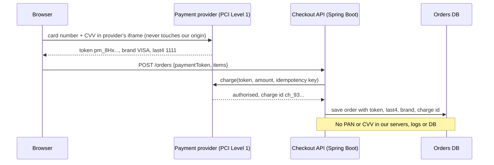
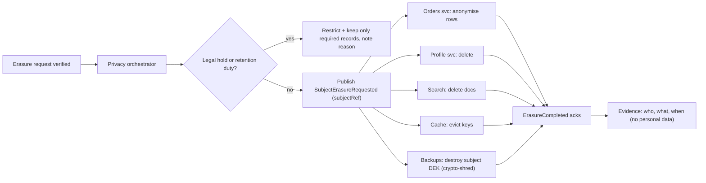

# PCI-DSS, GDPR & PII

!!! abstract "Key takeaways"
    - **PII** (NIST) and **personal data** (GDPR Art. 4(1)) both mean data that identifies a person directly or in combination; GDPR's definition is wider and explicitly includes online identifiers such as IP addresses and cookie IDs. **Pseudonymised data is still personal data**; only truly anonymous data falls outside GDPR (Recital 26).
    - **PCI DSS v4.0.1** applies wherever cardholder data (PAN, plus name, expiry, service code) or sensitive authentication data (CVV, track data, PIN) is stored, processed or transmitted. **Never store sensitive authentication data after authorisation**, mask PAN on display (BIN and last four at most), and render stored PAN unreadable.
    - The best PCI control is **scope reduction**: hosted payment fields or redirects plus a payment-provider token mean your servers never see a PAN, which takes most of your stack out of the cardholder data environment.
    - **GDPR** is principles-based (Art. 5: lawfulness, purpose limitation, minimisation, accuracy, storage limitation, security, accountability). Every processing needs a **lawful basis** (Art. 6, consent being only one of six); health data needs an Art. 9 condition too. Rights requests get answered within **one month**; breaches go to the supervisory authority within **72 hours**.
    - Engineering consequences: a **data inventory** with classification tags, **privacy by design** (Art. 25), an **erasure pipeline** that reaches every copy including caches, search indexes and backups (crypto-shredding), and **retention limits** enforced by code. This is engineering guidance, not legal advice.

## Why it matters

[HIPAA](01-hipaa-and-phi-handling.md) governs health data in the US. Most other systems you build will touch two other regimes: **PCI DSS** the moment you accept cards, and **GDPR** (or a law modelled on it: UK GDPR, California's CCPA/CPRA, India's DPDP Act) the moment you hold data about people in the EU. Fines are large enough to make architecture decisions: GDPR allows up to **€20 million or 4% of worldwide annual turnover**, and Meta's €1.2 billion fine in 2023 was for transferring EU users' data to the US without adequate safeguards.

PCI is different: it's a contractual standard from the card brands (Visa, Mastercard, Amex, Discover, JCB) through the PCI Security Standards Council, enforced by acquiring banks, not a law. Failing it means fines from your acquirer, higher fees, or losing the ability to take cards. Big card breaches (Target 2013, 40 million cards; British Airways 2018, where a skimming script on the payment page led to a £20 million GDPR fine) show both regimes landing on the same incident.

## Core concepts

### PII, personal data and the other classes

| Class | Definition | Examples | Regime |
|---|---|---|---|
| PII | Information that can distinguish or trace an identity, alone or linked (NIST SP 800-122) | Name, SSN, email, phone, address | US sector laws, state laws |
| Personal data | Any information relating to an identified or identifiable natural person (GDPR Art. 4(1)) | All of the above, plus IP address, device ID, cookie ID, location | GDPR, UK GDPR |
| Special category | Health, genetics, biometrics for ID, racial or ethnic origin, religion, sexual orientation, union membership, political opinions (Art. 9) | Diagnosis, prescription | GDPR Art. 9 conditions |
| PHI | Identifiable health info held by a HIPAA covered entity or BA | Claims, prescriptions | HIPAA |
| Cardholder data | PAN, cardholder name, expiry date, service code | `4111 1111 1111 1111` | PCI DSS |
| Sensitive authentication data | Full track/chip data, CVV2/CVC2, PIN/PIN block | `123` on the back | PCI DSS: never store after authorisation |

A single field can sit in several classes: a patient's email held by a European pharmacy is personal data, special-category context, and (if the pharmacy is a US covered entity) PHI.

### PCI DSS v4.0.1

Version 4.0.1 (June 2024) is the only active version; the "future-dated" requirements in 4.0 became mandatory on **31 March 2025**. Twelve requirements in six goals: secure networks (1–2), protect account data (3–4), vulnerability management (5–6), access control (7–9), monitoring and testing (10–11), policy (12).

**Scope** is the **cardholder data environment (CDE)**: systems that store, process or transmit account data, plus anything connected to them or able to affect their security. Segmentation and outsourcing shrink it; everything left in scope gets all the applicable requirements.

The requirements engineers implement directly:

| Req. | What it says | Implementation |
|---|---|---|
| 3.2.1 | Keep account data only as long as needed, with a retention policy | TTL/purge jobs on any table with PAN |
| 3.3.1 | **SAD not retained after authorisation**, even if encrypted | Never persist CVV, never log request bodies on payment endpoints |
| 3.4.1 | PAN **masked when displayed**: BIN and last four digits are the maximum | `411111******1111` or `•••• 1111` |
| 3.5.1 | PAN **unreadable wherever stored**: keyed hash, truncation, index tokens, or strong encryption | Tokens from the PSP; field-level encryption with KMS keys |
| 3.5.1.1 | Hashes of PAN must be **keyed** cryptographic hashes (HMAC) | Plain SHA-256 of a 16-digit PAN is brute-forceable |
| 3.5.1.2 | Disk- or partition-level encryption alone is not enough (except removable media) | Use field- or database-level encryption |
| 3.6–3.7 | Key management: custodians, rotation, split knowledge | See [key rotation](../cryptography-key-management/06-key-rotation-strategies-without-downtime.md), [HSMs](../cryptography-key-management/05-hsms-and-byok-hyok.md) |
| 4.2.1 | Strong cryptography for PAN over open, public networks | TLS 1.2+ with valid certificates |
| 6.4.3 / 11.6.1 | Inventory and authorise every script on payment pages; detect unauthorised changes | CSP, SRI, script monitoring (the British Airways and Magecart lesson) |
| 8.4.2 | **MFA for all access into the CDE** | SSO + MFA for consoles and bastions |
| 10.x | Audit logs of access to cardholder data, kept 12 months (3 immediately available) | See [audit logging](03-audit-logging-and-data-retention.md) |

Compliance is validated annually by a Qualified Security Assessor (Report on Compliance) for large merchants and service providers, or a **Self-Assessment Questionnaire (SAQ)** for smaller ones. An e-commerce merchant that fully outsources card entry to a PCI-compliant provider through an iframe or redirect qualifies for **SAQ A**, the shortest.

### Tokenisation shrinks scope


*Notice that the card number goes from the browser straight to the provider; our API only ever handles a token that is useless outside our provider account.*

{ loading=lazy }
*Every box that sees a PAN is in scope and needs the full set of controls; tokenisation removes the PAN, not just encrypts it.*

Tokens are not encryption: there's no key that turns a token back into a PAN outside the provider's vault. Network tokens (issued by Visa or Mastercard per merchant) add the benefit of being updated automatically when a card is reissued.

### GDPR in engineering terms

**Scope (Art. 3):** organisations established in the EU, and organisations elsewhere that offer goods or services to people in the EU or monitor their behaviour. A Pune-based team building a product for European customers is in scope.

**Roles:** the **controller** decides why and how data is processed; the **processor** acts on its instructions under a contract (Art. 28, the DPA). A SaaS vendor is usually a processor for its customers' data and a controller for its own customers' account data.

**Principles (Art. 5)** and their engineering form:

| Principle | Engineering form |
|---|---|
| Lawfulness, fairness, transparency | Every processing activity has a recorded lawful basis; privacy notice matches what the code does |
| Purpose limitation | Data collected for fulfilment isn't silently reused for ML training |
| Data minimisation | Collect only needed fields; don't log payloads |
| Accuracy | Correction (rectification) flows propagate to copies |
| Storage limitation | Retention periods enforced by TTLs and purge jobs |
| Integrity and confidentiality | Art. 32 security: encryption, pseudonymisation, access control, resilience, testing |
| Accountability | Records of processing (Art. 30), DPIAs (Art. 35), evidence |

**Lawful bases (Art. 6):** consent, contract, legal obligation, vital interests, public task, legitimate interests. Consent must be freely given, specific, informed and as easy to withdraw as to give, so it's the wrong basis for anything you can't stop doing when it's withdrawn. **Special-category data** (health) also needs an Art. 9(2) condition such as explicit consent or provision of healthcare.

**Data subject rights (Art. 12–22):** access (15), rectification (16), erasure (17), restriction (18), portability (20), objection (21) and safeguards around automated decisions (22). Respond within **one month**, extendable by two more for complex requests. Erasure has exceptions (Art. 17(3)): a legal obligation to keep records (tax, AML, HIPAA documentation), and establishing or defending legal claims.

**Breach notification:** the controller notifies the supervisory authority **within 72 hours** of becoming aware unless the breach is unlikely to result in risk (Art. 33); the processor tells the controller without undue delay; data subjects are told without undue delay if the risk is high, unless the data was unintelligible to the attacker, e.g. encrypted (Art. 34).

**International transfers (Ch. V):** to countries with an adequacy decision (the EU–US Data Privacy Framework covers certified US companies since July 2023), or with safeguards such as Standard Contractual Clauses plus a transfer impact assessment.

**Pseudonymisation vs anonymisation:** pseudonymised data (Art. 4(5)) can be re-attributed with separately held information, so it's still personal data but counts as a security and minimisation measure. Anonymised data can't reasonably be re-identified by anyone (Recital 26) and is out of scope; true anonymisation of rich records is hard.

### Other laws you'll be asked about

- **UK GDPR** mirrors GDPR after Brexit, with its own regulator (ICO) and adequacy decisions.
- **CCPA/CPRA (California):** rights to know, delete, correct and opt out of "sale or sharing", and limits on sensitive personal information.
- **India DPDP Act 2023** and the DPDP Rules notified in November 2025, phased in over 18 months (most obligations from around May 2027): consent-centred, data fiduciaries and processors, breach intimation to the Data Protection Board and affected people, penalties up to ₹250 crore per instance. Check the current Rules for dates.

### Erasure across microservices

The hard part of GDPR in a distributed system is that a person's data lives in a dozen stores. Erasure needs an inventory, an orchestrator and proof.


*Notice that backups and logs are handled by crypto-shredding and retention expiry rather than by editing them, and that the evidence record itself must not contain the erased data.*

{ loading=lazy }
*Watch the orders service: erasure often means anonymising and keeping what tax law requires, not deleting everything.*

## In practice: code & configuration

=== "❌ Common mistake"
    ```java
    @Entity
    class Payment {
        @Id UUID id;
        String cardNumber;          // full PAN in the DB: whole stack in PCI scope
        String cvv;                 // SAD stored after authorisation: prohibited (3.3.1)
        String expiry;
    }

    @PostMapping("/payments")
    ResponseEntity<?> pay(@RequestBody PaymentRequest req) {
        log.debug("payment request {}", req);                 // PAN and CVV into log files
        String hash = DigestUtils.sha256Hex(req.cardNumber()); // unkeyed hash: brute-forceable (3.5.1.1)
        ...
    }
    ```

=== "✅ Correct approach"
    ```java
    @Entity
    class Payment {
        @Id UUID id;
        String providerToken;       // pm_... from the PSP; useless outside our PSP account
        String brand;               // VISA
        String last4;               // display only; BIN + last 4 is the maximum allowed
        String chargeId;
    }

    @PostMapping("/orders")
    OrderResponse create(@Valid @RequestBody CreateOrder req, @RequestHeader("Idempotency-Key") String key) {
        // The browser tokenised the card in the PSP's iframe; we never receive the PAN.
        Charge c = psp.charge(req.paymentToken(), req.total(), key);
        log.info("order paid", kv("orderId", c.orderId()), kv("last4", c.last4())); // no PAN, no token
        return orders.save(req, c);
    }
    ```

A per-service erasure handler, idempotent and acknowledging back to the orchestrator:

```java
@Component
class OrderErasureListener {

    @KafkaListener(topics = "privacy.erasure-requested", groupId = "orders-erasure")
    @Transactional
    void onErasure(SubjectErasureRequested evt) {
        if (erasureLog.alreadyDone(evt.requestId(), "orders")) return;      // idempotent on redelivery
        // Keep what tax law requires (invoice totals, dates), drop what identifies the person.
        int rows = orders.anonymiseCustomer(evt.subjectRef(), "erased-" + evt.requestId());
        cache.evictAllFor(evt.subjectRef());
        erasureLog.record(evt.requestId(), "orders", rows);                  // evidence without personal data
        outbox.publish(new ErasureCompleted(evt.requestId(), "orders", rows)); // ack via outbox, same transaction
    }
}
```

For data you can't rewrite (backups, event logs, archives), encrypt each subject's fields with a per-subject data key and destroy the key on erasure: [crypto-shredding](../cryptography-key-management/03-envelope-encryption-and-data-keys.md). The [outbox pattern](../microservices/07-distributed-transactions-saga-outbox-pattern.md) keeps the acknowledgement consistent with the database change.

## Real-world usage

- **British Airways (2018):** attackers modified a JavaScript file on the payment page to skim the personal and card details of about 430,000 customers and staff; the UK ICO fined BA £20 million under GDPR. PCI DSS v4 requirements 6.4.3 and 11.6.1 target exactly this.
- **Target (2013):** attackers entered through an HVAC vendor's credentials and installed malware on point-of-sale terminals, taking 40 million cards: the textbook case for segmentation and third-party access control.
- **Meta (2023):** €1.2 billion from the Irish DPC for EU–US transfers under SCCs without sufficient protection against US surveillance; the reason transfer impact assessments and the Data Privacy Framework matter.
- **Stripe, Adyen, Braintree** and similar providers sell scope reduction: hosted fields and tokens keep merchants on SAQ A or SAQ A-EP.
- **Privacy engineering platforms** at large companies maintain a data catalogue with field-level classification, used to drive DSAR exports and erasure automatically.

## Trade-offs & production gotchas

| Option | Pros | Cons | Use when |
|---|---|---|---|
| PSP tokenisation (hosted fields) | Minimal PCI scope (SAQ A), no key management | Provider lock-in; token portability is contractual | Almost every merchant |
| Own token vault | Provider-independent, reusable tokens | Vault is fully in scope; HSMs, audits | Large payment platforms, multiple acquirers |
| Field-level encryption of PAN | Keeps PAN usable for recurring flows | Systems with decrypt rights in scope; key management | Only when you must hold PAN |
| Pseudonymisation (surrogate keys) | Shrinks exposure, still joinable internally | Still personal data under GDPR | Analytics, events, logs |
| Anonymisation (aggregation, k-anonymity) | Out of GDPR scope if done properly | Utility loss; re-identification risk if done badly | Published statistics, open datasets |
| Crypto-shredding | Erases from backups and immutable logs | Per-subject keys to manage | Event-sourced data, backups |

!!! warning "Gotcha: PAN in places you didn't design"
    Card numbers turn up in support-ticket free text, call recordings, screenshots, error reports and search indexes. Run periodic PAN discovery scans (regex plus Luhn check) across logs and data stores, and mask in the logging pipeline as a backstop.

!!! warning "Gotcha: consent as the default basis"
    Choosing consent for processing you need to run the service (order fulfilment, fraud checks) creates a problem when users withdraw it. Contract, legal obligation or legitimate interests (with a balancing test) are often the right bases; record which and why.

!!! tip "Interview framing"
    "For cards I design so we never see a PAN. For personal data I start with an inventory: what, why, which lawful basis, where it flows, how long we keep it and how we erase it, and I build those answers into the code."

## How this connects to my experience

- **Where I used it:** not used directly; PCI and GDPR weren't named on my projects. Position as transferable knowledge from adjacent work: "Built secure enterprise APIs using OAuth2, PingFederate, and Active Directory integration" (OptumRx Meteor, healthcare data with similar minimisation and access rules), "implemented security controls using IAM, KMS, and Secrets Manager" (Deloitte ConvergeHealth), and "Developed enterprise key management capabilities" and "automated key rotation workflows and HSM integrations" (Coriolis CCKM), which is the key-management side of PCI Requirement 3.6–3.7 and of crypto-shredding.
- **Talking points:**
    - The data-handling discipline from PHI carries straight over: minimum necessary ≈ data minimisation, masked logs, references in Kafka events, no production data in lower environments.
    - CCKM: customers of an enterprise key manager are often driven by PCI DSS and GDPR requirements for key custody, rotation and separation of duties. *[confirm: whether CCKM customers or features were explicitly tied to PCI or GDPR, e.g. BYOK for compliance]*
    - Kafka-based workflows with retry and DLQ are the backbone of an erasure fan-out like the one above; idempotent consumers make repeated erasure events safe.
    - ConvergeHealth may have had non-US data or customers. *[confirm: any GDPR or non-US privacy requirements on ConvergeHealth; otherwise don't claim it]*
- **Likely follow-up chain:** "Have you worked with PCI?" → "How would you take card payments in a new service?" → "How would you erase a customer across 12 microservices?" → "What about backups?". Answer honestly (not directly), then: hosted fields and tokens for SAQ A; inventory plus erasure event with idempotent per-service handlers and acknowledgements; crypto-shredding and retention expiry for backups.

## Interview questions

### Fundamentals

??? question "Q1. What's the difference between PII, personal data, PHI and cardholder data?"
    **Answer:** PII is the US/NIST term for data that identifies a person alone or linked. GDPR personal data is broader: any information relating to an identifiable person, including online identifiers like IPs and cookie IDs. PHI is identifiable health information held by a HIPAA covered entity or business associate. Cardholder data is the PAN plus name, expiry and service code, protected by PCI DSS; sensitive authentication data (CVV, track, PIN) is a separate, stricter class.

    **Interviewer listens for:** GDPR's breadth, PHI's dependence on who holds it, CHD vs SAD.

    **Common wrong answer:** "They're all the same thing."

??? question "Q2. What card data may you never store under PCI DSS?"
    **Answer:** Sensitive authentication data after authorisation: full track or chip data, CVV2/CVC2/CID, and PINs or PIN blocks, even encrypted (Requirement 3.3.1). PAN may be stored if needed, but must be rendered unreadable (keyed hashes, truncation, tokens, strong encryption) and masked on display to at most BIN and last four.

    **Interviewer listens for:** "even if encrypted", masking rule.

    **Common wrong answer:** "You can store CVV if it's encrypted."

??? question "Q3. Under GDPR, do you always need consent?"
    **Answer:** No. Art. 6 offers six lawful bases: consent, contract, legal obligation, vital interests, public task and legitimate interests. Processing needed to deliver the service rests on contract; tax records on legal obligation; fraud prevention often on legitimate interests. Consent fits optional processing like marketing, and must be as easy to withdraw as to give. Special-category data (health) also needs an Art. 9 condition.

    **Interviewer listens for:** six bases, consent's drawbacks, Art. 9.

    **Common wrong answer:** "Yes, a consent checkbox covers everything."

### Intermediate

??? question "Q4. Tokenisation, encryption or hashing for card numbers: which and why?"
    **Answer:** Tokenisation by the payment provider is best: no PAN reaches your systems, so they leave the CDE. Encryption keeps PAN recoverable, so anything with decrypt rights is in scope and keys need PCI-grade management. Hashing makes PAN unreadable but must be a keyed hash (3.5.1.1) because the PAN space is small enough to brute-force; it's useful for matching, not for charging.

    **Interviewer listens for:** scope reduction, keyed hashes, decrypt rights in scope.

    **Common wrong answer:** "SHA-256 the card number and store it."

??? question "Q5. Is pseudonymised data still personal data?"
    **Answer:** Yes. Under GDPR Art. 4(5) and Recital 26, data that can be re-attributed using separately held information is still personal data; pseudonymisation is a recommended security and minimisation measure (Art. 25, 32), not an exit. Only anonymised data that can't reasonably be re-identified by anyone falls outside GDPR, and rich records are rarely truly anonymous.

    **Interviewer listens for:** Recital 26, "reasonably likely means", benefit still exists.

    **Common wrong answer:** "Once we replace names with IDs, GDPR doesn't apply."

??? question "Q6. How do you implement the right to erasure across microservices and backups?"
    **Answer:** Maintain a data inventory of which services and stores hold personal data. A privacy orchestrator verifies the request, checks legal holds and retention duties, and publishes an erasure event keyed by a subject reference. Each service deletes or anonymises idempotently, evicts caches and search documents, and acknowledges via an outbox. Backups and immutable logs are handled by crypto-shredding or by expiring within a documented retention period. Keep evidence without the personal data, and answer within one month.

    **Interviewer listens for:** inventory, orchestration with acks, exceptions, backups.

    **Common wrong answer:** "Run DELETE on the users table."

### Senior

??? question "Q7. Compare breach notification under GDPR, HIPAA and PCI."
    **Answer:** GDPR: controller notifies the supervisory authority within 72 hours of awareness unless unlikely to cause risk; data subjects without undue delay if high risk (not needed if data was unintelligible, e.g. encrypted); processors tell controllers without undue delay. HIPAA: individuals within 60 days of discovery, HHS and media for 500+, BAs tell the covered entity. PCI: contractual; notify your acquirer and card brands immediately per their rules and engage a PCI Forensic Investigator. One incident can trigger all three, so incident runbooks need all the clocks.

    **Interviewer listens for:** 72 hours vs 60 days, encryption exemption, PCI is contractual.

    **Common wrong answer:** "Everyone has 72 hours."

??? question "Q8. You're designing a new customer-data service. How do you apply privacy by design?"
    **Answer:** Run a DPIA if it's high risk (large-scale special-category data, profiling). Define purposes and lawful bases; collect the minimum fields; classify each field in the schema (tags in the data catalogue); separate identifiers from attributes with surrogate keys; encrypt sensitive fields; restrict access by role; set retention per field and enforce it with jobs; design DSAR export and erasure from day one; log access without logging data; and make privacy-protective defaults (Art. 25(2)), e.g. optional sharing off.

    **Interviewer listens for:** DPIA, minimisation, retention, rights built in, defaults.

    **Common wrong answer:** "Encrypt the database and add a privacy policy."

### Scenario-based

??? question "Q9. Product wants to send EU customer support transcripts to a US-hosted LLM API for summarisation. What do you check?"
    **Answer:** Lawful basis and purpose compatibility; whether transcripts contain special-category data or card numbers (redact before sending); the vendor's role (processor) and DPA terms, including no training on our data and retention; transfer mechanism (DPF certification or SCCs plus a transfer impact assessment), or an EU-region endpoint; update the records of processing and privacy notice; DPIA if risk is high; and logging of what was sent without storing transcripts again.

    **Interviewer listens for:** transfers, processor terms, redaction, DPIA.

    **Common wrong answer:** "It's fine if the API uses TLS."

??? question "Q10. A scan finds full card numbers in your application logs and in a support tool. What do you do?"
    **Answer:** Treat it as a potential incident. Find and fix the source (payload logging, a free-text field), add masking in the log pipeline as a backstop, restrict access to affected logs, and securely purge or mask the stored PANs in logs, backups of logs and the support tool. Involve security and compliance: those systems are now in CDE scope, which may need disclosure to the acquirer or QSA. Add PAN-detection scans to CI and to periodic data discovery.

    **Interviewer listens for:** scope impact, purge, root cause, detection.

    **Common wrong answer:** "Restrict log access and move on."

## Cheat sheet

| Concept | Remember |
|---|---|
| Personal data | Any info about an identifiable person; IPs and cookie IDs count |
| Pseudonymised | Still personal data; anonymised is out of scope |
| PCI scope | CDE = systems storing, processing, transmitting account data + connected |
| Never store | CVV, track data, PIN after authorisation (3.3.1) |
| PAN display | BIN + last four maximum (3.4.1) |
| PAN at rest | Token, truncation, keyed hash, strong encryption (3.5.1); disk encryption alone isn't enough |
| v4.0.1 | Future-dated requirements mandatory since 31 March 2025; MFA for all CDE access |
| Scope reduction | Hosted fields + PSP token → SAQ A |
| GDPR principles | Lawful, purpose-limited, minimal, accurate, time-limited, secure, accountable |
| Lawful bases | Consent, contract, legal obligation, vital interests, public task, legitimate interests |
| Rights | Access, rectify, erase, restrict, port, object; reply in one month |
| Breach | 72 h to authority; data subjects if high risk |
| Fines | Up to €20M or 4% of global turnover |
| Erasure | Inventory → event → idempotent deletes → acks; crypto-shred backups |

## Sources

1. [PCI Security Standards Council: PCI DSS v4.0.1 document library](https://www.pcisecuritystandards.org/document_library/): requirement text for 3.2.1–3.7, 4.2.1, 6.4.3, 8.4.2, 10.5.1, 11.6.1.
2. [PCI SSC: Just published: PCI DSS v4.0.1](https://blog.pcisecuritystandards.org/just-published-pci-dss-v4-0-1): limited revision, no new requirements, v4.0 retirement.
3. [PCI SSC: Information Supplement: Tokenization Product Security Guidelines](https://www.pcisecuritystandards.org/documents/Tokenization_Product_Security_Guidelines.pdf): tokens and scope.
4. [Regulation (EU) 2016/679 (GDPR), EUR-Lex](https://eur-lex.europa.eu/eli/reg/2016/679/oj): Articles 3, 4, 5, 6, 9, 12–22, 25, 28, 30, 32–35, 44–49, 83 and Recital 26.
5. [European Data Protection Board: Guidelines 9/2022 on personal data breach notification](https://www.edpb.europa.eu/our-work-tools/our-documents/guidelines/guidelines-92022-personal-data-breach-notification-under_en): 72-hour rule in practice.
6. [EDPB: Guidelines 01/2025 on pseudonymisation](https://www.edpb.europa.eu/our-work-tools/documents/public-consultations/2025/guidelines-012025-pseudonymisation_en): pseudonymised data remains personal data.
7. [NIST SP 800-122: Guide to Protecting the Confidentiality of PII](https://csrc.nist.gov/pubs/sp/800/122/final): PII definition, linked and linkable information.
8. [European Commission: adequacy decision for the EU-US Data Privacy Framework](https://commission.europa.eu/law/law-topic/data-protection/international-dimension-data-protection/eu-us-data-transfers_en): transfers since July 2023.
9. [EDPB: 1.2 billion euro fine for Facebook as a result of EDPB binding decision](https://www.edpb.europa.eu/news/news/2023/12-billion-euro-fine-facebook-result-edpb-binding-decision_en): Meta transfer fine.
10. [Herbert Smith Freehills Kramer: ICO fines British Airways £20 million for its 2018 data breach](https://www.hsfkramer.com/notes/data/2020-10/the-not-so-mega-mega-fine-ico-fines-british-airways-20-million-for-its-2018-data-breach): payment-page skimming, Art. 5 and 32 infringements, £20 million fine (ICO penalty notice summarised).
11. [California Privacy Protection Agency: CCPA regulations](https://cppa.ca.gov/regulations/): CCPA/CPRA rights.
12. [MeitY: Digital Personal Data Protection Rules, 2025](https://www.meity.gov.in/data-protection-framework): India DPDP Act and phased rules.
