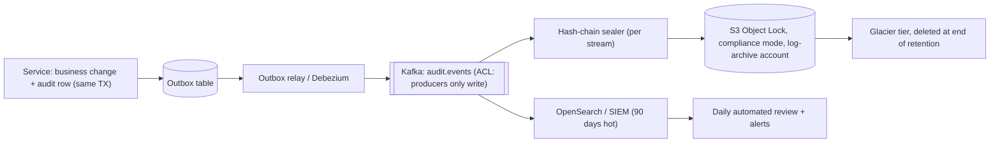
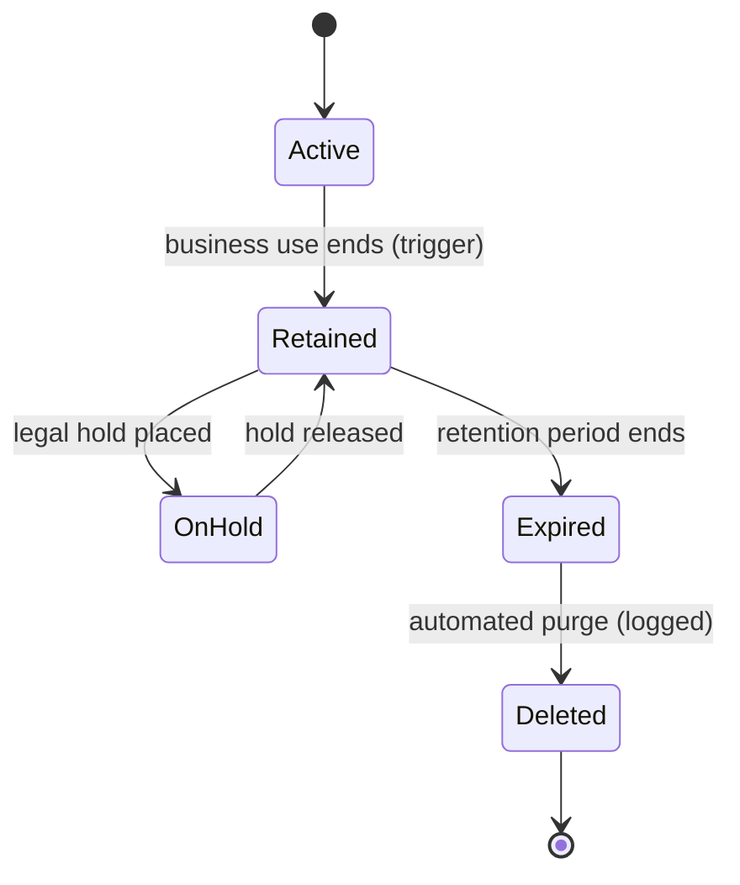

# Audit logging & data retention

!!! abstract "Key takeaways"
    - An **audit log** answers *who did what, to which record, when, from where, and with what outcome*, for accountability and forensics. It is a separate stream from debug and application logs: complete, append-only, access-restricted, retained for years, and free of the sensitive values it describes.
    - Regulations ask for it in different words: HIPAA **audit controls** (164.312(b)) and regular **activity review**; PCI DSS **Requirement 10** (log access to cardholder data, admin actions and failed logins, protect the logs, review daily, keep **12 months with 3 immediately available**); GDPR **accountability** (Art. 5(2)) balanced by **storage limitation**.
    - **Tamper evidence** comes from hash-chaining or signed digests (CloudTrail log file validation) and **WORM storage** (S3 Object Lock in compliance mode, Azure immutable blobs) in a separate account that application admins can't touch.
    - **Retention is two-sided**: keep records as long as a law, contract or legal hold requires, then **delete automatically**. "Keep everything forever" breaks GDPR, raises breach impact and e-discovery cost. A retention schedule maps each record class to a period, a trigger and a deletion method.
    - Spring Data's `@LastModifiedBy` and Actuator's in-memory `AuditEventRepository` aren't audit trails. Emit domain audit events through a **transactional outbox** to Kafka and an immutable store, and record **reads of sensitive data**, not only writes. Not legal advice.

## Why it matters

When an investigator, auditor or customer asks "who looked at this patient's prescription history last March, and why?", only an audit trail can answer. OCR's HIPAA settlements repeatedly cite **insufficient information system activity review**: logs existed but nobody looked, or they couldn't show who accessed what. In the Anthem breach, attackers had access for months before anyone noticed; PCI DSS made daily log review mandatory for the same reason. On the other side, regulators fine organisations for keeping personal data too long: Deutsche Wohnen was fined €14.5 million in 2019 for an archive that couldn't delete tenants' data (the fine was later the subject of a landmark EU court ruling on corporate liability).

Audit logging sits between [observability](../observability/01-logs-metrics-and-traces.md) (operational logs, metrics and traces for running the system) and security monitoring. This page covers what's specific to compliance: content, integrity, review and retention. JSON log mechanics and PII masking are in [Structured logging](../observability/02-structured-logging-and-correlation-ids.md); which data counts as PHI or personal data is on [page 1](01-hipaa-and-phi-handling.md) and [page 2](02-pci-dss-gdpr-and-pii.md).

## Core concepts

### Audit logs versus application logs

| | Application / debug log | Audit log |
|---|---|---|
| Purpose | Troubleshooting, operations | Accountability, forensics, compliance evidence |
| Reader | Engineers, SREs | Security, compliance, auditors, investigators |
| Completeness | Sampled, levels can be turned down | Every in-scope event, no sampling |
| Mutability | Rotated, dropped under pressure | Append-only, tamper-evident |
| Retention | Days to weeks | Months to years, per schedule |
| Access | Broad within engineering | Narrow; reads of the audit log are themselves audited |
| Content | Technical context | Actor, action, resource, time, source, outcome; **no secret or PHI values** |

### What to record

PCI DSS 10.2.1 lists the events; they're a good baseline for any regulated system:

1. Individual user access to sensitive data (cardholder data, and by analogy PHI reads).
2. All actions by administrative or root accounts.
3. Access to the audit logs themselves.
4. Invalid logical access attempts.
5. Changes to identification and authentication: new accounts, privilege grants, password and MFA changes.
6. Starting, stopping or pausing audit logging.
7. Creation and deletion of system-level objects.

Each record (PCI 10.2.2) carries the **user identity, event type, date and time, success or failure, origination, and the identity of the affected data or resource**. In practice add: the acting service and version, correlation/trace ID, tenant, **purpose of use** (treatment, payment, support case number) for health data, which **fields** were read, and a sequence number.

```json
{
  "eventId": "01J9ZK7X4Q8M2B4V3W5N6P7R8S",
  "seq": 1840221,
  "ts": "2026-03-14T09:21:07.412Z",
  "actor": { "type": "user", "id": "u-48213", "roles": ["CALL_CENTER"], "authn": "pingfed-mfa" },
  "action": "PHI_READ",
  "resource": { "type": "Member", "ref": "mbr-sur-7f3a9c", "fields": ["name", "dob", "plan"] },
  "purpose": "support-case:CS-99812",
  "outcome": "SUCCESS",
  "source": { "ip": "10.12.4.18", "service": "member-graphql", "version": "4.12.0" },
  "traceId": "4bf92f3577b34da6a3ce929d0e0e4736",
  "prevHash": "9c1e…", "hash": "e04b…"
}
```

Note what's absent: no name, no date of birth, no token, no card number. The audit log is itself a sensitive store; [OWASP's logging guidance](https://cheatsheetseries.owasp.org/cheatsheets/Logging_Cheat_Sheet.html) says to exclude or mask such values.

### Where audit events come from

| Source | Captures | Gaps |
|---|---|---|
| Cloud control plane (CloudTrail, Azure Activity Log) | API calls on infrastructure, KMS `Decrypt`, `GetSecretValue` | Nothing about application users or records |
| Database (pgAudit, CDC with Debezium, Hibernate Envers) | Row changes and history | Doesn't know the end user behind a service account; reads mostly invisible |
| Identity provider (PingFederate, AD, Okta) | Logins, MFA, failures, group changes | Nothing after the token is issued |
| **Application audit events** | Business actions by real users, reads of sensitive data, purpose | Must be designed and kept complete |

You need all four: CloudTrail proves no one decrypted outside the app; application events prove who saw which record through it.

### The pipeline


*Notice that the audit record is written in the same transaction as the change, so neither can exist without the other, and that the immutable copy and the searchable copy have different retention.*

### Tamper evidence and immutability

Two complementary ideas:

- **Tamper-evident:** each record includes the hash of the previous one (`hash = SHA-256(prevHash ‖ canonicalRecord)`), and periodically a signed digest of the chain head is stored elsewhere. Changing or deleting any record breaks every later hash. AWS CloudTrail does this for you with **log file integrity validation**: hourly digest files that hold SHA-256 hashes of each log file and are signed (SHA-256 with RSA), verifiable with `aws cloudtrail validate-logs`.
- **Tamper-resistant (WORM):** storage that refuses deletes and overwrites until retention expires. **S3 Object Lock** has *governance mode* (users with a special permission can bypass) and *compliance mode* (nobody, including the root user, can delete or shorten retention), plus **legal holds** with no expiry. Azure has time-based retention and legal-hold policies on immutable blob storage.

{ loading=lazy }
*Recomputing the whole chain after an edit would hide it, which is why the head hash is signed and stored somewhere the attacker can't reach.*

Put the archive in a **separate account** (the AWS Control Tower "log archive" pattern) so that compromising the application account, or an admin deciding to cover tracks, can't delete it. PCI 10.3 asks for exactly this: limit read access, protect from modification, back up promptly to a central server, and run change-detection on the logs.

### Review

Logs no one reads don't count. HIPAA requires **regular review of information system activity** (164.308(a)(1)(ii)(D)); PCI 10.4.1 requires reviewing security events and critical-system logs **at least daily**, with automated mechanisms (10.4.1.1). Typical detections: a user reading hundreds of member records in an hour, access to a VIP or employee's record, reads outside working hours, admin role grants, audit pipeline gaps (sequence numbers missing), logging stopped. Route these to the SIEM and on-call as described in [alerting](../observability/06-alerting-and-on-call.md).

### Retention: as long as required, then gone

A **retention schedule** lists each record class with its legal basis, period, trigger (from creation, from account closure, from end of contract) and disposal method.

| Record class | Typical driver | Period (illustrative; confirm with counsel) |
|---|---|---|
| Debug / application logs | Operational need, GDPR storage limitation | 14–30 days |
| PCI audit logs | PCI DSS 10.5.1 | ≥ 12 months, last 3 months immediately available |
| HIPAA policies, risk analyses, assessments | 45 CFR 164.316(b)(2) | 6 years from creation or last effective date |
| HIPAA accounting of disclosures | 164.528 | Must be able to report the last 6 years |
| Financial records audited under SOX | Auditors keep workpapers 7 years (SEC Reg. S-X 2-06) | 7 years is a common policy |
| Broker-dealer records | SEC Rule 17a-4 (WORM-style storage) | 3–6 years by record type |
| Medical records themselves | State law, not HIPAA | Varies by state, often 6–10 years |
| Personal data after account closure | GDPR Art. 5(1)(e) | Only as long as needed, then delete or anonymise |

HIPAA's six-year rule is for **documentation** (policies, assessments, actions it requires you to record), not an explicit duty to keep every audit log line six years. Many organisations still keep audit trails six years so they can produce evidence for that window; state it as a policy choice.

{ loading=lazy }
*Each bar ends with automated deletion; only a legal hold moves the end, and the hold is lifted explicitly.*


*Notice that a legal hold can interrupt the clock at any point and that the purge itself produces an audit event.*

**Legal holds** suspend deletion for records relevant to litigation or an investigation; once litigation is reasonably anticipated, destroying them is spoliation. Your deletion jobs must check holds, and holds need an owner who releases them.

**GDPR tension:** audit logs contain personal data (user IDs, IPs, subject references). Keep them for a defined period with a documented basis (legal obligation, legitimate interests in security), minimise their content with pseudonymous references, and note that erasure requests don't override legal retention duties (Art. 17(3)(b), (e)). Crypto-shredding of subject keys can make referenced data unreadable without breaking the chain.

## In practice: code & configuration

=== "❌ Common mistake"
    ```java
    @Entity @EntityListeners(AuditingEntityListener.class)
    class Claim {
        @LastModifiedBy String lastModifiedBy;   // only the latest editor; history and reads lost
        @LastModifiedDate Instant lastModified;
    }

    void approve(Claim c) {
        claims.save(c.approve());
        log.info("user {} approved claim {} for member {}",
                 user, c.getId(), c.getMember());         // mixed into debug logs, sampled,
    }                                                     // 30-day retention, PHI in the line,
                                                          // deletable by anyone with log admin
    ```

=== "✅ Correct approach"
    ```java
    // Domain audit event, written atomically with the change via the outbox.
    public record AuditEvent(String action, String resourceType, String resourceRef,
                             List<String> fields, String purpose, String outcome) {}

    @Service
    class ClaimService {
        @Transactional
        public void approve(ClaimId id, Actor actor, String purpose) {
            Claim c = claims.findById(id).orElseThrow();
            claims.save(c.approve(actor));
            outbox.append(actor, new AuditEvent("CLAIM_APPROVE", "Claim", c.ref(),
                    List.of("status"), purpose, "SUCCESS"));   // same TX: no change without its audit row
        }

        @Transactional(readOnly = true)
        @Audited(action = "PHI_READ", fields = {"drugs", "diagnosis"})  // aspect records sensitive reads too
        public ClaimView view(ClaimId id) { return claims.view(id); }
    }
    ```

The sealer that chains records per stream:

```java
final class AuditSealer {
    private byte[] prev = new byte[32];                     // persisted chain head, per stream/partition

    SealedRecord seal(long seq, byte[] canonicalJson) {
        MessageDigest sha = sha256();
        sha.update(prev);                                   // link to the previous record
        sha.update(Longs.toByteArray(seq));                 // gaps in seq are detectable
        sha.update(canonicalJson);                          // canonical form: stable field order
        byte[] h = sha.digest();
        prev = h;
        return new SealedRecord(seq, canonicalJson, h);
    }
    // Every N records or hourly: sign the head with a KMS asymmetric key and store
    // the signature in the log-archive account, so a recomputed chain can't pass.
}
```

WORM archive with lifecycle in Terraform:

```hcl
resource "aws_s3_bucket" "audit" {
  bucket              = "acme-audit-archive-prod"
  object_lock_enabled = true                         # must be set at creation
}

resource "aws_s3_bucket_object_lock_configuration" "audit" {
  bucket = aws_s3_bucket.audit.id
  rule {
    default_retention {
      mode = "COMPLIANCE"                            # no one, including root, can shorten or delete
      days = 2192                                    # ~6 years: our HIPAA evidence policy [confirm with compliance]
    }
  }
}

resource "aws_s3_bucket_lifecycle_configuration" "audit" {
  bucket = aws_s3_bucket.audit.id
  rule {
    id     = "tier-then-expire"
    status = "Enabled"
    filter {}
    transition {
      days          = 90
      storage_class = "STANDARD_IA"
    }
    transition {
      days          = 365
      storage_class = "GLACIER"
    }
    expiration { days = 2193 }                       # delete the day after retention ends
  }
}
```

Spring pieces you might reach for and what they're good for: Spring Security publishes `AuthenticationSuccessEvent` and `AbstractAuthenticationFailureEvent` (feed logins and failures into the audit stream); Hibernate Envers keeps row history (good for "what did this record look like", not "who read it"); Actuator's `auditevents` endpoint with `InMemoryAuditEventRepository` is a demo, not storage.

## Real-world usage

- **AWS CloudTrail** with an organisation trail into a log-archive account, Object Lock and log file validation is the standard landing-zone setup; PCI and HIPAA assessors ask to see it.
- **Electronic health record systems** keep per-access audit trails that privacy officers review for "snooping": hospitals have disciplined staff for viewing celebrities' records, found through exactly these logs.
- **Banks and brokers** use WORM archives because SEC Rule 17a-4 historically required non-rewriteable, non-erasable storage for certain records; S3 Object Lock and Azure immutable storage have third-party assessments for it.
- **Deutsche Wohnen (2019):** a German regulator fined the company €14.5 million because its archive system couldn't delete tenants' personal data no longer needed: retention without deletion is a violation too.
- **Event sourcing** gives an audit trail as a side effect, but erasure then needs references or crypto-shredding; see [CQRS and event sourcing](../microservices/08-cqrs-and-event-sourcing.md).

## Trade-offs & production gotchas

| Option | Pros | Cons | Use when |
|---|---|---|---|
| Audit rows in the service's own DB | Simple, transactional | Admins can edit; per-service silos | Small systems, as the outbox source |
| Outbox → Kafka → WORM + SIEM | Atomic, central, immutable, searchable | More moving parts | Regulated, multi-service platforms |
| DB-level audit (pgAudit, CDC) | Catches changes the app bypasses | No end-user identity, noisy, reads invisible | Complement for DBA and batch access |
| Hash chain + signed checkpoints | Detects edits and gaps | Ordering per stream; key management | High-assurance trails |
| Fail closed (no audit, no action) | Complete trail guaranteed | Audit outage blocks business | High-risk actions: payments, PHI exports, admin |
| Fail open with durable buffer + alert | Availability | Gap risk if buffer is lost | Low-risk reads at high volume |

!!! warning "Gotcha: the audit log as a data leak"
    Teams put request bodies into audit events "for completeness", creating a second, longer-lived copy of PHI or PAN with broader access. Record references and field names; if the investigator needs values, they read the source system under its own audited access.

!!! warning "Gotcha: deletion jobs that never run"
    Retention policies on paper with no automated purge (or a purge that silently fails) are common audit findings. Make deletion a monitored job with its own metrics and audit events, and test that legal holds stop it.

!!! tip "Interview framing"
    "I separate audit events from application logs, write them in the same transaction as the change, record sensitive reads with purpose, chain and lock them in a separate account, review them automatically every day, and delete them on schedule unless a hold says otherwise."

## How this connects to my experience

- **Where I used it:** not a named resume item; position as transferable from adjacent work. OptumRx Meteor: "Owned the GraphQL Consumer Service end-to-end" in a healthcare platform "serving 750K+ users", "Designed Kafka-based event-driven workflows with retry and DLQ handling", "Built secure enterprise APIs using OAuth2, PingFederate, and Active Directory integration". Coriolis CCKM: "Worked extensively with AWS KMS, encryption services, and cloud security workflows" (key operations are audited through CloudTrail). Deloitte: "Automated infrastructure provisioning and deployment processes using Terraform" and "Implemented Liquibase migration strategies".
- **Talking points:**
    - The GraphQL integration layer is the natural place to emit PHI-read audit events: it knows the end user (from the PingFederate/AD token), the fields resolved and the upstream. *[confirm: whether Meteor had application-level audit logging, where it went (Splunk, a dedicated store) and whether reads were audited]*
    - Kafka with retry and DLQ gives the transport for an audit stream; idempotent consumers and the outbox give completeness.
    - CCKM: enterprise key managers keep audit trails of key creation, rotation and use for customers' compliance. *[confirm: whether you built or used CCKM's audit/reporting features]*
    - Terraform for S3 Object Lock, lifecycle rules and CloudTrail at ConvergeHealth. *[confirm: whether you configured CloudTrail, log retention or lifecycle policies there]*
- **Likely follow-up chain:** "How would you audit who viewed a member's data?" → "How do you stop an admin deleting the trail?" → "How long do you keep it, and what about GDPR deletion?" → "What if the audit pipeline is down?". Answer: application events in the GraphQL layer with purpose and fields via outbox; WORM in a separate account plus hash chain; retention schedule with legal holds, pseudonymous references and Art. 17(3) exceptions; fail closed for high-risk actions, durable buffer and alert for reads.

## Interview questions

### Fundamentals

??? question "Q1. How is an audit log different from an application log?"
    **Answer:** An application log helps engineers operate and debug; it can be sampled, rotated quickly and broadly readable. An audit log is evidence of who did what to which resource, when, from where and with what result. It must be complete, append-only and tamper-evident, access-restricted (with reads of it audited), retained per a schedule, and free of the sensitive values it describes.

    **Interviewer listens for:** purpose, completeness, immutability, separate access and retention.

    **Common wrong answer:** "It's the same logs at INFO level."

??? question "Q2. What should an audit record contain?"
    **Answer:** PCI 10.2.2's list is a good baseline: user identity, event type, date and time (synchronised clocks, UTC), success or failure, origination (IP, service), and the affected resource. Add actor roles and authentication method, purpose of use, fields accessed, correlation/trace ID, service version and a sequence number. Exclude secrets, tokens, PAN and PHI values.

    **Interviewer listens for:** actor/action/resource/time/source/outcome, purpose, no sensitive values.

    **Common wrong answer:** "The full request and response."

??? question "Q3. How long should logs be kept?"
    **Answer:** It depends on the record class and the regimes in scope, set out in a retention schedule. PCI DSS: audit logs at least 12 months, 3 immediately available. HIPAA: documentation 6 years; many organisations keep PHI-access audit trails as long. SOX-related: commonly 7 years. Debug logs: days to weeks. GDPR's storage limitation means no longer than needed, so periods end in automated deletion unless a legal hold applies.

    **Interviewer listens for:** per-class schedule, real numbers with sources, deletion.

    **Common wrong answer:** "Forever, to be safe."

### Intermediate

??? question "Q4. How do you make an audit log tamper-evident?"
    **Answer:** Chain records with hashes (each includes the previous hash and a sequence number), periodically sign the chain head with a key held elsewhere (KMS asymmetric key) and store the signature separately; verify regularly. Store in WORM storage (S3 Object Lock compliance mode) in a separate account, with restricted access. For infrastructure, enable CloudTrail log file integrity validation.

    **Interviewer listens for:** chain + signed checkpoints, WORM, separate account, verification.

    **Common wrong answer:** "Restrict who can delete the table."

??? question "Q5. Are `@LastModifiedBy` or Hibernate Envers enough for an audit trail?"
    **Answer:** No. `@LastModifiedBy` keeps only the latest editor. Envers keeps row revisions, which is useful history, but it doesn't capture reads, the end user behind a service account, purpose, failed attempts or actions that don't change a row (exports, logins). Use them as complements to explicit domain audit events.

    **Interviewer listens for:** reads, purpose, end-user identity.

    **Common wrong answer:** "Envers audits everything."

??? question "Q6. Should a failure to write the audit record block the operation?"
    **Answer:** For high-risk actions (payments, PHI exports, admin role grants) fail closed: the outbox pattern makes this natural, since the audit row is in the same transaction. For high-volume, lower-risk reads, fail open into a durable local buffer with alerting on lag or gaps, and treat sustained failure as an incident. Decide per action class and document it.

    **Interviewer listens for:** risk-based, outbox atomicity, gap detection.

    **Common wrong answer:** "Never block the user" or "always block" without nuance.

### Senior

??? question "Q7. Design a central audit capability for 30 microservices."
    **Answer:** A shared library or starter defines the event schema (schema registry), the `@Audited` aspect and outbox writer; Debezium or a relay publishes to an `audit.events` topic with write-only producer ACLs. A sealer chains per partition and writes to S3 Object Lock in a log-archive account; a copy goes to the SIEM for 90 days of search and daily automated detections. Retention and legal holds are managed centrally; access to query the trail goes through an audited tool. Monitor completeness with per-service sequence gaps and outbox lag. Include CloudTrail and IdP logs in the same SIEM.

    **Interviewer listens for:** schema, atomic emit, immutability, review, completeness monitoring.

    **Common wrong answer:** "Each service logs to Splunk."

??? question "Q8. A user requests GDPR erasure, but audit logs reference them. What do you do?"
    **Answer:** Erasure doesn't override legal obligations or legal-claims retention (Art. 17(3)(b), (e)), and security logging can rest on legal obligation or legitimate interests. Keep audit records for their documented period, minimised: pseudonymous subject references, no content values. Erase the source data; if the reference mapping is deleted or the subject key crypto-shredded, the audit trail stays intact but no longer identifies the person. Delete at retention end. Explain this in the response to the user.

    **Interviewer listens for:** Art. 17(3), minimisation, pseudonymous references.

    **Common wrong answer:** "Delete their lines from the audit log."

### Scenario-based

??? question "Q9. An investigator asks who viewed a specific member's prescriptions last March. What has to exist to answer?"
    **Answer:** Application-level PHI-read events with actor, member reference, fields, purpose and time; a way to map the member to their surrogate reference; retention long enough to cover last March with the data retrievable from the archive; evidence the trail is intact (chain verification, Object Lock); and an audited process for running the query. If reads weren't audited, the honest answer is you can't tell, which is itself a finding.

    **Interviewer listens for:** reads audited, retention, integrity evidence, controlled access.

    **Common wrong answer:** "Search the Kibana access logs."

??? question "Q10. Log storage costs are exploding. One team wants to keep everything seven years in hot Elasticsearch; another wants to delete all logs after 30 days. What do you propose?"
    **Answer:** Separate classes. Debug and application logs: 14–30 days hot, sampled where possible. Audit events: a small, structured stream, 90 days hot in the SIEM, then compressed in S3 tiers (IA, Glacier) under Object Lock until the schedule's end, then deleted. Measure what's queried, drop noisy fields, and make the retention schedule the source of truth. Keeping everything hot is costly and breaks storage limitation; deleting audit trails at 30 days breaks PCI and HIPAA evidence needs.

    **Interviewer listens for:** classification, tiering, compliance minimums, deletion.

    **Common wrong answer:** Picking one of the two.

## Cheat sheet

| Concept | Remember |
|---|---|
| Audit event | Who, what, which resource, when, where from, outcome (+ purpose, fields) |
| Never in audit | Secrets, tokens, PAN, PHI values |
| HIPAA | Audit controls 164.312(b); activity review 164.308(a)(1)(ii)(D); docs 6 years |
| PCI Req. 10 | Log CHD access, admin actions, failures, log tampering; review daily; 12 months / 3 hot |
| GDPR | Accountability vs storage limitation; Art. 17(3) exceptions |
| Atomic | Outbox: change and audit row in one transaction |
| Tamper-evident | Hash chain + seq + signed checkpoints elsewhere; CloudTrail validation |
| WORM | S3 Object Lock compliance mode, legal holds; separate log-archive account |
| Reads | Audit sensitive reads, not just writes |
| Retention | Schedule per class → tiering → automated, audited deletion; holds pause it |
| Not enough | `@LastModifiedBy`, Envers alone, Actuator in-memory audit events |

## Sources

1. [eCFR: 45 CFR 164.312 Technical safeguards](https://www.ecfr.gov/current/title-45/subtitle-A/subchapter-C/part-164/subpart-C/section-164.312): audit controls standard.
2. [eCFR: 45 CFR 164.308 Administrative safeguards](https://www.ecfr.gov/current/title-45/subtitle-A/subchapter-C/part-164/subpart-C/section-164.308): information system activity review.
3. [eCFR: 45 CFR 164.316 Documentation](https://www.ecfr.gov/current/title-45/subtitle-A/subchapter-C/part-164/subpart-C/section-164.316): six-year documentation retention.
4. [PCI SSC: PCI DSS v4.0.1](https://www.pcisecuritystandards.org/document_library/): Requirement 10.2–10.7 (events, fields, protection, daily review, 12-month retention, time sync).
5. [GDPR, EUR-Lex](https://eur-lex.europa.eu/eli/reg/2016/679/oj): Art. 5(1)(e) storage limitation, 5(2) accountability, 17(3) erasure exceptions, 30 records of processing.
6. [NIST SP 800-92: Guide to Computer Security Log Management](https://csrc.nist.gov/pubs/sp/800/92/final): log management infrastructure, protection and retention planning.
7. [OWASP Logging Cheat Sheet](https://cheatsheetseries.owasp.org/cheatsheets/Logging_Cheat_Sheet.html): which events to log, what to exclude, protecting logs.
8. [AWS: Validating CloudTrail log file integrity](https://docs.aws.amazon.com/awscloudtrail/latest/userguide/cloudtrail-log-file-validation-intro.html): SHA-256 hashing and signed digest files.
9. [AWS: S3 Object Lock](https://docs.aws.amazon.com/AmazonS3/latest/userguide/object-lock.html): governance vs compliance mode, retention periods, legal holds.
10. [Azure: Immutable storage for blob data](https://learn.microsoft.com/en-us/azure/storage/blobs/immutable-storage-overview): time-based retention and legal holds.
11. [SEC Rule 17a-4 (17 CFR 240.17a-4)](https://www.ecfr.gov/current/title-17/chapter-II/part-240/subject-group-ECFR3dd95cf4d3f6730/section-240.17a-4): broker-dealer record retention and electronic storage.
12. [SEC Regulation S-X Rule 2-06 (17 CFR 210.2-06)](https://www.ecfr.gov/current/title-17/chapter-II/part-210/section-210.2-06): seven-year retention of audit workpapers.
13. [Berlin DPA: €14.5 million fine against Deutsche Wohnen (EDPB news)](https://www.edpb.europa.eu/news/national-news/2019/berlin-commissioner-data-protection-imposes-fine-real-estate-company_en): archive unable to delete personal data.
14. [Hibernate Envers documentation](https://docs.jboss.org/hibernate/orm/6.6/userguide/html_single/Hibernate_User_Guide.html#envers): entity revision auditing.
