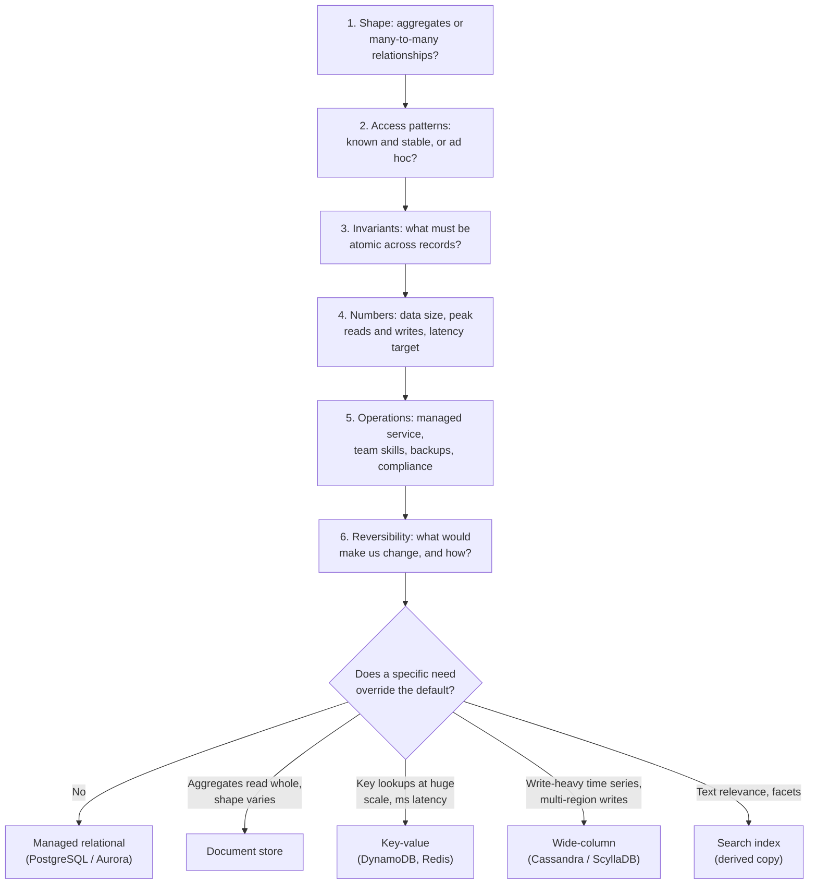

# SQL vs NoSQL: Choosing the Right Database

!!! abstract "Key takeaways"
    - "SQL vs NoSQL" is the wrong axis. Compare **data model** (tables, documents, key-value, wide-column, graph, search), **query model** (ad hoc vs known access paths), **consistency and transactions**, **scaling model** and **who operates it**.
    - The 2010-era differences have blurred: MongoDB has multi-document ACID transactions (4.0 replica sets, 4.2 sharded), DynamoDB has `TransactWriteItems` (up to 100 items), and PostgreSQL has `jsonb`, partitioning and distributed-SQL relatives (Citus, CockroachDB, YugabyteDB, Spanner).
    - **Relational designs for flexibility:** normalise, then ask any question later. **Key-value and wide-column stores design for known queries:** fast and cheap on those, slow or impossible off them. Document stores sit between.
    - Default to **a managed relational database** unless a specific need overrides it: a single-digit-millisecond lookup at very high scale, a write-heavy time series, full-text relevance, very deep graph traversals, or aggregates that are always read whole.
    - Defend the choice like an architect: name the **access patterns, invariants, volumes and failure modes**, the alternative you rejected, and what would make you change your mind.

## Why it matters

Database choice is one of the few decisions that is expensive to reverse. Code can be refactored in a sprint; moving hundreds of millions of rows to a new store with a different model takes months of dual writes and backfills (see [schema evolution](04-schema-evolution-and-zero-downtime-migrations.md)). Interviewers ask "why MongoDB?" or "why not just Postgres?" because the answer shows whether you chose from requirements or from fashion.

The NoSQL wave (Bigtable 2006, Dynamo 2007, Cassandra, MongoDB 2009) came from companies whose single relational servers couldn't keep up with write volume or availability needs. Ten years later most of those systems had added the features they once rejected (secondary indexes, transactions, SQL-like query languages), and relational databases had added JSON, horizontal options and managed scaling. In 2026 the question is less "SQL or NoSQL?" than **"which access patterns and guarantees does this data need, and which store gives them at the lowest total cost?"**

This page is the decision. How to model the data once you've chosen is on [page 2](02-data-modelling-for-relational-document-key-value-and-wide-co.md); how the stores replicate, partition and index is on [page 3](03-replication-partitioning-and-indexing-trade-offs.md); combining several stores is on [page 5](05-polyglot-persistence-in-microservices.md).

## Core concepts

### The families, by data model

| Family | Data shape | Query model | Typical engines | Strong at |
|---|---|---|---|---|
| Relational | Normalised tables, foreign keys | Ad hoc SQL, joins, aggregates | PostgreSQL, MySQL, Aurora, SQL Server | Integrity, flexible queries, reporting |
| Document | Nested JSON-like aggregates | Queries on fields and indexes, aggregation pipeline | MongoDB, Couchbase, Cosmos DB | Aggregates read and written whole, evolving shapes |
| Key-value | Opaque value per key | Get / put by key, sometimes ranges | Redis, DynamoDB, Memcached | Lowest-latency lookups at any scale |
| Wide-column | Rows in partitions, sorted by clustering key | Query by partition key + range | Cassandra, ScyllaDB, Bigtable, HBase | Very high write throughput, time series |
| Search | Inverted index over documents | Full-text, relevance, facets | Elasticsearch, OpenSearch | Text search, filtering, analytics on logs |
| Graph | Nodes and edges | Traversals (Cypher, Gremlin) | Neo4j, Neptune | Deep, variable-length relationships |
| Time series | Timestamped measurements | Range scans, downsampling | TimescaleDB, InfluxDB | Metrics, IoT, retention policies |

DynamoDB is usually described as key-value *and* document; its data modelling (partition key + sort key, item collections) is closer to wide-column. Labels matter less than the questions each one answers cheaply.

### "Schemaless" means schema-on-read

Every application has a schema; the question is **where it is enforced**. A relational database enforces it on write (types, `NOT NULL`, foreign keys, `CHECK`). A document store accepts any shape unless you add JSON Schema validation, so the schema lives in your code and in every reader's assumptions. That makes adding a field easy and makes bad data easy too. Both MongoDB (`$jsonSchema` validators) and PostgreSQL (`jsonb` + `CHECK` constraints) let you pick a point between the two.

### What has converged, and what hasn't

| Old claim | 2026 reality |
|---|---|
| "NoSQL has no transactions" | MongoDB multi-document ACID transactions since 4.0 (replica sets) and 4.2 (sharded); DynamoDB `TransactWriteItems` up to 100 items. They cost more latency and have limits; design so you rarely need them. |
| "SQL doesn't scale" | One PostgreSQL node with good indexes handles tens of thousands of simple queries per second (illustrative); read replicas, partitioning, Citus and distributed SQL (CockroachDB, YugabyteDB, Spanner) go further. |
| "SQL can't store flexible data" | PostgreSQL `jsonb` with GIN indexes; MySQL `JSON`. |
| "NoSQL can't query" | MongoDB aggregation, DynamoDB PartiQL, Cassandra CQL. |
| **Still true:** joins and ad hoc queries | Relational planners join and aggregate arbitrary tables. Key-value and wide-column stores can't join; queries outside the key design mean scans or new tables/indexes. |
| **Still true:** horizontal writes | Dynamo-style and Cassandra-style stores spread writes across nodes by design; a single-primary relational database has one write node unless you shard. |

### A decision framework: six questions


*Notice that the store comes out last. Questions 3 and 4 remove most options: hard multi-record invariants push toward relational, and only real numbers (not "it must scale") justify giving up joins.*

**1. Shape.** Is the data a set of self-contained aggregates (an order with its lines, a member profile with preferences) or a web of many-to-many relationships (prescribers, pharmacies, plans, formularies)? Aggregates fit documents; webs fit relational or graph.

**2. Access patterns.** List the top queries with their frequency and latency target. If you can list them all and they're stable, a store built for known queries (DynamoDB, Cassandra) can serve them at any scale. If analysts, support tools and new features will keep asking new questions, you want SQL.

**3. Invariants.** "A claim can't be paid twice", "stock can't go negative", "a ledger balances". If an invariant spans many records and must hold at every moment, pick a store where it's a single transaction, or model the data so the invariant lives inside one record or partition.

**4. Numbers.** Do the [back-of-the-envelope estimate](../system-design/02-back-of-the-envelope-estimation.md): rows, bytes, peak QPS, growth. 750K users and a few hundred writes per second fits one relational primary comfortably; 2 million writes per second does not.

**5. Operations.** Who patches, backs up, restores and pages at 3 a.m.? A managed service (RDS/Aurora, Atlas, DynamoDB) often decides it. Regulated data (PHI, PCI) adds encryption, audit and residency requirements every candidate must meet.

**6. Reversibility.** Write down what would make you change and how you'd migrate. An ADR with this section is what a senior answer sounds like.

### The relational default, and when to leave it

{ loading=lazy }
*Climb one rung at a time and measure; most systems never need the top rungs, and each rung costs more to run than the one below.*

PostgreSQL (or MySQL) is the default for transactional business data because it gives integrity, ad hoc queries, mature tooling and a large hiring pool, and because the steps that scale it are incremental: indexes ([PostgreSQL indexes](../postgresql-sql/02-indexes-and-explain-analyze.md)), pooling and replicas ([partitioning, replication and pooling](../postgresql-sql/07-partitioning-replication-and-connection-pooling.md)), caching ([caching patterns](../redis-caching/02-caching-patterns-cache-aside-read-write-through-write-behind.md)), then sharding ([database scaling](../system-design/05-database-scaling-replication-sharding-partitioning-consisten.md)).

Leave it, or add a second store, when one of these holds and you can show the numbers:

- **Predictable key lookups at very high scale** with single-digit-millisecond latency and no operations team (DynamoDB).
- **Write-heavy, append-mostly data** queried by key and time range (Cassandra/ScyllaDB, a time-series database).
- **Aggregates always read and written whole**, whose shape varies by type or evolves fast (MongoDB).
- **Full-text relevance and faceting** (Elasticsearch/OpenSearch, as a derived copy, not the source of truth).
- **Traversals many hops deep** (graph).
- **Ephemeral hot data**: sessions, rate limits, leaderboards (Redis).

### Query flexibility vs predictable performance

The deepest difference is when the cost of a query is paid. A relational database stores data once, normalised, and pays at **read time** (joins, planner). A query-first store pays at **design and write time**: you duplicate data into the shape each query needs, so reads are a single lookup, but a new query may need a new table, index or backfill.

{ loading=lazy }
*The document store wins the query it was designed for and pays for the one nobody planned; the relational store is never the fastest and never stuck.*

## In practice: code & configuration

### Writing the choice down

=== "❌ Common mistake"
    ```yaml
    # ADR-007: Use MongoDB for the claims service
    decision: MongoDB
    reasons:
      - "NoSQL scales better than SQL"          # no numbers: what load, which operation?
      - "Schemaless, so we can move fast"        # schema still exists, now unenforced
      - "Our other service uses it"              # consistency of stack, not fit for this data
    # Missing: access patterns, invariants (a claim must not be paid twice),
    # reporting needs, alternatives considered, what would make us revisit.
    ```

=== "✅ Correct approach"
    ```yaml
    # ADR-007: Store claims in PostgreSQL (Aurora), search via OpenSearch
    context:
      volumes: "~40M claims/year, peak 300 writes/s, 2k reads/s (estimate [confirm])"
      access_patterns:
        - "get claim by id with lines (p99 < 20 ms)"
        - "list claims for member, newest first, paged"
        - "adjudication updates claim + accumulators atomically"   # invariant
        - "ops/finance ad hoc reporting"                            # needs SQL
        - "free-text search on notes"                               # derived index
      constraints: "PHI: encryption at rest with KMS, audit, 7-year retention"
    decision: "Aurora PostgreSQL as system of record; OpenSearch fed by CDC for search"
    alternatives:
      - option: MongoDB
        rejected_because: "accumulator updates span documents; reporting needs joins"
      - option: DynamoDB
        rejected_because: "ad hoc reporting; access patterns still changing"
    revisit_when: "writes > 5k/s sustained, or multi-region active-active required"
    ```

### Flexible attributes without leaving SQL

A common reason to reach for a document store is "products have different attributes per type". PostgreSQL handles that with a `jsonb` column next to normal columns, so the invariants stay relational and only the variable part is flexible.

```java
// Spring Boot 3 / Hibernate 6: map a jsonb column to a Java record
@Entity
@Table(name = "drug_product")
public class DrugProduct {
    @Id
    private String ndc;                              // stable, relational key

    @Column(nullable = false)
    private String name;

    @JdbcTypeCode(SqlTypes.JSON)                     // Hibernate 6 native JSON mapping
    @Column(columnDefinition = "jsonb")
    private Attributes attributes;                   // varies by product type

    public record Attributes(String form, String strength,
                             Boolean refrigerated, Map<String, String> extra) {}
}
```

```sql
-- Index only the paths you query; keep invariants in real columns
CREATE INDEX drug_product_attrs_gin ON drug_product USING gin (attributes jsonb_path_ops);
SELECT ndc, name FROM drug_product WHERE attributes @> '{"refrigerated": true}';
```

## Real-world usage

- **Both directions happen.** The Guardian moved its content API to MongoDB around 2011 (Fowler cites it as a productivity win), then moved from MongoDB to PostgreSQL with `jsonb` in 2018 when it migrated to AWS, keeping the document shape inside a relational database. Uber moved from PostgreSQL to MySQL in 2016, citing write amplification and replication behaviour, and built its Schemaless layer on top. Neither direction is "right"; each followed the team's numbers and operating model at the time.
- **Discord** stores messages in a wide-column store partitioned by channel and time bucket. It ran 177 Cassandra nodes by early 2022 and migrated to 72 ScyllaDB nodes, with p99 historical-read latency falling from 40–125 ms to 15 ms. That is the profile wide-column stores exist for: huge append volume, read by key and time.
- **DynamoDB** underpins high-scale AWS and Amazon.com workloads whose access patterns are known in advance; AWS's own guidance says not to design a DynamoDB schema until you know the questions it must answer.
- **Healthcare and banking** keep claims, payments and ledgers in relational stores because the invariants (no double payment, balanced accumulators, auditability) are multi-record and regulators expect ad hoc reporting. Document and key-value stores appear around them for profiles, caches, preferences and event history.

## Trade-offs & production gotchas

| Option | Pros | Cons | Use when |
|---|---|---|---|
| Managed relational (Postgres, Aurora, MySQL) | Integrity, joins, ad hoc SQL, mature tools, easy hiring | One write primary; sharding is manual work | Default for business data with invariants and reporting |
| Document (MongoDB) | Aggregates in one read/write, flexible shape, built-in sharding | Joins via `$lookup` are limited; schema discipline is on you | Aggregates read whole; shape varies; moderate cross-aggregate queries |
| Key-value (DynamoDB) | Predictable latency at any scale, serverless ops | Every query must be designed in; ad hoc analytics need an export | Known, stable access patterns at high scale |
| Key-value (Redis) | Sub-millisecond, rich data structures | Memory-bound; persistence is not a ledger | Caches, sessions, counters, rate limits |
| Wide-column (Cassandra/Scylla) | Linear write scaling, multi-region, tunable consistency | Query-per-table, no joins, tombstone and compaction tuning | Write-heavy time series, messaging, IoT |
| Search (Elasticsearch/OpenSearch) | Relevance, facets, fuzzy text | Not a system of record; eventual consistency | A derived index beside the source of truth |
| Distributed SQL (CockroachDB, Spanner, YugabyteDB) | SQL + horizontal writes + strong consistency | Higher write latency (consensus), cost, fewer experts | Relational needs that truly outgrow one primary |

!!! warning "Gotcha: picking for the first feature"
    The first three screens rarely show the hard queries. Reporting, audits, support tooling and "find every order affected by this recall" arrive later and are the ones a query-first store can't answer. Ask who else will read the data before choosing.

!!! warning "Gotcha: 'schemaless' as a migration strategy"
    Skipping schema enforcement doesn't remove migrations; it moves them into every reader as `if (doc.has("oldField"))` branches. Use a `schemaVersion` field and validation from day one ([schema evolution](04-schema-evolution-and-zero-downtime-migrations.md)).

!!! tip "Interview framing"
    Start with "it depends on the access patterns and invariants", then **actually decide**. Interviewers mark down candidates who list trade-offs and never pick.

## How this connects to my experience

- **Where I used it:** On OptumRx Meteor (Publicis Sapient) I *"designed and developed microservices using Java, Spring Boot, Kafka, MongoDB, Redis, and GraphQL"* and *"implemented Redis-based caching for frequently accessed queries and UI reference data"*. At Deloitte (ConvergeHealth Data Asset Explorer) the stack included *"RDS, DynamoDB … S3"* and *"Elasticsearch-powered search"*. The skills list adds PostgreSQL and MySQL.
- **Talking points:**
    - Meteor is a polyglot example: MongoDB for service data, Redis as a cache in front of slow upstream queries, Kafka for events. Be ready to say *why MongoDB* for those services: the shape of the data, the aggregates read whole, and what the source of truth was. *[confirm: which data lived in MongoDB, and whether the decision predated you]*
    - ConvergeHealth shows the relational + key-value + search split: RDS for relational metadata, DynamoDB for key-based lookups, Elasticsearch for data discovery search. *[confirm: which engine ran on RDS (PostgreSQL or MySQL) and what lived in DynamoDB]*
    - Redis was a cache, not a store of record: losing it costs latency, not data.
    - A healthy honest line: "I didn't choose every store, but I can explain the fit and what I'd change."
- **Likely follow-up chain:** "Why MongoDB on Meteor?" → "What did you embed vs reference?" ([page 2](02-data-modelling-for-relational-document-key-value-and-wide-co.md), [MongoDB schema design](../mongodb/01-document-model-and-schema-design.md)) → "Did you need transactions across documents?" ([MongoDB transactions](../mongodb/06-transactions-and-consistency.md)) → "How did you keep the Redis cache consistent?" ([invalidation](../redis-caching/03-ttl-eviction-policies-and-invalidation-strategies.md)) → "Would you choose MongoDB again?" Answer with the access patterns and invariants, not loyalty.

## Interview questions

### Fundamentals

??? question "Q1. What is the real difference between SQL and NoSQL databases?"
    **Answer:** "NoSQL" groups several data models (document, key-value, wide-column, graph) whose common trait is that they're not relational. The meaningful differences are the data model, the query model (ad hoc SQL with joins vs access paths designed in advance), consistency and transaction scope, and how they scale writes (one primary vs partitioned by design). Many old differences have converged: NoSQL stores have transactions and query languages; relational stores have JSON and horizontal options.

    **Interviewer listens for:** data model and query model, not "structured vs unstructured"; awareness of convergence.

    **Common wrong answer:** "SQL is for structured data and doesn't scale; NoSQL is for unstructured data and scales."

??? question "Q2. When would you choose a document database over a relational one?"
    **Answer:** When the data is a set of aggregates that are usually read and written whole (an order with its lines, a profile with preferences), their shape varies or changes often, and cross-aggregate invariants are rare. The document maps to the object, one read serves a screen, and sharding by the aggregate's key is natural. I'd avoid it when many queries cut across aggregates or need multi-record invariants and reporting.

    **Interviewer listens for:** aggregates and access patterns; the cost on cross-aggregate queries.

    **Common wrong answer:** "When we don't know the schema yet."

??? question "Q3. Do NoSQL databases support ACID transactions?"
    **Answer:** Many do now, with limits. MongoDB supports multi-document transactions on replica sets since 4.0 and sharded clusters since 4.2, and single-document writes were always atomic. DynamoDB `TransactWriteItems` covers up to 100 items across tables at twice the capacity cost. Cassandra offers lightweight transactions (Paxos-based compare-and-set) on one partition. They're slower and more limited than relational transactions, so a good NoSQL model keeps each invariant inside one record or partition.

    **Interviewer listens for:** versions and limits; designing so transactions are rare.

    **Common wrong answer:** "No, NoSQL is BASE only."

### Intermediate

??? question "Q4. Walk me through how you'd choose a database for a new service."
    **Answer:** Six questions: the data's shape (aggregates or relationships), the top access patterns with frequency and latency targets, the invariants that must be atomic, the numbers (size, peak reads/writes, growth), the operating model (managed service, team skills, compliance), and reversibility (what would change the decision, how we'd migrate). Then I default to a managed relational store unless a specific need, backed by numbers, overrides it, and I write an ADR with the rejected alternatives.

    **Interviewer listens for:** a repeatable method, numbers, invariants, a default, an ADR.

    **Common wrong answer:** Naming a database in the first sentence.

??? question "Q5. What does 'schemaless' really mean, and what does it cost?"
    **Answer:** The database doesn't enforce a schema on write; the schema still exists, in the application and every reader. Adding fields is easy, but bad or mixed-version data gets in unnoticed and every reader must handle old shapes. Mitigate with validators (`$jsonSchema`), a `schemaVersion` field, typed mapping classes and migrations for big changes.

    **Interviewer listens for:** schema-on-read vs schema-on-write; versioning discipline.

    **Common wrong answer:** "There's no schema, so no migrations."

??? question "Q6. How far can a single PostgreSQL primary go before you need something else?"
    **Answer:** Usually much further than people think. Fix queries and indexes, add connection pooling, cache hot reads, add read replicas, partition big tables and archive old data. A tuned primary on large hardware handles thousands to tens of thousands of writes per second for simple rows, depending on row size, indexes and durability settings, so measure your own. Beyond that: shard (by tenant or key, possibly with Citus), move to distributed SQL, or move the specific high-volume data to a store built for it.

    **Interviewer listens for:** the ladder of steps, "measure", moving only the hot data.

    **Common wrong answer:** "Once you have a million users you need NoSQL."

### Senior

??? question "Q7. When is DynamoDB the wrong choice even though it scales?"
    **Answer:** When access patterns aren't known or keep changing, when the business needs ad hoc queries and reporting, when invariants span many items (transactions are capped at 100 items and cost double), or when items are large or relationships many-to-many and deep. Each new query may need a GSI or a backfill, and analytics need an export to S3/Athena or a warehouse.

    **Interviewer listens for:** query-first design cost; transactions limits; analytics path.

    **Common wrong answer:** "It's never wrong; it scales infinitely."

??? question "Q8. How do you defend a database choice to an architecture board?"
    **Answer:** Bring the access patterns with numbers, the invariants and how they're enforced, a capacity estimate, cost, the operating model (managed, backups, RPO/RTO, encryption), the alternatives with the reason each was rejected, and the conditions that would trigger a revisit with the migration path. Show a spike or benchmark on realistic data for the riskiest query.

    **Interviewer listens for:** evidence, rejected alternatives, reversibility.

    **Common wrong answer:** Arguing from popularity or team preference.

### Scenario-based

??? question "Q9. A team wants MongoDB for a payments ledger because 'it's flexible'. What do you say?"
    **Answer:** A ledger is the opposite of flexible: fixed shape, append-only entries, invariants across accounts (debits equal credits), strict auditability and heavy reporting. That favours a relational store with constraints and serializable or carefully locked transactions. MongoDB could work with transactions and careful modelling, but it adds risk for no benefit. If flexibility is for metadata, use a `jsonb` column.

    **Interviewer listens for:** invariants and audit drive it; offering a compromise for the flexible part.

    **Common wrong answer:** "Sure, MongoDB has transactions now," without examining the invariants.

??? question "Q10. You inherited a service on MongoDB where most queries use `$lookup` across five collections. What do you do?"
    **Answer:** First measure: which queries are slow and how often they run. The pattern says the data was modelled relationally inside a document store. Options: remodel around aggregates (embed or use extended references for read-mostly fields), add a read model built from events for the cross-cutting queries, or, if most access really is relational and invariant-heavy, plan a migration to PostgreSQL with dual writes and backfill. Choose by the number of queries and the cost of change.

    **Interviewer listens for:** measure first; remodel vs read model vs migrate; migration discipline.

    **Common wrong answer:** "Rewrite it in Postgres" on day one.

## Cheat sheet

| Concept | Remember |
|---|---|
| Real axes | Data model · query model · invariants/transactions · scaling model · operations |
| Default | Managed relational, unless a measured need overrides it |
| Document | Aggregates read whole, shape varies; weak at cross-aggregate queries |
| Key-value / DynamoDB | Known access patterns at scale; design queries first; ≤100-item transactions |
| Wide-column | Write-heavy, query by partition + range; table per query |
| Search | Derived copy for text and facets, never the source of truth |
| Schemaless | Schema-on-read; version your documents |
| Convergence | Mongo txns 4.0/4.2 · Postgres `jsonb` · distributed SQL |
| Senior answer | Access patterns + invariants + numbers + rejected alternatives + revisit trigger |

## Sources
1. [Martin Fowler: Polyglot Persistence (2011)](https://martinfowler.com/bliki/PolyglotPersistence.html): choosing storage by how data is used; Guardian and key-value examples.
2. [AWS: NoSQL design for DynamoDB](https://docs.aws.amazon.com/amazondynamodb/latest/developerguide/bp-general-nosql-design.html): design for known queries, few tables, keep related data together.
3. [Apache Cassandra: Data modeling compared with RDBMS](https://cassandra.apache.org/doc/latest/cassandra/developing/data-modeling/data-modeling_rdbms.html): no joins, denormalisation, query-first design.
4. [MongoDB Manual: Transactions](https://www.mongodb.com/docs/manual/core/transactions/): multi-document transactions, version history and limits.
5. [AWS: DynamoDB transactions](https://docs.aws.amazon.com/amazondynamodb/latest/developerguide/transaction-apis.html): `TransactWriteItems` limits and cost.
6. [Discord: How Discord stores trillions of messages (2023)](https://discord.com/blog/how-discord-stores-trillions-of-messages): Cassandra to ScyllaDB, node counts and latencies.
7. [The Guardian: Bye bye Mongo, hello Postgres (2018)](https://www.theguardian.com/info/2018/nov/30/bye-bye-mongo-hello-postgres): migration from MongoDB to PostgreSQL `jsonb`.
8. [Uber Engineering: Why Uber switched from Postgres to MySQL (2016)](https://www.uber.com/blog/postgres-to-mysql-migration/): write amplification and replication reasons.
9. [PostgreSQL: JSON types](https://www.postgresql.org/docs/current/datatype-json.html): `jsonb`, containment and GIN indexing.
10. Martin Kleppmann, *Designing Data-Intensive Applications* (O'Reilly), chapter 2: data models and query languages.
