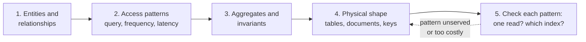
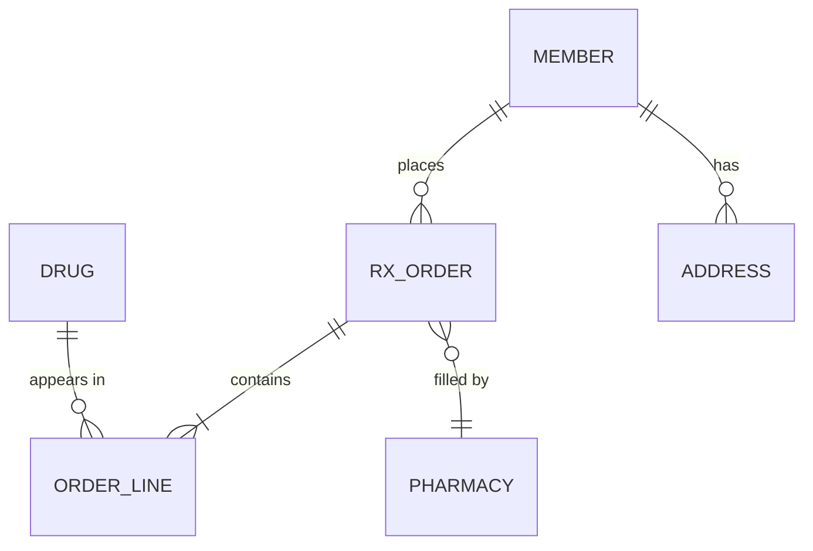

# Data Modelling for Relational, Document, Key-Value & Wide-Column Stores

!!! abstract "Key takeaways"
    - Every model starts the same way: **entities and relationships, then the access patterns** (with frequency and latency), then the physical shape. The stores differ in **when you need the access patterns**: relational can wait, the others can't.
    - **Relational:** normalise to 3NF, enforce invariants with keys and constraints, add indexes for the queries; denormalise only where measured.
    - **Document:** model **aggregates**: embed what's read together and bounded, reference what's shared, unbounded or updated independently; copy a few read-mostly fields (extended reference).
    - **Key-value / DynamoDB:** the key *is* the query. Use partition key + sort key to build **item collections** that a single `Query` reads in order; add GSIs for other access paths; keep related entities in one table.
    - **Wide-column (Cassandra):** **one table per query**, partition key for distribution, clustering columns for sort order, time buckets to bound partition size; duplicate data and accept it.

## Why it matters

"Design the schema for X" is a standard interview step, and the follow-ups test whether you can move between models: "Now store it in DynamoDB", "What if this were Cassandra?" A table-for-table copy of a relational schema into another store is the most common failure: it keeps all the joins and loses the planner that made them cheap.

The topic pages already go deep on single stores: [normalisation in PostgreSQL](../postgresql-sql/05-normalisation-vs-denormalisation.md), [MongoDB schema design](../mongodb/01-document-model-and-schema-design.md), [DynamoDB keys and indexes](../aws/07-databases-rds-aurora-dynamodb.md) and [Redis data structures](../redis-caching/01-redis-data-structures-and-use-cases.md). This page **compares**: one domain, four shapes, and the reasoning that picks between them. Which store to use is [page 1](01-sql-vs-nosql-choosing-the-right-database.md).

## Core concepts

### The method is the same for every store


*Notice the loop at the end. In a relational model step 5 is mostly adding indexes; in DynamoDB or Cassandra a failed check means changing keys or adding a table, which is why those models need step 2 to be complete first.*

### The running example: an online pharmacy


*Notice the mix: orders and lines form an aggregate (always read together), drugs and pharmacies are shared reference data (many-to-many through lines), and a member's order history grows without bound.*

Access patterns, ranked:

| # | Pattern | Frequency | Target |
|---|---|---|---|
| AP1 | Get an order with its lines | Very high | p99 < 20 ms |
| AP2 | List a member's orders, newest first, paged | High | p99 < 50 ms |
| AP3 | Orders in status `READY` at a pharmacy (fulfilment queue) | Medium | p99 < 100 ms |
| AP4 | Get member profile and addresses | High | p99 < 20 ms |
| AP5 | Every order containing a recalled drug since a date | Rare, urgent | Minutes acceptable |

AP5 is the "question nobody planned" from [page 1](01-sql-vs-nosql-choosing-the-right-database.md); watch how each model copes with it.

{ loading=lazy }
*Same data, four shapes: the relational model stores each fact once; the other three store it in the shape of the reads.*

### Relational: normalise, constrain, index

Tables `member`, `address`, `rx_order`, `order_line`, `drug`, `pharmacy`. Foreign keys and `CHECK`s hold the invariants; each access pattern becomes an index:

- AP1: primary key on `rx_order`, index on `order_line(order_id)`.
- AP2: `rx_order(member_id, created_at DESC)` gives an index-ordered page with keyset pagination.
- AP3: partial index `rx_order(pharmacy_id, created_at) WHERE status = 'READY'`.
- AP5: `order_line(ndc)` joined to `rx_order`. One more index, no remodelling.

Denormalise (a `line_count`, a copied `drug_name`) only after measuring a hot read. The normal forms and when to break them are on the [normalisation page](../postgresql-sql/05-normalisation-vs-denormalisation.md).

### Document: model aggregates

Ask of each relationship: is it read with the parent, is it bounded, and does it change independently?

| Relationship | Read together? | Bounded? | Model |
|---|---|---|---|
| Order → lines | Always | Yes (tens) | **Embed** lines in the order |
| Member → addresses | Usually | Yes (a few) | **Embed** |
| Member → orders | Sometimes (paged) | **No** | **Reference**: `memberId` on each order + index |
| Line → drug | Name and strength shown | Drug catalogue changes rarely | **Extended reference**: copy `ndc`, `name`, `strength`; full drug in its own collection |
| Order → pharmacy | Name shown | Shared | Extended reference |

AP1 and AP4 become one document read; AP2 an index on `{memberId: 1, createdAt: -1}`; AP3 an index on `{pharmacyId: 1, status: 1, createdAt: 1}`; AP5 a multikey index on `lines.ndc`, fine if planned, a collection scan if not. The copied drug name must be updated (or accepted as a historical snapshot, which for an order is usually correct: the order shows what was dispensed). Patterns (subset, bucket, computed, schema versioning) are on the [MongoDB page](../mongodb/01-document-model-and-schema-design.md).

### Key-value: the key is the query

A pure key-value store (Redis, Memcached) answers one question: "give me the value for this key". Modelling means choosing keys and value structures so each access pattern is one or two lookups:

```text
order:{orderId}              -> hash or JSON   (AP1)
member:{memberId}            -> hash           (AP4)
member:{memberId}:orders     -> sorted set, score = createdAt epoch, member = orderId   (AP2)
pharmacy:{id}:ready          -> sorted set of orderIds by createdAt   (AP3)
```

Every secondary "index" is a structure you maintain on write, ideally atomically (`MULTI`/Lua). There's no AP5 without scanning everything. That's why Redis usually holds a **derived** copy in front of a system of record ([caching patterns](../redis-caching/02-caching-patterns-cache-aside-read-write-through-write-behind.md)), not the data itself.

### DynamoDB: item collections and single-table design

DynamoDB adds a **sort key**, which turns a key-value store into ordered partitions: all items with the same partition key (an *item collection*) are stored together and sorted, and a `Query` reads a contiguous range of them. Single-table design puts several entity types in one table so a related set is one `Query`:

| PK | SK | Attributes | Serves |
|---|---|---|---|
| `MEMBER#42` | `PROFILE` | name, addresses | AP4 |
| `MEMBER#42` | `ORDER#2026-10-03#o-981` | status, total, lines (embedded) | AP2 (and AP1 via GSI or a second item) |
| `ORDER#o-981` | `ORDER#o-981` | full order | AP1 |
| GSI1: `PHARM#7#READY` | GSI1SK: `2026-10-03T09:12` | projected order summary | AP3 |

`Query(PK = "MEMBER#42", SK begins_with "ORDER#", ScanIndexForward = false, Limit = 20)` returns the member's newest orders in one round trip; the same partition read with `SK = "PROFILE"` returns the profile.

{ loading=lazy }
*A Query reads one sorted slice of one partition; a Scan with a filter reads and pays for everything, then throws most of it away.*

Status changes (`READY` → `SHIPPED`) move the GSI entry automatically, because the GSI key is just an attribute. AP5 has no key: export to S3 and query with Athena, or keep a GSI on drug if recalls must be answered in seconds. Capacity, hot partitions and GSI vs LSI are on the [DynamoDB page](../aws/07-databases-rds-aurora-dynamodb.md).

### Wide-column: one table per query

Cassandra and ScyllaDB store rows in partitions (located by hashing the **partition key**) sorted by **clustering columns**. There are no joins and filtering outside the key is discouraged, so each access pattern gets its own table holding duplicated data:

```sql
-- AP2: a member's orders, newest first
CREATE TABLE orders_by_member (
  member_id   uuid,
  created_at  timestamp,
  order_id    uuid,
  status      text,
  total       decimal,
  lines       frozen<list<frozen<order_line>>>,   -- UDT, embedded like a document
  PRIMARY KEY ((member_id), created_at, order_id)
) WITH CLUSTERING ORDER BY (created_at DESC, order_id ASC);

-- AP3: fulfilment queue; day bucket bounds partition size and spreads load
CREATE TABLE ready_orders_by_pharmacy (
  pharmacy_id uuid,
  day         date,                                -- bucket
  created_at  timestamp,
  order_id    uuid,
  member_id   uuid,
  PRIMARY KEY ((pharmacy_id, day), created_at, order_id)
);
```

A status change means deleting from one table and inserting into another (a logged batch keeps the writes together, at a cost). Deletes create **tombstones** that slow reads until compaction, so a queue-like table that churns constantly is a known Cassandra anti-pattern; a short time bucket and TTLs limit the damage. Keep partitions bounded (a common guideline is well under 100 MB and 100,000 rows) with buckets such as `(member_id, year)` for heavy users.

### Relationships across the four models

| Relationship | Relational | Document | DynamoDB | Wide-column |
|---|---|---|---|---|
| One-to-few | Child table + FK | Embed | Same item or same partition | Collection column or clustering rows |
| One-to-many (unbounded) | Child table + index | Reference + index, or bucket | Item collection under parent PK | Clustering rows in parent partition, bucketed |
| Many-to-many | Join table | Arrays of refs both sides, or link collection | Adjacency list: both directions as items, GSI to invert | Two tables, one per direction |
| Shared reference data | FK to lookup table | Extended reference (copy hot fields) | Copy into items, or separate lookup | Copy into each table |
| Ad hoc new query | New index | New index (if field exists) | New GSI + backfill, or export | New table + backfill |

## In practice: code & configuration

### Filtering outside the key

=== "❌ Common mistake"
    ```sql
    -- Cassandra: one generic orders table, then filter on non-key columns
    CREATE TABLE orders (order_id uuid PRIMARY KEY, member_id uuid, pharmacy_id uuid,
                         status text, created_at timestamp);

    SELECT * FROM orders WHERE pharmacy_id = ? AND status = 'READY' ALLOW FILTERING;
    -- Contacts every node and reads every partition, then filters.
    -- Fine on a laptop with 1,000 rows, a timeout in production.
    ```

=== "✅ Correct approach"
    ```sql
    -- A table shaped for the query: one partition per pharmacy per day, already sorted
    SELECT order_id, member_id, created_at
    FROM ready_orders_by_pharmacy
    WHERE pharmacy_id = ? AND day = ?
    LIMIT 100;
    -- Single-partition read, served by one replica set.
    ```

### DynamoDB query for AP2 (AWS SDK for Java v2)

```java
// Member's newest 20 orders: one Query on one item collection
public List<OrderSummary> recentOrders(String memberId, Map<String, AttributeValue> startKey) {
    QueryRequest.Builder req = QueryRequest.builder()
        .tableName("pharmacy")
        .keyConditionExpression("PK = :pk AND begins_with(SK, :prefix)")
        .expressionAttributeValues(Map.of(
            ":pk", AttributeValue.fromS("MEMBER#" + memberId),
            ":prefix", AttributeValue.fromS("ORDER#")))
        .scanIndexForward(false)          // newest first: SK starts with ISO date
        .limit(20);
    if (startKey != null) req.exclusiveStartKey(startKey);   // keyset pagination

    QueryResponse res = dynamo.query(req.build());
    return res.items().stream().map(OrderSummary::from).toList();
}
```

### Document vs relational in Java

```java
// MongoDB (Spring Data): the aggregate is one class, lines embedded, drug copied
@Document("orders")
@CompoundIndex(name = "member_recent", def = "{'memberId': 1, 'createdAt': -1}")
public record RxOrder(@Id String id, String memberId, Instant createdAt, Status status,
                      List<Line> lines, int schemaVersion) {
    public record Line(String ndc, String drugName, String strength, int qty) {}   // extended reference
}

// JPA: the same aggregate across two tables; the line references the drug
@Entity class RxOrderEntity {
    @Id UUID id;
    @ManyToOne(fetch = FetchType.LAZY) MemberEntity member;
    @OneToMany(mappedBy = "order", cascade = CascadeType.ALL, orphanRemoval = true)
    List<OrderLineEntity> lines = new ArrayList<>();
}
```

## Real-world usage

- **Single-table DynamoDB design** is AWS's recommended approach for related entities with known access patterns (Rick Houlihan's re:Invent talks, and Alex DeBrie's *The DynamoDB Book*). AWS also documents when **multiple tables** are better: very different access patterns, time-series data, or teams that need separate ownership and streams.
- **Discord** partitions messages by channel and a fixed time bucket, the textbook wide-column pattern for bounded partitions on an unbounded stream.
- **MongoDB's schema design patterns** (extended reference, subset, bucket, computed) came from consulting on real customer workloads; the bucket pattern is how IoT and time-series data stayed in document stores before native time-series collections (MongoDB 5.0).
- **Healthcare:** claims, eligibility and pharmacy data are usually relational at the core because of many-to-many reference data (plans, formularies, prescribers) and audit reporting, with document or key-value projections for member-facing reads.

## Trade-offs & production gotchas

| Model | Write once, read many ways? | Cost of a new query | Duplication | Main risk |
|---|---|---|---|---|
| Relational | Yes | Low: an index | Minimal | Join cost at scale, single write primary |
| Document | Mostly | Low–medium: an index if the field exists | Some (extended references) | Unbounded arrays, cross-aggregate queries |
| Key-value (Redis) | No | High: new structure maintained on write | High | Drift between hand-built indexes |
| DynamoDB | No | Medium–high: GSI + backfill, or export | Some–high | Hot partitions, unplanned queries |
| Wide-column | No | High: new table + backfill | High (table per query) | Large partitions, tombstones |

!!! warning "Gotcha: modelling from the ER diagram alone"
    For DynamoDB and Cassandra, a model built before the access-pattern list is a guess. Write the pattern table first (like AP1–AP5 above), and review it with product and support, who know the queries engineers forget.

!!! warning "Gotcha: duplicated data needs an owner"
    Every copy (extended reference, second Cassandra table, GSI projection, Redis index) needs a rule: snapshot (never updated, like the drug name on a historical order) or kept in sync (and by what: same write, batch, or event). Decide per field and write it down.

## How this connects to my experience

- **Where it applies:** Not a ★ subtopic, but every store on the resume needs a model: MongoDB on OptumRx Meteor, DynamoDB and RDS on ConvergeHealth, Redis as a cache on Meteor (*"Redis-based caching for frequently accessed queries and UI reference data"*), and the GraphQL Consumer Service as *"the integration layer between 5 upstream systems"*, which is a read-model shape problem.
- **Talking points:**
    - GraphQL schemas are designed from client queries, the same "access patterns first" thinking as DynamoDB and Cassandra.
    - Redis key design for reference data and query results: key naming, TTLs and what the value holds. *[confirm: key scheme and value types used on Meteor]*
    - If asked about DynamoDB at Deloitte, describe the partition and sort keys and the access patterns they served. *[confirm: tables and keys, or say it was a small part of the work]*
- **Likely follow-up chain:** "Model this order system" → "Now in DynamoDB" (pattern table, PK/SK, GSI for status) → "How do you find every order with a recalled drug?" (GSI on drug or export to Athena; in SQL just an index) → "How do you keep the copied drug name correct?" (snapshot vs sync).

## Interview questions

### Fundamentals

??? question "Q1. What's the first step in modelling data for any database?"
    **Answer:** Identify entities and relationships, then list the access patterns with frequency and latency targets. In a relational model you can design from the entities and add indexes later; in a document, key-value or wide-column model the access patterns decide the keys and the shape, so they come before any physical design.

    **Interviewer listens for:** an access-pattern table; knowing when it's mandatory.

    **Common wrong answer:** Starting from tables and translating them to the target store.

??? question "Q2. When do you embed and when do you reference in a document model?"
    **Answer:** Embed what's read with the parent, bounded in size and owned by it (order lines, a few addresses). Reference what's unbounded (order history), shared across many parents (drugs, pharmacies) or updated independently and often. Use an extended reference to copy a few read-mostly fields to avoid a second read, and decide whether the copy is a snapshot or kept in sync.

    **Interviewer listens for:** read-together, bounded, independent change; extended reference.

    **Common wrong answer:** "Always embed, that's the point of documents."

??? question "Q3. What are a partition key and a clustering (sort) key?"
    **Answer:** The partition key is hashed to decide which partition, and so which nodes, hold the data; queries need it to avoid touching every node. The clustering or sort key orders rows within a partition, so range queries and "newest first" reads are a contiguous slice. Together they form the primary key. In DynamoDB they are the partition key and sort key; in Cassandra the partition key and clustering columns.

    **Interviewer listens for:** distribution vs ordering; single-partition reads.

    **Common wrong answer:** Treating the partition key as just a unique ID.

### Intermediate

??? question "Q4. Explain single-table design in DynamoDB. When wouldn't you use it?"
    **Answer:** Several entity types share one table, with generic `PK`/`SK` attributes holding prefixed values (`MEMBER#42`, `ORDER#2026-10-03#id`), so related items form one item collection read by a single `Query`; GSIs with overloaded keys serve other patterns. It cuts round trips and keeps related data together. I'd use separate tables when access patterns differ a lot, for time series with different retention, when teams own entities separately, or when access patterns aren't stable, because single-table models are hard to change.

    **Interviewer listens for:** item collections, overloaded keys and GSIs, and the honest limits.

    **Common wrong answer:** "One table for the whole company."

??? question "Q5. Why does Cassandra modelling use one table per query?"
    **Answer:** Cassandra has no joins, and efficient reads must hit one partition with a known key and read rows in clustering order. A table is effectively a materialised view for one query shape, so each access pattern gets its own table with duplicated data, written together (often in a logged batch). Writes are cheap in Cassandra, so trading write work for single-partition reads is the right trade.

    **Interviewer listens for:** no joins, single-partition reads, cheap writes, duplication accepted.

    **Common wrong answer:** Using secondary indexes or `ALLOW FILTERING` to avoid extra tables.

??? question "Q6. How do you keep partitions from growing without bound?"
    **Answer:** Add a bucket to the partition key: time (`(member_id, year)`, `(sensor_id, day)`) or a hash suffix for very hot keys. Choose the bucket so a partition stays within the store's guidelines (DynamoDB item collections with an LSI are capped at 10 GB; Cassandra partitions are best kept well under ~100 MB). Reads that span buckets query a few partitions and merge.

    **Interviewer listens for:** time buckets, write sharding, the read cost of buckets.

    **Common wrong answer:** "Partitions grow automatically, the database handles it."

### Senior

??? question "Q7. Model a many-to-many relationship in each of the four stores."
    **Answer:** Relational: a join table with two FKs and indexes both ways. Document: arrays of references on one or both sides if bounded, otherwise a link collection with indexes. DynamoDB: an adjacency list, storing each edge as an item under one entity's PK, with a GSI that inverts PK and SK to read the other direction. Cassandra: two tables, one per direction, written together.

    **Interviewer listens for:** adjacency list + inverted GSI; two tables in Cassandra.

    **Common wrong answer:** Embedding both sides fully in document stores.

??? question "Q8. A new query arrives after launch. What does it cost in each model?"
    **Answer:** Relational: usually one index, built concurrently. Document: an index if the field exists; otherwise a schema change and backfill. DynamoDB: a new GSI (DynamoDB backfills it, but the key attributes must exist on items, which may need a backfill of its own) or an export for rare analytical queries. Cassandra: a new table plus a backfill job, and dual writes from then on. That's why query-first stores need the access-pattern review up front.

    **Interviewer listens for:** cost asymmetry; analytics export as an option.

    **Common wrong answer:** "Add a secondary index" in every store.

### Scenario-based

??? question "Q9. Design storage for a member's medication history: years of fills, read newest first, occasionally filtered by drug."
    **Answer:** In Cassandra or DynamoDB: partition by `(member_id, year)`, sort by fill date descending, so the common read is a single-partition slice and partitions stay bounded; for "by drug", a second table or GSI keyed `(member_id, ndc)` sorted by date. In PostgreSQL: one table with an index on `(member_id, filled_at DESC)` and another on `(member_id, ndc, filled_at DESC)`, possibly partitioned by year for retention. Choose by the scale and whether other ad hoc queries exist.

    **Interviewer listens for:** bucketing, a second access path, and the relational alternative.

    **Common wrong answer:** Embedding all fills in the member document.

??? question "Q10. A team copied their relational schema table-for-table into DynamoDB, and every screen makes six requests. How do you fix it?"
    **Answer:** List the screens' access patterns, then redesign keys so related items share a partition key and come back in one `Query`; embed small child lists in the parent item; add GSIs for the remaining patterns; migrate by dual-writing the new items and backfilling from the old tables (or a DynamoDB export), then switch reads. If the access patterns turn out to be mostly ad hoc, question whether DynamoDB was the right choice.

    **Interviewer listens for:** item collections, migration plan, willingness to revisit the store.

    **Common wrong answer:** "Use `BatchGetItem` to parallelise the six calls."

## Cheat sheet

| Concept | Remember |
|---|---|
| Method | Entities → access patterns → aggregates/invariants → shape → check each pattern |
| Relational | 3NF, constraints, one index per pattern, denormalise when measured |
| Document | Embed: read together + bounded + owned. Reference: unbounded, shared, independent |
| Extended reference | Copy hot read-mostly fields; snapshot or sync, decided per field |
| Key-value | The key is the query; secondary indexes are structures you maintain |
| DynamoDB | PK + SK → item collection → one `Query`; GSI for other paths; single table if patterns are known |
| Wide-column | Table per query; partition key + clustering order; time buckets; tombstones |
| Unplanned query | SQL: index · Mongo: index · Dynamo: GSI/export · Cassandra: new table + backfill |

## Sources
1. [AWS: NoSQL design for DynamoDB](https://docs.aws.amazon.com/amazondynamodb/latest/developerguide/bp-general-nosql-design.html): access patterns first, keep related data together, sort order, GSIs.
2. [AWS: Best practices for managing many-to-many relationships (adjacency list)](https://docs.aws.amazon.com/amazondynamodb/latest/developerguide/bp-adjacency-graphs.html): adjacency lists and inverted GSIs.
3. [Apache Cassandra: Data modeling compared with RDBMS](https://cassandra.apache.org/doc/latest/cassandra/developing/data-modeling/data-modeling_rdbms.html): no joins, denormalisation, query-first, partitions and clustering.
4. [MongoDB Manual: Data modeling and design patterns](https://www.mongodb.com/docs/manual/data-modeling/): embedding vs references, schema patterns.
5. [Redis: Data types](https://redis.io/docs/latest/develop/data-types/): hashes and sorted sets used as hand-built indexes.
6. [Discord: How Discord stores trillions of messages](https://discord.com/blog/how-discord-stores-trillions-of-messages): channel + time-bucket partitioning.
7. Alex DeBrie, *The DynamoDB Book*: single-table design, item collections, GSI overloading.
8. Martin Kleppmann, *Designing Data-Intensive Applications*, chapters 2–3: data models, document vs relational, storage layouts.
