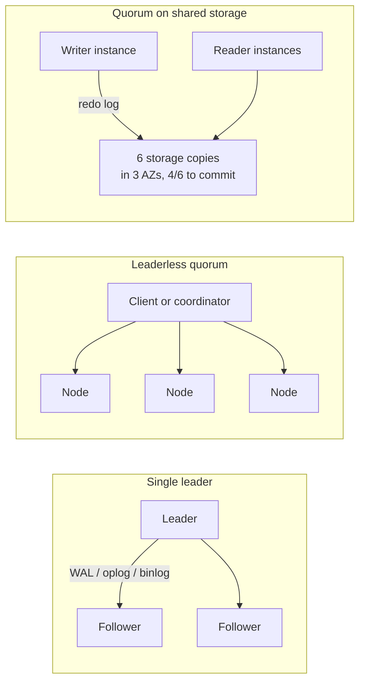
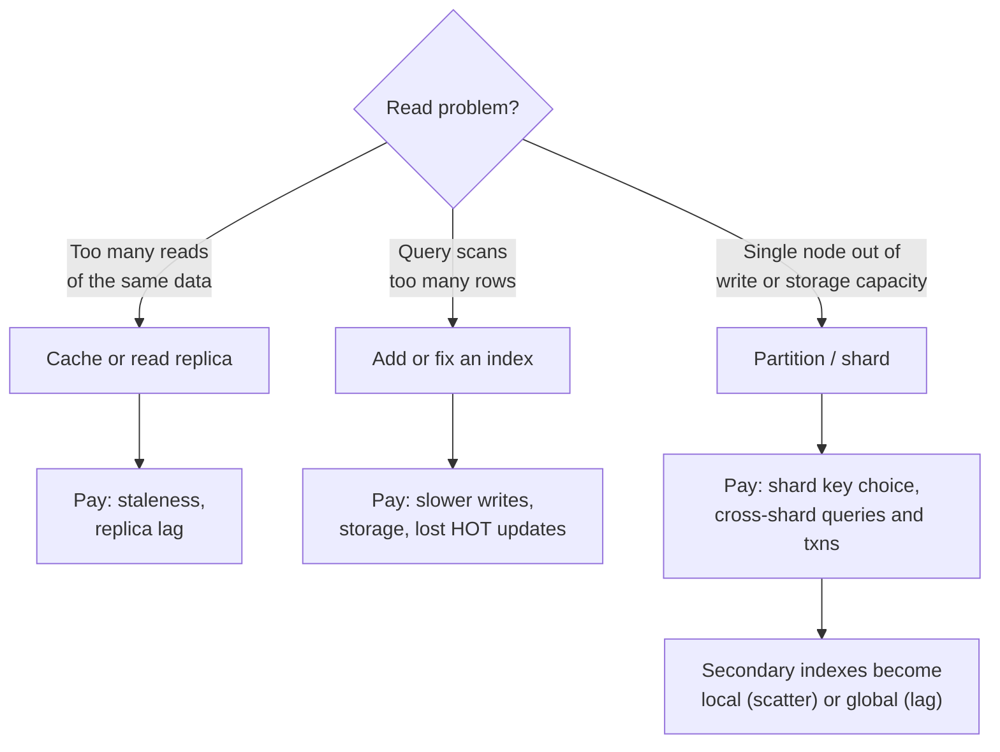

# Replication, Partitioning & Indexing Trade-offs

!!! abstract "Key takeaways"
    - Replication, partitioning and indexing all **store data redundantly or rearrange it** so reads are faster or more available. Each one is paid for on **every write**, and the costs multiply: one row × 4 indexes × 3 replicas is 15 page writes plus logs.
    - **Replication styles:** single-leader (PostgreSQL, MySQL, MongoDB), leaderless quorum (Cassandra), quorum on shared storage (Aurora: 6 copies, 4/6 to write), consensus per range (Spanner, CockroachDB). They differ in write latency, read-your-writes and failover behaviour.
    - **Partitioning:** hash spreads load but loses range scans; range keeps order but invites hot spots on monotonic keys. PostgreSQL declarative partitioning splits a table **on one node** (pruning, retention); sharding splits across nodes.
    - **Secondary indexes on partitioned data are local or global.** Local (MongoDB, PostgreSQL partitions, Cassandra, Elasticsearch): cheap writes, scatter-gather reads unless the query has the partition key. Global (DynamoDB GSI): targeted reads, but an extra asynchronous write and **eventual consistency**.
    - **B-tree vs LSM:** B-trees (PostgreSQL, InnoDB, WiredTiger) favour reads and in-place updates; LSM trees (Cassandra, ScyllaDB, RocksDB) favour write throughput and pay with compaction and multi-file reads.

## Why it matters

Every "scale this" interview answer reaches for "add a replica", "shard it" or "add an index". The follow-up is always the cost: "What happens to writes?", "Can the user see their own update?", "What if the query doesn't include the shard key?" Knowing these mechanisms across engines is what lets you predict the cost before production does.

The mechanics are covered elsewhere and linked rather than repeated: [leader/follower and quorum replication](../distributed-systems/02-consistency-models-and-replication.md), [replication, sharding and consistent hashing](../system-design/05-database-scaling-replication-sharding-partitioning-consisten.md), [CAP and PACELC](../system-design/06-cap-and-pacelc-consistency-models.md), [PostgreSQL indexes](../postgresql-sql/02-indexes-and-explain-analyze.md), [PostgreSQL partitioning and replication](../postgresql-sql/07-partitioning-replication-and-connection-pooling.md), [MongoDB replica sets](../mongodb/04-replica-sets-read-write-concerns.md), [MongoDB sharding](../mongodb/05-sharding-and-shard-key-selection.md) and [DynamoDB keys and GSIs](../aws/07-databases-rds-aurora-dynamodb.md). This page **compares across stores** and shows how the three levers interact.

## Core concepts

### Three levers, one bill

| Lever | What it buys | What every write pays | Consistency risk |
|---|---|---|---|
| Replication | Availability, read scaling, geo-locality | Ship the change to N copies (sync or async) | Stale reads from lagging replicas |
| Partitioning | Write and storage scale beyond one node | Routing; cross-partition work for some operations | Cross-partition transactions and uniqueness |
| Secondary index | Fast reads on non-key columns | One extra structure update per index | Global indexes lag the base data |

{ loading=lazy }
*One logical write becomes many physical ones; every index and replica you add multiplies the cost of every insert, forever.*

### Replication compared


*Notice where the copy happens: single-leader ships a log to whole database copies; leaderless writes to several nodes directly; Aurora ships only the log to a storage layer that readers share, which is why its replica lag is usually milliseconds.*

| Style | Examples | Write path | Read-your-writes | Failover | Conflicts |
|---|---|---|---|---|---|
| Single leader, async | PostgreSQL streaming, MySQL, MongoDB (`w:1`) | Leader only | Only on the leader | Promote a follower; recent writes can be lost | None |
| Single leader, sync/majority | PostgreSQL `synchronous_commit`, MongoDB `w:"majority"` | Waits for 1+ followers | Leader, or causal sessions | No acknowledged write lost | None |
| Leaderless quorum | Cassandra, ScyllaDB (`QUORUM`, `LOCAL_QUORUM`) | Any replica coordinates; W of N ack | If R + W > N | No failover; quorum keeps serving | Last-write-wins by timestamp |
| Shared storage quorum | Aurora (6 copies, 3 AZs, write 4/6, read 3/6) | One writer instance | Writer; readers lag ~ms | Promote a reader in ~30 s or less | None |
| Consensus per range | Spanner, CockroachDB, YugabyteDB (Paxos/Raft) | Majority of the range's replicas | Yes (linearisable) | Automatic leader election | None |
| Multi-leader | Multi-region active-active (DynamoDB global tables, BDR) | Local region | Local region only | Regions independent | Must resolve (LWW, CRDTs, app) |

Two things decide the choice: **how much write latency you'll pay for durability** (sync vs async, local vs cross-region quorum) and **whether reads must see the latest write**. For a member updating their address and immediately viewing it, route that read to the leader or use a session guarantee; for a dashboard, a replica is fine.

### Partitioning compared

| Scheme | How rows map | Good at | Bad at | Examples |
|---|---|---|---|---|
| Hash | `hash(key) mod ring` | Even spread of writes | Range scans across keys | DynamoDB PK, Cassandra (Murmur3), MongoDB hashed shard key |
| Range | Key ranges per partition | Range scans, ordered reads | Hot spot on monotonic keys (timestamps, sequences) | MongoDB ranged, HBase/Bigtable, Spanner, CockroachDB |
| Composite | Hash on one part, sort on another | Spread + ordered reads within a key | Queries without the hash part | DynamoDB PK+SK, Cassandra partition + clustering |
| List / tenant | Explicit mapping (by tenant, region) | Isolation, residency | Uneven tenants | Citus by tenant, PostgreSQL `LIST` partitions |

**Partitioning is not always sharding.** PostgreSQL declarative partitioning splits a table into child tables **on the same server**: queries prune partitions, and old months are dropped with `DETACH`/`DROP` instead of a giant `DELETE`. It doesn't add write capacity. Sharding (Citus, Vitess for MySQL, application-level, or a natively partitioned store) spreads data across servers. Range partitions by time on one node for retention, plus hash sharding by tenant across nodes, is a common combination.

**Rebalancing** differs: Cassandra moves token ranges when nodes join (with virtual nodes, `num_tokens` defaults to 16 since 4.0); MongoDB's balancer migrates chunks; DynamoDB splits partitions on size or heat transparently; Elasticsearch fixes the **primary shard count at index creation**, so changing it means split, shrink or reindex.

### Secondary indexes on partitioned data

{ loading=lazy }
*Local indexes make writes cheap and reads fan out; global indexes make reads targeted and writes double, with a lag.*

| Store | Secondary index scope | Consequence |
|---|---|---|
| PostgreSQL partitioned table | Local per partition | A `UNIQUE` constraint must include the partition key |
| MongoDB sharded | Local per shard | Queries without the shard key scatter-gather; unique indexes must be prefixed by the shard key |
| Cassandra | Local per node (legacy 2i, SAI) | Use for low-cardinality filters *inside* a partition; otherwise a new table |
| Elasticsearch | Local per shard | Every search fans out to one copy of each shard |
| DynamoDB GSI | Global, own partitions | Targeted reads; eventually consistent; an under-provisioned GSI throttles base writes |
| DynamoDB LSI | Local to the partition key | Strongly consistent; 10 GB per item collection; defined at table creation |

### Index structures: B-tree vs LSM

| | B-tree | LSM tree |
|---|---|---|
| Engines | PostgreSQL, MySQL InnoDB, MongoDB WiredTiger, SQL Server | Cassandra, ScyllaDB, RocksDB (MyRocks), HBase, Bigtable |
| Write | Update pages in place (plus WAL) | Append to memtable + commit log; flush sorted files |
| Read | One tree walk | Check memtable + several SSTables (Bloom filters help) |
| Background cost | Vacuum (Postgres), page splits | Compaction: rewrites files, uses I/O and disk headroom |
| Sweet spot | Read-heavy, updates, range queries | Very high write rates, append-mostly data |

Two engine details interviewers like:

- **InnoDB clusters the table on the primary key** and secondary indexes store the PK, so a random UUIDv4 key scatters inserts across pages (splits, cache misses) and a large PK bloats every index. Prefer a sequential key or UUIDv7.
- **PostgreSQL HOT updates** skip index maintenance when no indexed column changes and the page has free space. Every extra index on a frequently updated column disables that, which was part of Uber's write-amplification complaint in 2016.

### How the levers interact


*Notice that sharding changes the other two levers: after it, every secondary index is either local or global, and replicas multiply per shard. Fix indexes and add replicas first; shard last.*

## In practice: code & configuration

### Reading through a global index right after a write

=== "❌ Common mistake"
    ```java
    // Update order status, then immediately load the pharmacy's READY queue from a GSI
    dynamo.updateItem(markReady(orderId));                       // base table write
    List<Order> queue = queryGsi("GSI1", "PHARM#7#READY");      // GSI is updated asynchronously
    // The order just marked READY may be missing. GSIs don't support ConsistentRead=true,
    // so retrying "until it shows up" is guesswork.
    ```

=== "✅ Correct approach"
    ```java
    // Return the item you just wrote from the write itself, and merge it into the view
    UpdateItemResponse res = dynamo.updateItem(markReady(orderId).toBuilder()
            .returnValues(ReturnValue.ALL_NEW).build());          // the authoritative new state
    Order updated = Order.from(res.attributes());
    List<Order> queue = mergeLatest(queryGsi("GSI1", "PHARM#7#READY"), updated);
    // Or read by primary key with ConsistentRead=true when one item must be current.
    ```

### Choosing consistency per query (Cassandra, Java driver 4.x)

```java
// Writes and reads at LOCAL_QUORUM in a 3-replica DC: W=2, R=2, R+W > N within the DC
SimpleStatement write = SimpleStatement.newInstance(
        "INSERT INTO orders_by_member (member_id, created_at, order_id, status) VALUES (?,?,?,?)",
        memberId, createdAt, orderId, "PLACED")
    .setConsistencyLevel(DefaultConsistencyLevel.LOCAL_QUORUM);

// A dashboard tile can tolerate staleness: ONE is faster and survives two replicas down
SimpleStatement dashboard = SimpleStatement.newInstance(
        "SELECT count(*) FROM ready_orders_by_pharmacy WHERE pharmacy_id=? AND day=?", pharmacyId, today)
    .setConsistencyLevel(DefaultConsistencyLevel.ONE);
```

### Partitioning for retention on one PostgreSQL node

```sql
CREATE TABLE claim_event (
  claim_id   uuid        NOT NULL,
  occurred_at timestamptz NOT NULL,
  payload    jsonb,
  PRIMARY KEY (claim_id, occurred_at)          -- unique keys must include the partition key
) PARTITION BY RANGE (occurred_at);

CREATE TABLE claim_event_2026_10 PARTITION OF claim_event
  FOR VALUES FROM ('2026-10-01') TO ('2026-11-01');

-- Retention: detach and drop a month instead of DELETE-ing millions of rows
ALTER TABLE claim_event DETACH PARTITION claim_event_2019_10 CONCURRENTLY;
DROP TABLE claim_event_2019_10;
```

## Real-world usage

- **Aurora** separates compute from a log-structured storage layer with six copies across three AZs, committing on 4 of 6 and reading on 3 of 6; readers share that storage, so adding a reader doesn't copy the database ([AWS page](../aws/07-databases-rds-aurora-dynamodb.md)).
- **Uber (2016)** cited PostgreSQL's write amplification (every index updated on row changes that move the tuple) and physical WAL replication across versions as reasons to move to MySQL. PostgreSQL has improved since, but the lesson stands: count index writes on hot, frequently updated tables.
- **Discord** chose ScyllaDB (LSM, Cassandra-compatible) for a write-heavy message store; its migration post credits partition design and read coalescing for the latency gains as much as the engine.
- **DynamoDB GSIs** propagate asynchronously, and AWS warns that a GSI without enough write capacity throttles writes on the base table. In regulated systems (healthcare, banking), this makes "the record I just saved isn't in the list" a real support ticket unless reads are designed for it.

## Trade-offs & production gotchas

| Decision | Choose A when… | Choose B when… |
|---|---|---|
| Async vs sync replication | Low write latency matters; small loss window acceptable | No acknowledged write may be lost (payments, claims) |
| Read replica vs cache | Many different queries, SQL needed | Few hot keys, sub-ms latency |
| Hash vs range partitioning | Write spread matters, point lookups | Range scans, ordered reads, no monotonic hot spot |
| Local vs global index | Most queries include the partition key | Frequent queries on another attribute, can accept lag |
| B-tree vs LSM engine | Read-heavy, updates in place | Ingest-heavy, append-mostly, time series |
| Add an index | Query runs often and scans a lot | Table is write-hot and the query is rare (use a replica or batch) |

!!! warning "Gotcha: the unused index tax"
    Indexes added "just in case" slow every write, consume buffer cache and, in PostgreSQL, block HOT updates. Check `pg_stat_user_indexes.idx_scan` (or `$indexStats` in MongoDB) and drop indexes nobody reads, after confirming they don't back a constraint.

!!! warning "Gotcha: failover loses async writes"
    With asynchronous replication, the newly promoted leader may be missing the last writes the old leader acknowledged. If those were payments, you have a reconciliation problem. Use synchronous or majority acknowledgement for that data, and idempotency keys so clients can safely retry ([idempotency](../distributed-systems/04-idempotency-and-idempotency-keys.md)).

## How this connects to my experience

- **Where it applies:** Not a ★ subtopic. The resume lists MongoDB (Meteor), RDS and DynamoDB (ConvergeHealth), Elasticsearch and Redis, so each mechanism has a store I can talk about.
- **Talking points:**
    - MongoDB on Meteor: replica set write concern and read preference, and which indexes backed the GraphQL queries. *[confirm: write concern used, sharded or not, main indexes]*
    - Elasticsearch on ConvergeHealth: primary shard count fixed at index creation, replicas for read throughput, and reindexing when mappings changed. *[confirm: index and shard setup]*
    - Redis caching is the "few hot keys" alternative to read replicas; it avoided load on upstream systems rather than on our own database. *[confirm]*
- **Likely follow-up chain:** "How did you scale reads?" → "Replicas or cache, and why?" → "How did the user see their own write?" → "What would you shard on?" Answer with the access pattern, the consistency need, and the cost on writes.

## Interview questions

### Fundamentals

??? question "Q1. What does each secondary index cost?"
    **Answer:** Every insert, every delete and every update that touches an indexed column must update the index too, plus its WAL records and replicas. It uses storage and buffer cache, and in PostgreSQL an index on an updated column prevents HOT updates. The read benefit has to outweigh that cost on every write.

    **Interviewer listens for:** write amplification, storage, HOT updates.

    **Common wrong answer:** "Indexes only make things faster."

??? question "Q2. What's the difference between partitioning and sharding?"
    **Answer:** Partitioning splits a dataset into parts; sharding is partitioning across separate servers. PostgreSQL declarative partitioning splits a table into child tables on one server for pruning and retention, without adding write capacity. Sharding (Citus, Vitess, MongoDB, Cassandra, DynamoDB) spreads data and load across nodes and brings cross-shard query and transaction costs.

    **Interviewer listens for:** same-node vs cross-node; retention as a reason to partition.

    **Common wrong answer:** Using the words interchangeably.

??? question "Q3. Hash or range partitioning: how do you choose?"
    **Answer:** Hash spreads writes evenly and suits point lookups, but a range scan across keys hits every partition. Range keeps keys ordered for scans but a monotonically increasing key (timestamp, sequence) sends all inserts to the last partition. Composite keys combine them: hash on an entity ID, ordered by time inside it.

    **Interviewer listens for:** monotonic hot spot; composite keys.

    **Common wrong answer:** "Hash is always better."

### Intermediate

??? question "Q4. Local vs global secondary indexes in a partitioned database?"
    **Answer:** A local index lives with each partition and indexes only its rows, so writes stay in one place but a query without the partition key must ask every partition and merge (scatter-gather). A global index is partitioned by the indexed value, so the query goes to one place, but each write updates a different partition, usually asynchronously, making the index eventually consistent. MongoDB and Elasticsearch are local; DynamoDB GSIs are global.

    **Interviewer listens for:** scatter-gather vs async lag; named examples.

    **Common wrong answer:** Not knowing that sharded MongoDB indexes are per shard.

??? question "Q5. Compare replication in PostgreSQL, Cassandra and Aurora."
    **Answer:** PostgreSQL streams WAL from one primary to standbys, async by default or synchronous per setting; failover promotes a standby. Cassandra is leaderless: any node coordinates, writes go to N replicas and succeed at the chosen consistency level (e.g. `LOCAL_QUORUM`); no failover is needed and conflicts resolve by timestamp. Aurora has one writer shipping redo logs to a shared storage layer with six copies across three AZs (4/6 write, 3/6 read quorum); readers share the storage, so lag is low and failover is fast.

    **Interviewer listens for:** log shipping vs quorum vs shared storage; failover behaviour.

    **Common wrong answer:** "They all copy the data to replicas."

??? question "Q6. B-tree vs LSM tree?"
    **Answer:** A B-tree updates pages in place: one tree walk for reads, good for read-heavy and update-heavy workloads; costs are random writes and page splits. An LSM tree buffers writes in memory, appends to a log and flushes sorted immutable files, merged by compaction: very high write throughput, but reads may check several files (Bloom filters help) and compaction consumes I/O and disk headroom. PostgreSQL and InnoDB are B-trees; Cassandra and RocksDB are LSM.

    **Interviewer listens for:** in-place vs append + compaction; workload fit.

    **Common wrong answer:** "LSM is just faster."

### Senior

??? question "Q7. Why are unique constraints hard on partitioned or sharded data?"
    **Answer:** Each partition can only check uniqueness among its own rows. If the unique column isn't part of the partition key, two partitions can each accept the same value. So PostgreSQL requires the partition key in unique constraints on partitioned tables, and MongoDB requires unique indexes to be prefixed by the shard key. Alternatives: make the unique value the key of its own table or partition (a "claim the email" record written with a condition), or a global index with a transactional check.

    **Interviewer listens for:** local enforcement; the "uniqueness table" workaround.

    **Common wrong answer:** "Just add a unique index."

??? question "Q8. A read replica is lagging and users don't see their own updates. Options?"
    **Answer:** Route reads that follow a user's write to the primary for a short window (session stickiness or a "last write" timestamp in the session); wait for the replica to reach the write's log position (PostgreSQL LSN, MongoDB causal consistency with `afterClusterTime`); return the written state from the write response; or show an optimistic UI. Also investigate the lag itself: long queries on the replica, heavy writes, network.

    **Interviewer listens for:** read-your-writes techniques; fix the cause too.

    **Common wrong answer:** "Turn on synchronous replication everywhere."

### Scenario-based

??? question "Q9. Inserts into an events table slow down as you add indexes for new dashboards. What do you do?"
    **Answer:** Measure which indexes are used (`pg_stat_user_indexes`), drop unused ones, and move dashboard queries off the write path: a read replica with its own indexes isn't possible for physical replicas in PostgreSQL, so use logical replication or CDC into a reporting database or warehouse with the indexes the dashboards need. Partition by time so indexes stay small and old partitions drop cheaply.

    **Interviewer listens for:** separating OLTP and analytics; measuring index usage; partitions.

    **Common wrong answer:** Adding bigger hardware and keeping every index.

??? question "Q10. Your MongoDB cluster is sharded on `orderId` (hashed), and the busiest query is 'orders for member X'. What's wrong and how do you fix it?"
    **Answer:** The query lacks the shard key, so it scatter-gathers to every shard, and the cost grows with shard count. Options: reshard on `memberId` (hashed, or compound `{memberId, createdAt}`) with `reshardCollection` (MongoDB 5.0+), if `memberId` has good cardinality and no extreme hot members; or keep `orderId` and add a member-keyed read model. Check the other access patterns before choosing.

    **Interviewer listens for:** scatter-gather; shard key from the dominant query; resharding.

    **Common wrong answer:** "Add an index on memberId" (it's local per shard, so it still fans out).

## Cheat sheet

| Concept | Remember |
|---|---|
| One write costs | Rows × (1 + indexes) × replicas, plus logs |
| Single leader | Simple, no conflicts; async failover can lose writes |
| Leaderless | R + W > N; LWW conflicts; no failover |
| Aurora | 6 copies / 3 AZs; write 4/6, read 3/6; shared storage readers |
| Consensus (Spanner, Cockroach) | Linearisable, higher write latency |
| Hash vs range | Spread vs order; monotonic keys make range hot |
| Partitioning ≠ sharding | Postgres partitions = one node, for pruning and retention |
| Local index | Cheap writes, scatter reads without the key; unique must include the key |
| Global index (GSI) | Targeted reads, async, eventually consistent |
| B-tree vs LSM | Reads/updates vs ingest; vacuum vs compaction |

## Sources
1. [Amazon Aurora storage and reliability](https://docs.aws.amazon.com/AmazonRDS/latest/AuroraUserGuide/Aurora.Overview.StorageReliability.html): six copies across three AZs, quorum writes and reads.
2. [AWS: Using global secondary indexes in DynamoDB](https://docs.aws.amazon.com/amazondynamodb/latest/developerguide/GSI.html): asynchronous propagation, eventual consistency, throttling.
3. [PostgreSQL: Table partitioning](https://www.postgresql.org/docs/current/ddl-partitioning.html): declarative partitioning, unique constraints must include the partition key, detach.
4. [PostgreSQL: Heap-only tuples (HOT)](https://www.postgresql.org/docs/current/storage-hot.html): when index updates are skipped.
5. [MongoDB Manual: Sharded cluster query routing](https://www.mongodb.com/docs/manual/core/sharded-cluster-query-router/): targeted vs broadcast operations; [unique indexes on sharded collections](https://www.mongodb.com/docs/manual/core/sharding-shard-key/).
6. [Apache Cassandra: Dynamo architecture](https://cassandra.apache.org/doc/latest/cassandra/architecture/dynamo.html): consistent hashing, virtual nodes, tunable consistency.
7. [MySQL: Clustered and secondary indexes](https://dev.mysql.com/doc/refman/8.4/en/innodb-index-types.html): InnoDB clusters on the primary key.
8. [Uber Engineering: Why Uber switched from Postgres to MySQL](https://www.uber.com/blog/postgres-to-mysql-migration/): write amplification and replication.
9. [Discord: How Discord stores trillions of messages](https://discord.com/blog/how-discord-stores-trillions-of-messages): LSM-based store for write-heavy data.
10. Martin Kleppmann, *Designing Data-Intensive Applications*, chapters 3, 5 and 6: storage engines, replication, partitioning.
