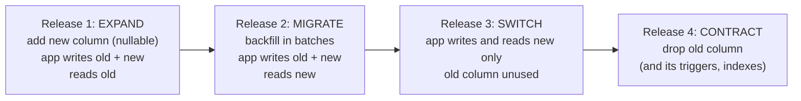
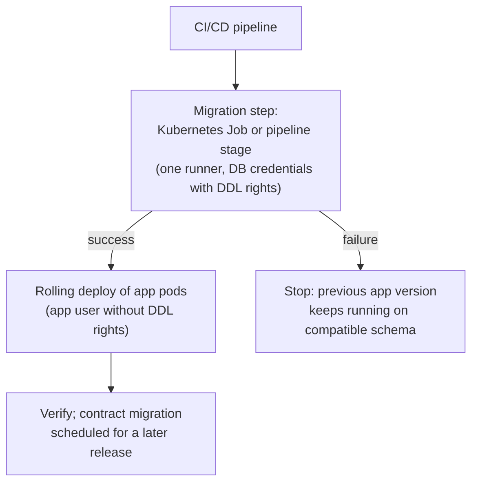

# Schema Evolution & Zero-Downtime Migrations

!!! abstract "Key takeaways"
    - During a rolling deploy **two app versions share one schema**, so every schema version must work with the current and the previous release. Breaking changes (rename, type change, drop, new `NOT NULL`) become several small **expand → migrate → contract** releases.
    - **DDL takes locks.** In PostgreSQL most `ALTER TABLE` forms need `ACCESS EXCLUSIVE`; queued behind a long transaction, they block every query on the table. Set `lock_timeout`, use `CREATE INDEX CONCURRENTLY`, add constraints `NOT VALID` then `VALIDATE`, and avoid rewrites.
    - **Backfills are production workloads:** batch by key range, commit per batch, throttle on replica lag, make them idempotent and resumable. Never one giant `UPDATE`.
    - **Liquibase or Flyway** version every change; run migrations **once per deploy as a separate step** (a pipeline stage or Kubernetes Job), not from every pod at startup, and plan **roll forward** rather than relying on rollback scripts.
    - Document stores evolve with a **`schemaVersion` field**: readers handle old versions, writers write the new one, and a lazy or background migration converges the data. Moving data between stores uses Stripe's four steps: **dual write, switch reads, switch writes, remove old**.

## Why it matters

Continuous delivery made deploys cheap; the database is what still makes them risky. A migration that rewrites a 200 GB table, or an `ALTER` stuck behind a reporting query, takes a service down as surely as a bad release, and unlike code it often can't be rolled back. Interviewers probe this because it separates people who have run production systems from people who have only written `ddl-auto=update`.

The basic expand/contract sequence and its picture are on the [deployment strategies page](../microservices/11-deployment-strategies-blue-green-canary-feature-flags.md); the PostgreSQL lock queue is demonstrated on the [MVCC and locking page](../postgresql-sql/04-mvcc-locking-and-deadlocks.md); event schema compatibility is on the [schema registry page](../kafka/10-schema-management-avro-protobuf-schema-registry-compatibilit.md). This page is the database playbook that ties them together.

## Core concepts

### The compatibility rule

At any moment during a rolling deploy, the database is read and written by **version N and version N+1** of the app (and for a rollback, N again). So:

- A migration that runs **before** the new code (expand) must not break version N: add things, don't remove or rename them.
- A migration that removes things (contract) runs **after** no running version uses them, usually one release later.
- Data written by N+1 must be readable by N if you might roll back.


*Notice that each release is individually safe to roll back one step, and that the destructive change is last and on its own. A rename that "takes four releases" is the price of never having a broken pod.*

### Which DDL is safe in PostgreSQL

| Change | What happens | Zero-downtime way |
|---|---|---|
| Add nullable column | Catalog-only, brief `ACCESS EXCLUSIVE` | Safe with `lock_timeout` |
| Add column with constant default | Catalog-only since PostgreSQL 11 (non-volatile default stored in metadata) | Safe |
| Add column with volatile default (`clock_timestamp()`), identity or stored generated column | **Full table and index rewrite** | Add nullable, backfill, then set default |
| Set `NOT NULL` | Full scan under `ACCESS EXCLUSIVE` | `ADD CONSTRAINT … CHECK (col IS NOT NULL) NOT VALID` → `VALIDATE` → `SET NOT NULL` (scan skipped, PG 12+) → drop the check |
| Add foreign key | Scans the table | `ADD … NOT VALID`, then `VALIDATE CONSTRAINT` (only `SHARE UPDATE EXCLUSIVE`) |
| Create index | Blocks writes for the whole build | `CREATE INDEX CONCURRENTLY` (not in a transaction; on failure leaves an `INVALID` index to drop and retry) |
| Add unique constraint | Builds index under lock | `CREATE UNIQUE INDEX CONCURRENTLY`, then `ADD CONSTRAINT … UNIQUE USING INDEX` |
| Change column type | Usually a rewrite | New column + backfill + switch (expand/contract) |
| Rename column or table | Instant, but old code breaks | Expand/contract, or a view or generated column under the old name for a transition |
| Drop column | Instant (marks it dropped) | Only after no code reads it; Hibernate entities too |

MySQL 8.0 has a similar split: `ALGORITHM=INSTANT` for adding columns (any position since 8.0.29) and some metadata changes, `ALGORITHM=INPLACE, LOCK=NONE` for many index builds, and tools like **gh-ost** or **pt-online-schema-change** that copy into a shadow table and swap, for everything else.

### Lock safety: every DDL with a timeout

Even a catalog-only `ALTER` needs `ACCESS EXCLUSIVE` for a moment. If a long transaction holds any lock on the table, the `ALTER` waits, and every new query queues behind it. Start every migration with `SET lock_timeout = '3s'` (and a `statement_timeout`), and retry on `55P03` with backoff. The race is animated on the [locking page](../postgresql-sql/04-mvcc-locking-and-deadlocks.md).

### Backfills: batched, throttled, resumable

A single `UPDATE rx_order SET npi = …` over 50 million rows holds row locks for its whole duration, generates one huge burst of WAL (replicas fall behind), bloats the table with dead tuples, and if it fails at 90% it rolls back everything.

{ loading=lazy }
*Same rows, same end state: the batched version keeps locks short, lag flat and progress saved.*

Rules: walk the primary key in ranges (keyset, not `OFFSET`), commit each batch, sleep or check replica lag between batches, make each batch idempotent (`WHERE npi IS NULL`), record the last key so it resumes, and run it as a job, not inside the migration tool's transaction.

### Migration tools: Liquibase and Flyway

| | Liquibase | Flyway |
|---|---|---|
| Change format | Changelog in YAML/XML/JSON/SQL with changesets (`id` + `author`) | Versioned SQL (or Java) files: `V7__add_npi.sql`, repeatable `R__views.sql` |
| History table | `DATABASECHANGELOG` (+ checksums) | `flyway_schema_history` (+ checksums) |
| Concurrency guard | `DATABASECHANGELOGLOCK` row lock | Database lock (PostgreSQL advisory lock) |
| Rollback | Generated for many change types; explicit `rollback` blocks otherwise; `update-sql` previews | `undo` (U-files) only in paid editions; otherwise write a new forward migration |
| Targeting | Contexts, labels, preconditions per changeset | Locations, placeholders, callbacks |
| Spring Boot 3 | Auto-runs `db/changelog/db.changelog-master.yaml` at startup if `liquibase-core` is present | Auto-runs `db/migration` if `flyway-core` (+ `flyway-database-postgresql`) is present |

Both work; Liquibase suits teams that want database-agnostic changesets, preconditions and generated rollback, Flyway teams that prefer plain SQL. Either way: **never edit an applied migration** (the checksum fails, and other environments already ran the old one); add a new one.

**Where migrations run** matters as much as the tool:


*Notice that a failed migration stops the pipeline before any new pod starts. Running migrations inside every pod at startup ties pod readiness to DDL, makes ten pods race for the lock, and needs the app user to hold DDL rights.*

### Document stores: versioned documents

MongoDB doesn't enforce a schema, so the old and new shapes coexist in one collection. The schema versioning pattern makes that explicit:

{ loading=lazy }
*Lazy migration costs nothing up front but never finishes on its own; add a background sweep when you need to delete the old reader code.*

- Every document has `schemaVersion`. Readers dispatch on it (one upcaster per version); writers always write the latest.
- **Lazy (on read/write):** upgrade in memory when loaded, save as the new version on the next write.
- **Eager (background):** a batched job rewrites old documents; when no old versions remain, delete the old reader branch.
- Add or tighten `$jsonSchema` validation with `validationLevel: "moderate"` (applies to inserts and to updates of already-valid documents) during the transition.
- Indexes may need to cover the field in both locations until the migration finishes.

### Moving data between stores or models

For big moves (a new table design, splitting a service's database, MongoDB to PostgreSQL), Stripe's online-migration pattern applies:

1. **Dual write:** keep writing the old store; also write the new one; backfill history.
2. **Switch reads:** read from the new store, compare against the old in shadow first.
3. **Switch writes:** the new store becomes the source of truth.
4. **Remove old:** stop writing the old store, then delete its data.

Prefer **CDC or an outbox** to application-level dual writes when the two stores can't share a transaction ([dual-write problem](../microservices/07-distributed-transactions-saga-outbox-pattern.md)), and see [polyglot persistence](05-polyglot-persistence-in-microservices.md) for keeping derived stores in sync.

## In practice: code & configuration

### Making a column `NOT NULL` on a large table

=== "❌ Common mistake"
    ```yaml
    # One changeset: rename, backfill and NOT NULL together
    - changeSet:
        id: 51-npi
        author: rx-team
        changes:
          - renameColumn: { tableName: pharmacy, oldColumnName: ncpdp_npi, newColumnName: npi }
          - sql: UPDATE pharmacy SET npi = legacy_lookup(id) WHERE npi IS NULL   # one huge txn
          - addNotNullConstraint: { tableName: pharmacy, columnName: npi }        # full scan under ACCESS EXCLUSIVE
    # Old pods still query ncpdp_npi and fail the moment this runs.
    # No lock_timeout: if a report holds a lock, the whole table queues behind this.
    ```

=== "✅ Correct approach"
    ```yaml
    # Release N: expand (old pods unaffected)
    - changeSet:
        id: 51-add-npi
        author: rx-team
        changes:
          - sql: SET lock_timeout = '3s'
          - addColumn: { tableName: pharmacy, columns: [ { column: { name: npi, type: varchar(10) } } ] }
    # Backfill runs as a batched job (below), app writes both columns.
    # Release N+1: enforce without a long lock
    - changeSet:
        id: 52-npi-not-null
        author: rx-team
        runInTransaction: false
        changes:
          - sql: SET lock_timeout = '3s'
          - sql: ALTER TABLE pharmacy ADD CONSTRAINT npi_nn CHECK (npi IS NOT NULL) NOT VALID
          - sql: ALTER TABLE pharmacy VALIDATE CONSTRAINT npi_nn            # SHARE UPDATE EXCLUSIVE
          - sql: ALTER TABLE pharmacy ALTER COLUMN npi SET NOT NULL         # scan skipped (PG 12+)
          - sql: ALTER TABLE pharmacy DROP CONSTRAINT npi_nn
    # Release N+2: app reads/writes only npi. Release N+3: drop ncpdp_npi.
    ```

### A batched, resumable backfill (Spring Boot 3, `JdbcClient`)

```java
@Component
@RequiredArgsConstructor
class NpiBackfill {
    private final JdbcClient jdbc;
    private final ReplicaLag lag;                       // reads pg_stat_replication or a metric

    void run() throws InterruptedException {
        long lastId = jdbc.sql("SELECT coalesce(max(last_id), 0) FROM backfill_progress WHERE job = 'npi'")
                          .query(Long.class).single();  // resume point
        while (true) {
            Long maxId = jdbc.sql("""
                    WITH batch AS (
                      SELECT id FROM pharmacy WHERE id > :last AND npi IS NULL
                      ORDER BY id LIMIT 10000)                         -- keyset, not OFFSET
                    UPDATE pharmacy p SET npi = p.ncpdp_npi
                    FROM batch WHERE p.id = batch.id
                    RETURNING p.id""")
                .param("last", lastId)
                .query(Long.class).list().stream().max(Long::compare).orElse(null);
            if (maxId == null) break;                                   // done
            lastId = maxId;
            jdbc.sql("INSERT INTO backfill_progress(job, last_id) VALUES ('npi', :id) "
                   + "ON CONFLICT (job) DO UPDATE SET last_id = :id").param("id", lastId).update();
            while (lag.seconds() > 5) Thread.sleep(1_000);              // throttle on replica lag
            Thread.sleep(50);                                           // leave room for traffic
        }
    }
}
```
*Each loop iteration is its own transaction (autocommit), so locks last milliseconds and a crash resumes from `backfill_progress`.*

### Running migrations once, not in every pod

```yaml
# application.yaml for the app pods: never run DDL at startup
spring:
  liquibase:
    enabled: false
---
# Kubernetes Job run by the pipeline before the rollout (same image, migration profile)
apiVersion: batch/v1
kind: Job
metadata: { name: rx-service-migrate-1-42-0 }
spec:
  backoffLimit: 0                                   # fail fast; a human looks at it
  template:
    spec:
      restartPolicy: Never
      containers:
        - name: migrate
          image: registry.example.com/rx-service:1.42.0
          args: ["--spring.profiles.active=migrate",          # enables liquibase, exits after
                 "--spring.main.web-application-type=none"]
          envFrom: [ { secretRef: { name: rx-db-ddl-credentials } } ]
```

### Versioned documents in Java

```java
// One reader handles every version; writers always produce the latest
Member read(Document doc) {
    return switch (doc.getInteger("schemaVersion", 1)) {
        case 1 -> upcastV1(doc);              // v1 stored phone as a string field
        case 2 -> mapper.convert(doc, Member.class);
        default -> throw new IllegalStateException("Unknown schemaVersion " + doc.get("schemaVersion"));
    };
}
```

## Real-world usage

- **Stripe** migrated hundreds of millions of subscription objects online with dual writes, offline backfill, shadow-compared reads and a gradual switch, never changing more than a few hundred lines at a time.
- **GitHub** built **gh-ost** because trigger-based tools added load to its busiest MySQL tables; gh-ost reads the binlog instead and can be throttled or paused.
- **Evolutionary database design** (Sadalage and Fowler) is the origin of "every change is a versioned migration in source control" and of transition phases where old and new structures coexist.
- **Regulated domains** (healthcare, banking) add audit: who ran which change when. The migration history table plus the pipeline log is that evidence; manual DDL in production breaks it.

## Trade-offs & production gotchas

| Choice | Pros | Cons | Use when |
|---|---|---|---|
| Migrations at app startup | Simple, always in sync | Pods race for the lock, DDL rights in the app, slow starts, failed migration = crash loop | Small apps, single instance, dev |
| Separate migration Job / pipeline step | One runner, clear failure point, least privilege | One more pipeline stage | Production, multiple replicas |
| Rollback scripts | Fast for simple changes | Lose data written since; untested in practice | Rarely; prefer roll forward |
| Roll forward | Always possible with expand/contract | Needs discipline and small releases | Default |
| Lazy document migration | No big job | Old shapes linger; reader code stays | Low-traffic or rarely-read data |
| Eager background migration | Converges; old code can be deleted | Load on the cluster; must be throttled | When you need to remove old versions |

!!! warning "Gotcha: Hibernate `ddl-auto`"
    `spring.jpa.hibernate.ddl-auto=update` creates and alters tables without review, versioning, `lock_timeout` or rollback, and never drops anything. Use `validate` (or `none`) in every shared environment and let Liquibase or Flyway own the schema.

!!! warning "Gotcha: a stuck Liquibase lock"
    If a pod is killed mid-migration, `DATABASECHANGELOGLOCK` can stay locked and every later run waits forever. Check it before blaming the network, and release it (`liquibase release-locks`) only after confirming nothing is running.

!!! warning "Gotcha: `CREATE INDEX CONCURRENTLY` inside a transaction"
    Migration tools wrap changesets in transactions by default, and `CONCURRENTLY` refuses to run in one. Set `runInTransaction: false` (Liquibase) or use a non-transactional migration (Flyway `executeInTransaction=false`), and check for `INVALID` indexes after a failure.

## How this connects to my experience

- **Where I used it:** At Deloitte (ConvergeHealth Data Asset Explorer) I *"implemented Elasticsearch-powered search capabilities and Liquibase migration strategies"*, alongside *"automated infrastructure provisioning and deployment processes using Terraform"*. On OptumRx Meteor, services ran on MongoDB, and I *"established engineering standards around testing, CI/CD, code quality, and deployment practices"*.
- **Talking points:**
    - Liquibase strategy: changelog structure (master file including per-release files), naming of changesets, contexts per environment, and where migrations ran in the pipeline. *[confirm: YAML/XML/SQL format, startup vs pipeline step, and whether rollback blocks were used]*
    - Expand/contract for a real change: one column or table you added, backfilled and switched. *[confirm: a concrete example]*
    - Elasticsearch mappings can't change a field's type in place: create a new index with the new mapping, reindex, switch an alias. Same expand/contract idea. *[confirm whether aliases were used]*
    - MongoDB on Meteor: how document shape changes were handled (versioned fields, tolerant readers, migration scripts). *[confirm]*
- **Likely follow-up chain:** "How did you run Liquibase migrations?" → "What if two pods start at once?" (lock table; better, a single Job) → "How do you rename a column with zero downtime?" (four releases) → "How do you roll back a migration?" (roll forward; expand/contract keeps the previous version working) → "How would you backfill 50 million rows?" (batched, throttled, resumable).

## Interview questions

### Fundamentals

??? question "Q1. Why can't you just rename a column in one release?"
    **Answer:** During a rolling deploy old and new app versions run together. If the migration renames the column before the new code is everywhere, old pods fail; if after, new pods fail. Expand/contract avoids this: add the new column, write both, backfill, switch reads, stop writing the old one, and drop it in a later release. Each step is compatible with the versions running around it.

    **Interviewer listens for:** two versions at once; multi-release sequence.

    **Common wrong answer:** "Deploy the migration and code together during a quiet period."

??? question "Q2. What is a database migration tool for, and how does it know what has run?"
    **Answer:** It applies versioned, reviewed schema changes in order across every environment, and records each applied change with a checksum in a history table (`DATABASECHANGELOG` for Liquibase, `flyway_schema_history` for Flyway). On each run it applies only what's missing and fails if an applied change was edited. A lock (table or advisory) stops two runners applying the same change.

    **Interviewer listens for:** history table, checksums, ordering, locking.

    **Common wrong answer:** "It compares the entities to the database and fixes differences" (that's `ddl-auto`).

??? question "Q3. Which PostgreSQL schema changes are safe on a large, busy table?"
    **Answer:** Adding a nullable column or one with a constant default (catalog-only since PG 11), `CREATE INDEX CONCURRENTLY`, constraints added `NOT VALID` then validated, and `SET NOT NULL` after a validated check constraint (PG 12+). Unsafe: volatile defaults, type changes (rewrite), plain `CREATE INDEX` (blocks writes), and any DDL without a `lock_timeout`, because even a brief `ACCESS EXCLUSIVE` request queues all traffic behind a long transaction.

    **Interviewer listens for:** rewrite vs catalog-only, `CONCURRENTLY`, `NOT VALID`, `lock_timeout`.

    **Common wrong answer:** "Adding a column always locks the table for a long time."

### Intermediate

??? question "Q4. How do you backfill a new column on 50 million rows?"
    **Answer:** As a separate job, not one `UPDATE`: walk the primary key in batches (keyset), update rows `WHERE new_col IS NULL` so batches are idempotent, commit each, store the last key so it resumes, and throttle on replica lag and database load. Run it after the expand release (app already writing the new column for new rows) and verify with a count before enforcing `NOT NULL`.

    **Interviewer listens for:** batches, idempotency, resumability, throttling on lag.

    **Common wrong answer:** "Run the update in the migration overnight."

??? question "Q5. Where should migrations run in Kubernetes?"
    **Answer:** Once per deploy, before the rollout, as a pipeline step or a Kubernetes Job using the new image and a DDL-capable credential, with app pods running as a user without DDL rights. If it fails, the rollout doesn't start and the old version keeps working. Running from every pod at startup works for small systems but means lock races, slow and failing startups, and broader privileges.

    **Interviewer listens for:** single runner, ordering with rollout, least privilege.

    **Common wrong answer:** "Spring Boot runs them automatically, so that's fine."

??? question "Q6. Liquibase or Flyway?"
    **Answer:** Both version changes with a history table and checksums and integrate with Spring Boot. Liquibase has a changelog format with preconditions, contexts and labels, and generated rollback for many change types; Flyway uses plain versioned SQL files and keeps undo for paid editions. I'd pick by team preference for SQL vs abstracted changesets; the practices (small changes, no edits to applied ones, expand/contract, roll forward) matter more than the tool.

    **Interviewer listens for:** real differences, and that process matters more.

    **Common wrong answer:** A feature war without mentioning practices.

### Senior

??? question "Q7. How do you roll back a release that included a migration?"
    **Answer:** Design so you don't need to roll back the schema: with expand/contract, the previous app version works on the new schema, so you roll back only the code. Destructive steps happen a release later, after the new version has proven itself. Rollback scripts are a last resort: they lose data written since the migration and are rarely tested. When something is wrong with the schema itself, roll forward with a corrective migration.

    **Interviewer listens for:** roll back code, roll forward schema; why down-migrations are risky.

    **Common wrong answer:** "Run the Liquibase rollback."

??? question "Q8. How do you evolve documents in MongoDB without a migration window?"
    **Answer:** Add a `schemaVersion` field; readers handle every version (upcasters), writers write only the latest. Migrate lazily (upgrade on the next write) and, when the old reader code needs to go, run a throttled background job to rewrite remaining old documents. Tighten `$jsonSchema` validation with `validationLevel: moderate` during the transition, and index both field locations if queries need them until it completes.

    **Interviewer listens for:** versioned documents, tolerant readers, lazy + eager, validation level.

    **Common wrong answer:** "MongoDB is schemaless, so nothing to do."

### Scenario-based

??? question "Q9. A migration added an index and the API went down for four minutes. What happened, and what do you change?"
    **Answer:** Most likely a plain `CREATE INDEX`, which blocks writes for the whole build, or an `ALTER` that queued behind a long transaction with no `lock_timeout`, so every query queued behind it. Fix: `CREATE INDEX CONCURRENTLY` (outside a transaction, then check for `INVALID` indexes), `lock_timeout` and `statement_timeout` on every DDL with retries, a CI check that flags unsafe DDL (e.g. a migration linter), and migrations run in a monitored step where they can be stopped.

    **Interviewer listens for:** both causes, concrete prevention, tooling.

    **Common wrong answer:** "Run migrations at night."

??? question "Q10. You need to move a service's orders from MongoDB to PostgreSQL with no downtime. Plan it."
    **Answer:** Design the relational model from the access patterns. Phase 1: write to MongoDB as the source of truth and feed PostgreSQL via an outbox or change streams (avoid unprotected dual writes); backfill history in batches; reconcile counts and checksums. Phase 2: shadow-read from PostgreSQL and compare results, then switch reads behind a flag, gradually. Phase 3: switch writes so PostgreSQL is the source of truth, optionally feeding MongoDB back for rollback. Phase 4: stop the reverse feed and decommission. Each phase is reversible until the last.

    **Interviewer listens for:** Stripe's four steps, CDC over dual writes, shadow comparison, reversibility.

    **Common wrong answer:** "Export, import over a weekend, switch the connection string."

## Cheat sheet

| Concept | Remember |
|---|---|
| Compatibility | Schema must work with app N and N+1 |
| Expand/contract | Add → write both + backfill → read new → write new only → drop (later) |
| Safe PG DDL | Nullable / constant-default column, `CONCURRENTLY`, `NOT VALID` + `VALIDATE`, `SET NOT NULL` via check |
| Always | `SET lock_timeout`, retry on `55P03` |
| Backfill | Keyset batches, idempotent, resumable, throttled on replica lag |
| Tools | Liquibase (changesets, lock table, generated rollback) · Flyway (SQL files, undo is paid) |
| Where | One Job/pipeline step before rollout; app user without DDL |
| Rollback | Roll back code, roll forward schema |
| Documents | `schemaVersion`, upcasters, lazy + background sweep |
| Store moves | Dual write → switch reads → switch writes → remove old |

## Sources
1. [PostgreSQL: ALTER TABLE](https://www.postgresql.org/docs/current/sql-altertable.html): lock levels, non-volatile defaults without rewrite, `NOT VALID`/`VALIDATE`, `SET NOT NULL` with a valid check.
2. [PostgreSQL: CREATE INDEX](https://www.postgresql.org/docs/current/sql-createindex.html): `CONCURRENTLY`, no transaction block, invalid indexes on failure.
3. [MySQL 8.4: Online DDL operations](https://dev.mysql.com/doc/refman/8.4/en/innodb-online-ddl-operations.html): `INSTANT`, `INPLACE` and locking.
4. [Stripe: Online migrations at scale](https://stripe.com/blog/online-migrations): dual write, switch reads, switch writes, remove old.
5. [Martin Fowler and Pramod Sadalage: Evolutionary Database Design](https://martinfowler.com/articles/evodb.html): every change a migration, transition phases.
6. [Martin Fowler: Parallel Change](https://martinfowler.com/bliki/ParallelChange.html): expand, migrate, contract.
7. [Liquibase documentation](https://docs.liquibase.com/): changesets, `DATABASECHANGELOGLOCK`, rollback, `runInTransaction`.
8. [Flyway documentation (Redgate)](https://documentation.red-gate.com/flyway): versioned migrations, schema history, undo in paid editions.
9. [Spring Boot: Database initialization and migrations](https://docs.spring.io/spring-boot/how-to/data-initialization.html): Flyway and Liquibase auto-configuration.
10. [MongoDB: Schema versioning pattern](https://www.mongodb.com/docs/manual/data-modeling/design-patterns/data-versioning/schema-versioning/): versioned documents and index caveats.
11. [GitHub: gh-ost, triggerless online schema migration for MySQL](https://github.com/github/gh-ost): binlog-based online schema change.
