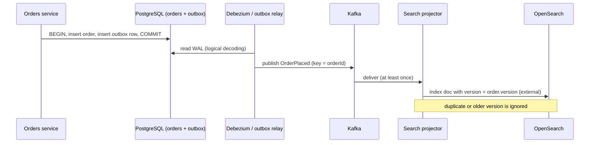

# Polyglot Persistence in Microservices

!!! abstract "Key takeaways"
    - **Polyglot persistence** (Fowler, 2011) means choosing each store by how its data is used. In microservices it pairs with **database per service**: a service's data is private and reachable only through its API or events.
    - Every fact has **one source of truth and one writer**. Search indexes, caches, read models and warehouses are **derived** stores: rebuildable, eventually consistent, never written to directly by other services.
    - Keep derived stores in sync with a **transactional outbox or CDC** (e.g. Debezium) and **idempotent, version-aware consumers**, never with dual writes from application code.
    - Cross-service queries use **API composition** (a gateway or GraphQL layer) for small, fresh reads and **CQRS read models** built from events for joins, search and lists.
    - Each extra store has a fixed cost: backups, restore drills, security review, encryption, monitoring, upgrades and skills. Add one only when a measured need justifies it; a **paved-road list** of approved stores keeps the estate manageable.

## Why it matters

Microservices promised independent deployability, and shared databases quietly break it: one team's column rename breaks another team's report, and a slow query from one service starves the others. Database per service fixes that, and once each service owns its data it can choose the store that fits. Then the hard questions start: how does search stay in sync with the orders table, how does a screen show data owned by five services, and who restores the Elasticsearch cluster at 3 a.m.?

Interviewers ask about polyglot persistence to see whether you can **draw the data flow, name the source of truth for each fact and explain the consistency the user experiences**, not just list technologies. The mechanics live on other pages: [saga and outbox](../microservices/07-distributed-transactions-saga-outbox-pattern.md), [CQRS and event sourcing](../microservices/08-cqrs-and-event-sourcing.md), [data ownership and service boundaries](../ddd-clean-architecture/04-using-ddd-to-define-microservice-boundaries.md), [Kafka Connect and CDC](../kafka/11-kafka-streams-and-kafka-connect.md) and [caching patterns](../redis-caching/02-caching-patterns-cache-aside-read-write-through-write-behind.md). Choosing a store is [page 1](01-sql-vs-nosql-choosing-the-right-database.md).

## Core concepts

### Database per service

| Option | Isolation | Overhead | Notes |
|---|---|---|---|
| Private tables per service in a shared database | Low (convention) | Lowest | Enforce with a database user per service and grants |
| Schema per service | Medium | Low | Clear ownership; still one server's capacity and failure domain |
| Database server per service | High | Highest | Independent scaling, versions, engines: the precondition for polyglot |

The rule that matters more than the deployment option: **no other service reads or writes your tables.** Data leaves a service through its API or through events it publishes. The cost: no cross-service joins or ACID transactions; sagas, API composition and read models replace them.

### One source of truth per fact, many derived copies

{ loading=lazy }
*Solid boxes are sources of truth with one writer each; dashed boxes are derived and can be dropped and rebuilt from events or the source.*

Classify every store in the design:

| Role | Examples | Written by | If lost |
|---|---|---|---|
| **System of record** | Orders in PostgreSQL, member profiles in MongoDB, files in S3 | Only the owning service | Restore from backup; RPO matters |
| **Derived index** | OpenSearch for search, a GSI-like lookup table | A projector consuming events/CDC | Rebuild by replaying |
| **Cache** | Redis for reference data and hot queries | Cache-aside on read, or invalidation on events | Cold start, higher latency |
| **Read model** | Order-history view joining orders, shipments, claims | A projector | Rebuild by replaying |
| **Log / event store** | Kafka topics (with retention or compaction) | Services publishing events | Depends on retention; usually not the only copy |
| **Analytics** | Warehouse or lakehouse | CDC or batch pipelines | Reload |

If a derived store starts accepting writes that exist nowhere else, it has silently become a system of record, with none of the backups and controls one needs.

### Keeping derived stores in sync


*Notice that the service writes to one database in one transaction. Everything after the commit is asynchronous and retried, so the consumer must be idempotent and must not let an older event overwrite a newer document.*

The options, from worst to best for a source → derived pair:

| Approach | How | Problem |
|---|---|---|
| Dual write from the service | Save to PostgreSQL, then call OpenSearch | Crash between the two, or a failed second write, leaves them inconsistent forever; concurrent requests can apply in different orders |
| Transactional outbox | Insert an event row in the same transaction; a relay publishes it | Needs a relay and cleanup; at-least-once delivery |
| CDC from the log | Debezium reads the WAL/oplog/binlog and publishes changes | Exposes table structure unless you use the outbox event router |
| Event-sourced | Events are the source of truth; all views are projections | Biggest model change; replay and versioning discipline |

Consumers must be **idempotent** and **ordered per key** (partition by entity ID in Kafka), and carry a **version** so a late, older event can't overwrite newer state. Elasticsearch/OpenSearch support this directly with external versioning; Redis can use a Lua compare-and-set; SQL read models use `WHERE version < :new`.

{ loading=lazy }
*The derived store is behind for a moment by design; the user only notices if the screen they land on reads from it.*

### Querying across services

| Need | Pattern | Consistency | Watch out for |
|---|---|---|---|
| Show one order with member name and shipment status | **API composition** (gateway, BFF or GraphQL resolvers call each service) | Fresh | Latency is the slowest call; partial failures; N+1 calls |
| List or search across services ("my orders with claim status") | **CQRS read model** fed by events | Eventual (seconds) | Rebuild path, lag monitoring |
| Reporting and analytics | CDC to a warehouse | Minutes to hours | Schema drift, PII handling |
| A service needs another's reference data often | **Event-carried state transfer**: keep a local copy of the fields it needs | Eventual | Copy only what you need; it's still the other service's data |

A GraphQL layer is API composition with a schema: resolvers fan out to the owning services, DataLoader batches calls, and caches absorb repeated reads. It answers "fresh view of a few entities" well and "search across millions of rows" badly, which is the read model's job.

### The cost side

Every store type added to an estate needs: backup and **tested restore**, encryption at rest and in transit with key management, access control and audit, patching and version upgrades, monitoring and alerting, capacity planning, local development and test containers, and people who can debug it under pressure. Managed services (RDS/Aurora, Atlas, DynamoDB, ElastiCache, OpenSearch Service) remove some of this, not all.

Ways teams keep it manageable:

- **A paved road:** a short list of approved stores with templates, Terraform modules, dashboards and runbooks; anything else needs an ADR.
- **Prefer a capability in an existing store** before a new store: PostgreSQL `jsonb` before MongoDB, PostgreSQL full-text before OpenSearch for small catalogues, Redis streams before another broker for a small queue.
- **Derived stores must be rebuildable** with a documented, tested replay or reindex procedure.

## In practice: code & configuration

### Indexing orders for search

=== "❌ Common mistake"
    ```java
    @Transactional
    public Order place(PlaceOrder cmd) {
        Order order = orders.save(Order.from(cmd));          // PostgreSQL
        searchClient.index(i -> i.index("orders")            // OpenSearch, inside the DB transaction
                .id(order.id().toString()).document(OrderDoc.from(order)));
        redis.delete("member:" + cmd.memberId() + ":orders"); // cache
        return order;
    }
    // If the commit fails after indexing, search shows an order that doesn't exist.
    // If OpenSearch is down, placing orders fails: search availability now limits writes.
    // Two concurrent updates can reach OpenSearch in the opposite order to the DB commits.
    ```

=== "✅ Correct approach"
    ```java
    @Transactional
    public Order place(PlaceOrder cmd) {
        Order order = orders.save(Order.from(cmd));                    // version = 1
        outbox.save(OutboxEvent.of("Order", order.id(), "OrderPlaced",  // same transaction
                                   OrderPlaced.from(order)));
        return order;                                                   // UI shows this state
    }

    // Separate projector: at-least-once, keyed by orderId, version-aware
    @KafkaListener(topics = "orders.events", groupId = "order-search-projector")
    void on(OrderEvent e) throws IOException {
        try {
            search.index(i -> i.index("orders").id(e.orderId().toString())
                    .version(e.orderVersion()).versionType(VersionType.External)  // older versions rejected
                    .document(OrderDoc.from(e)));
        } catch (OpenSearchException ex) {
            if (ex.status() != 409) throw ex;       // 409 = stale or duplicate event: safe to skip
        }
        redis.delete("member:" + e.memberId() + ":orders");                 // invalidate derived cache
    }
    ```

### API composition with GraphQL (Spring for GraphQL)

```java
@Controller
class OrderGraph {
    // Order comes from the Orders service; member and claim fields are resolved from their owners
    @QueryMapping
    Order order(@Argument UUID id) { return ordersClient.get(id); }

    // Batched: one call to Members for all orders on the page, not one per order (avoids N+1)
    @BatchMapping
    Map<Order, MemberSummary> member(List<Order> orders) {
        var byId = membersClient.summaries(orders.stream().map(Order::memberId).collect(toSet()));
        return orders.stream().collect(toMap(o -> o, o -> byId.get(o.memberId())));
    }

    @SchemaMapping
    ClaimStatus claimStatus(Order order) {
        return claimsClient.statusFor(order.id());   // fresh read; degrade to null on timeout
    }
}
```

## Real-world usage

- **Fowler's original examples** (2011) separated session data in a key-value store, transactional orders in a relational database, product catalogue in a document store, recommendations in a graph store and reporting in an RDBMS: a sketch he notes is illustrative, not prescriptive.
- **Netflix** runs Cassandra as a primary store for many services with **EVCache** (Memcached-based) in front, and Elasticsearch for search and operational insights, with data moving between them through its data pipelines. That's polyglot with a strong platform team behind it.
- **Debezium's outbox event router** turns an `outbox` table into Kafka events with the aggregate ID as key, so per-entity order is preserved without application-level dual writes.
- **Healthcare and banking** keep the regulated system of record in a relational store with audited access and treat search, caches and analytics as derived copies, which also limits where PHI or card data lands and simplifies audits.

## Trade-offs & production gotchas

| Choice | Pros | Cons | Use when |
|---|---|---|---|
| One shared relational database | Joins, ACID, one thing to run | Coupling, contention, lockstep schema changes | Monolith or modular monolith |
| Database per service, same engine | Ownership, simple ops | No cross-service joins | Default for microservices |
| Polyglot per service | Best fit per workload | Ops and skills cost per store; harder consistency | A measured need (search, scale, latency) |
| API composition | Fresh, simple | Latency and failure fan-out | A few entities per request |
| CQRS read model | Fast joins and search | Eventual, rebuild machinery | Lists, search, dashboards across services |
| Outbox | Atomic with the business write | Relay, cleanup | Service owns a relational DB |
| CDC | No app changes | Leaks table structure unless outbox-routed | Legacy systems, analytics feeds |

!!! warning "Gotcha: no rebuild path"
    A search index or read model that can't be rebuilt from the source becomes a second system of record by accident. Keep the replay or full-reindex job tested; Kafka retention alone often isn't enough (old events expire), so the rebuild usually reads from the source database.

!!! warning "Gotcha: invisible lag"
    Eventual consistency is acceptable only if someone watches it. Export consumer lag and "event time to indexed time" as metrics with alerts, and run a reconciliation job that compares counts or checksums between source and derived stores.

!!! tip "Interview framing"
    For every store you draw, say three things: **source of truth or derived, who writes it, and how it's rebuilt.** It's the fastest way to show the design is operable.

## How this connects to my experience

- **Where I used it:** On OptumRx Meteor I *"designed and developed microservices using Java, Spring Boot, Kafka, MongoDB, Redis, and GraphQL"*, *"implemented Redis-based caching for frequently accessed queries and UI reference data"*, *"designed Kafka-based event-driven workflows with retry and DLQ handling"* and *"owned the GraphQL Consumer Service end-to-end, acting as the integration layer between 5 upstream systems and multiple downstream consumers"*. At Deloitte (ConvergeHealth) the platform used *"RDS, DynamoDB, SQS, SNS, and S3"* with *"Elasticsearch-powered search capabilities"*.
- **Talking points:**
    - The GraphQL Consumer Service is API composition over systems I didn't own: batching, caching in Redis, timeouts and partial results when one upstream was slow. *[confirm: how partial failures were represented to clients]*
    - Redis held derived data (query results, reference data) with TTLs; the upstream systems stayed the source of truth, so losing Redis cost latency, not correctness. *[confirm: invalidation approach, TTL vs event-driven]*
    - Kafka with retry and DLQ is the delivery mechanism for keeping consumers in sync; idempotent handling made redelivery safe. *[confirm: whether any consumer maintained a read model or MongoDB projection]*
    - ConvergeHealth: relational metadata on RDS, key lookups in DynamoDB, discovery search in Elasticsearch, files in S3: a polyglot estate, and the question is how Elasticsearch was kept in sync with the source. *[confirm: indexing path, e.g. event-driven via SQS/SNS or batch]*
- **Likely follow-up chain:** "Why so many stores?" (each need, source vs derived) → "How did search stay consistent with the database?" (outbox/CDC or events, versioned idempotent indexing; be honest about what was actually built) → "What did the user see during lag?" → "How would you rebuild the index?" → "What would you simplify now?"

## Interview questions

### Fundamentals

??? question "Q1. What is polyglot persistence?"
    **Answer:** Using different data storage technologies for different needs within one system, chosen by how each dataset is used: for example relational for orders, a search engine for full-text, Redis for sessions and caches. In microservices it usually follows database per service, so each service can pick its own store. It trades better fit for more operational and consistency complexity.

    **Interviewer listens for:** chosen by usage; the complexity cost.

    **Common wrong answer:** "Using NoSQL instead of SQL."

??? question "Q2. Why database per service, and what does it cost?"
    **Answer:** It keeps services loosely coupled: a schema change or slow query in one service can't break another, each team owns its data, and each can choose a store. The costs are no cross-service joins or ACID transactions (sagas, API composition and read models instead), duplicated data, and more databases to run. Enforce it with separate credentials and grants, not just convention.

    **Interviewer listens for:** coupling as the reason; the replacement patterns.

    **Common wrong answer:** "Each service must have its own database server."

??? question "Q3. What's the difference between a system of record and a derived store?"
    **Answer:** The system of record holds the authoritative copy of a fact, written by one owner, backed up and restored with an RPO. A derived store (search index, cache, read model, warehouse) is computed from it, can lag, and can be rebuilt by replaying events or reloading from the source. Other services never write to derived stores directly.

    **Interviewer listens for:** one writer; rebuildability.

    **Common wrong answer:** Treating the cache or index as another place to write data.

### Intermediate

??? question "Q4. How do you keep Elasticsearch in sync with PostgreSQL?"
    **Answer:** Write the change and an outbox event in one PostgreSQL transaction (or use CDC such as Debezium on the WAL); publish to Kafka keyed by entity ID; a projector indexes into Elasticsearch idempotently, using the entity's version with external versioning so older events can't overwrite newer documents. Monitor lag, reconcile periodically, and keep a full reindex job (new index + alias switch) for rebuilds and mapping changes.

    **Interviewer listens for:** no dual write, per-key ordering, versioned idempotent indexing, rebuild path.

    **Common wrong answer:** "Save to both in the same method."

??? question "Q5. API composition or a CQRS read model: how do you choose?"
    **Answer:** API composition for small, fresh views of a few entities (one order with its member and shipment): simple, but latency and failures fan out. A read model for lists, search, filtering and joins across many entities: fast and independent of the source services' availability, but eventually consistent and needing a rebuild path. Many systems use both: composition for detail pages, read models for lists.

    **Interviewer listens for:** freshness vs scale; failure fan-out; both together.

    **Common wrong answer:** "Always use GraphQL to join across services."

??? question "Q6. What problems does eventual consistency between stores cause for users, and how do you hide them?"
    **Answer:** A user saves something and doesn't see it in a list or search for a few seconds, or sees two screens disagree. Hide it by returning the written state from the write and showing it optimistically, reading from the owning service for "my own data" screens, routing just-written reads to the source for a short window, and showing "updating" states. Measure the lag and alert on it.

    **Interviewer listens for:** read-your-writes techniques; measuring lag.

    **Common wrong answer:** "Make everything synchronous."

### Senior

??? question "Q7. How do you stop polyglot persistence becoming an operational mess?"
    **Answer:** A paved road: a short list of supported stores with Terraform modules, backup and restore runbooks, dashboards, security baselines and local test containers; new stores need an ADR showing a measured need and an owner. Prefer a capability in an existing store first (`jsonb`, PostgreSQL full-text, Redis streams). Use managed services, and require every derived store to have a tested rebuild procedure.

    **Interviewer listens for:** platform thinking, ADRs, "capability before new store".

    **Common wrong answer:** "Let each team choose whatever they want."

??? question "Q8. A downstream service needs the member's name and plan on every request. Call the Members service or keep a copy?"
    **Answer:** If it's on every request and Members' availability shouldn't limit this service, keep a local copy of just those fields via event-carried state transfer (MemberUpdated events), accepting seconds of staleness and documenting that Members owns the data. If freshness is critical or the data is sensitive, call Members with a cache (short TTL) and a timeout and fallback. Decide on freshness needs, coupling and data sensitivity (PHI copies widen the audit scope).

    **Interviewer listens for:** availability coupling vs staleness; minimal copies; sensitivity.

    **Common wrong answer:** "Read the Members database directly."

### Scenario-based

??? question "Q9. Search results sometimes show orders as 'PLACED' after they've shipped. Diagnose."
    **Answer:** Likely an older event overwriting a newer one: events for the same order processed out of order (different partition keys, parallel consumers, or retries from a retry topic arriving late), and an indexer that overwrites unconditionally. Check the Kafka key (must be orderId), retry-topic handling, and whether indexing uses the entity version. Fix with per-key ordering, external versioning in the index, and a reconciliation job to repair existing drift.

    **Interviewer listens for:** ordering per key, retry topics break order, version checks, repair.

    **Common wrong answer:** "Elasticsearch is eventually consistent, refresh more often."

??? question "Q10. Design the data layer for a pharmacy app: orders, member profiles, drug search, order history, and analytics."
    **Answer:** Orders and claims in PostgreSQL (invariants, reporting) owned by their services; member profiles in PostgreSQL `jsonb` or MongoDB if they're read whole and vary in shape; drug search in OpenSearch fed from the catalogue via outbox/CDC; order history as a read model built from order, shipment and claim events; Redis for sessions and reference-data caching; S3 for documents; CDC to a warehouse for analytics. For each: source or derived, who writes, how it's rebuilt, and the lag the user sees. Then state the ops cost and which stores you'd drop for a smaller team.

    **Interviewer listens for:** classification of every store, sync mechanism, honest cost.

    **Common wrong answer:** Listing technologies without data flow.

## Cheat sheet

| Concept | Remember |
|---|---|
| Polyglot persistence | Store chosen by data usage (Fowler, 2011) |
| Database per service | Private data; access via API or events; enforce with grants |
| Source vs derived | One writer per fact; derived stores are rebuildable |
| Sync | Outbox or CDC → Kafka (key = entity ID) → idempotent, version-aware consumer |
| Never | Dual writes from application code |
| Cross-service reads | API composition (fresh, few) · read model (lists, search) · local copy (hot reference data) |
| User-visible lag | Return written state; read own data from the source; measure lag |
| Cost | Backup/restore, security, upgrades, monitoring, skills per store |
| Guardrail | Paved road + ADR for new stores; capability in existing store first |
| Every store drawn | Source or derived? Who writes? How rebuilt? |

## Sources
1. [Martin Fowler: Polyglot Persistence](https://martinfowler.com/bliki/PolyglotPersistence.html): the term, examples and costs.
2. [microservices.io: Database per service](https://microservices.io/patterns/data/database-per-service.html): options, benefits, drawbacks, related patterns.
3. [microservices.io: Transactional outbox](https://microservices.io/patterns/data/transactional-outbox.html) and [CQRS](https://microservices.io/patterns/data/cqrs.html): sync and query patterns.
4. [Debezium: Outbox event router](https://debezium.io/documentation/reference/stable/transformations/outbox-event-router.html): outbox table to Kafka events keyed by aggregate.
5. [Elasticsearch: Index API, versioning (`version_type=external`)](https://www.elastic.co/guide/en/elasticsearch/reference/current/docs-index_.html): rejecting older versions.
6. [Martin Fowler: What do you mean by "Event-Driven"?](https://martinfowler.com/articles/201701-event-driven.html): event-carried state transfer.
7. [AWS Prescriptive Guidance: Enabling data persistence in microservices](https://docs.aws.amazon.com/prescriptive-guidance/latest/modernization-data-persistence/welcome.html): database per service, API composition, CQRS, sagas on AWS.
8. [Netflix Technology Blog: Announcing EVCache](https://netflixtechblog.com/announcing-evcache-distributed-in-memory-datastore-for-cloud-c26a698c27f7): caching tier in front of Cassandra.
9. [Spring for GraphQL: Batch mapping](https://docs.spring.io/spring-graphql/reference/controllers.html#controllers.batch-mapping): batching resolvers to avoid N+1.
10. Sam Newman, *Building Microservices* (2nd ed.), chapters on data decomposition and data ownership.
