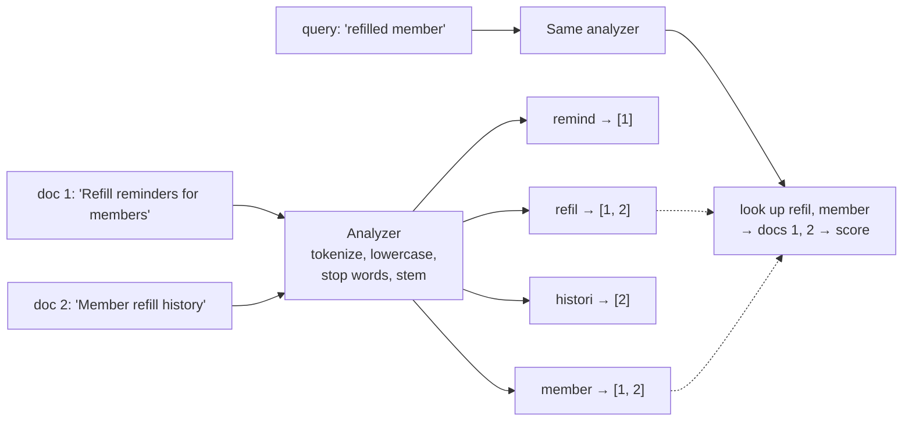
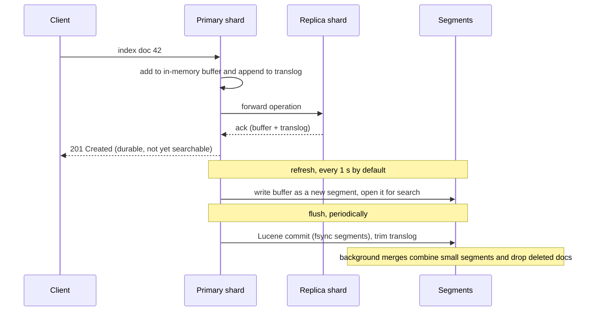

# Elasticsearch: Inverted Index, Analyzers, Relevance, Sharding

!!! abstract "Key takeaways"
    - An **inverted index** maps each **term** to the documents (and positions) containing it, so a query costs the matching postings, not the corpus.
    - **Analysis decides what a term is**: char filters → one tokenizer → token filters. Index and query must be analysed compatibly. `text` is analysed; `keyword` is one exact term for filters, sorts and aggregations.
    - Shards are Lucene indexes of **immutable segments**. A **refresh** (1 s default) makes writes searchable: **near real-time**. The translog makes acknowledged writes durable.
    - **Relevance** is BM25 (`k1 = 1.2`, `b = 0.75`): rare terms count more, repetition saturates, long fields are penalised. Yes/no conditions go in **filter context**: unscored and cached.
    - The **primary shard count is fixed** (`hash(_routing) % shards`): split, shrink or reindex behind an **alias**. Search is query-then-fetch across every shard. Aim for **10–50 GB, < 200M docs per shard**.

## Why it matters

A B-tree can't answer "datasets about *heart attack readmissions*, best first" when the text says "myocardial infarction". That needs tokenising, normalising, matching any word and ranking, across millions of documents in milliseconds. Elasticsearch (and its fork OpenSearch, behind Amazon OpenSearch Service) does this on top of Apache Lucene.

Interviewers probe *why* search behaves as it does: why a just-indexed document isn't found, why "Running" doesn't match "run", why you can't just add shards. Where Elasticsearch fits next to a system of record, and how to keep it in sync, is on the [polyglot persistence page](../data-modelling/05-polyglot-persistence-in-microservices.md); local vs global indexes across stores are compared on the [indexing trade-offs page](../data-modelling/03-replication-partitioning-and-indexing-trade-offs.md). This page goes inside the engine.

## Core concepts

### The inverted index

An inverted index splits each field into **terms** and maps every term to a **postings list**: the sorted IDs of documents containing it, with term frequencies and positions (for phrase queries). A query for `refill reminder` looks up both terms and intersects or unions two sorted lists; it never reads documents containing neither word. Other per-field structures sit beside it:

| Structure | Layout | Used for |
|---|---|---|
| Inverted index | term → doc IDs | `match`, `term`, `prefix` queries |
| **Doc values** | doc ID → value, columnar on disk | Sorting, aggregations, scripts (on `keyword`, numbers, dates) |
| `_source` | the original JSON | Returning the document, reindexing |

So you aggregate on `keyword` and search on `text`; enabling `fielddata` on `text` loads it into heap, a classic out-of-memory cause.


*Notice that the documents and the query pass through the same analyzer: "Refilled" and "Refill" both become the stem `refil`, so they meet in the index. Change one side's analyzer and they stop meeting.*

{ loading=lazy }
*Watch each token change as it passes a filter: the index only ever sees the output on the right.*

### Analyzers: what a term is

An analyzer is **character filters** (strip HTML) → exactly one **tokenizer** (`standard` splits on word boundaries) → **token filters** (`lowercase`, `asciifolding`, `stop`, `stemmer`, `synonym_graph`, `edge_ngram`). The `_analyze` API shows what a string becomes; use it whenever a match surprises you. Design decisions:

- **`text` vs `keyword`.** `text` is analysed for full-text search; `keyword` is one exact term for filters, sorting, aggregations and IDs. Use **multi-fields** for both (`title` and `title.raw`), and a **normalizer** to lowercase a `keyword`.
- **Synonyms at search time** with `synonym_graph`: the list changes without reindexing and multi-word synonyms keep their positions.
- **Autocomplete:** `edge_ngram` at index time only (`ca`, `car`, `card`…), so a prefix is a term lookup.
- **Codes and IDs** (ICD-10, NDC, member IDs) are `keyword`, never stemmed.

Dynamic mapping turns every new string into `text` plus `.keyword`: double indexing and mapping explosion past the 1,000-field default. Production indices use explicit mappings, often `"dynamic": "strict"`.

### Segments, refresh and durability

A shard is a Lucene index made of **immutable segments**, which explains the write path:


*Notice the gap between "acknowledged" and "searchable": the write is safe once it's in the translog on the primary and replicas, but search only sees it after the next refresh. That gap is near real-time.*

Consequences: **updates are delete + reindex** (merges reclaim space later); `refresh=wait_for` gives read-your-write for one flow, while `refresh=true` on every write makes tiny segments; bulk loads set `refresh_interval: -1` and use `_bulk`; **GET by ID is real-time**, search is not.

### Relevance: BM25, query vs filter context

Elasticsearch scores with **BM25** by default. For each query term *t* in document *d*:

```text
score(t, d) = IDF(t) × tf × (k1 + 1) / (tf + k1 × (1 − b + b × |d| / avgdl))
IDF(t)      = ln(1 + (N − n + 0.5) / (n + 0.5))      N = docs in shard, n = docs containing t
```

Three ideas: **rare terms matter more** (IDF); **repetition saturates** (`k1 = 1.2`), so stuffing doesn't win as in TF-IDF; **short fields win** (`b = 0.75`), so a title match beats the same match in a long description. Scores sum over clauses, times **boosts** (`title^3`); `function_score` blends in recency or popularity; `explain` shows the arithmetic.

**Query vs filter context** matters most in practice. In a `bool` query, `must`/`should` clauses **score**; `filter`/`must_not` only include or exclude, **don't score** and are **cached**. Domain, date range and access level are filters; the free-text box is the only `must`.

IDF is **per shard**, so in small or skewed indices identical documents can score differently; `dfs_query_then_fetch` gathers global statistics first, at the cost of a round trip.

### Sharding, routing and distributed search

An index has **primary shards**, each with **replicas** on other nodes (default since 7.0: 1 primary, 1 replica). A document goes to:

```text
shard = hash(_routing) % number_of_primary_shards      // _routing defaults to _id
```

So the primary count **can't change in place**: `_split` multiplies it, `_shrink` divides it, otherwise `_reindex`. Replicas can change any time; they add availability and read throughput, not write throughput.

A search is scatter-gather in two phases. **Query:** the coordinator asks one copy of **every** shard for the IDs and scores of its top `from + size` hits. **Fetch:** it merges them, picks the global top `size` and fetches only those documents.

{ loading=lazy }
*Each shard must return `from + size` candidates, which is why page 500 costs far more than page 1.*

Hence: **deep pagination is expensive** (`max_result_window` defaults to 10,000; use `search_after` with a point-in-time, as on the [pagination page](../api-design/03-pagination-filtering-and-sorting.md)); **custom routing** by tenant makes tenant searches hit one shard but risks hot shards; and **shard size** should be **10–50 GB and under 200M documents**. Many tiny shards waste heap and widen every fan-out; huge ones recover slowly. Time-based data uses data streams with ILM rollover.

## In practice: code & configuration

### Mapping and analysis for a dataset catalogue (illustrative)

```json
PUT datasets-v2
{
  "settings": {
    "number_of_shards": 3,
    "number_of_replicas": 1,
    "analysis": {
      "filter": {
        "en_stop":  { "type": "stop", "stopwords": "_english_" },
        "en_stem":  { "type": "stemmer", "language": "english" },
        "clinical_syn": { "type": "synonym_graph",
                          "synonyms": ["heart attack, myocardial infarction, mi"] },
        "prefix_ng": { "type": "edge_ngram", "min_gram": 2, "max_gram": 15 }
      },
      "analyzer": {
        "text_en":        { "tokenizer": "standard", "filter": ["lowercase", "asciifolding", "en_stop", "en_stem"] },
        "text_en_search": { "tokenizer": "standard", "filter": ["lowercase", "asciifolding", "clinical_syn", "en_stop", "en_stem"] },
        "prefix_idx":     { "tokenizer": "standard", "filter": ["lowercase", "prefix_ng"] }
      },
      "normalizer": { "lc": { "type": "custom", "filter": ["lowercase", "asciifolding"] } }
    }
  },
  "mappings": {
    "dynamic": "strict",
    "properties": {
      "title": { "type": "text", "analyzer": "text_en", "search_analyzer": "text_en_search",
                 "fields": { "raw":    { "type": "keyword", "normalizer": "lc" },
                             "prefix": { "type": "text", "analyzer": "prefix_idx", "search_analyzer": "standard" } } },
      "description": { "type": "text", "analyzer": "text_en", "search_analyzer": "text_en_search" },
      "domain":      { "type": "keyword" },
      "sensitivity": { "type": "keyword" },
      "icdCodes":    { "type": "keyword" },
      "rowCount":    { "type": "long" },
      "updatedAt":   { "type": "date" }
    }
  }
}
```

Synonyms sit only in the search analyzer, so the list can change without reindexing; codes are `keyword`, never stemmed.

### Query: free text scores, everything else filters

=== "❌ Common mistake"
    ```json
    GET datasets/_search
    {
      "query": { "bool": { "must": [
        { "wildcard": { "title.keyword": "*heart*" } },
        { "match": { "domain": "cardiology" } },
        { "range": { "updatedAt": { "gte": "now-2y" } } }
      ] } },
      "from": 9980, "size": 20
    }
    ```
    The leading wildcard scans every term and skips analysis. Domain and date are scored, distorting ranking and never cached. `from: 9980` makes every shard return 10,000 candidates.

=== "✅ Correct approach"
    ```json
    GET datasets/_search
    {
      "query": { "bool": {
        "must":   [ { "multi_match": { "query": "heart attack readmissions",
                                        "fields": ["title^3", "description"] } } ],
        "filter": [ { "term":  { "domain": "cardiology" } },
                    { "terms": { "sensitivity": ["public", "internal"] } },
                    { "range": { "updatedAt": { "gte": "now-2y/d" } } } ]
      } },
      "size": 20,
      "sort": [ "_score", { "updatedAt": "desc" } ],
      "search_after": [ 7.42, 1759017600000 ],
      "pit": { "id": "<point-in-time id>", "keep_alive": "1m" }
    }
    ```
    Only the text scores (titles × 3). Filters are exact, cached and enforce access. Paging continues from the last hit's sort values; add a unique tiebreaker field in production.

### Java 21 with the Elasticsearch Java API Client

```java
@Service
public class DatasetSearch {
    private final ElasticsearchClient es;          // co.elastic.clients, replaces the RestHighLevelClient
    public DatasetSearch(ElasticsearchClient es) { this.es = es; }

    public List<DatasetHit> search(String text, String domain, Set<String> allowedSensitivity) throws IOException {
        SearchResponse<DatasetDoc> res = es.search(s -> s
            .index("datasets")                       // an alias, never the physical index name
            .size(20)
            .query(q -> q.bool(b -> b
                .must(m -> m.multiMatch(mm -> mm.query(text).fields("title^3", "description")))
                .filter(f -> f.term(t -> t.field("domain").value(domain)))
                .filter(f -> f.terms(t -> t.field("sensitivity").terms(v -> v.value(
                    allowedSensitivity.stream().map(FieldValue::of).toList()))))
            )), DatasetDoc.class);

        return res.hits().hits().stream()
            .map(h -> new DatasetHit(h.id(), h.score(), h.source()))
            .toList();
    }
}
```

### Changing a mapping without downtime

Types, analyzers and shard counts can't change in place, so applications query an **alias**. Create `datasets-v3`, `_reindex` (or replay from the source), catch up, then swap atomically:

```json
POST _aliases
{ "actions": [
  { "remove": { "index": "datasets-v2", "alias": "datasets" } },
  { "add":    { "index": "datasets-v3", "alias": "datasets" } }
] }
```

## Real-world usage

- **Catalogue search** (drugs, providers, datasets) uses analyzers, synonyms and boosts; **log platforms** (ELK) lean on rollover, `keyword` and doc values more than scoring.
- **Amazon OpenSearch Service**: AWS renamed Amazon Elasticsearch Service in 2021 after Elastic's licence change; OpenSearch forked from Elasticsearch 7.10.2. These concepts apply to both; APIs and clients have diverged.
- **Hybrid search for RAG** pairs BM25 with vectors because exact codes and names are where embeddings miss ([production RAG](../fde-applied-llm/03-production-rag-chunking-hybrid-search-reranking-permission-a.md)).
- **Healthcare**: the index is a **copy of regulated data**. Index only what search needs, encrypt, enforce access filters on every query, keep PHI out of IDs and logs.

## Trade-offs & production gotchas

| Choice | Pros | Cons | Use when |
|---|---|---|---|
| One shard | No fan-out, global IDF | No parallelism | Indices below ~10 GB |
| Search-time synonyms | Update without reindex | Slightly slower queries | Domain vocabularies that change |
| Index-time edge n-grams | Fast prefix match | Bigger index | Autocomplete on short fields |
| `refresh=wait_for` | Read-your-write in search | Request waits up to the interval | One UI flow or tests, not bulk loads |
| Custom routing by tenant | One-shard tenant searches | Hot or oversized shards | Many small tenants of similar size |

!!! warning "Gotcha: Elasticsearch as the system of record"
    No multi-document transactions, no in-place mapping changes. Keep the source of truth elsewhere and make the index **rebuildable** from it.

!!! warning "Gotcha: mapping explosion"
    Arbitrary JSON with dynamic mapping creates a field per key until the 1,000-field limit stops indexing. Use `"dynamic": "strict"` or the `flattened` type.

## How this connects to my experience

- **Where I used it:** ConvergeHealth Data Asset Explorer at Deloitte: *"Implemented Elasticsearch-powered search capabilities and Liquibase migration strategies"*, as part of *"secure data discovery platforms"* on AWS.
- **Talking points:**
    - A data-discovery search is ranked text search over titles and descriptions plus **filters** for domain, owner and access level, which maps directly onto `must` vs `filter` and per-request access filters. *[confirm: which fields were searchable and how access was enforced]*
    - Analyzer choices for a clinical catalogue: stemming for descriptions, `keyword` for codes and IDs, search-time synonyms for clinical abbreviations. *[confirm: custom analyzers or defaults]*
    - Keeping the index in sync with the relational source (RDS, migrated with Liquibase) and rebuilding it with an alias swap. *[confirm: indexing path, e.g. event-driven via SQS/SNS or batch]*
    - Whether it ran on Amazon Elasticsearch/OpenSearch Service or self-managed, and the shard and replica layout. *[confirm]*
- **Likely follow-up chain:** "How does Elasticsearch find documents?" (inverted index, analysis) → "Why didn't a new dataset show up in search?" (refresh interval; or the sync pipeline lagged) → "How did you rank results?" (BM25, field boosts, filters) → "How would you add a field or change an analyzer on a live index?" (new index, reindex, alias swap) → "How many shards and why?" (size-based: 10–50 GB per shard). If details are hazy, say what you'd do and why rather than inventing numbers.

## Interview questions

### Fundamentals

??? question "Q1. What is an inverted index, and why is it faster than `LIKE '%term%'`?"
    **Answer:** It maps each term to a sorted postings list of the documents containing it, with frequencies and positions. A query looks up its terms in the term dictionary and combines their postings lists, so the work is proportional to the matching postings. `LIKE '%term%'` can't use a B-tree because of the leading wildcard and must scan every row's text, and it has no notion of words, stems or ranking.

    **Interviewer listens for:** term → documents; postings intersection; analysis; ranking.

    **Common wrong answer:** "It's a hash index on the text."

??? question "Q2. What's the difference between `text` and `keyword`, and why have both on one field?"
    **Answer:** `text` is analysed into terms for full-text matching and scoring; it has no doc values by default. `keyword` stores the whole value as one exact term with doc values, for filters, sorting, aggregations and IDs. A title needs both, so a multi-field maps it as `text` with a `.raw` `keyword` sub-field (often with a lowercase normalizer).

    **Interviewer listens for:** analysed vs exact; doc values for sort and aggregations; multi-fields.

    **Common wrong answer:** "Keyword is for short strings, text is for long ones."

??? question "Q3. Walk through what an analyzer does."
    **Answer:** Character filters clean the raw string (strip HTML, map characters), one tokenizer splits it into tokens with positions, and token filters transform them: lowercase, ASCII folding, stop words, stemming, synonyms, n-grams. The output terms are what's indexed. Queries on that field use the search analyzer (the same one by default), so both sides produce comparable terms. `_analyze` shows the result.

    **Interviewer listens for:** the three stages in order; same analysis at index and search time; `_analyze`.

    **Common wrong answer:** Describing only tokenization.

### Intermediate

??? question "Q4. A document was indexed successfully but a search right after doesn't find it. Why, and what do you do?"
    **Answer:** Indexing goes to an in-memory buffer and the translog; search sees it only after a refresh writes a segment (every second by default). GET by ID would find it. For one flow, use `refresh=wait_for`, or show the saved object from the write response. Don't force `refresh=true` everywhere: tiny segments, lower throughput. If the gap is minutes, the sync pipeline is lagging, not Elasticsearch.

    **Interviewer listens for:** refresh and segments; real-time GET; `wait_for` vs forced refresh; pipeline lag.

    **Common wrong answer:** "Elasticsearch lost the write" or "set refresh_interval to 1ms".

??? question "Q5. Explain BM25 and how it differs from TF-IDF."
    **Answer:** Both reward terms that are frequent in the document and rare in the corpus. BM25 saturates term frequency (controlled by `k1 = 1.2`), so repetitions add less and less, and normalises by field length relative to the average (controlled by `b = 0.75`), so matches in short fields score higher. IDF uses a smoothed log so very common terms contribute almost nothing. Field boosts and function scores then adjust the sum.

    **Interviewer listens for:** saturation, length normalisation, IDF; the default parameters.

    **Common wrong answer:** "Score is just how many times the word appears."

??? question "Q6. Why can't you change the number of primary shards, and what do you do instead?"
    **Answer:** Documents are placed by `hash(_routing) % number_of_primary_shards`, so a different count would put existing documents on the wrong shards. `_split` multiplies the count (into a new index), `_shrink` divides it, and anything else is a `_reindex`. Applications should query an alias so the new index can be swapped in atomically. Replica count, by contrast, can change any time. For growing time-based data, rollover creates new indices instead of resizing old ones.

    **Interviewer listens for:** routing formula; split/shrink/reindex; aliases; rollover.

    **Common wrong answer:** "Just update `number_of_shards` in the settings."

### Senior

??? question "Q7. Explain query-then-fetch and why deep pagination is expensive."
    **Answer:** The coordinator sends the query to one copy of every shard; each returns IDs and scores of its top `from + size`. The coordinator merges, picks the global top `size`, then fetches only those documents. At `from = 10,000` every shard returns 10,000+ candidates and the coordinator merges shards × 10,000, so cost grows with depth; `max_result_window` caps it at 10,000. Use `search_after` with a point-in-time; PIT slicing for exports.

    **Interviewer listens for:** two phases; per-shard `from + size`; `search_after` + PIT.

    **Common wrong answer:** "Raise `max_result_window`."


### Scenario-based

??? question "Q8. Users of a clinical data catalogue search 'heart attack' and miss datasets described as 'myocardial infarction', and searches for code 'I21.4' return nothing. Fix both."
    **Answer:** Add a `synonym_graph` filter with clinical synonyms to the **search** analyzer: multi-word synonyms work and the list changes without reindexing. The standard analyzer mangles codes, so map them as `keyword` and have the search box also query that field with a boost. Verify with `_analyze` and a test set of real queries before and after.

    **Interviewer listens for:** search-time `synonym_graph`; `keyword` for codes; `_analyze`; measuring relevance.

    **Common wrong answer:** Switching to wildcard queries.

??? question "Q9. You're designing search for a multi-tenant platform: 2,000 tenants, a few very large. How do you lay out indices and shards?"
    **Answer:** Not an index per tenant: thousands of shards and cluster-state overhead. A shared index with a `tenantId` keyword, a mandatory tenant filter enforced in one place (or filtered aliases), and routing by tenant so a tenant's search hits one shard. Give the few large tenants their own index (or `routing_partition_size`) to avoid hot, oversized shards. Size shards at 10–50 GB.

    **Interviewer listens for:** shard count discipline; routing; tenant isolation through filters; special-casing big tenants.

    **Common wrong answer:** "One index per tenant for isolation."

## Cheat sheet

| Concept | Remember |
|---|---|
| Inverted index | term → postings (doc IDs, freqs, positions); doc values for sort/aggs |
| Analyzer | char filters → 1 tokenizer → token filters; same analysis at index and search |
| `text` / `keyword` | analysed, scored / exact, sortable, aggregatable; use multi-fields |
| Synonyms | `synonym_graph` in the search analyzer |
| Near real-time | buffer + translog → refresh (1 s) → segment; flush = Lucene commit |
| Updates | delete + reindex into a new segment; merges reclaim |
| BM25 | IDF × saturating tf (`k1 = 1.2`) × length norm (`b = 0.75`) |
| Filter context | no scoring, cached; all yes/no conditions |
| Shards | primary count fixed (`hash(_routing) % n`); split, shrink, reindex + alias |
| Sizing | 10–50 GB, < 200M docs per shard; avoid oversharding |
| Search | query phase (top `from + size` per shard) → fetch phase; `search_after` + PIT |

## Sources

1. [Elastic: Near real-time search](https://www.elastic.co/docs/manage-data/data-store/near-real-time-search): segments, refresh every second, search-idle indices.
2. [Elastic: Similarity settings](https://www.elastic.co/docs/reference/elasticsearch/index-settings/similarity): BM25 default, `k1 = 1.2`, `b = 0.75`.
3. [Elastic: Size your shards](https://www.elastic.co/docs/deploy-manage/production-guidance/optimize-performance/size-shards): 10–50 GB, 200M documents, shard limits per node.
4. [Elastic: Text analysis](https://www.elastic.co/docs/manage-data/data-store/text-analysis): analyzer anatomy, index vs search analysis, synonyms.
5. [Elastic: Query and filter context](https://www.elastic.co/docs/explore-analyze/query-filter/languages/querydsl): scoring vs filtering, caching.
6. [Elastic: `_routing` field](https://www.elastic.co/docs/reference/elasticsearch/mapping-reference/mapping-routing-field): routing formula, custom routing, `routing_partition_size`.
7. [Elastic: Paginate search results](https://www.elastic.co/docs/reference/elasticsearch/rest-apis/paginate-search-results): `max_result_window`, `search_after`, point in time.
8. [Elastic: Elasticsearch Java API Client](https://www.elastic.co/docs/reference/elasticsearch/clients/java): the current Java client.
9. [AWS: Amazon OpenSearch Service rename announcement](https://aws.amazon.com/blogs/aws/amazon-elasticsearch-service-is-now-amazon-opensearch-service-and-supports-opensearch-10/): 2021 rename and OpenSearch fork.
10. Clinton Gormley and Zachary Tong, *Elasticsearch: The Definitive Guide*: inverted index, analysis, distributed search phases (older version, concepts still accurate).
