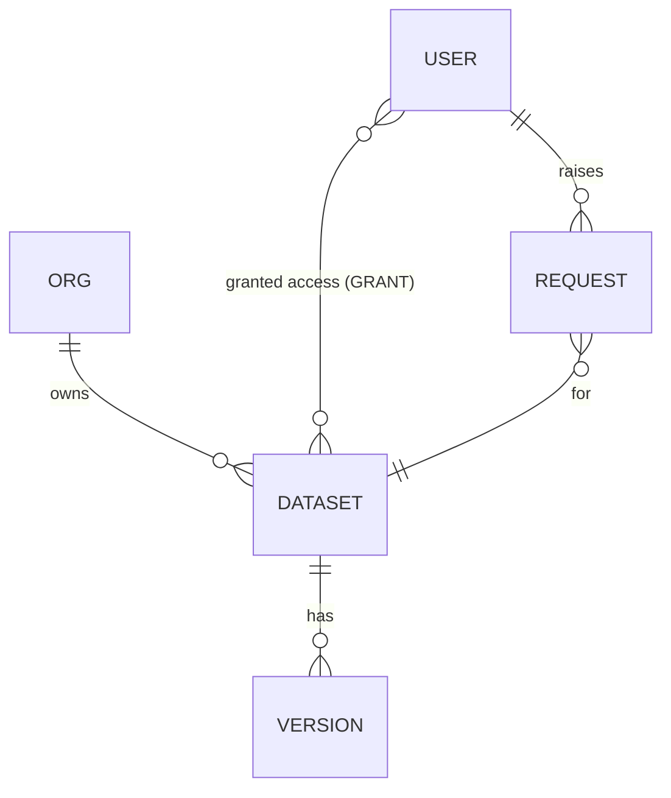
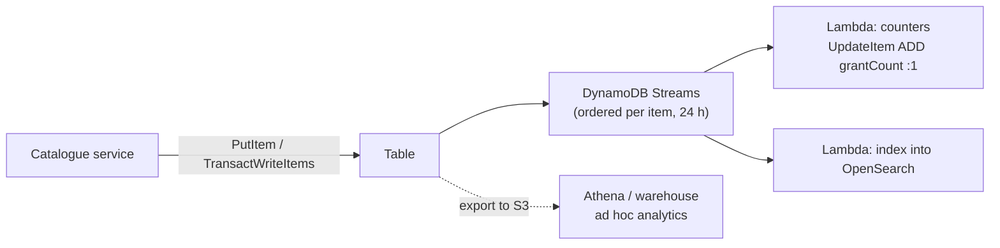

# DynamoDB Data Modelling & Single-Table Design

!!! abstract "Key takeaways"
    - **Access patterns first**: every pattern must be a `GetItem`, a `Query` on the table or a GSI, or consciously not DynamoDB's job.
    - **Single-table design** puts entity types under generic `PK`/`SK` so related items come back in **one `Query`** (a pre-joined item collection). An optimisation for known patterns, not a rule.
    - Index toolkit: **overloaded GSIs**, the **inverted index** for many-to-many, **sparse indexes** for "only the pending ones", composite sort keys for hierarchies, and (since November 2025) **multi-attribute GSI keys**, up to 4 attributes per key part.
    - Uniqueness beyond the primary key: a **marker item** in a **`TransactWriteItems`** with `attribute_not_exists`.
    - `FilterExpression` runs **after** the read. Counts, search and analytics go to **Streams-fed** stores or S3 exports. Prefer **multiple tables** when patterns are unsettled or streams and exports must be separate.

## Why it matters

DynamoDB gives single-digit-millisecond reads at any scale, but only for questions the keys were designed to answer: no planner, no joins. A relational schema copied table-for-table makes every screen issue five sequential requests, or scan.

Basics live elsewhere: partitions, capacity, GSI vs LSI and hot partitions on the [AWS databases page](../aws/07-databases-rds-aurora-dynamodb.md); a first single-table sketch next to other stores on the [data-modelling page](../data-modelling/02-data-modelling-for-relational-document-key-value-and-wide-co.md); global vs local indexes on the [indexing trade-offs page](../data-modelling/03-replication-partitioning-and-indexing-trade-offs.md). This page is the **method and its patterns**, worked through one design.

## Core concepts

### The method

1. **Entities and relationships** (an ER diagram).
2. **Access-pattern table**: inputs, sort, frequency, freshness.
3. **Primary key** so the most frequent patterns are a `GetItem` or one `Query` on the base table.
4. **Secondary indexes** for the rest: overloaded, inverted, sparse.
5. **Validate** each pattern on an *entity chart* (entity → `PK`, `SK`, GSI keys), then with production-shaped data.
6. **Name what's out of scope**: search, ad hoc analytics, global counts.

### Worked example: a clinical dataset catalogue (illustrative)

Organisations own datasets; datasets have versions; users are granted access (many-to-many) and request access, which a data steward approves.


*Notice the many-to-many between users and datasets: relationally it's a join table; in DynamoDB it becomes an adjacency list read from both sides.*

| # | Access pattern | Inputs | Sort | Frequency |
|---|---|---|---|---|
| AP1 | Dataset details + latest version | datasetId | | Very high |
| AP2 | Version history | datasetId | newest first | Medium |
| AP3 | Users with access to a dataset | datasetId | | Medium |
| AP4 | Datasets a user can access | userId | | High (every page load) |
| AP5 | An org's datasets, recently updated | orgId | updatedAt desc | High |
| AP6 | Pending access requests for an org | orgId | oldest first | Medium |
| AP7 | Dataset name unique within an org | orgId, name | | On create/rename |
| AP8 | Free-text search over titles and descriptions | text | relevance | High |

The entity chart:

| Entity | PK | SK | GSI1PK / GSI1SK | GSI2PK / GSI2SK |
|---|---|---|---|---|
| Dataset | `DS#d1` | `META` | `ORG#o1` / `UPD#2026-10-02T09:14Z` | |
| Version | `DS#d1` | `VER#0003` | | |
| Grant | `DS#d1` | `USER#u7` | | `USER#u7` / `DS#d1` |
| Request (pending) | `DS#d1` | `REQ#u9` | `PENDING#ORG#o1` / `2026-10-01T16:40Z` | |
| Name marker | `ORG#o1#NAME#readmissions-2024` | `MARKER` | | |
| User | `USER#u7` | `PROFILE` | | |

How each pattern is served:

- **AP1, AP2, AP3** are one item collection: `Query PK = DS#d1` returns `META`, the grants and the versions together, sorted by `SK`. `SK begins_with VER#` with `ScanIndexForward=false` gives newest versions first (zero-padded numbers sort correctly as strings). For AP1, the `META` item carries a copy of the latest version's summary, written in the same transaction as each new `VER#` item, so the hottest pattern is a single `GetItem`.
- **AP4** uses the **inverted index** GSI2: the grant item carries `GSI2PK = USER#u7`, so `Query GSI2 PK = USER#u7` lists that user's datasets. The same edge item is read from both directions.
- **AP5** is **GSI overloading**: on a dataset item, `GSI1PK` means "owning org" and `GSI1SK` means "last updated". On a request item the same GSI attributes mean something else entirely.
- **AP6** is a **sparse index**: only *pending* requests have `GSI1PK = PENDING#ORG#o1`. Approving the request removes those attributes and DynamoDB removes it from the index, so the index holds only work to do.
- **AP7** is a **marker item** written in the same transaction as the dataset.
- **AP8** isn't DynamoDB's job: Streams feed an OpenSearch index (see the [Elasticsearch page](01-elasticsearch-inverted-index-analyzers-relevance-sharding.md)).

{ loading=lazy }
*The same grant items answer "who can see d1?" in the table and "what can u7 see?" in the inverted index; the sparse index holds only what still needs a decision.*

!!! warning "Gotcha: the naive inverted index"
    The textbook inverted index swaps `PK` and `SK` for *every* item. Here that would put every dataset's `META` item under one GSI partition key `META`: a hot, ever-growing partition. Give GSI key attributes only to the items that need that access path.

### Multi-attribute GSI keys (2025)

Synthetic keys such as `PENDING#ORG#o1` or `COUNTRY#IN#STATE#MH` exist because a key used to be one attribute. Since November 2025 a GSI's partition and sort key can each be built from **up to four existing attributes** (for example partition key `orgId` + `status`, sort key `createdAt`). Queries must match every partition-key attribute by equality and use sort-key attributes left to right, with any range condition last. That avoids backfilling concatenated attributes before adding an index and keeps items typed. The base table's key is unchanged (one partition and one sort attribute), so `PK`/`SK` design still matters.

### Relationships

| Relationship | Pattern | Example |
|---|---|---|
| One-to-one, one-to-few | Attribute (map or list) on the parent item | Dataset's 3 contact emails |
| One-to-many, read with the parent | Item collection under the parent's `PK` | Versions under `DS#d1` |
| One-to-many, read from the child's side | GSI keyed by the parent | Datasets by `ORG#o1` |
| Many-to-many | Adjacency list + inverted index | Grants: `DS#…/USER#…` and GSI2 |
| Hierarchy | Composite sort key, `begins_with` | `LOC#IN#MH#PUNE` for "everything in MH" |
| Large blobs | Pointer to S3; item limit is 400 KB | Schema files, sample data |

Duplication (the dataset title on the grant item, so AP4 renders without a second read) is normal; decide per field whether it's a snapshot or synced, and by what.

### Derived data: counts, search and analytics

There's no `COUNT(*)` or `GROUP BY` without reading everything, so derive them from the change log:


*Notice that each derived store is rebuilt from the table, not written by the request path. DynamoDB Streams supports at most two concurrent consumers per shard, so many consumers mean one fan-out Lambda to SNS/EventBridge, or Kinesis Data Streams for DynamoDB.*

## In practice: code & configuration

### Uniqueness: check-then-write vs a transaction

=== "❌ Common mistake"
    ```java
    // Race: two requests both see "no dataset with that name", both write.
    boolean taken = dynamo.query(q -> q.tableName(TABLE).indexName("GSI1")
            .keyConditionExpression("GSI1PK = :org")
            .filterExpression("#n = :name")                    // read every org dataset, then filter
            .expressionAttributeNames(Map.of("#n", "name"))
            .expressionAttributeValues(Map.of(":org", s("ORG#" + orgId), ":name", s(name))))
        .count() > 0;
    if (!taken) dynamo.putItem(p -> p.tableName(TABLE).item(datasetItem));
    ```
    The filter runs after the read (you pay for every org dataset), the GSI is eventually consistent, and two requests can both pass the check.

=== "✅ Correct approach"
    ```java
    public void createDataset(Dataset d) {
        var marker = Map.of("PK", s("ORG#" + d.orgId() + "#NAME#" + d.name().toLowerCase()),
                            "SK", s("MARKER"), "datasetId", s(d.id()));
        try {
            dynamo.transactWriteItems(t -> t.transactItems(
                TransactWriteItem.builder().put(p -> p.tableName(TABLE).item(d.toItem())
                    .conditionExpression("attribute_not_exists(PK)")).build(),     // id not reused
                TransactWriteItem.builder().put(p -> p.tableName(TABLE).item(marker)
                    .conditionExpression("attribute_not_exists(PK)")).build()      // name free in this org
            ).clientRequestToken(d.id()));                                          // idempotent retry for 10 min
        } catch (TransactionCanceledException e) {
            // cancellationReasons() line up with the items: index 1 = ConditionalCheckFailed → name taken
            throw new DuplicateNameException(d.orgId(), d.name());
        }
    }
    ```
    Both items commit or neither does. A rename deletes the old marker, puts the new one and updates the dataset in one transaction. Transactions cost 2× WCU.

{ loading=lazy }
*The losing request writes nothing at all: the condition on the marker cancels the dataset item too.*

### Querying a GSI with pagination

```java
public Page<DatasetSummary> datasetsForUser(String userId, Map<String, AttributeValue> cursor) {
    QueryResponse res = dynamo.query(q -> q.tableName(TABLE).indexName("GSI2")
        .keyConditionExpression("GSI2PK = :u")
        .expressionAttributeValues(Map.of(":u", s("USER#" + userId)))
        .limit(25)
        .exclusiveStartKey(cursor));                       // null on the first page
    return new Page<>(res.items().stream().map(DatasetSummary::fromGrant).toList(),
                      res.lastEvaluatedKey());             // empty map = no more pages
}
```

A `Query` returns at most 1 MB per call before any filter is applied; always loop or page on `LastEvaluatedKey`, and encode it opaquely before sending it to a client.

## Real-world usage

- **Amazon retail** peaked at **151 million DynamoDB requests per second** on Prime Day 2025; single-table patterns came out of Amazon's own migration off relational databases (Rick Houlihan's re:Invent talks).
- **The guidance has softened**: Alex DeBrie's AWS Database Blog post gives real reasons for **multiple tables** (the Streams consumer limit, separate analytics exports, simplicity), and AWS AppSync guidance favours multi-table while patterns are changing.
- **Healthcare**: keep PHI (names, member numbers) out of keys, which surface in logs and Contributor Insights; use customer-managed KMS keys where policy requires; TTL deletes asynchronously.

## Trade-offs & production gotchas

| Choice | Pros | Cons | Use when |
|---|---|---|---|
| Single table | One `Query` for related items, fewer round trips, one set of alarms | Hard to read, hard to change, one stream for everything | Stable, known access patterns; latency-critical reads of related data |
| Table per entity | Familiar, isolated streams and exports, easy GraphQL resolvers | Several requests per screen, more tables to operate | Patterns still changing; few cross-entity reads |
| GSI | Any new access path, added any time | Eventually consistent; extra write cost per projected item | Most secondary patterns |
| Duplicate attribute | Saves a read | Must be kept in sync or be a snapshot | Read-heavy lists |
| Scan + filter | No design needed | Reads and pays for the whole table | Never in a request path; offline jobs only |

!!! warning "Gotcha: `FilterExpression` is not a WHERE clause"
    Capacity and the 1 MB page limit apply to items **read**, before the filter. A `Query` with `Limit 25` and a filter can return 0 items and a `LastEvaluatedKey`. If you filter away most of what you read, the key design is wrong.

!!! warning "Gotcha: GSI projections"
    Every write touching a GSI key or projected attribute also writes the GSI, and a lagging GSI throttles the **base table**. Project what the pattern renders (`KEYS_ONLY`/`INCLUDE`), not `ALL` by habit.

!!! warning "Gotcha: unbounded item collections"
    A collection that grows forever (all audit events under `DS#d1`) concentrates traffic and, with an LSI, hits 10 GB. Bucket by time (`DS#d1#2026-10`) or use a separate table.

## How this connects to my experience

- **Where I used it:** ConvergeHealth Data Asset Explorer at Deloitte: *"Built cloud-native microservices on AWS using Lambda, EC2, ECS, EKS, API Gateway, RDS, DynamoDB, SQS, SNS, and S3"*, with *"event-driven healthcare analytics workflows and secure data discovery platforms"*. DynamoDB is also in the skills list.
- **Talking points:**
    - Which data lived in DynamoDB vs RDS and why (key lookups and per-user state vs relational metadata with Liquibase migrations). *[confirm: tables, keys and what each held]*
    - Whether it was single-table or table-per-entity, and the access patterns that drove the keys. *[confirm]*
    - Event-driven flows: whether DynamoDB Streams or SQS/SNS fed downstream processing such as the Elasticsearch index. *[confirm]*
    - The worked example on this page is illustrative; present it as how you'd model a data catalogue today, not as the production design, unless it matches.
- **Likely follow-up chain:** "How did you choose the partition key?" (access patterns, cardinality, even load) → "How would you list all datasets a user can access?" (adjacency list + inverted GSI) → "How do you enforce a unique name?" (marker item + transaction) → "What about counts and search?" (Streams → counters and OpenSearch; S3 export for analytics) → "Single-table or not?" (depends on stable patterns; name the multi-table reasons).

## Interview questions

### Fundamentals

??? question "Q1. What is single-table design, and what problem does it solve?"
    **Answer:** Several entity types share one table with generic key attributes (`PK`, `SK`) holding typed, prefixed values. Related items share a partition key, forming an item collection that one `Query` returns sorted: in effect a pre-computed join. It solves the lack of joins: instead of several sequential requests, one round trip. GSIs with overloaded generic keys serve further patterns.

    **Interviewer listens for:** item collections as pre-joins; generic keys; that it's driven by access patterns.

    **Common wrong answer:** "Putting everything in one table to save money on tables."

??? question "Q2. Why must you list access patterns before choosing keys?"
    **Answer:** DynamoDB can only `GetItem` or `Query` efficiently by key, on the table or a GSI; anything else is a scan. The keys therefore encode the questions. Without the pattern list, you'd design keys for the ER diagram and discover missing paths in production, where a fix means a new GSI, a backfill of key attributes, or a data migration.

    **Interviewer listens for:** no planner or joins; cost of a late pattern.

    **Common wrong answer:** "So you know which attributes to index", treating GSIs like relational indexes.


### Intermediate

??? question "Q3. Model a many-to-many relationship, such as users and the datasets they can access."
    **Answer:** An adjacency list: one edge item per grant, `PK = DS#d1`, `SK = USER#u7`, so a dataset's grants are its item collection. A GSI keyed on the user (`GSI2PK = USER#u7`, `GSI2SK = DS#d1`) reads the other direction. Copy the few attributes each side needs to render a list (title, role) onto the edge item. Give the GSI attributes only to edge items, so non-edge items don't pile into one hot GSI partition.

    **Interviewer listens for:** edge items, inverted GSI, duplication on the edge, the hot-partition trap.

    **Common wrong answer:** A list of user IDs on the dataset item (400 KB limit, hard to query from the user side).

??? question "Q4. How do you enforce uniqueness on an attribute that isn't the primary key?"
    **Answer:** Write a marker item whose primary key is the unique value (`ORG#o1#NAME#readmissions-2024`) in the same `TransactWriteItems` as the main item, both with `attribute_not_exists(PK)`. If the name exists, the transaction is cancelled and nothing is written. A rename deletes the old marker and puts the new one in one transaction. Use `ClientRequestToken` so retries are idempotent.

    **Interviewer listens for:** marker items; transaction atomicity; no check-then-write.

    **Common wrong answer:** Query a GSI first, then write (race, plus GSI lag).

??? question "Q5. Why can a `Query` with `Limit 25` return zero items, and what does that tell you?"
    **Answer:** `Limit` and the 1 MB page cap apply to items read before `FilterExpression` runs. If the first 25 items read all fail the filter, the response is empty with a `LastEvaluatedKey`. You also paid for all 25 reads. It means the filter does work the key should do: move the condition into the sort key or a sparse GSI.

    **Interviewer listens for:** filter after read; pagination with `LastEvaluatedKey`; fix the key.

    **Common wrong answer:** "It's a bug; increase the limit."

### Senior

??? question "Q6. When would you choose multiple tables over single-table design?"
    **Answer:** When patterns aren't stable (single-table models are expensive to change); when entities need different stream consumers or separate analytics exports; when different teams own them; when entities are rarely read together; when GraphQL resolvers map to one table per type. Single-table pays off when related items are read together on hot, latency-sensitive paths.

    **Interviewer listens for:** concrete reasons, not dogma either way.

    **Common wrong answer:** "Always single table; AWS says so."

??? question "Q7. How do you add a new access pattern to a live single-table design?"
    **Answer:** If existing attributes can serve it, add a GSI (multi-attribute keys since 2025 often avoid a synthetic key); DynamoDB backfills it online. If a new attribute is needed, first deploy code that writes it, then backfill old items with a resumable, rate-limited parallel scan-and-update, then add the GSI and switch reads. Rare analytical questions go to an S3 export, not an index.

    **Interviewer listens for:** write-path change before backfill; online GSI build; export as the alternative.

    **Common wrong answer:** "Change the primary key" (impossible in place: it's a new table and a migration).

### Scenario-based

??? question "Q8. Product wants a dashboard: number of datasets per org and per sensitivity level, plus search by keyword. Design it on top of the table."
    **Answer:** Not with scans. A Streams-triggered Lambda maintains counter items (`PK = ORG#o1`, `SK = STATS`) with atomic `ADD` updates, made idempotent because Lambda can retry a batch. Keyword search goes to OpenSearch fed from the same stream; exploration to an S3 export queried with Athena. State the freshness: seconds for counters and search, a day for exports.

    **Interviewer listens for:** Streams-derived aggregates; idempotency; right store per question; freshness.

    **Common wrong answer:** "A Scan with a Count select every time the dashboard loads."

??? question "Q9. One organisation has 80% of all datasets and its listing page throttles. What's happening and how do you fix it?"
    **Answer:** AP5 puts all that org's datasets under one GSI partition key, so their writes hit one GSI partition, and GSI throttling back-pressures base-table writes. Write-shard the key (`ORG#o1#0`…`#9` by hashing the dataset ID) and query the shards in parallel, or add a natural second key part (team, domain); maybe serve the listing from a cache or search index. Confirm with Contributor Insights.

    **Interviewer listens for:** hot GSI partition; write sharding with scatter-gather reads; measuring.

    **Common wrong answer:** "Switch to on-demand capacity" (per-partition limits still apply).

## Cheat sheet

| Concept | Remember |
|---|---|
| Method | ER diagram → access-pattern table → PK/SK → GSIs → entity chart → load test |
| Item collection | Same `PK`, sorted by `SK`; one `Query` = a pre-join |
| Overloaded GSI | Generic `GSI1PK`/`GSI1SK`, meaning per entity type |
| Inverted index | Edge items read both ways; give GSI keys only to edges |
| Sparse index | Only items with the key attribute are indexed |
| Multi-attribute GSI keys | Up to 4 + 4 attributes (Nov 2025); fewer synthetic keys |
| Uniqueness | Marker item + `TransactWriteItems` + `attribute_not_exists` |
| Filters | Applied after the read; you pay for what's read; 1 MB pages |
| Derived data | Streams → counters, OpenSearch; S3 export → Athena |
| Multi-table when | Changing patterns, many stream consumers, separate exports, separate owners |

## Sources

1. [AWS: NoSQL design for DynamoDB](https://docs.aws.amazon.com/amazondynamodb/latest/developerguide/bp-general-nosql-design.html): access patterns first, item collections.
2. [AWS: Overloading global secondary indexes](https://docs.aws.amazon.com/amazondynamodb/latest/developerguide/bp-gsi-overloading.html) and [sparse indexes](https://docs.aws.amazon.com/amazondynamodb/latest/developerguide/bp-indexes-general-sparse-indexes.html).
3. [AWS: Managing many-to-many relationships (adjacency list)](https://docs.aws.amazon.com/amazondynamodb/latest/developerguide/bp-adjacency-graphs.html): edge items and inverted GSIs.
4. [AWS: Multi-attribute keys pattern](https://docs.aws.amazon.com/amazondynamodb/latest/developerguide/GSI.DesignPattern.MultiAttributeKeys.html) and [launch announcement (November 2025)](https://aws.amazon.com/about-aws/whats-new/2025/11/amazon-dynamodb-multi-attribute-composite-keys-global-secondary-indexes): up to four attributes per key part.
5. [AWS: Amazon DynamoDB transactions](https://docs.aws.amazon.com/amazondynamodb/latest/developerguide/transaction-apis.html): `TransactWriteItems`, conditions, `ClientRequestToken`, cost.
6. [AWS: Query and filter expressions](https://docs.aws.amazon.com/amazondynamodb/latest/developerguide/Query.FilterExpression.html): filters after read, 1 MB limit.
7. [AWS Database Blog: Single-table vs. multi-table design in Amazon DynamoDB (Alex DeBrie)](https://aws.amazon.com/blogs/database/single-table-vs-multi-table-design-in-amazon-dynamodb/): when multiple tables are better.
8. [AWS: Change data capture with DynamoDB Streams](https://docs.aws.amazon.com/amazondynamodb/latest/developerguide/Streams.html): ordering, 24-hour retention, consumers per shard.
9. [AWS News Blog: AWS services scale for Prime Day 2025](https://aws.amazon.com/blogs/aws/aws-services-scale-to-new-heights-for-prime-day-2025-key-metrics-and-milestones): 151 million DynamoDB requests per second at peak.
10. Alex DeBrie, *The DynamoDB Book*: entity charts, single-table patterns, uniqueness with transactions.
