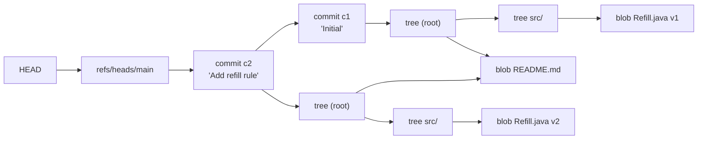
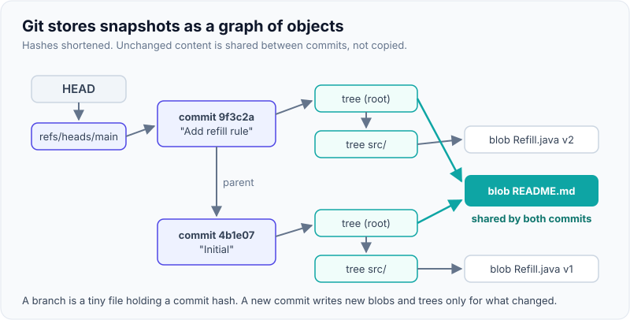
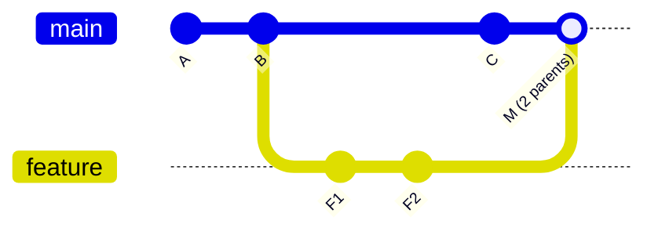
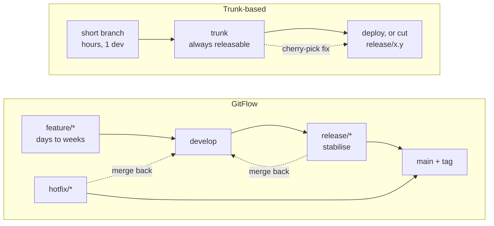

# Git Internals & Branching Strategies (GitFlow vs Trunk-Based)

!!! abstract "Key takeaways"
    - Git is a **content-addressable object store**: four object types (**blob, tree, commit, annotated tag**), each named by the hash of its content. A commit points to one tree and its parent commits; a **branch is just a file holding a commit hash**, and `HEAD` points to the current branch.
    - Because objects are immutable, **rebase, amend and cherry-pick create new commits** with new hashes. Never rewrite history other people have pulled; if you must force-push your own branch, use `--force-with-lease`.
    - **Merge** joins histories with a three-way merge from the merge base (default strategy `ort` since Git 2.34); **rebase** replays your commits on a new base for linear history; **squash merge** turns a PR into one commit on trunk.
    - **GitFlow** (develop, feature, release, hotfix branches) suits versioned, shipped software with several supported releases. Its author added a 2020 note recommending a **simpler workflow for continuously delivered web apps**.
    - **Trunk-based development** (branches living hours to a day, merged to trunk at least daily, unfinished work behind feature flags, releases cut from trunk) is what DORA research links with higher delivery performance. Long-lived branches turn integration into a big, risky event.

## Why it matters

Every team uses Git; few people can explain what a commit *is*. Interviewers at senior level use Git questions for two reasons. First, internals questions ("what happens when you rebase?", "how do you recover a deleted branch?") separate people who memorised commands from people who can get a team out of trouble at 6 p.m. before a release. Second, the branching strategy is a **delivery decision**: it decides how often code integrates, how releases are cut and how hotfixes reach production. That ties directly into [DORA metrics](05-dora-metrics-and-engineering-effectiveness.md), [code review](02-code-review-best-practices.md) and the [CI/CD pipeline](../cicd-devops/index.md).

Before Git, centralised systems (CVS, Subversion) made branching expensive, so teams branched rarely. Git made branches nearly free, which created the opposite problem: teams branch freely, keep branches open for weeks, and pay for it at merge time.

## Core concepts

### The object model

Everything in `.git/objects` is one of four types, stored zlib-compressed and named by a hash of `"<type> <size>\0<content>"` (SHA-1 today; SHA-256 repositories have been supported since Git 2.29, and making SHA-256 the default for new repositories is listed as a planned Git 3.0 change).

| Object | Holds | Points to |
|---|---|---|
| **Blob** | File contents only (no name, no permissions) | Nothing |
| **Tree** | A directory listing: mode, name and hash per entry | Blobs and sub-trees |
| **Commit** | Author, committer, timestamps, message | Exactly one root tree, zero or more parent commits |
| **Annotated tag** | Tagger, message, optional signature | Usually a commit |


*Notice that c2's tree reuses the unchanged README blob from c1. A commit is a full snapshot, but unchanged content is shared, not copied; packfiles add delta compression on top.*

{ loading=lazy }
*A branch is a 41-byte file; moving it is all a commit, reset or fast-forward does to refs.*

Consequences worth saying in an interview:

- **Snapshots, not diffs.** Each commit records the whole tree; `git diff` computes differences on demand.
- **Integrity for free.** Changing any byte of history changes every hash after it, which is why rewritten history is visible and why signed tags and commits protect a whole chain.
- **Refs are cheap.** `refs/heads/feature-x` is a small file (or a line in `packed-refs`). Creating a branch costs nothing; *keeping it alive* is what costs.
- **The index (staging area)** is a binary file describing the next tree to commit. `git add` writes blobs and updates the index; `git commit` writes trees and the commit.
- **The reflog** records where `HEAD` and each branch pointed over time. "Lost" commits are usually still there: `git reflog`, then `git branch rescue <hash>`. Reachable reflog entries expire after 90 days by default and unreachable ones after 30; `git gc` then prunes unreachable objects.

### Merge, rebase, squash, reset

- **Fast-forward:** if the target branch hasn't moved, Git just moves the ref forward. No new commit.
- **Three-way merge:** Git finds the **merge base** (best common ancestor), compares both sides with it, and writes a **merge commit with two parents**. The default merge strategy has been `ort` since Git 2.34 (it replaced `recursive`).
- **Rebase:** takes your commits since the merge base and **replays them as new commits** on top of the target. Same changes, new hashes, linear history.
- **Squash merge:** collapses a PR into one new commit on trunk. Clean history; the branch's individual commits are lost from trunk.
- **Reset:** moves the current branch ref. `--soft` keeps index and working tree, `--mixed` (default) resets the index, `--hard` also overwrites the working tree.
- **Revert:** creates a new commit that undoes another one. The safe way to undo on a shared branch.


*Notice that the merge commit M has two parents and B is the merge base. A rebase would instead produce F1' and F2' after C, with new hashes, and no merge commit.*

### Branching strategies

| Strategy | Branches | Release flow | Fits |
|---|---|---|---|
| **GitFlow** (Driessen, 2010) | `main`, `develop`, `feature/*`, `release/*`, `hotfix/*` | Stabilise on a release branch, merge to `main` and back to `develop`, tag | Versioned products, several supported versions, slow release cadence |
| **GitHub Flow** | `main` + short feature branches | Every merge to `main` is deployable; deploy from `main` | Web apps with continuous deployment |
| **GitLab Flow** | `main` + feature branches, plus environment branches (`staging`, `production`) or release branches | Promote by merging downstream | Teams that need environment gates or maintained release lines |
| **Trunk-based** | Trunk (`main`) + branches living hours to a day | Deploy trunk, or cut a release branch from trunk; fix on trunk and cherry-pick | Continuous integration at any scale (Google, Meta run very large trunks) |

Vincent Driessen, who published GitFlow, added a "note of reflection" in March 2020: web apps are typically continuously delivered, not rolled back, and teams doing continuous delivery should adopt "a much simpler workflow" such as GitHub Flow. GitFlow is still reasonable for software shipped in explicit versions (mobile apps, on-prem products, libraries).


*Notice the number of merge directions. GitFlow merges in four directions and back-merges are easy to forget; trunk-based has one direction plus an occasional cherry-pick from trunk to a release branch.*

### Why long-lived branches hurt

Merge pain grows faster than branch age: every day a branch lives, trunk moves, the diff grows and the chance that two people touched the same code rises. Integration problems are found late, all at once, by the person merging. Continuous integration originally meant *everyone integrates into the mainline at least daily*; a feature branch with a CI badge on it is not CI.

{ loading=lazy }
*Same work, same conflicts; trunk-based just finds them one at a time while they're small.*

DORA's trunk-based development capability describes the practice as: **three or fewer active branches**, branches and forks **merged to trunk at least once a day**, and **no code freezes or integration phases**.

### Making trunk-based work

Trunk-based development is not "everyone pushes to `main` unreviewed". It rests on:

- **Small PRs with fast review** (see [code review](02-code-review-best-practices.md)).
- **A fast, reliable CI pipeline** on every PR and every trunk commit; a red trunk is fixed or reverted within minutes.
- **Feature flags** to merge unfinished work dark, and **branch by abstraction** to replace a component in small steps behind an interface ([feature flags and canaries](../microservices/11-deployment-strategies-blue-green-canary-feature-flags.md)).
- **Release branches cut from trunk** when you need a stabilisation window or a supported version; bugs are fixed on trunk first and cherry-picked to the release branch, never the other way round.

## In practice: code & configuration

### Unfinished work: long branch vs flag on trunk

=== "❌ Common mistake"
    ```text
    feature/new-pricing-engine   (open 5 weeks, 140 files, 9,000 lines)
      - rebased "occasionally"; three people commit to it
      - merge day: 37 conflicts, 2 days of re-testing, release slips
      - bugs found in integration can't be bisected to a small change
    ```

=== "✅ Correct approach"
    ```java
    // Branch by abstraction + feature flag: merge to trunk daily, release when ready.
    public interface PricingEngine {                // 1. the abstraction both versions implement
        Money price(Claim claim);
    }

    @Service
    public class PricingRouter implements PricingEngine {
        private final LegacyPricingEngine legacy;
        private final RulesPricingEngine next;      // 2. new engine grows on trunk, PR by PR
        private final FeatureFlags flags;

        public PricingRouter(LegacyPricingEngine legacy, RulesPricingEngine next, FeatureFlags flags) {
            this.legacy = legacy; this.next = next; this.flags = flags;
        }

        @Override
        public Money price(Claim claim) {
            // 3. dark by default; enable per tenant, then percentage, then delete the flag and legacy
            return flags.isEnabled("pricing.rules-engine", claim.tenantId())
                    ? next.price(claim)
                    : legacy.price(claim);
        }
    }
    ```

### Rewriting history safely

=== "❌ Common mistake"
    ```bash
    git rebase main            # rewrites commits a teammate already pulled
    git push --force           # silently overwrites anything pushed since your last fetch
    ```

=== "✅ Correct approach"
    ```bash
    git fetch origin
    git rebase origin/main                 # only on your own, unshared branch
    git push --force-with-lease            # refuses if the remote moved since you fetched
    # On shared branches (main, release/*): never rewrite. Undo with a new commit:
    git revert <bad-sha>
    ```

### Recovering "lost" work

```bash
git reflog                                  # where HEAD has been, newest first
# a1b2c3d HEAD@{3}: commit: Add refill limit validation   <- the commit you "lost"
git branch rescue/refill-limit a1b2c3d      # give it a ref again; done
git bisect start HEAD v2.4.0                # binary-search the commit that broke a test
git bisect run ./mvnw -q -Dtest=RefillLimitTest test
```

### Protecting trunk (GitLab example)

```yaml
# .gitlab-ci.yml: run the same checks on merge requests and on main
workflow:
  rules:
    - if: $CI_PIPELINE_SOURCE == "merge_request_event"
    - if: $CI_COMMIT_BRANCH == $CI_DEFAULT_BRANCH
    - if: $CI_COMMIT_BRANCH =~ /^release\//
# Repository settings (not YAML): main protected, no direct push, merge only when
# the pipeline succeeds, 1+ approval incl. CODEOWNERS, squash or fast-forward merge.
```

## Real-world usage

- **Google** develops almost all code in one monorepo trunk with code review on every change, presubmit tests and feature flags; release branches are cut from trunk for some products (described in *Software Engineering at Google*, chapters on version control and code review).
- **Mobile and on-prem products** often keep release branches per shipped version because users run old versions for months; this is where GitFlow-style release and hotfix branches still earn their cost.
- **Regulated domains (healthcare, banking)** often ask for "a release branch we can audit". Trunk-based with release branches cut from trunk, tags, signed commits and pipeline evidence satisfies that without long-lived feature branches *[confirm whether Meteor needed this for audit]*.
- **Failure mode:** the "merge week" before a release, where several long-lived branches land together, tests break in ways no single PR caused and the release slips. It is the most common symptom interviewers ask about.

## Trade-offs & production gotchas

| Choice | Pros | Cons | Use when |
|---|---|---|---|
| GitFlow | Clear release stabilisation; parallel versions | Many merge directions, slow integration, back-merge mistakes | Versioned, shipped software |
| GitHub Flow | Simple; every merge deployable | Needs strong CI and fast review; no stabilisation branch | Continuous deployment of a web service |
| Trunk-based + flags | Continuous integration, small diffs, easy bisect | Needs flag hygiene, discipline, fast pipeline | Most teams aiming at high DORA performance |
| Merge commits | True history, easy to revert a whole PR | Noisy graph | Shared branches, release merges |
| Rebase / squash | Linear, readable history | Rewrites hashes; squash loses granular commits | Your own branch before merge |

!!! warning "Gotcha: feature flags are debt with a timer"
    Every flag doubles the code paths to test. Give each flag an owner and an expiry date, and remove it (and the old code path) once rollout is complete. Old flags are a classic source of [technical debt](03-technical-debt-management.md) and of incidents when someone toggles a flag nobody remembers.

!!! tip "Interview angle"
    Don't call GitFlow "wrong". Say what it optimises for (stabilising versioned releases) and what it costs (late integration), then say which you'd pick for this team and why.

## How this connects to my experience

- **Where I used it:** not a resume claim on its own, but it sits under *"Established engineering standards around testing, CI/CD, code quality, and deployment practices"* (OptumRx Meteor) and *"Led sprint planning, estimation, stakeholder communication, release management, and production support"*. GitLab CI/CD at Coriolis (CCKM) and GitLab CI/CD and Jenkins in the skills list.
- **Talking points:**
    - The branching model the Meteor team used and why: trunk-based with short-lived branches, or GitFlow-style release branches *[confirm which, and the typical branch lifetime]*.
    - How a hotfix reached production during release management: fix on the main line, cherry-pick to the release branch, tag *[confirm the actual flow]*.
    - Micro-frontends raise the repo question: one monorepo or a repo per micro-frontend, and how shared components were versioned *[confirm]*.
    - Teaching juniors to recover with `reflog` and to use `--force-with-lease`: a small, real mentoring example *[confirm]*.
- **Likely follow-up chain:** "What branching strategy did you use?" → "Why not trunk-based / why not GitFlow?" → "How did you handle unfinished features at release time?" → "How did you do a hotfix?" Answer with the model, the reason (release cadence, audit needs, team size), feature flags or release branches for unfinished work, and fix-forward on main plus cherry-pick.

## Interview questions

### Fundamentals

??? question "Q1. What is a Git commit, physically?"
    **Answer:** An immutable object in `.git/objects` named by the hash of its content. It records author, committer, timestamps and message, and points to exactly one root tree (a full snapshot of the project) and to zero or more parent commits. Trees point to blobs (file contents) and sub-trees. Unchanged files share the same blob across commits, and packfiles add delta compression.

    **Interviewer listens for:** snapshot not diff, tree and parent pointers, content addressing.

    **Common wrong answer:** "A commit stores the diff from the previous commit."

??? question "Q2. What is a branch, and what is HEAD?"
    **Answer:** A branch is a ref: a small file under `refs/heads/` (or a line in `packed-refs`) containing a commit hash. Committing moves the current branch's ref forward. `HEAD` is a symbolic ref naming the current branch; in "detached HEAD" it holds a commit hash directly.

    **Interviewer listens for:** branches are pointers, so they're cheap.

    **Common wrong answer:** "A branch is a copy of the code."

??? question "Q3. Merge vs rebase vs squash: when do you use each?"
    **Answer:** Merge creates a commit with two parents and preserves real history; use it on shared branches. Rebase replays your commits onto a new base as new commits for linear history; use it on your own branch before opening or updating a PR. Squash merge turns a PR into one commit on trunk; good when PR commits are noisy. Never rebase commits others have based work on.

    **Interviewer listens for:** rebase creates new hashes, the "shared branch" rule.

    **Common wrong answer:** "Rebase is always better because history is cleaner."

### Intermediate

??? question "Q4. How do you undo a bad commit that's already on main?"
    **Answer:** `git revert <sha>` to create a new commit that undoes it, then push through the normal pipeline. Don't reset and force-push a shared branch: everyone else's clones still contain the old commits. If the bad commit was a merge, revert with `-m 1` to pick the mainline parent.

    **Interviewer listens for:** revert on shared history, awareness of `-m` for merges.

    **Common wrong answer:** "`git reset --hard` and force push."

??? question "Q5. A colleague says they lost a day's work after a bad rebase. What do you do?"
    **Answer:** Run `git reflog` on their machine, find the entry before the rebase (e.g. `HEAD@{5}`), and create a branch at that hash, or `git reset --hard` to it if the branch is theirs alone. Commits stay in the object store until they're unreachable and garbage-collected; reflog entries last 30 to 90 days by default.

    **Interviewer listens for:** reflog, objects aren't deleted immediately.

    **Common wrong answer:** "It's gone unless it was pushed."

??? question "Q6. Compare GitFlow and trunk-based development."
    **Answer:** GitFlow uses long-lived `develop` and `main` plus feature, release and hotfix branches; it's built to stabilise and support explicit versions, at the cost of late integration and many merge directions. Trunk-based keeps one trunk always releasable, branches live hours to a day, unfinished work hides behind flags, and releases are deployed from trunk or cut from it. DORA associates trunk-based development with higher delivery performance; GitFlow's author recommends simpler flows for continuously delivered web apps.

    **Interviewer listens for:** what each optimises for, flags, the 2020 note or DORA evidence.

    **Common wrong answer:** "Trunk-based means no code review."

??? question "Q7. How do you ship a large feature that takes six weeks with trunk-based development?"
    **Answer:** Split it into small vertical slices merged daily behind a feature flag that's off in production. Use branch by abstraction when replacing an existing component: introduce an interface, build the new implementation behind it, switch traffic by flag (per tenant, then percentage), then delete the old path and the flag. Tests cover both paths while the flag lives.

    **Interviewer listens for:** dark launching, branch by abstraction, flag removal.

    **Common wrong answer:** "Keep it on a feature branch and merge when done."

### Senior

??? question "Q8. Your team does GitFlow and suffers a 'merge week' before every release. How do you move to trunk-based without breaking releases?"
    **Answer:** Do it in steps. First shorten branch life (WIP limits, PR size guideline, review SLA) and make CI on `develop` fast and trustworthy. Introduce feature flags so unfinished work can merge. Then collapse `develop` into `main` and cut release branches from `main` with a "fix on trunk, cherry-pick to release" rule. Measure branch age, PR cycle time and change failure rate before and after, and keep the release branch until the team trusts trunk.

    **Interviewer listens for:** incremental change, prerequisites (CI, flags, review speed), measurement.

    **Common wrong answer:** "Delete develop on Monday."

??? question "Q9. Monorepo or polyrepo for a set of microservices and micro-frontends?"
    **Answer:** A monorepo makes atomic cross-cutting changes, shared tooling and consistent versions easy, but needs build tooling that only builds and tests what changed (Nx, Turborepo, Bazel, Gradle build cache) and ownership rules (CODEOWNERS). Polyrepos give clear ownership and independent pipelines, but cross-repo changes need versioned contracts and coordination. Choose by team topology and how often changes span services; independent deployability matters more than repo layout.

    **Interviewer listens for:** trade-offs tied to team structure and tooling, not dogma.

    **Common wrong answer:** "Microservices must each have their own repo."

### Scenario-based

??? question "Q10. A critical bug is in production, and main already has two weeks of unreleased work. How do you hotfix?"
    **Answer:** If you deploy from trunk with flags, unreleased work is dark, so fix on main and deploy normally. If you release from release branches: fix on main first (with a test), cherry-pick the commit onto the current release branch, run its pipeline, tag and deploy. Fixing only on the release branch risks the bug reappearing in the next release.

    **Interviewer listens for:** fix trunk first, cherry-pick down, test included.

    **Common wrong answer:** "Hotfix on the release branch and remember to merge it back."

??? question "Q11. Someone force-pushed main and three PRs' worth of commits disappeared from the remote. What now?"
    **Answer:** Stop further pushes. Find the previous tip: any developer's clone or the CI runner has it (`git reflog` or `origin/main@{1}`), and some hosts record the push event. Push the old tip back (with the host's admin override if main is protected) or merge the lost commits. Then fix the cause: protect main, disallow force pushes, require merge requests.

    **Interviewer listens for:** distributed copies as backup, branch protection as the real fix.

    **Common wrong answer:** "Restore from backup."

## Cheat sheet

| Concept | Remember |
|---|---|
| Objects | Blob (contents), tree (directory), commit (snapshot + parents), annotated tag |
| Hash | SHA-1 of `type size\0content`; SHA-256 supported since 2.29, planned default in Git 3.0 |
| Branch | A ref: file with a commit hash. HEAD names the current branch |
| Merge | Three-way from the merge base; `ort` default since 2.34 |
| Rebase / amend / cherry-pick | New commits, new hashes. Never on shared history |
| Undo on shared branch | `git revert` (`-m 1` for merges) |
| Recover | `git reflog` → `git branch rescue <sha>` |
| Force push | `--force-with-lease`, only on your own branch |
| GitFlow | develop + feature/release/hotfix; versioned products |
| Trunk-based | ≤3 active branches, merge daily, flags, no code freeze; release branches cut from trunk |
| Hotfix | Fix on trunk, cherry-pick to release |

## Sources
1. [Pro Git, chapter 10: Git Internals](https://git-scm.com/book/en/v2/Git-Internals-Git-Objects): blobs, trees, commits, refs, packfiles.
2. [git-reflog and git-gc documentation](https://git-scm.com/docs/git-reflog): reflog expiry defaults (90 days reachable, 30 days unreachable).
3. [Git 2.34 release notes](https://github.com/git/git/blob/master/Documentation/RelNotes/2.34.0.txt): `ort` becomes the default merge strategy.
4. [Git BreakingChanges document](https://git-scm.com/docs/BreakingChanges): planned Git 3.0 changes including SHA-256 as default for new repositories.
5. [Vincent Driessen: A successful Git branching model (with 2020 note of reflection)](https://nvie.com/posts/a-successful-git-branching-model/): GitFlow and the recommendation of simpler flows for continuous delivery.
6. [DORA capability: Trunk-based development](https://dora.dev/capabilities/trunk-based-development/): three or fewer active branches, daily merges, no code freeze.
7. [Paul Hammant: Trunk Based Development](https://trunkbaseddevelopment.com/) and [Branch by Abstraction](https://paulhammant.com/blog/branch_by_abstraction.html): release branches from trunk, cherry-pick fixes, branch by abstraction.
8. [Martin Fowler: Patterns for Managing Source Code Branches](https://martinfowler.com/articles/branching-patterns.html): mainline integration, feature branching and their costs.
9. Winters, Manshreck, Wright: *Software Engineering at Google* (O'Reilly, 2020): version control (one-version rule, monorepo trunk) and code review chapters.
