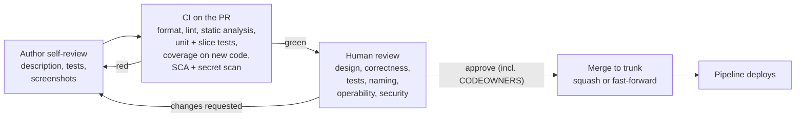
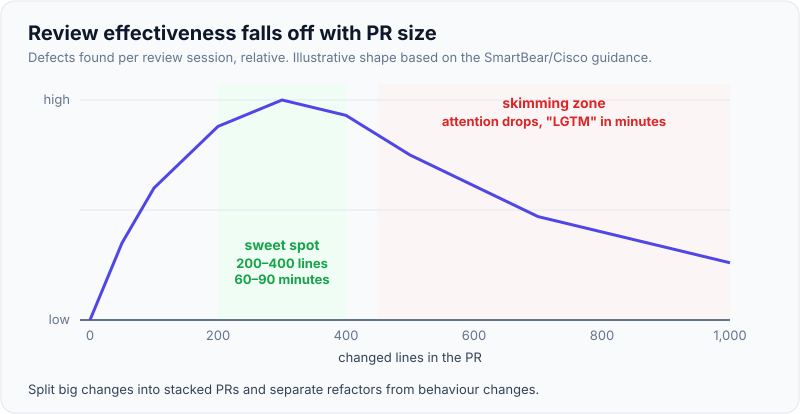
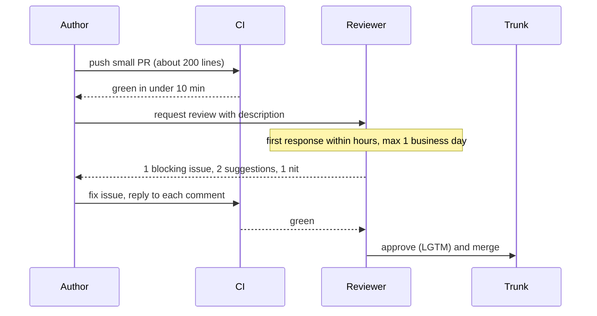

# Code Review Best Practices

!!! abstract "Key takeaways"
    - Review exists for **code health, shared understanding and knowledge transfer** as much as for catching bugs. Microsoft and Google studies both found that defects are the expected purpose, but knowledge transfer, awareness and better design are what reviews deliver most.
    - **Google's standard:** approve once the change **definitely improves the overall code health**, even if it isn't perfect. Respond within **one business day** at most; faster is better.
    - **Automate everything a machine can judge** (formatting, lint, static analysis, tests, coverage on new code, dependency and secret scanning) so humans spend attention on **design, correctness, tests, naming and operability**.
    - **Small PRs win.** Reviewers find most defects in roughly 200–400 lines over 60–90 minutes; beyond that, attention drops and big PRs get rubber-stamped. Stack changes instead.
    - **Label every comment** (blocking issue, suggestion, question, nit, praise), critique code not people, and explain the *why*. As a lead, measure **time to first review and PR cycle time**, not comment counts.

## Why it matters

"Mentored engineers through code reviews" and "established code-quality standards" are common lead-level claims, and interviewers probe them: *what do you look for, how fast are reviews, what happens when a senior pushes back, how do you stop reviews becoming a bottleneck?* Code review is also the most frequent place a lead shapes a codebase: dozens of small decisions a week.

Review has a cost. Every hour a PR waits is an hour of context lost by the author, and slow reviews push people towards bigger PRs, which are reviewed worse, which slows things further. Done well, review is where a team's standards actually live; done badly, it is the main thing stretching [lead time for changes](05-dora-metrics-and-engineering-effectiveness.md).

## Core concepts

### What review is for

- **Code health over time:** readable, consistent, simple code that the next person can change safely.
- **Knowledge transfer:** at least two people understand every change; juniors learn the codebase and its norms; seniors learn what juniors find confusing. Bacchelli and Bird's study at Microsoft (ICSE 2013) found finding defects was the top *expectation*, but outcomes were dominated by knowledge transfer, team awareness and alternative solutions. Google's case study (Sadowski et al., ICSE-SEIP 2018, 9 million changes) reports education, maintaining norms, gatekeeping and accident prevention as the motivations.
- **Catching defects early:** cheaper than catching them in test or production, especially logic, concurrency, security and data-migration issues that tests didn't cover.
- **Compliance evidence:** separation of duties ("nobody ships their own change unreviewed"). PCI DSS v4.0 requirement 6.2.3, for example, requires bespoke and custom software to be reviewed before release to production or to customers, to identify and correct potential coding vulnerabilities.

### Machines first, humans second


*Notice that a human never sees a red build. Formatting and style arguments disappear when a formatter decides them; quality gates themselves are covered on the [quality gates page](../testing/07-tdd-coverage-and-quality-gates.md).*

### What a human reviewer looks at, in order

Google's reviewer guide lists design, functionality, complexity, tests, naming, comments, style and documentation. A practical order that saves time:

1. **Context and design.** Read the description. Does this change belong here, at this layer, in this service? Is there a simpler approach? A design objection should come first, before twenty line comments on code that will be rewritten.
2. **Correctness.** Edge cases, error handling, null and empty inputs, concurrency, idempotency (retries, Kafka redelivery), transactions, time zones.
3. **Tests.** Do they fail if the code is wrong? Do they cover the edge cases you just thought of? Are they readable?
4. **Operability and security.** Logs with correlation IDs but no PII/PHI, metrics, timeouts, input validation, authorisation checks, secrets, migration safety and rollback.
5. **Readability.** Naming, size of methods, comments that explain *why*.
6. **Nits.** Prefix them, never block on them, and push recurring ones into the linter.

### Size and speed

{ loading=lazy }
*Big PRs don't get more review; they get less per line. Illustrative curve based on the SmartBear/Cisco guidance.*

SmartBear's study of a Cisco team (*Best Kept Secrets of Peer Code Review*) is the usual citation: review no more than **200–400 lines at a time**, for no longer than **60–90 minutes**, at no more than about **400–500 lines per hour**. The numbers come from one codebase, so treat them as direction, not law; the direction is consistent across later studies and Google's own guidance on "small CLs".

Speed matters as much as size. Google's guide makes **one business day** the maximum time to first response and allows **"LGTM with comments"** when remaining comments are minor or the reviewer trusts the author to address them, which avoids a second round trip across time zones.


*Notice the waits, not the work. Most PR cycle time is time spent waiting for CI or for a person, which is why review SLAs and small PRs shorten lead time more than faster typing does.*

{ loading=lazy }
*Splitting doesn't add review work; it removes the waiting and the skimming.*

### Comments that teach without blocking

- **Label intent.** Conventional Comments gives a vocabulary: `issue (blocking)`, `suggestion (non-blocking)`, `question`, `nitpick`, `praise`, `thought`. Google uses a `Nit:` prefix for the same purpose.
- **Explain why, offer a way forward.** "This retries without an idempotency key, so a redelivered event would charge twice; could we key on `eventId`?" teaches. "Wrong." doesn't.
- **Talk about the code, not the person.** "This method" not "you".
- **Praise specifically.** "Nice use of a sealed interface here; it makes the switch exhaustive."
- **Move long debates to a call**, then write the outcome back on the PR (and into an [ADR](04-architecture-decision-records-and-documentation.md) if it's a decision others will ask about).

How to use reviews deliberately for mentoring (levels, feedback models, growing reviewers) is covered on the [mentoring page](../leadership-behavioral/04-mentoring-and-growing-engineers.md).

### Review as a team process

| Lever | Practice |
|---|---|
| Ownership | `CODEOWNERS` routes PRs to the right people; required approvals on protected branches |
| Load | Review rotation or "review before you start new work"; no single reviewer bottleneck |
| Speed | Team SLA (e.g. first response same day), WIP limits on open PRs per person |
| Consistency | A short written checklist and style guide; recurring nits become lint rules |
| Risk-based depth | Two reviewers or a security reviewer for auth, payments, PHI, migrations; one for the rest |
| Alternatives | Pair or mob programming counts as review for many teams; ship/show/ask for low-risk changes |
| Metrics | Time to first review, PR cycle time, PR size distribution, rework after merge. Never comments per reviewer |

**AI reviewers (2025–2026):** many teams run an LLM reviewer as a first pass that comments on the PR. Treat it like a linter with opinions: useful for catching obvious issues and summarising large diffs, but it doesn't replace the human approval, it misses context about intent and design, and its comments need the same "blocking or not" discipline.

## In practice: code & configuration

### The review comment itself

=== "❌ Common mistake"
    ```text
    > Why would you do it like this?
    > This is wrong.
    > Use Optional.
    > nit: rename      (x 23 comments, all blocking, no approval for 3 days)
    > LGTM            (on a 2,000-line PR, 4 minutes after it was opened)
    ```

=== "✅ Correct approach"
    ```text
    > issue (blocking): onMessage() charges the card before checking eventId,
    >   so a Kafka redelivery would double-charge. Could we insert the eventId into
    >   processed_events in the same transaction and skip if it exists?
    > suggestion (non-blocking): extract the retry policy into RefillRetryPolicy so
    >   the tests can cover the backoff without sleeping.
    > question: is 30 s the right timeout for the eligibility call? Its p99 is ~800 ms.
    > nitpick (non-blocking): `data` -> `eligibilityResponse`.
    > praise: the parameterised test for the boundary dates is great.
    ```

### What the reviewer caught, in code

```java
// Before review: non-idempotent consumer
@KafkaListener(topics = "refill.requested")
void onMessage(RefillRequested event) {
    payments.charge(event.memberId(), event.amount());   // runs again on every redelivery
    refills.save(Refill.from(event));
}

// After review: idempotent by eventId (processed_events has a unique key on event_id)
@KafkaListener(topics = "refill.requested")
@Transactional
void onMessage(RefillRequested event) {
    if (!processedEvents.markProcessed(event.eventId())) {   // INSERT ... ON CONFLICT DO NOTHING
        return;                                             // duplicate: already handled
    }
    refills.save(Refill.from(event));
    outbox.add(new ChargeRequested(event.eventId(), event.memberId(), event.amount()));
}
```

### PR template and ownership

```markdown
<!-- .github/pull_request_template.md (or .gitlab/merge_request_templates/Default.md) -->
## What and why
<!-- Link the ticket. One paragraph: the problem, not the diff. -->
## How it was tested
<!-- Unit/integration tests added, manual steps, screenshots for UI -->
## Risk and rollout
- [ ] Behind a feature flag / safe to deploy dark
- [ ] DB migration is backward compatible (expand, then contract)
- [ ] Logs contain no PII/PHI; new metrics/alerts added if needed
## Reviewer focus
<!-- "Please check the retry logic in RefillConsumer; the rest is mechanical." -->
```

```text
# CODEOWNERS: the last matching pattern wins
*                         @meteor/backend-reviewers
/consumer-graphql/        @meteor/graphql-owners
/**/security/             @meteor/security-champions
/db/migrations/           @meteor/data-owners
```

## Real-world usage

- **Google** requires review for essentially every change and separates two approvals: *LGTM* from a reviewer for correctness, and *readability* approval from someone certified in that language (described in *Software Engineering at Google*). Changes are small: most are reviewed by one reviewer, quickly.
- **Microsoft's** research on modern code review (Bacchelli and Bird) is the classic evidence that review's main benefit is shared understanding, which is why "two people understand every change" is a defensible goal even when tests are strong.
- **Ship / Show / Ask** (Rouan Wilsenach, martinfowler.com): ship trivial changes directly, show changes for after-the-fact review, ask for review only where discussion adds value. It's a way to keep review where it pays in high-trust teams.
- **Failure modes:** the "LGTM culture" (fast approvals, no reading), the gatekeeper senior who blocks on taste, reviews used to rank people, and PRs that sit for days and make every change a merge conflict.

## Trade-offs & production gotchas

| Option | Pros | Cons | Use when |
|---|---|---|---|
| Mandatory 1 reviewer | Simple, fast, audit evidence | Single point of judgement | Default for most changes |
| 2 reviewers / CODEOWNERS | Expertise on risky areas | Slower; owners become bottlenecks | Auth, payments, PHI, migrations, shared libraries |
| Pair/mob programming | Review happens live, no waiting | Costly for routine changes | Complex or risky work, onboarding |
| Ship/Show/Ask | Review effort where it matters | Needs trust and good automation | Mature team, strong CI and observability |
| AI reviewer first pass | Catches obvious issues instantly | Noise, no intent or design context | As an extra lint step, never as the approval |

!!! warning "Gotcha: reviews that measure people"
    Counting comments, rejections or "bugs found by reviewer X" turns review into a contest. Authors split hairs to avoid comments, reviewers nitpick to score. Measure flow (time to first review, cycle time, PR size) at team level.

!!! tip "Interview angle"
    Have a short personal checklist ready: "design and placement first, then correctness and edge cases, then tests, then operability and security, then naming; nits labelled and non-blocking". Then give one real example of a review that caught something important.

## How this connects to my experience

- **Where I used it:** *"Mentored 5+ engineers through code reviews, design reviews, and technical coaching"* (Leadership highlights) and *"Established engineering standards around testing, CI/CD, code quality, and deployment practices"* on OptumRx Meteor, leading 8–10 engineers across backend, frontend and QA.
- **Talking points:**
    - The review standard I set on Meteor: PR size guideline, SLA for first response, checklist, CODEOWNERS for the GraphQL Consumer Service *[confirm the actual rules and numbers]*.
    - A concrete catch: for example, a Kafka consumer that wasn't idempotent under retries/DLQ, a Redis cache key missing a user or tenant dimension, or a resolver causing N+1 calls to an upstream *[confirm a real one]*.
    - Using reviews to grow people: moving a mid-level engineer from author to trusted reviewer of the GraphQL layer *[confirm]*. Details on the [mentoring page](../leadership-behavioral/04-mentoring-and-growing-engineers.md).
    - Front-end reviews on the React app and micro-frontends: component boundaries, Storybook stories as review aids *[confirm]*.
- **Likely follow-up chain:** "What do you look for in a review?" → "How do you keep reviews fast?" → "Tell me about a disagreement in a review" → "How do you know your review process works?" Answer with the ordered checklist; small PRs, SLA, automation and rotation; a story where you separated blocking from taste and moved a long thread to a call (see [technical disagreements](../leadership-behavioral/05-handling-conflict-and-technical-disagreements.md)); and time to first review, cycle time and escaped defects trending the right way *[confirm numbers]*.

## Interview questions

### Fundamentals

??? question "Q1. What is the purpose of code review?"
    **Answer:** To keep code health improving, share knowledge so at least two people understand every change, catch defects and security issues early, keep the codebase consistent, and provide evidence of separation of duties. Research at Microsoft and Google shows knowledge transfer and shared understanding are among the biggest benefits, not only bug finding.

    **Interviewer listens for:** more than "find bugs"; code health and knowledge transfer.

    **Common wrong answer:** "To check the developer did their job."

??? question "Q2. What do you look for when reviewing a PR?"
    **Answer:** In order: whether the design and placement make sense; correctness including edge cases, errors, concurrency and idempotency; whether tests would fail if the code were wrong; operability and security (logs without PII, metrics, timeouts, authorisation, migration safety); readability and naming. Formatting and style are the linter's job; nits are labelled non-blocking.

    **Interviewer listens for:** an ordered approach, tests and operability, automation of style.

    **Common wrong answer:** A list that starts with formatting and variable names.

??? question "Q3. How big should a pull request be?"
    **Answer:** Small enough to review properly in one sitting: as a guide a few hundred changed lines at most, one logical change. SmartBear's Cisco study found reviewers are effective up to about 200–400 lines over 60–90 minutes. Split larger work into stacked PRs, separate refactors from behaviour changes, and use feature flags so incomplete work can merge.

    **Interviewer listens for:** a number with a reason, techniques to split.

    **Common wrong answer:** "As big as the feature."

### Intermediate

??? question "Q4. Reviews take three days on your team. How do you fix that?"
    **Answer:** Measure first: time to first review, cycle time and PR size. Then: agree an SLA (first response within the same working day), make review a priority over starting new work, add a rotation so it isn't always the same two seniors, use CODEOWNERS to route, shrink PRs, automate style checks, and allow "approve with comments" for minor issues. Re-measure after a few sprints.

    **Interviewer listens for:** data, team agreements, smaller PRs, removing bottleneck reviewers.

    **Common wrong answer:** "Tell people to review faster."

??? question "Q5. How do you write review comments, especially to juniors?"
    **Answer:** Label each comment's intent (blocking issue, suggestion, question, nit, praise), explain why with the consequence, offer an alternative or a question rather than an order, talk about the code not the person, and give specific praise. For a junior with many issues, pick the two or three that matter, pair on them, and turn the rest into a learning plan instead of 40 comments.

    **Interviewer listens for:** labels, why, kindness plus standards.

    **Common wrong answer:** "Be direct; they need to learn."

??? question "Q6. What should be automated instead of reviewed?"
    **Answer:** Formatting (Spotless, Prettier), linting (Checkstyle, ESLint), static analysis and quality gates on new code (SonarQube), unit and integration tests, coverage on changed lines, dependency vulnerability and licence scanning, secret scanning, and build reproducibility. Humans review design, correctness, test quality and operability.

    **Interviewer listens for:** a clear split, gates on new code.

    **Common wrong answer:** "Reviewers should check style consistency."

### Senior

??? question "Q7. How do you set up code review for a team of 8–10 across backend, frontend and QA?"
    **Answer:** A short written standard (purpose, checklist, comment labels, size guideline, SLA). CODEOWNERS per area with at least two owners each, required approvals on protected branches, extra review for high-risk paths. A rotation so review load spreads and juniors review too (with a senior as second reviewer at first). PR template with testing and rollout sections. Track time to first review, cycle time and PR size monthly in the retro.

    **Interviewer listens for:** written standard, ownership, spreading load, growing reviewers, metrics.

    **Common wrong answer:** "Every PR must be approved by me."

??? question "Q8. How do you handle a reviewer who blocks PRs over personal style?"
    **Answer:** Separate taste from standards: if it isn't in the agreed guide or linter, it's a non-blocking suggestion. Talk to the reviewer privately with examples and the cost (PR delays). If the preference has merit, propose adding it to the style guide or a lint rule through the team; otherwise drop it. Google's standard helps: approve when the change improves code health, even if it's not how you'd have written it.

    **Interviewer listens for:** private conversation, written standard as arbiter, code-health standard.

    **Common wrong answer:** "Override them as the lead."

??? question "Q9. How would you use AI code review tools on the team?"
    **Answer:** As an automated first pass in CI that comments but doesn't approve: it catches obvious bugs, missing null checks and summarises big diffs. Tune it to reduce noise, label its comments non-blocking by default, never send regulated data to an unapproved provider, and keep human approval and CODEOWNERS. Watch whether it shortens time to first meaningful review or just adds noise.

    **Interviewer listens for:** augmentation not replacement, data governance, measuring value.

    **Common wrong answer:** "It can replace the second reviewer."

### Scenario-based

??? question "Q10. A 3,000-line PR lands the day before release. What do you do?"
    **Answer:** Don't rubber-stamp it. Ask the author to walk through it on a call, identify what can be split or deferred, and check whether it can ship behind a flag. If it must go in, focus review on the risky parts (data changes, security, error handling) with two reviewers, require tests on those paths, and plan a follow-up. Afterwards, fix the cause: why did work accumulate on one branch?

    **Interviewer listens for:** risk-based review, flags, root cause.

    **Common wrong answer:** "Approve it; we're out of time."

??? question "Q11. A production incident was caused by code that passed review. What do you change?"
    **Answer:** Run a blameless review of the process, not the reviewer: was the PR too large, was the risky part obvious, did tests cover it, was there a checklist item that would have caught it? Fix systemically: add a test pattern, a lint rule or static-analysis check, a CODEOWNERS rule for that area, or a checklist item. Review is one layer; tests, canaries and monitoring are the others ([postmortems](../leadership-behavioral/08-production-incidents-and-postmortems.md)).

    **Interviewer listens for:** blameless, systemic fix, defence in depth.

    **Common wrong answer:** "The reviewer should have caught it."

## Cheat sheet

| Concept | Remember |
|---|---|
| Purpose | Code health, knowledge transfer, defects, consistency, compliance |
| Standard | Approve when it definitely improves code health; not perfection |
| Speed | First response ≤ 1 business day; "LGTM with comments" for minor items |
| Size | ~200–400 lines, 60–90 min per sitting; split and stack |
| Automate | Format, lint, static analysis, tests, coverage on new code, SCA, secrets |
| Human order | Design → correctness → tests → operability/security → naming → nits |
| Comments | Labelled (issue, suggestion, question, nit, praise), why + alternative |
| Process | CODEOWNERS, rotation, SLA, risk-based depth, PR template |
| Metrics | Time to first review, cycle time, PR size. Never per-person counts |
| AI review | First pass only; humans approve |

## Sources
1. [Google Engineering Practices: How to do a code review](https://google.github.io/eng-practices/review/reviewer/) and [standard of code review](https://google.github.io/eng-practices/review/reviewer/standard.html): code-health standard, what to look for.
2. [Google: Speed of code reviews](https://google.github.io/eng-practices/review/reviewer/speed.html): one business day maximum, LGTM with comments.
3. [Google: Small CLs](https://google.github.io/eng-practices/review/developer/small-cls.html): why and how to split changes.
4. [Sadowski et al.: Modern Code Review: A Case Study at Google (ICSE-SEIP 2018)](https://research.google/pubs/modern-code-review-a-case-study-at-google/): motivations and practices across 9 million reviewed changes.
5. [Bacchelli and Bird: Expectations, Outcomes, and Challenges of Modern Code Review (ICSE 2013)](https://www.microsoft.com/en-us/research/publication/expectations-outcomes-and-challenges-of-modern-code-review/): defects expected; knowledge transfer and awareness delivered.
6. [SmartBear: Best practices for peer code review](https://smartbear.com/learn/code-review/best-practices-for-peer-code-review/): 200–400 LOC, 60–90 minutes, inspection rate (Cisco study).
7. [Conventional Comments](https://conventionalcomments.org/): labels and decorations for review comments.
8. [Rouan Wilsenach: Ship / Show / Ask (martinfowler.com)](https://martinfowler.com/articles/ship-show-ask.html): matching review to risk.
9. [GitHub Docs: About code owners](https://docs.github.com/en/repositories/managing-your-repositorys-settings-and-features/customizing-your-repository/about-code-owners): CODEOWNERS syntax and required reviews.
10. Winters, Manshreck, Wright: *Software Engineering at Google* (O'Reilly, 2020), chapter 9 Code Review: LGTM and readability approvals.
