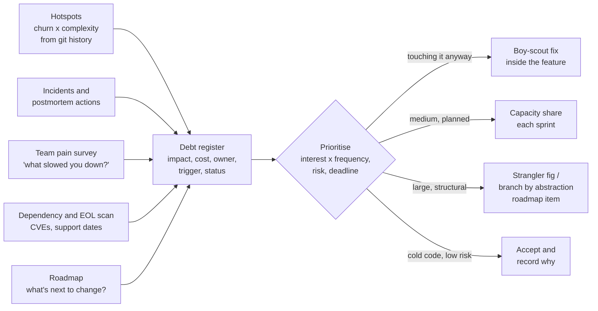

# Technical Debt Management

!!! abstract "Key takeaways"
    - Ward Cunningham's metaphor (1992): shipping code that reflects an incomplete understanding is like borrowing; the **principal** is the cost to fix it, the **interest** is the extra cost you pay on every change until you do. Debt is a **tool**, not a sin, when taken deliberately and repaid.
    - **Not all debt matters.** Debt in code nobody touches charges no interest. Prioritise by **interest × frequency**: hotspots (high churn × high complexity), areas behind incidents, and debt that blocks the next roadmap item.
    - Make debt **visible in business terms** with a register: impact (hours lost, incidents, risk, deadlines such as end of support), cost to fix, owner, trigger. "Refactor the pricing module" loses to features; "cuts lead time for pricing changes from 8 days to 2" doesn't.
    - Pay continuously: **boy-scout rule** in feature work, a **steady capacity share** for planned items, and **strangler fig** or **branch by abstraction** for big pieces. Avoid big-bang rewrites.
    - **Stop new debt spreading** with automation: architecture tests (ArchUnit), quality gates on new code, dependency update bots, automated migrations (OpenRewrite), and flag expiry dates.

## Why it matters

Every lead gets asked "how do you balance tech debt against features?" The weak answer is "we do a tech-debt sprint". The strong answer shows you can **find** the debt that's actually costing money, **price** it in terms a product owner cares about, and **pay it down without stopping delivery**.

The stakes are real. Southwest Airlines' December 2022 meltdown, when a winter storm overwhelmed an outdated crew-scheduling system and the airline had to cancel most of its flights to reset its network, ended in a US Department of Transportation settlement of **$140 million** in December 2023. Log4Shell (December 2021) showed dependency debt: teams that couldn't list where Log4j 2 was used spent days finding out. Stripe's *Developer Coefficient* survey (2018) estimated developers spend over 17 hours a week on maintenance, about 4 of them on "bad code"; it's a vendor survey, so quote it as an estimate.

This page goes deeper than the summary on the [engineering standards page](../leadership-behavioral/10-driving-engineering-standards-and-technical-decisions.md), which shows Fowler's debt quadrant and the capacity-budget argument.

## Core concepts

### Principal, interest and the quadrant

- **Principal:** the effort to bring the code to where it should be.
- **Interest:** the extra effort, risk or incidents you pay *every time* you work near it. Interest is only charged when you touch the code or when it breaks.
- **Fowler's quadrant** separates **deliberate vs inadvertent** and **prudent vs reckless** debt. "We must ship now and deal with consequences" is prudent and deliberate; "now we know how we should have done it" is prudent and inadvertent, and every healthy team produces it. Reckless debt is a skills or culture problem, not a backlog item.

{ loading=lazy }
*Paying a steady share looks slower for a few sprints and faster for the rest of the product's life. Illustrative.*

### Kinds of debt

| Kind | Example | Typical interest |
|---|---|---|
| Code | 600-line resolver, copy-pasted mapping logic | Slow, risky changes; bugs in one copy only |
| Design / architecture | Two services sharing a database; synchronous chain of 5 calls | Coupled releases, cascading failures |
| Test | No integration tests around a payment flow; flaky E2E suite | Fear of change, manual regression, ignored red builds |
| Dependency / platform | Java 8, Spring Boot 2.x after open-source support ended, an EOL Node version | Security exposure, blocked upgrades, audit findings |
| Infrastructure | Hand-configured servers, no IaC | Snowflake environments, slow recovery |
| Data | Inconsistent identifiers across systems, nullable everything | Reconciliation work, reporting errors |
| Documentation / knowledge | Only one person understands the batch job | Bus factor, slow onboarding, slow incidents |
| Security | Disabled TLS verification "temporarily", broad IAM roles | Breach risk, audit failures |

### Finding the debt that matters


*Notice that accepting debt is a valid outcome. The register exists so that decision is made on purpose, and revisited when the trigger (a roadmap change, an end-of-support date) arrives.*

- **Hotspots.** Adam Tornhill's approach (*Your Code as a Crime Scene*, CodeScene): files that change often *and* are complex are where interest is paid. A complex file nobody touches is cheap debt. `git log` gives churn; any complexity metric gives the other axis.
- **Incidents.** Postmortem contributing factors that say "fragile", "no tests", "only X knew" are debt with a measured cost.
- **Ask the team.** A two-question retro ("what slowed you down most this sprint, and where?") is surprisingly accurate.
- **Dates.** End-of-support dates for runtimes, frameworks and libraries turn debt into deadlines. Track them like any other dependency.
- **Tool estimates with care.** SonarQube's "technical debt" (remediation effort for code smells) is useful for trends on new code, not as the business case: it counts rule violations, not interest.

### Prioritising

```mermaid
quadrantChart
    title Debt items by interest paid and cost to fix
    x-axis Low cost to fix --> High cost to fix
    y-axis Low interest --> High interest
    quadrant-1 Plan it: roadmap item
    quadrant-2 Do now
    quadrant-3 Boy-scout when touched
    quadrant-4 Accept and record
    Flaky E2E suite: [0.3, 0.85]
    Shared DB between services: [0.82, 0.78]
    Copy-pasted mappers: [0.2, 0.35]
    Old admin batch job: [0.75, 0.15]
    Spring Boot 2 EOL: [0.6, 0.65]
```
*Notice the top-left quadrant: cheap fixes with high interest are the easiest business case you'll ever make. Item positions are illustrative.*

### Paying it down without stopping delivery

- **Boy-scout rule** (leave code better than you found it), and Kent Beck's "make the change easy, then make the easy change": refactor the area you're about to change as the first commit of the feature.
- **A steady capacity share** for planned debt items, agreed with the product owner and reported on like features. The [standards page](../leadership-behavioral/10-driving-engineering-standards-and-technical-decisions.md) discusses the size of the share.
- **Strangler fig** (Fowler, 2004) for large legacy components: put a routing facade in front, build new capabilities beside the old system, move traffic slice by slice, and delete the old code when nothing routes to it. **Branch by abstraction** does the same inside a codebase ([branching page](01-git-internals-and-branching-strategies.md)); the service-level version is on the [monolith migration page](../microservices/02-decomposition-strategies-and-monolith-migration.md).
- **Automated migrations** for platform debt: OpenRewrite recipes upgrade Spring Boot, JUnit and Java versions across many repos; Renovate or Dependabot keep dependencies current in small, reviewable PRs.
- **Rewrites** only when the old system genuinely can't evolve and you can migrate incrementally. Joel Spolsky's "Things You Should Never Do" (2000) on Netscape's rewrite is the classic warning: the old code holds years of bug fixes nobody documented.

{ loading=lazy }
*Each slice is a normal release that can be rolled back; there's never a big-bang cut-over.*

### Talking to the business

Translate every item into one of four currencies the business already uses:

1. **Speed:** "Changes to pricing take 8 days end to end; 5 of them are working around the rules module."
2. **Risk:** "Spring Boot 2.7 is out of open-source support; a critical CVE would need an emergency upgrade under pressure."
3. **Incidents and cost:** "Three of the last five P2 incidents started in the batch importer; each cost about a day of two engineers."
4. **Opportunity:** "The new member portal needs real-time eligibility; the current synchronous chain can't meet its latency target."

## In practice: code & configuration

### Recording debt: TODO vs a decision with an owner

=== "❌ Common mistake"
    ```java
    // TODO: fix this later, hacky
    public Money price(Claim c) {
        if (c.planCode().startsWith("LEG")) {        // copied from OldPricing, keep in sync!!
            return legacyRules(c);
        }
        return rules(c);
    }
    ```

=== "✅ Correct approach"
    ```java
    /**
     * Legacy plan codes still priced by the old rules.
     * Debt: DEBT-142 (register). Owner: pricing team. Trigger: last LEG plan migrates (Q3).
     */
    @Deprecated(since = "4.2", forRemoval = true)     // compiler warns every new caller
    Money legacyRules(Claim c) { /* ... */ }
    ```
    ```java
    // ArchUnit: stop the debt spreading while it's paid down
    @AnalyzeClasses(packages = "com.example.pricing")
    class PricingArchitectureTest {
        @ArchTest
        static final ArchRule noNewLegacyCallers =
            FreezingArchRule.freeze(                    // existing violations recorded, new ones fail
                noClasses().that().resideOutsideOfPackage("..legacy..")
                    .should().dependOnClassesThat().resideInAPackage("..legacy.."));
    }
    ```

### A debt register entry

```yaml
# docs/debt/DEBT-142.yaml (or a labelled ticket with the same fields)
id: DEBT-142
title: Legacy plan pricing duplicated in two modules
kind: code/design
interest: >
  Every pricing change is made twice (~1.5 days extra per change, ~2 changes/month);
  two production defects in 2026 from the copies drifting.  # numbers illustrative
principal: 6-8 days (merge rules, migrate tests, delete legacy path)
risk: medium (pricing errors reach members)
trigger: before Q3 plan-year changes
owner: pricing team
plan: branch by abstraction behind PricingEngine, flag per plan code
status: planned (sprint 31-32)
```

### Platform debt with automated migration

```xml
<!-- pom.xml: OpenRewrite plugin; run `mvn rewrite:run`, review the diff like any PR -->
<plugin>
  <groupId>org.openrewrite.maven</groupId>
  <artifactId>rewrite-maven-plugin</artifactId>
  <version><!-- current release --></version>
  <configuration>
    <activeRecipes>
      <recipe>org.openrewrite.java.spring.boot3.UpgradeSpringBoot_3_4</recipe>
    </activeRecipes>
  </configuration>
  <dependencies>
    <dependency>
      <groupId>org.openrewrite.recipe</groupId>
      <artifactId>rewrite-spring</artifactId>
      <version><!-- current release --></version>
    </dependency>
  </dependencies>
</plugin>
```

## Real-world usage

- **Southwest Airlines (2022):** an under-invested crew-scheduling system that couldn't cope with mass disruption; the DOT settlement was $140 million, most of it as credits and compensation to passengers. A standard example of operational debt becoming a business crisis.
- **Log4Shell (2021):** organisations with a software bill of materials and automated dependency updates patched in hours; others spent days discovering where Log4j lived. Dependency debt is security debt.
- **Strangler fig migrations** are the norm for large legacy estates: incremental, reversible, delivering value along the way. Big-bang rewrites have a poor record (Netscape 6 is the usual cautionary tale).
- **Healthcare and banking** carry heavy platform debt (mainframes, batch files, old Java). Debt work there is often justified by **audit and end-of-support risk**, which compliance teams will fund when features won't.

## Trade-offs & production gotchas

| Approach | Pros | Cons | Use when |
|---|---|---|---|
| Boy-scout rule | No negotiation; debt paid where interest is | Only reaches code being touched; can bloat PRs | Always, in a separate commit/PR from behaviour change |
| Capacity share each sprint | Predictable, sustainable | Can become a dumping ground without a register | Ongoing, medium items |
| Debt sprint / hardening sprint | Visible, focused | Debt builds up between; signals features matter more | Rarely; e.g. after a crunch, with a clear list |
| Strangler fig | Incremental, reversible, value along the way | Two systems in parallel for a while; facade complexity | Large legacy components |
| Big-bang rewrite | Clean slate | Loses hidden knowledge, long time to value, high failure rate | Almost never |

!!! warning "Gotcha: refactoring mixed into feature PRs"
    A PR that both moves 40 files and changes behaviour is unreviewable and hard to revert. Put the refactor in its own PR first (no behaviour change, tests unchanged and green), then the feature.

!!! warning "Gotcha: the debt backlog nobody reads"
    A list of 200 "tech debt" tickets with no impact or owner is noise. Keep the register short (top 10–20 with interest stated), review it monthly with the product owner, and close items you've decided to accept.

!!! tip "Interview angle"
    Use the words **interest** and **hotspot**, and give one number: "this module was in 60% of our changes and 3 of 5 incidents, so we paid it down first." That's what separates a lead from someone who just dislikes old code.

## How this connects to my experience

- **Where I used it:** not a resume claim on its own. Closest lines: *"Contributed to the migration of a legacy monolithic application to microservices"* (Johnson Controls, Metasys), *"Established engineering standards around testing, CI/CD, code quality, and deployment practices"* (OptumRx Meteor), and *"Implemented ... Liquibase migration strategies"* (Deloitte ConvergeHealth).
- **Talking points:**
    - Metasys: what made the monolith hard to change, and whether the migration was incremental (strangler-style) or a rewrite *[confirm the approach and my part as a graduate engineer]*.
    - Meteor: one debt item I made visible and got prioritised, for example GraphQL resolvers with duplicated upstream mapping, a missing integration-test layer, or a library upgrade *[confirm a real one and its impact]*.
    - How debt was balanced with features during sprint planning: a capacity share, boy-scout rule or debt tickets in the backlog *[confirm]*.
    - Liquibase as debt prevention: versioned schema changes instead of manual scripts.
- **Likely follow-up chain:** "How do you handle tech debt?" → "Give me an example you paid down" → "How did you convince the product owner?" → "How did you know it was worth it?" Answer with the register and interest framing; the real example; the business currency you used (speed, risk, incidents); and a before/after measure such as change lead time or incident count *[confirm numbers]*.

## Interview questions

### Fundamentals

??? question "Q1. What is technical debt?"
    **Answer:** Ward Cunningham's metaphor for the gap between the code you have and the code you'd write with today's understanding. The principal is the cost to close the gap; the interest is the extra effort and risk you pay every time you change or run that code until you do. Taken deliberately and repaid, it's a legitimate way to learn faster or hit a date.

    **Interviewer listens for:** principal vs interest, debt as a deliberate tool.

    **Common wrong answer:** "Bad code written by bad developers."

??? question "Q2. What kinds of technical debt are there?"
    **Answer:** Code (duplication, complexity), design and architecture (coupling, shared databases), test (missing or flaky tests), dependency and platform (EOL runtimes and frameworks, vulnerable libraries), infrastructure (manual environments), data, documentation and knowledge (bus factor), and security. Fowler's quadrant classifies by intent: deliberate or inadvertent, prudent or reckless.

    **Interviewer listens for:** beyond code; dependency and knowledge debt.

    **Common wrong answer:** Only code smells.

??? question "Q3. How do you decide which debt to pay first?"
    **Answer:** By interest, not by ugliness: how often the code changes, how much each change costs because of the debt, incidents it causes, risk and deadlines (end of support, audits), and whether the next roadmap items go through it. Hotspot analysis (churn × complexity) finds candidates; cheap fixes with high interest go first; cold, stable code can be left alone and recorded as accepted.

    **Interviewer listens for:** interest × frequency, accepting some debt.

    **Common wrong answer:** "Whatever SonarQube flags as most debt."

### Intermediate

??? question "Q4. How do you convince a product owner to prioritise debt?"
    **Answer:** Speak in their currencies: speed (lead time for changes in that area), risk (EOL dates, CVEs, audit findings), incidents and their cost, and the features it blocks or slows. Bring data from the register and the incident log, propose a bounded plan with a measurable outcome, and report back on it like a feature. Agree a steady capacity share so you don't renegotiate every sprint.

    **Interviewer listens for:** business framing, data, follow-through.

    **Common wrong answer:** "Explain that the code is bad."

??? question "Q5. Debt sprint vs continuous paydown?"
    **Answer:** Continuous wins in most teams: boy-scout fixes where you're working, a capacity share for planned items, and roadmap items for structural work. Debt sprints let debt pile up in between and send the message that quality is a separate activity. A focused hardening period can make sense after a crunch, with a defined list.

    **Interviewer listens for:** continuous by default, with reasons.

    **Common wrong answer:** "A tech-debt sprint every quarter."

??? question "Q6. How do you stop new debt being added?"
    **Answer:** Quality gates on new code (SonarQube "clean as you code"), architecture tests such as ArchUnit with frozen existing violations, code review with a checklist, dependency update bots, ADRs for deliberate shortcuts with a payback trigger, feature-flag expiry dates, and a definition of done that includes tests and docs.

    **Interviewer listens for:** automation and recording deliberate debt.

    **Common wrong answer:** "Tell developers to write clean code."

### Senior

??? question "Q7. When would you approve a rewrite?"
    **Answer:** Rarely, and almost never big-bang. Only when the old system can't meet a hard requirement (scale, security, platform end of life) and incremental change is genuinely impossible or costlier. Even then, migrate with a strangler fig: facade first, capability by capability, with old and new running side by side and a rollback per slice. Budget for the undocumented behaviour the old system carries.

    **Interviewer listens for:** strangler fig, hidden knowledge, reversibility.

    **Common wrong answer:** "When the code is too messy to work with."

??? question "Q8. How do you measure whether debt work paid off?"
    **Answer:** Choose the measure when you choose the item: lead time or cycle time for changes in that area, change failure rate, incident count and time to restore for that component, build or test time, onboarding time. Record the baseline, do the work, and compare over a few sprints. Report it, so the next debt request is easier.

    **Interviewer listens for:** baseline and outcome metric chosen up front.

    **Common wrong answer:** "Lower SonarQube debt score."

### Scenario-based

??? question "Q9. You join a team with a 400-ticket tech debt backlog. What do you do in your first month?"
    **Answer:** Don't start fixing. Run hotspot analysis on git history, read the last few postmortems, survey the team on what slows them down, and list EOL dates. Build a short register of the top 10–15 items with interest, cost and owner, close or archive the rest, and agree a capacity share and the first two items with the product owner, one of them a quick win. Set the measure for each.

    **Interviewer listens for:** data-driven triage, short register, quick win, agreement.

    **Common wrong answer:** "Start with the oldest tickets."

??? question "Q10. Your Spring Boot 2.7 services are past open-source support and a critical CVE drops. What's your plan?"
    **Answer:** Short term: assess exposure, apply a patched dependency version or mitigation if available, and add WAF or config mitigations. Then treat the upgrade as a planned programme: Java 17+ baseline, `javax` to `jakarta` namespace, Spring Security 6 configuration changes, Hibernate 6. Use OpenRewrite recipes to automate most of it, upgrade one service first as a template, run contract and integration tests, and roll out service by service. Add EOL dates to the register so it doesn't happen again.

    **Interviewer listens for:** immediate mitigation, then automated, incremental upgrade, and prevention.

    **Common wrong answer:** "Upgrade all services this weekend."

## Cheat sheet

| Concept | Remember |
|---|---|
| Metaphor | Cunningham 1992: principal = cost to fix, interest = cost of every change until then |
| Quadrant | Deliberate/inadvertent × prudent/reckless (Fowler) |
| Kinds | Code, design, test, dependency/platform, infra, data, knowledge, security |
| Find | Hotspots (churn × complexity), incidents, team survey, EOL dates, roadmap |
| Prioritise | Interest × frequency, risk, deadline; cold code can be accepted |
| Pay | Boy-scout, capacity share, strangler fig / branch by abstraction, OpenRewrite |
| Prevent | Quality gate on new code, ArchUnit, dependency bots, ADRs, flag expiry |
| Sell | Speed, risk, incidents, opportunity, with numbers |
| Avoid | Big-bang rewrite, refactor mixed into feature PR, unread 400-ticket backlog |

## Sources
1. [Ward Cunningham: The WyCash Portfolio Management System (OOPSLA 1992 experience report)](https://c2.com/doc/oopsla92.html): origin of the debt metaphor.
2. [Martin Fowler: Technical Debt](https://martinfowler.com/bliki/TechnicalDebt.html) and [Technical Debt Quadrant](https://martinfowler.com/bliki/TechnicalDebtQuadrant.html): principal and interest, the quadrant.
3. [Martin Fowler: Strangler Fig Application](https://martinfowler.com/bliki/StranglerFigApplication.html): incremental replacement of legacy systems.
4. Adam Tornhill: *Your Code as a Crime Scene* (Pragmatic Bookshelf, 2nd ed. 2024): hotspot analysis from version-control history.
5. [ArchUnit user guide: Freezing arch rules](https://www.archunit.org/userguide/html/000_Index.html#_freezing_arch_rules): record existing violations, fail on new ones.
6. [OpenRewrite: Spring Boot 3 migration recipes](https://docs.openrewrite.org/recipes/java/spring/boot3): automated framework upgrades.
7. [Spring Boot support timeline](https://spring.io/projects/spring-boot#support): open-source and commercial support end dates per version.
8. [US fines Southwest Airlines $140 million after 2022 meltdown (Reuters via AJOT)](https://www.ajot.com/news/us-fines-southwest-airlines-140-million-after-2022-meltdown): outdated crew scheduling, settlement structure.
9. [Stripe Developer Coefficient coverage (O'Reilly Radar, Sept 2018)](https://www.oreilly.com/radar/four-short-links-17-september-2018/): survey estimate of time spent on maintenance and bad code.
10. [Joel Spolsky: Things You Should Never Do, Part I](https://www.joelonsoftware.com/2000/04/06/things-you-should-never-do-part-i/): the case against big-bang rewrites.
