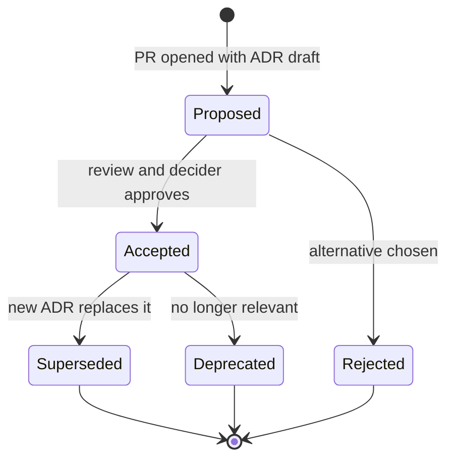
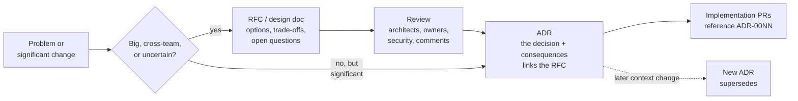
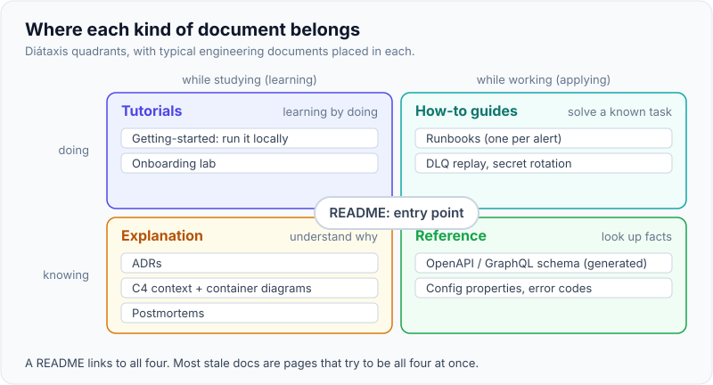
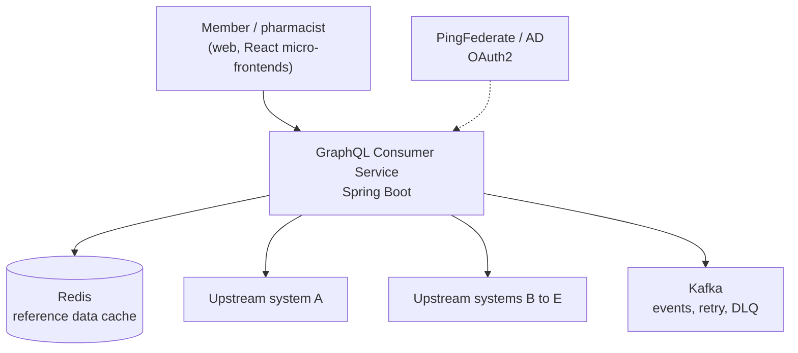

# Architecture Decision Records & Documentation

!!! abstract "Key takeaways"
    - An **ADR** is a short, numbered record of **one architecturally significant decision**: its **context** (forces, constraints), the **decision** ("We will…"), its **status** and its **consequences**, good and bad. Michael Nygard proposed the format in 2011.
    - ADRs are **append-only**: you don't edit an accepted decision, you write a new ADR that **supersedes** it and link both ways. The log becomes the history of *why* the system looks the way it does.
    - **RFC / design doc = proposal for discussion before deciding; ADR = the record after deciding.** Many teams link the RFC from the ADR.
    - Keep docs **as code**: Markdown in the repo next to the code, reviewed in PRs, built and published by CI. Docs that live away from code rot fastest.
    - Organise docs by the reader's need: **Diátaxis** (tutorials, how-to guides, reference, explanation), **C4** diagrams for architecture (context, containers, components), **runbooks** for on-call, and generated reference (OpenAPI, GraphQL schema). Every page has an owner.

## Why it matters

Six months after a decision nobody remembers why it was made. New engineers either accept it blindly ("there must have been a reason") or reverse it blindly and rediscover the reason in production. Both are expensive. ADRs fix this cheaply: a page or two per decision, written when the context is fresh.

For a lead, ADRs and documentation are also how you **scale your influence**: architects, other teams, auditors and new joiners can understand the system without booking a meeting with you. Interviewers ask "how do you make and record technical decisions?" and "how do you keep documentation from going stale?" The decision-making side (one-way vs two-way doors, who decides) is on the [engineering standards page](../leadership-behavioral/10-driving-engineering-standards-and-technical-decisions.md); this page covers the records and the documentation system around them.

## Core concepts

### What counts as architecturally significant

Write an ADR when a decision is **hard to reverse, affects more than one team, or will make someone ask "why?"** later:

- Choice of datastore, message broker, framework, API style (REST vs GraphQL), auth model.
- Cross-cutting patterns: caching strategy, retry and DLQ policy, idempotency, multi-tenancy, versioning.
- Deliberate shortcuts with a payback trigger (a recorded [technical debt](03-technical-debt-management.md) decision).
- Decisions *not* to do something ("We will not split the consumer service yet").

Skip it for decisions that are easily reversed and local to one module; a PR description is enough.

### The Nygard format and its variants

| Section | Content |
|---|---|
| **Title** | Numbered, names the decision: "ADR-0012: Use cache-aside in Redis for UI reference data" |
| **Status** | Proposed → Accepted → (Deprecated or Superseded by ADR-00NN); or Rejected |
| **Context** | Forces at play: requirements, constraints, quality attributes, team skills, politics. Value-neutral |
| **Decision** | "We will …" in full sentences, active voice |
| **Consequences** | Everything that follows, positive, negative and neutral, including new risks and follow-up work |

Variants:

- **MADR** (Markdown Any Decision Records) adds **decision drivers**, **considered options** and pros/cons per option, plus a "confirmation" section on how compliance with the decision will be checked.
- **Y-statement** (Zdun et al.) for one-paragraph records: *"In the context of <use case>, facing <concern>, we decided for <option> and neglected <alternatives>, to achieve <quality>, accepting <downside>."*

### Lifecycle


*Notice there's no arrow from Accepted back to Proposed. You never rewrite an accepted ADR's decision; you supersede it, so the history of reasoning stays intact. Fixing typos or adding links is fine.*

{ loading=lazy }
*The old decision stays in the log, marked superseded, so the reasoning behind both is still readable.*

### ADR, RFC, design doc


*Notice the RFC is optional and the ADR isn't. An RFC captures the debate; the ADR is the short, durable answer people will search for later.*

### Documentation as a system

**Docs-as-code:** Markdown (or AsciiDoc) in the repo, changed in the same PR as the code, reviewed like code, linted, and published by CI to a site (MkDocs or Zensical, Backstage TechDocs, Docusaurus). The single biggest predictor of whether docs stay true is whether updating them is part of the change.

**Diátaxis** (Daniele Procida) sorts docs by what the reader needs:

| Type | Reader's need | Example |
|---|---|---|
| Tutorial | Learning by doing | "Run the consumer service locally and make your first query" |
| How-to guide | Solving a known task | "Replay messages from the DLQ", "Rotate the client secret" |
| Reference | Looking up facts | GraphQL schema docs, OpenAPI spec, config properties |
| Explanation | Understanding why | Architecture overview, ADRs, caching strategy |

{ loading=lazy }
*Most stale-doc complaints come from mixing types: a README that tries to be tutorial, reference and explanation at once.*

**C4 model** (Simon Brown) for architecture diagrams: **Context** (the system and its users and neighbours), **Containers** (deployable units and datastores), **Components** (inside one container), **Code** (rarely worth drawing). Two levels, kept up to date, beat ten levels that drift. Diagrams as code (Mermaid, Structurizr DSL, PlantUML) can be reviewed in PRs.


*Notice this is a C4 container-level sketch: deployable units and datastores, no classes. It's what a new joiner and an architect both need first. Names here are illustrative of the resume, not an exact diagram.*

**Other documents a service needs:** a **README** (what it is, how to run, how to test, who owns it), **runbooks** for every alert (symptom, checks, mitigation, escalation; see [alerting and on-call](../observability/06-alerting-and-on-call.md)), **API reference** generated from the source of truth (OpenAPI, GraphQL SDL), and **postmortems** ([incident management](../observability/07-incident-management-and-postmortems.md)).

**Freshness:** an owner per page (CODEOWNERS works for docs), a "last reviewed" date, deleting docs that are wrong rather than leaving them, and generating reference docs instead of writing them by hand.

## In practice: code & configuration

### Recording a decision

=== "❌ Common mistake"
    ```text
    #team-meteor (Slack), 14 March:
      A: so are we going with redis for the reference data?
      B: yeah I think so, architect was ok with it
      A: 👍
    Confluence "Architecture decisions" page: last edited 2 years ago, overwritten 9 times,
    no record of what the alternatives were or why the earlier choice changed.
    ```

=== "✅ Correct approach"
    ```markdown
    # ADR-0012: Use Redis cache-aside for UI reference data

    - Status: Accepted (supersedes ADR-0007)
    - Date: 2026-03-14
    - Deciders: tech lead, solution architect; consulted: platform, security
    - Related: RFC-004 "Reference data caching", ticket MET-2231

    ## Context
    The GraphQL Consumer Service serves UI reference data (plan types, pharmacy lists)
    aggregated from upstream systems. ADR-0007 cached it in-process (Caffeine).
    With 6 pods, caches diverge for up to 10 minutes after an upstream change, and each
    pod warms separately after a deploy, sending bursts to a rate-limited upstream.
    Data is not PHI. Upstreams publish change events on Kafka.

    ## Decision
    We will cache reference data in Redis using cache-aside with a 30-minute TTL,
    and evict keys on the upstream change events from Kafka.
    In-process caching remains for per-request memoisation only.

    ## Considered options
    1. Keep Caffeine per pod (rejected: divergence, warm-up bursts)
    2. Redis cache-aside with TTL + event eviction (chosen)
    3. Push full reference data to the UI at build time (rejected: changes daily)

    ## Consequences
    + One consistent view across pods; one warm-up per key, not per pod.
    + Event-driven eviction gives near-real-time freshness.
    - New runtime dependency: Redis availability now affects latency; fall back to
      upstream on Redis errors with a circuit breaker.
    - Key design must include locale and plan year; reviewed in CODEOWNERS.
    - Follow-up: dashboard for hit ratio and eviction lag (MET-2240).
    ```
    *Illustrative ADR modelled on the resume's Redis caching line; numbers are examples [confirm the real decision].*

### Repository layout and tooling

```text
consumer-graphql/
├── README.md                  # what, run, test, owner, links
├── docs/
│   ├── adr/
│   │   ├── 0001-record-architecture-decisions.md
│   │   ├── 0007-cache-reference-data-in-process.md      # Status: Superseded by 0012
│   │   └── 0012-redis-cache-aside-for-reference-data.md
│   ├── architecture.md        # C4 context + container diagrams (Mermaid)
│   ├── runbooks/
│   │   ├── dlq-replay.md
│   │   └── upstream-timeouts.md
│   └── api/                   # generated from the GraphQL schema in CI
└── mkdocs.yml                 # docs site built and published by the pipeline
```

```bash
# adr-tools (npryce/adr-tools): numbering and superseding handled for you
adr init docs/adr
adr new -s 7 "Redis cache-aside for reference data"   # creates 0012, marks 0007 superseded, links both
```

```yaml
# catalog-info.yaml: Backstage TechDocs publishes docs/ next to the service's catalog entry
apiVersion: backstage.io/v1alpha1
kind: Component
metadata:
  name: consumer-graphql
  annotations:
    backstage.io/techdocs-ref: dir:.
spec:
  type: service
  owner: team-meteor
  lifecycle: production
```

## Real-world usage

- **UK Government Digital Service** ("The GDS Way") and many public-sector teams publish ADR guidance and keep ADRs in repos; AWS Prescriptive Guidance documents an ADR process for teams on AWS.
- **Spotify** wrote publicly about when to write an ADR: whenever a decision has significant impact, including decisions made long ago that were never written down (backfilling).
- **Google** uses design docs reviewed before significant work starts, as described in *Software Engineering at Google*; RFC processes at companies like Uber and HashiCorp serve the same role across teams.
- **Regulated domains:** ADRs double as audit evidence for why a control was chosen (encryption, data residency, retention). In healthcare work, "why is PHI not cached here?" deserves an ADR.
- **Failure modes:** ADRs written after the fact to justify a decision already shipped, ADRs so long nobody reads them, decision logs in a wiki that are edited in place, and docs with no owner that are trusted long after they've gone wrong.

## Trade-offs & production gotchas

| Option | Pros | Cons | Use when |
|---|---|---|---|
| ADRs in the repo (Markdown) | Versioned with code, reviewed in PRs, close to developers | Less visible to non-engineers | Default for service-level decisions |
| ADRs in a wiki | Visible, easy for architects and PMs | Edited in place, drift from code | Enterprise-wide decisions, with links from repos |
| Nygard (5 sections) | Fast to write, easy to read | Alternatives can be skipped | Most decisions |
| MADR (options, drivers) | Forces explicit comparison | Longer | Contested or one-way-door decisions |
| Hand-written reference docs | Flexible | Go stale | Avoid; generate from OpenAPI/SDL/config |

!!! warning "Gotcha: the ADR as permission slip"
    An ADR written after the code shipped, with only the chosen option listed, records nothing useful. Write it while the decision is open (status Proposed), list real alternatives and negative consequences, and let the PR review be the discussion.

!!! tip "Interview angle"
    Say "I'd write ADR-0001: record architecture decisions" as the first thing on a new team, and mention **supersede, don't edit**. Those two details show you've actually run an ADR log.

## How this connects to my experience

- **Where I used it:** not a resume claim on its own. Related lines: *"Collaborated with senior architects to design scalable service architecture, API strategies, and data integration patterns"*, *"Owned the GraphQL Consumer Service end-to-end, acting as the integration layer between 5 upstream systems"* (OptumRx Meteor), and *"driving architecture discussions"* (summary).
- **Talking points:**
    - How decisions with architects were recorded on Meteor: ADRs, design docs, Confluence pages or architecture review minutes *[confirm the actual practice]*.
    - Decisions worth an ADR from the resume: GraphQL as the integration layer over 5 upstreams, Redis for reference-data caching, Kafka retry topics and DLQ, micro-frontend architecture for the React app, PingFederate/OAuth2 integration *[confirm which were formally recorded]*.
    - Runbooks for production support: DLQ replay, upstream timeouts *[confirm]*.
    - If ADRs weren't used: say so honestly and explain how you'd introduce them (ADR-0001, a template, PR review), which is a strong answer in itself.
- **Likely follow-up chain:** "How do you document architecture decisions?" → "Show me what one looks like" → "What happens when a decision changes?" → "How do you keep docs current?" Answer with the five sections and a real decision (the Redis one), supersede-not-edit, and docs-as-code with owners and generated reference.

## Interview questions

### Fundamentals

??? question "Q1. What is an ADR and what goes in it?"
    **Answer:** A short document recording one architecturally significant decision. Nygard's format: title (numbered), status, context (the forces and constraints), decision ("We will…"), and consequences (positive, negative and neutral). It's stored with the code and kept as an append-only log.

    **Interviewer listens for:** the sections, especially consequences including negatives.

    **Common wrong answer:** "A document describing the architecture."

??? question "Q2. Which decisions deserve an ADR?"
    **Answer:** Ones that are hard to reverse, affect several teams or services, or will prompt "why is it like this?" later: datastores, brokers, frameworks, API style, auth model, cross-cutting patterns like caching and retries, deliberate shortcuts, and decisions not to do something. Easily reversed local choices go in a PR description.

    **Interviewer listens for:** a reversibility and impact test.

    **Common wrong answer:** "Every technical decision."

??? question "Q3. How is an ADR different from an RFC or design doc?"
    **Answer:** An RFC or design doc is a proposal written before deciding, to gather feedback on options and open questions; it can be long. An ADR records the decision and its consequences after it's made; it's short and durable. Teams often link the RFC from the ADR. Small decisions can skip the RFC and go straight to an ADR in Proposed status.

    **Interviewer listens for:** before vs after, discussion vs record.

    **Common wrong answer:** "They're the same thing."

### Intermediate

??? question "Q4. A decision recorded in an ADR turns out wrong. What do you do with the ADR?"
    **Answer:** Leave its decision text as it was, change its status to "Superseded by ADR-00NN", and write a new ADR with the new context and decision that links back. The old ADR explains why the first choice made sense at the time, which helps avoid repeating the mistake.

    **Interviewer listens for:** supersede, don't edit; links both ways.

    **Common wrong answer:** "Update the ADR with the new decision."

??? question "Q5. Where should ADRs live?"
    **Answer:** In the repository of the system they affect (e.g. `docs/adr/`), as Markdown, reviewed in PRs, published with the docs site. Cross-cutting enterprise decisions can live in a central architecture repo or wiki, linked from each service. The test is whether developers find and update them as part of normal work.

    **Interviewer listens for:** close to code, reviewed, discoverable.

    **Common wrong answer:** "In Confluence, maintained by the architect."

??? question "Q6. How do you keep documentation from going stale?"
    **Answer:** Docs-as-code updated in the same PR as the change, with a PR template checkbox; generate reference docs (OpenAPI, GraphQL schema, config) from the source; owners per page via CODEOWNERS; a last-reviewed date with periodic review; delete wrong docs; and keep each page to one Diátaxis type so it stays focused.

    **Interviewer listens for:** generation, ownership, docs in the change.

    **Common wrong answer:** "A documentation sprint before release."

### Senior

??? question "Q7. How do you introduce ADRs to a team that doesn't use them?"
    **Answer:** Start small: ADR-0001 "Record architecture decisions" with the template, then write the next real decision as ADR-0002 in Proposed status and review it in a PR. Backfill three or four decisions people keep asking about. Add a PR-template prompt ("Does this need an ADR?") and link ADRs from code reviews. Keep them short; nobody will write a ten-page ADR twice.

    **Interviewer listens for:** lightweight start, real decisions, backfilling, habit via PR template.

    **Common wrong answer:** "Mandate ADRs for all changes."

??? question "Q8. How do you document architecture for different audiences?"
    **Answer:** C4: a context diagram for everyone (users, neighbours), a container diagram for engineers and architects (deployables, datastores, protocols), component diagrams only where useful. ADRs for why. Runbooks for on-call, how-to guides for common tasks, generated reference for APIs. Diátaxis keeps each page aimed at one need. Diagrams as code so they're reviewed and versioned.

    **Interviewer listens for:** C4 levels, audience-driven, diagrams as code.

    **Common wrong answer:** "One big architecture diagram."

### Scenario-based

??? question "Q9. A new architect wants to replace Kafka with another broker; the team doesn't remember why Kafka was chosen. What do you do?"
    **Answer:** Look for the original ADR or reconstruct the context from tickets and people (and backfill an ADR). Then run the new proposal as an RFC against today's forces: throughput, ordering, retention and replay, retry/DLQ patterns, team skills, operations cost, migration cost. Record the outcome as a new ADR, either superseding the Kafka one or recording the decision to stay.

    **Interviewer listens for:** recover context, evaluate on current forces, record either way.

    **Common wrong answer:** "Keep Kafka because that's what we use."

??? question "Q10. An auditor asks why patient data isn't encrypted at the application layer in one service. How should you be able to answer?"
    **Answer:** With an ADR that records the context (data classification, existing encryption at rest via KMS and in transit via TLS, threat model), the options considered (field-level encryption, tokenisation), the decision and its consequences, plus who approved it. Without one, you're reconstructing reasoning from memory under audit, which is exactly what ADRs prevent.

    **Interviewer listens for:** ADRs as compliance evidence, threat model, approvals.

    **Common wrong answer:** "Explain it verbally."

## Cheat sheet

| Concept | Remember |
|---|---|
| ADR | One significant decision: title, status, context, decision, consequences (Nygard 2011) |
| Significant | Hard to reverse, cross-team, or "why?" later |
| Lifecycle | Proposed → Accepted → Superseded/Deprecated; or Rejected. Supersede, never edit |
| Variants | MADR (drivers, options, pros/cons), Y-statement (one paragraph) |
| RFC vs ADR | RFC = proposal before; ADR = record after; link them |
| Where | `docs/adr/NNNN-title.md` in the repo, reviewed in PRs |
| Docs-as-code | Same PR as the change, CI-published, owners, generated reference |
| Diátaxis | Tutorial, how-to, reference, explanation |
| C4 | Context, containers, components, (code) |
| Service docs | README, runbooks per alert, API reference, ADRs, postmortems |

## Sources
1. [Michael Nygard: Documenting Architecture Decisions (2011)](https://www.cognitect.com/blog/2011/11/15/documenting-architecture-decisions): the original ADR format.
2. [Martin Fowler: Architecture Decision Record](https://martinfowler.com/bliki/ArchitectureDecisionRecord.html): ADR practice, immutability and superseding.
3. [MADR: Markdown Any Decision Records](https://adr.github.io/madr/) and [adr.github.io](https://adr.github.io/): templates, Y-statements and tooling.
4. [adr-tools (Nat Pryce)](https://github.com/npryce/adr-tools): command-line numbering and superseding.
5. [AWS Prescriptive Guidance: ADR process](https://docs.aws.amazon.com/prescriptive-guidance/latest/architectural-decision-records/adr-process.html): lifecycle and review process.
6. [The GDS Way: Documenting architecture decisions](https://gds-way.digital.cabinet-office.gov.uk/standards/architecture-decisions.html): public-sector ADR standard.
7. [Spotify Engineering: When Should I Write an Architecture Decision Record (2020)](https://engineering.atspotify.com/2020/04/when-should-i-write-an-architecture-decision-record/): when to write and backfill ADRs.
8. [Diátaxis](https://diataxis.fr/): tutorials, how-to guides, reference and explanation.
9. [The C4 model (Simon Brown)](https://c4model.com/): context, container, component and code diagrams.
10. [Backstage TechDocs](https://backstage.io/docs/features/techdocs/): docs-as-code published alongside the service catalog.
