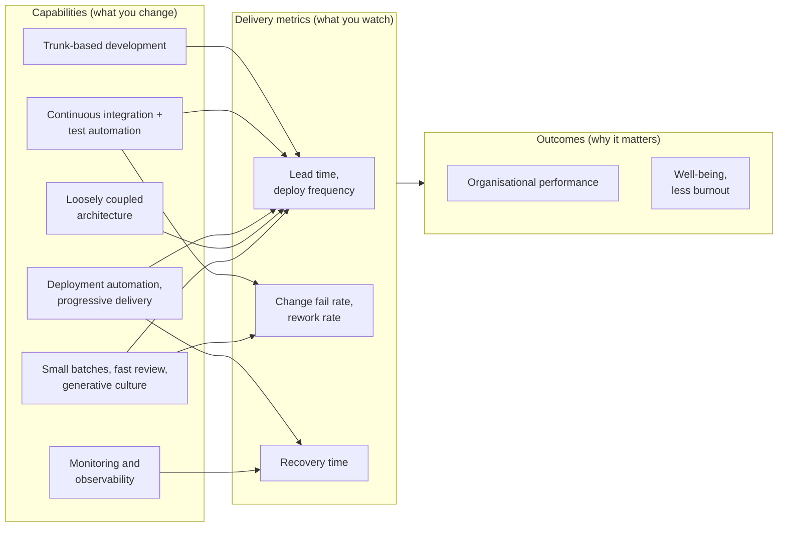

# DORA Metrics & Engineering Effectiveness

!!! abstract "Key takeaways"
    - DORA now uses **five** software delivery metrics in two groups. **Throughput:** change lead time, deployment frequency, failed deployment recovery time. **Instability:** change fail rate, deployment rework rate. The original four come from *Accelerate* (2018); "time to restore" was renamed **failed deployment recovery time** in 2023 and **rework rate** was added in 2024.
    - DORA's central finding: **speed and stability go together**. Teams that deploy small changes often also fail less and recover faster; the "move slow to be safe" trade-off doesn't hold.
    - The metrics are **outcomes**; you improve them through **capabilities**: trunk-based development, CI, test and deployment automation, loosely coupled architecture, monitoring, small batches, a generative culture.
    - Measure **per service, as trends, at team level**, from systems (VCS, CI/CD, incident tool), never per person, never as targets, never to rank teams. DORA's own guide warns about Goodhart's law.
    - DORA measures delivery, not everything. Pair it with **reliability (SLOs)**, **developer experience** (SPACE, DevEx surveys) and **product outcomes**. The 2025 DORA report replaced its four performance clusters with seven team archetypes and found AI **amplifies** a team's existing strengths and weaknesses.

## Why it matters

"How do you measure your team's engineering effectiveness?" is a standard lead and manager question, and the resume lines about release management, CI/CD standards and production support invite it. Weak answers are velocity points, lines of code or commit counts. Strong answers name the DORA metrics precisely, explain how they're measured, give a before/after story, and show awareness of how metrics get gamed.

DORA (DevOps Research and Assessment, part of Google Cloud since 2018) has run its survey-based research for over a decade, with the 2024 report drawing on more than 39,000 professionals across its history. *Accelerate* (Forsgren, Humble, Kim, 2018) is the book that made the four keys mainstream.

## Core concepts

### The five metrics

| Metric | Group | Definition (DORA) | Measured from |
|---|---|---|---|
| **Change lead time** | Throughput | Time from a change being committed to version control to it being deployed in production | Commit timestamp in VCS → production deploy event |
| **Deployment frequency** | Throughput | How often changes are deployed to production (or the time between deployments) | Deploy events from CD |
| **Failed deployment recovery time** | Throughput | Time to recover from a deployment that fails and needs immediate intervention | Failed deploy → rollback, fix-forward or recovery event |
| **Change fail rate** | Instability | Share of deployments that need immediate intervention (rollback, hotfix) | Deploys flagged as failed / all deploys |
| **Deployment rework rate** | Instability | Share of deployments that are unplanned and triggered by a production incident | Incident-linked deploys / all deploys |

{ loading=lazy }
*Every metric comes from timestamps your tools already record; no survey or time-tracking is needed for the basics.*

Notes interviewers probe:

- **Lead time starts at commit, not at ticket creation.** Ticket-to-production ("cycle time" or "customer lead time") is useful too, but it measures product process as well as delivery. Say which one you mean.
- **"Failure" needs a team definition:** a rollback, a hotfix, a feature-flag kill, an incident attributed to the deploy. Write it down before measuring.
- **Recovery is about the failed deployment**, not every incident (an upstream outage isn't a failed deploy). Broader incident response times (MTTD, MTTR) are tracked separately in [incident management](../observability/07-incident-management-and-postmortems.md).
- **Per service.** A monolith deployed monthly and a microservice deployed hourly in the same "team number" hide both stories.

### Speed and stability together

The most-cited DORA result is that the best performers are better on **both** throughput and stability. The mechanism is batch size: small, frequent changes are easier to review, test and roll back, so each deploy is less risky and failures are cheaper to fix. Large, infrequent releases bundle risk, which is why "release freezes" tend to make the next release worse.

DORA's yearly benchmarks moved over time (the elite cluster's change fail rate was quoted as "0–15%" in earlier reports and around 5% in 2024), and the 2025 report replaced clusters with seven team archetypes. In an interview, quote the shape ("on-demand deploys, lead time under a day, recovery under an hour for the best performers") and say benchmarks change by year, rather than reciting one year's table as law *[verify exact thresholds against the report year you cite]*.

### Capabilities drive the metrics


*Notice the direction: you can't improve lead time by asking for it. You improve it by changing a capability (smaller PRs, faster pipeline, decoupled deploys) and watching the metric respond.*

Related pages: [trunk-based development](01-git-internals-and-branching-strategies.md), [code review speed](02-code-review-best-practices.md), [deployment strategies and feature flags](../microservices/11-deployment-strategies-blue-green-canary-feature-flags.md), [quality gates](../testing/07-tdd-coverage-and-quality-gates.md).

### Finding where lead time goes

Lead time is mostly **waiting**: for review, for CI, for a test environment, for a release window, for a change-approval board. Break it into stages before trying to fix it.

{ loading=lazy }
*In this illustrative trace, under a day of the four days is active work. The fix is in the queues, not the typing.*

### Beyond DORA: engineering effectiveness

| Framework | What it covers | Use it for |
|---|---|---|
| **DORA** (five metrics + capabilities) | Software delivery throughput and instability | Delivery health per service; capability improvement |
| **SLOs and error budgets** | Reliability as users experience it | Operational performance; balancing features and reliability ([SLOs](../observability/05-slis-slos-slas-and-error-budgets.md)) |
| **SPACE** (Forsgren, Storey et al., 2021) | Satisfaction and well-being, Performance, Activity, Communication and collaboration, Efficiency and flow | A reminder that productivity is multi-dimensional; pick metrics from at least three dimensions |
| **DevEx** (Noda, Storey, Forsgren, Greiler, 2023) | Feedback loops, cognitive load, flow state | Developer surveys plus system data to find friction |
| **Flow metrics** | Flow time, flow load (WIP), flow efficiency | Where work waits across the whole value stream |

The **2025 DORA report** (*State of AI-assisted Software Development*) found AI use near-universal among respondents and described AI as an **amplifier**: strong platforms and practices turn it into throughput, weak ones get more instability. It's a good line for "how do you measure the impact of AI coding tools?": watch the same delivery and instability metrics, not lines of code generated.

## In practice: code & configuration

### What to put on the dashboard

=== "❌ Common mistake"
    ```text
    Engineering dashboard (shown at the all-hands):
      Commits per developer this month   — ranked, top 3 highlighted
      Story points per sprint            — compared across teams
      Lines of code added                — "productivity"
      Deployment frequency target: 20/week per team, bonus-linked
    Result: commits split, points inflated, deploys of empty config changes,
            no idea whether users got anything faster or safer.
    ```

=== "✅ Correct approach"
    ```text
    Team delivery review (monthly, team-owned, per service, trend over 6 months):
      Change lead time (median and p85)  — commit -> production
      Deployment frequency               — prod deploys per week
      Change fail rate                   — deploys needing rollback/hotfix
      Failed deployment recovery time    — median
      Deployment rework rate             — unplanned deploys from incidents
      + context: SLO attainment, PR time-to-first-review, DevEx survey score
    Used to pick ONE capability to improve next (e.g. "review SLA"), then re-check.
    Never per person; never compared across unlike systems.
    ```

### Computing the metrics from deployment events (PostgreSQL)

```sql
-- deployments(id, service, env, started_at, finished_at, status, trigger)
--   trigger: 'planned' | 'incident'      status: 'ok' | 'failed'
-- deployment_changes(deployment_id, commit_sha, committed_at)
-- recoveries(deployment_id, recovered_at)  -- rollback or fix-forward completed

WITH prod AS (
  SELECT * FROM deployments
  WHERE env = 'production' AND finished_at >= now() - interval '90 days'
)
SELECT
  p.service,
  count(*) / 13.0                                               AS deploys_per_week,
  percentile_cont(0.5) WITHIN GROUP (
      ORDER BY extract(epoch FROM p.finished_at - c.committed_at) / 3600)
                                                                AS median_lead_time_h,
  avg((p.status = 'failed')::int)                               AS change_fail_rate,
  avg((p.trigger = 'incident')::int)                            AS rework_rate,
  percentile_cont(0.5) WITHIN GROUP (
      ORDER BY extract(epoch FROM r.recovered_at - p.finished_at) / 60)
      FILTER (WHERE p.status = 'failed')                        AS median_recovery_min
FROM prod p
JOIN deployment_changes c ON c.deployment_id = p.id
LEFT JOIN recoveries r    ON r.deployment_id = p.id
GROUP BY p.service;
-- Caveat: the join repeats each deployment once per commit, so rate columns are
-- commit-weighted here; compute rates from `prod` alone in a real report.
```

### Emitting deploy events from the pipeline (GitLab CI)

```yaml
deploy_production:
  stage: deploy
  environment:
    name: production            # GitLab records deployments per environment,
    url: https://refills.example.com   # which feeds its built-in DORA metrics
  script:
    - ./deploy.sh "$CI_COMMIT_SHA"
    - >
      curl -sf -X POST "$METRICS_URL/deployments"
      -H "Content-Type: application/json"
      -d "{\"service\":\"consumer-graphql\",\"sha\":\"$CI_COMMIT_SHA\",
           \"trigger\":\"${DEPLOY_TRIGGER:-planned}\",\"status\":\"ok\"}"
  rules:
    - if: $CI_COMMIT_BRANCH == $CI_DEFAULT_BRANCH
# GitLab (Ultimate) also exposes the metrics via API:
#   GET /projects/:id/dora/metrics?metric=lead_time_for_changes
```

## Real-world usage

- **DORA Quick Check** (dora.dev) lets a team benchmark itself in a few minutes against the survey population; GitLab, GitHub-integrated tools, and engineering-intelligence products (LinearB, Sleuth, DX, Jellyfish and others) compute the metrics from VCS and CD data.
- **Regulated industries** often have change-advisory boards. DORA's research found heavyweight external change approval associated with worse delivery performance and no improvement in stability, while peer review plus automation gives the separation-of-duties evidence auditors need. That's a useful argument in banking and healthcare.
- **Goodhart failures** are common: deployment-frequency targets met with empty deploys, change fail rate "improved" by not labelling rollbacks, lead time cut by committing late. DORA's guide explicitly warns against using the metrics as goals or for comparing teams.
- **Platform engineering teams** use DORA trends across many services to decide where to invest (pipeline speed, test environments, deployment automation).

## Trade-offs & production gotchas

| Choice | Pros | Cons | Use when |
|---|---|---|---|
| System-derived metrics | Objective, continuous, cheap once wired | Definitions hide in code; data gaps (manual deploys) | Default for the five metrics |
| Survey (Quick Check, DevEx survey) | Captures perception, friction, culture | Subjective; survey fatigue | Quarterly, alongside system data |
| Commit-to-deploy lead time | Comparable with DORA research | Ignores time before coding | Delivery-pipeline improvements |
| Ticket-to-deploy cycle time | Closer to what customers feel | Mixes product process with delivery | Value-stream conversations with product |
| Team-level trends | Safe, honest, actionable | Less "accountability" theatre | Always |
| Individual metrics | Feels precise | Gamed, destroys collaboration and trust | Never |

!!! warning "Gotcha: one metric alone"
    Pushing deployment frequency without watching change fail rate and rework rate trades stability for speed and hides it. DORA's own advice is to use several metrics that create healthy tension and to share ownership across development and operations.

!!! tip "Interview angle"
    Name all five correctly (including the 2023 rename and the 2024 rework rate), say "per service, trends, team-owned, not targets", and then tell one story: "lead time was X, most of it was waiting for review and a weekly release window; we added a review SLA and moved to daily deploys; lead time fell to Y without change fail rate rising" *[confirm your numbers]*.

## How this connects to my experience

- **Where I used it:** *"Led sprint planning, estimation, stakeholder communication, release management, and production support"* (Leadership highlights) and *"Established engineering standards around testing, CI/CD, code quality, and deployment practices"* on OptumRx Meteor; GitLab CI/CD automated deployments at Coriolis (CCKM); Terraform-automated provisioning and deployment at Deloitte.
- **Talking points:**
    - Release cadence on Meteor before and after the CI/CD standards: deploy frequency, how releases were approved, how rollbacks worked *[confirm actual cadence and numbers]*.
    - Which DORA-style measures were tracked, formally or informally: lead time, change failures, recovery time from production issues *[confirm; if none were formally tracked, say so and describe what you'd instrument]*.
    - A capability change and its effect: for example, adding a test-automation stage, a review SLA, feature flags or automated deployments that shortened lead time or cut rollbacks *[confirm a real one]*.
    - Production support with Kafka retry/DLQ: how failed deployments versus upstream incidents were distinguished, which matters for recovery time *[confirm]*.
- **Likely follow-up chain:** "How do you measure your team's effectiveness?" → "Define lead time precisely" → "What did you improve and how much?" → "How do you stop people gaming it?" Answer with the five metrics plus SLOs and a developer-experience pulse; commit-to-production; the capability story with before/after; and team-level trends, no targets, several metrics in tension, team ownership.

## Interview questions

### Fundamentals

??? question "Q1. What are the DORA metrics?"
    **Answer:** Five software delivery metrics. Throughput: change lead time (commit to production), deployment frequency, and failed deployment recovery time. Instability: change fail rate (deploys needing immediate intervention) and deployment rework rate (unplanned deploys caused by production incidents). The original four keys came from *Accelerate*; recovery time was renamed in 2023 and rework rate added in 2024.

    **Interviewer listens for:** precise definitions, the two groups, awareness of the update.

    **Common wrong answer:** "Velocity, bug count, uptime and code coverage."

??? question "Q2. Isn't there a trade-off between deploying often and stability?"
    **Answer:** DORA's research consistently finds the opposite: top performers are better on both. Small, frequent changes are easier to review, test and roll back, so each deploy carries less risk and failures are cheaper. Big, rare releases batch risk together.

    **Interviewer listens for:** batch size as the mechanism.

    **Common wrong answer:** "Yes, so regulated teams should release quarterly."

??? question "Q3. How exactly do you measure change lead time?"
    **Answer:** For each production deployment, take the commits it contains and measure from each commit's timestamp to the deployment's completion; report the median (and a high percentile) per service over a window. Data comes from the VCS and the CD tool. Ticket-to-deploy is a different metric (cycle time) and should be named separately.

    **Interviewer listens for:** commit to production, per service, median.

    **Common wrong answer:** "From when the ticket was created to when it was closed."

### Intermediate

??? question "Q4. How would you set up DORA measurement for a team from scratch?"
    **Answer:** Agree definitions first (what's a production deploy, what's a failure, what's recovery). Emit deployment events from the pipeline with service, commit SHA, trigger and status; link incidents to deployments; record rollbacks and fix-forwards. Compute per service, look at trends monthly in a team-owned review, and add a quick survey (DORA Quick Check or DevEx) for context. Start rough and refine; don't wait for perfect data.

    **Interviewer listens for:** definitions, automated events, team ownership.

    **Common wrong answer:** "Ask people to log their deployments in a spreadsheet."

??? question "Q5. Your lead time is 10 days. How do you reduce it?"
    **Answer:** Break it into stages: coding, waiting for review, review, CI, waiting for an environment or release window, deploy. Usually waiting dominates. Then change the capability behind the biggest wait: review SLA and smaller PRs, faster and more reliable CI, trunk-based development with flags, automated deploys replacing a weekly window, lighter change approval with peer review as evidence. Re-measure.

    **Interviewer listens for:** value-stream breakdown, capability changes, re-measuring.

    **Common wrong answer:** "Ask developers to work faster."

??? question "Q6. How do DORA metrics relate to SLOs and to SPACE or DevEx?"
    **Answer:** DORA measures delivery throughput and instability. SLOs measure reliability as users experience it; error budgets decide when to slow feature work. SPACE says productivity has several dimensions (satisfaction, performance, activity, communication, efficiency/flow) and you should measure at least three; DevEx focuses on feedback loops, cognitive load and flow. Together: delivery, reliability and developer experience.

    **Interviewer listens for:** complementary, not competing.

    **Common wrong answer:** "DORA replaces all of those."

### Senior

??? question "Q7. Leadership wants to rank teams by DORA metrics. What do you say?"
    **Answer:** Push back with reasons: the metrics are for a team improving its own service; systems differ (a mobile app, a batch platform, a web API) so comparisons mislead; ranking turns metrics into targets and invites gaming (Goodhart), which DORA explicitly warns about. Offer an alternative: each team reports trends and the capability it's improving, and leadership invests in shared blockers seen across teams (pipeline speed, environments, approvals).

    **Interviewer listens for:** Goodhart, context, a constructive alternative.

    **Common wrong answer:** "Fine, it creates healthy competition."

??? question "Q8. How would you measure whether AI coding assistants improved your team's effectiveness?"
    **Answer:** With the same outcome measures as any change: lead time, deployment frequency, change fail rate and rework rate per service, plus review time and a developer-experience survey, compared before and after or against a team not yet using them. Watch for larger PRs and higher instability, which the 2025 DORA report flags as a risk when AI amplifies weak practices. Don't use lines generated or acceptance rate as the success metric.

    **Interviewer listens for:** outcome metrics, instability watch, no vanity metrics.

    **Common wrong answer:** "Percentage of code written by AI."

### Scenario-based

??? question "Q9. Deployment frequency went up after you introduced a target, but incidents rose too. What happened and what do you do?"
    **Answer:** Probably Goodhart: deploys were split or pushed out without the safety capabilities to support them, and change fail rate and rework rate show the cost. Remove the target, look at the instability metrics alongside throughput, and invest in the capabilities that make frequent deploys safe: automated tests, progressive delivery with canaries, feature flags, fast rollback, better monitoring.

    **Interviewer listens for:** metrics in tension, capabilities over targets.

    **Common wrong answer:** "Lower the target a bit."

??? question "Q10. In a regulated healthcare project, a change-advisory board approves every release weekly. How do you improve delivery without failing audit?"
    **Answer:** Show the board what it needs: evidence of review, testing and traceability for every change. Provide it automatically: mandatory peer review on protected branches, pipeline test and security-scan results attached to each deploy, ticket links, audit logs and fast rollback. Propose classifying low-risk standard changes as pre-approved and reserving the board for high-risk ones. Measure lead time and change fail rate before and after to show stability didn't suffer. DORA's research found heavyweight external approval doesn't improve stability.

    **Interviewer listens for:** automated evidence, standard changes, data to persuade.

    **Common wrong answer:** "Bypass the board" or "nothing can change in a regulated environment."

## Cheat sheet

| Concept | Remember |
|---|---|
| Throughput | Change lead time, deployment frequency, failed deployment recovery time |
| Instability | Change fail rate, deployment rework rate (added 2024) |
| History | *Accelerate* 2018 four keys; "time to restore" renamed 2023; 2025 report: seven archetypes, AI as amplifier |
| Lead time | Commit → production, per service, median + p85 |
| Key finding | Speed and stability go together; batch size is the mechanism |
| Improve via | Capabilities: trunk-based, CI, test + deploy automation, loose coupling, monitoring, small batches |
| Don't | Targets, ranking teams, individual metrics, one metric alone |
| Pair with | SLOs/error budgets, SPACE (≥3 dimensions), DevEx (feedback, cognitive load, flow) |
| Where time goes | Mostly waiting: review, CI, environments, release windows, approvals |
| Regulated | Automated evidence + peer review beats heavyweight CAB |

## Sources
1. [DORA: Software delivery performance metrics guide](https://dora.dev/guides/dora-metrics-four-keys/): the five metrics, throughput vs instability, warnings about targets and comparisons.
2. [DORA Research: 2024 Accelerate State of DevOps Report](https://research.google/pubs/dora-accelerate-state-of-devops-2024-report/): tenth report, rework rate, more than 39,000 professionals over the program.
3. [Google Cloud: Announcing the 2025 DORA report](https://cloud.google.com/blog/products/ai-machine-learning/announcing-the-2025-dora-report): AI-assisted software development, team archetypes, AI as amplifier.
4. [DORA capabilities catalogue](https://dora.dev/capabilities/): trunk-based development, CI, deployment automation, loosely coupled teams, streamlining change approval.
5. Forsgren, Humble, Kim: *Accelerate: The Science of Lean Software and DevOps* (IT Revolution, 2018): the original four keys and the research model.
6. [Forsgren, Storey et al.: The SPACE of Developer Productivity (ACM Queue, 2021)](https://queue.acm.org/detail.cfm?id=3454124): five dimensions of productivity.
7. [Noda, Storey, Forsgren, Greiler: DevEx: What Actually Drives Productivity (ACM Queue, 2023)](https://queue.acm.org/detail.cfm?id=3595878): feedback loops, cognitive load, flow state.
8. [GitLab Docs: DORA metrics](https://docs.gitlab.com/user/analytics/dora_metrics/): built-in DORA metrics from deployments and incidents, API.
9. [DORA Quick Check](https://dora.dev/quickcheck/): self-assessment against the research population.
