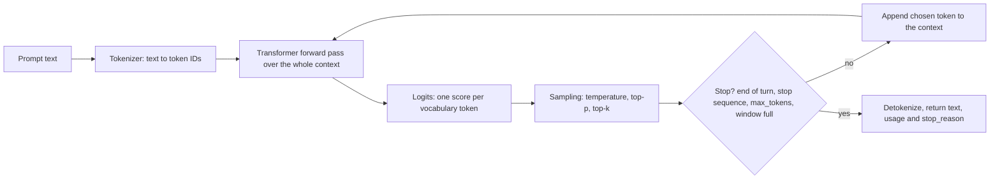
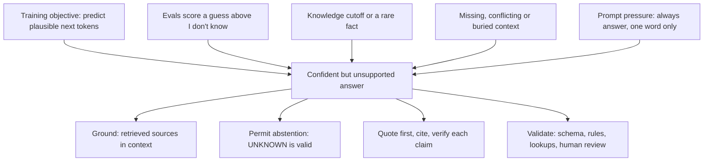

# LLM fundamentals: tokens, context window, temperature, hallucination

!!! abstract "Key takeaways"
    - An LLM is a **next-token predictor**. Text is split into **tokens** (subword pieces, about **4 characters of English each**); the model scores every vocabulary token, one is picked and appended, and the loop repeats. Price, rate limits and size limits are all **in tokens**, and each model family has its own tokenizer.
    - The **context window** is one budget for **input + output** (system prompt, tools, history, documents, thinking, the answer). The API is **stateless**: you resend history every call. Current Claude models: **1M-token window, up to 128K output**. Quality drops long before the limit (**lost in the middle**, **context rot**).
    - **Temperature** divides logits before softmax: low T is near-greedy, high T flattens the distribution. **Top-p** keeps the smallest set of tokens covering p of the mass. **T = 0 is not deterministic**, and the newest Claude models reject `temperature`/`top_p`/`top_k` (400).
    - A **hallucination** is fluent output not supported by the input or the facts. It comes from the training objective and from evaluations that reward guessing over "I don't know". Lowering temperature does **not** fix it.
    - Defences: **ground** answers in retrieved sources, allow "I don't know", require **quotes/citations** and verify them, validate structured output, check `stop_reason`, and keep humans on high-stakes decisions.

## Why it matters

Most production problems with LLMs trace back to these four ideas:

- **Cost and latency scale with tokens.** Output tokens are generated one at a time and usually cost several times more than input (Claude Opus 5.5: $4 per million input, $20 per million output).
- **Failures are expressed in tokens:** "prompt is too long", answers cut off at `max_tokens`, rate limits in tokens per minute.
- **Reproducibility depends on sampling**, so byte-for-byte snapshot tests are flaky by design.
- **Trust depends on hallucination.** A chatbot inventing a refund policy is a system-design failure, not a model bug you can patch.

The transformer's self-attention (2017) lets every token attend to every other token in the window. That made long, coherent generation possible, and it is also why context is a scarce resource.

## Core concepts

### The generation loop


*Notice that each output token is fed back as input: output length drives latency, and the window must hold the prompt plus everything generated.*

The model has no memory between calls. What it "knows" is either in its weights (frozen at a **knowledge cutoff**) or in the current context.

### Tokens

A **tokenizer** maps text to integer IDs from a fixed vocabulary. Most use **byte-pair encoding (BPE)** or a relative: start from bytes and repeatedly merge the most frequent adjacent pairs, so common words become one token and rare words split ("authorization" → "author" + "ization"). Working on bytes means any input can be encoded.

{ loading=lazy }
*The model sees IDs, not letters, which is why spelling, counting characters and long-number arithmetic are surprisingly hard for it.*

| Content | Rough cost | Why |
|---|---|---|
| English prose | ~4 characters, ~0.75 words per token | Common words are single tokens |
| Code, JSON, YAML | More tokens per character | Punctuation, indentation, camelCase |
| UUIDs, hashes, long numbers | Many tokens | No frequent merges to exploit |
| Non-English scripts | Often several times English | Fewer merges learned for them |
| Images, PDFs | Converted to tokens | Same window, same bill |

Two consequences. First, **count with the provider's tokenizer**: OpenAI's `tiktoken` does not match Claude's, so use `POST /v1/messages/count_tokens` and the `usage` field on responses. Tokenizers also change between generations; Anthropic notes the tokenizer introduced with Opus 4.7 uses roughly 1x–1.35x as many tokens for the same text, so re-baseline cost on migration. Second, **design payloads for tokens**: a 5,000-row JSON dump "just in case" is paid for on every call and dilutes attention.

### The context window

The **context window** is the maximum number of tokens the model can attend to in one request, **including its own output**. System prompt, tool definitions, every message and tool result, images, thinking tokens and the answer all count.

{ loading=lazy }
*Watch the output reservation: `max_tokens` lives in the same budget as the prompt, so a growing history eventually squeezes out the answer.*

Claude specifics (other vendors are similar in spirit):

- Current models (Opus 5.5, Sonnet 5.5, Haiku 5.5 and the 4.6+ generation) have a **1M-token** window and up to **128K** output tokens per request; older ones such as Haiku 4.5 have 200K.
- If the **input alone** exceeds the window: **400 `invalid_request_error`** ("prompt is too long").
- On Claude 4.5+, input + `max_tokens` may exceed the window; if generation actually reaches it, the response stops with **`stop_reason: "model_context_window_exceeded"`**, distinct from `max_tokens` (your output cap).
- **Prompt caching** makes a repeated prefix cheaper and faster, but cached tokens **still occupy the window**.

Because the API is stateless, your service decides what to resend: a sliding window, a summary of old turns (**compaction**), or only the relevant pieces via retrieval (see [RAG architecture](04-rag-architecture.md)).

**Bigger is not automatically better.** "Lost in the Middle" (Liu et al., TACL 2024) found accuracy is highest when the relevant fact is at the **start or end** of a long input and drops in the middle. Anthropic calls the general effect **context rot**: recall degrades as token count grows, because attention is spread over n² token pairs. Curate the context and put long documents first and the question last (see [Prompt engineering & structured output](02-prompt-engineering-and-structured-output.md)).

### Temperature, top-p and top-k

At each step the model emits **logits**; softmax turns them into probabilities after dividing by **temperature T**: `p_i = exp(z_i / T) / Σ exp(z_j / T)`.

- **T → 0**: the top token takes almost all the mass (**greedy**). Good for extraction and classification.
- **T = 1**: the learned distribution.
- **T > 1**: flatter; unlikely and nonsensical tokens get real odds.

{ loading=lazy }
*The ranking never changes; temperature only decides how often a lower-ranked token is picked.*

**Top-p (nucleus sampling)**, from Holtzman et al. (ICLR 2020), samples only from the smallest set of tokens whose cumulative probability reaches p, cutting the unreliable tail. **Top-k** keeps a fixed number of candidates. The usual advice is to tune temperature *or* top-p, not both.

What interviewers probe:

- **Ranges differ by vendor**: OpenAI's chat API takes 0–2; Anthropic took 0–1 on models that still accept it.
- **The newest Claude models remove sampling parameters.** On Opus 4.7 and later Opus models (including Opus 5.5), sending `temperature`, `top_p` or `top_k` returns **400**; Sonnet 5.5 and Haiku 5.5 reject non-default values. You steer with the prompt, structured outputs and the `effort` setting, so "temperature=0 everywhere" code breaks on migration.
- **T = 0 ≠ deterministic.** Anthropic states that temperature 0 never guaranteed identical outputs: batching, GPU floating-point effects and backend updates all perturb logits. Test properties, not exact strings.

### Hallucination

A **hallucination** is confident output **not supported** by the provided context (*intrinsic*: a summary contradicting its document) or by the world (*extrinsic*: an invented API, citation or policy).


*Notice that the causes are incentives and missing information, not randomness, which is why lowering temperature barely helps.*

Kalai et al. ("Why Language Models Hallucinate", OpenAI, 2025) argue that hallucinations arise from ordinary statistical pressure in pretraining and **persist because benchmarks grade like multiple-choice exams**: a guess can score, "I don't know" cannot. Practical mitigations, most of them in Anthropic's guidance:

1. **Supply the facts** through retrieval or tool calls to authoritative systems, and instruct the model to answer **only** from them.
2. **Allow "I don't know"** and make the calling code handle it.
3. **Quote, then answer**: extract verbatim quotes first; require citations and drop claims without one.
4. **Verify** with deterministic checks (does the cited ID exist?), best-of-N consistency or a verifier pass.
5. **Constrain output** with schemas and enums so the model can't invent fields or statuses.
6. **Measure** with an eval suite and keep humans on high-stakes decisions (see [AI-assisted development, evaluation & responsible AI](07-ai-assisted-development-evaluation-and-responsible-ai.md)).

## In practice: code & configuration

The classic mistake is treating the LLM as a deterministic function. The example uses the official Anthropic Java SDK; Spring AI wraps the same ideas (see [Spring AI & LLM API integration](05-spring-ai-and-llm-api-integration.md)).

=== "❌ Common mistake"
    ```java
    // "Deterministic" summariser for prior-authorization notes.
    MessageCreateParams params = MessageCreateParams.builder()
        .model("claude-opus-5-5")
        .temperature(0.0)                 // 400 on Opus 4.7+: sampling params were removed
        .maxTokens(256L)                  // tiny cap: long summaries silently truncated
        .addUserMessage(String.join("\n", allNotesForMember)) // unbounded input, no budget
        .build();

    Message response = client.messages().create(params);
    String summary = response.content().get(0).text().get().text(); // ignores stop_reason
    // ... stored as a verified fact, no grounding or check
    ```

=== "✅ Correct approach"
    ```java
    // 1) Budget tokens, 2) ground and allow abstention, 3) check why it stopped.
    private static final long INPUT_BUDGET = 150_000;   // our own cap, well below the 1M window

    String notes = notesRetriever.relevantNotes(memberId, question); // retrieve, don't dump
    String prompt = """
        <notes>
        %s
        </notes>
        Using only the notes above, summarise the prior-authorization status.
        Quote the note lines you rely on. If the notes don't say, answer "UNKNOWN".
        """.formatted(notes);

    long inputTokens = client.messages().countTokens(          // model-specific tokenizer
        MessageCountTokensParams.builder()
            .model("claude-opus-5-5")
            .addUserMessage(prompt)
            .build()).inputTokens();
    if (inputTokens > INPUT_BUDGET) {
        throw new ContextBudgetExceededException(inputTokens); // narrow retrieval or summarise
    }

    Message response = client.messages().create(MessageCreateParams.builder()
        .model("claude-opus-5-5")
        .maxTokens(4_000L)                 // room for quotes plus the answer
        .addUserMessage(prompt)            // no temperature: steer with the prompt
        .build());

    StopReason reason = response.stopReason().orElseThrow();
    if (StopReason.MAX_TOKENS.equals(reason)
            || StopReason.MODEL_CONTEXT_WINDOW_EXCEEDED.equals(reason)) {
        throw new TruncatedAnswerException(reason);   // never persist half an answer
    }
    String answer = response.content().stream()
        .flatMap(b -> b.text().stream())
        .map(TextBlock::text)
        .collect(Collectors.joining());
    summaryValidator.requireQuotesPresentIn(answer, notes); // citations must exist in the source
    log.info("llm usage in={} out={}", response.usage().inputTokens(), response.usage().outputTokens());
    ```

The fixed version budgets tokens, retrieves only what matters, gives the model a legitimate `UNKNOWN` exit, drops parameters the model rejects, never stores truncated output, verifies quotes and logs usage for cost tracking.

## Real-world usage

- **Mata v. Avianca (S.D.N.Y., June 2023):** lawyers filed a brief citing cases ChatGPT had invented and kept defending them; the court fined the lawyers and their firm $5,000, noting that using AI is not improper but failing to check is.
- **Moffatt v. Air Canada (BC Civil Resolution Tribunal, February 2024):** the airline's chatbot said a bereavement fare could be claimed retroactively, contrary to policy. The tribunal rejected the idea that the chatbot was responsible for its own statements: the company owns what its bot says.
- **Long-context products** (document Q&A, coding assistants) lean on retrieval and compaction rather than stuffing the window, for cost, latency and context rot.
- **Healthcare and banking:** a hallucinated dosage, coverage rule or balance is a safety or compliance incident. Typical controls: answers only from access-controlled sources, validated structured output, audit logs with PHI/PII handling, human review for decisions.

## Trade-offs & production gotchas

| Option | Pros | Cons | Use when |
|---|---|---|---|
| Whole document in a large window | Simple, no pipeline | Cost per call, latency, lost in the middle, over-sharing | One-off analysis of one long document |
| Retrieve relevant chunks (RAG) | Cheaper, fresher, citable, per-chunk access control | Retrieval misses cause wrong answers | Q&A over a large or changing corpus |
| Summarise or trim old turns | Bounded cost for long chats | Loses early detail | Long conversations, agents |
| Low temperature / low effort | Consistent, cheaper | Still not deterministic | Extraction, classification, routing |
| Higher temperature, several samples | Diversity, best-of-N | More errors | Brainstorming, candidates to rank |

!!! warning "Gotcha: output is the slow, expensive part"
    Latency ≈ time to first token + output tokens × per-token time, and output costs more than input. Set `max_tokens` to what the use case needs, ask for concise structured output and stream long answers.

!!! warning "Gotcha: the wrong tokenizer"
    Estimating Claude cost with `tiktoken` or characters ÷ 4 under-counts code, JSON and non-English text. Use the token-counting endpoint and the response `usage`, and alert on tokens per request.

!!! tip "Treat the model as an untrusted, probabilistic upstream"
    Timeouts, retries with backoff on 429/5xx, a circuit breaker, a fallback path and validation of every response: the resilience you'd give any flaky third-party API, plus content checks.

## How this connects to my experience

- **Where I used it:** not a resume claim; position as transferable knowledge. Any hands-on use of LLM APIs or AI coding assistants at Publicis Sapient or elsewhere: *[confirm]*. The closest fit is **owning the GraphQL Consumer Service end-to-end** on OptumRx Meteor (healthcare, 750K+ users, integration layer between 5 upstream systems and downstream consumers): an LLM is architecturally another upstream with latency, quotas, cost and unreliable output.
- **Talking points:**
    - In healthcare, hallucination is a safety and compliance risk: answer only from retrieved, authorised data (the same OAuth2/PingFederate access rules the APIs enforce), validate structured output, keep humans on decisions.
    - Familiar levers: **Redis caching** of frequent queries ≈ prompt and response caching; **Kafka retry and DLQ** ≈ retry/backoff and dead-lettering failed asynchronous LLM jobs.
    - Token budgets as a non-functional requirement, like payload limits on GraphQL queries: count, cap, log `usage`, alert.
- **Likely follow-up chain:** "What is a token and why care?" → billing, limits, latency; count with the provider's tokenizer → "The window is 1M, why not send everything?" → cost, latency, lost in the middle, data minimisation for PHI; retrieve instead → "How do you stop it inventing a coverage rule?" → grounding with citations, `UNKNOWN` allowed, schema validation against the source system, evals, human review.

## Interview questions

### Fundamentals

??? question "Q1. What is a token, and why do engineers care about token counts?"
    **Answer:** The unit the model reads and writes: an integer ID for a subword piece from a tokenizer (usually BPE). In English, about 4 characters or 0.75 words; code, JSON, IDs and non-English text use more. Pricing (input and output separately), rate limits, latency and the context window are all measured in tokens. Count with the provider's tokenizer, since tokenizers differ by vendor and model generation.

    **Interviewer listens for:** subword/BPE, rough ratio, input vs output pricing, model-specific counts.

    **Common wrong answer:** "A token is a word." That under-counts code and non-English text.

??? question "Q2. What is the context window, and what counts against it?"
    **Answer:** The maximum tokens the model attends to in one request, including its output: system prompt, tool definitions, messages, tool results, documents, images, thinking and the answer. The API is stateless, so the client resends history and it keeps growing. On Claude, input that is too long gets a 400; generation that hits the window stops with `model_context_window_exceeded`.

    **Interviewer listens for:** output counts, statelessness, behaviour at the limit.

    **Common wrong answer:** "It's the model's memory of past conversations." Only what you send is in context.

??? question "Q3. What do temperature and top-p do?"
    **Answer:** Temperature divides logits before softmax: low values sharpen towards the top token, high values flatten so unlikely tokens are sampled more. Top-p samples from the smallest set of tokens whose cumulative probability reaches p; top-k keeps k candidates. Tune one, not both. The newest Claude models no longer accept these parameters.

    **Interviewer listens for:** logits and softmax, greedy at low T, nucleus definition.

    **Common wrong answer:** "Temperature controls how accurate the model is."

??? question "Q4. What is a hallucination, and why do LLMs hallucinate?"
    **Answer:** Fluent, confident output unsupported by the context or reality: invented citations, APIs, policies, numbers. Models are trained to produce plausible text, not verified facts; rare and post-cutoff facts are weakly represented; and training and benchmarks reward a guess over "I don't know" (Kalai et al., 2025). Missing or buried context and prompts that force an answer make it worse.

    **Interviewer listens for:** plausibility vs truth, cutoff, incentives to guess, intrinsic vs extrinsic.

    **Common wrong answer:** "It's caused by high temperature; set it to 0."

### Intermediate

??? question "Q5. Is temperature 0 deterministic? How do you test LLM features?"
    **Answer:** No: batching, GPU floating-point effects and model or infrastructure updates change outputs, and Anthropic says temperature 0 never guaranteed identical results. Test properties instead: schema validity, required fields, citations present in the source, rule checks, and an eval set scored by code or an LLM judge, run in CI with thresholds.

    **Interviewer listens for:** sources of non-determinism, property- and eval-based tests.

    **Common wrong answer:** "Yes, temperature 0 always returns the same text."

??? question "Q6. The model supports 1M tokens. Why not put the whole knowledge base in every prompt?"
    **Answer:** Cost and latency scale with input on every call; accuracy drops with length and for facts in the middle; you can't cite or access-control what you didn't select; and it over-shares sensitive data. Retrieve the relevant pieces, cache stable prefixes, and keep large windows for genuine single-document tasks.

    **Interviewer listens for:** cost per call, lost in the middle, access control, caching doesn't free window space.

    **Common wrong answer:** "Bigger context is always better now."

??? question "Q7. How do you estimate and control the cost of an LLM feature?"
    **Answer:** Cost ≈ input tokens × input price + output tokens × output price, times volume, measured from response `usage`. Levers: shorter prompts and tool lists, retrieval instead of dumps, prompt caching, capped `max_tokens` and concise output, smaller or lower-effort models where evals show quality holds, batch APIs for offline work. Budget and alert per feature or tenant, and judge cost per completed task, not per request.

    **Interviewer listens for:** output priced higher, measured usage, caching, evidence-based model choice.

    **Common wrong answer:** "Just use the cheapest model."

### Senior

??? question "Q8. Design guardrails for an LLM that answers members' questions about prescription coverage."
    **Answer:** Answer only from retrieved, authorised sources (plan documents, formulary, the member's claims via existing APIs with the member's own token). Require quotes and allow `UNKNOWN`; return structured output and validate citations and codes against reference data. Route coverage decisions to humans, refuse medical advice, log with PHI controls, rate-limit and monitor, and run an eval suite (including adversarial questions) before every prompt or model change.

    **Interviewer listens for:** grounding with access control, abstention, validation, human in the loop, evals, audit.

    **Common wrong answer:** "Add 'do not hallucinate' to the system prompt."

??? question "Q9. A long chat gets worse and then fails. What is happening?"
    **Answer:** The resent history keeps growing: quality degrades with length, early instructions are diluted, and eventually input plus `max_tokens` no longer fits (400, `model_context_window_exceeded` or `max_tokens` truncation). Track tokens per turn, compact or trim old turns and stale tool results, keep stable instructions in the system prompt, retrieve rather than carry documents, and handle stop reasons explicitly.

    **Interviewer listens for:** statelessness, both failure modes, compaction, stop-reason handling.

    **Common wrong answer:** "Increase `max_tokens`." That reserves more of the window.

### Scenario-based

??? question "Q10. After migrating to a newer Claude model, every request returns 400. What do you check?"
    **Answer:** Read the error, then check removed parameters: on the newest models `temperature`/`top_p`/`top_k`, fixed thinking budgets and assistant prefill are rejected. Remove them and steer with the prompt, effort and structured outputs. Then re-baseline token counts (the tokenizer may have changed), cost and evals before shifting traffic.

    **Interviewer listens for:** removed sampling params, tokenizer re-baseline, eval before rollout.

    **Common wrong answer:** "Roll back and stay on the old model."

## Cheat sheet

| Concept | Remember |
|---|---|
| Token | Subword ID from a BPE-style tokenizer; ~4 chars / 0.75 words of English |
| Counting | Model-specific; `count_tokens` and response `usage`, not `tiktoken`, for Claude |
| Context window | Input + output + thinking; stateless; Claude current: 1M in, 128K out |
| Overflow | Input too long → 400; generation hits limit → `model_context_window_exceeded` |
| Long context | Lost in the middle, context rot: curate, retrieve, question last |
| Temperature | softmax(logits / T); low = sharp, high = flat; T = 0 not deterministic |
| Top-p / top-k | Tokens covering p of the mass / k tokens; tune one knob |
| Newer Claude models | `temperature`/`top_p`/`top_k` → 400; steer with prompt and effort |
| Hallucination | Plausible but unsupported; objective, cutoff, guess-rewarding evals |
| Mitigation | Ground, allow UNKNOWN, quote and cite, validate, eval, human review |
| Cost | Output costs more and is slower; cap `max_tokens`, cache prefixes |

## Sources
1. [Anthropic: Context windows](https://platform.claude.com/docs/en/build-with-claude/context-windows): what counts, 1M / 128K sizes, 400 vs `model_context_window_exceeded`, context rot.
2. [Anthropic: Token counting](https://platform.claude.com/docs/en/build-with-claude/token-counting) and [Models overview](https://platform.claude.com/docs/en/about-claude/models/overview): `count_tokens`, current models and pricing.
3. [Anthropic: Migration guide](https://platform.claude.com/docs/en/about-claude/models/migration-guide): sampling parameters removed from Opus 4.7 on, temperature 0 never guaranteed identical outputs, tokenizer change.
4. [Anthropic: Reduce hallucinations](https://platform.claude.com/docs/en/test-and-evaluate/strengthen-guardrails/reduce-hallucinations): "I don't know", quote-first grounding, citations, best-of-N.
5. [Anthropic Engineering: Effective context engineering for AI agents](https://www.anthropic.com/engineering/effective-context-engineering-for-ai-agents) (September 2025): context rot, attention budget, n² relationships.
6. [Liu et al., "Lost in the Middle: How Language Models Use Long Contexts", TACL 2024](https://aclanthology.org/2024.tacl-1.9/): U-shaped accuracy by position.
7. [Kalai, Nachum, Vempala, Zhang, "Why Language Models Hallucinate" (arXiv 2509.04664, 2025)](https://arxiv.org/abs/2509.04664): statistical origins of hallucination and guess-rewarding evaluations.
8. [Holtzman et al., "The Curious Case of Neural Text Degeneration", ICLR 2020](https://arxiv.org/abs/1904.09751): nucleus (top-p) sampling.
9. [Sennrich, Haddow, Birch, "Neural Machine Translation of Rare Words with Subword Units", ACL 2016](https://aclanthology.org/P16-1162/): BPE for subword tokenization.
10. [openai/tiktoken README](https://github.com/openai/tiktoken): BPE properties, ~4 bytes per token on average.
11. [Moffatt v. Air Canada, 2024 BCCRT 149](https://decisions.civilresolutionbc.ca/crt/crtd/en/525448/1/document.do): company liable for its chatbot's statements.
12. [LawSites: sanctions in Mata v. Avianca (June 2023)](https://www.lawnext.com/2023/06/court-imposes-sanctions-on-lawyers-who-filed-bogus-cases-after-relying-on-chatgpt-for-legal-research.html): $5,000 sanction for AI-fabricated citations.
