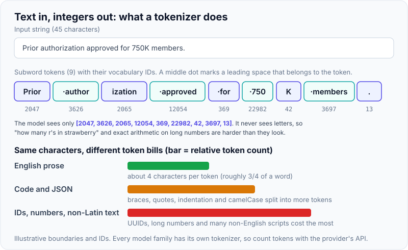
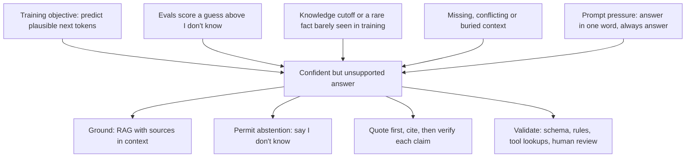

# LLM fundamentals: tokens, context window, temperature, hallucination

!!! abstract "Key takeaways"
    - An LLM is a **next-token predictor**. Text is split into **tokens** (subword pieces from a BPE-style tokenizer, about **4 characters of English per token**), the model scores every token in its vocabulary, one is chosen, appended, and the loop repeats until a stop condition. Everything is priced, rate-limited and capped **in tokens**, and every model family has its own tokenizer.
    - The **context window** is one budget for **input + output** (system prompt, tool definitions, history, documents, thinking and the answer). The API is **stateless**: you resend the history on every call. Current Claude models have a **1M-token window and up to 128K output tokens**; quality degrades well before the limit (**"lost in the middle"**, **context rot**).
    - **Temperature** divides the logits before softmax: low T sharpens the distribution (near-greedy), high T flattens it. **Top-p** (nucleus) keeps the smallest set of tokens covering p of the probability mass. **Temperature 0 is not a determinism guarantee**, and the newest Claude models reject `temperature`/`top_p`/`top_k` altogether (400): you steer with prompts and effort instead.
    - A **hallucination** is fluent output that is not supported by the input or by the facts. It comes from the training objective (predict plausible text) and from evaluations that reward guessing over "I don't know". Lower temperature does **not** fix it.
    - Engineering defences: **ground** the model in retrieved sources (RAG), allow and reward "I don't know", ask for **quotes and citations** and verify them, validate structured output, check `stop_reason`, and keep a **human or rule-based check** where errors are costly (healthcare, banking, legal).

## Why it matters

Every GenAI interview for a backend or lead role starts here, because every production problem with LLMs traces back to these four ideas:

- **Cost and latency** are proportional to tokens. Output tokens are slower (generated one at a time) and usually several times more expensive than input tokens: for example, Claude Opus 5.5 lists $4 per million input tokens and $20 per million output tokens.
- **Limits and failures** are expressed in tokens: "prompt is too long", truncated answers (`max_tokens`), rate limits in tokens per minute.
- **Reproducibility** depends on sampling. Tests that compare LLM output byte-for-byte are flaky by design.
- **Trust** depends on hallucination. A chatbot that invents a refund policy or a lawyer's brief that cites invented cases are not model bugs you can patch; they are system-design failures.

Before transformers (2017), language models were RNN/LSTM-based with short effective memory. The transformer's self-attention lets every token attend to every other token in the window, which is what made long, coherent generation possible and also why context is a scarce resource: attention cost and "attention budget" grow with the number of tokens.

## Core concepts

### The generation loop


*Notice that the model only ever predicts the next token. Each output token is fed back as input, so output length drives latency, and the window must hold the prompt plus everything generated.*

The model has no memory between calls and no database lookup. Whatever it "knows" is either baked into its weights at training time (with a **knowledge cutoff**) or present in the current context window.

### Tokens

A **tokenizer** maps text to integer IDs from a fixed vocabulary (often 100K–200K entries). Most modern tokenizers use **byte-pair encoding (BPE)** or a close relative: start from bytes, repeatedly merge the most frequent adjacent pairs, so common words become one token and rare words split into pieces ("authorization" → "author" + "ization"). Working on bytes means any input can be encoded; there are no unknown words.

{ loading=lazy }
*The model never sees letters, only IDs; that is why spelling, counting characters and long-number arithmetic are surprisingly hard for it.*

Rules of thumb engineers use:

| Content | Rough cost | Why |
|---|---|---|
| English prose | ~4 characters, ~0.75 words per token | Common words are single tokens |
| Code, JSON, YAML | More tokens per character | Punctuation, indentation, camelCase splits |
| UUIDs, hashes, long numbers | Many tokens | No frequent merges to exploit |
| Non-English scripts (e.g. Devanagari) | Often 2–4x English for the same meaning | Less training-data weight in the merges |
| Images, PDFs | Converted to tokens too | Count against the same window and bill |

Two practical consequences:

1. **Count with the provider's tokenizer.** Token counts are model-specific. OpenAI's `tiktoken` does not match Claude's tokenizer; for Claude use the `POST /v1/messages/count_tokens` endpoint. Even within one vendor, tokenizers change: Anthropic notes that the tokenizer introduced with Claude Opus 4.7 produces roughly 1x–1.35x as many tokens for the same text as earlier models, so re-baseline cost when you migrate.
2. **Design prompts and payloads for tokens, not characters.** Sending a 5,000-row JSON array "just in case" costs real money on every call and dilutes attention.

### The context window

The **context window** is the maximum number of tokens the model can attend to in one request, **including its own output for that turn**. Everything counts: system prompt, tool definitions, every message (including tool results, images, documents), extended-thinking tokens and the answer.

{ loading=lazy }
*Watch the output reservation: `max_tokens` lives in the same budget as the prompt, so a growing history eventually squeezes out the answer.*

Key behaviours for Claude (other vendors are similar in spirit; check their docs):

- Current Claude models (Opus 5.5, Sonnet 5.5, Haiku 5.5 and the 4.6+ generation) have a **1M-token** window, and one request can generate up to **128K** output tokens. Older models such as Haiku 4.5 have 200K.
- If the **input alone** exceeds the window, the API returns **400 `invalid_request_error`** ("prompt is too long").
- On Claude 4.5 and newer, if input + `max_tokens` exceeds the window the request is accepted; if generation actually hits the limit it stops with **`stop_reason: "model_context_window_exceeded"`**, distinct from `max_tokens` (your own output cap).
- **Prompt caching** makes a repeated prefix cheaper and faster, but cached tokens **still occupy the window**.
- Chat UIs hide the statelessness by trimming or summarising old turns. In your own service you choose: sliding window, summarisation (**compaction**), or retrieval of only the relevant pieces (RAG, see [RAG architecture](04-rag-architecture.md)).

**Bigger is not automatically better.** Liu et al. ("Lost in the Middle", TACL 2024) showed accuracy is highest when the relevant fact is at the **start or end** of a long input and drops when it is buried in the middle (a U-shaped curve). Anthropic calls the general effect **context rot**: as token count grows, recall and accuracy degrade, because attention is spread across n² token pairs. Curate what goes in; put instructions and the question where the model will weigh them (long documents first, question last is a common pattern; see [Prompt engineering & structured output](02-prompt-engineering-and-structured-output.md)).

### Temperature, top-p and top-k

At each step the model outputs **logits** (raw scores). Softmax turns them into probabilities, and **temperature T** rescales them first: `p_i = exp(z_i / T) / Σ exp(z_j / T)`.

- **T → 0**: the top token gets almost all the mass, effectively **greedy decoding**. Good for extraction and classification.
- **T = 1**: the model's learned distribution.
- **T > 1**: flatter; unlikely and nonsensical tokens get real probability. More "creative", more errors.

{ loading=lazy }
*The ranking never changes; temperature only decides how often a lower-ranked token is picked.*

**Top-p (nucleus sampling)**, from Holtzman et al. (ICLR 2020), samples only from the smallest set of tokens whose cumulative probability reaches p (e.g. 0.9), cutting the long unreliable tail. **Top-k** keeps a fixed number of candidates. Vendors generally advise tuning temperature *or* top-p, not both.

Things interviewers probe:

- **Ranges differ by vendor.** OpenAI's chat API accepts temperature 0–2; Anthropic's accepted 0–1 on models that still allow it.
- **The newest Claude models remove sampling parameters.** On Claude Opus 4.7 and later Opus models (including Opus 5.5) and the Fable family, sending `temperature`, `top_p` or `top_k` returns **400**; Sonnet 5.5 and Haiku 5.5 reject non-default values. Steering is done with the prompt, structured outputs and the `effort` setting. Code written "temperature=0 everywhere" breaks on migration.
- **T = 0 ≠ deterministic.** Anthropic states explicitly that temperature 0 never guaranteed identical outputs. Batching, floating-point non-associativity on GPUs, and backend changes all perturb logits. Design tests around properties (schema valid, contains X, judged correct), not exact strings.

### Hallucination

A **hallucination** is output that is fluent and confident but **not supported** by the provided context (*intrinsic*, e.g. a summary that contradicts the document) or by the facts of the world (*extrinsic*, e.g. an invented API method, citation or policy).


*Notice that most causes are about incentives and missing information, not randomness, which is why lowering temperature barely helps.*

Why it happens: the model is trained to continue text plausibly, not to know when it doesn't know. Kalai et al. (OpenAI, "Why Language Models Hallucinate", 2025) argue that hallucinations arise from ordinary statistical pressure in pretraining and **persist because most benchmarks grade like multiple-choice exams**: a guess can score, "I don't know" cannot, so models learn to guess. Their proposed fix is to change how evaluations score abstention.

Mitigations that work in practice (Anthropic's guidance lists most of these):

1. **Give the model the facts**: retrieval (RAG), tool calls to authoritative systems, and an instruction to answer **only** from the supplied material.
2. **Allow "I don't know"** explicitly, and make the calling code handle that outcome.
3. **Quote, then answer**: for long documents, extract verbatim quotes first and reason only from them; ask for **citations** and drop any claim without a supporting quote.
4. **Verify**: best-of-N consistency checks, a second-pass verifier, deterministic validators (does the cited claim ID exist? does the drug code exist in the formulary?).
5. **Constrain the output** with schemas and enums so the model can't invent a field or a status (see [Prompt engineering & structured output](02-prompt-engineering-and-structured-output.md)).
6. **Measure** with evals and keep humans in the loop for high-stakes decisions (see [AI-assisted development, evaluation & responsible AI](07-ai-assisted-development-evaluation-and-responsible-ai.md)).

## In practice: code & configuration

A typical mistake is treating the LLM like a deterministic function: hard-coded sampling, no token budget, no stop-reason handling. The example uses the official Anthropic Java SDK (Spring AI wraps the same ideas; see [Spring AI & LLM API integration](05-spring-ai-and-llm-api-integration.md)).

=== "❌ Common mistake"
    ```java
    // "Deterministic" summariser for prior-authorization notes.
    MessageCreateParams params = MessageCreateParams.builder()
        .model("claude-opus-5-5")
        .temperature(0.0)                 // 400 on Opus 4.7+: sampling params were removed
        .maxTokens(256L)                  // tiny cap: long summaries silently truncated
        .addUserMessage(String.join("\n", allNotesForMember)) // unbounded history, no budget
        .build();

    Message response = client.messages().create(params);
    String summary = response.content().get(0).text().get().text(); // ignores stop_reason
    // ... stored as if it were a verified fact, no grounding or check
    ```

=== "✅ Correct approach"
    ```java
    // 1) Budget tokens before calling, 2) ground and allow abstention, 3) check why it stopped.
    private static final long INPUT_BUDGET = 150_000;   // our own cap, well below the 1M window

    String notes = notesRetriever.relevantNotes(memberId, question); // retrieve, don't dump everything
    String prompt = """
        <notes>
        %s
        </notes>
        Using only the notes above, summarise the prior-authorization status.
        Quote the note lines you rely on. If the notes don't say, answer "UNKNOWN".
        """.formatted(notes);

    long inputTokens = client.messages().countTokens(          // model-specific tokenizer
        MessageCountTokensParams.builder()
            .model("claude-opus-5-5")
            .addUserMessage(prompt)
            .build()).inputTokens();
    if (inputTokens > INPUT_BUDGET) {
        throw new ContextBudgetExceededException(inputTokens); // trim, summarise or narrow retrieval
    }

    Message response = client.messages().create(MessageCreateParams.builder()
        .model("claude-opus-5-5")
        .maxTokens(4_000L)                 // room for quotes plus the answer
        .addUserMessage(prompt)            // no temperature: steer with the prompt instead
        .build());

    StopReason reason = response.stopReason().orElseThrow();
    if (StopReason.MAX_TOKENS.equals(reason)
            || StopReason.MODEL_CONTEXT_WINDOW_EXCEEDED.equals(reason)) {
        throw new TruncatedAnswerException(reason);   // never store half an answer
    }
    String answer = response.content().stream()
        .flatMap(b -> b.text().stream())
        .map(TextBlock::text)
        .collect(Collectors.joining());
    summaryValidator.requireQuotesPresentIn(answer, notes); // verify citations really exist
    log.info("llm usage in={} out={}", response.usage().inputTokens(), response.usage().outputTokens());
    ```

What changed: the request has a **token budget**, retrieval limits the context to what matters, the prompt **grounds** the model and gives it a legitimate "UNKNOWN" exit, there are no sampling parameters the model would reject, `stop_reason` is checked so truncated output is never persisted, quotes are verified against the source, and **usage is logged** for cost tracking.

## Real-world usage

- **Legal: Mata v. Avianca (S.D.N.Y., June 2023).** Lawyers filed a brief citing cases that ChatGPT had invented and kept defending them when questioned; Judge Castel fined the lawyers and their firm $5,000. The court said using AI is not improper; failing to check is.
- **Customer service: Moffatt v. Air Canada (BC Civil Resolution Tribunal, February 2024).** The airline's chatbot told a customer he could claim a bereavement fare retroactively, contradicting the actual policy. The tribunal rejected the argument that the chatbot was responsible for its own statements and held the airline liable for what its website said. Lesson: an LLM answer to a customer is your company's answer.
- **Long-context products** (document Q&A, code assistants) rely on retrieval and compaction rather than stuffing the window, because of cost, latency and context rot.
- **Healthcare and banking:** hallucinated dosages, coverage rules or account balances are safety and compliance incidents, not UX bugs. Typical controls: answer only from retrieved, access-controlled sources; structured output validated against reference data; audit logging of prompts and responses (with PHI/PII handling); human review for decisions.

## Trade-offs & production gotchas

| Option | Pros | Cons | Use when |
|---|---|---|---|
| Stuff the whole document into a large window | Simple, no retrieval pipeline | Cost per call, latency, lost-in-the-middle, PHI over-sharing | One-off analysis of a single long document |
| Retrieve relevant chunks (RAG) | Cheaper, fresher, citable, access control per chunk | Retrieval misses cause wrong answers | Q&A over a large or changing corpus |
| Sliding window / summarise old turns | Bounded cost for long chats | Loses detail from early turns | Long conversations, agents |
| Low temperature / low effort | Consistent, cheaper | Less variety, still not deterministic | Extraction, classification, routing |
| High temperature / multiple samples | Diversity for brainstorming, best-of-N | More errors and nonsense | Creative drafts, generating candidates to rank |
| Bigger model | Better reasoning, fewer errors | Higher cost and latency | Hard reasoning; measure before defaulting |

!!! warning "Gotcha: output is the expensive, slow part"
    Latency is roughly time-to-first-token plus output tokens × per-token generation time, and output tokens cost several times more than input. Asking for "a detailed explanation" in a hot path can multiply both. Set `max_tokens` to what the use case needs, ask for concise structured output, and stream long answers.

!!! warning "Gotcha: token estimates from the wrong tokenizer"
    Estimating Claude cost with `tiktoken` (or characters ÷ 4) under-counts code, JSON and non-English text, and tokenizers change between model generations. Use the provider's token-counting endpoint and the `usage` field on each response, and alert on tokens per request.

!!! warning "Gotcha: snapshot tests on LLM output"
    Even at temperature 0, outputs vary across runs and model versions. Assert properties (schema valid, required fields present, quotes found in the source, judged correct by an eval), not exact strings.

!!! tip "Treat the model like an untrusted, probabilistic upstream"
    Timeouts, retries with backoff on 429/5xx, a circuit breaker, validation of every response and a fallback path: the same resilience patterns you would apply to any flaky third-party API, plus content checks.

## How this connects to my experience

- **Where I used it:** not a resume claim; position as transferable knowledge. Whether I have used LLM APIs or AI coding assistants on OptumRx Meteor or elsewhere: *[confirm]*. The closest fit is **owning the GraphQL Consumer Service end-to-end** on OptumRx Meteor (healthcare, 750K+ users, integration layer between 5 upstream systems and downstream consumers): an LLM call is architecturally another upstream with latency, quotas, cost and unreliable output, which is exactly what that service handled.
- **Talking points:**
    - In healthcare, hallucination is a patient-safety and compliance risk: I would only let a model answer from retrieved, authorised data (the same OAuth2/PingFederate-backed access rules the APIs already enforce), validate structured output against reference data, and keep humans on decisions.
    - Cost and latency control map to things I already did: **Redis caching** of frequent queries ≈ prompt/response caching; **Kafka retry and DLQ** ≈ retry/backoff and dead-lettering failed LLM jobs for asynchronous workloads such as summarisation.
    - Token budgets as a non-functional requirement, like payload-size limits on GraphQL queries: count, cap, log `usage`, alert.
- **Likely follow-up chain:** "What is a token and why do you care?" → billing, limits, latency; count with the provider's tokenizer → "The context window is 1M; why not send everything?" → cost, latency, lost-in-the-middle, data minimisation for PHI; use retrieval → "How do you stop it inventing a coverage rule?" → grounding with citations, permission to say UNKNOWN, schema plus validation against the source system, eval suite, human review for anything that drives a decision.

## Interview questions

### Fundamentals

??? question "Q1. What is a token, and why do engineers care about token counts?"
    **Answer:** A token is the unit the model reads and writes: an integer ID for a subword piece produced by a tokenizer (usually BPE). In English, one token is about 4 characters or three-quarters of a word; code, JSON, IDs and non-English text use more. Engineers care because pricing (separately for input and output), rate limits, latency (output is generated token by token) and the context window are all measured in tokens. Count with the provider's own tokenizer or token-counting API, since tokenizers differ by vendor and even by model generation.

    **Interviewer listens for:** subword/BPE, rough ratio, input vs output pricing, model-specific tokenizers.

    **Common wrong answer:** "A token is a word." That under-counts code and non-English text and leads to wrong cost estimates.

??? question "Q2. What is the context window, and what counts against it?"
    **Answer:** The maximum number of tokens the model can attend to in one request, including the output it generates. The system prompt, tool definitions, all prior messages, tool results, documents and images, thinking tokens and the answer all count. The API is stateless, so the client resends the conversation every turn and the history keeps growing. When the input alone is too large, Claude returns a 400; when generation hits the window it stops with `model_context_window_exceeded`.

    **Interviewer listens for:** output counts too, statelessness, what happens at the limit.

    **Common wrong answer:** "It's the model's memory of past conversations." The model has no memory between calls; only what you send is in context.

??? question "Q3. What does temperature do? What about top-p?"
    **Answer:** Temperature divides the logits before softmax. Low values sharpen the distribution towards the top token (near-greedy, consistent); high values flatten it so less likely tokens are sampled more often (diverse, more errors). Top-p samples from the smallest set of tokens whose cumulative probability reaches p, cutting off the tail; top-k keeps a fixed number of candidates. Tune one of temperature or top-p, not both. Some newer models (recent Claude Opus models) no longer accept these parameters at all.

    **Interviewer listens for:** softmax/logits, greedy at low T, nucleus definition, "one or the other".

    **Common wrong answer:** "Temperature controls how smart or accurate the model is." It only reshapes the sampling distribution.

??? question "Q4. What is a hallucination, and why do LLMs hallucinate?"
    **Answer:** Fluent, confident output not supported by the provided context or by reality: invented citations, APIs, policies or numbers. Models are trained to produce plausible continuations, not to verify facts; rare facts and anything after the knowledge cutoff are weakly represented; and training and benchmarks reward a guess over "I don't know" (the argument of Kalai et al., 2025). Missing or buried context and prompts that force an answer make it worse.

    **Interviewer listens for:** plausibility vs truth, cutoff, incentives to guess, intrinsic vs extrinsic.

    **Common wrong answer:** "It's caused by high temperature; set it to 0." Greedy decoding still produces confident wrong answers.

### Intermediate

??? question "Q5. Is temperature 0 deterministic? How do you test LLM features then?"
    **Answer:** No. Even at temperature 0, hosted models can return different outputs because of batching, GPU floating-point non-determinism and model or infrastructure updates; Anthropic says explicitly that temperature 0 never guaranteed identical outputs, and its newest models remove the parameter. Test properties instead: schema validation, required fields, citations that exist in the source, rule checks, and an evaluation set scored by code or an LLM judge, run in CI with thresholds rather than exact-match snapshots.

    **Interviewer listens for:** sources of non-determinism, property-based or eval-based testing.

    **Common wrong answer:** "Yes, temperature 0 always returns the same text."

??? question "Q6. The model supports 1M tokens. Why not put the whole knowledge base in every prompt?"
    **Answer:** Cost and latency scale with input tokens on every call; accuracy drops as context grows and facts in the middle are recalled less reliably (lost in the middle, context rot); you can't cite or access-control what you didn't select; and it over-shares sensitive data. Retrieve the relevant pieces (RAG), cache stable prefixes, and reserve big windows for genuine single-document tasks.

    **Interviewer listens for:** cost per call, lost-in-the-middle, access control, caching doesn't free window space.

    **Common wrong answer:** "Bigger context is always better now."

??? question "Q7. How do you estimate and control the cost of an LLM feature?"
    **Answer:** Cost ≈ input tokens × input price + output tokens × output price, per call, times call volume. Measure real `usage` from responses, not character estimates. Levers: shorter system prompts and tool lists, retrieval instead of dumping data, prompt caching for stable prefixes, a capped `max_tokens` and concise structured output, smaller or lower-effort models where quality holds, batch APIs for offline work, and response caching for repeated questions. Track tokens per request and per tenant, with budgets and alerts.

    **Interviewer listens for:** output priced higher, measured usage, caching, model choice by measurement.

    **Common wrong answer:** "Just use the cheapest model." Cost per completed task matters; a cheap model that needs retries isn't cheaper.

### Senior

??? question "Q8. Design the guardrails for an LLM that answers members' questions about prescription coverage."
    **Answer:** Answer only from retrieved, authorised sources (plan documents, formulary, the member's claims via the existing APIs with the member's token, never broader access). Instruct the model to quote sources and return `UNKNOWN` when unsupported; return structured output (answer, citations, confidence category) and validate citations against the retrieved text and codes against reference data. Escalate to a human for coverage decisions, refuse medical advice, log prompts and responses with PHI controls, rate-limit and monitor. Run an eval suite of real questions (including adversarial ones) before every prompt or model change. Remember Air Canada: the company owns what the bot says.

    **Interviewer listens for:** grounding plus access control, abstention, validation, human-in-the-loop, evals, audit.

    **Common wrong answer:** "Add 'do not hallucinate' to the system prompt."

??? question "Q9. A long-running chat starts giving worse answers and then fails. What is happening and what do you do?"
    **Answer:** The resent history is growing: quality degrades with context length, early instructions get diluted, and eventually input plus `max_tokens` no longer fits (400 "prompt is too long", or `model_context_window_exceeded`/`max_tokens` truncation). Fix: track tokens per turn; compact (summarise older turns, or use server-side compaction where available), drop stale tool results, keep stable instructions in the system prompt, retrieve rather than carry large documents, and handle the stop reasons explicitly instead of persisting truncated answers.

    **Interviewer listens for:** statelessness, both failure modes, compaction or trimming, stop-reason handling.

    **Common wrong answer:** "Increase `max_tokens`." That reserves more of the window and can make it fail sooner.

### Scenario-based

??? question "Q10. After migrating to a newer Claude model, every request returns 400. What do you check?"
    **Answer:** Breaking parameter changes first. On the newest Claude models `temperature`, `top_p` and `top_k` are rejected, fixed thinking budgets (`budget_tokens`) and assistant prefill are removed, and some tool-choice modes changed. Read the error message, strip the removed parameters and steer with the prompt, effort and structured outputs instead. Then re-baseline token counts (the tokenizer may have changed), cost and evals before switching traffic.

    **Interviewer listens for:** reading the error, removed sampling params, tokenizer re-baseline, eval before rollout.

    **Common wrong answer:** "Roll back and stay on the old model forever."

??? question "Q11. Your summarisation job stores summaries that end mid-sentence for some long cases. Why?"
    **Answer:** The response stopped because of `max_tokens` (the output cap) or the context window, and the code took the text without checking `stop_reason`. Check it on every response: on `max_tokens` retry with a larger cap or ask for a shorter format; on a window overflow, reduce the input (retrieve, chunk then merge). Route repeated failures to a dead-letter queue for review rather than persisting partial output.

    **Interviewer listens for:** `stop_reason` handling, sizing the output, chunking, DLQ.

    **Common wrong answer:** "The model is lazy; add 'please write the full summary'."

## Cheat sheet

| Concept | Remember |
|---|---|
| Token | Subword ID from BPE-style tokenizer; ~4 chars / 0.75 words of English |
| Counting | Model-specific; use `count_tokens` and response `usage`, not `tiktoken` for Claude |
| Context window | Input + output + thinking; stateless API resends history; Claude current: 1M in, 128K out |
| Overflow | Input too long → 400; generation hits limit → `model_context_window_exceeded` |
| Long context | Lost in the middle, context rot: curate, retrieve, put the question last |
| Temperature | softmax(logits / T); low = sharp, high = flat; T = 0 is not deterministic |
| Top-p / top-k | Keep tokens covering p of the mass / keep k tokens; tune one knob |
| Newer Claude models | Reject `temperature`/`top_p`/`top_k` (400); steer with prompt and effort |
| Hallucination | Plausible but unsupported; caused by objective, cutoff, guess-rewarding evals |
| Mitigation | Ground (RAG), allow UNKNOWN, quote and cite, validate, eval, human review |
| Cost | Output tokens cost more and are slower; cap `max_tokens`, cache prefixes |

## Sources
1. [Anthropic: Context windows](https://platform.claude.com/docs/en/build-with-claude/context-windows): what counts toward the window, 1M / 128K sizes, overflow behaviour (400 vs `model_context_window_exceeded`), context rot.
2. [Anthropic: Token counting](https://platform.claude.com/docs/en/build-with-claude/token-counting) and [Models overview](https://platform.claude.com/docs/en/about-claude/models/overview): `count_tokens`, model-specific token counts, current models and per-token pricing.
3. [Anthropic: Migration guide](https://platform.claude.com/docs/en/about-claude/models/migration-guide): `temperature`/`top_p`/`top_k` removed on Opus 4.7 and later, temperature 0 never guaranteed identical outputs, new tokenizer token-count change.
4. [Anthropic: Reduce hallucinations](https://platform.claude.com/docs/en/test-and-evaluate/strengthen-guardrails/reduce-hallucinations): allow "I don't know", quote-first grounding, citations, best-of-N and verification.
5. [Anthropic Engineering: Effective context engineering for AI agents](https://www.anthropic.com/engineering/effective-context-engineering-for-ai-agents) (September 2025): context rot, attention budget, n² token relationships.
6. [Liu et al., "Lost in the Middle: How Language Models Use Long Contexts", TACL 2024](https://aclanthology.org/2024.tacl-1.9/): U-shaped accuracy by position of relevant information.
7. [Kalai, Nachum, Vempala, Zhang, "Why Language Models Hallucinate" (arXiv 2509.04664, 2025)](https://arxiv.org/abs/2509.04664): hallucinations from training statistics and guess-rewarding evaluations.
8. [Holtzman et al., "The Curious Case of Neural Text Degeneration", ICLR 2020](https://arxiv.org/abs/1904.09751): nucleus (top-p) sampling.
9. [Sennrich, Haddow, Birch, "Neural Machine Translation of Rare Words with Subword Units", ACL 2016](https://aclanthology.org/P16-1162/): byte-pair encoding for subword tokenization.
10. [openai/tiktoken README](https://github.com/openai/tiktoken): BPE properties and the ~4 bytes per token average.
11. [Moffatt v. Air Canada, 2024 BCCRT 149](https://decisions.civilresolutionbc.ca/crt/crtd/en/525448/1/document.do): company liable for its chatbot's incorrect policy statement.
12. [Mata v. Avianca, Inc. (S.D.N.Y. 2023), coverage by LawSites](https://www.lawnext.com/2023/06/court-imposes-sanctions-on-lawyers-who-filed-bogus-cases-after-relying-on-chatgpt-for-legal-research.html): sanctions for AI-fabricated case citations.
