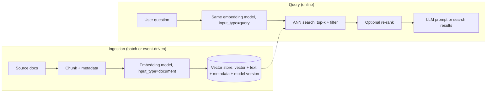
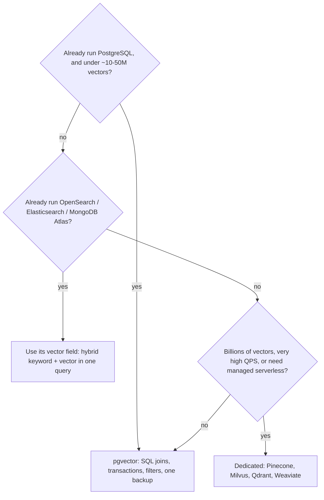

# Embeddings & vector databases

!!! abstract "Key takeaways"
    - An **embedding** is a fixed-length vector of floats (often 256–2,048 dimensions) produced by an encoder model, placed so that texts with similar meaning sit close together. Documents and queries must be embedded by the **same model**; changing models means **re-embedding everything**.
    - Similarity is **cosine**, **dot product** or **Euclidean (L2)**. For vectors normalised to length 1 (Voyage AI, OpenAI and most modern models), all three give the **same ranking**, and dot product is cheapest.
    - Exact search compares the query with every vector (O(N·d)). Vector databases use **approximate nearest neighbour (ANN)** indexes: **HNSW** (layered graph; best recall/latency, memory-hungry) or **IVF** (k-means buckets; cheaper to build, lower recall). Knobs such as `ef_search` and `probes` trade **recall for latency**.
    - Filters (`tenant = 'acme'`) applied **after** an ANN scan can silently return fewer rows than `LIMIT`. Use filtered/iterative scans, partial indexes or partitions, and test recall with filters on.
    - "Vector database" is mostly a feature now: **pgvector** in PostgreSQL, `knn`/`dense_vector` in OpenSearch and Elasticsearch, `$vectorSearch` in MongoDB Atlas, Redis vector search, plus dedicated stores (Pinecone, Milvus, Qdrant, Weaviate). Start with the database you already run; move only when scale or features demand it.

## Why it matters

Keyword search (inverted index, BM25) matches **tokens**. A member who types "how do I reorder my meds?" gets nothing from a FAQ that says "refill your prescription", because no word overlaps. Synonym lists and stemming patch this one phrase at a time.

Embeddings map meaning into geometry. A neural encoder reads a whole passage and outputs a vector; contrastive training on query/answer pairs pushes related passages together and unrelated ones apart. Lineage: word2vec (2013) gave one vector per *word*, Sentence-BERT (2019) one per *passage*; today's commercial models (Voyage AI, OpenAI, Cohere, Amazon Titan, Google) read thousands of tokens.

Where it shows up: **retrieval for RAG** (see [RAG architecture](04-rag-architecture.md)), **semantic search** over articles, tickets and code, **deduplication and clustering**, **recommendations** ("items like this one"), **classification** by nearest labelled example, and **semantic caching** of LLM answers.

Anthropic does not offer its own embedding model; its docs point to Voyage AI (part of MongoDB) and recommend assessing several vendors. So a Claude-based system always has a **second model**, with its own versioning, cost and failure modes.

## Core concepts

### From text to vector

An embedding call takes text and returns a list of floats:

- **Dimension** is fixed per model setting: `voyage-4` returns 1,024 by default (256, 512 or 2,048 on request). As `float32` that is 4 KB per vector, so 10 million chunks is ~40 GB before index overhead.
- **Context limit**: 32,000 tokens for current Voyage text models. Longer documents are **chunked**; each chunk gets its own vector.
- **Asymmetric inputs**: Voyage's `input_type="query"` or `"document"` prepends a different instruction to each; Voyage says not to omit it for retrieval.
- **Not portable**: vectors from two models (or versions) live in different spaces and can't be compared, even at the same dimension.

{ loading=lazy }
*The query shares no words with its best matches; it is close to them in meaning, and therefore in space.*

### Measuring similarity

| Metric | Formula (idea) | Range | Notes |
|---|---|---|---|
| Cosine similarity | angle between vectors: `a·b / (‖a‖‖b‖)` | −1 to 1 | Ignores length; the default for text |
| Dot product (inner product) | `a·b` | unbounded | Equals cosine when both vectors have length 1; fastest |
| Euclidean (L2) distance | `‖a − b‖` | 0 to ∞ | Same ranking as cosine for unit vectors |

pgvector exposes these as operators: `<=>` cosine **distance** (1 − similarity), `<#>` **negative** inner product (because PostgreSQL index scans only go in ascending order), `<->` L2 distance. The index's operator class must match the operator in the query, or the planner falls back to a sequential scan.

Scores are **relative**, not probabilities: 0.78 may be strong for one model and noise for another, so tune thresholds per model on your data.

### Exact vs approximate search

Exact ("flat") k-NN scores every vector: perfect recall, linear cost, fine for small sets (MongoDB suggests exact search under ~10,000 documents). ANN indexes visit a small fraction of vectors and sometimes miss a true neighbour. The quality metric is **recall@k**: what fraction of the exact top-k did the index return?

### HNSW

**Hierarchical Navigable Small World** graphs (Malkov and Yashunin, 2016) are the default index in pgvector, OpenSearch, Elasticsearch, Lucene, MongoDB Atlas, Qdrant, Weaviate and others.

- Every vector is a node in the bottom layer, linked to its nearest neighbours. Each node is also promoted to higher layers with exponentially decreasing probability, so upper layers are sparse "express lanes".
- A search enters at the top, greedily hops to whichever neighbour is closer to the query, drops a layer when it cannot improve, and at the bottom keeps a candidate list of size `ef_search` from which it returns the top k. Visited nodes grow roughly logarithmically with N.
- Build knobs: `m` (links per node; pgvector default 16) and `ef_construction` (candidate list while inserting; default 64). Query knob: `ef_search` (default 40). Higher values give better recall and cost more memory, build time or latency.

{ loading=lazy }
*Each layer narrows the region; only the bottom layer is searched carefully. That is why it is fast, and why it is approximate.*

HNSW handles inserts without rebuilding, but the graph must fit **in memory** to be fast, and builds are slow (pgvector advises raising `maintenance_work_mem`).

### IVF and quantization

**IVF (inverted file)** runs k-means to split vectors into `lists` buckets; a query scans only the `probes` nearest buckets. pgvector's IVFFlat builds faster and uses less memory than HNSW but has lower recall at the same speed, must be built **after** the table has representative data, and drifts as data changes (centroids go stale). Starting points from the pgvector docs: `lists = rows / 1000` up to 1M rows, `probes = sqrt(lists)`.

**Quantization** shrinks vectors: `float16` (2×), `int8` (4×), binary (32× smaller than `float32`). Recall drops, so search the compressed index for ~100 candidates and **re-rank** them with full-precision vectors. **Matryoshka** models (such as Voyage 4) put a usable embedding in the first 256 or 512 dimensions; truncate and re-normalise to save storage.

### Filtering: the silent recall killer

Real queries combine similarity with metadata: tenant, document type, effective date, the user's permissions. With an ANN index, pgvector applies the `WHERE` clause **after** the index scan. If only 10% of rows match and `ef_search` is 40, about 4 rows survive, and `LIMIT 10` quietly returns 4.

{ loading=lazy }
*No error is raised: the answer is just thinner, and the LLM built on top of it gets less context.*

Fixes: **iterative index scans** (pgvector 0.8+: `SET hnsw.iterative_scan = strict_order`), **partial indexes** or **partitions** per tenant or category, a store with **pre-filtering** built into the ANN search (MongoDB `$vectorSearch` `filter` on fields indexed as filters, OpenSearch/Lucene filtered k-NN, Qdrant payload indexes), or exact search when the filter is very selective.

### End-to-end flow


*Notice the two paths share one model and one store. Every change on the ingestion side (model, chunking, dimension) forces a re-index that the query side must switch to at the same moment.*

### Choosing a store


*The thresholds are rules of thumb: benchmark recall and p99 latency on your own data.*

## In practice: code & configuration

The common mistakes are to embed the query with a different model from the corpus, to filter in Java after the search, and to compare against a hard-coded score.

=== "❌ Common mistake"
    ```java
    // Query embedded with the NEW model; the store still holds vectors from the OLD one.
    float[] q = newEmbeddingModel.embed(question);                    // different vector space
    List<Document> hits = vectorStore.similaritySearch(
            SearchRequest.builder().query(question).topK(5).build());  // top-5 across ALL tenants
    return hits.stream()
            .filter(d -> tenantId.equals(d.getMetadata().get("tenant"))) // filter AFTER search: 5 -> 0..5 rows
            .filter(d -> d.getScore() != null && d.getScore() > 0.8)    // threshold copied from a blog
            .toList();
    ```

=== "✅ Correct approach"
    ```java
    // Spring AI 1.x with the pgvector starter; one EmbeddingModel bean used for ingest AND query.
    @Service
    class PolicySearch {
        private final VectorStore store;
        PolicySearch(VectorStore store) { this.store = store; }

        void ingest(String tenant, String docId, List<String> chunks) {
            var docs = chunks.stream().map(text -> new Document(text, Map.of(
                    "tenant", tenant,
                    "docId", docId,
                    "embeddingModel", "model-v2")))   // record which model produced the vector
                .toList();
            store.add(docs);                          // embeds with the configured model, batches writes
        }

        List<Document> search(String tenant, String question) {
            return store.similaritySearch(SearchRequest.builder()
                    .query(question)                  // embedded by the same model
                    .topK(8)
                    .similarityThreshold(0.55)        // tuned on our labelled queries, not copied
                    .filterExpression("tenant == '%s' && embeddingModel == 'model-v2'"
                            .formatted(tenant))       // filter pushed into the store's query
                    .build());
        }
    }
    ```
    In production, validate `tenant` against the authenticated principal rather than formatting a raw string, or build the filter with `FilterExpressionBuilder`.

Spring AI configuration for pgvector (the starter is `spring-ai-starter-vector-store-pgvector`):

```yaml
spring:
  ai:
    vectorstore:
      pgvector:
        index-type: HNSW                # NONE = exact search, IVFFLAT, HNSW (default)
        distance-type: COSINE_DISTANCE  # NEGATIVE_INNER_PRODUCT is faster if vectors are normalised
        dimensions: 1024                # must match the embedding model's output
        initialize-schema: false        # create the table and index with Flyway/Liquibase instead
```

The SQL that migration would own, with the filtered-search fix:

```sql
CREATE EXTENSION IF NOT EXISTS vector;
CREATE TABLE policy_chunk (
  id         uuid PRIMARY KEY,
  tenant     text NOT NULL,
  content    text NOT NULL,
  model      text NOT NULL,            -- embedding model + version
  embedding  vector(1024) NOT NULL     -- 'vector' indexes up to 2,000 dims; halfvec up to 4,000
);
CREATE INDEX ON policy_chunk USING hnsw (embedding vector_cosine_ops)
  WITH (m = 16, ef_construction = 64);  -- operator class must match the <=> operator below

BEGIN;
SET LOCAL hnsw.ef_search = 100;              -- more candidates: better recall, more latency
SET LOCAL hnsw.iterative_scan = strict_order; -- pgvector 0.8+: keep scanning until LIMIT rows pass the filter
SELECT id, content, 1 - (embedding <=> $1) AS cosine_similarity
FROM policy_chunk
WHERE tenant = $2 AND model = 'model-v2'
ORDER BY embedding <=> $1
LIMIT 10;
COMMIT;
```

The embedding call itself, from the Voyage AI example in Anthropic's docs (Python client):

```python
import voyageai
vo = voyageai.Client()  # reads VOYAGE_API_KEY
docs = vo.embed(chunks, model="voyage-4", input_type="document").embeddings
q = vo.embed([question], model="voyage-4", input_type="query").embeddings[0]
# Voyage vectors are normalised to length 1, so dot product == cosine similarity.
```

## Real-world usage

- **Libraries before databases**: Spotify's **Annoy** (memory-mapped tree indexes) and Meta's **FAISS** (IVF, product quantization, GPU search) powered early production similarity search.
- **Search engines added vectors**: Elasticsearch, OpenSearch and MongoDB Atlas index vectors next to text, so **hybrid search** (BM25 + vector, merged with reciprocal rank fusion) runs in one system; pgvector pairs with PostgreSQL full-text search.
- **Embeddings are sensitive data**: Morris et al. (EMNLP 2023, "Text Embeddings Reveal (Almost) As Much As Text") showed that an iterative inversion method recovered 92% of 32-token inputs exactly and recovered full names from clinical-note embeddings. In healthcare (PHI) and banking, treat the vector column with the same encryption, access control, retention and residency rules as the source text.
- **Re-embedding is a migration**: a model upgrade recomputes every vector, so teams run it like a schema migration (new column, backfill, shadow-compare recall, switch reads).

## Trade-offs & production gotchas

| Option | Pros | Cons | Use when |
|---|---|---|---|
| pgvector (PostgreSQL) | One database; SQL joins, transactions, row-level security; cheap | HNSW needs RAM and slow builds; post-filter by default; single-node scale limits | Most apps up to tens of millions of vectors |
| OpenSearch / Elasticsearch k-NN | Hybrid BM25 + vector; filtered k-NN; horizontal scale | Cluster ops and memory sizing; JVM heap vs native memory tuning | You already run it for search or logs |
| MongoDB Atlas Vector Search | Vectors live with documents; pre-filter on indexed fields | Atlas-only (or recent self-managed versions); separate search nodes to size | MongoDB is the system of record |
| Dedicated (Pinecone, Milvus, Qdrant, Weaviate) | Built for scale, quantization, multi-tenancy, serverless | Another system to secure, sync and pay for | Billions of vectors or very high QPS |
| HNSW vs IVFFlat vs flat | HNSW: best recall/latency; IVF: cheaper build; flat: exact | HNSW: RAM; IVF: rebuilds as data drifts; flat: O(N) | Default HNSW; flat under ~10k vectors |

!!! warning "Gotcha: dimension and operator mismatches"
    The column type, the index operator class, the query operator and the model's output dimension must all agree. A `vector_l2_ops` index with an `ORDER BY embedding <=> …` query is ignored and the query becomes a sequential scan; a 3,072-dimension model does not fit an indexed pgvector `vector` column (limit 2,000) without `halfvec` or a smaller output dimension.

!!! warning "Gotcha: the stale-index split brain"
    During a model upgrade, if the query path switches before the backfill finishes, half the corpus is in the old space and its scores are meaningless. Store the model id per row and filter on it, or swap whole indexes atomically.

!!! tip "Measure recall, not only latency"
    Keep a golden set of real queries. Compare ANN results with exact search (in PostgreSQL, `SET enable_indexscan = off` in a test session), with production filters on, whenever you change `ef_search`, quantization, chunking or the model.

## How this connects to my experience

- **Where I used it:** not used directly; position as transferable knowledge. The closest fit is **implementing Elasticsearch-powered search** on ConvergeHealth Data Asset Explorer at Deloitte: the same problems (relevance tuning, filters by data domain, index rebuilds) apply, and Elasticsearch now adds vector fields and hybrid queries. Whether that search used any semantic/vector features: *[confirm]* (assume keyword only).
- **Talking points:**
    - Keyword vs semantic vs hybrid search; I'd add vectors to the existing search engine or database (PostgreSQL, MongoDB, Redis all support it) before adding a new system.
    - Security habits from OptumRx (OAuth2, PHI) and CCKM (KMS): embeddings of PHI are PHI; filter by tenant and entitlement inside the query.
    - **AWS Personalize** at Deloitte is the nearest "similar items" experience, but it is a managed recommender; don't claim hands-on embedding work from it.
- **Likely follow-up chain:** "How would you add semantic search to an existing app?" → embed chunks with one model, store in pgvector with metadata, HNSW cosine index, hybrid with keyword search → "Results for some tenants look thin. Why?" → post-filtering after ANN; iterative scans, partitions, pre-filtering → "How do you upgrade the embedding model?" → versioned column, backfill, shadow-compare recall@k, atomic switch.

## Interview questions

### Fundamentals

??? question "Q1. What is an embedding and why does it enable semantic search?"
    **Answer:** A fixed-length vector produced by an encoder model trained so that semantically similar inputs have nearby vectors. You embed every document chunk once, embed the query at search time with the same model, and return the nearest vectors. Because closeness reflects meaning rather than shared tokens, "reorder my meds" finds "refill your prescription".

    **Interviewer listens for:** same model for both sides, fixed dimension, nearest-neighbour search, chunking for long text.

    **Common wrong answer:** "It's a hash of the text" or "It's a compressed copy of the text you can decode" (it isn't designed to be decoded, though inversion attacks exist).

??? question "Q2. Cosine similarity, dot product or Euclidean distance: which do you use?"
    **Answer:** What the model was trained for, usually cosine. For unit-length vectors cosine equals dot product and L2 ranks identically, so use dot product for speed. In pgvector, the index operator class must match the query operator.

    **Interviewer listens for:** normalisation makes them equivalent; index/operator agreement.

    **Common wrong answer:** "Euclidean is always more accurate."

### Intermediate

??? question "Q3. Explain how HNSW works and which parameters you tune."
    **Answer:** A multi-layer proximity graph: every vector is in layer 0, a random, exponentially shrinking subset is in each higher layer. Search starts at the top entry point, greedily moves to closer neighbours, drops down when stuck, and at the bottom keeps `ef_search` candidates and returns the top k. `m` (links per node) and `ef_construction` control graph quality, memory and build time; `ef_search` controls per-query recall vs latency.

    **Interviewer listens for:** layers as express lanes, greedy descent, build vs query knobs, memory footprint.

    **Common wrong answer:** "It's a tree that partitions the space like a B-tree."

??? question "Q4. What happens if you change the embedding model?"
    **Answer:** Every stored vector must be recomputed: vectors from different models are not comparable, even at the same dimension. Plan it as a migration: new column or index, backfill in batches (rate limits, cost), compare recall on a golden query set, switch reads atomically, keep the model id on each row so mixed states can be filtered.

    **Interviewer listens for:** full re-index, versioning, shadow evaluation, cutover.

    **Common wrong answer:** "Only new documents need the new model."

### Senior

??? question "Q5. How do you combine metadata filters and permissions with vector search?"
    **Answer:** Push the filter into the search, not after it. Post-filtering an ANN result set returns fewer than k results (or none) for selective filters. Options: stores with filtered ANN (pre-filter during graph traversal), pgvector iterative scans, partitions or partial indexes per tenant, separate indexes for large tenants, or exact search when the filter leaves few rows. Permissions must be enforced from the authenticated principal, and tested for both leaks and recall.

    **Interviewer listens for:** post-filter starvation, tenant isolation, security not delegated to the prompt.

    **Common wrong answer:** "Retrieve top 5 and drop the ones the user can't see."

??? question "Q6. How do you size and cost a vector index for 50 million chunks?"
    **Answer:** Raw vectors: 50M × 1,024 × 4 bytes ≈ 205 GB in float32, plus HNSW graph links and metadata. Options: smaller output dimension (Matryoshka), `halfvec`/int8 (2–4× smaller), binary quantization with full-precision re-rank, sharding across nodes, or a dedicated/serverless store. Add embedding API cost and throughput for the initial load and every re-embed, then benchmark recall and p99 at the chosen settings.

    **Interviewer listens for:** back-of-envelope maths, memory as the constraint, quantization with re-rank, re-embedding cost.

    **Common wrong answer:** "Vectors are small; storage doesn't matter."

### Scenario-based

??? question "Q7. Users say semantic search misses exact things like policy numbers and drug names. What do you do?"
    **Answer:** Dense embeddings are weak at rare identifiers. Add BM25 keyword search, merge with reciprocal rank fusion, optionally re-rank with a cross-encoder. Check chunking and `input_type` too, and measure on a labelled query set.

    **Interviewer listens for:** hybrid search, re-ranking, evaluation rather than guessing.

    **Common wrong answer:** "Raise top-k" or "lower the similarity threshold."

??? question "Q8. After a release, retrieval quality dropped sharply but nothing errors. How do you debug it?"
    **Answer:** Check that query and documents use the same model and version (config drift, a new SDK default), the same `input_type`, and the same dimension; check whether the index is used (`EXPLAIN`: operator/opclass mismatch causes a sequential scan or a wrong metric); look for filters that now starve results; check normalisation if switching to inner product; and compare recall@k on the golden set before and after.

    **Interviewer listens for:** model/version mismatch first, index usage, filters, a regression test set.

    **Common wrong answer:** "The LLM got worse; switch LLMs."

## Cheat sheet

| Concept | Remember |
|---|---|
| Embedding | Fixed-length float vector; same model for docs and queries |
| Size | 1,024 dims × 4 B = 4 KB per vector (float32) |
| Metrics | Cosine, dot, L2; identical ranking for unit vectors |
| pgvector operators | `<=>` cosine distance, `<#>` negative inner product, `<->` L2 |
| HNSW | Layered graph; `m` 16, `ef_construction` 64, `ef_search` 40 (pgvector defaults); RAM-hungry |
| IVFFlat | k-means lists + probes; build after data; drifts |
| Quantization | float16 2×, int8 4×, binary 32× smaller; re-rank with full vectors |
| Matryoshka | Truncate dimensions, re-normalise |
| Filters | Post-filter starves `LIMIT`; iterative scan (pgvector 0.8+), partitions, pre-filter |
| Model change | Re-embed everything; version the vectors |
| Security | Embeddings can be inverted: treat as the source data (PHI/PII) |
| Anthropic | No embedding model of its own; docs point to Voyage AI |

## Sources
1. [Anthropic docs: Embeddings](https://platform.claude.com/docs/en/build-with-claude/embeddings): no Anthropic embedding model, Voyage AI models, dimensions and context length, `input_type` prompts, normalisation, quantization, Matryoshka truncation.
2. [pgvector README](https://github.com/pgvector/pgvector): operators, HNSW and IVFFlat parameters and defaults, dimension limits, filtering after index scans, iterative scans (0.8.0), `halfvec`, binary quantization, hybrid search.
3. [Spring AI reference: PGvector](https://github.com/spring-projects/spring-ai/blob/main/spring-ai-docs/src/main/antora/modules/ROOT/pages/api/vectordbs/pgvector.adoc) and [Vector databases](https://github.com/spring-projects/spring-ai/blob/main/spring-ai-docs/src/main/antora/modules/ROOT/pages/api/vectordbs.adoc): starter, `index-type`, `distance-type`, `dimensions`, `initialize-schema`, `VectorStore`, `SearchRequest` (`topK` default 4, `similarityThreshold`, `filterExpression`).
4. Malkov and Yashunin, *Efficient and robust approximate nearest neighbor search using Hierarchical Navigable Small World graphs* (arXiv 1603.09320, IEEE TPAMI): the HNSW algorithm.
5. [MongoDB Atlas: `$vectorSearch` stage](https://www.mongodb.com/docs/atlas/atlas-vector-search/vector-search-stage/): `numCandidates`, `limit`, `exact` (ENN for small collections), pre-filter.
6. Morris, Kuleshov, Shmatikov and Rush, [*Text Embeddings Reveal (Almost) As Much As Text*](https://aclanthology.org/2023.emnlp-main.765), EMNLP 2023: embedding inversion (92% of 32-token inputs; names from clinical notes).
7. [Spotify Annoy](https://github.com/spotify/annoy) and [FAISS](https://github.com/facebookresearch/faiss): ANN libraries behind early production vector search.
8. Related pages: [Production RAG: chunking, hybrid search, reranking](../fde-applied-llm/03-production-rag-chunking-hybrid-search-reranking-permission-a.md), [PostgreSQL indexes and EXPLAIN ANALYZE](../postgresql-sql/02-indexes-and-explain-analyze.md), [MongoDB indexing](../mongodb/03-indexing-and-explain-plans.md).
