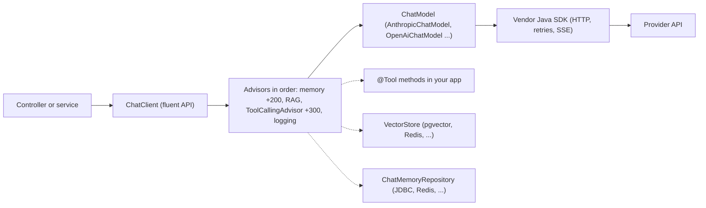
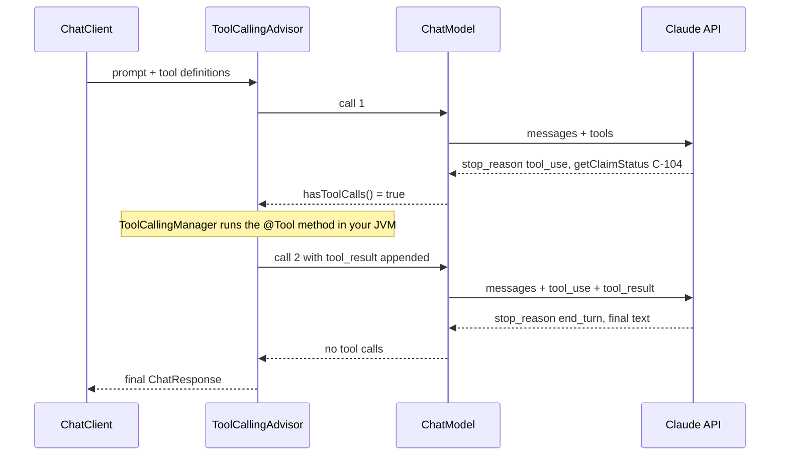
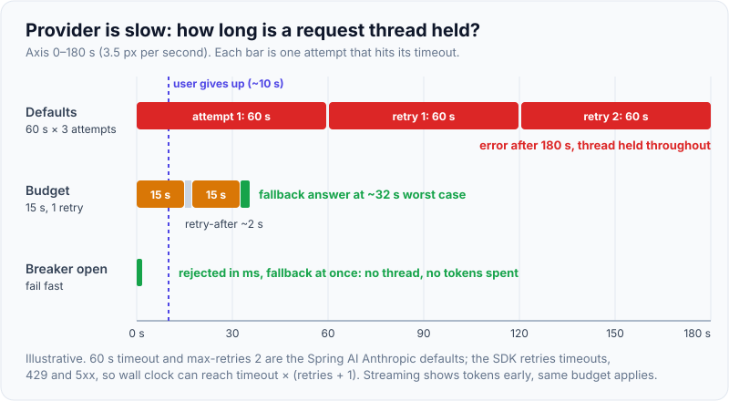

# Spring AI & LLM API integration

!!! abstract "Key takeaways"
    - An LLM API is a **stateless, slow, metered, rate-limited HTTP dependency**. Each request carries the whole conversation; latency is seconds, not milliseconds; you pay per input and output token; and 429 (rate limit) and 529/5xx (overloaded) errors are normal. Treat it like any other flaky upstream: timeouts, bounded retries, concurrency limits, a circuit breaker and a fallback.
    - **Spring AI 2.0** (GA June 2026, current 2.0.1; Spring Boot 4.x, Spring Framework 7, Jackson 3) gives you one portable API over providers. **`ChatClient`** is the user-facing fluent API; **`ChatModel`** is the low-level, per-provider building block. Core providers now wrap the **vendor SDKs** (Anthropic Java SDK, OpenAI Java SDK, Google GenAI SDK).
    - Cross-cutting behaviour runs in an ordered **advisor chain**: chat memory, RAG (`QuestionAnswerAdvisor`), logging, guardrails, and in 2.0 the **`ToolCallingAdvisor`** (order +300), which owns the tool-call loop. `ChatModel.call()` no longer executes tools for you.
    - **Structured output**: `.entity(MyRecord.class)` maps the reply to a Java type. `useProviderStructuredOutput()` sends the JSON Schema to the provider as a hard constraint; `validateSchema()` adds a validate-and-retry loop.
    - Model-specific options bite: current Claude models (e.g. Claude Opus 5.5) **reject** `temperature`/`top_p`/`top_k`, fixed thinking budgets and forced `tool_choice` with a 400, so 1.x-era config copied from blog posts breaks. Pin options per model and test against the real API.

## Why it matters

Most enterprise GenAI work is not training models; it is **integrating** a hosted model into an existing service: a claims assistant behind a REST or GraphQL API, a ticket classifier on a Kafka consumer, a summariser in a batch job. Interviewers for senior Java roles want to know whether you can do that the way you would integrate a payment gateway: with typed contracts, failure handling, cost control, security and observability, not a `RestTemplate` call and a string concatenation.

Before frameworks, teams called provider REST APIs directly (OpenAI's Chat Completions, Anthropic's Messages API) with hand-written JSON, or used the vendor's SDK. That works for one model and one feature. It gets messy with the fourth feature: every team re-implements prompt templates, the tool-calling loop, JSON parsing, chat history and metrics, and switching or mixing providers means a rewrite. Spring AI (and LangChain4j, its main Java alternative) apply the familiar Spring idea, a portable API plus auto-configuration, the way Spring Data did for databases.

## Core concepts

### The LLM API as a dependency

Whatever the provider, a chat API call has the same shape. Using Anthropic's Messages API (`POST /v1/messages`) as the example:

- **Request**: `model`, `max_tokens` (a hard cap on output), a `system` prompt, the full `messages` history (alternating `user`/`assistant`), optional `tools` (JSON Schema per tool) and output settings (structured output schema, effort).
- **Response**: content blocks (`text`, `tool_use`, `thinking`), a `stop_reason` (`end_turn`, `max_tokens`, `tool_use`, `refusal`, …) and `usage` (input, output and cache read/write tokens), which is your bill.
- **Statelessness**: the API remembers nothing. "Chat memory" is your code resending history, so every turn costs more input tokens than the last (see [LLM fundamentals](01-llm-fundamentals-tokens-context-window-temperature-hallucina.md) for context windows).
- **Errors**: 400 (invalid request, including unsupported parameters), 401/403, 413 (too large), **429** rate limit with a `retry-after` header, **529** overloaded and other 5xx. The official SDKs retry connection errors, 408, 409, 429 and 5xx with exponential backoff (2 retries by default).

Three ways to call it from Java:

| Approach | Pros | Cons | Use when |
|---|---|---|---|
| Raw HTTP (`RestClient`/`WebClient`) | No dependency, full control | You own JSON, streaming (SSE), retries, tool loop | Proxies, gateways, unusual runtimes |
| Vendor SDK (e.g. `com.anthropic:anthropic-java`) | Typed, day-one access to new features, built-in retries | Locked to one provider; you still build memory, RAG, tool loop | One provider, need the newest API features |
| Spring AI 2.0 | Portable API, Boot auto-config, advisors, tools, memory, vector stores, Micrometer | Abstraction lags new provider features; options differ per model anyway | Spring services, multiple features or providers |
| LangChain4j | Similar scope, framework-agnostic, `@AiService` interfaces | Different idioms from Spring; a second ecosystem | Quarkus/plain Java, or team preference |

### Spring AI 2.0 building blocks


*Notice that your code talks only to `ChatClient`; memory, retrieval and the tool loop are advisors around a provider-specific `ChatModel`, which itself delegates to the vendor SDK.*

- **`ChatModel`**: one interface per provider with `call(Prompt)` and `stream(Prompt)` (a Reactor `Flux`). In 2.0 it returns the raw model response; it no longer runs tools.
- **`ChatClient`**: the fluent API (`prompt().system(...).user(...).call().content()`), built from an auto-configured, prototype-scoped `ChatClient.Builder`. Defaults (system prompt, options, advisors, tools) are set once on the builder.
- **Options**: immutable, builder-based in 2.0 (`AnthropicChatOptions.builder()`), with defaults in the options class (Anthropic: model `claude-haiku-4-5`, `maxTokens` 4096, 60 s timeout, 2 retries). The `.options` segment disappeared from property keys (`spring.ai.anthropic.chat.model`).
- **Advisors**: interceptors (`CallAdvisor`, `StreamAdvisor`) ordered by `getOrder()`; lower order runs first on the way in, last on the way out. Built-ins include `MessageChatMemoryAdvisor`, `QuestionAnswerAdvisor` and `RetrievalAugmentationAdvisor` (RAG, see [RAG architecture](04-rag-architecture.md)), `SimpleLoggerAdvisor` and `SafeGuardAdvisor`.
- **Starters**: `spring-ai-starter-model-anthropic`, `-openai`, and so on, plus the Spring AI BOM. MCP clients and servers (`@McpTool`) are part of core in 2.0.

### The tool-calling loop

The model cannot run code. It asks you to: the response stops with `tool_use` and the arguments, your application executes the method, and you send the result back in a second request. Spring AI 2.0 moved that loop out of each `ChatModel` into the **`ToolCallingAdvisor`**, auto-registered by `ChatClient` whenever tools are present.


*Notice that one "chat" call is two billed API calls, and the tool runs in your service with your credentials, so the model only ever sees its result.*

{ loading=lazy }
*Watch where memory sits: outside the tool loop by default (order +200 vs +300), so the stored history holds whole turns, never a dangling tool call.*

Guard rails that matter in production: `ToolCallingManager` caps calls per tool and in total per turn (`maxCallsPerTool`, `maxTotalToolCalls`, then `ToolCallLimitExceededException`); `ToolContext` passes tenant or user ids to tools **without** sending them to the model; and `returnDirect` returns a tool's result straight to the caller. Tools are a privilege boundary: a prompt-injected document can ask the model to call them, so authorise inside the tool, not in the prompt (more in [Agents & tool calling](06-agents-and-tool-calling.md)).

### Structured output

`.entity(ClaimSummary.class)` derives a JSON Schema from the record. By default Spring AI adds format instructions to the prompt and parses the reply, with no guarantee. Two switches on `EntityParamSpec` harden it: `useProviderStructuredOutput()` sends the schema to the provider as an API constraint (Anthropic requires `additionalProperties: false` and a recent model), and `validateSchema()` validates the reply and retries with the error appended (3 attempts by default). Use both when downstream code can't tolerate shape drift. The prompt side is covered in [Prompt engineering & structured output](02-prompt-engineering-and-structured-output.md).

### Chat memory

`ChatMemory` (default `MessageWindowChatMemory`, a 20-message sliding window that evicts whole turns and keeps system messages) plus a `ChatMemoryRepository` (in-memory, JDBC, Redis, Cassandra, Neo4j). `MessageChatMemoryAdvisor` loads history for a `ChatMemory.CONVERSATION_ID` and saves the new exchange. In-memory storage is per JVM, so behind a load balancer use a shared repository. The window is a cost and context-window control, not just a feature: every remembered message is re-billed input on each turn.

### Streaming

`.stream().content()` returns `Flux<String>` (server-sent events from the provider) so a UI can show tokens as they arrive; time to first token is often under a second while the full answer takes many. In Spring MVC return the `Flux` or an `SseEmitter`. Streaming does not shorten the total time, so it needs the same timeout budget, and it complicates structured output (`.entity()` is call-only) and token accounting.

## In practice: code & configuration

Spring AI 2.0.1, Spring Boot 4.x, Java 21. Configuration first:

```yaml
spring:
  ai:
    anthropic:
      api-key: ${ANTHROPIC_API_KEY}        # from Secrets Manager / Key Vault, never in git
      timeout: 20s                         # construction-time default (library default 60s)
      max-retries: 1                       # SDK retries 429, 5xx, timeouts with backoff
      chat:
        model: claude-opus-5-5             # pin explicitly; the library default is claude-haiku-4-5
        max-tokens: 4096
        cache-options:
          strategy: SYSTEM_AND_TOOLS       # prompt caching for the stable prefix
    chat:
      client:
        observations:
          log-prompt: false                # prompts may contain PHI/PII; keep off in prod
          log-completion: false
```

=== "❌ Common mistake"
    ```java
    // Copied from a 1.x tutorial: new model per call, sampling knobs, forced tool choice,
    // user input concatenated into the system prompt, raw string parsing.
    @GetMapping("/claims/{id}/summary")
    String summary(@PathVariable String id, @RequestParam String question) {
        var model = AnthropicChatModel.builder()                 // new SDK client + pool per request
            .options(AnthropicChatOptions.builder()
                .model("claude-opus-5-5")
                .temperature(0.2)                                // 400 on current Claude models
                .thinkingEnabled(2048L)                          // fixed budget: 400 on Opus 5.5
                .toolChoice(ToolChoiceAny.builder().build())     // forced tool use: 400 on Opus 5.5
                .build())
            .build();
        String system = "You summarise claim " + id + ". " + question;   // prompt injection
        ChatResponse r = model.call(new Prompt(system));         // 2.0: tools would NOT be executed
        return r.getResult().getOutput().getText();              // free text, parsed by regex later
    }
    ```

=== "✅ Correct approach"
    ```java
    public record ClaimSummary(String claimId, String status, List<String> nextSteps) {}

    @Configuration
    @EnableResilientMethods                                      // Spring Framework 7: @ConcurrencyLimit
    class AiConfig {
        @Bean
        ChatClient claimsClient(ChatClient.Builder builder, ChatMemory memory, ClaimTools tools) {
            return builder
                .defaultSystem("""
                    You are a claims assistant. Answer only from tool results.
                    If the data is missing, say so.""")                  // fixed, cacheable prefix
                .defaultOptions(AnthropicChatOptions.builder()            // 2.0: pass the builder
                    .effort(OutputConfig.Effort.MEDIUM)                   // cost/quality knob, no temperature
                    .timeout(Duration.ofSeconds(20)))
                .defaultTools(tools)                                      // @Tool methods
                .defaultAdvisors(MessageChatMemoryAdvisor.builder(memory).build())
                .build();                                                 // ToolCallingAdvisor auto-registered
        }
    }

    @Service
    class ClaimAssistant {
        private final ChatClient chat;
        ClaimAssistant(ChatClient claimsClient) { this.chat = claimsClient; }

        @ConcurrencyLimit(20)                                    // bulkhead: cap in-flight LLM calls
        ClaimSummary summarise(String conversationId, String userId, String question) {
            try {
                return chat.prompt()
                    .user(question)                              // user text stays in the user turn
                    .toolContext(Map.of("userId", userId))       // for authorisation in tools, never sent to the model
                    .advisors(a -> a.param(ChatMemory.CONVERSATION_ID, conversationId))
                    .call()
                    .entity(ClaimSummary.class, spec -> spec
                        .useProviderStructuredOutput()           // schema enforced by the API
                        .validateSchema());                      // validate + retry on drift
            } catch (RuntimeException e) {                       // SDK already retried 429/5xx once
                log.warn("LLM unavailable, degrading", e);
                return ClaimSummary.unavailable();               // deterministic fallback
            }
        }
    }

    @Component
    class ClaimTools {
        private final ClaimRepository claims;
        ClaimTools(ClaimRepository claims) { this.claims = claims; }

        @Tool(description = "Get the status of a claim the current user may see")
        ClaimStatus getClaimStatus(@ToolParam(description = "Claim id, e.g. C-104") String claimId,
                                   ToolContext ctx) {
            String userId = (String) ctx.getContext().get("userId");
            return claims.findVisibleTo(claimId, userId)         // authorise here, not in the prompt
                .orElseThrow(() -> new ToolExecutionException("not found or not permitted"));
        }
    }
    ```

What changed and why: one shared `ChatClient` (connection pool reuse); no sampling parameters the model rejects; quality traded with `effort`; user input confined to the user turn; tools that authorise with data the model never sees; a typed, schema-enforced result; a concurrency cap, a short timeout and a fallback. For a circuit breaker add Resilience4j around `summarise` (see [Resilience patterns](../microservices/06-resilience-circuit-breaker-retry-bulkhead-timeout-rate-limit.md)).

{ loading=lazy }
*The defaults are reasonable for a batch job and terrible for a request thread: decide the budget per use case.*

## Real-world usage

- **Patterns that ship**: summarisation and drafting behind a human review step, classification and extraction on a Kafka consumer (latency hidden, retries via retry topics and a DLQ), RAG assistants over internal docs, and agent-style tool use for read-only lookups first.
- **Gateways**: larger organisations put an **LLM gateway** (often OpenAI- or Anthropic-compatible) between services and providers for keys, quotas per team, PII redaction, logging and model routing. Spring AI can target it via `base-url`.
- **Cloud routes**: regulated teams often reach Claude through Amazon Bedrock (`spring-ai-starter-model-bedrock-converse`) or Google Vertex AI, to keep traffic in their cloud account and region; the Anthropic starter also exposes `inference-geo` for data residency.
- **Failure modes seen in practice**: provider overload (529) during launches, rate-limit storms from unbounded parallel batch jobs, runaway tool loops burning tokens, `max_tokens` truncation producing invalid JSON, and prompts with PHI landing in logs through debug logging.
- **Healthcare and banking**: send the minimum data, redact before the call, check the provider agreement (BAA for PHI, data retention, zero-retention options), and keep an audit trail of prompts and outputs with access controls (see [Guardrails](../fde-applied-llm/06-guardrails-prompt-injection-pii-phi-redaction-grounding-chec.md)).

## Trade-offs & production gotchas

| Option | Pros | Cons | Use when |
|---|---|---|---|
| Blocking `call()` | Simple, works with `.entity()` | Holds a thread for seconds | Batch, back-office, virtual threads |
| Streaming `stream()` | Fast first token, better UX | Same total time; harder JSON and accounting | Chat UIs |
| Native structured output | Provider guarantees shape | Newer models only; schema rules | Machine-consumed results |
| Prompt-only structured output + `validateSchema()` | Portable | Extra calls on failure | Older or mixed providers |
| Memory window (`MessageWindowChatMemory`) | Bounded cost | Forgets early context | Most chat features |
| Summarising memory / session store | Long conversations | Extra LLM calls, complexity | Long-running assistants |

!!! warning "Gotcha: 1.x and blog config on new models"
    `temperature`, `topP`, `topK`, `thinkingEnabled(budget)`, `thinkingDisabled()` and `ToolChoiceAny`/`ToolChoiceTool` are all rejected with HTTP 400 by Claude Opus 5.5; it uses adaptive thinking with `effort` (default `medium`) instead. Spring AI passes options through, so the failure appears only at runtime. Keep an integration test per configured model.

!!! warning "Gotcha: retries multiply"
    The SDK retries 429, 5xx and timeouts (2 by default). Wrapping the call in `@Retryable` or a Resilience4j retry multiplies attempts (3 × 3 = 9 calls), amplifies load on an already overloaded provider, and stretches latency to timeout × attempts. Retry in **one** layer and honour `retry-after`.

!!! warning "Gotcha: one chat call is not one API call"
    Tool loops, `validateSchema()` retries and RAG query rewriting each add model calls. Budget per **completed request**: read `usage` from `ChatResponse` metadata (`responseEntity(...)` gives you both), export `gen_ai.client.token.usage` via Micrometer, and alert on cost per feature.

!!! tip "Cost levers in order"
    Prompt caching for the stable prefix (`cache-options.strategy`), a bounded memory window, the right model per route (a small model such as Claude Haiku 5.5 for classification), lower `effort` where quality holds, `max-tokens` sized to the output, and the Batches API for offline work. See [LLM observability & cost control](../fde-applied-llm/07-llm-observability-latency-budgets-and-token-cost-control.md).

## How this connects to my experience

- **Where I used it:** not a resume claim; position as transferable integration knowledge. Whether I have built anything on Spring AI or an LLM API, at work or in a side project: *[confirm]*. The closest real fits are **owning the GraphQL Consumer Service** on OptumRx Meteor, an integration layer over **5 upstream systems** (an LLM provider is one more slow, rate-limited upstream with a contract), **Redis caching** of frequent queries, **Kafka workflows with retry and DLQ**, and **secure APIs with OAuth2/PingFederate**. At Deloitte I **integrated AWS Personalize** (a managed ML service) and used **IAM, KMS and Secrets Manager**, the same controls an LLM API key and PHI-bearing prompts need.
- **Talking points:**
    - "I'd treat the model like any upstream in the GraphQL layer: timeout budget, single retry layer, bulkhead, circuit breaker, fallback, and per-call metrics."
    - Healthcare data: minimum necessary data in prompts, redaction, no prompt logging in prod, provider BAA and retention checks.
    - Async by default where latency allows: put LLM enrichment on a Kafka consumer with retry topics and a DLQ, as in the Meteor event workflows.
    - Caching: exact-match caching of deterministic prompts in Redis (cross-tenant isolation in the key), plus provider prompt caching for the shared prefix.
- **Likely follow-up chain:** "How would you add an AI summary to your claims API?" → `ChatClient` with a fixed system prompt, a typed `ClaimSummary`, tools that call existing services with the user's permissions → "What if the provider is down or slow?" → 15–20 s budget, one retry layer, `@ConcurrencyLimit`/bulkhead, breaker, deterministic fallback, async for non-interactive paths → "How do you control cost?" → token metrics per feature, prompt caching, memory window, model routing, `effort`.

## Interview questions

### Fundamentals

??? question "Q1. What actually happens when a Java service calls an LLM chat API?"
    **Answer:** An HTTPS POST with the model id, `max_tokens`, a system prompt, the full message history and optional tool schemas. The provider returns content blocks, a stop reason (`end_turn`, `max_tokens`, `tool_use`, `refusal`) and token usage. It is stateless: conversation memory is the client resending history, so each turn costs more input tokens. Latency is seconds, and 429/529/5xx are expected, so it needs timeouts, retries with backoff and limits.

    **Interviewer listens for:** statelessness, stop reasons, token billing, failure modes.

    **Common wrong answer:** "The model remembers the session on its side."

??? question "Q2. What is the difference between `ChatModel` and `ChatClient` in Spring AI?"
    **Answer:** `ChatModel` is the provider-specific, low-level interface (`call`, `stream` on a `Prompt`). `ChatClient` is the fluent, portable API built on it, with defaults (system prompt, options, tools, advisors), structured output via `.entity()`, and the advisor chain. In 2.0 `ChatModel` no longer runs tools; the auto-registered `ToolCallingAdvisor` in `ChatClient` does.

    **Interviewer listens for:** layering, advisors, the 2.0 tool-loop change.

    **Common wrong answer:** "They are the same; `ChatClient` is just a newer name."

??? question "Q3. How does tool (function) calling work end to end?"
    **Answer:** You send tool names, descriptions and JSON Schemas. The model replies with `stop_reason: tool_use` and arguments; your code runs the method and sends a `tool_result` in a new request with the history; the model then answers or calls more tools. In Spring AI, `@Tool` methods become `ToolCallback`s and `ToolCallingAdvisor` drives the loop, with per-tool and total call limits.

    **Interviewer listens for:** the model never executes code, two or more API calls, loop limits.

    **Common wrong answer:** "The model calls my REST endpoint directly."

### Intermediate

??? question "Q4. How do you get reliable JSON out of an LLM in Spring AI?"
    **Answer:** Map to a record with `.entity(Type.class)`. Prefer the provider's native structured output (`useProviderStructuredOutput()`), which constrains generation to the schema, and add `validateSchema()` to validate and retry on residual failures. Keep `max_tokens` high enough to avoid truncated JSON, and still validate business rules (enums, ranges) in code.

    **Interviewer listens for:** native constraint vs prompt instructions, validation loop, truncation.

    **Common wrong answer:** "Ask nicely in the prompt and parse with a regex."

??? question "Q5. How do you implement chat memory, and what are its costs?"
    **Answer:** `MessageChatMemoryAdvisor` with a `ChatMemory` (default 20-message window) and a shared `ChatMemoryRepository` (JDBC or Redis, not in-memory behind a load balancer), keyed by `CONVERSATION_ID`. Every remembered message is resent and billed on each turn and consumes context window, so bound it by messages or tokens, summarise long histories, and never mix conversation ids across users.

    **Interviewer listens for:** stateless API, shared store, bounded window, tenant isolation.

    **Common wrong answer:** "Store everything forever for better answers."

??? question "Q6. Your LLM calls see frequent 429s. What do you do?"
    **Answer:** Read the rate-limit headers (Spring AI exposes them via `getRateLimit()`), respect `retry-after`, retry in one layer only, cap concurrency with a bulkhead or `@ConcurrencyLimit`, smooth batch jobs with a queue, cut tokens (caching, smaller history), route simple tasks to a smaller model, and request higher limits. Separate interactive and batch quotas so a batch job can't starve users.

    **Interviewer listens for:** backpressure, not more retries; token as well as request limits.

    **Common wrong answer:** "Increase retries to 10."

### Senior

??? question "Q7. Spring AI, the vendor SDK, or LangChain4j: how do you choose?"
    **Answer:** Spring AI in Spring Boot services that need several building blocks (tools, memory, RAG, vector stores, observability) or provider portability. The vendor SDK when you are on one provider and need the newest features the day they ship. LangChain4j outside Spring or for its `@AiService` style. Portability is partial anyway: options, model behaviour and prompts differ by model, so plan an eval suite per model, not a config switch.

    **Interviewer listens for:** trade-offs, feature lag, honest view of portability.

    **Common wrong answer:** "Spring AI lets us swap providers with one property."

??? question "Q8. How do you make an LLM-backed endpoint production-ready in a regulated domain?"
    **Answer:** Secrets in a vault with rotation; minimum necessary data, PII/PHI redaction, provider BAA and retention checks; no prompt/completion logging in prod, but an access-controlled audit trail; timeouts, single retry layer, bulkhead, breaker, fallback; tools authorise with server-side context; structured, validated output; Micrometer metrics for latency, tokens and cost per feature; evals before model or prompt changes; and a human in the loop for consequential decisions.

    **Interviewer listens for:** security, resilience, observability and evaluation together.

    **Common wrong answer:** "The provider is HIPAA compliant, so we're covered."

### Scenario-based

??? question "Q9. After upgrading to a new Claude model, every request fails with HTTP 400. What happened?"
    **Answer:** Most likely options the new model rejects: `temperature`/`top_p`/`top_k`, a fixed thinking budget or disabled thinking, or forced `tool_choice` (all 400 on Claude Opus 5.5), often set in a shared `defaultOptions` or properties file. Read the error body, remove them, use `effort` for the cost/quality trade-off, and add an integration test per configured model so the next upgrade fails in CI, not prod.

    **Interviewer listens for:** reading the 400 body, model-specific options, test per model.

    **Common wrong answer:** "Roll back the Spring AI version."

??? question "Q10. An AI summary endpoint has p99 latency of 90 s and occasionally returns truncated JSON. Fix it."
    **Answer:** Latency: check for retries stacked across layers, the 60 s default timeout × attempts, tool loops and `validateSchema()` retries adding calls, and huge histories; set a per-use-case budget, one retry layer, a concurrency cap and fallback, stream if it's interactive, or move it async. Truncation: `stop_reason: max_tokens`; raise `max-tokens`, shrink the requested output, and use native structured output with validation.

    **Interviewer listens for:** count the calls, budgets, `max_tokens` stop reason.

    **Common wrong answer:** "Use a faster model" without measuring where time goes.

## Cheat sheet

| Concept | Remember |
|---|---|
| Spring AI version | 2.0 GA June 2026 (2.0.1 current); Boot 4.x, Framework 7, Jackson 3 |
| `ChatClient` vs `ChatModel` | Fluent API + advisors vs provider-level `call`/`stream` |
| Tool loop | `ToolCallingAdvisor` (+300), auto-registered; `ChatModel` no longer executes tools |
| Memory | `MessageChatMemoryAdvisor` (+200), 20-message window, shared repository |
| Structured output | `.entity(T)` + `useProviderStructuredOutput()` + `validateSchema()` |
| Anthropic defaults | `claude-haiku-4-5`, 4096 max tokens, 60 s timeout, 2 retries |
| Claude Opus 5.5 | No temperature/top_p/top_k, no budgets, no forced tool choice; use `effort` |
| Errors | 429 + `retry-after`, 529 overloaded, 5xx: retry in one layer |
| Resilience | Timeout budget, bulkhead (`@ConcurrencyLimit`), breaker, fallback |
| Cost | Prompt caching, memory window, model routing, effort, batch |
| Observability | Micrometer `gen_ai.client.operation`, `gen_ai.client.token.usage`; prompt logging off |

## Sources
1. [Spring AI 2.0.0 GA announcement](https://spring.io/blog/2026/06/12/spring-ai-2-0-0-GA-available-now/): Boot 4 / Framework 7 baseline, Jackson 3, vendor SDK providers, `ToolCallingAdvisor`, structured output validation, MCP in core.
2. [Spring AI 2.0.1 release notes](https://spring.io/blog/2026/08/21/spring-ai-2-0-1-available-now): current maintenance release, tool call limit, Anthropic timeout fix.
3. [Spring AI reference: Upgrade notes, Upgrading to 2.0.0](https://docs.spring.io/spring-ai/reference/upgrade-notes.html): removal of the per-model tool loop and `internalToolExecutionEnabled`, advisor orders, options immutability, property flattening.
4. [Spring AI reference: Anthropic Chat](https://docs.spring.io/spring-ai/reference/api/chat/anthropic-chat.html): properties and defaults, prompt caching strategies, structured output and effort, rate-limit metadata, sampling parameters deprecated on newer models.
5. [Spring AI reference: ChatClient](https://docs.spring.io/spring-ai/reference/api/chatclient.html), [Structured output](https://docs.spring.io/spring-ai/reference/api/structured-output.html), [Tool calling](https://docs.spring.io/spring-ai/reference/api/tools.html) and [Chat memory](https://docs.spring.io/spring-ai/reference/api/chat-memory.html): fluent API, `EntityParamSpec`, tool limits and `ToolContext`, `MessageWindowChatMemory`.
6. [Spring AI reference: Observability](https://docs.spring.io/spring-ai/reference/observability/index.html): `gen_ai.*` observations and prompt/completion logging flags.
7. [Anthropic docs: Messages API](https://docs.claude.com/en/api/messages), [Errors](https://docs.claude.com/en/api/errors) and [Rate limits](https://docs.claude.com/en/api/rate-limits): request/response shape, stop reasons, 429/529, `retry-after`.
8. [Anthropic docs: Models overview](https://docs.claude.com/en/docs/about-claude/models/overview): current model ids and per-model parameter support (sampling parameters and forced tool choice on Claude Opus 5.5).
9. [Anthropic Java SDK](https://github.com/anthropics/anthropic-sdk-java): the SDK under Spring AI's Anthropic module; default retries and timeouts.
10. [Spring Framework reference: Resilience features](https://docs.spring.io/spring-framework/reference/core/resilience.html): `@Retryable`, `@ConcurrencyLimit`, `@EnableResilientMethods`.
11. [LangChain4j documentation](https://docs.langchain4j.dev/): the main Java alternative.
