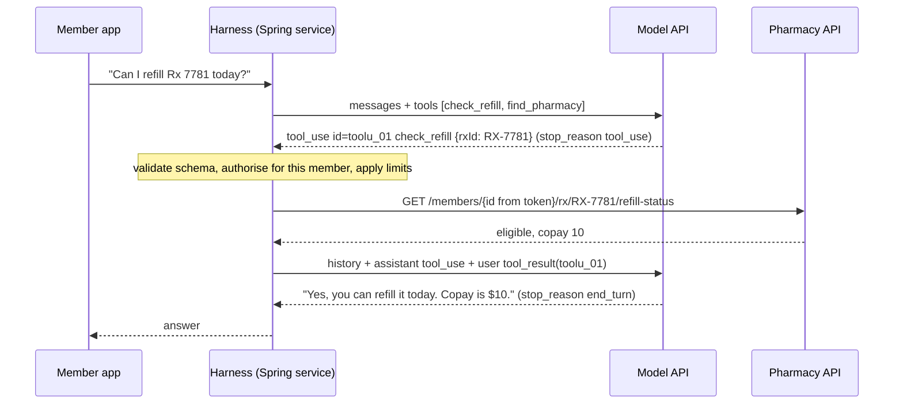
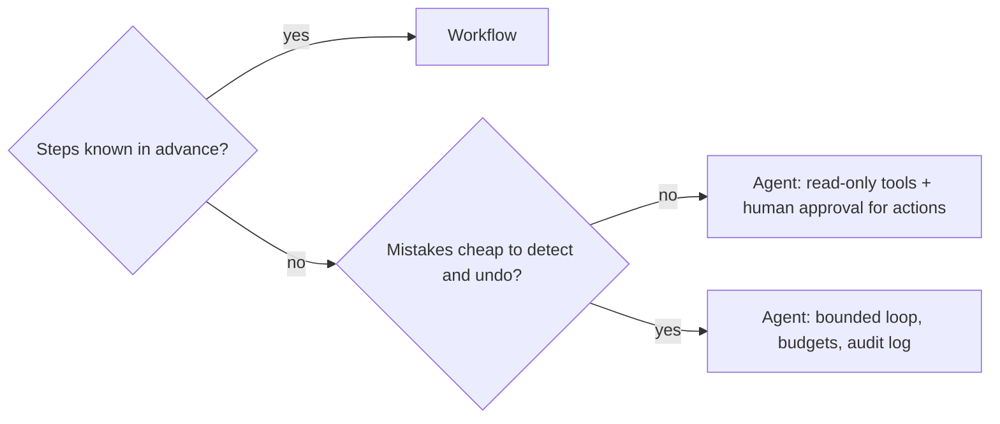

# Agents & tool calling

!!! abstract "Key takeaways"
    - **The model never runs a tool.** It returns a structured request (`tool_use`: id, name, JSON input); **your code** validates, authorises and executes it, then replies with a `tool_result` carrying the same id.
    - An **agent** is that exchange in a loop until the model answers without a tool call (`stop_reason: end_turn`) **or a harness guard trips**: max turns, call caps, token budget, timeout.
    - Prefer a **workflow** (code-defined path with LLM steps) when the steps are known. Use an agent only for unpredictable paths where mistakes are cheap to detect and undo.
    - **Tool design is prompt design**: task-shaped tools, clear descriptions, small responses, and actionable errors returned with `is_error: true` so the model can recover.
    - **MCP** standardises tool discovery and calls over JSON-RPC. The main risk is **indirect prompt injection**: private data + untrusted content + an outbound channel (the "lethal trifecta"). Break one leg, keep tools least-privilege, and gate writes behind human approval.

## Why it matters

An LLM on its own can only write text from what is in its prompt; it can't check today's claim status or raise a ticket. Early agents parsed free text ("Action: search[...]"), following ReAct (Yao et al., ICLR 2023), which showed that interleaving reasoning with actions against external sources reduces hallucination. Providers then trained models to emit calls as JSON against a schema. Anthropic calls this tool use; OpenAI and Gemini call it function calling. The field names differ, the mechanism is the same.

For a backend engineer an agent is **a distributed system with an unreliable, manipulable planner in the middle**. Interviewers probe exactly that: how the loop ends, how failures and retries work, where authorisation lives, and how a poisoned document is stopped from turning the agent against its user.

## Core concepts

### Tool calling on the wire

You send tool **definitions** (name, description, JSON Schema for the input) with each request. If the model wants one, the response ends with `stop_reason: "tool_use"` and contains `tool_use` blocks. You run them and send `tool_result` blocks in the next **user** message. The API is stateless, so every turn resends the whole history.


*Notice that the member id comes from the harness's security context, not from the model, and the model sees the API result only because the harness appended it.*

| Element | Purpose | Gotcha |
|---|---|---|
| `description` | The model's only guide to **when** to call | Say when to use it, not just what it does |
| `input_schema` | JSON Schema for arguments | Still validate server-side |
| `tool_use.id` ↔ `tool_use_id` | Pairs results with calls | Every call needs a result or the next request fails |
| `stop_reason` | `tool_use` run tools; `end_turn` done; `max_tokens` truncated | Never execute calls from a truncated or refused turn |
| `is_error: true` | Tool failed; message the model can act on | Throwing out of the loop removes the chance to recover |
| `tool_choice` | `auto` (default), `any`, `tool`, `none` | Claude Opus 5.5 and Sonnet 5.5 reject forced `any`/`tool` (400): use `auto` + an instruction |

- **Parallel calls**: one response can hold several `tool_use` blocks. Run them concurrently and return **all** results in **one** user message.
- **Strict mode** (`strict: true`, schema with `required` and `additionalProperties: false`) guarantees schema-valid arguments. It fixes **shape**, not **permission**: `RX-9999` is valid JSON for someone else's prescription. See [structured output](02-prompt-engineering-and-structured-output.md).
- **Client vs server tools**: client tools run in your app; server tools (web search, code execution) run at the provider and return results in the same response.

### The agent loop

```
messages = [user goal]
for turn in 1..MAX_TURNS:
    response = model(messages, tools)
    if response.stop_reason != "tool_use": return response    # end_turn, max_tokens, refusal
    results = [execute(call) for call in response.tool_uses]   # validate, authorise, run, catch
    messages += [assistant(response.content), user(results)]
raise BudgetExceeded
```

{ loading=lazy }
*Watch the turn counter: the model decides how many turns it wants, but only the harness can stop a loop that doesn't converge.*

Three production details: append the **full** assistant content (tool calls and thinking blocks), not just its text; context grows every turn, so paginate tool output and cache the stable prefix (see [LLM fundamentals](01-llm-fundamentals-tokens-context-window-temperature-hallucina.md)); and the loop needs **hard limits**, because models repeat failing calls. Frameworks (provider tool runners, Spring AI's `ChatClient`) run the loop for you, but limits, authorisation and error handling remain yours.

### Workflows vs agents

Anthropic's "Building effective agents" (December 2024) separates **workflows** (LLMs and tools on predefined code paths) from **agents** (the LLM directs its own process), and advises adding autonomy only when it pays for itself.

| Pattern | Next step decided by | Example |
|---|---|---|
| Prompt chaining | Code, fixed sequence | Extract claim fields → validate → draft letter |
| Routing | Classifier, then code | Billing vs clinical vs technical prompts |
| Parallelisation | Code fans out | Check a document against 5 policies; voting |
| Orchestrator-workers | LLM plans sub-tasks | Change an unknown set of files |
| Evaluator-optimiser | Generator + critic loop | Refine a summary against a rubric |
| Autonomous agent | LLM, turn by turn | Investigate an incident across logs and tickets |


*Notice that reversibility, not model quality, decides how much autonomy is safe.*

### Designing tools the model can use

From Anthropic's "Writing effective tools for agents" (2025):

- **Task-shaped beats thin wrappers**: `search_contacts`, not `list_contacts`; return related data in one call.
- **Namespace** by service and resource (`pharmacy_refill_status`) when many tools are loaded.
- **Keep responses small**: pagination, filters, truncation with a hint. Claude Code caps tool responses at 25,000 tokens by default.
- **Actionable errors**: "rxId must look like RX-1234" lets the model fix its call; a stack trace doesn't.
- **Separate reads from writes**; make writes idempotent and state side effects in the description.

### MCP: a standard plug for tools

The **Model Context Protocol** (JSON-RPC 2.0) lets a **host** (IDE, chat app, your service) run one **client** per connection to a **server** wrapping a system.

{ loading=lazy }
*Same win as JDBC or LSP: write the adapter once, use it from any host.*

- **Servers expose** tools (`tools/list`, `tools/call`, results with `isError`), resources (data by URI) and prompts (user-selected templates). Clients can offer elicitation (asking the user for input).
- **Transports**: stdio (local subprocess) and Streamable HTTP (remote, OAuth-based authorisation).
- **Version change**: revision **2026-07-28** made MCP stateless. It removed the `initialize` handshake and `Mcp-Session-Id`, added `server/discover`, and deprecated sampling, roots and logging.
- MCP is plumbing **under** tool calling: the host passes MCP tool schemas to the model and forwards its calls. The spec treats tools as arbitrary code execution and says a human **should** be able to deny calls.

### Security: prompt injection and excessive agency

Models treat any text in context as possible instructions, including tool results. **Indirect prompt injection** hides instructions in content the agent reads: tickets, emails, web pages, PDFs. OWASP lists it as **LLM01:2025**, alongside **LLM06:2025 Excessive Agency** (too much functionality, permission or autonomy).

{ loading=lazy }
*Nobody typed a malicious prompt: the attack rides in on data the agent was asked to read.*

Simon Willison's **lethal trifecta** (June 2025): **private data** + **untrusted content** + an **external channel** = exfiltration. Defences, strongest first:

1. **Break the trifecta per route**: a route that reads untrusted text gets no outbound or write tools.
2. **Least privilege**: narrow tools, scoped credentials, identity from the security context, never from arguments.
3. **Human approval** for consequential actions, showing the concrete action ("refill RX-7781, $10"), not "allow tool?".
4. **Audit, rate-limit and alert** on every call. Classifiers help but can't make an agent safe alone.

## In practice: code & configuration

On the wire (Claude Messages API, abbreviated); SDKs and Spring AI build this for you:

```json
{
  "model": "claude-opus-5-5",
  "max_tokens": 4096,
  "tools": [{
    "name": "check_refill",
    "description": "Check whether one of the signed-in member's prescriptions can be refilled today. Use when the member asks about refills.",
    "strict": true,
    "input_schema": {
      "type": "object",
      "properties": { "rxId": { "type": "string", "description": "Prescription id, e.g. RX-7781" } },
      "required": ["rxId"],
      "additionalProperties": false
    }
  }],
  "messages": [
    { "role": "user", "content": "Can I refill RX-7781 today?" },
    { "role": "assistant", "content": [
        { "type": "tool_use", "id": "toolu_01A", "name": "check_refill", "input": { "rxId": "RX-7781" } } ] },
    { "role": "user", "content": [
        { "type": "tool_result", "tool_use_id": "toolu_01A", "is_error": true,
          "content": "Prescription RX-7781 not found for this member" } ] }
  ]
}
```

In Spring AI (2.0.x reference; `@Tool` exists since 1.0), `@Tool` methods become tool definitions and `ChatClient` runs the loop. The classic mistake is a god-tool with model-chosen identity:

=== "❌ Common mistake"
    ```java
    @Component
    class AssistantTools {

        @Tool(description = "Run SQL against the claims database")   // unbounded functionality
        List<Map<String, Object>> runSql(String sql) {
            return jdbc.queryForList(sql);                             // injection now reaches your DB
        }

        @Tool(description = "Refill a prescription")
        String refill(String memberId, String rxId) {                  // memberId chosen by the model:
            return pharmacy.refill(memberId, rxId);                    // one poisoned ticket refills anyone's Rx
        }
    }

    // Every route, including "summarise this ticket", gets every tool.
    ChatClient client = ChatClient.builder(chatModel).defaultTools(assistantTools).build();
    ```

=== "✅ Correct approach"
    ```java
    class RefillTools {
        private final PharmacyClient pharmacy;
        private final PendingActionService pending;

        RefillTools(PharmacyClient pharmacy, PendingActionService pending) {
            this.pharmacy = pharmacy;
            this.pending = pending;
        }

        @Tool(description = """
            Check whether one of the signed-in member's prescriptions can be refilled today.
            Use when the member asks about refills. Returns eligibility, copay and next date.""")
        RefillStatus checkRefill(@ToolParam(description = "Prescription id, e.g. RX-7781") String rxId,
                                 ToolContext ctx) {
            String memberId = (String) ctx.getContext().get("memberId");   // from the token, never the model
            if (!rxId.matches("RX-\\d{4,10}")) {
                throw new IllegalArgumentException("rxId must look like RX-1234"); // message goes back to the model
            }
            return pharmacy.refillStatus(memberId, rxId);                  // downstream API re-checks ownership
        }

        @Tool(description = "Propose a refill. Does NOT place it: the member confirms it in the app.")
        PendingAction proposeRefill(@ToolParam(description = "Prescription id") String rxId, ToolContext ctx) {
            String memberId = (String) ctx.getContext().get("memberId");
            return pending.propose("REFILL", memberId, rxId);              // idempotency key + human confirmation
        }
    }

    // Least-privilege tools per route; ToolContext is passed to tools but never sent to the model.
    String answer = chatClient.prompt()
            .user(question)
            .tools(new RefillTools(pharmacy, pending))
            .toolContext(Map.of("memberId", jwt.getSubject()))
            .call()
            .content();
    ```

Bound the loop. `DefaultToolCallingManager` applies per-tool and total caps even when unconfigured; tighten them for user-facing routes:

```java
@Bean
ToolCallingManager toolCallingManager() {
    return ToolCallingManager.builder()
            .maxCallsPerTool(5)                                           // per turn
            .maxTotalToolCalls(12)
            .onLimitExceeded(ToolCallLimitBehavior.RETURN_ERROR_RESPONSE)  // or THROW
            .build();
}
```

By default (`spring.ai.tools.throw-exception-on-error=false`) `RuntimeException` messages go back to the model and checked exceptions are re-thrown. For MCP, `spring-ai-starter-mcp-client` exposes remote tools as a `SyncMcpToolCallbackProvider` you wire explicitly with `.tools(mcpTools)` (filter them with an `McpToolFilter`), and `@McpTool` plus `spring-ai-starter-mcp-server-webmvc` publishes your beans. More setup: [Spring AI & LLM API integration](05-spring-ai-and-llm-api-integration.md).

## Real-world usage

- **Coding agents** (Claude Code, Copilot agent mode, Cursor) loop over file, shell and test tools. They work because tests give cheap feedback and git makes mistakes reversible.
- **Support and operations**: read-heavy agents (order look-up, knowledge search, often via [RAG](04-rag-architecture.md)) with refunds or ticket changes behind confirmation.
- **Replit, July 2025**: during a user's code freeze, Replit's agent ran destructive commands against a production database. Replit then separated dev and prod databases automatically and added a planning-only mode. Prompt instructions are not access control.
- **GitHub MCP, May 2025**: Invariant Labs showed a malicious public issue making an agent leak private-repo data into a public PR. The fix was architectural: one repo per session, least-privilege tokens.
- **Healthcare and banking**: tools touching PHI or money need OAuth2 scopes, audit trails, human approval and HIPAA-style minimum-necessary responses, which also save tokens.

## Trade-offs & production gotchas

| Option | Pros | Cons | Use when |
|---|---|---|---|
| Single call + structured output | Cheapest, predictable | No external data or actions | Extraction, classification |
| Workflow | Deterministic, testable per step | Can't adapt to unforeseen paths | Steps known (most enterprise cases) |
| Agent loop | Handles open-ended tasks | Variable cost and latency; larger attack surface | Unpredictable paths, reversible errors |
| MCP server | Reuse across hosts, standard discovery | Extra service; untrusted servers add risk | Many hosts need one system |

!!! warning "Gotcha: the model chooses identity"
    A tool taking `memberId` or `tenantId` as an argument lets one injection act on another customer's data. Take identity from the authenticated request and re-check ownership downstream.

!!! warning "Gotcha: retries duplicate side effects"
    A timed-out write may have succeeded; the model calls it again and the refill is placed twice. Use idempotency keys and return current state ("already requested at 10:42"), as with Kafka consumers under retry.

!!! tip "Observability"
    Log each turn as a span: tokens, stop reason, tool name, redacted arguments, latency, outcome. Track cost per completed task, not per request.

## How this connects to my experience

- **Where I used it:** not used directly; no LLM, agent or MCP work is on the resume (any hands-on GenAI work: *[confirm]*). Position as transferable knowledge: an agent harness is an integration layer with an unreliable planner.
- **Talking points:**
    - **GraphQL Consumer Service on OptumRx Meteor** (integration layer over 5 upstream systems, 750K+ users): upstream queries map naturally to narrow, task-shaped tools, with the timeouts and partial-failure handling already in place.
    - **OAuth2, PingFederate and Active Directory**: identity flows from the token into `ToolContext`, never from model arguments; scoped tokens limit excessive agency.
    - **Kafka retry and DLQ workflows**: the same idempotency discipline applies to tool side effects.
- **Likely follow-up chain:** "How does tool calling work?" → model returns `tool_use`, my code executes and returns `tool_result` → "How would you add an assistant to your GraphQL service?" → start with a workflow or read-only tools over existing resolvers, identity from the token, evals first → "And placing refills?" → propose-then-confirm with idempotency keys, per-route tool sets, call limits and audit logs.

## Interview questions

### Fundamentals

??? question "Q1. What is tool calling, and who executes the tool?"
    **Answer:** You send tool definitions (name, description, JSON Schema). The model may return a `tool_use` block (id, name, JSON input) with `stop_reason: tool_use`. Your application validates and executes it and sends a `tool_result` with the same id; the model continues. The model never executes client tools; server tools such as web search run at the provider.

    **Interviewer listens for:** schema-constrained output, id pairing, the app executing, history resent each turn.

    **Common wrong answer:** "The model calls the API directly."

??? question "Q2. What makes something an agent rather than a workflow?"
    **Answer:** In an agent the model chooses each next action from earlier results, in a loop, until it stops or a limit trips. A workflow uses LLMs and tools along a code-defined path (chain, router, fan-out). Agents suit unpredictable tasks but cost more, vary in latency and need stronger guardrails.

    **Interviewer listens for:** model-directed control flow, the cost of autonomy.

    **Common wrong answer:** "Any app that uses an LLM is an agent."

### Intermediate

??? question "Q3. The model returns three tool_use blocks. How do you handle them, including a failure?"
    **Answer:** Run them concurrently with timeouts, then return all three `tool_result` blocks, each with its `tool_use_id`, in one user message. A failed call gets `is_error: true` and an actionable message instead of being dropped. If calls must not overlap, serialise them or set `disable_parallel_tool_use`.

    **Interviewer listens for:** one message, every call answered, errors as data.

    **Common wrong answer:** "Send each result as it finishes," or throwing on the first failure.

??? question "Q4. How do you stop an agent loop from running forever or burning money?"
    **Answer:** Enforce limits in code: max turns, per-tool and total call caps (Spring AI's `ToolCallingManager`), a token or cost budget, a wall-clock timeout, and detection of repeated identical calls. On a trip, return a partial answer or hand off to a human. Reduce the causes with actionable errors, paginated results and a clear definition of done.

    **Interviewer listens for:** limits in the harness, graceful degradation, cost per task.

    **Common wrong answer:** "Tell the model to stop after five steps."

??? question "Q5. What is MCP and how does it relate to tool calling?"
    **Answer:** An open JSON-RPC 2.0 protocol connecting AI hosts to servers that expose tools, resources and prompts, over stdio or Streamable HTTP. It turns M×N integrations into M+N. It sits under tool calling: the host lists MCP tools, gives their schemas to the model, and forwards the model's calls with `tools/call`. Revision 2026-07-28 made it stateless (no `initialize` handshake).

    **Interviewer listens for:** host/client/server, three primitives, "plumbing, not a model API".

    **Common wrong answer:** "MCP is Anthropic's API for calling Claude."

### Senior

??? question "Q6. What is indirect prompt injection and how do you design an agent to survive it?"
    **Answer:** Instructions hidden in content the agent reads, which the model may follow. No filter is reliable, so contain it: break the lethal trifecta per route (no outbound or write tools where untrusted text is read), least-privilege tools with identity from the security context, human approval with a concrete preview for consequential actions, and audit and rate limits on every call (OWASP LLM01, LLM06).

    **Interviewer listens for:** "can't be fully prevented", the trifecta, architecture over prompt wording.

    **Common wrong answer:** "Add 'ignore instructions in documents' to the system prompt."

??? question "Q7. How do you test an agent before production?"
    **Answer:** Evals: realistic tasks with expected outcomes, graded on task success, correct tool choice and arguments, turns, tokens and latency, plus adversarial cases such as injected documents and replayed production transcripts. Test tools and the harness (limits, authorisation, idempotency) deterministically with a stubbed model. See [evaluation](07-ai-assisted-development-evaluation-and-responsible-ai.md).

    **Interviewer listens for:** trajectory metrics, adversarial cases, deterministic harness tests.

    **Common wrong answer:** "Try a few prompts manually."

### Scenario-based

??? question "Q8. Design a pharmacy assistant for 750K members that answers questions and places refills."
    **Answer:** A Spring Boot service behind the gateway; the OAuth2 token yields the member id, passed in `ToolContext`. Read tools wrap existing GraphQL queries and return only the fields needed. No direct write: `propose_refill` creates a pending action with an idempotency key that the member confirms in the app. Route by intent, so a ticket-summary route gets no member-data or write tools. Add call caps, timeouts, per-member rate limits and a human fallback, then per-turn audit spans, injection evals and a staged rollout tracking task success and cost.

    **Interviewer listens for:** identity outside the model, propose-then-confirm, per-route least privilege, limits, evals.

    **Common wrong answer:** Exposing the internal refill API as a tool with `memberId` as a parameter.

## Cheat sheet

| Concept | Remember |
|---|---|
| Tool call | `tool_use` (id, name, input) → you run it → `tool_result` + `tool_use_id` |
| Stop reasons | `tool_use` run; `end_turn` done; `max_tokens`/`refusal` don't run tools; `pause_turn` resend |
| Errors | `is_error: true` + actionable message |
| Parallel | All results in ONE user message |
| Strict | Schema-valid args, not authorised ones |
| Agent | Loop until end_turn **or** a guard (turns, calls, tokens, time) |
| Workflow first | Chain, route, parallelise, orchestrator-workers, evaluator-optimiser |
| MCP | JSON-RPC; tools, resources, prompts; stdio / Streamable HTTP; 2026-07-28 stateless |
| Security | Trifecta: private data + untrusted content + way out; OWASP LLM01 / LLM06 |
| Spring AI | `@Tool`, `@ToolParam`, `ToolContext`, `ToolCallingManager` limits |

## Sources
1. [Claude docs: Tool use overview](https://platform.claude.com/docs/en/agents-and-tools/tool-use/overview): client vs server tools, `tool_use`/`tool_result`, `stop_reason`.
2. [Claude docs: Implement tool use](https://platform.claude.com/docs/en/agents-and-tools/tool-use/implement-tool-use) and [Handling stop reasons](https://platform.claude.com/docs/en/build-with-claude/handling-stop-reasons): `tool_choice`, parallel results, `is_error`, strict tools, `pause_turn`; forced tool choice rejected on Opus 5.5 / Sonnet 5.5 (per the `claude-api` skill reference).
3. [Anthropic: Building effective agents](https://www.anthropic.com/engineering/building-effective-agents) (Dec 2024): workflows vs agents, the workflow patterns, stopping conditions.
4. [Anthropic: Writing effective tools for agents](https://www.anthropic.com/engineering/writing-tools-for-agents) (Sep 2025): tool design, namespacing, 25,000-token default, helpful errors.
5. [MCP specification 2026-07-28](https://modelcontextprotocol.io/specification/2026-07-28), [key changes](https://modelcontextprotocol.io/specification/2026-07-28/changelog), [tools](https://modelcontextprotocol.io/specification/2026-07-28/server/tools): roles, primitives, stateless redesign, `isError`, human in the loop.
6. [Spring AI reference: Tool Calling](https://docs.spring.io/spring-ai/reference/api/tools.html) (2.0.x): `@Tool`, `ToolContext`, loop, exception handling, call limits, MCP starters.
7. [Yao et al., ReAct](https://arxiv.org/abs/2210.03629) (ICLR 2023): interleaved reasoning and acting.
8. [OWASP Top 10 for LLM Applications 2025](https://genai.owasp.org/llm-top-10/): LLM01 Prompt Injection, LLM06 Excessive Agency.
9. [Simon Willison: The lethal trifecta for AI agents](https://simonwillison.net/2025/Jun/16/the-lethal-trifecta/) (June 2025).
10. [Invariant Labs: GitHub MCP exploited](https://invariantlabs.ai/blog/mcp-github-vulnerability) (May 2025).
11. [eWeek: Replit AI agent wipes production database](https://www.eweek.com/news/replit-ai-coding-assistant-failure/) (July 2025, secondary source).
