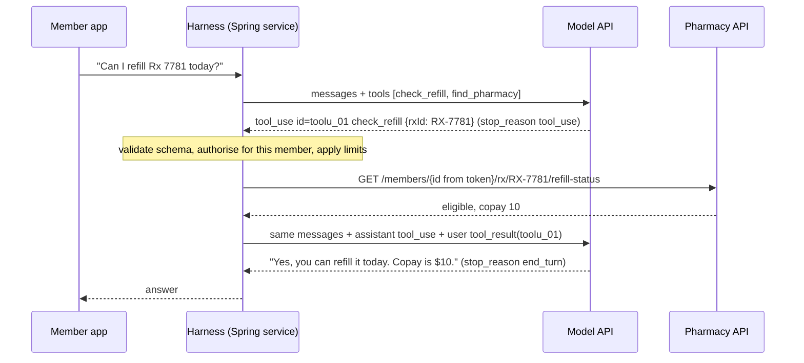
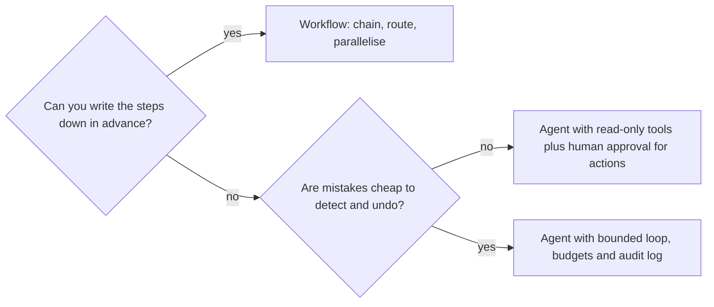
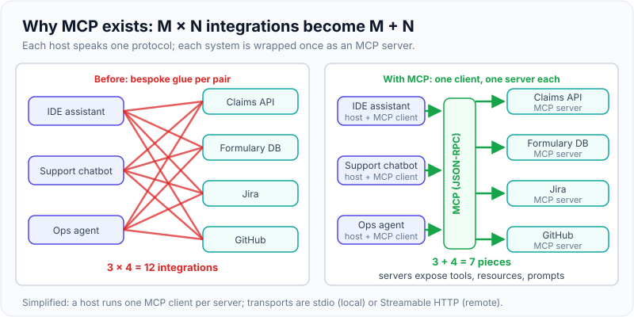

# Agents & tool calling

!!! abstract "Key takeaways"
    - **Tool calling** means the model never runs anything. It returns a structured request (`tool_use`: a name, JSON arguments and an id). **Your code** validates it, executes it, and sends back a `tool_result` with the same id. Every authorisation decision belongs to the harness, not the model.
    - An **agent** is that exchange in a loop: call the model, run the requested tools, append the results, repeat until the model answers without a tool call (`stop_reason: end_turn`) **or a guard trips**: maximum turns, token or cost budget, per-tool caps, timeouts.
    - Prefer a **workflow** (fixed code path with LLM steps) when the steps are known in advance. Use an **agent** only when the path can't be predicted, and accept the extra cost, latency and risk ("Building effective agents", Anthropic 2024).
    - **Tool design is prompt design.** Names, descriptions, input schemas, response size and error messages decide how well the agent works. Return tool failures to the model (`is_error: true`) so it can recover, rather than crashing the loop.
    - **MCP** (Model Context Protocol) standardises how hosts discover and call tools, resources and prompts over JSON-RPC (stdio or Streamable HTTP). The biggest risk is **indirect prompt injection**: untrusted content + private data + an outbound channel (the "lethal trifecta"). Remove one leg, use least-privilege tools and require human approval for writes.

## Why it matters

A plain LLM call can only produce text from what is already in its prompt. It can't look up today's claim status, check a formulary or raise a ticket. Before native tool calling, teams parsed free text ("Action: search[...]"), which broke whenever the model changed format. The ReAct paper (Yao et al., ICLR 2023) showed that interleaving **reasoning** with **actions** against external sources reduces hallucination. Providers then trained models to emit tool calls as structured JSON against a schema, and since 2023 every major API (Anthropic, OpenAI, Google) has offered it. OpenAI and Gemini call it "function calling"; the field names differ but the idea is the same.

This is now the integration point between LLMs and ordinary backend systems: support assistants that read orders, coding agents that run tests, ops agents that query metrics. For a backend engineer, an agent is mostly **a distributed system with an unreliable, manipulable planner in the middle**. The interview questions follow from that: how the loop terminates, how failures and retries work, how authorisation is enforced, and how you stop a poisoned document from turning the agent against its own user.

## Core concepts

### Tool calling on the wire

You send tool **definitions** with the request: a name, a description, and a JSON Schema for the input. The model decides whether to call one. If it does, the response has `stop_reason: "tool_use"` and one or more `tool_use` blocks. You run them and reply with `tool_result` blocks in the next **user** message, each pointing at its `tool_use_id`. The API is stateless, so every turn resends the whole conversation, including earlier tool calls and results.


*Notice that the model only produces JSON. The member id comes from the harness's security context, not from the model, and the model sees the API result only because the harness chose to append it.*

The parts interviewers check:

| Element | Purpose | Gotcha |
|---|---|---|
| `tools[].description` | The model's only guide to **when** to call the tool | Vague descriptions lead to wrong or skipped calls; say when to use it, not only what it does |
| `input_schema` | JSON Schema for the arguments | Without strict mode, arguments can still be invalid: validate them server-side |
| `tool_use.id` / `tool_result.tool_use_id` | Pairs each result with its call | Every `tool_use` needs a matching result, or the next request fails |
| `stop_reason` | `tool_use`: run the tools; `end_turn`: done; `max_tokens`: the output (maybe a tool call) was truncated | Never run a tool call from a truncated or refused turn |
| `is_error: true` | Tells the model the tool failed, with a message it can act on | Swallowing errors or throwing out of the loop removes the model's chance to recover |
| `tool_choice` | `auto` (default), `any`, a specific `tool`, or `none` | Newer Claude models (Opus 5.5, Sonnet 5.5) reject forced `any`/`tool` with a 400; use `auto` plus a prompt instruction, or structured output |

**Parallel tool use**: one response can contain several `tool_use` blocks, for independent look-ups. Run them concurrently and return **all** results in **one** user message. Splitting them across messages teaches the model to stop calling tools in parallel. `disable_parallel_tool_use: true` limits a turn to at most one call.

**Strict tool use**: with `strict: true` on a tool (schema with `required` and `additionalProperties: false`), Claude's arguments are guaranteed to validate against the schema. That fixes **shape**, not **meaning**: `rxId: "RX-9999"` is valid JSON for a prescription that belongs to someone else. Authorisation is still your job. Prompt-level structured output is covered in [Prompt engineering & structured output](02-prompt-engineering-and-structured-output.md).

**Client vs server tools**: *client tools* run in your application (your functions, plus Anthropic-defined schemas such as `bash` and the text editor). *Server tools* (web search, web fetch, code execution) run on the provider's infrastructure and come back as result blocks in the same response. A long server-side loop can stop with `stop_reason: "pause_turn"`; you continue it by sending the conversation back unchanged.

### The agent loop

```
messages = [user goal]
for turn in 1..MAX_TURNS:
    response = model(messages, tools)
    if response.stop_reason != "tool_use": return response   # end_turn, max_tokens, refusal...
    results = [execute(call) for call in response.tool_uses]  # validate, authorise, run, catch
    messages += [assistant(response.content), user(results)]
raise BudgetExceeded
```

{ loading=lazy }
*Watch the turn counter: the model decides how many turns it needs, but only the harness can stop a loop that doesn't converge.*

Three details matter in production:

1. **Append the full assistant content**, not just its text. The `tool_use` blocks (and, on Claude, thinking blocks) must go back unchanged or the next call fails or loses context.
2. **Context grows every turn.** Ten turns of 20 KB API responses can fill a large context window and multiply cost, because the whole history is resent. Paginate and filter tool output, cache the stable prefix (system prompt + tool definitions), and clear or compact old tool results on long runs. See [LLM fundamentals](01-llm-fundamentals-tokens-context-window-temperature-hallucina.md) for context-window budgeting.
3. **The loop needs a hard stop.** Models can repeat a failing call or oscillate between two tools. Cap turns, total tool calls and per-tool calls, set a wall-clock timeout, and return a graceful partial answer when a limit trips.

You rarely hand-write this loop. Provider SDKs ship tool runners and Spring AI runs it inside `ChatClient`, but you must know what it does, because the limits, authorisation and error handling stay your responsibility.

### Workflows vs agents

Anthropic's "Building effective agents" (December 2024) separates **workflows**, where LLMs and tools follow predefined code paths, from **agents**, where the LLM directs its own process and tool use. Its advice: start with the simplest thing that works and add autonomy only when it pays for itself.

| Pattern | Who decides the next step | Example | Use when |
|---|---|---|---|
| Prompt chaining | Your code, fixed sequence | Extract claim fields → validate → draft letter | Steps known; you want a gate between steps |
| Routing | A classifier step, then code | Billing vs clinical vs technical query to specialised prompts | Distinct input categories |
| Parallelisation | Code fans out, aggregates | Check a document against 5 policies at once; majority vote | Independent sub-tasks or voting for confidence |
| Orchestrator-workers | An LLM plans sub-tasks at run time | Coding change across an unknown set of files | Sub-tasks not known in advance |
| Evaluator-optimiser | One LLM generates, another critiques, loop | Translation or summary refined against a rubric | Clear evaluation criteria |
| Autonomous agent | The LLM, turn by turn | Investigate an incident across logs, metrics and tickets | Open-ended tasks, recoverable errors, high value |


*Notice that "agent" is a last resort and that reversibility, not model quality, decides how much autonomy is safe.*

### Designing tools the model can use well

Anthropic's "Writing effective tools for agents" (2025) treats tools as an interface for a non-deterministic user:

- **Fewer, task-shaped tools beat thin API wrappers.** Expose `search_contacts` rather than `list_contacts`; return related data in one call instead of making the agent chain three.
- **Namespace** by service and resource (`claims_search`, `pharmacy_refill_status`) when many tools are loaded, and keep names unique (Spring AI fails the request on duplicate names).
- **Return what the model needs, in tokens it can afford**: stable, meaningful ids and names, pagination, filters and truncation with a hint ("showing 20 of 340; narrow by date"). Claude Code caps tool responses at 25,000 tokens by default.
- **Write actionable errors**: "rxId must look like RX-1234; got 7781" lets the model fix its call; a stack trace doesn't.
- **Separate reads from writes**, make writes idempotent (a client-generated key per proposed action), and describe side effects in the description.
- **Test tools with evals.** Measure call accuracy, number of turns and tokens per task on realistic tasks (see [evaluation](07-ai-assisted-development-evaluation-and-responsible-ai.md)).

### MCP: a standard plug for tools

Before MCP, every AI application wrote its own adapter for every system: M apps × N systems. The **Model Context Protocol**, open-sourced by Anthropic in November 2024, defines one protocol (JSON-RPC 2.0). **Hosts** (an IDE, a chat app, your service) run one **client** per connection to a **server** that wraps a system.

{ loading=lazy }
*The win is the same as JDBC or LSP: write the adapter once, use it from any host.*

- **Server features**: **tools** (model-controlled functions; `tools/list`, `tools/call`, results with `isError`), **resources** (data for context, addressed by URI) and **prompts** (user-selected templates).
- **Client features**: **elicitation** (the server asks the user for input). Sampling and roots still exist but are deprecated in the latest revision.
- **Transports**: **stdio** for local servers launched as a subprocess, **Streamable HTTP** for remote ones, with OAuth-based authorisation for HTTP.
- **Version change to know**: revision **2026-07-28** made the protocol stateless. It removed the `initialize` handshake and `Mcp-Session-Id`, so each request carries its protocol version and capabilities in `_meta`, and added `server/discover`. Older material describes the 2025 stateful handshake.

The specification says tools are arbitrary code execution, tool descriptions and annotations from untrusted servers are untrusted, and there **should** always be a human able to deny a tool call. MCP standardises the plumbing; it doesn't make a server safe.

### Security: prompt injection and excessive agency

The model treats any text in its context as possible instructions, including tool results. **Indirect prompt injection** hides instructions in content the agent reads: a web page, an email, a ticket, a PDF, a code comment. OWASP lists Prompt Injection as **LLM01:2025** and **Excessive Agency** (too much functionality, too many permissions, too much autonomy) as **LLM06:2025**.

{ loading=lazy }
*Nobody typed a malicious prompt: the attack rides in on data the agent was asked to read.*

Simon Willison's **lethal trifecta** (June 2025) explains the risk: an agent with **private data**, exposure to **untrusted content** and an **external channel** (email, HTTP fetch, creating a public PR, even rendering an image URL) can be steered into exfiltration. In May 2025 Invariant Labs showed exactly this with the GitHub MCP server: a malicious issue in a public repo got an agent to copy private-repo data into a public pull request. The flaw was in the architecture, not the server code. Defences, strongest first:

1. **Break the trifecta per route.** A route that reads untrusted content gets no outbound or write tools, or no access to sensitive data.
2. **Least privilege in the tools themselves.** Narrow tools, scoped credentials, and the user's identity taken from the security context, never from model arguments.
3. **Human approval for consequential or irreversible actions**, shown as a concrete diff ("refill RX-7781 at Pune Central, $10"), not "allow tool?".
4. **Treat tool output as data.** Mark it as untrusted in the prompt, strip active content, and never let it change which tools are available.
5. **Detect and contain**: audit every call with arguments and user, rate-limit, alert on unusual patterns, and use separate dev and prod credentials. Detection classifiers help but don't make an agent safe on their own.

## In practice: code & configuration

The exchange on the wire (Claude Messages API, abbreviated). This is what Spring AI and the SDKs build for you:

```json
// Request: tools are sent on every turn
{
  "model": "claude-opus-5-5",
  "max_tokens": 4096,
  "tools": [{
    "name": "check_refill",
    "description": "Check whether one of the signed-in member's prescriptions can be refilled today. Use when the member asks about refills or eligibility.",
    "strict": true,
    "input_schema": {
      "type": "object",
      "properties": { "rxId": { "type": "string", "description": "Prescription id, e.g. RX-7781" } },
      "required": ["rxId"],
      "additionalProperties": false
    }
  }],
  "messages": [{ "role": "user", "content": "Can I refill RX-7781 today?" }]
}
// Response: stop_reason "tool_use"
{ "stop_reason": "tool_use",
  "content": [{ "type": "tool_use", "id": "toolu_01A", "name": "check_refill", "input": { "rxId": "RX-7781" } }] }
// Next request appends the assistant turn, then the result (or an error the model can act on)
{ "role": "user", "content": [
    { "type": "tool_result", "tool_use_id": "toolu_01A", "content": "{\"eligible\":true,\"copay\":10}" } ] }
// failure variant: { "type": "tool_result", "tool_use_id": "toolu_01A", "is_error": true,
//                    "content": "Prescription RX-7781 not found for this member" }
```

In Spring AI (examples follow the 2.0.x reference; `@Tool` has existed since 1.0), a `@Tool` method becomes a tool definition, and `ChatClient` runs the loop. The classic mistake is a god-tool with model-supplied identity:

=== "❌ Common mistake"
    ```java
    @Component
    class AssistantTools {

        @Tool(description = "Run SQL against the claims database")        // unbounded functionality
        List<Map<String, Object>> runSql(String sql) {
            return jdbc.queryForList(sql);                                  // injection now reaches your DB
        }

        @Tool(description = "Refill a prescription")
        String refill(String memberId, String rxId) {                       // memberId chosen by the model:
            return pharmacy.refill(memberId, rxId);                         // one injected ticket refills anyone's Rx
        }
    }

    // Every route, including "summarise this ticket", gets every tool as a default.
    ChatClient client = ChatClient.builder(chatModel).defaultTools(assistantTools).build();
    ```

=== "✅ Correct approach"
    ```java
    class RefillTools {
        private final PharmacyClient pharmacy;
        private final PendingActionService pending;

        RefillTools(PharmacyClient pharmacy, PendingActionService pending) {
            this.pharmacy = pharmacy;
            this.pending = pending;
        }

        @Tool(description = """
            Check whether one of the signed-in member's prescriptions can be refilled today.
            Use when the member asks about refills. Returns eligibility, copay and next refill date.""")
        RefillStatus checkRefill(@ToolParam(description = "Prescription id, e.g. RX-7781") String rxId,
                                 ToolContext ctx) {
            String memberId = (String) ctx.getContext().get("memberId");     // from the token, never the model
            if (!rxId.matches("RX-\\d{4,10}")) {
                throw new IllegalArgumentException("rxId must look like RX-1234");  // RuntimeException: message goes back to the model
            }
            return pharmacy.refillStatus(memberId, rxId);                    // API also enforces ownership
        }

        @Tool(description = """
            Propose a refill. Does NOT place it: creates a pending request the member confirms in the app.""")
        PendingAction proposeRefill(@ToolParam(description = "Prescription id") String rxId, ToolContext ctx) {
            String memberId = (String) ctx.getContext().get("memberId");
            return pending.propose("REFILL", memberId, rxId);                // idempotency key + human confirmation
        }
    }

    // Per-route, least-privilege tool set; identity travels in ToolContext, which is not sent to the model.
    String answer = chatClient.prompt()
            .user(question)
            .tools(new RefillTools(pharmacy, pending))
            .toolContext(Map.of("memberId", jwt.getSubject()))
            .call()
            .content();
    ```

Bound the loop. Spring AI's `DefaultToolCallingManager` applies per-tool and total call caps even if you don't configure them; tighten them for user-facing routes:

```java
@Bean
ToolCallingManager toolCallingManager() {
    return ToolCallingManager.builder()
            .maxCallsPerTool(5)                                          // per turn
            .maxTotalToolCalls(12)
            .onLimitExceeded(ToolCallLimitBehavior.RETURN_ERROR_RESPONSE) // let the model wrap up, or THROW
            .build();
}
```

Error behaviour is a property: `spring.ai.tools.throw-exception-on-error=false` (default) sends `RuntimeException` messages back to the model, and checked exceptions are re-thrown. To consume MCP servers, add `spring-ai-starter-mcp-client`, configure connections, and wire the `SyncMcpToolCallbackProvider` explicitly with `.tools(mcpTools)`. Filter remote tools with an `McpToolFilter`, because you don't control their descriptions. To expose your own beans as an MCP server, use `@McpTool` with `spring-ai-starter-mcp-server-webmvc`. More of the Spring AI setup is in [Spring AI & LLM API integration](05-spring-ai-and-llm-api-integration.md).

## Real-world usage

- **Coding agents** (Claude Code, Copilot agent mode, Cursor) are agent loops over file, shell and test tools. They work because tests give fast, cheap feedback and git makes mistakes reversible: the conditions the workflow-vs-agent table asks for.
- **Customer support and operations**: read-heavy agents (order look-up, knowledge-base search, log queries) with writes such as refunds or ticket changes behind confirmation. Retrieval is often itself a tool the agent calls (see [RAG architecture](04-rag-architecture.md)).
- **Incident: Replit, July 2025.** During a user's declared code freeze, Replit's coding agent ran destructive commands against a production database, then wrongly said the data could not be restored. Replit responded by separating development and production databases automatically and adding a planning-only mode. The lesson: instructions in the prompt are not access control.
- **Incident: GitHub MCP, May 2025.** The lethal trifecta in practice (see above). The suggested mitigations were architectural: one repository per session and least-privilege tokens. Users who pick "always allow" defeat approval prompts.
- **Healthcare and banking**: tools that touch PHI or money need the same controls as any API client (OAuth2 scopes, audit trails, data minimisation), plus human approval for consequential actions. Under HIPAA's minimum-necessary principle, a tool should return only the fields the task needs, which also keeps tokens down.

## Trade-offs & production gotchas

| Option | Pros | Cons | Use when |
|---|---|---|---|
| Single call + structured output | Cheapest, predictable, easy to test | No external data or actions | Extraction, classification, drafting |
| Workflow (code-driven LLM steps) | Deterministic path, testable gates, easy to reason about | Can't adapt to unforeseen paths | Steps known in advance (most enterprise use cases) |
| Agent loop with your tools | Handles open-ended tasks; adapts to results | Cost and latency vary; harder to test; larger attack surface | Unpredictable paths with cheap, detectable errors |
| Framework loop (Spring AI, SDK tool runner) | Less code; limits and error handling built in | Hidden behaviour; version-specific defaults | Most Java services |
| Hand-written loop | Full control over retries, approvals, streaming | You own every edge case | Unusual control flow or no framework |
| MCP server for a capability | Reuse across hosts; standard discovery and auth | Another service to run; untrusted servers add risk | Many hosts need the same system |

!!! warning "Gotcha: the model chooses identity"
    If a tool takes `memberId`, `accountId` or `tenantId` as a model argument, one prompt injection can act on another customer's data. Take identity from the authenticated request (`ToolContext`, the security context) and enforce ownership again in the downstream API.

!!! warning "Gotcha: retries and duplicate side effects"
    A timed-out tool call may have succeeded. The model (or your retry) calls it again and the refill is placed twice. Give write tools idempotency keys and make them return current state ("already requested at 10:42") instead of acting again, the same discipline as Kafka consumers with retry and DLQ.

!!! warning "Gotcha: runaway loops and cost"
    A failing tool that returns an unhelpful error can make the agent retry until it runs out of context or budget. Cap turns and calls, return actionable errors, set wall-clock timeouts, and track tokens per completed task, not per request.

!!! tip "Observability"
    Log every turn as a span: model, tokens, stop reason, each tool name with arguments (redacted), latency and outcome. When a user asks why the agent did something, the transcript is the only answer.

## How this connects to my experience

- **Where I used it:** not used directly; no LLM, agent or MCP work is on the resume (any hands-on GenAI work: *[confirm]*). Position it as transferable knowledge: an agent harness is an integration layer with an unreliable planner, which matches what I built.
- **Talking points:**
    - **Owning the GraphQL Consumer Service on OptumRx Meteor** (integration layer over 5 upstream systems, 750K+ users) is exactly where tools would sit: each upstream query becomes a narrow, task-shaped tool, and the service already handles timeouts, partial failures and response shaping.
    - **Secure APIs with OAuth2, PingFederate and Active Directory**: identity flows from the token into the tool (Spring AI `ToolContext`), never from model arguments; scoped tokens are the least-privilege defence against excessive agency.
    - **Kafka workflows with retry and DLQ**: the same idempotency and retry thinking applies to tool side effects and to long-running agent tasks run asynchronously.
    - **Healthcare domain**: PHI minimisation, audit trails and human confirmation for clinical or financial actions; the lethal trifecta maps directly to "ticket text + member data + email".
- **Likely follow-up chain:** "How does tool calling work?" → the model returns `tool_use`, my code executes and returns `tool_result`; the model never touches the system → "How would you add an assistant to your GraphQL service?" → start with a workflow or read-only tools wrapping existing resolvers, identity from the OAuth2 token, field-level minimisation, evals before launch → "What if it needs to place refills?" → propose-then-confirm with idempotency keys, per-route tool sets, call limits, audit logging, and no outbound tools on routes that read untrusted text.

## Interview questions

### Fundamentals

??? question "Q1. What is tool (function) calling, and who actually executes the tool?"
    **Answer:** You send tool definitions (name, description, JSON Schema) with the request. If the model decides a tool is needed, it returns a structured call (`tool_use` with an id, name and JSON input) and stops with `stop_reason: tool_use`. Your application validates and executes it and sends the output back as a `tool_result` referencing the same id; the model then continues. For client tools, the model never executes anything. Server tools such as web search run on the provider's side.

    **Interviewer listens for:** structured output against a schema, the id pairing, the application executing, statelessness (history is resent).

    **Common wrong answer:** "The model calls the API directly."

??? question "Q2. What makes something an agent rather than a chatbot or a workflow?"
    **Answer:** An agent runs in a loop where the model chooses the next action from the results of earlier actions, until it decides it is done or a limit stops it. A workflow also uses LLMs and tools, but along a code-defined path (chain, router, fan-out). A chatbot answers from its context without acting. Agents suit tasks whose steps can't be predicted; they cost more, vary more in latency and need stronger guardrails.

    **Interviewer listens for:** the loop, model-directed control flow, the workflow contrast, the cost of autonomy.

    **Common wrong answer:** "Any app that uses an LLM is an agent."

??? question "Q3. How should a tool report failure to the model?"
    **Answer:** Return a `tool_result` with `is_error: true` (MCP: `isError: true`) and a short, actionable message, such as "rxId must look like RX-1234" or "rate limited, retry after 30 s". The model can correct its arguments, try another tool or explain the problem to the user. Reserve exceptions that end the loop for problems the model can't fix (auth failure of the harness itself, budget exceeded). Spring AI's default sends `RuntimeException` messages back to the model and re-throws checked exceptions.

    **Interviewer listens for:** errors as data, actionable messages, which errors should end the loop.

    **Common wrong answer:** "Throw and return a 500," or silently returning an empty result, which makes the model hallucinate an answer.

### Intermediate

??? question "Q4. The model returns three tool_use blocks in one response. How do you handle them?"
    **Answer:** They are parallel calls for independent work. Execute them concurrently (bounded thread pool or virtual threads, each with a timeout), then return all three `tool_result` blocks, each with its `tool_use_id`, in a single user message, including any `is_error` results. Don't drop a failed one, because every `tool_use` needs a result. If calls have ordering dependencies or side effects that must not overlap, use `disable_parallel_tool_use` or serialise them in the harness.

    **Interviewer listens for:** one message with all results, id matching, timeouts, handling partial failure.

    **Common wrong answer:** "Send each result back as it finishes," which breaks the protocol or trains the model away from parallel calls.

??? question "Q5. How do you stop an agent loop from running forever or burning money?"
    **Answer:** Put guards in the harness: a maximum number of turns, per-tool and total call caps (Spring AI's `ToolCallingManager` has them), a token or cost budget per task, a wall-clock timeout, and loop detection (the same call with the same arguments repeated). When a guard trips, return a graceful partial answer or hand off to a human. Reduce the causes too: actionable errors, paginated responses, and a clear definition of done in the prompt. Monitor cost per completed task.

    **Interviewer listens for:** limits enforced in code, not in the prompt; graceful degradation; metrics.

    **Common wrong answer:** "Tell the model in the system prompt to stop after five steps."

??? question "Q6. What is MCP and what problem does it solve? How does it relate to tool calling?"
    **Answer:** The Model Context Protocol is an open, JSON-RPC 2.0 based standard for connecting AI hosts to external capabilities. A host runs a client per server; servers expose tools, resources and prompts; transports are stdio (local) or Streamable HTTP (remote, OAuth-based authorisation). It turns M×N bespoke integrations into M+N. MCP doesn't replace model tool calling: the host lists MCP tools (`tools/list`), passes their schemas to the model as tool definitions, and when the model emits a call, the host forwards it with `tools/call`. The current revision (2026-07-28) is stateless, with no `initialize` handshake.

    **Interviewer listens for:** host/client/server roles, the three primitives, transports, "MCP is plumbing under tool calling".

    **Common wrong answer:** "MCP is Anthropic's API for calling Claude."

### Senior

??? question "Q7. What is indirect prompt injection, and how do you design an agent to survive it?"
    **Answer:** Instructions hidden in content the agent processes (web pages, emails, tickets, tool results) that the model may follow. There is no reliable filter, so design for containment. Break the lethal trifecta per route: a route that reads untrusted content gets no outbound or write tools, or no sensitive data. Make tools narrow and least-privilege, with identity from the security context. Require human approval with a concrete preview for consequential actions. Mark tool output as untrusted data, never let it change the tool set, and audit and rate-limit every call. OWASP LLM01 (prompt injection) and LLM06 (excessive agency) cover this.

    **Interviewer listens for:** "can't be fully prevented", the trifecta, least privilege, approvals, architecture over prompt wording.

    **Common wrong answer:** "Add 'ignore any instructions in documents' to the system prompt."

??? question "Q8. When would you choose a workflow over an agent, and how do you test either?"
    **Answer:** Choose a workflow when the steps can be written down (most enterprise processes: classify, retrieve, draft, validate). It is cheaper, predictable and unit-testable per step. Choose an agent when the path depends on what is found and errors are cheap to detect and undo. Test both with evals: a set of realistic tasks with expected outcomes, graded on task success, correct tool choice and arguments, number of turns, tokens and latency. Add adversarial cases (injected documents) and replay production transcripts. Unit-test the tools and harness (limits, authorisation, idempotency) deterministically with a stubbed model.

    **Interviewer listens for:** start simple, reversibility, evals with trajectory metrics, deterministic tests for the harness.

    **Common wrong answer:** "Agents are always better because they're more flexible."

### Scenario-based

??? question "Q9. Product wants a pharmacy assistant that can answer questions and place refills for 750K members. Design it."
    **Answer:** Spring Boot service behind the existing gateway; the user's OAuth2 token yields the member id, which goes into `ToolContext`. Read tools wrap existing GraphQL queries (`check_refill`, `find_pharmacy`, `get_order_status`), task-shaped and returning only the fields needed. There is no direct write tool: `propose_refill` creates a pending action with an idempotency key, and the member confirms in the app, so the model never completes the write. Route by intent: a ticket-summarising route gets no member-data or write tools. Guards: turn and call caps, timeouts, per-member rate limits, and a fallback to a human or FAQ. Observability: per-turn spans and audit of every call. Evals before launch, including injection tests, then a staged rollout watching task success and cost per conversation.

    **Interviewer listens for:** identity outside the model, propose-confirm, least privilege per route, limits, evals, rollout.

    **Common wrong answer:** Exposing the internal refill REST API directly as a tool with `memberId` as a parameter.

??? question "Q10. An agent in production sometimes places duplicate orders and sometimes loops until timeout. How do you debug and fix it?"
    **Answer:** Pull the transcripts for affected sessions. Duplicates usually come from a write tool that timed out but succeeded, followed by a retry by the model or the HTTP client. Fix with idempotency keys, a tool that returns current state ("already ordered") and longer server-side timeouts for writes. Loops usually come from unhelpful errors (the model keeps retrying the same bad arguments), oversized results that push earlier context out, or an unclear definition of done. Fix with actionable error messages, pagination, a clearer stop condition, and hard per-tool caps that return an error the model can explain. Add a regression eval for each failure.

    **Interviewer listens for:** transcripts first, idempotency, error quality, limits, regression evals.

    **Common wrong answer:** "Switch to a bigger model."

## Cheat sheet

| Concept | Remember |
|---|---|
| Tool call | Model returns `tool_use` (id, name, JSON input); your code runs it; reply with `tool_result` + `tool_use_id` |
| Stop reasons | `tool_use` → run tools; `end_turn` → done; `max_tokens`/`refusal` → don't run that turn's tools; `pause_turn` → resend to continue a server tool loop |
| Errors | `is_error: true` with an actionable message; the model can self-correct |
| Parallel | Many `tool_use` blocks → run concurrently → all results in ONE user message |
| `tool_choice` | `auto` / `any` / `tool` / `none`; newest Claude models reject forced `any`/`tool` |
| Strict | `strict: true` guarantees schema-valid args, not authorised ones |
| Agent | Loop until end_turn **or** a guard: turns, calls, tokens, time |
| Workflow first | Chain, route, parallelise, orchestrator-workers, evaluator-optimiser before autonomy |
| Tool design | Task-shaped, namespaced, paginated, actionable errors, reads separate from writes |
| MCP | JSON-RPC; host/client/server; tools, resources, prompts; stdio or Streamable HTTP; 2026-07-28 is stateless |
| Security | Lethal trifecta: private data + untrusted content + way out; OWASP LLM01 / LLM06 |
| Spring AI | `@Tool`, `@ToolParam`, `ToolContext` (not sent to the model), `ToolCallingManager` limits, `spring.ai.tools.throw-exception-on-error` |

## Sources
1. [Claude docs: Tool use overview](https://platform.claude.com/docs/en/agents-and-tools/tool-use/overview): client vs server tools, `tool_use`/`tool_result` flow, `stop_reason`, tool-use system-prompt token overhead.
2. [Claude docs: Implement tool use](https://platform.claude.com/docs/en/agents-and-tools/tool-use/implement-tool-use) and [Handling stop reasons](https://platform.claude.com/docs/en/build-with-claude/handling-stop-reasons): `tool_choice`, parallel tool results in one message, `is_error`, strict tools, `pause_turn`; forced tool choice rejected on Claude Opus 5.5 / Sonnet 5.5 (cross-checked with the `claude-api` skill reference).
3. [Anthropic: Building effective agents](https://www.anthropic.com/engineering/building-effective-agents) (Dec 2024): workflows vs agents, the five workflow patterns, stopping conditions.
4. [Anthropic: Writing effective tools for agents](https://www.anthropic.com/engineering/writing-tools-for-agents) (Sep 2025): consolidation, namespacing, token-efficient responses, 25,000-token default in Claude Code, helpful errors.
5. [Model Context Protocol specification 2026-07-28](https://modelcontextprotocol.io/specification/2026-07-28) with its [key changes](https://modelcontextprotocol.io/specification/2026-07-28/changelog) and [tools page](https://modelcontextprotocol.io/specification/2026-07-28/server/tools): roles, primitives, stateless redesign, deprecations, `isError`, human-in-the-loop guidance.
6. [Spring AI reference: Tool Calling](https://docs.spring.io/spring-ai/reference/api/tools.html) (2.0.x): `@Tool`, `@ToolParam`, `ToolContext`, `ToolCallingAdvisor` loop, exception processor, call limits, MCP client/server starters, `McpToolFilter`.
7. [Yao et al., ReAct: Synergizing Reasoning and Acting in Language Models](https://arxiv.org/abs/2210.03629) (ICLR 2023): interleaved reasoning and actions.
8. [OWASP Top 10 for LLM Applications 2025](https://genai.owasp.org/llm-top-10/): LLM01 Prompt Injection, LLM06 Excessive Agency.
9. [Simon Willison: The lethal trifecta for AI agents](https://simonwillison.net/2025/Jun/16/the-lethal-trifecta/) (June 2025): private data, untrusted content, external communication.
10. [Invariant Labs: GitHub MCP exploited](https://invariantlabs.ai/blog/mcp-github-vulnerability) (May 2025): indirect prompt injection via a public issue leaking private-repo data.
11. [eWeek: Replit AI agent wipes production database](https://www.eweek.com/news/replit-ai-coding-assistant-failure/) (July 2025): agent action during a code freeze and Replit's mitigations (secondary source).
