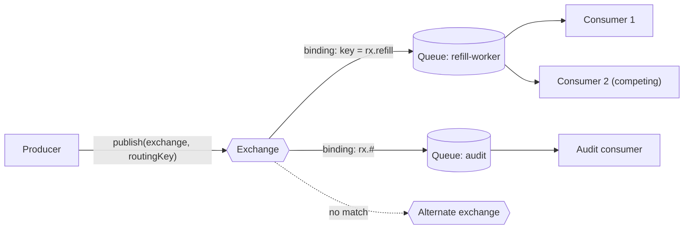
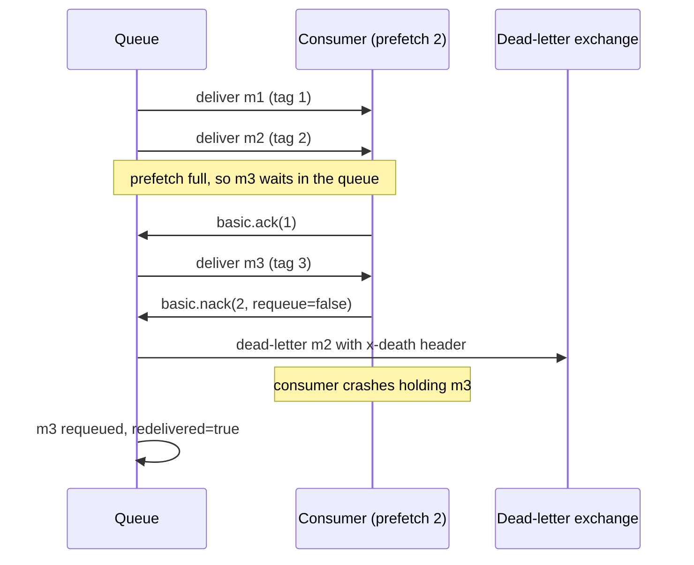

# RabbitMQ: exchanges, queues, routing

!!! abstract "Key takeaways"
    - **Producers never publish to a queue.** They publish to an **exchange** with a **routing key**. **Bindings** decide which queues get a copy. The broker is smart and the consumer is simple, the opposite of Kafka.
    - **Exchange types:** **direct** (exact key), **fanout** (all bound queues), **topic** (`*` = one word, `#` = zero or more) and **headers**. The **default exchange** (`""`) routes to the queue named by the key.
    - **A message leaves the queue only when it's acked.** Use manual acks plus **prefetch** (`basic.qos`, 100–300 is a good start) and **publisher confirms** for at-least-once delivery. Consumers must be idempotent because redelivery happens.
    - **Failures go to a dead-letter exchange (DLX)** on reject with `requeue=false`, TTL expiry or overflow. **Quorum queues** (Raft, three replicas by default) are the durable choice. In 4.x they have a **delivery limit of 20** that stops poison-message loops, and 4.3 adds built-in **delayed retries**.
    - **RabbitMQ 4.x:** mirrored classic queues were **removed in 4.0** (use quorum queues), **Khepri** replaced Mnesia (the only metadata store in 4.3), AMQP 1.0 is native, and **streams** give Kafka-like replay.

## Why it matters

RabbitMQ is the classic **smart broker, simple consumer** design: routing lives in the broker and consumers just ack. Interviewers use it to check that you understand the **queue model** (work is handed out and deleted on ack) as opposed to the **log model** of Kafka (data stays and consumers keep offsets). Kafka is covered in depth in [Kafka](../kafka/index.md) and queues in general in [Message queues & async processing](../system-design/07-message-queues-and-async-processing.md). This page covers only what's specific to RabbitMQ, and [the next page](02-kafka-vs-rabbitmq-vs-sqs-choosing.md) shows how to choose between them.

Typical jobs: task queues (emails, PDFs), request/reply RPC, routing by content (`claims.created.eu` to one team), per-message TTL and priorities, and MQTT or STOMP clients.

## Core concepts

### The AMQP 0-9-1 model


*Notice that the producer only knows the exchange and a key. Adding a new queue with a new binding (audit) changes nothing in the producer. Two consumers on one queue **compete**, each message goes to one of them, while two queues each get **their own copy**.*

- **Exchange:** a routing table, not storage. If no binding matches, the message is **dropped**, unless you publish with `mandatory=true` (returned to the publisher) or set an **alternate exchange**.
- **Queue:** ordered storage that hands messages to consumers round-robin, up to each consumer's prefetch.
- **Channel:** a lightweight session inside one TCP connection, one per thread (not thread-safe). A **virtual host** namespaces everything for multi-tenancy.

### Exchange types

| Type | Routing rule | Example binding → key that matches | Use for |
|---|---|---|---|
| **direct** | binding key == routing key | `pdf` → `pdf` | Work queues by job type |
| **fanout** | all bound queues | (none) → anything | Broadcast, cache invalidation |
| **topic** | dot-separated words, `*` = exactly one word, `#` = zero or more | `claims.*.eu` → `claims.created.eu` (not `claims.created.eu.retry`); `claims.#` → both | Routing by several attributes |
| **headers** | header match, `x-match=all` or `any` | `{type: pdf, region: eu}` | When attributes don't fit a dotted key |
| **default** (`""`) | queue named like the key | key `refill-worker` → that queue | Simple point-to-point |

{ loading=lazy }
*Watch one publish turn into zero, one or several queue copies depending only on the bindings.*

### Acks, prefetch and redelivery


*Notice three ways a message leaves the consumer: **ack** deletes it, **nack/reject without requeue** sends it to the DLX, and a **lost channel** requeues it with `redelivered=true`. That last one is why consumers must be idempotent.*

- **Auto-ack** treats a message as done the moment it's sent. A crash loses it. Use **manual ack** in production.
- **Prefetch** caps unacked messages per consumer. Without it the broker floods one consumer and others sit idle. The RabbitMQ docs suggest **100–300** for throughput. Use 1 for long, uneven jobs where fairness matters more.
- **Requeue loops:** `nack(requeue=true)` on a poison message redelivers it forever at full speed. Quorum queues stop this with a **delivery limit** (default **20** since 4.0), after which the message is dead-lettered or dropped.
- **Publisher confirms:** the broker acks a publish once all target queues have it. For quorum queues that means a majority of replicas. Without confirms, a broker crash can silently lose "sent" messages.

### Queue types in RabbitMQ 4.x

| Type | Replicated | Notes |
|---|---|---|
| **Classic** | No (mirroring removed in 4.0) | Fast, single node. Fine for transient or rebuildable work |
| **Quorum** | Yes, Raft, 3 members by default | Durable default for anything important. Delivery limit, poison handling, priorities (32 strict levels from 4.3), delayed retries (4.3). Not exclusive, not transient |
| **Stream** | Yes | Append-only log with offsets. Consumers can **replay** without deleting. Super streams partition it. Kafka-like semantics inside RabbitMQ |

### Retries with a dead-letter exchange

The classic retry pattern before 4.3 uses a **wait queue with a TTL that dead-letters back** to the work exchange:

{ loading=lazy }
*The retry queue has no consumers: the TTL expiring is what moves the message back. The `x-death` count decides when to stop.*

In RabbitMQ 4.3, quorum queues can do this themselves with `x-delayed-retry-type` and a linear backoff from `x-delayed-retry-min` to `x-delayed-retry-max`. You don't need extra queues.

## In practice: code & configuration

Spring Boot 3 with Spring AMQP: declare topology as beans, set a prefetch and dead-letter failures. The container's default `AUTO` ack mode acks on success and rejects on exception.

=== "❌ Common mistake"
    ```java
    // Classic queue, no DLX, requeue on every failure, no prefetch tuning
    @Bean Queue refills() { return new Queue("refills"); }   // classic, non-replicated

    @RabbitListener(queues = "refills")
    void on(RefillRequested evt) {
        pharmacy.submit(evt);           // throws for a malformed message...
    }                                   // ...default requeue = true → hot loop forever

    // Producer: fire-and-forget, no confirms, no mandatory flag
    rabbit.convertAndSend("rx", "rx.refil", evt);  // typo in key → silently dropped
    ```

=== "✅ Correct approach"
    ```java
    @Configuration
    class RxTopology {
        @Bean TopicExchange rx() { return new TopicExchange("rx"); }
        @Bean DirectExchange dlx() { return new DirectExchange("rx.dlx"); }

        @Bean Queue refills() {
            return QueueBuilder.durable("refills")
                .quorum()                                  // Raft-replicated, 3 members
                .deliveryLimit(5)                          // poison protection
                .deadLetterExchange("rx.dlx")              // failures go here
                .deadLetterRoutingKey("refills.parked")
                .build();
        }
        @Bean Queue parked() { return QueueBuilder.durable("refills.parked").quorum().build(); }

        @Bean Binding b1() { return BindingBuilder.bind(refills()).to(rx()).with("rx.refill.*"); }
        @Bean Binding b2() { return BindingBuilder.bind(parked()).to(dlx()).with("refills.parked"); }
    }

    @Component
    class RefillListener {
        @RabbitListener(queues = "refills")
        void on(RefillRequested evt) {
            if (processed.exists(evt.id())) return;      // idempotent: redelivery is normal
            pharmacy.submit(evt);
            // Non-retryable error? throw AmqpRejectAndDontRequeueException → DLX
        }
    }
    ```

    ```yaml
    spring:
      rabbitmq:
        publisher-confirm-type: correlated   # broker acks each publish
        publisher-returns: true              # unroutable → returned, not dropped
        template.mandatory: true
        listener.simple:
          prefetch: 50                       # cap in-flight per consumer
          default-requeue-rejected: false    # exceptions dead-letter instead of looping
          retry:
            enabled: true                    # in-memory retries first (3 attempts, backoff)
            max-attempts: 3
            initial-interval: 1s
            multiplier: 2
    ```

!!! tip "Spring AMQP retries are in-memory"
    `listener.simple.retry` blocks the consumer thread while it waits. Keep it to seconds; for longer backoff use a DLX + TTL wait queue or 4.3 delayed retries.

## Real-world usage

- **Task distribution:** Celery, the common Python task framework, uses RabbitMQ as its default broker. Instagram has described running its background jobs on Celery with RabbitMQ.
- **Banking and healthcare integration:** topic exchanges route `payments.<type>.<region>` to processors, with quorum queues and confirms for durability.
- **Managed offerings:** Amazon MQ for RabbitMQ (supports 4.2), CloudAMQP and Azure-hosted clusters. With Amazon MQ on 4.2, a queue declared without a type becomes a quorum queue.
- **Known failure modes:** long backlogs that trigger memory alarms and publisher flow control, unbounded prefetch, requeue hot loops, and split-brain with the old mirrored queues under network partitions (the reason mirroring was replaced by Raft).

## Trade-offs & production gotchas

| Option | Pros | Cons | Use when |
|---|---|---|---|
| Classic queue | Fastest, low overhead | Lost if the node is lost | Rebuildable or transient work |
| Quorum queue | Replicated, poison handling, safe default | More disk and network, always durable | Anything you can't lose |
| Stream | Replay, many readers, huge backlogs | Different client API, no per-message ack and delete | Fan-out to many readers, audit, replay |
| DLX + TTL retry | Works on all versions, visible in UI | Extra queues, head-of-line blocking with per-message TTL | Before 4.3 or for classic queues |

!!! warning "Gotchas"
    - **Per-message TTL only expires at the head of the queue.** A 60 s message behind a 10 min message waits 10 min. Use one wait queue per delay (queue-level `x-message-ttl`).
    - **Competing consumers and requeues break ordering.** For per-key order, use consistent-hash shards or Single Active Consumer.
    - **Keep queues short.** RabbitMQ is happiest when queues are near empty. A large backlog is a capacity problem, not storage.

## How this connects to my experience

- **Where I used it:** RabbitMQ is listed under **Messaging** in my skills (Kafka, RabbitMQ). It isn't tied to a specific project bullet, so the project and use case need to be ready before the interview. *[confirm: which project, which exchange type, which queue type]*
- **Talking points:**
    - "At OptumRx Meteor we built Kafka workflows with retry and DLQ. The RabbitMQ equivalent is a DLX plus a TTL wait queue, or 4.3 delayed retries on a quorum queue. Same idea, and the broker does the routing."
    - "I'd choose RabbitMQ over Kafka for task queues with per-message acks, priorities and routing by pattern. I'd choose Kafka when I need replay or many independent consumer groups."
    - If you haven't used it in production, say so plainly and position it as transferable knowledge: the queue semantics are the same ones I used with SQS at Deloitte.
- **Likely follow-up chain:** "How does a message reach a queue?" → "What if nothing matches?" → "How do you avoid losing messages?" → "How do you retry with backoff?" Answer: exchange + binding → dropped unless `mandatory` or alternate exchange → confirms + quorum queue + manual ack → DLX + TTL wait queue (or 4.3 delayed retries) + parking lot.

## Interview questions

### Fundamentals

??? question "Q1. Explain exchanges, queues and bindings."
    **Answer:** A producer publishes to an **exchange** with a routing key. The exchange holds nothing; it looks at its **bindings** (exchange → queue, with a binding key or header arguments) and puts a copy into each matching **queue**. Consumers subscribe to queues. The producer never knows which queues exist, so adding a consumer is just a new queue and binding.

    **Interviewer listens for:** producer decoupled from queues, one copy per matching queue, competing consumers.

    **Common wrong answer:** "Producers send to a queue and the exchange is optional." Even "direct to queue" goes through the default exchange.

??? question "Q2. Direct vs topic vs fanout vs headers?"
    **Answer:**

    - **Direct:** exact key match.
    - **Fanout:** every bound queue, key ignored.
    - **Topic:** pattern match on dot-separated words, where `*` is exactly one word and `#` is zero or more.
    - **Headers:** match on message headers with `x-match` set to `all` or `any`.

    Topic covers most needs. Fanout is for broadcast.

    **Interviewer listens for:** the `*` vs `#` difference, and that a topic binding of `#` behaves like fanout.

    **Common wrong answer:** "`*` matches any characters." It matches exactly one dot-separated word.

??? question "Q3. What happens to a message no queue is bound for?"
    **Answer:** It's silently dropped by default. To catch it, publish with `mandatory=true` so the broker returns it to the publisher (`basic.return`), or configure an **alternate exchange** on the exchange so unroutable messages go to a catch-all queue.

    **Interviewer listens for:** silent drop, mandatory flag or alternate exchange, and that publisher confirms still ack an unroutable message, so confirms alone don't detect it.

    **Common wrong answer:** "It waits in the exchange until a queue appears."

### Intermediate

??? question "Q4. How do you guarantee a message isn't lost end to end?"
    **Answer:**

    - Use **publisher confirms**, and republish if no ack arrives.
    - Use a **durable quorum queue** with persistent messages.
    - Consumers use **manual ack after processing**, with a sensible prefetch.
    - Consumers are **idempotent**, because a crash before the ack causes redelivery.

    **Interviewer listens for:** both ends (publish and consume), confirms, ack after work, idempotency.

    **Common wrong answer:** "Make the queue durable." That doesn't cover a failed publish or an auto-acked crash.

??? question "Q5. What is prefetch and how do you pick it?"
    **Answer:** `basic.qos` limits how many unacked messages the broker sends to a consumer. Too high (or 0, unlimited) and one consumer hoards messages and memory while others sit idle. Too low (1) and throughput suffers from round trips. The RabbitMQ docs suggest 100–300 as a starting point for fast handlers. Use a low value (1–10) for slow, uneven jobs so work spreads fairly. Measure and tune.

    **Interviewer listens for:** fairness vs throughput, unbounded (0) as a risk, the per-consumer cap.

    **Common wrong answer:** "Prefetch is how many messages are batched on the network." It's a cap on unacked deliveries.

??? question "Q6. How do you implement retries with backoff in RabbitMQ?"
    **Answer:**

    - **Short retries (seconds):** in-process, using Spring AMQP retry.
    - **Longer backoff:** reject without requeue to a DLX, which routes the message to a **wait queue** with `x-message-ttl` and no consumers. That queue dead-letters back to the work exchange when the TTL expires. Count attempts from the `x-death` header and send to a **parking-lot** queue after N attempts.
    - **RabbitMQ 4.3:** quorum queues support `x-delayed-retry-*` natively.

    Quorum queues also have a delivery limit (default 20) as a safety net.

    **Interviewer listens for:** no hot requeue loops, separate wait queues per delay (per-message TTL only expires at the head), a parking lot plus alerting.

    **Common wrong answer:** "`nack` with `requeue=true` and sleep in the consumer." That blocks the consumer and loops forever on poison messages.

### Senior

??? question "Q7. Classic vs quorum vs stream queues, and why were mirrored queues removed?"
    **Answer:**

    - **Classic:** single node and fast.
    - **Quorum:** Raft-replicated (3 members by default), durable, with poison-message handling. It's the HA default.
    - **Stream:** a replicated append-only log with offsets, for replay and many readers.

    Mirrored classic queues behaved badly under network partitions (split-brain, message loss, slow resync), so 4.0 removed them.

    **Interviewer listens for:** Raft and majority confirms, quorum trade-offs (always durable, never exclusive), streams for replay.

    **Common wrong answer:** "Mirror the classic queue across all nodes for HA." That isn't possible in 4.x.

??? question "Q8. How do you preserve ordering per customer while scaling consumers?"
    **Answer:** A single queue is FIFO, but competing consumers and requeues break order. Options:

    - **Single Active Consumer** on the queue: one consumer at a time, the others on standby. Gives order but no parallelism.
    - **Shard by key** with the consistent-hash exchange, or a routing key per shard. Each shard queue has one consumer, so order holds per customer and parallelism comes from the number of shards.
    - **Super streams:** partitioned streams with single active consumer per partition.

    **Interviewer listens for:** recognising that order and parallelism conflict, and partitioning by key as the answer.

    **Common wrong answer:** "Queues are FIFO, so order is guaranteed with any number of consumers."

### Scenario-based

??? question "Q9. Queue depth grows to 5 million and publishers slow down. What's happening and what do you do?"
    **Answer:** Consumers are slower than producers. The broker is hitting a memory or disk alarm and applying **flow control** to publishers, which is why they slow down.

    - **Short term:** scale consumers, check prefetch and look for a slow downstream or a poison-message loop (redelivery rate). Set `x-max-length` with `overflow=reject-publish` or dead-letter so a backlog can't take the broker down.
    - **Long term:** alert on queue depth and consumer utilisation. If you really need a large backlog or replay, use a **stream** or Kafka, not a long queue.

    **Interviewer listens for:** flow control, consumer-side diagnosis, bounded queues, and knowing that RabbitMQ prefers short queues.

    **Common wrong answer:** "Add more broker RAM." That hides the backlog until it happens again.

## Cheat sheet

| Concept | Remember |
|---|---|
| Exchanges | direct (exact), fanout (all), topic (`*` one word, `#` zero or more), headers (`x-match`), default `""` = queue name |
| Unroutable | Dropped unless `mandatory` (returned) or alternate exchange |
| Safety | Publisher confirms + durable quorum queue + manual ack after work + idempotent consumer |
| Prefetch | `basic.qos`, 100–300 to start, low for slow jobs, never unbounded |
| Dead-lettering | reject/nack without requeue, TTL expiry, max-length overflow, delivery limit → DLX, `x-death` header |
| Retry | DLX + TTL wait queue + parking lot. 4.3: quorum queue delayed retries |
| Queue types | classic (single node), quorum (Raft, 3, delivery limit 20), stream (log, replay) |
| 4.x changes | Mirrored queues removed (4.0), AMQP 1.0 native, Khepri default (4.2) and only store (4.3), QQ 32 priorities (4.3) |
| Ordering | One queue + one consumer, or consistent-hash shards with SAC |

## Sources

1. [RabbitMQ: AMQP 0-9-1 model explained](https://www.rabbitmq.com/tutorials/amqp-concepts): exchanges, bindings, default exchange, unroutable messages.
2. [RabbitMQ tutorial 5: topics](https://www.rabbitmq.com/tutorials/tutorial-five-java): `*` and `#` wildcard semantics.
3. [RabbitMQ: consumer acknowledgements and publisher confirms](https://www.rabbitmq.com/docs/confirms): manual ack, nack/reject, prefetch 100–300, when confirms are sent.
4. [RabbitMQ: quorum queues](https://www.rabbitmq.com/docs/quorum-queues): Raft, 3 members default, delivery limit 20 since 4.0, unsupported features.
5. [RabbitMQ: dead letter exchanges](https://www.rabbitmq.com/docs/dlx): dead-letter triggers, `x-death`.
6. [RabbitMQ: time-to-live](https://www.rabbitmq.com/docs/ttl): per-message TTL expires only at the head of the queue.
7. [RabbitMQ 4.3 release blog](https://www.rabbitmq.com/blog/2026/04/23/rabbitmq-4.3-release): 32 priority levels, delayed retries, Khepri only, Mnesia removed.
8. [The roadmap for making Khepri the default metadata store](https://www.rabbitmq.com/blog/2025/09/01/6-khepri-default): Khepri default from 4.2.
9. [Amazon MQ: RabbitMQ 4](https://docs.aws.amazon.com/amazon-mq/latest/developer-guide/rabbitmq-4.html): mirrored classic queues removed in 4.0, quorum as default type on Amazon MQ 4.2.
10. [RabbitMQ: streams](https://www.rabbitmq.com/docs/streams): append-only log, offsets, super streams.
11. [Spring AMQP reference](https://docs.spring.io/spring-amqp/reference/): `@RabbitListener`, `QueueBuilder`, container ack modes, retry interceptor.
