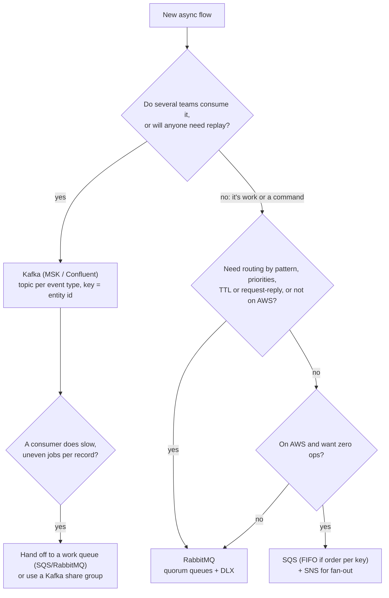

# Kafka vs RabbitMQ vs SQS — choosing

!!! abstract "Key takeaways"
    - **The first question is log or queue.**
        - **Kafka** is a retained, partitioned **log**. Consumers keep offsets, many groups read the same data, and anyone can **replay**.
        - **RabbitMQ** and **SQS** are **queues**. A message is handed to one worker and **deleted on ack**.
    - **Pick by the workload, not the brand:**
        - Events many teams consume, replay, stream processing or CDC → **Kafka**.
        - Jobs and commands with per-message ack, retry and DLQ on AWS with zero ops → **SQS**.
        - Rich routing, priorities, TTL, request/reply or non-AWS/on-prem → **RabbitMQ**.
    - **Ordering costs parallelism everywhere.**
        - Kafka: order per partition, so parallelism is capped by the partition count.
        - SQS FIFO: order per message group.
        - RabbitMQ: order per queue with a single consumer.

        In all three, you **partition by key** to get both.
    - **The lines are blurring.** Kafka 4.2 **share groups** give queue-style per-record acks. RabbitMQ **streams** give replay. SQS **fair queues** handle noisy tenants. Know them, but choose on the core model.
    - **Real systems are hybrid.** A typical design is a Kafka event backbone with SQS or RabbitMQ work queues behind specific consumers, or SNS → SQS fan-out on AWS. In every design: at-least-once delivery, idempotent consumers, and an outbox on the producer side.

## Why it matters

"Why Kafka and not RabbitMQ?" or "Why SQS here?" is one of the most common system-design follow-ups. A weak answer compares brands ("Kafka is faster"). A strong one names the **workload property** that decides: replay, number of independent consumers, ordering, per-message semantics, and who runs the cluster.

The deep material lives elsewhere, and this page only compares:

- **Kafka:** [event-driven fundamentals](../kafka/01-event-driven-architecture-fundamentals.md), [consumers and groups](../kafka/04-consumers-consumer-groups-rebalancing-offset-management-comm.md), [retry topics and DLQ](../kafka/07-error-handling-retry-topics-dlq-poison-messages-replay.md).
- **SQS/SNS:** [AWS messaging](../aws/08-messaging-sqs-vs-sns-vs-eventbridge-vs-kinesis.md).
- **RabbitMQ:** [exchanges, queues, routing](01-rabbitmq-exchanges-queues-routing.md).
- **Queues in general:** [message queues & async processing](../system-design/07-message-queues-and-async-processing.md).

## Core concepts

### Log vs queue: the property that decides most choices

In a queue, a message exists until **one** consumer acks it. In a log, it exists until **retention** expires, and every consumer group has its own position.

{ loading=lazy }
*The queue ends empty. The log ends full, which is why a team that joins late can still read history.*

What follows from that:

- **Fan-out:** Kafka serves N consumer groups from one copy of the data. A queue needs a copy per consumer, through SNS → SQS or a RabbitMQ fanout or topic exchange.
- **Replay and backfill:** Kafka can reset offsets. Queues can't. Once acked, a message is gone; only the DLQ redrive brings back failed messages.
- **Back-pressure:** in a queue, depth means work waiting. In Kafka, **consumer lag** means the same, but the data stays even after it's processed.

### The comparison

| Dimension | **Kafka** (3.x/4.x, KRaft) | **RabbitMQ** (4.x) | **Amazon SQS** |
|---|---|---|---|
| Model | Partitioned log, pull | Exchanges route to queues, push with prefetch | Managed queue, pull (long polling) |
| Retention | Time or size (days, or forever with compaction or tiered storage) | Until acked. **Streams** retain | Until deleted, max 14 days |
| Replay | Yes (offset or timestamp reset) | Streams only | No (DLQ redrive only) |
| Consumers | Many independent groups | Competing on a queue. Fan-out via exchanges | Competing. Fan-out via SNS |
| Ordering | Per partition (key) | Per queue with one consumer (SAC) | FIFO: per message group. Standard: best effort |
| Parallelism | ≤ partitions per group (share groups lift this) | Add consumers freely | Add consumers freely (FIFO: ≤ active groups) |
| Routing | By key to partition. Filtering is consumer-side | **Rich**: direct, topic, headers, alternate exchange | None (SNS filter policies in front) |
| Per-message features | Headers. Retry and delay are built with topics | TTL, priorities, DLX, delivery limit, delayed retries (4.3) | Visibility timeout, delay up to 15 min, DLQ, `maxReceiveCount` |
| Delivery | At-least-once. **Exactly-once** inside Kafka with transactions | At-least-once with confirms + manual ack | At-least-once. FIFO dedupes sends for 5 min |
| Throughput | Very high (sequential I/O, batching) | High, best with short queues | Standard: practically unlimited. FIFO: 300/s per action (3,000 batched; more in high-throughput mode) |
| Operations | Brokers, partitions, rebalancing, or MSK/Confluent | Cluster, quorum queues, or Amazon MQ/CloudAMQP | **None** (serverless), pay per request |

### A decision path


*Notice that the first fork is about **consumers and history**, not throughput. Throughput rarely decides it, since all three handle thousands of messages a second. The last fork is the common hybrid: Kafka for the event, a queue for the slow job it triggers.*

### Ordering vs parallelism

All three answer "order **and** scale" the same way: partition by a key and keep one consumer per partition.

{ loading=lazy }
*Same idea, three names: partition, shard queue and message group. The number of keys in flight sets the parallelism.*

### The blurring lines (2025–2026)

- **Kafka share groups (KIP-932, production-ready in 4.2):** several consumers read the **same partition** with per-record acks and delivery counts. It's a job queue without over-partitioning, but with no per-key order.
- **RabbitMQ streams and super streams:** replay inside RabbitMQ, without Kafka's ecosystem (Connect, Streams, Schema Registry).
- **SQS fair queues (2025):** a message group ID on a **standard** queue stops one noisy tenant delaying the others.

## In practice: code & configuration

The most common mistake is **using Kafka as a job queue for slow work**. A 2-minute job per record blocks the whole partition, and if `poll()` isn't called within `max.poll.interval.ms` (default 5 min), the group rebalances and the batch is redelivered.

=== "❌ Common mistake"
    ```java
    // Kafka listener doing slow, uneven work per record
    @KafkaListener(topics = "claim-submitted", groupId = "pdf-renderer")
    void on(ClaimSubmitted evt) {
        pdfService.render(evt);   // 30 s–3 min each; one slow claim blocks its partition,
                                  // a batch over max.poll.interval.ms → rebalance → duplicates
    }
    ```

=== "✅ Correct approach"
    ```java
    // Kafka stays the event backbone; the slow job goes to a work queue
    @KafkaListener(topics = "claim-submitted", groupId = "pdf-dispatcher")
    void on(ClaimSubmitted evt) {
        sqs.send(to -> to.queue("pdf-render-jobs")          // fast hand-off, commit offset
            .payload(new RenderPdf(evt.claimId()))
            .messageGroupId(evt.claimId())                  // FIFO: order per claim
            .messageDeduplicationId(evt.eventId()));        // FIFO queue: dedupe resends
    }

    // Workers scale on queue depth, each job acked on its own
    @SqsListener(value = "pdf-render-jobs", maxConcurrentMessages = "10")
    void render(RenderPdf job) {
        if (renders.exists(job.claimId())) return;          // idempotent
        pdfService.render(job);                             // visibility timeout > worst case
    }                                                        // after maxReceiveCount → DLQ
    ```

    On Kafka 4.2+ a **share group** is the in-Kafka alternative if you don't need per-claim ordering for the job.

## Real-world usage

- **LinkedIn** built Kafka for activity streams and data pipelines, where many consumers and replay matter. It's the canonical log use case.
- **Task queues:** Celery and many Spring or Django shops run background jobs on RabbitMQ or SQS.
- **AWS-native systems:** SNS → SQS fan-out is the default for loosely coupled services. Teams usually add MSK or Kinesis only when replay or stream processing shows up.
- **Hybrid is normal.** Banks and healthcare platforms often run Kafka as the system of record for events and CDC (Debezium) while keeping JMS, MQ or RabbitMQ for point-to-point integration with legacy systems, and SQS for cloud-side workers.
- **Known failure stories:** Kafka as a job queue (blocked partitions, rebalance storms), RabbitMQ as a long-term store (memory alarms), SQS standard where order mattered (update before create), and no replay path when a new service needs last month's events.

## Trade-offs & production gotchas

| Option | Pros | Cons | Use when |
|---|---|---|---|
| Kafka | Replay, many consumers, throughput, ecosystem (Connect, Streams) | Ops cost (or MSK bill), partitions cap parallelism, no per-message delay or priority | Event backbone, CDC, analytics, event sourcing |
| RabbitMQ | Routing, priorities, TTL, per-message ack, many protocols | Runs a cluster, dislikes long queues, replay only with streams | Task queues and commands with routing needs, on-prem or multi-cloud |
| SQS (+SNS) | Zero ops, scales automatically, DLQ built in, IAM | AWS-only, no replay, 14-day max, FIFO throughput limits | Jobs and decoupling on AWS |
| Hybrid | Each tool where it fits | Two systems to monitor, a bridge to maintain | Most mature platforms |

!!! warning "Gotchas"
    - **"Exactly once" is a different thing in each.** Kafka's applies to read-process-write inside Kafka (transactions). SQS FIFO only dedupes sends for 5 minutes. RabbitMQ has none. Side effects need **idempotent consumers** everywhere.
    - **Dual writes.** Writing to the database and then publishing to any broker can lose or duplicate events. Use the **transactional outbox** (with Debezium for Kafka, or a poller for SQS and RabbitMQ).
    - **Don't migrate brokers for throughput alone.** SQS standard and RabbitMQ handle most business loads. Migrate when you need replay or many independent consumers.

## How this connects to my experience

- **Where I used it:**
    - **OptumRx Meteor (Publicis Sapient):** "Designed **Kafka-based event-driven workflows** with retry and DLQ handling."
    - **ConvergeHealth Data Asset Explorer (Deloitte):** cloud-native microservices on AWS using "**SQS, SNS**" and "event-driven healthcare analytics workflows".
    - **Skills:** Kafka and RabbitMQ.
- **Talking points:**
    - "I've used both models in production: Kafka at Optum and SQS/SNS at Deloitte. That lets me say why each fit, rather than which is better."
    - "Kafka fit Meteor because several services reacted to the same domain events and we needed retry topics and DLQs with replay." *[confirm: number of consumer groups, whether replay was ever used]*
    - "SQS/SNS fit ConvergeHealth because it was AWS-native, with Lambda and ECS workers, and needed zero broker operations." *[confirm: Lambda vs container consumers, FIFO vs standard]*
    - RabbitMQ: be honest about where you used it. *[confirm: project and use case]* If it wasn't in production, call it transferable knowledge.
- **Likely follow-up chain:** "Why Kafka at Optum?" → "Would SQS have worked?" → "How did you handle a poison message?" → "How do you guarantee order for one member's events?" Answer:
    - Several consumers plus replay → Kafka.
    - SQS + SNS would work for the fan-out but loses replay and makes per-key ordering harder (FIFO limits).
    - Poison messages: retry topics with backoff, then a DLQ with alerting and a replay tool.
    - Ordering: key by member ID so events stay on one partition, with idempotent consumers.

## Interview questions

### Fundamentals

??? question "Q1. What is the fundamental difference between Kafka and RabbitMQ or SQS?"
    **Answer:** Kafka is a **retained log**. Messages stay after they're consumed, each consumer group keeps its own offset, and groups can replay. RabbitMQ and SQS are **queues**: a message goes to one consumer and is deleted when it's acked. Everything else follows from that: fan-out, replay, how back-pressure shows up, and how parallelism works.

    **Interviewer listens for:** retention vs delete-on-ack, offsets, independent groups.

    **Common wrong answer:** "Kafka is just faster RabbitMQ."

??? question "Q2. When would you choose SQS over Kafka?"
    **Answer:** When the flow is **work distribution** with one logical consumer, on AWS, with **no broker operations** wanted: background jobs, buffering a slow downstream, Lambda triggers. You get visibility timeout, DLQ and autoscaling, paid per request. Choose Kafka when many consumers need the same events, or you need replay or stream processing.

    **Interviewer listens for:** a workload-based answer, ops cost, an honest mention of lock-in.

    **Common wrong answer:** "SQS can't scale." Standard queues have practically unlimited throughput.

??? question "Q3. When is RabbitMQ the better choice than both?"
    **Answer:**

    - Routing by pattern or header to many queues without producer changes.
    - Message **priorities** and per-message or queue **TTL**.
    - **Request/reply** patterns.
    - Protocol needs such as AMQP, MQTT or STOMP.
    - On-prem or multi-cloud deployments where SQS isn't available.

    It also has low latency for small task queues.

    **Interviewer listens for:** routing and per-message features, and not using it as a long-term store.

    **Common wrong answer:** "RabbitMQ when you need guaranteed delivery." All three can deliver at-least-once.

### Intermediate

??? question "Q4. How do you get ordering per customer while processing in parallel in each system?"
    **Answer:** Partition by customer ID in each system:

    - **Kafka:** use the customer ID as the message key, so one partition per key, with one consumer per partition in a group.
    - **SQS FIFO:** `MessageGroupId` = customer ID. Groups process in parallel and in order within each group.
    - **RabbitMQ:** consistent-hash exchange to shard queues, each with a Single Active Consumer.

    Parallelism equals the number of active keys and partitions. A failing message blocks only its own key.

    **Interviewer listens for:** the same partition-by-key idea in all three, head-of-line blocking per key, hot keys.

    **Common wrong answer:** "Use a single consumer." That gives correct order but no scale.

??? question "Q5. A new analytics service needs the last 30 days of order events. Which design makes that easy?"
    **Answer:** A **log**. With Kafka and 30-day retention (or tiered storage), a new consumer group starts at a timestamp. With SQS or a RabbitMQ work queue the events are gone after the ack, so you'd backfill from the database or outbox, or from an archive (SNS → Firehose → S3). A likely replay need argues for a log from the start.

    **Interviewer listens for:** replay as a design requirement, backfill from the source of truth.

    **Common wrong answer:** "Read them from the DLQ."

??? question "Q6. Your Kafka consumer renders PDFs that take 30 seconds to 3 minutes each. What goes wrong and what do you change?"
    **Answer:** One slow record blocks its partition, so lag grows unevenly. A slow batch can exceed `max.poll.interval.ms`, which triggers a rebalance and redelivery, and that leads to duplicates and rebalance storms. Fixes:

    - Hand off to a **work queue** (SQS or RabbitMQ) and commit quickly.
    - Use a Kafka 4.2+ **share group** for per-record acks across consumers.
    - Last resort: smaller `max.poll.records` and more partitions.

    **Interviewer listens for:** the poll interval, partition blocking, work queue vs share group.

    **Common wrong answer:** "Just increase `max.poll.interval.ms` to an hour." That hides failures and stalls rebalances.

### Senior

??? question "Q7. Design messaging for a platform where 5 upstream systems publish changes that 10 services consume, and some consumers kick off slow jobs."
    **Answer:**

    - **Backbone:** Kafka topics per event type, keyed by entity ID, with schemas in a registry and the producer-side outbox.
    - **Consumers:** each service has its own consumer group, with retry topics, a DLQ and idempotent handlers.
    - **Slow jobs:** consumers that trigger slow jobs drop a command into SQS (or RabbitMQ, or a share group), and workers autoscale on queue depth.
    - **Operations:** alert on consumer lag and DLQ depth, and keep a replay tool.

    This uses the log where replay and many consumers matter, and the queue where per-job acks matter.

    **Interviewer listens for:** a hybrid design with a reason for each piece, outbox, schemas, idempotency, observability.

    **Common wrong answer:** one broker for everything, chosen by familiarity.

??? question "Q8. The team wants to replace RabbitMQ with Kafka \"for scale\". How do you evaluate it?"
    **Answer:** Ask what's actually failing.

    - **Long queues and memory alarms?** That's a consumer capacity problem, and fixing it is cheaper than a migration.
    - **Need replay or many consumers?** That's a real reason for Kafka.
    - **Per-message priorities, TTL, routing, request-reply in use?** Kafka lacks these, so you'd rebuild them.

    If you migrate, go flow by flow: dual-publish through the outbox, compare, then cut over consumers. Or keep both, each where it fits.

    **Interviewer listens for:** requirements before technology, the cost of lost features, an incremental migration.

    **Common wrong answer:** "Kafka handles millions per second, so yes."

### Scenario-based

??? question "Q9. You're on AWS, events must be processed in order per patient, there are 2,000 events/s at peak, and two teams consume them. SQS FIFO, SNS FIFO + SQS FIFO, Kinesis or MSK?"
    **Answer:**

    - **SNS FIFO → two SQS FIFO queues:** works. Use `MessageGroupId` = patient ID, with high-throughput FIFO mode for 2,000/s. Zero ops, but no replay.
    - **MSK (or Kinesis):** order per key, both teams as consumer groups, replay included, with more ops and cost.

    Choose on replay and future consumers. If more teams are coming or audits need replay, choose MSK. Otherwise SNS FIFO + SQS FIFO. In both cases, use idempotent consumers and an outbox.

    **Interviewer listens for:** the FIFO throughput mode, message groups as keys, replay as the tiebreaker.

    **Common wrong answer:** "SQS standard with a sequence number": that pushes reordering into every consumer.

## Cheat sheet

| Concept | Remember |
|---|---|
| First question | Log (retain, replay, many groups) or queue (one consumer, delete on ack)? |
| Kafka | Event backbone, replay, CDC, stream processing. Order per partition. Share groups (4.2) for job-style acks |
| RabbitMQ | Routing, priorities, TTL, request/reply, protocols. Keep queues short. Streams for replay |
| SQS | Zero-ops jobs on AWS. Visibility timeout + DLQ. FIFO = order per group. SNS for fan-out. 14-day max, no replay |
| Order + scale | Partition by key: partition / shard queue + SAC / message group |
| Slow jobs | Not on a Kafka partition: hand off to a queue or a share group |
| Everywhere | At-least-once, idempotent consumers, outbox, DLQ + alerting |
| Hybrid | Kafka backbone + queues for workers is normal and defensible |

## Sources

1. [Apache Kafka documentation: design](https://kafka.apache.org/documentation/#design): log, consumer groups, retention, exactly-once semantics.
2. [Apache Kafka 4.2.0 release announcement](https://kafka.apache.org/blog/2026/02/17/apache-kafka-4.2.0-release-announcement/): share groups (KIP-932) production-ready.
3. [KIP-932: Queues for Kafka](https://cwiki.apache.org/confluence/display/KAFKA/KIP-932%3A+Queues+for+Kafka): share group semantics, per-record acks, delivery counts.
4. [RabbitMQ: AMQP 0-9-1 model](https://www.rabbitmq.com/tutorials/amqp-concepts) and [streams](https://www.rabbitmq.com/docs/streams): routing model, replayable streams.
5. [RabbitMQ: consumer acknowledgements and publisher confirms](https://www.rabbitmq.com/docs/confirms): at-least-once mechanics.
6. [Amazon SQS developer guide](https://docs.aws.amazon.com/AWSSimpleQueueService/latest/SQSDeveloperGuide/welcome.html): standard vs FIFO, retention, visibility timeout, quotas.
7. [Amazon SQS FIFO high throughput](https://docs.aws.amazon.com/AWSSimpleQueueService/latest/SQSDeveloperGuide/high-throughput-fifo.html): FIFO throughput limits and high-throughput mode.
8. [Amazon SQS introduces fair queues](https://aws.amazon.com/about-aws/whats-new/2025/07/amazon-sqs-introduces-fair/): noisy-neighbour handling on standard queues.
9. [Confluent: Kafka consumer configuration, `max.poll.interval.ms`](https://docs.confluent.io/platform/current/installation/configuration/consumer-configs.html): poll interval default and rebalance behaviour.
10. [AWS Prescriptive Guidance: transactional outbox](https://docs.aws.amazon.com/prescriptive-guidance/latest/cloud-design-patterns/transactional-outbox.html): dual-write problem and fix.
11. [Spring Cloud AWS: SQS integration](https://docs.awspring.io/spring-cloud-aws/docs/3.2.0/reference/html/index.html#sqs-integration): `@SqsListener`, `SqsTemplate`.
