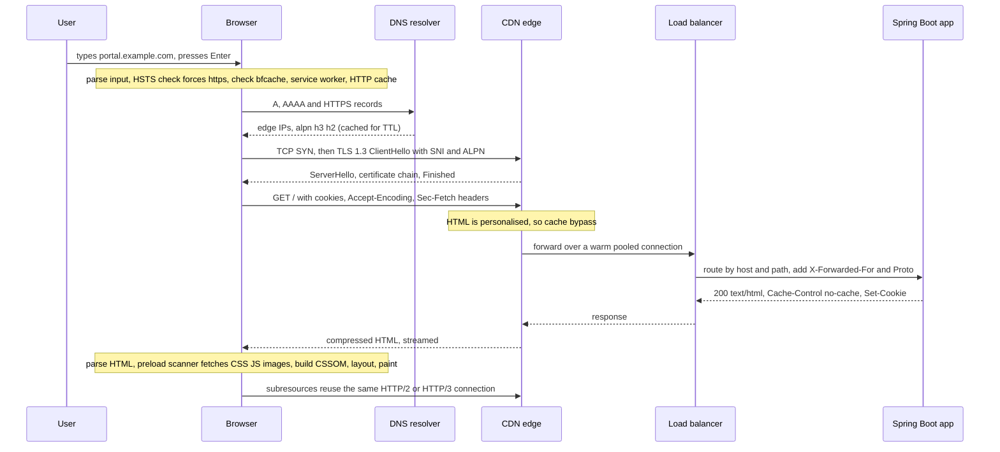
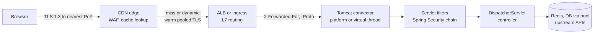

# "What happens when you type a URL"

!!! abstract "Key takeaways"
    - The answer is a **pipeline of stages**, each covered in depth elsewhere: **parse the input and pick HTTPS** (HSTS, HTTPS-first) → **check caches** (bfcache, service worker, HTTP cache) → **DNS** → **connection** (TCP + TLS 1.3, or QUIC) → **HTTP request** through **CDN, load balancer and app** → **response** (status, headers, redirects) → **render** (parse, CSSOM, layout, paint) → **subresources and JavaScript**.
    - Count **round trips**, not milliseconds: a cold HTTPS navigation over TCP costs about **DNS (1) + TCP (1) + TLS 1.3 (1) + request (1) = 4 RTTs plus server time** before the first byte. HTTP/3 saves one, a reused connection saves two or three, and an `http://` redirect adds two or three more.
    - The fastest request is the one never sent: **HSTS** removes the `http://` hop, **caching** (DNS, HTTP, CDN) removes trips, **connection reuse** removes handshakes, and **preconnect, 103 Early Hints and prerender** move the remaining work off the critical path.
    - Bytes are not pixels. The browser **streams** the HTML into the DOM, the **preload scanner** fetches CSS, scripts and images early, **CSS is render-blocking** and classic scripts are parser-blocking, and a single-page app adds **JS download → execute → data fetch** before anything useful shows.
    - A senior answer **picks depth deliberately**, gives numbers (RTTs, TTLs, initial congestion window), names where it breaks in production (stale DNS, missing intermediate certificate, 502 from idle timeouts, cached personal data) and says **how to measure each stage** (Navigation Timing, `curl -w`, `Server-Timing`, CDN and LB logs, traces).

## Why it matters

It's the most famous open-ended interview question because it has no bottom. A junior lists "DNS, then HTTP, then the page shows". A senior uses it to show a map of the whole stack and the judgement to zoom into the part that matters for the role: for a backend or full-stack lead, that's usually **connection cost, the edge and the server**, plus enough of the **rendering pipeline** to explain why a fast API can still give a slow page.

It's also the frame for real debugging. "The portal is slow for users in another region", "login works on one network but not another", "after the cut-over some users still hit the old servers": each is one stage of this journey failing. This page stitches together [TCP and UDP](01-osi-tcp-ip-tcp-vs-udp.md), [HTTP versions](02-http-1-1-vs-http-2-vs-http-3.md), the [TLS handshake](03-tls-handshake.md), [DNS](04-dns-resolution.md), [load balancers and CDNs](05-load-balancers-reverse-proxies-and-cdns.md) and the [browser rendering pipeline](../browser-web-performance/01-browser-rendering-pipeline-reflow-vs-repaint.md), and links to them rather than repeating them.

## Core concepts

### The whole journey on one diagram


*Notice that the browser talks only to the nearest edge; the long-haul hops (edge to origin, LB to app) run over connections that are already open, which is why a CDN helps even for uncacheable HTML.*

### 1. From keystrokes to a URL, and the HTTPS decision

- **Input parsing.** The address bar decides whether the text is a URL or a search. `portal.example.com` becomes a URL with an implied scheme; spaces or a bare word go to the search engine. The **WHATWG URL Standard** then parses scheme, host, port, path, query and fragment. Non-ASCII hostnames are converted to **Punycode** (`xn--…`), and browsers show the Punycode form for lookalike domains to blunt phishing.
- **Which scheme?** Historically a typed host meant `http://`, and the server answered `301` to `https://`. Now, in order:
    - **HSTS** (RFC 6797): if the host sent `Strict-Transport-Security` on an earlier visit, or is on the browser's built-in **HSTS preload list** (hstspreload.org: `max-age` of at least one year, `includeSubDomains`, `preload`), the browser rewrites to `https://` internally with **no network round trip**. See [HSTS](../application-security/06-security-headers-and-dependency-scanning.md#hsts).
    - **HTTPS by default for typed navigations** (Chrome 90, 2021): try `https://` first, fall back to `http://` if it fails.
    - **"Always use secure connections"**: Chrome announced it would enable this by default for public sites in **Chrome 154 (October 2026)**, warning before the first `http://` visit to a public site.
- **Leaving the current page.** The current document gets `beforeunload` (it may prompt) and later `pagehide`. Any **speculation rules** prefetch or prerender for this URL is used now, and a prerendered page is simply activated.

### 2. Caches before the network

The browser looks for a reason not to go to the network at all; the order is detailed in [the browser's cache layers](../browser-web-performance/06-browser-storage-cookies-and-caching.md#the-browsers-cache-layers):

1. **bfcache** (back/forward only): the whole page restored from memory, zero requests.
2. **Service worker**: if one controls this scope, its `fetch` handler decides (cache first, network first, offline page).
3. **HTTP cache**: HTML is normally `Cache-Control: no-cache`, so the browser sends a **conditional request** (`If-None-Match`) and may get a cheap `304 Not Modified`. Hashed JS and CSS are `immutable` and come straight from disk.

A cache hit doesn't skip the rest of this page; it skips the expensive middle. A `304` still pays for DNS, connection and one round trip.

### 3. DNS: the name to an address

Full detail in [DNS resolution](04-dns-resolution.md). The capstone points:

- The browser keeps its own **host cache**, then asks the OS stub resolver (or uses its own DNS-over-HTTPS client if "secure DNS" is on). A cold lookup goes **recursive resolver → root → TLD → authoritative** ([recursive vs iterative](04-dns-resolution.md#recursive-vs-iterative-queries)); a warm one is answered by a nearby cache in a few milliseconds.
- Browsers ask for **A and AAAA** in parallel, and increasingly the **HTTPS record** (RFC 9460), which can advertise `alpn=h3,h2` so the very first connection can try HTTP/3 ([how a client finds HTTP/3](02-http-1-1-vs-http-2-vs-http-3.md#how-a-client-finds-http3)).
- **Happy Eyeballs v2** (RFC 8305) races IPv6 and IPv4: wait up to about **50 ms** for AAAA after an A answer, then start connecting, staggering attempts about **250 ms** apart so a broken IPv6 path never costs the user a full timeout.
- For a CDN-fronted site the answer is a **nearby edge** (DNS steering or anycast), chosen per resolver location. That's the first latency win of a CDN.

### 4. The connection: TCP + TLS, or QUIC

- **TCP**: SYN, SYN-ACK, ACK, **1 RTT** before data ([the handshake](01-osi-tcp-ip-tcp-vs-udp.md#tcp-a-reliable-byte-stream-over-an-unreliable-network)). The new connection starts in **slow start** with an initial window of 10 segments (about 14 KB), so the first round trip of the response carries only about 14 KB. That is the origin of the advice to keep critical HTML and inline CSS small.
- **TLS 1.3**: **1 more RTT** ([one round trip](03-tls-handshake.md#tls-13-one-round-trip)). The `ClientHello` carries **SNI** (which host, so the edge picks the right certificate) and **ALPN** (`h2`, `http/1.1`). The browser validates the chain, the hostname against the SAN, the dates and Certificate Transparency ([certificate validation](03-tls-handshake.md#certificate-validation-why-the-client-trusts-the-server)). TLS 1.2 would cost 2 RTTs.
- **QUIC / HTTP/3**: transport and TLS in **1 RTT** combined, and **0-RTT** on resumption for safe requests ([QUIC](01-osi-tcp-ip-tcp-vs-udp.md#quic-tcps-guarantees-rebuilt-over-udp)). Browsers race QUIC against TCP when UDP might be blocked.
- **Reuse beats all of it.** A warm HTTP/2 or HTTP/3 connection to the same origin is reused, and HTTP/2 can **coalesce** requests for a different hostname onto it when the IP matches and the certificate covers that name. HTTP/1.1 falls back to about six parallel connections per host.

### 5. The request and its path to your code

The browser sends `GET /` with `:authority` (the `Host`), `Accept`, `Accept-Encoding: gzip, br, zstd`, cookies for the site (subject to `SameSite`, `Secure`, `HttpOnly`; see [cookies](../browser-web-performance/06-browser-storage-cookies-and-caching.md#cookies-anatomy-and-attributes)), and **Fetch Metadata** headers (`Sec-Fetch-Mode: navigate`, `Sec-Fetch-Dest: document`) that servers can use to reject cross-site tricks.

On the server side it crosses [the layers in front of a service](05-load-balancers-reverse-proxies-and-cdns.md#the-layers-in-front-of-a-service):


*Notice that every arrow except the first is usually an already-open connection: the edge, the load balancer and HikariCP all pool, so only the user's first hop pays handshakes. Most server time is in the last box.*

- The **CDN** looks up the cache key; personalised HTML bypasses the cache but still benefits from edge TLS and a warm origin connection ([CDNs](05-load-balancers-reverse-proxies-and-cdns.md#cdns-reverse-proxies-at-the-edge)).
- The **load balancer** terminates TLS (or re-encrypts), picks a healthy target and adds forwarded headers ([who is the client](05-load-balancers-reverse-proxies-and-cdns.md#who-is-the-client-forwarded-headers-and-the-proxy-protocol)).
- In **Spring Boot**, Tomcat accepts the connection and hands the request to a worker thread (or a [virtual thread](../java-concurrency-jvm/07-virtual-threads-and-structured-concurrency.md) with `spring.threads.virtual.enabled=true`). It runs the servlet filters including the [Spring Security filter chain](../spring-security-oauth2/01-spring-security-architecture-filter-chain-securitycontext-au.md) (session or token, CSRF, headers), then the controller, which calls Redis, the database through a [connection pool](../postgresql-sql/07-partitioning-replication-and-connection-pooling.md) and upstream services.
- For an authenticated portal, the first visit often goes further: **no session → `302` to the identity provider** (another origin: DNS, TCP, TLS again), login, then a redirect back with an authorisation code. SSO adds a whole second journey.

### 6. The response

- **Status line.** `200` streams the body. `301`/`308` (permanent, and cacheable by the browser) or `302`/`303`/`307` (temporary) send the browser back to step 1 for the new URL. Each redirect costs at least one round trip, and a redirect to a **different host** costs a full new DNS + TCP + TLS setup. `304` means "use your cached copy".
- **Headers that shape the rest:** `Content-Type` and charset; `Content-Encoding` (Brotli or gzip); `Cache-Control` and `ETag`; `Set-Cookie`; security headers (`Strict-Transport-Security`, `Content-Security-Policy`); `Alt-Svc` advertising HTTP/3 for next time; `Server-Timing` for diagnostics.
- **103 Early Hints** (RFC 8297): while the server is still computing the page, it can send an interim response with `Link: </app.css>; rel=preload` so the browser starts fetching critical resources during server think time. It replaced HTTP/2 server push, which browsers removed.

### 7. From bytes to pixels

Detail in the [critical rendering path](../browser-web-performance/01-browser-rendering-pipeline-reflow-vs-repaint.md#from-bytes-to-the-first-frame-the-critical-rendering-path). In one pass:

1. The HTML is **parsed as it streams** into the DOM. The **preload scanner** reads ahead and requests stylesheets, scripts, fonts and images it can see in the markup, over the same connection with browser-assigned priorities.
2. **CSS is render-blocking**: nothing paints until all CSS in the `<head>` is downloaded and the CSSOM is built. A classic `<script>` without `defer`/`async` **blocks the parser** (and waits for preceding CSS).
3. Style → layout → paint → composite produce the **first contentful paint**. Fonts are discovered only once CSS references them, so they arrive late unless preloaded.
4. The **LCP** element (often a hero image or heading) paints; see [LCP's four subparts](../browser-web-performance/04-core-web-vitals-and-performance-optimisation.md#lcp-four-subparts): TTFB, resource load delay, load duration, render delay.
5. `DOMContentLoaded` fires after the document is parsed and deferred scripts have run; `load` after all subresources.
6. In a **client-rendered SPA**, the meaningful content needs one more chain: download the JS bundle → execute → fetch data (a GraphQL query, say) → React renders. Server-side rendering or streaming moves that work to the server so the HTML already has content.

{ loading=lazy }
*Server think time is dead air for the browser unless you give it something to fetch. The font row shows the late-discovery chain: HTML, then CSS, then font.*

### Counting round trips

Interviewers love "how many round trips before the first byte?". With RTT = 100 ms (a user on another continent, or mobile) and a fast server:

| Scenario | DNS | Connect | TLS | Request | Time to first byte |
|---|---|---|---|---|---|
| Typed `http://`, no HSTS, then `301` to HTTPS | 1 | 1 + 1 | 1 | 1 + 1 | ~6 RTT ≈ 650 ms |
| Cold HTTPS, TCP + TLS 1.3 (HTTP/2) | 1 | 1 | 1 | 1 | ~4 RTT ≈ 450 ms |
| Cold HTTPS over QUIC (HTTP/3) | 1 | 1 (combined) | | 1 | ~3 RTT ≈ 350 ms |
| Revisit: DNS cached, connection reused | 0 | 0 | 0 | 1 | ~1 RTT ≈ 150 ms |
| Resumed QUIC with 0-RTT (idempotent GET) | 0 | 0 | 0 | 1 (with handshake) | ~1 RTT |
| Prerendered by speculation rules | | | | | ~0 (already loaded) |

*Times include about 50 ms of server work; DNS is shown as one round trip to a nearby resolver, and a fully cold lookup can take several.*

{ loading=lazy }
*Each block is a round trip someone could remove: HSTS kills the red one, QUIC merges two, and reuse removes everything except the request itself.*

## In practice: code & configuration

The browser does most of this journey, but the server decides how many extra hops it adds. The common backend mistake is a Spring Boot app behind a TLS-terminating load balancer that doesn't know it is serving HTTPS.

=== "❌ Common mistake"
    ```java
    // application.yml: server.port=8080, TLS ends at the ALB, no forward-headers-strategy
    @Bean
    SecurityFilterChain web(HttpSecurity http) throws Exception {
        http.headers(Customizer.withDefaults())      // "HSTS is on by default"... but it's only written when
                                                     // request.isSecure(), which is false behind the ALB
            .oauth2Login(Customizer.withDefaults()); // redirect_uri built as http://portal.../login/oauth2/code/ping
        return http.build();                         // -> extra http->https hop, or an IdP redirect_uri mismatch
    }
    // The SPA's index.html is served with the default static caching (or max-age=86400):
    // after a deploy, users keep an old shell that references deleted, hashed bundles -> blank page.
    ```

=== "✅ Correct approach"
    ```java
    // application.yml
    //   server.forward-headers-strategy: native   # Tomcat trusts X-Forwarded-Proto/For from the LB's
    //                                             # internal range, so isSecure() and redirect URLs are right
    //   server.compression.enabled: true          # if the CDN doesn't compress
    @Bean
    SecurityFilterChain web(HttpSecurity http) throws Exception {
        http.headers(h -> h.httpStrictTransportSecurity(hsts -> hsts
                    .maxAgeInSeconds(31_536_000)       // 1 year: browsers go straight to https:// next time
                    .includeSubDomains(true)
                    .preload(true)))                   // only once every subdomain serves HTTPS
            .oauth2Login(Customizer.withDefaults());   // redirect_uri now https://
        return http.build();
    }

    @Configuration
    class SpaCaching implements WebMvcConfigurer {
        @Override
        public void addResourceHandlers(ResourceHandlerRegistry reg) {
            reg.addResourceHandler("/assets/**")       // hashed file names: app.3f9a1c.js
               .addResourceLocations("classpath:/static/assets/")
               .setCacheControl(CacheControl.maxAge(Duration.ofDays(365)).cachePublic().immutable()); // Spring 6.0.5+
            reg.addResourceHandler("/index.html")      // the shell: always revalidate (cheap 304)
               .addResourceLocations("classpath:/static/")
               .setCacheControl(CacheControl.noCache());
        }
    }
    ```
    Redirect port 80 to 443 **at the load balancer** (an ALB listener rule), not in every app, and submit the domain to the preload list only after `includeSubDomains` has run safely for a while: removal takes months.

To see **which stage** is slow, break the journey down from both ends:

```bash
# Per-phase timing from a client machine (seconds, cumulative from start)
curl -so /dev/null https://portal.example.com/ -w \
 'dns %{time_namelookup}  tcp %{time_connect}  tls %{time_appconnect}  ttfb %{time_starttransfer}  total %{time_total}  redirects %{num_redirects}  http %{http_version}\n'
curl -sI http://portal.example.com/        # does http:// answer 301/308, and does https:// send Strict-Transport-Security?
```

```ts
// Real users: Navigation Timing Level 2 (TypeScript), sent to your RUM endpoint
const [nav] = performance.getEntriesByType("navigation") as PerformanceNavigationTiming[];
if (nav) {
  const phases = {
    redirect: nav.redirectEnd - nav.redirectStart,               // 0 if none (or cross-origin)
    dns: nav.domainLookupEnd - nav.domainLookupStart,            // 0 when cached or connection reused
    connect: nav.connectEnd - nav.connectStart,                  // TCP + TLS (or QUIC)
    tls: nav.secureConnectionStart ? nav.connectEnd - nav.secureConnectionStart : 0,
    ttfb: nav.responseStart - nav.requestStart,                  // network RTT + server time
    download: nav.responseEnd - nav.responseStart,
    domInteractive: nav.domInteractive - nav.startTime,
    protocol: nav.nextHopProtocol,                               // "h2", "h3", "http/1.1"
    server: nav.serverTiming.map(s => `${s.name}=${s.duration}`) // from the Server-Timing response header
  };
  navigator.sendBeacon("/rum", JSON.stringify(phases));
}
```

```java
// Server side: expose where server time went, visible in DevTools and in nav.serverTiming
@Component
class ServerTimingFilter extends OncePerRequestFilter {
    @Override
    protected void doFilterInternal(HttpServletRequest req, HttpServletResponse res, FilterChain chain)
            throws ServletException, IOException {
        long start = System.nanoTime();
        try { chain.doFilter(req, res); }
        finally {
            // header must be set before the response is committed; for streamed bodies use a trailer or tracing
            if (!res.isCommitted())
                res.addHeader("Server-Timing", "app;dur=" + (System.nanoTime() - start) / 1_000_000);
        }
    }
}
```

## Real-world usage

- **Browsers keep cutting stages.** HSTS preload and HTTPS-by-default remove the `http://` hop; HTTPS DNS records and Alt-Svc let HTTP/3 start sooner; speculation rules prerender likely next pages; bfcache makes Back free. Server push was removed from Chrome (106) because it pushed what was already cached; 103 Early Hints took its place.
- **CDNs exist mostly for this question's middle steps.** Terminating TLS a few milliseconds from the user turns three long round trips into short ones, even when the HTML itself is never cached.
- **Outages map to stages.** DNS (Dyn 2016, Facebook 2021: the authoritative servers disappeared), certificates (expired or missing intermediates break every client at the TLS step), load balancers and timeouts (random 502s from [idle-timeout races](05-load-balancers-reverse-proxies-and-cdns.md#keep-alive-and-idle-timeouts-the-classic-502)), and caches (a CDN serving one user's page to another).
- **Healthcare and banking portals** add an SSO round trip (OAuth2/OIDC via an identity provider such as PingFederate), are mostly uncacheable at the edge because pages carry PHI or account data, and must keep TLS on every hop for HIPAA and PCI DSS. That makes connection reuse, edge TLS and server time the levers, not caching the HTML.

## Trade-offs & production gotchas

| Technique | Removes | Cost or risk | Use when |
|---|---|---|---|
| HSTS + preload | The `http://` round trips and SSL-stripping | Hard to undo; every subdomain must do HTTPS | Any public HTTPS site, preload once mature |
| CDN in front of dynamic pages | Long-haul TCP/TLS handshakes | Another layer to configure; caching mistakes leak data | Users far from the origin |
| HTTP/3 | One RTT on new connections, TCP HOL blocking | UDP blocked on some networks; more CPU | Mobile and long-distance users |
| `preconnect` / `dns-prefetch` | DNS + handshake for a known third-party origin | Wasted sockets if unused; keep to 2–3 origins | Fonts, API or IdP origin needed on load |
| `preload` / 103 Early Hints | Late discovery of critical CSS, fonts, LCP image | Over-preloading competes for bandwidth | LCP image, critical CSS, fonts |
| Speculation rules prerender | The entire navigation | Server load for pages never visited; side effects | High-probability next pages, safe GETs only |
| Inline critical CSS | One render-blocking request | No caching of the inlined bytes | Landing pages with a tiny critical style set |

!!! warning "Gotcha: redirect chains"
    `http://example.com` → `https://example.com` → `https://www.example.com` → `/login` → identity provider → back. Each hop is at least one round trip and a host change is a full new connection. Point links and bookmarks at the final URL, redirect once at the edge, and use HSTS.

!!! warning "Gotcha: the DNS change that \"didn't work\""
    After a cut-over, some users reach the old servers for minutes or hours. The browser host cache, the OS, a JVM's own cache and **open keep-alive connections** each hold the old answer independently; see [TTLs and caching at every layer](04-dns-resolution.md#ttls-and-caching-at-every-layer). Lower the TTL well before the change and drain old targets instead of killing them.

!!! warning "Gotcha: a fast API, a slow page"
    In a client-rendered SPA, the API's 80 ms p50 is the last step of HTML → JS bundle → execute → fetch → render. Check the waterfall: a 600 KB bundle on a mid-range phone, or a data request that starts only after JS runs, usually costs more than the server. Preload the data request, split the bundle, or render on the server.

!!! question "Interview angle: structure your answer"
    Spend 20 seconds on the outline ("input and HTTPS, caches, DNS, connection, request through the edge to the app, response, rendering"), then ask or choose where to go deep. For a backend role go deep on connection, edge and server; for full-stack add the critical rendering path and SPA hydration. End with how you'd measure it. That beats reciting every step at equal depth.

## How this connects to my experience

Not ★ and not a resume claim: this is the frame that ties together work on the resume, positioned as working knowledge.

- **Where I used it:**
    - **OptumRx Meteor (750K+ users):** I **built the ReactJS application from the ground up** with a **micro-frontend architecture**, so a page load is shell HTML → host bundle → remote bundles → GraphQL query to the **GraphQL Consumer Service** I owned, which fans out to **5 upstream systems** and uses **Redis caching** for frequent queries and UI reference data. Login goes through **OAuth2 with PingFederate**, which is the SSO redirect leg of the journey. *[confirm: CDN used for the static bundles, and how the shell and remotes were cached]*
    - **Deloitte, ConvergeHealth:** services on **AWS (EC2, ECS, EKS, API Gateway)**: the load balancer and gateway part of the path. *[confirm: ALB/NLB/ingress specifics]*
    - **AWS Certified Solutions Architect – Associate (2023)**: Route 53, CloudFront and ELB are the DNS, CDN and load-balancer stages.
- **Talking points:**
    - "For our portal the expensive part of the first load wasn't the network, it was the chain after the HTML: bundles, then the GraphQL call, then render. Redis caching of reference data shortened the last step." *[confirm whether page-load timings were measured]*
    - "Behind a TLS-terminating load balancer, the app must trust forwarded headers from the LB only, or OAuth2 redirect URIs and HSTS break." *[confirm whether this was hit with PingFederate]*
    - "Member data is PHI, so HTML and API responses are `private`/`no-store`; only hashed static assets are long-cached at the edge."
- **Likely follow-up chain:** "Walk me through typing a URL" → the 7-stage outline → "How many round trips before the first byte?" → 4 for cold TCP + TLS 1.3, 3 with HTTP/3, 1 when warm → "Users far away say the first load is slow. What would you do?" → measure per phase (RUM Navigation Timing, CDN logs), edge TLS via CDN, HTTP/3, preconnect to the IdP and API origins, fewer redirects, smaller critical path → "And the server part?" → `Server-Timing`, traces through the GraphQL service and upstreams, caching, pool sizing.

## Interview questions

### Fundamentals

??? question "Q1. What happens when you type a URL into the browser and press Enter?"
    **Answer:** The browser parses the input into a URL and decides on HTTPS (HSTS or HTTPS-by-default). It checks bfcache, a service worker and the HTTP cache. If it needs the network, it resolves the hostname via its cache, the OS and a recursive resolver, gets the edge's IP, and opens a TCP connection plus a TLS 1.3 handshake (or a QUIC connection) with SNI and ALPN. It sends the HTTP request with cookies; a CDN edge, load balancer and the app process it (filters, auth, controller, database). The response comes back with status and headers; redirects restart the process. The browser streams the HTML into the DOM, the preload scanner fetches CSS, JS and images, CSS blocks render, then style, layout, paint and composite produce the first frame; JS and data fetches complete the page. I'd then go deep on whichever stage matters, e.g. connection costs or the edge.

    **Interviewer listens for:** a clear ordered outline, HTTPS decision and caches before DNS, TLS details, the server side, rendering, and choosing depth.

    **Common wrong answer:** "DNS returns the IP, the server returns HTML, the browser shows it", with no caches, TLS, edge or rendering.

??? question "Q2. You type `example.com` without a scheme. How does the browser end up on HTTPS?"
    **Answer:** If the domain is on the HSTS preload list, or the browser saw a `Strict-Transport-Security` header from it before, it upgrades to `https://` internally without touching the network. Otherwise modern browsers try `https://` first for typed navigations (Chrome since 90) and fall back to `http://` on failure; with "Always use secure connections" (announced as the Chrome default from version 154) it warns before loading a public `http://` site. Without any of these, the browser requests `http://` and the server or load balancer redirects with `301`/`308`, which costs extra round trips and leaves the first request open to SSL stripping.

    **Interviewer listens for:** HSTS and preload, HTTPS-first, the redirect as the legacy path and its cost and risk.

    **Common wrong answer:** "The server redirects to HTTPS", as if that were safe and free.

??? question "Q3. Which caches can answer before a request reaches your server?"
    **Answer:** In the browser: bfcache for back/forward, the service worker's Cache Storage, the HTTP cache (fresh entries, or a conditional request that gets a `304`), plus DNS caches (browser, OS, resolver) and reusable connections. In the network: the CDN edge and origin shield, then any reverse proxy cache. In the app: Redis or local caches before the database. Each layer has its own freshness rules, which is why "I deployed but users see the old version" needs checking layer by layer.

    **Interviewer listens for:** browser, edge and server layers; DNS and connection reuse as caches too; freshness and validation.

    **Common wrong answer:** Only "browser cache and CDN".

### Intermediate

??? question "Q4. How many round trips happen before the first byte of HTML arrives?"
    **Answer:** For a cold HTTPS load over TCP with TLS 1.3: about one for DNS (more if the resolver is cold), one for the TCP handshake, one for TLS, one for the request and response start: four RTTs plus server time. TLS 1.2 adds one. HTTP/3 merges TCP and TLS into one QUIC handshake: three. A revisit with cached DNS and a pooled connection needs one, and resumed QUIC with 0-RTT can send the request with the handshake. An `http://` start with a redirect adds two or three more. At 100 ms RTT, that's the difference between about 150 ms and 650 ms before any server work.

    **Interviewer listens for:** a per-stage count, TLS 1.2 vs 1.3, QUIC, reuse, redirects, translating RTTs to milliseconds.

    **Common wrong answer:** Quoting a single number without saying what's cached or which protocol.

??? question "Q5. The HTML has arrived. What does the browser do before the user sees anything?"
    **Answer:** It parses the HTML incrementally into the DOM while the preload scanner requests discovered resources. CSS is render-blocking, so it waits for the stylesheets in the head and builds the CSSOM; a classic script without `defer` or `async` stops the parser and waits for earlier CSS. Then style, layout, paint and composite produce the first contentful paint. Fonts referenced by CSS are discovered late, images load in parallel, and the largest element painting is LCP. In a client-rendered SPA the useful content waits for the JS bundle to download and run and for its data requests.

    **Interviewer listens for:** streaming parse, preload scanner, render-blocking CSS vs parser-blocking JS, the render pipeline, the SPA chain.

    **Common wrong answer:** "It downloads everything and then renders."

??? question "Q6. What's the cost of redirects, and which status codes would you use?"
    **Answer:** Each redirect is at least one more round trip, and a redirect to another host is a full new DNS + TCP + TLS setup. `301` and `308` are permanent and cacheable by the browser (so later visits skip them), `302`, `303` and `307` are temporary. `307` and `308` preserve the method and body; `301`/`302` historically let clients change POST to GET; `303` explicitly means "GET this other URL" after a POST. I'd redirect once at the edge, use HSTS so `http://` never happens, and keep links pointing at the final URL.

    **Interviewer listens for:** RTT cost, cross-host cost, permanent vs temporary, method preservation, HSTS.

    **Common wrong answer:** Treating redirects as free, or using `302` for permanent moves so browsers never cache them.

### Senior

??? question "Q7. How does the browser choose between IPv4 and IPv6, and between HTTP/1.1, HTTP/2 and HTTP/3?"
    **Answer:** For IP family, Happy Eyeballs v2 (RFC 8305): query A and AAAA in parallel, prefer IPv6, wait briefly (about 50 ms) for AAAA, then start connections staggered by about 250 ms and use whichever succeeds first, so a broken path costs milliseconds, not a timeout. For HTTP version, ALPN in the TLS handshake negotiates `h2` or `http/1.1`. HTTP/3 needs a hint first: an `Alt-Svc` header from an earlier response, or an HTTPS DNS record with `alpn=h3`. The browser then tries QUIC, often racing it against TCP, and falls back if UDP is blocked.

    **Interviewer listens for:** Happy Eyeballs, ALPN, Alt-Svc and HTTPS record, fallback and racing.

    **Common wrong answer:** "The browser always uses the newest protocol."

??? question "Q8. How would you instrument the whole journey to know which stage is slow for real users?"
    **Answer:** Client side, Navigation Timing Level 2 (`PerformanceNavigationTiming`) gives redirect, DNS, connect, TLS, request-to-first-byte and download per page view, plus `nextHopProtocol`; Resource Timing does the same per asset, and Core Web Vitals (LCP subparts, INP) cover rendering. Send them to a RUM backend and look at p75 and p95 by region and network. Server side, a `Server-Timing` header exposes app time to the browser, and distributed traces (OpenTelemetry) break it down across services. In between, CDN logs (edge vs origin time, cache status) and load-balancer logs (request, target and response processing time) separate network from backend. From one machine, `curl -w` and WebPageTest give a waterfall.

    **Interviewer listens for:** field data over lab, per-phase breakdown, server and edge logs, joining the views.

    **Common wrong answer:** Only Lighthouse on a developer laptop, or only server-side APM.

### Scenario-based

??? question "Q9. Users in another region say the portal's first load takes 4 seconds; it's fast for the team. How do you investigate and fix it?"
    **Answer:** Measure first: RUM split by country gives DNS, connect, TLS, TTFB and LCP. Long distance multiplies every round trip, so I'd expect connect, TLS and TTFB to dominate, plus redirect chains (http → https → www → login → IdP). Fixes in order: a CDN so TLS terminates near users and long-haul hops reuse warm connections; HSTS and a single redirect; HTTP/3; `preconnect` to the API and identity-provider origins; cache static assets with long-lived hashed names; reduce the critical path (bundle size, preload the LCP image and the first data request, 103 Early Hints during server think time). If the server is single-region and the data allows, consider regional read replicas or edge caching of non-personal data. Verify with the same RUM breakdown afterwards.

    **Interviewer listens for:** measurement by region and phase, RTT multiplication, CDN for dynamic content, redirects, preconnect, verifying.

    **Common wrong answer:** "Add more servers" or "scale the database" when the time is in round trips.

??? question "Q10. After a deploy of the React app, some users get a blank page until they hard-refresh. What's happening?"
    **Answer:** The HTML shell was cached (browser, CDN or service worker) longer than it should be. It references hashed bundles from the previous build that the deploy deleted, so the script requests 404 and nothing renders. Fix: serve `index.html` with `Cache-Control: no-cache` (always revalidate, usually a `304`), hashed assets with `max-age=31536000, immutable`, keep the previous build's assets available for a while, and if a service worker caches the shell, update it with a versioned cache and prompt to reload. Purge the CDN entry for the shell on deploy.

    **Interviewer listens for:** shell vs hashed assets, cache layers including service worker, keeping old assets, no-cache vs no-store.

    **Common wrong answer:** "Tell users to clear their cache."

??? question "Q11. `curl https://portal.example.com` works from your laptop, but a partner's Java service gets `PKIX path building failed`, and some browsers on a corporate network get a different certificate. Walk through the stages."
    **Answer:** The failure is at the TLS stage, but check DNS first: is the partner resolving the same edge IP (split-horizon DNS, an old cached record)? Then the certificate chain: browsers and curl may fill in a missing intermediate (cached intermediates, AIA fetching) while Java won't, so `openssl s_client -showcerts -servername portal.example.com` shows whether the server sends the full chain ([certificate validation](03-tls-handshake.md#certificate-validation-why-the-client-trusts-the-server)). Also check SNI: an old client without SNI gets the default certificate. The "different certificate" on the corporate network is a TLS-inspecting proxy re-signing traffic with a corporate CA; that's expected there, but it breaks certificate pinning and mTLS. Fix the chain on the server or LB, not by importing certs into the partner's trust store.

    **Interviewer listens for:** stage-by-stage reasoning, missing intermediate, SNI, interception proxies, fixing at the source.

    **Common wrong answer:** "Disable certificate validation in the Java client."

## Cheat sheet

| Stage | Remember |
|---|---|
| Input | URL vs search; WHATWG URL parsing; Punycode for IDNs |
| HTTPS decision | HSTS (header or preload list: 1 year, `includeSubDomains`, `preload`); HTTPS-first for typed URLs |
| Caches | bfcache → service worker → HTTP cache (`304`) → CDN → app cache |
| DNS | Browser → OS → recursive → root/TLD/authoritative; A, AAAA, HTTPS record; Happy Eyeballs 50 ms / 250 ms |
| Connect | TCP 1 RTT + TLS 1.3 1 RTT; QUIC 1 RTT total; 0-RTT on resumption; reuse and coalescing |
| First flight | Initial cwnd 10 segments ≈ 14 KB |
| Request | Host, cookies (`SameSite`, `Secure`), `Accept-Encoding`, `Sec-Fetch-*` |
| Server path | CDN edge → LB (X-Forwarded-*) → Tomcat thread → filters → controller → pools |
| Response | 3xx restarts the journey; 103 Early Hints during think time; `Alt-Svc` for HTTP/3 |
| Render | Streamed parse, preload scanner, CSS render-blocking, sync JS parser-blocking, style → layout → paint → composite |
| SPA | HTML → JS → execute → data → render; SSR or preloading shortens it |
| RTT count | Cold TCP+TLS 1.3: ~4; HTTP/3: ~3; warm: 1; `http://` redirect: +2–3 |
| Measure | Navigation Timing, `curl -w`, `Server-Timing`, CDN/LB logs, traces |

## Sources
1. [WHATWG URL Standard](https://url.spec.whatwg.org/) and [WHATWG HTML: navigation and parsing](https://html.spec.whatwg.org/multipage/): URL parsing, navigation steps, the parser and script blocking.
2. [RFC 6797: HTTP Strict Transport Security](https://www.rfc-editor.org/rfc/rfc6797) and [hstspreload.org](https://hstspreload.org/): HSTS behaviour and preload list requirements.
3. [Chromium blog: A safer default for navigation, HTTPS](https://blog.chromium.org/2021/03/a-safer-default-for-navigation-https.html) and [Google Security blog: HTTPS by default (October 2025)](https://security.googleblog.com/2025/10/https-by-default.html): Chrome 90 typed-navigation upgrade and the Chrome 154 "Always use secure connections" default.
4. [RFC 8305: Happy Eyeballs Version 2](https://www.rfc-editor.org/rfc/rfc8305) and [RFC 9460: SVCB and HTTPS DNS records](https://www.rfc-editor.org/rfc/rfc9460): dual-stack connection racing, resolution and attempt delays, HTTPS record ALPN hints.
5. [RFC 9293: TCP](https://www.rfc-editor.org/rfc/rfc9293), [RFC 6928: Initial window](https://www.rfc-editor.org/rfc/rfc6928), [RFC 8446: TLS 1.3](https://www.rfc-editor.org/rfc/rfc8446), [RFC 9000: QUIC](https://www.rfc-editor.org/rfc/rfc9000), [RFC 9113 §9.1.1: connection reuse](https://www.rfc-editor.org/rfc/rfc9113#section-9.1.1): handshake costs, slow start and coalescing.
6. [RFC 9110: HTTP Semantics](https://www.rfc-editor.org/rfc/rfc9110) (redirect status codes, method preservation) and [RFC 8297: 103 Early Hints](https://www.rfc-editor.org/rfc/rfc8297) with [Chrome for Developers: Early Hints](https://developer.chrome.com/docs/web-platform/early-hints).
7. [MDN: Populating the page, how browsers work](https://developer.mozilla.org/en-US/docs/Web/Performance/Guides/How_browsers_work) and [web.dev: Critical rendering path](https://web.dev/learn/performance/understanding-the-critical-path): streaming parse, preload scanner, render-blocking resources.
8. [W3C Navigation Timing Level 2](https://www.w3.org/TR/navigation-timing-2/) and [W3C Server Timing](https://www.w3.org/TR/server-timing/): per-phase timing fields, `nextHopProtocol`, `Server-Timing`.
9. [Chrome for Developers: Prerender pages with speculation rules](https://developer.chrome.com/docs/web-platform/prerender-pages) and [web.dev: Back/forward cache](https://web.dev/articles/bfcache): navigation shortcuts.
10. [Spring Boot: running behind a front-end proxy](https://docs.spring.io/spring-boot/how-to/webserver.html#howto.webserver.use-behind-a-proxy-server), [Spring Security: HTTP Strict Transport Security](https://docs.spring.io/spring-security/reference/servlet/exploits/headers.html#servlet-headers-hsts) and [Spring Framework `CacheControl`](https://docs.spring.io/spring-framework/docs/current/javadoc-api/org/springframework/http/CacheControl.html): forwarded headers, HSTS only on secure requests, `immutable` since 6.0.5.
11. [curl: `--write-out` variables](https://everything.curl.dev/usingcurl/verbose/writeout.html): `time_namelookup`, `time_connect`, `time_appconnect`, `time_starttransfer`.
12. Ilya Grigorik, [*High Performance Browser Networking*](https://hpbn.co/), and the [alex/what-happens-when](https://github.com/alex/what-happens-when) write-up: round-trip budgets and the classic end-to-end narrative.
