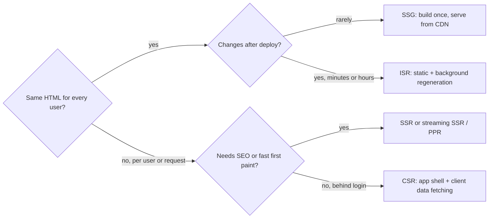
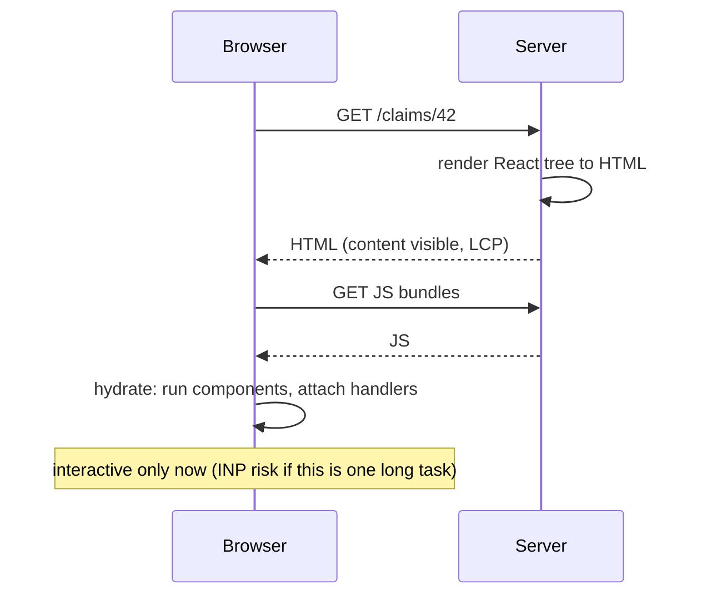

# Rendering strategies: CSR, SSR, SSG, ISR

!!! abstract "Key takeaways"
    - Every strategy answers two questions: **where** is the HTML produced (browser or server) and **when** (build time, request time, or in the background after a request). CSR = browser at runtime; SSR = server per request; SSG = server at build; ISR = SSG plus **stale-while-revalidate** regeneration in the background.
    - Server-rendered HTML shows content early (better LCP, SEO, link previews) but is **not interactive until hydration** finishes: the same JavaScript still downloads, runs and attaches handlers. SSR moves the bottleneck from LCP to INP; it doesn't remove it.
    - **Streaming SSR** sends the page shell immediately and fills `<Suspense>` boundaries as their data resolves, so one slow query no longer holds back the whole page.
    - **Partial Prerendering (PPR)** mixes them in one response: a static shell from the CDN plus dynamic holes streamed per request. In Next.js 16 it is what you get with **Cache Components** (`cacheComponents: true`), on by default for new apps since **16.4 (Oct 2026)** and planned as the default in Next.js 17.
    - Choose **per route**, not per app: marketing and docs pages static, catalogue pages ISR, dashboards dynamic or CSR behind login.

## Why it matters

A single-page app ships an almost empty HTML file and builds the page in the browser. That is simple to host but slow to first content on mid-range phones and invisible to crawlers that don't run JavaScript. Classic server rendering (JSP, Rails, PHP) sent full HTML but needed a page reload per navigation. React frameworks such as Next.js combine them: render HTML on the server for the first load, then **hydrate** so later navigations behave like an SPA.

"CSR vs SSR vs SSG vs ISR, which would you use?" is the standard opener for any frontend lead role that mentions Next.js. A strong answer names the axis (where and when), the cost of each (server compute, staleness, hydration) and picks per page.


*Notice the first question is about sharing, not freshness: anything personalised can't come from a shared static file, so it is either rendered per request or fetched by the browser.*

## Core concepts

### The four strategies

| Strategy | HTML produced | First content | Freshness | Server cost | Next.js (App Router) |
|---|---|---|---|---|---|
| **CSR** | In the browser, after JS loads | Late: after bundle + API calls | Always fresh | Static hosting only | `'use client'` component fetching in the browser |
| **SSR** | On the server, per request | Early, after TTFB | Always fresh | Render on every request | Reading `cookies()`, `headers()`, uncached data |
| **SSG** | At build time | Earliest (CDN) | Stale until redeploy | None at runtime | Default for routes with no request data |
| **ISR** | At build, then regenerated after requests | Earliest (CDN) | Stale for up to the revalidate window | Occasional background render | `cacheLife(...)` / `export const revalidate = n`, `revalidateTag` |

In the older **Pages Router** (still supported) the same choices are explicit functions: `getServerSideProps` (SSR), `getStaticProps` (SSG), `getStaticProps` with `revalidate` (ISR) and `getStaticPaths` with `fallback` for routes not built ahead of time.

### Hydration

Server-rendered HTML is a picture of the UI. **Hydration** is React running the same components in the browser, building its tree, comparing it with the existing DOM and attaching event handlers. Until a region is hydrated, clicks do nothing (or are replayed afterwards).


*Notice the content is visible two network round trips before it works: the gap between "looks ready" and "is ready" is the hydration cost SSR adds.*

Two consequences interviewers probe:

- **Hydration mismatch:** if the server and the first client render produce different output (`Date.now()`, `Math.random()`, `typeof window` branches, locale formatting, invalid HTML nesting such as `<div>` inside `<p>`, browser extensions editing the DOM), React logs an error and re-renders that subtree on the client. Fix by rendering client-only values in `useEffect`, or by making the value deterministic.
- **Hydration cost:** the browser still downloads and executes the JavaScript for everything that is interactive. React 18's **selective hydration** hydrates Suspense regions independently and prioritises the one the user clicks. **Server Components** (next page) go further: components that never need interactivity ship no JavaScript and are never hydrated.

{ loading=lazy }
*Watch the gap between the content bar and the interactive marker: SSR and SSG close the blank-screen gap, but hydration still sits between "visible" and "usable".*

### Streaming SSR

Plain SSR waits for the slowest query before sending a byte. **Streaming** (React 18 `renderToReadableStream`, Next.js `loading.tsx` or `<Suspense>`) flushes the shell and fallbacks at once, then sends each boundary's HTML, with a small inline script that swaps it in, as its data resolves. TTFB and LCP no longer depend on the slowest dependency. Details of Suspense and selective hydration are in [Error boundaries & Suspense](../react/07-error-boundaries-and-suspense.md).

### ISR: stale-while-revalidate for pages

ISR serves the cached page immediately; if it is older than its revalidate window, the **next** request still gets the stale copy while Next.js regenerates in the background, and the request after that gets the fresh page. On-demand revalidation (`revalidateTag`, `revalidatePath`) marks entries stale when the CMS or database changes instead of waiting for the timer. Routes not listed in `generateStaticParams` are rendered on first request and cached for the next visitor.

{ loading=lazy }
*Notice request A, the first after the window expires, still gets the old page: ISR never makes a user wait for regeneration unless the entry has fully expired.*

### Partial Prerendering: one page, several strategies

Before PPR, Next.js decided per **route**: one `cookies()` call made the whole page dynamic. With Cache Components, each component decides: static and `'use cache'` parts are prerendered into a **static shell** (servable from a CDN), and parts that read request data or uncached data sit inside `<Suspense>` and stream into the same response. Next.js 16.4 added `export const ensureStatic = 'navigation'` to fail the build if a dynamic component sneaks into a page meant to stay static. Caching APIs are covered in [Data fetching & caching](03-data-fetching-and-caching-in-next-js.md).

## In practice: code & configuration

=== "❌ Common mistake"
    ```tsx
    'use client';
    // Hydration mismatch: the server renders one time, the browser another.
    export function LastUpdated() {
      const now = new Date().toLocaleTimeString();          // differs server vs client (and by locale/time zone)
      const isMobile = typeof window !== 'undefined' && window.innerWidth < 600; // false on server, maybe true in browser
      return <p>{isMobile ? 'Mobile' : 'Desktop'} view, updated {now}</p>;
    }
    ```

=== "✅ Correct approach"
    ```tsx
    'use client';
    import { useEffect, useState } from 'react';

    // Render a stable value on both sides, then fill client-only values after hydration.
    export function LastUpdated({ updatedAt }: { updatedAt: string }) { // timestamp comes from data, not the clock
      const [isMobile, setIsMobile] = useState(false);       // same initial value on server and client
      useEffect(() => setIsMobile(window.innerWidth < 600), []); // runs only in the browser, after hydration
      return (
        <p>
          {isMobile ? 'Mobile' : 'Desktop'} view, updated{' '}
          <time dateTime={updatedAt}>{new Date(updatedAt).toISOString().slice(0, 16)}</time>
        </p>
      );
    }
    ```

ISR for a product catalogue in the App Router (Cache Components model):

```tsx
// app/products/[id]/page.tsx
import { cacheLife, cacheTag } from 'next/cache';

export async function generateStaticParams() {
  const top = await getTopProductIds(100);               // prerender the 100 most viewed at build time
  return top.map((id) => ({ id }));                      // others render on first request, then are cached
}

export default async function ProductPage({ params }: PageProps<'/products/[id]'>) {
  const { id } = await params;
  return <ProductDetails id={id} />;
}

async function ProductDetails({ id }: { id: string }) {
  'use cache';
  cacheLife('hours');                                    // background regeneration after 1 hour
  cacheTag(`product-${id}`);                             // CMS webhook can call revalidateTag(`product-${id}`, 'max')
  const product = await getProduct(id);
  return <h1>{product.name}</h1>;
}
```

## Real-world usage

- **Content and commerce** (news, docs, product pages) use SSG/ISR so most traffic is served from the CDN; editors trigger on-demand revalidation from the CMS. This is where SSR frameworks earn their keep: SEO, social link previews and LCP on mobile.
- **Authenticated portals** (banking, healthcare member portals, admin tools) often stay CSR or SSR without caching: no SEO need, data is per user and sensitive, and sessions are long, so hydration is paid once. Personalised pages must never land in a shared static cache.
- **Self-hosting ISR** across several pods needs a **shared cache handler** (Redis, S3); otherwise each instance regenerates and serves its own version, and on-demand revalidation only reaches one pod.
- **Streaming behind proxies:** some load balancers and compression layers buffer responses, silently turning streaming SSR back into "wait for everything". Check with `curl -N` against production.

## Trade-offs & production gotchas

| Option | Pros | Cons | Use when |
|---|---|---|---|
| CSR | Cheap hosting, simple mental model | Blank screen until JS + data; weak SEO | Apps behind login, highly interactive tools |
| SSR (per request) | Fresh, personalised, early content | Server cost per request; TTFB tied to slowest query | Personalised pages that need fast first paint |
| Streaming SSR | Shell immediately, slow parts later | Status code and headers sent before content finishes | Pages with one or two slow dependencies |
| SSG | Fastest, cheapest, CDN-friendly | Stale until rebuild; long builds for many pages | Docs, marketing, legal pages |
| ISR | Near-static speed with freshness | Some users see stale content; cache infrastructure when self-hosting | Catalogues, articles, listings |
| PPR (Cache Components) | Static shell + dynamic holes in one response | New model; needs Suspense discipline | Mostly-static pages with a personalised corner |

!!! warning "Gotcha: streaming fixes the status code early"
    Once the shell has been flushed, the HTTP status (200) and headers are on the wire. A `notFound()` or `redirect()` thrown inside a streamed boundary can't change them, so Next.js handles it in the client. Do existence and auth checks **before** the first Suspense boundary if the status code matters (SEO, monitoring).

!!! warning "Gotcha: SSR is not automatically faster"
    SSR improves LCP, but a large hydration task can make INP worse, and a slow API makes TTFB worse for everyone. Measure with field data; see [Core Web Vitals](../browser-web-performance/04-core-web-vitals-and-performance-optimisation.md).

## How this connects to my experience

- **Where I used it:** not used directly; Next.js is not on my resume, so I position this as transferable knowledge. The closest fit is **OptumRx Meteor**, where I **built the ReactJS application from the ground up and established a micro-frontend architecture** for a platform serving **750K+ users**. That app is an authenticated healthcare portal, which I'd describe as CSR with React Query for data *[confirm: CSR SPA, which bundler, any server rendering]*.
- **Talking points:**
    - Why CSR was a reasonable choice there: behind login, no SEO, long sessions, per-user PHI that must not be cached in shared HTML.
    - Where I'd use SSR/ISR: public, content-led pages (drug information, plan comparison, help centre) where LCP and SEO matter.
    - The backend side is familiar: ISR is stale-while-revalidate, the same trade-off as the **Redis caching of frequently accessed queries and UI reference data** I implemented behind the GraphQL Consumer Service.
- **Likely follow-up chain:** "CSR or SSR for your app?" → behind login, CSR plus caching → "What does SSR cost?" → server compute, TTFB, hydration → "How would you make a product page fast and fresh?" → ISR with tags and on-demand revalidation from the CMS → "Self-hosted on Kubernetes?" → shared cache handler so all pods see the same regenerated page.

## Interview questions

### Fundamentals

??? question "Q1. Explain CSR, SSR, SSG and ISR in one sentence each."
    **Answer:** CSR builds the HTML in the browser after the JavaScript loads; SSR renders HTML on the server for each request; SSG renders HTML once at build time and serves the same file to everyone; ISR is SSG whose pages are regenerated in the background after a time window or on demand, serving the stale copy meanwhile.

    **Interviewer listens for:** the where/when axis, "stale-while-revalidate" for ISR, the cost of each.

    **Common wrong answer:** "SSR means no JavaScript in the browser." SSR still hydrates.

??? question "Q2. What is hydration and why can SSR pages feel frozen?"
    **Answer:** Hydration is React running the components in the browser against the server HTML to attach event handlers and state. The HTML is visible before the JavaScript has downloaded and run, so the page looks ready but ignores input until its region is hydrated. Large bundles make this a long task that hurts INP.

    **Interviewer listens for:** visible ≠ interactive, bundle size, selective hydration, Server Components reducing hydrated code.

    **Common wrong answer:** "Hydration re-renders the page from scratch." It reuses the DOM; only a mismatch forces client re-rendering.

??? question "Q3. What causes hydration mismatches and how do you fix them?"
    **Answer:** Output that differs between server and first client render: current time, random values, `window`/`localStorage` checks during render, locale/time-zone formatting, invalid HTML nesting, extensions editing the DOM. Fix by making values deterministic (pass timestamps as data), moving browser-only values into `useEffect`, or loading browser-only widgets client-side only. `suppressHydrationWarning` is for a single unavoidable text node such as a timestamp.

    **Interviewer listens for:** concrete causes, "same initial render" principle, not silencing the warning everywhere.

    **Common wrong answer:** "Wrap it in `typeof window !== 'undefined'`", which itself causes the mismatch.

### Intermediate

??? question "Q4. How does ISR behave when the revalidate window has passed?"
    **Answer:** The first request after the window still receives the cached (stale) page and triggers a background regeneration. If regeneration succeeds, later requests get the new page; if it fails, the old page keeps being served. Only after the `expire` time with no traffic does a request wait for a fresh render. On-demand `revalidateTag`/`revalidatePath` marks entries stale without waiting for the timer.

    **Interviewer listens for:** stale served to the triggering request, failure keeps old page, on-demand invalidation.

    **Common wrong answer:** "The user who hits the expired page waits for the rebuild."

??? question "Q5. What does streaming SSR change, and what can't it fix?"
    **Answer:** The server flushes the shell and Suspense fallbacks immediately and streams each boundary as its data resolves, so TTFB and first content no longer wait for the slowest query. It can't change the status code or headers once flushed, it doesn't reduce JavaScript or hydration cost, and buffering proxies can defeat it.

    **Interviewer listens for:** Suspense boundaries, status code sent early, proxy buffering.

    **Common wrong answer:** "Streaming makes the page interactive sooner." Hydration still needs the JS.

??? question "Q6. What is Partial Prerendering?"
    **Answer:** Rendering one route as a static shell, prerendered and cacheable on a CDN, with dynamic holes (Suspense boundaries reading cookies, headers or uncached data) streamed into the same response per request. In Next.js 16 it is the default rendering behaviour with Cache Components; `create-next-app` enables it from 16.4. It replaces the old per-route static-or-dynamic decision.

    **Interviewer listens for:** static shell + dynamic holes, one response, per-component rather than per-route.

    **Common wrong answer:** "It's ISR for parts of a page." ISR regenerates cached content; PPR's dynamic parts aren't cached at all.

### Senior

??? question "Q7. You self-host Next.js on Kubernetes with 6 pods and ISR. What breaks?"
    **Answer:** Each pod has its own file-system/in-memory cache, so pods regenerate independently, users see different versions depending on the pod, and an on-demand revalidation call hits one pod only. Configure a shared cache handler (Redis or object storage), make revalidation reach the shared store, and make sure all pods run the same build (cache keys include the build ID).

    **Interviewer listens for:** per-instance cache, shared handler, revalidation fan-out, build ID.

    **Common wrong answer:** "ISR works the same everywhere; it's built in."

### Scenario-based

??? question "Q8. Choose a rendering strategy for each: marketing home page, product detail page, logged-in claims dashboard, search results."
    **Answer:** Home page: SSG (or long-lived cache) on the CDN. Product page: ISR with tags, prerender the top products, render the rest on first request, revalidate on CMS/price events; stock level as a streamed dynamic hole. Claims dashboard: dynamic per request (or CSR) behind auth, never in a shared cache, with streaming for slow widgets. Search: SSR or streaming for SEO-relevant queries, client fetching for filters; cache popular queries keyed by `searchParams`.

    **Interviewer listens for:** per-route decisions, personal data kept out of shared caches, PPR for the mixed product page.

    **Common wrong answer:** One strategy for the whole app.

## Cheat sheet

| Concept | Remember |
|---|---|
| Axis | Where (browser/server) × when (build/request/background) |
| CSR | Empty HTML + JS; fine behind login; weak SEO and LCP |
| SSR | HTML per request; still hydrates; TTFB = slowest query unless streamed |
| SSG | Build once, CDN; stale until rebuild |
| ISR | Serve stale, regenerate in background; on-demand via `revalidateTag`/`revalidatePath` |
| Hydration | Visible ≠ interactive; mismatch from time, random, `window`, nesting |
| Streaming | Shell first, Suspense boundaries later; status code fixed once flushed |
| PPR | Static shell + streamed holes; default with Cache Components (Next.js 16; on in new apps from 16.4) |
| Self-hosting | Shared cache handler for ISR across pods |

## Sources
1. [Next.js docs: Caching (Cache Components, prerendering, PPR, ISR)](https://nextjs.org/docs/app/getting-started/caching): static shell, streaming holes, App Shell and ISR with Cache Components.
2. [Next.js 16.4 release post](https://nextjs.org/blog/next-16-4): Cache Components recommended for every app and enabled in `create-next-app`, `ensureStatic`, default in Next.js 17.
3. [Next.js 16 release post](https://nextjs.org/blog/next-16): Cache Components introduction, removal of `experimental.ppr`.
4. [Next.js docs: Caching and Revalidating (Previous Model)](https://nextjs.org/docs/app/guides/caching-without-cache-components): route segment `revalidate`, `dynamic`, build-time `fetch` behaviour.
5. [Next.js docs: Incremental Static Regeneration](https://nextjs.org/docs/app/guides/incremental-static-regeneration) and [Self-hosting](https://nextjs.org/docs/app/guides/self-hosting): stale-while-revalidate behaviour, shared cache handlers.
6. [React docs: hydrateRoot](https://react.dev/reference/react-dom/client/hydrateRoot): hydration, mismatches, `suppressHydrationWarning`.
7. [React docs: renderToReadableStream](https://react.dev/reference/react-dom/server/renderToReadableStream): streaming SSR with Suspense and status codes.
8. [web.dev: Rendering on the Web](https://web.dev/articles/rendering-on-the-web): CSR/SSR/SSG trade-offs and hydration cost.
