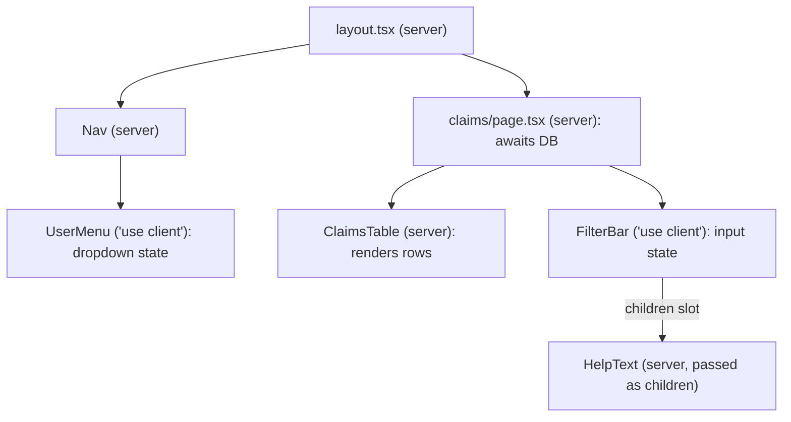
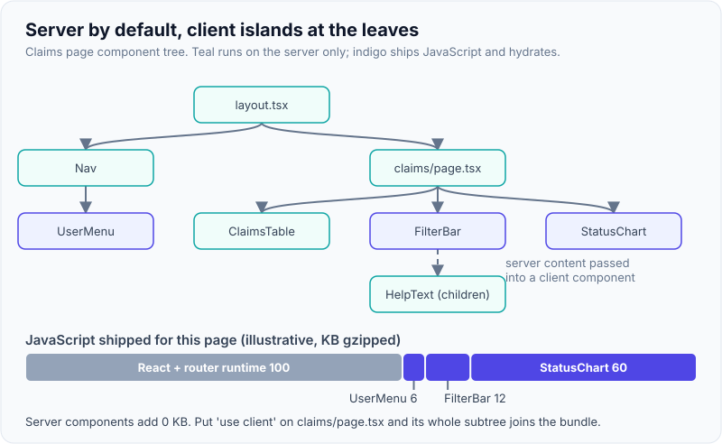
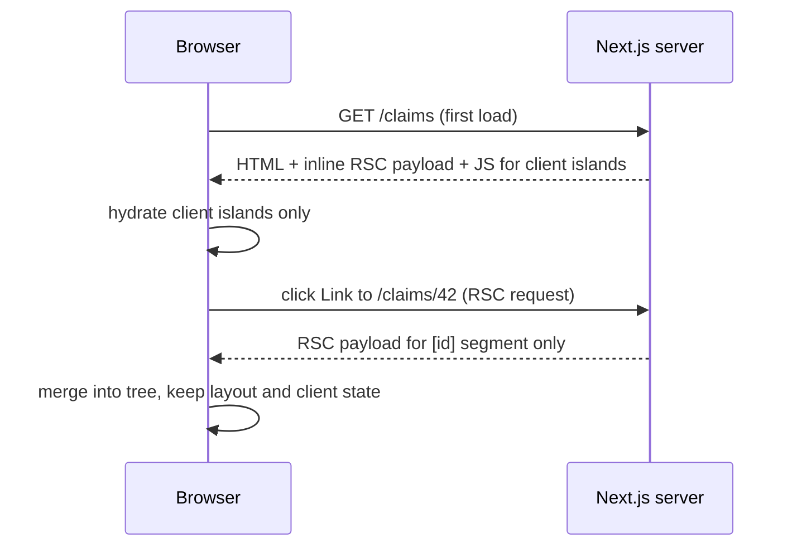

# App Router & React Server Components

!!! abstract "Key takeaways"
    - The **App Router** (`app/` directory, stable since Next.js 13.4) maps folders to URL segments and special files to UI roles: `layout`, `page`, `loading` (Suspense fallback), `error` (error boundary), `not-found`, `route` (HTTP handler). Layouts persist across navigations; only the changed segment re-renders.
    - Components are **Server Components by default**: they run only on the server (or at build), can be `async`, read databases and secrets directly, and ship **no JavaScript**. `'use client'` marks a **boundary**: that module and everything it imports become client code that is server-rendered once and hydrated.
    - Server output travels as the **RSC payload**: a serialised tree with placeholders for client components and their props. First load = HTML + payload; later navigations fetch only the payload for the changed segments.
    - Props crossing the boundary must be **serialisable**; pass Server Components to Client Components as `children`, not by importing them.
    - **Server Functions** (`'use server'`, used as Server Actions) are **public POST endpoints**: authenticate, authorise and validate inside every one. 2025 showed why: a middleware auth bypass (CVE-2025-29927) and a CVSS 10 RSC deserialisation RCE (CVE-2025-55182). In Next.js 16, `middleware.ts` is renamed **`proxy.ts`**.

## Why it matters

The Pages Router fetched data per page (`getServerSideProps`) and then shipped **every** component's JavaScript for hydration, even purely presentational ones. React Server Components split the tree: the parts that only display data stay on the server, and only interactive "islands" become client JavaScript. The App Router is Next.js's implementation of that model, plus nested layouts, streaming and Server Actions.

For an interviewer, this topic separates people who have used Next.js recently from those who used it in 2021. The core questions: what runs where, what crosses the boundary, and how you keep a server-first app secure.

## Core concepts

### File conventions and nested layouts

```text
app/
├── layout.tsx              # root layout: <html>, <body>, providers; never re-mounts
├── page.tsx                # "/"
├── (marketing)/about/page.tsx   # route group: "/about" (folder name not in URL)
├── claims/
│   ├── layout.tsx          # persists while moving between claims pages
│   ├── loading.tsx         # Suspense fallback for this segment
│   ├── error.tsx           # error boundary ('use client') for this segment
│   ├── page.tsx            # "/claims"
│   └── [id]/page.tsx       # "/claims/42": params is a Promise in Next.js 15+
├── @modal/(.)photo/[id]/page.tsx  # parallel slot + intercepting route (modal over a list)
└── api/health/route.ts     # Route Handler: GET/POST with Web Request/Response
proxy.ts                    # request interception (was middleware.ts before Next.js 16)
```

Next.js wraps each segment as `Layout > ErrorBoundary(error) > Suspense(loading) > Page`, so a failure or slow fetch in one segment doesn't take down its parents. Since Next.js 15, `params`, `searchParams`, `cookies()` and `headers()` are **async**; Next.js 16 removed the synchronous fallback.

### Server vs Client Components

| | Server Component (default) | Client Component (`'use client'`) |
|---|---|---|
| Runs | Server, per request or at build | Server (for initial HTML) **and** browser |
| Can be `async` / `await` data | Yes | No (use `use()` or a data library) |
| State, effects, event handlers | No | Yes |
| Browser APIs | No | Yes (after hydration) |
| Secrets, DB, file system | Yes (guard with `import 'server-only'`) | Never |
| JavaScript shipped | None | Its code and everything it imports |

`'use client'` is about the **module graph**, not a single component: once a file has it, every module it imports is bundled for the client. Put it on small leaf components (a button, a chart, a form), not on pages or layouts.


*Notice the client components are leaves; the server component passed as `children` to `FilterBar` stays server-rendered even though its parent is a client component.*

{ loading=lazy }
*Notice the bundle bar: only the indigo islands ship JavaScript; marking the page itself `'use client'` would pull the whole subtree into it.*

### What crosses the boundary: the RSC payload

When a Server Component renders, React produces the **RSC payload** (the "Flight" format): the rendered output of server components, plus references to client component modules and their props. On the first request Next.js uses it to produce HTML and embeds it for hydration. On a client navigation the router requests only the payload for the segments that changed, merges it into the existing tree and keeps layouts and client state intact.


*Notice the second request returns no HTML and no layout: the shared `claims/layout.tsx` and the `FilterBar` state survive the navigation.*

{ loading=lazy }
*Watch which boxes repaint on the second navigation: only the page segment; the layouts never reload.*

Serialisable props are plain data (strings, numbers, arrays, plain objects, `Date`, `Map`, `Set`, promises) and Server Functions. Class instances, closures and functions other than Server Functions can't cross. Anything you pass is visible to the browser, so pass `{ id, name }`, not the whole database row with internal fields.

### Server Functions and Server Actions

A function marked `'use server'` can be called from client code or used as a `<form action>`. React turns it into a reference; the call becomes a POST to the page with an action ID. That makes it a **public HTTP endpoint**: anyone can call it with any arguments. Next.js mitigates some risks (unguessable IDs, removing unused actions, encrypted closure variables, Origin vs Host check against CSRF), but authorisation and input validation are your job. React 19 hooks (`useActionState`, `useFormStatus`, `useOptimistic`) give pending and optimistic states; see [React 18/19](../react/08-react-18-19-concurrent-rendering-transitions-actions-use-rea.md).

### `proxy.ts` and where auth belongs

`proxy.ts` (Next.js 16; `middleware.ts` before) runs before routing on the Node.js runtime. Use it for redirects, rewrites, headers and **optimistic** checks such as "is there a session cookie". The Next.js docs recommend a **Data Access Layer**: verify the session and permissions next to the data, in every Server Component, Server Function and Route Handler that reads or writes it. Layouts don't re-render on navigation, so an auth check in a layout alone is not enforced on every request.

## In practice: code & configuration

=== "❌ Common mistake"
    ```tsx
    // app/claims/[id]/actions.ts
    'use server';
    import { db } from '@/lib/db';

    // Anyone can POST to this action with any id and status:
    // no session check, no ownership check, no validation.
    export async function updateClaimStatus(id: string, status: string) {
      await db.claim.update({ where: { id }, data: { status } });
    }
    ```

=== "✅ Correct approach"
    ```tsx
    // app/claims/[id]/actions.ts
    'use server';
    import 'server-only';
    import { z } from 'zod';
    import { updateTag } from 'next/cache';
    import { verifySession } from '@/lib/dal';            // Data Access Layer: reads + verifies the session cookie
    import { db } from '@/lib/db';

    const Input = z.object({ id: z.string().uuid(), status: z.enum(['APPROVED', 'REJECTED']) });

    export async function updateClaimStatus(raw: unknown) {
      const { id, status } = Input.parse(raw);             // validate: arguments are attacker-controlled
      const session = await verifySession();               // authenticate: throws or redirects if not signed in
      if (!session.roles.includes('CLAIMS_REVIEWER')) {    // authorise: role check next to the data
        throw new Error('Forbidden');
      }
      await db.claim.update({ where: { id }, data: { status, reviewedBy: session.userId } });
      updateTag(`claim-${id}`);                            // read-your-writes: the reviewer sees the new status
      return { ok: true };                                 // return only what the UI needs
    }
    ```

Keeping the client island small:

```tsx
// app/claims/page.tsx (Server Component: no 'use client')
import { Suspense } from 'react';
import { FilterBar } from './filter-bar';                  // 'use client' inside that file
import { listClaims } from '@/lib/dal';

export default function ClaimsPage() {
  return (
    <>
      <FilterBar>
        <p>Filters apply to claims you can access.</p>       {/* server content passed as children */}
      </FilterBar>
      <Suspense fallback={<p>Loading claims…</p>}>
        <ClaimsTable />
      </Suspense>
    </>
  );
}

async function ClaimsTable() {
  const claims = await listClaims();                       // DAL checks the session and scopes the query
  return <table>{claims.map((c) => <tr key={c.id}><td>{c.id}</td><td>{c.status}</td></tr>)}</table>;
}
```

## Real-world usage

- **Bundle reduction** is the headline benefit: content-heavy pages (docs, commerce, dashboards with large read-only tables) move markdown parsers, date libraries and table rendering to the server.
- **Backend-for-frontend:** Server Components and Route Handlers often sit in front of internal APIs (REST, GraphQL), holding tokens server-side so they never reach the browser. This overlaps with the BFF pattern in [Frontend security](../frontend-architecture/05-frontend-security.md).
- **March 2025, CVE-2025-29927 (CVSS 9.1):** an attacker could send the internal `x-middleware-subrequest` header to skip middleware entirely; apps that did auth only in middleware exposed protected routes. Fixed in 12.3.5, 13.5.9, 14.2.25 and 15.2.3.
- **December 2025, CVE-2025-55182 "React2Shell" (CVSS 10.0):** unsafe deserialisation of Server Function payloads in `react-server-dom-*` 19.0–19.2.0 allowed unauthenticated remote code execution, even in a fresh `create-next-app`, and was exploited in the wild within days. The lesson: an RSC app exposes a protocol endpoint whether or not you wrote a Server Action; patch React and Next.js promptly.

## Trade-offs & production gotchas

| Option | Pros | Cons | Use when |
|---|---|---|---|
| Server Component | No JS, direct data access, secrets stay server-side | No state or handlers; re-renders need a server round trip | Display of data, layout, static content |
| Client Component | Interactivity, browser APIs, instant local updates | Ships JS, hydrates, can't hold secrets | Inputs, menus, charts, anything stateful |
| Server Action | Progressive enhancement, no hand-written API | Public endpoint, POST only, sequential per client | Mutations from forms in the same app |
| Route Handler | Normal HTTP API, any method, cacheable GET | Hand-written fetch on the client | Webhooks, third-party or mobile consumers |
| Auth in `proxy.ts` only | One place, early redirect | Bypassable; not run for every data access path | Optimistic redirect only, never sole check |

!!! warning "Gotcha: Context providers"
    `createContext` only works in Client Components. Wrap providers in a small `'use client'` component and render it in the root layout with `{children}`; the children can still be Server Components.

!!! warning "Gotcha: leaking server data through props"
    Every prop passed to a Client Component is serialised into the page. Passing a full user record leaks fields such as internal flags or PHI. Use DTOs, `import 'server-only'` in data modules, and React's `taintObjectReference`/`taintUniqueValue` for secrets.

## How this connects to my experience

- **Where I used it:** not used directly; position as transferable knowledge. I **built the ReactJS application from the ground up** on OptumRx Meteor *[confirm: client-rendered, no Next.js]*, and I **owned the GraphQL Consumer Service** that integrates 5 upstream systems.
- **Talking points:**
    - Server Components fetching from the GraphQL Consumer Service is a BFF: tokens stay on the server, the browser gets only rendered output. Same reason I'd keep OAuth2 tokens from **PingFederate** out of the browser.
    - "Server Actions are public endpoints" is the same discipline as securing REST APIs with **Spring Security**: authenticate, authorise per resource, validate input (see [authentication vs authorisation](../spring-security-oauth2/02-authentication-vs-authorization-method-security.md)).
    - CVE-2025-29927 maps to a lesson from my **JWT/SSO** work at Johnson Controls: a gateway or filter check is defence in depth, not the only check.
- **Likely follow-up chain:** "Server vs Client Components?" → what runs where, JS shipped → "Can a client component render a server component?" → only via `children`/props → "How do you secure a Server Action?" → public POST, session + role + validation in a DAL → "Middleware auth enough?" → no, CVE-2025-29927.

## Interview questions

### Fundamentals

??? question "Q1. What is a React Server Component and how is it different from SSR?"
    **Answer:** A Server Component runs only on the server and sends its rendered output (RSC payload), never its code, to the browser; it is never hydrated. SSR is rendering any component to HTML on the server for the first load; client components are SSR'd too and then hydrated. RSC reduces the JavaScript shipped; SSR improves first paint. They combine: Server Components produce the payload, SSR turns it into HTML.

    **Interviewer listens for:** no JS for server components, client components still SSR'd, the two are complementary.

    **Common wrong answer:** "Server Components are just SSR."

??? question "Q2. What does `'use client'` actually do?"
    **Answer:** It marks a module as an entry point into the client bundle. That component and every module it imports are sent to the browser and hydrated (they are still rendered on the server for the initial HTML). It doesn't mean "client-only rendering".

    **Interviewer listens for:** boundary on the module graph, imports become client code, still SSR'd.

    **Common wrong answer:** "It disables server rendering for that component."

??? question "Q3. How do layouts behave on navigation?"
    **Answer:** Layouts wrap their segment and persist across navigations between child routes: they don't re-render or re-mount, so their state and DOM survive. Only the changed segment's payload is fetched. `template.tsx` is the variant that re-mounts on every navigation.

    **Interviewer listens for:** partial rendering, state preserved, template as the exception.

    **Common wrong answer:** "Every navigation re-renders the whole tree from the root."

### Intermediate

??? question "Q4. Can a Client Component render a Server Component?"
    **Answer:** Not by importing it: an import inside a client module makes it client code. But a Server Component can pass another Server Component to a Client Component as `children` or another JSX prop; it is rendered on the server and slotted in. That is how providers and interactive wrappers keep server-rendered content inside.

    **Interviewer listens for:** import vs composition, `children` slot pattern.

    **Common wrong answer:** "No, never," or "Yes, just import it."

??? question "Q5. What can you pass as props from a Server to a Client Component?"
    **Answer:** Serialisable values: primitives, plain objects and arrays, `Date`, `Map`, `Set`, typed arrays, promises (unwrapped with `use()`), JSX, and Server Functions. Not class instances, ordinary functions or symbols. Everything passed is visible in the page source, so send minimal DTOs.

    **Interviewer listens for:** serialisation, promises + `use()`, data exposure.

    **Common wrong answer:** "Anything, it's all JavaScript."

### Senior

??? question "Q6. How do you secure Server Actions?"
    **Answer:** Treat each as a public POST endpoint: validate input with a schema, verify the session and authorise for the specific resource inside the action (via a Data Access Layer), return minimal data, and rate-limit sensitive ones. Next.js adds unguessable action IDs, dead-code elimination of unused actions, encrypted closures and an Origin/Host check, but none of that is authorisation. Keep React/Next.js patched (CVE-2025-55182).

    **Interviewer listens for:** public endpoint, authz per resource, validation, DAL, patching.

    **Common wrong answer:** "They're only callable from my UI, so they're safe."

??? question "Q7. Why shouldn't authentication live only in middleware/`proxy.ts`?"
    **Answer:** It runs before routing and isn't tied to every data access path; it was bypassable in CVE-2025-29927; and not every access goes through the path you matched (Server Actions post to the page URL, prefetches, Route Handlers). Use the proxy for optimistic redirects and enforce in the DAL next to the data.

    **Interviewer listens for:** defence in depth, the CVE, DAL.

    **Common wrong answer:** "Middleware runs on every request, so it's enough."

### Scenario-based

??? question "Q8. A page marked `'use client'` at the top ships 600 KB of JavaScript. How do you fix it?"
    **Answer:** Find what needs interactivity (filters, menus, charts) and extract those into small client components. Remove `'use client'` from the page so it becomes a Server Component that fetches data directly and renders tables and text on the server. Pass server-rendered content into client wrappers as `children`. Check with the bundle analyser that heavy libraries (markdown, date, table rendering) moved to the server.

    **Interviewer listens for:** push the boundary to the leaves, composition, measuring.

    **Common wrong answer:** "Add `React.memo` and lazy loading."

## Cheat sheet

| Concept | Remember |
|---|---|
| Default | Server Component; `async`, data access, zero JS |
| `'use client'` | Module-graph boundary; still SSR'd, then hydrated; keep at leaves |
| Files | `layout`, `page`, `loading`, `error`, `not-found`, `route`, `template`, `default`; `proxy.ts` (16) |
| Navigation | RSC payload for changed segments only; layouts persist |
| Props across boundary | Serialisable only; visible to the browser; use DTOs |
| Server → client composition | Pass server components as `children` |
| Server Actions | Public POST endpoints: validate, authenticate, authorise in each |
| Async APIs | `await params`, `searchParams`, `cookies()`, `headers()` (15+; sync removed in 16) |
| 2025 CVEs | 29927 middleware bypass (9.1); 55182 RSC RCE (10.0) |

## Sources
1. [Next.js docs: Server and Client Components](https://nextjs.org/docs/app/getting-started/server-and-client-components): defaults, `'use client'`, RSC payload, composition, context providers.
2. [Next.js docs: Layouts and Pages](https://nextjs.org/docs/app/getting-started/layouts-and-pages) and [Project structure](https://nextjs.org/docs/app/getting-started/project-structure): file conventions, route groups, parallel and intercepting routes.
3. [React docs: Server Components](https://react.dev/reference/rsc/server-components), ['use client'](https://react.dev/reference/rsc/use-client) and ['use server'](https://react.dev/reference/rsc/use-server): serialisable types, boundaries, Server Functions as endpoints.
4. [Next.js docs: Authentication guide](https://nextjs.org/docs/app/guides/authentication) and [Data security](https://nextjs.org/docs/app/guides/data-security): Data Access Layer, optimistic checks in proxy, Server Action security, taint APIs.
5. [Next.js 16 release post](https://nextjs.org/blog/next-16): `proxy.ts` replacing `middleware.ts`, async request APIs.
6. [Fastly: CVE-2025-29927 authorization bypass in Next.js](https://fastly.com/blog/cve-2025-29927-authorization-bypass-in-next-js): `x-middleware-subrequest`, affected and fixed versions.
7. [Datadog Security Labs: CVE-2025-55182 React2Shell](https://securitylabs.datadoghq.com/articles/cve-2025-55182-react2shell-remote-code-execution-react-server-components/): affected React versions, CVSS 10.0, active exploitation.
