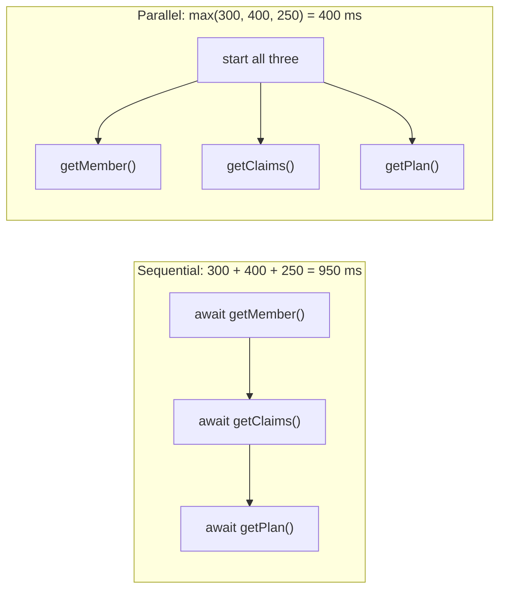
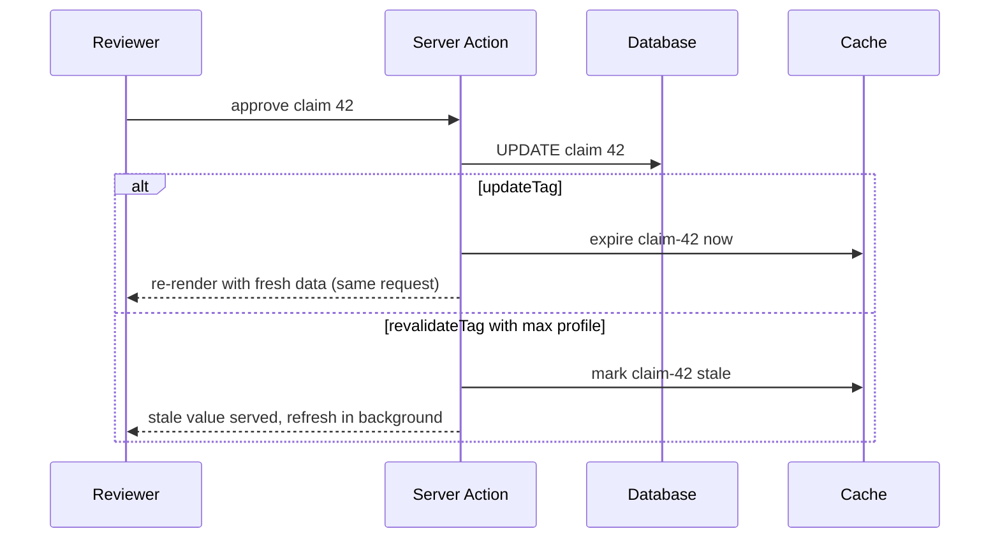

# Data fetching & caching in Next.js

!!! abstract "Key takeaways"
    - Fetch in **Server Components** with `async`/`await` against your API or database; start independent requests together (`Promise.all` or pass promises down) to avoid **waterfalls**; deduplicate within one render with React `cache()` (`fetch` is memoised automatically).
    - Defaults changed twice: **Next.js 14** cached `fetch`, GET Route Handlers and client navigations by default; **Next.js 15** made all three **uncached** by default; **Next.js 16** introduced **Cache Components**: nothing is cached unless you say `'use cache'`, and runtime data must stream behind `<Suspense>`. From **16.4** new apps enable it by default; it becomes the default in Next.js 17.
    - `'use cache'` caches a function's or component's result; arguments and captured variables form the key. `cacheLife` sets **stale** (browser), **revalidate** (background refresh) and **expire** (hard limit); `cacheTag` labels entries for invalidation.
    - Invalidate with **`updateTag(tag)`** in Server Actions for read-your-writes, **`revalidateTag(tag, 'max')`** for stale-while-revalidate (the one-argument form is deprecated), `revalidatePath`, and **`refresh()`** to re-render uncached data only.
    - Default `'use cache'` storage is **per-instance memory**; use `'use cache: remote'` with a cache handler for a shared store and `'use cache: private'` for per-user data cached only in the browser. Never put personalised data in a shared cache without the user in the key.

## Why it matters

Server Components made data fetching look trivial (`await db.query()` in a component), but where results are cached decides cost, freshness and correctness. Next.js's early App Router cached aggressively and implicitly, and "why is my data stale?" became the most common complaint. Next.js 15 reversed the defaults, and Next.js 16 replaced implicit caching with explicit, composable directives. Interviewers ask about it because the version you learned on changes the answer.

## Core concepts

### Fetching without waterfalls


*Notice the parallel version costs only as much as the slowest call: start independent work before the first `await` (numbers illustrative).*

- **Sequential** awaits are fine when one call needs the previous result (the member ID for the claims query).
- **Parallel:** `Promise.all`, or start promises in the page and pass them to children that `await` (or `use()` in a client component) inside their own `<Suspense>`, so each section streams when ready.
- **Deduplicate** within a request: two components calling `getMember(id)` should hit the backend once. `fetch` GETs are memoised per render; wrap ORM or SDK calls in React `cache()`.
- **Client-side fetching** still has a place: highly interactive, frequently polled or user-driven data (infinite scroll, live filters) fits TanStack Query in a client component; see [state management](../frontend-architecture/03-state-management-redux-toolkit-react-query-tanstack-query-wh.md).

### How the defaults changed

| Version | `fetch` default | GET Route Handlers | Client navigation cache | Model |
|---|---|---|---|---|
| **14** | Cached (`force-cache`) | Static by default | Pages reused for 30 s (dynamic) / 5 min (static) | Implicit: Request Memoisation, Data Cache, Full Route Cache, Router Cache |
| **15** | Not cached | Dynamic by default | Page segments not reused (`staleTimes.dynamic` = 0) | Same four caches, opt in with `cache: 'force-cache'`, `revalidate`, `unstable_cache` |
| **16** (Cache Components) | Not cached; uncached data must be inside `<Suspense>` or `'use cache'` | Follow the page prerendering model | Per entry, from `cacheLife` `stale` (min 30 s) | Explicit: `'use cache'`, `cacheLife`, `cacheTag`; PPR by default |

Without `cacheComponents`, Next.js 16 keeps the **previous model**: a route with no request-time APIs is still prerendered at build time, and a `fetch` with no `cache` option reached before any `cookies()`/`headers()` call runs once at build. That subtlety is why "uncached by default" in 15 doesn't mean "dynamic by default".

### `'use cache'`, `cacheLife` and `cacheTag`

`'use cache'` at the top of an async function, component or file caches its return value. The compiler builds the key from the build ID, the function ID, the serialisable arguments and any captured variables. Inside a cached scope you can't read `cookies()`, `headers()` or `searchParams`; read them outside and pass the values in as arguments (they become part of the key).

| Profile | stale (browser) | revalidate (background) | expire (hard) |
|---|---|---|---|
| `default` | 5 min | 15 min | never |
| `seconds` | 30 s | 1 s | 1 min |
| `minutes` | 5 min | 1 min | 1 h |
| `hours` | 5 min | 1 h | 1 day |
| `days` | 5 min | 1 day | 1 week |
| `weeks` | 5 min | 1 week | 30 days |
| `max` | 5 min | 30 days | 1 year |

Entries with `revalidate: 0` or `expire` under 5 minutes are excluded from the prerendered shell and become dynamic holes; of the presets only `seconds` does. Custom profiles go in `next.config.ts` under `cacheLife`.

### Where cached results live

- **Prerendered HTML / static shell:** built at deploy and served from disk or a CDN; ISR rebuilds it in the background.
- **Server store:** default `'use cache'` entries live in **per-instance memory**, which is lost on serverless cold starts and not shared between pods. `'use cache: remote'` stores them in a configured **cache handler** (Redis, KV), costing a network hop, worth it at high hit rates.
- **Browser:** cached output travels in the RSC payload and the client router reuses it for its `stale` window. `'use cache: private'` results, which may read cookies directly, live **only** here.
- Every store is scoped to one deployment: the build ID is in the key, so a deploy starts with a cold cache.

{ loading=lazy }
*Notice that plain `'use cache'` is per pod: on serverless or a scaled-out cluster, hit rates depend on which instance you land on.*

### Invalidation: which API when


*Notice only `updateTag` guarantees the person who made the change sees it; `revalidateTag` trades that for never blocking on a refresh.*

| API | Where | Effect | Use for |
|---|---|---|---|
| `updateTag(tag)` | Server Actions only | Expires immediately; the same request reads fresh data | Forms, settings: "I just saved, show it" |
| `revalidateTag(tag, 'max')` | Server Actions, Route Handlers | Marks stale; next visitor gets stale while it refreshes | CMS webhooks, content where seconds of staleness are fine |
| `revalidatePath(path)` | Server Actions, Route Handlers | Invalidates everything rendered for a path | Coarse invalidation when tags aren't set up |
| `refresh()` | Server Actions only | Re-renders uncached data; doesn't touch the cache | Counters, notifications shown alongside cached UI |
| `router.refresh()` | Client | Re-fetches the current route's payload | After a client-side mutation via an API |

Calling any of the server functions above from a Server Action also clears the client router cache, so the user's next navigation doesn't show stale pages.

{ loading=lazy }
*Watch the first view after the save: Approved in the top lane, still Pending in the bottom lane.*

## In practice: code & configuration

=== "❌ Common mistake"
    ```tsx
    import { cookies } from 'next/headers';

    // Personalised data in a cached scope keyed only by the function: every member
    // would share one entry, and reading cookies() inside 'use cache' is an error anyway.
    async function MemberClaims() {
      'use cache';
      const memberId = (await cookies()).get('member')?.value;   // not allowed inside 'use cache'
      const claims = await claimsApi.list(memberId);
      return <ClaimsList claims={claims} />;
    }
    ```

=== "✅ Correct approach"
    ```tsx
    import { Suspense } from 'react';
    import { cacheLife, cacheTag } from 'next/cache';
    import { verifySession } from '@/lib/dal';

    export default function ClaimsPage() {
      return (
        <Suspense fallback={<p>Loading claims…</p>}>          {/* runtime data streams behind Suspense */}
          <MemberClaims />
        </Suspense>
      );
    }

    async function MemberClaims() {
      const { memberId } = await verifySession();           // read request data outside the cache
      return <CachedClaims memberId={memberId} />;
    }

    async function CachedClaims({ memberId }: { memberId: string }) {
      'use cache: private';                                 // per-user: cached in this browser only, never shared
      cacheLife({ stale: 60 });                             // reuse for 60 s on client navigations
      cacheTag(`claims-${memberId}`);
      const claims = await claimsApi.list(memberId);        // memberId is part of the cache key
      return <ClaimsList claims={claims} />;
    }
    ```

Shared reference data, the same for every user, cached in a shared store:

```tsx
// lib/reference-data.ts
import { cacheLife, cacheTag } from 'next/cache';

export async function getFormulary(planYear: number) {
  'use cache: remote';                         // shared across instances via the configured cache handler
  cacheLife('days');                           // refresh in the background daily
  cacheTag('formulary');                       // webhook: revalidateTag('formulary', 'max')
  const res = await fetch(`${process.env.REF_API}/formulary/${planYear}`);
  return (await res.json()) as FormularyEntry[];
}
```

## Real-world usage

- **Next.js 14's implicit caching** caused widespread stale-data bugs (dashboards showing old values after mutations, route handlers serving build-time JSON); the Next.js team cited that feedback for the 15 default change and the explicit 16 model.
- **Healthcare and banking:** cache shared, non-sensitive data (formularies, plan catalogues, branch lists) on the server; keep PHI and account data uncached or `'use cache: private'`. A shared cache entry without the user in its key is a cross-user data leak, the worst class of caching bug.
- **Self-hosted clusters:** use a shared cache handler, or accept per-pod caches with lower hit rates. The same thinking as cache-aside with Redis; see [caching patterns](../redis-caching/02-caching-patterns-cache-aside-read-write-through-write-behind.md) and [CDN caching](../system-design/04-caching-strategies-and-cdn.md).
- **Event-driven invalidation:** a CMS webhook or a Kafka consumer calls a Route Handler that runs `revalidateTag`, instead of short timers that hammer the backend.

## Trade-offs & production gotchas

| Option | Pros | Cons | Use when |
|---|---|---|---|
| No cache (stream behind Suspense) | Always fresh, simplest to reason about | Backend load per request | Personal, sensitive or fast-changing data |
| `'use cache'` (in-memory) | Zero infrastructure | Per instance, lost on cold start | Single long-lived server, cheap recomputation |
| `'use cache: remote'` | Shared across pods, survives restarts | Network hop; needs a handler | High hit rate, expensive upstream calls |
| `'use cache: private'` | Per-user, instant back/forward navigations | Browser only; no server savings | Personalised data reused during a session |
| `updateTag` | Read-your-writes | Server Actions only; waits for fresh data | User-facing edits |
| `revalidateTag(tag, 'max')` | Never blocks; cheap | Brief staleness | Content and catalogue updates |

!!! warning "Gotcha: the one-argument `revalidateTag`"
    `revalidateTag('posts')` still compiles but is deprecated in Next.js 16. Pass a profile (`'max'` recommended) or switch to `updateTag` in Server Actions when the user must see their change.

!!! warning "Gotcha: nested cache lifetimes"
    An outer `'use cache'` without its own `cacheLife` inherits a shorter inner lifetime, and nesting a `seconds` cache inside it throws during prerendering. Always set `cacheLife` explicitly in every cached scope.

## How this connects to my experience

- **Where I used it:** not used directly; position as transferable knowledge. The closest fit is my **Redis-based caching for frequently accessed queries and UI reference data** on OptumRx Meteor, and the **GraphQL Consumer Service** over 5 upstream systems. The TTLs and invalidation approach we used *[confirm]*.
- **Talking points:**
    - `'use cache: remote'` + `cacheLife` + tags is the cache-aside pattern I ran in Redis: shared reference data with a TTL and event-driven eviction.
    - The PHI rule carries over: per-member data never in a shared cache without the member in the key; on the frontend that means `'use cache: private'` or no cache.
    - Kafka events could drive `revalidateTag` through a Route Handler, as our **Kafka-based workflows** drove downstream updates *[confirm whether any cache eviction was event-driven]*.
    - Parallel fetching and dedupe mirror DataLoader batching in GraphQL; see [N+1 and DataLoader](../graphql/04-n-plus-1-problem-and-dataloader-batching.md).
- **Likely follow-up chain:** "How does caching work in Next.js?" → version matters: 14 vs 15 vs 16 → "What does `'use cache'` key on?" → args, closures, build ID → "User saves a form but sees old data" → `updateTag` vs `revalidateTag` → "Six pods?" → remote cache handler.

## Interview questions

### Fundamentals

??? question "Q1. How do you fetch data in the App Router?"
    **Answer:** In Server Components with `async`/`await`, calling `fetch`, an ORM or an internal SDK directly; no `useEffect` and no API route for your own UI. Start independent requests in parallel, wrap slow sections in `<Suspense>` to stream them, dedupe with React `cache()`. Use client-side libraries such as TanStack Query for highly interactive or polled data.

    **Interviewer listens for:** server-side fetching, parallelism, Suspense, when client fetching still fits.

    **Common wrong answer:** "Create an API route and call it from `useEffect`."

??? question "Q2. What changed about caching between Next.js 14, 15 and 16?"
    **Answer:** 14 cached `fetch`, GET Route Handlers and client navigations by default. 15 made them uncached by default and made request APIs async. 16 added Cache Components: everything is dynamic unless marked `'use cache'`, runtime data must be inside Suspense, and PPR produces a static shell. 16.4 enables it for new apps; 17 makes it the default.

    **Interviewer listens for:** the direction (implicit → explicit), the three version anchors.

    **Common wrong answer:** "`fetch` is cached by default," which has been false since 15.

### Intermediate

??? question "Q3. What forms the cache key for `'use cache'`, and what can't you do inside it?"
    **Answer:** Build ID, function identity, serialisable arguments and captured closure variables. You can't call `cookies()`, `headers()` or read `searchParams` inside; read them outside and pass values in, or use `'use cache: private'`. Non-serialisable arguments can be passed through (e.g. `children`) but not inspected.

    **Interviewer listens for:** automatic keys, runtime APIs excluded, pass values as arguments.

    **Common wrong answer:** "You give it a string key like `unstable_cache`."

??? question "Q4. Explain `stale`, `revalidate` and `expire` in `cacheLife`."
    **Answer:** `stale`: how long the browser reuses the entry without asking the server (minimum 30 s). `revalidate`: after this, the next request gets the cached value and triggers a background refresh. `expire`: after this with no traffic, the next request waits for a fresh value. `expire` must exceed `revalidate`.

    **Interviewer listens for:** client vs server, stale-while-revalidate, hard limit.

    **Common wrong answer:** Treating all three as the same TTL.

??? question "Q5. `updateTag` vs `revalidateTag` vs `refresh`?"
    **Answer:** `updateTag` (Server Actions only) expires the tag and the same request renders fresh data: read-your-writes. `revalidateTag(tag, profile)` marks it stale with SWR semantics and works from Route Handlers too, ideal for webhooks. `refresh()` re-renders uncached parts of the page without touching the cache.

    **Interviewer listens for:** read-your-writes vs SWR, where each can be called.

    **Common wrong answer:** "They're aliases."

### Senior

??? question "Q6. Your app runs on six pods and cache hit rates are poor. Why, and what do you do?"
    **Answer:** Default `'use cache'` storage is in-memory per instance, so each pod warms its own cache and loses it on restart; ISR output may also be per pod. Configure a cache handler (Redis/KV) and use `'use cache: remote'` for expensive shared data, keep cheap or personal data uncached, and route revalidation to the shared store. Measure the hit rate before and after; remote caching adds a hop and only pays off at high hit rates.

    **Interviewer listens for:** per-instance memory, remote handler, hit-rate trade-off.

    **Common wrong answer:** "Increase the `cacheLife`."

??? question "Q7. How would you prevent one user's data leaking to another through caching?"
    **Answer:** Never cache per-user data in a shared scope unless the user ID is part of the key, and prefer not to share it at all: stream it uncached behind Suspense or use `'use cache: private'`. Read the session outside the cache, in a DAL. Review cached functions for captured values, set `Cache-Control: private` on personalised responses so CDNs don't store them, and test with two users.

    **Interviewer listens for:** keys, private caching, CDN headers, testing.

    **Common wrong answer:** "Next.js handles that automatically."

### Scenario-based

??? question "Q8. A reviewer approves a claim, gets redirected to the list, and it still says Pending. Diagnose."
    **Answer:** The list is cached (data cache or `'use cache'`) and the action either didn't invalidate it or used `revalidateTag` with SWR semantics, so the first view is stale; or the client router reused a cached payload. Fix: tag the list (`cacheTag('claims')`), call `updateTag('claims')` in the Server Action before redirecting, which also clears the client cache. If the mutation goes through an external API, call `router.refresh()` after it.

    **Interviewer listens for:** tags, `updateTag` for read-your-writes, client cache.

    **Common wrong answer:** "Add `export const dynamic = 'force-dynamic'` everywhere."

## Cheat sheet

| Concept | Remember |
|---|---|
| Fetching | Server Components, `await`; parallel with `Promise.all`; Suspense per slow section |
| Dedupe | `fetch` memoised per render; React `cache()` for ORMs |
| 14 / 15 / 16 | cached by default / uncached by default / explicit `'use cache'` (default in new apps from 16.4) |
| `'use cache'` key | Build ID + function + args + closures; no `cookies()`/`headers()` inside |
| Variants | `remote` = shared handler; `private` = browser only, may read cookies |
| `cacheLife` | stale (client, ≥ 30 s), revalidate (SWR), expire (hard); `default` = 5 min / 15 min / never |
| Invalidate | `updateTag` (actions, read-your-writes), `revalidateTag(tag,'max')` (SWR), `revalidatePath`, `refresh()` |
| Storage | Default in-memory per pod; deploy = cold cache |
| Safety | Personal data uncached or private; user in the key; test with two users |

## Sources
1. [Next.js docs: Caching](https://nextjs.org/docs/app/getting-started/caching): `'use cache'` usage, runtime APIs, private/remote variants, where entries are stored.
2. [Next.js docs: cacheLife](https://nextjs.org/docs/app/api-reference/functions/cacheLife): profile values, stale minimum of 30 s, prerendering thresholds, nested lifetimes.
3. [Next.js 16 release post](https://nextjs.org/blog/next-16): Cache Components, `updateTag`, `refresh`, two-argument `revalidateTag`.
4. [Next.js 16.4 release post](https://nextjs.org/blog/next-16-4): Cache Components default in `create-next-app`, recommended for all apps, default in Next.js 17.
5. [Next.js 16.3: Instant Navigations](https://nextjs.org/blog/next-16-3-instant-navigations): stream, cache or block; Partial Prefetching.
6. [Next.js docs: Caching and Revalidating (Previous Model)](https://nextjs.org/docs/app/guides/caching-without-cache-components): `fetch` options, `unstable_cache`, segment config, React `cache()` dedupe.
7. [Next.js 15 release post](https://nextjs.org/blog/next-15): `fetch`, GET Route Handlers and client navigations uncached by default; async request APIs.
8. [Next.js docs: Fetching data](https://nextjs.org/docs/app/getting-started/fetching-data): sequential vs parallel fetching, streaming with Suspense and `use()`.
