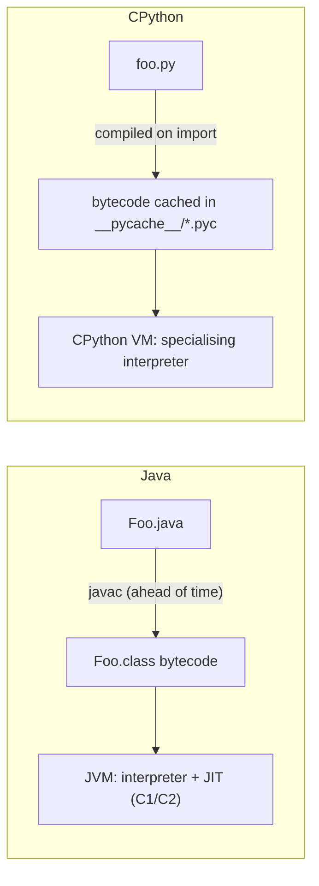
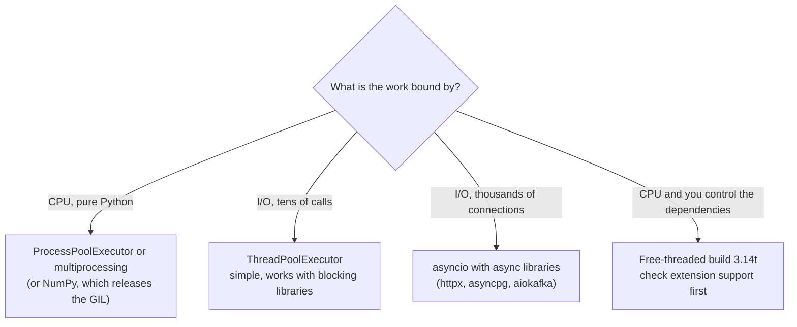

# Python Essentials for Java Developers

!!! abstract "Key takeaways"
    - **Variables are names bound to objects**, not typed boxes. Assignment never copies; it binds another name to the same object. Calls pass the object reference (like Java), so a function can mutate your list but can't rebind your name.
    - Python is **dynamically but strongly typed**: types live on objects, not names, and `"1" + 1` raises `TypeError`. Type hints are checked by tools (mypy, pyright), **not** at runtime.
    - The Java toolkit maps cleanly: `record` → `@dataclass(frozen=True, slots=True)`, `interface` → `typing.Protocol` (structural), getters/setters → `@property`, try-with-resources → `with`, `Stream` → generators and comprehensions.
    - **Pythonic style is EAFP** ("easier to ask forgiveness than permission"): try the operation and catch the exception. There are no checked exceptions.
    - **Concurrency**: standard CPython has a **GIL**, so threads help I/O-bound work only. CPU-bound work goes to **processes**; many concurrent I/O calls go to **asyncio**. The free-threaded build (3.13 experimental, 3.14 officially supported, still opt-in) removes the GIL.

## Why it matters

Python is on my resume next to Java, and it's the default language for data work, scripting, AI/LLM tooling and many take-home tasks. Interviewers for Lead roles rarely ask deep Python internals of a Java engineer, but they do notice **Java written in Python**: index loops, getters, null checks everywhere, a class where a function would do. They also ask the questions that expose a wrong mental model, mostly about mutability, references and the GIL.

This page is the conceptual bridge. For hands-on drills (scripts, pandas, FastAPI) see [Python fluency for FDE](../fde-practical-coding/06-python-fluency-for-fde-scripting-data-wrangling-fastapi-serv.md), which already has a Java-to-Python standard-library table. For the gotcha and output-prediction questions, see [Common Python interview questions](02-common-python-interview-questions.md).

## Core concepts

### How Python runs, compared with the JVM


*Notice that both compile to bytecode, but Python does it on import and type-checks nothing on the way. Errors that `javac` catches (a typo in a method name, a wrong argument type) surface in Python only when that line runs, or when you run mypy.*

CPython (the reference implementation) has had a *specialising adaptive interpreter* since 3.11, and 3.13 added an experimental JIT that is off by default. It is still much slower than the JVM for tight CPU loops, so heavy numeric work goes to C-backed libraries such as NumPy.

### Names, objects and mutability

Everything is an object, including `int`, functions and classes. A variable is a **name** in a namespace (a dict, conceptually) that points to an object. Assignment binds a name; it never copies.

```python
a = [1, 2]
b = a                    # b is a second name for the SAME list
b.append(3)
print(a, a is b)         # [1, 2, 3] True
a = a + [4]              # + builds a NEW list; a is rebound, b is not
print(a, b, a is b)      # [1, 2, 3, 4] [1, 2, 3] False
```

![Animation: names a and b both point to one list; appending through b changes what a sees; then a + [4] creates a new list and only a moves to it](images/01-names-and-objects.svg){ loading=lazy }
*Watch the arrows, not the boxes: mutation changes the object both names share, rebinding moves one arrow.*

This is the same as Java reference semantics for objects, with two differences that trip people up:

- **There are no primitives.** `int`, `str`, `tuple` and `frozenset` are immutable objects. `x += 1` on an `int` rebinds `x` to a new object; `xs += [1]` on a list mutates it in place.
- **Argument passing is "pass by object reference"** (Java's pass-by-value-of-the-reference). A function can mutate a list you passed, but assigning to its parameter only rebinds its local name.

Only hashable objects (in practice immutable ones: `int`, `str`, `tuple`, `frozenset`, frozen dataclasses) can be dict keys or set members, the same contract as Java's `equals`/`hashCode` (see [core Java OOP and equals/hashCode](../core-java/01-oop-principles-equals-hashcode-contract-immutability.md)).

### Dynamic but strong typing, and type hints

Types belong to objects, so a name can point to an `int` and later to a `str`. But Python won't coerce silently: `"1" + 1` raises `TypeError: can only concatenate str (not "int") to str`. JavaScript is the weakly typed one.

Type hints (`def total(xs: list[int]) -> int`) are **annotations**: the interpreter stores them and ignores them. A static checker (mypy, pyright) or a runtime validator (Pydantic, FastAPI) gives them teeth. Modern syntax to recognise:

| Feature | Syntax | Since |
|---|---|---|
| Union / optional | `int \| None` | 3.10 |
| Generic function / class | `def first[T](xs: list[T]) -> T`, `class Box[T]: ...` | 3.12 (PEP 695) |
| Forward references without quotes | annotations evaluated lazily | 3.14 (PEP 649) |

### Classes: dataclasses, properties and protocols

**Dataclasses replace records.** `@dataclass` generates `__init__`, `__repr__` and `__eq__`; `frozen=True` makes it immutable and hashable; `slots=True` drops the per-instance `__dict__` (less memory, typos raise instead of silently adding attributes).

```python
from dataclasses import dataclass, replace

@dataclass(frozen=True, slots=True)
class Money:
    amount: int
    currency: str = "INR"

    def __post_init__(self):                  # like a compact canonical constructor
        if self.amount < 0:
            raise ValueError("amount must be >= 0")

m = Money(500)
print(m)                                      # Money(amount=500, currency='INR')
print(m == Money(500), hash(m) == hash(Money(500)))  # True True
print(replace(m, amount=750))                 # a "wither": Money(amount=750, currency='INR')
```

**Properties replace getters and setters.** Start with a plain public attribute. If you later need validation, turn it into a `@property` (with a `@balance.setter`) and callers still write `acct.balance += 50`, so Python code doesn't write getters "just in case".

There is no `private`: `_name` is a convention, `__name` triggers name mangling (to avoid subclass clashes, not for security).

**Protocols replace interfaces, structurally.** A Java class must declare `implements Notifier`. In Python, any object with a matching `send` method satisfies a `Protocol`; mypy checks the shape. This is formalised duck typing ("if it quacks like a duck").

```python
from typing import Protocol

class Notifier(Protocol):
    def send(self, to: str, body: str) -> bool: ...

class SmsNotifier:                 # never mentions Notifier
    def send(self, to: str, body: str) -> bool:
        print(f"SMS to {to}: {body}")
        return True

def alert(n: Notifier) -> None:    # the checker verifies the shape, not the name
    n.send("+91-000", "refill ready")

alert(SmsNotifier())               # SMS to +91-000: refill ready
```

Use `abc.ABC` with `@abstractmethod` when you want nominal typing and a runtime error on missing methods, which is closer to a Java abstract class. Python also has multiple inheritance with a C3 method resolution order; the [questions page](02-common-python-interview-questions.md) covers `super()` and the MRO.

### Errors: EAFP, no checked exceptions

Java nudges you to check first (LBYL, "look before you leap"). Python prefers trying and catching (EAFP), partly because check-then-act can race (the file existed when you checked), and partly because exceptions are cheap in Python (since 3.11 a `try` block costs nothing when no exception is raised).

```python
def get_dose(cfg: dict[str, int], drug: str) -> int:
    try:
        return cfg[drug]                  # EAFP: just try it
    except KeyError:
        raise LookupError(f"no dose configured for {drug}") from None

print(get_dose({"amox": 500}, "amox"))   # 500
print({"amox": 500}.get("ibu", 0))       # 0: .get for an expected-missing key
```

There are no checked exceptions and no `throws` clauses. `raise X from e` chains causes (like `new RuntimeException(msg, e)`); `from None` hides the original.

### Iteration: generators and context managers

**Generators are Python's lazy streams.** A function with `yield` returns an iterator that runs until the next `yield`, then pauses. It's how you process a 50 GB file in constant memory.

**Context managers are try-with-resources.** `with` calls `__enter__` and guarantees `__exit__`. The `contextlib.contextmanager` decorator lets you write one as a generator.

```python
from collections.abc import Iterator
from contextlib import contextmanager
import time

def read_batches(rows: list[str], size: int) -> Iterator[list[str]]:
    batch: list[str] = []
    for row in rows:
        batch.append(row)
        if len(batch) == size:
            yield batch                  # pauses here until the caller asks for more
            batch = []
    if batch:
        yield batch

@contextmanager
def timed(label: str):
    start = time.perf_counter()
    try:
        yield                            # body of the with-block runs here
    finally:                             # runs even if the body raises
        print(f"{label}: {time.perf_counter() - start:.2f}s")

with timed("load"):
    for b in read_batches(["a", "b", "c", "d", "e"], 2):
        print(b)                         # ['a', 'b'] / ['c', 'd'] / ['e'], then "load: 0.00s"
```

### Concurrency: the GIL, threads, processes, asyncio

Standard CPython has a **Global Interpreter Lock**: only one thread executes Python bytecode at a time. Threads still help for **I/O-bound** work, because a thread releases the GIL while it waits on a socket or a file. They don't speed up **CPU-bound** pure-Python code. Measured on a 4-core machine with CPython 3.13 (GIL enabled), four calls to `sum(i * i for i in range(5_000_000))`:

| Executor | Time |
|---|---|
| `ThreadPoolExecutor(4)` | ~2.0 s (serialised by the GIL) |
| `ProcessPoolExecutor(4)` | ~0.6 s (four interpreters, four cores) |

{ loading=lazy }
*Under the GIL, only the waiting overlaps. That is why threads work for HTTP calls and not for number crunching.*


*Notice there is no single answer like Java's "use a thread pool, or virtual threads". The choice depends on what the work waits on.*

`asyncio` is a single-threaded event loop with cooperative `async`/`await` coroutines, much closer to Node.js (see the [event loop page](../javascript-typescript/02-event-loop-microtasks-vs-macrotasks.md)) than to Java threads. `TaskGroup` (3.11+) gives structured concurrency, the same idea as Java 21's `StructuredTaskScope` (see [virtual threads and structured concurrency](../java-concurrency-jvm/07-virtual-threads-and-structured-concurrency.md)):

```python
import asyncio
import time

async def fetch(name: str, delay: float) -> str:
    await asyncio.sleep(delay)            # stands in for an HTTP call; yields to the event loop
    return f"{name} ok"

async def main() -> None:
    start = time.perf_counter()
    async with asyncio.TaskGroup() as tg: # if one task fails, the others are cancelled
        tasks = [tg.create_task(fetch(n, 1.0)) for n in ("eligibility", "pricing", "pharmacy")]
    print([t.result() for t in tasks])    # ['eligibility ok', 'pricing ok', 'pharmacy ok']
    print(f"{time.perf_counter() - start:.1f}s")   # 1.0s, not 3.0s

asyncio.run(main())
```

The big difference from virtual threads: one blocking call (`time.sleep`, `requests.get`) inside a coroutine **freezes the whole loop**. Java's virtual threads unmount on blocking I/O; asyncio coroutines must explicitly `await`.

**Free-threaded Python.** PEP 703 added an optional build without the GIL in 3.13 (experimental). PEP 779 made it officially supported in 3.14, but it is still a separate, opt-in build (`python3.14t`). The docs put the single-threaded overhead at about 1–8% depending on platform, and importing a C extension that isn't marked free-threading-safe re-enables the GIL. For an interview: "know it exists, don't assume your dependencies are ready."

### Tooling in one table

| Need | Python | Java equivalent |
|---|---|---|
| Project file | `pyproject.toml` | `pom.xml` / `build.gradle` |
| Isolated dependencies | virtual environment (`python -m venv .venv`) | per-project classpath |
| Install / lock | `pip` + requirements, or **uv** (fast resolver, lockfile, Python versions) | Maven / Gradle |
| Tests | `pytest` (plain `assert`, fixtures) | JUnit 5 |
| Lint + format | Ruff (and/or Black) | Checkstyle, Spotless |
| Static types | mypy, pyright | `javac` |
| Style guide | PEP 8: `snake_case` functions, `PascalCase` classes, 4-space indent | Google/Oracle style |

## In practice: code & configuration

The same task, totalling paid orders per customer, with a Java accent and then idiomatic.

=== "❌ Common mistake"
    ```python
    class OrderService:
        def getPaidTotals(self, orders):            # camelCase, a class for no state
            totals = {}
            for i in range(len(orders)):            # index loop
                order = orders[i]
                if order["status"] != None and order["status"] == "PAID":  # != None, redundant check
                    if order["customer"] in totals:
                        totals[order["customer"]] = totals[order["customer"]] + order["amount"]
                    else:
                        totals[order["customer"]] = order["amount"]
            return totals                           # untyped dicts in, untyped dict out
    ```

=== "✅ Correct approach"
    ```python
    from collections import Counter
    from dataclasses import dataclass
    from typing import Literal

    @dataclass(frozen=True, slots=True)
    class Order:
        customer: str
        amount: int
        status: Literal["PAID", "PENDING", "FAILED"]

    def paid_totals(orders: list[Order]) -> Counter[str]:   # a function, not a service class
        totals: Counter[str] = Counter()
        for o in orders:                     # iterate values, not indexes
            if o.status == "PAID":
                totals[o.customer] += o.amount   # missing key starts at 0
        return totals

    orders = [Order("asha", 300, "PAID"), Order("ravi", 120, "FAILED"), Order("asha", 200, "PAID")]
    print(paid_totals(orders))               # Counter({'asha': 500})
    ```

Other habits to drop: `== None` (use `is None`), `if len(xs) > 0` (use `if xs`, empty containers are falsy), string concatenation in a loop (use `"".join(parts)`), and `for i in range(len(xs))` (use `enumerate(xs)` or `zip(a, b, strict=True)`).

## Real-world usage

- **Data and ML**: pandas, NumPy, PyTorch and nearly every LLM SDK and agent framework are Python-first. A Java shop's AI features often start as a Python service behind an API.
- **Glue and automation**: AWS Lambda functions, Terraform helpers, CI scripts, data migrations.
- **Web services**: FastAPI and Django. Instagram runs one of the largest Django deployments and has written about tuning CPython's garbage collector to save memory.
- **Failure modes**: a blocking call inside an async handler stalls every request; threads used for CPU work give no speed-up; runtime `TypeError`s slip past without a type checker. Regulated teams (healthcare, banking) typically run mypy in CI and validate boundaries with Pydantic.

## Trade-offs & production gotchas

| Option | Pros | Cons | Use when |
|---|---|---|---|
| Python | Fast to write, huge data/AI ecosystem, great for scripts | Slower CPU-bound code, GIL in the standard build, runtime type errors | Data, ML/LLM, automation, prototypes, I/O-bound APIs |
| Java 21 | JIT performance, real threads plus virtual threads, compile-time types | More ceremony, smaller data/AI ecosystem | Long-lived high-throughput services, large teams |

!!! warning "Gotcha"
    Type hints don't validate anything at runtime. `def f(x: int)` happily accepts `"abc"`. If data crosses a trust boundary (HTTP body, Kafka message, CSV), validate it with Pydantic or explicit checks.

!!! warning "Gotcha"
    `ProcessPoolExecutor` on macOS and Windows starts workers with *spawn*, which re-imports your module. Without an `if __name__ == "__main__":` guard, it tries to start the pool again and fails.

## How this connects to my experience

- **Where I used it:** Python is listed under Languages on my resume; no project bullet names it, so position it as a working second language, not a specialism. Specific Python use (scripts, AWS Lambda functions or data tooling around ConvergeHealth's AWS analytics work) is *[confirm]*.
- **Talking points:**
    - "I think in Java's object model, and Python's is close: references everywhere, so mutability is what I watch for."
    - "For an I/O-heavy integration layer like the GraphQL Consumer Service over 5 upstreams, Python would use asyncio with a TaskGroup, the same fan-out I'd do with CompletableFuture or structured concurrency in Java."
    - "I'd pick Python for data, automation and LLM tooling, and Java for the long-lived, high-throughput services."
- **Likely follow-up chain:** "Have you used Python in production?" → answer honestly from the *[confirm]* above → "What's the GIL?" → one lock on bytecode execution, threads for I/O, processes for CPU, free-threaded build in 3.14 → "How would you make a slow Python service faster?" → profile first (`cProfile`, py-spy), then async I/O, caching, moving hot loops to NumPy or a process pool.

## Interview questions

### Fundamentals

??? question "Q1. Is Python pass-by-value or pass-by-reference?"
    **Answer:** Neither, strictly: it passes object references by value ("call by sharing"), exactly like Java for objects. The function receives a reference to the same object, so it can mutate a mutable argument, but rebinding the parameter (`items = []`) only changes its local name.

    **Interviewer listens for:** Names bound to objects, mutation versus rebinding, a list example.

    **Common wrong answer:** "Ints are passed by value and lists by reference." Both are passed the same way; ints just can't be mutated.

??? question "Q2. Is Python statically or dynamically typed, and strongly or weakly?"
    **Answer:** Dynamically typed (types belong to objects and are checked at runtime) and strongly typed (no implicit coercion, `"1" + 1` raises `TypeError`). Type hints add optional static checking through mypy or pyright; the interpreter ignores them.

    **Interviewer listens for:** The two axes kept separate, hints not enforced at runtime.

    **Common wrong answer:** "Dynamic means weak." JavaScript is weak; Python is not.

??? question "Q3. What's the Python equivalent of a Java record and of an interface?"
    **Answer:** A record maps to `@dataclass(frozen=True, slots=True)` (generated init, repr, eq and hash, immutable). An interface maps to `typing.Protocol` for structural typing, checked by a type checker, or `abc.ABC` with `@abstractmethod` for nominal typing with a runtime error on instantiation if methods are missing.

    **Interviewer listens for:** Structural versus nominal typing, frozen for hashability.

    **Common wrong answer:** "Python has no interfaces, so you can't express contracts."

### Intermediate

??? question "Q4. What is EAFP, and why is it preferred over LBYL?"
    **Answer:** "Easier to ask forgiveness than permission": try the operation and catch the specific exception, instead of checking first. It avoids check-then-act races (the file existed when you checked), reads more directly, and is cheap in Python. Use `.get()` or `in` when absence is a normal case rather than an error.

    **Interviewer listens for:** Catching a specific exception, the race argument.

    **Common wrong answer:** Wrapping everything in a bare `except:`, which also swallows `KeyboardInterrupt` and `SystemExit`.

??? question "Q5. What does a generator give you over returning a list?"
    **Answer:** Laziness and constant memory: values are produced on demand, so you can stream a huge file, compose pipelines, or stop early. A generator is single-pass and holds suspended state. It's the counterpart of a Java `Stream` (lazy, single use).

    **Interviewer listens for:** `yield` pausing the function, single pass, memory.

    **Common wrong answer:** "Generators run in a separate thread."

### Senior

??? question "Q6. Explain the GIL and how you'd parallelise CPU-bound and I/O-bound work."
    **Answer:** In standard CPython the GIL lets one thread run bytecode at a time. Threads release it while blocked on I/O, so threads (or asyncio) suit I/O-bound work. CPU-bound pure-Python work needs processes (`ProcessPoolExecutor`) or C extensions such as NumPy that release the GIL. Python 3.13 added an experimental free-threaded build and 3.14 made it officially supported but opt-in, with some single-threaded overhead and extension compatibility to check.

    **Interviewer listens for:** I/O versus CPU split, processes, awareness of free-threading and its caveats.

    **Common wrong answer:** "Python can't do concurrency" or "the GIL makes my code thread-safe." Compound operations like `count += 1` can still interleave between threads.

??? question "Q7. How does asyncio differ from Java threads and virtual threads?"
    **Answer:** asyncio runs coroutines on one thread with cooperative scheduling: each task gives up control only at `await`. Virtual threads are preemptively scheduled by the JVM and unmount on blocking I/O automatically, so ordinary blocking code works. In asyncio, a blocking call such as `requests.get` or `time.sleep` stalls every task; you need async libraries or `asyncio.to_thread`. `TaskGroup` gives structured concurrency similar to `StructuredTaskScope`.

    **Interviewer listens for:** Cooperative versus preemptive, the blocking-call trap, function colouring (async spreads up the call stack).

    **Common wrong answer:** "async makes the code run in parallel on many cores."

### Scenario-based

??? question "Q8. A Python service that calls three upstream APIs per request is slow. What do you do?"
    **Answer:** Measure first: are the calls sequential? If so, fan them out concurrently, with asyncio `TaskGroup` (or `gather`) if the stack is async, or a `ThreadPoolExecutor` if it uses blocking clients. Add timeouts per call, reuse HTTP connections (one client session), and cache stable reference data. Latency drops from the sum of the calls to roughly the slowest one. If CPU shows up in the profile (JSON parsing, transforms), look at that separately.

    **Interviewer listens for:** Profiling first, concurrency matched to I/O, timeouts, connection reuse.

    **Common wrong answer:** "Add more threads" without checking what the time is spent on, or "rewrite it in Java."

??? question "Q9. You're reviewing Python from a Java team. What do you flag?"
    **Answer:** Index loops instead of `enumerate`/`zip`; `== None` instead of `is None`; getters/setters and single-method service classes instead of functions; mutable default arguments; bare `except:`; missing type hints and no mypy or Ruff in CI; dicts passed everywhere instead of dataclasses or Pydantic models at boundaries; blocking calls inside `async def`; and unpinned dependencies with no lockfile.

    **Interviewer listens for:** Idioms, correctness traps, and tooling as a team standard.

    **Common wrong answer:** Only style nits (naming), missing the correctness issues.

## Cheat sheet

| Concept | Remember |
|---|---|
| Variables | Names bound to objects; assignment never copies |
| Passing | Object reference by value, like Java objects |
| Typing | Dynamic and strong; hints are checked by mypy/pyright, not at runtime |
| Record | `@dataclass(frozen=True, slots=True)`, `replace()` as a wither |
| Interface | `Protocol` (structural) or `ABC` (nominal) |
| Getters | `@property` when needed; `_name` is convention |
| Errors | EAFP; no checked exceptions; `raise ... from e` |
| Lazy stream | Generator (`yield`), single pass |
| try-with-resources | `with` + context manager |
| GIL | Threads for I/O, processes for CPU, asyncio for many connections |
| Free-threaded | 3.13 experimental, 3.14 supported (opt-in `python3.14t`) |
| Tooling | `pyproject.toml`, venv or uv, pytest, Ruff, mypy |

## Sources
1. [Python Language Reference: Data model](https://docs.python.org/3/reference/datamodel.html): objects, identity, mutability, special methods.
2. [Python Programming FAQ](https://docs.python.org/3/faq/programming.html): argument passing, shared references.
3. [dataclasses documentation](https://docs.python.org/3/library/dataclasses.html): `frozen`, `slots`, `replace`, `__post_init__`.
4. [PEP 544: Protocols, structural subtyping](https://peps.python.org/pep-0544/): Protocol semantics.
5. [PEP 695: Type parameter syntax](https://peps.python.org/pep-0695/): `def f[T]`, `type` aliases.
6. [What's new in Python 3.14](https://docs.python.org/3/whatsnew/3.14.html): deferred annotations (PEP 649), free-threading support status.
7. [Python support for free threading (HOWTO)](https://docs.python.org/3/howto/free-threading-python.html): free-threaded build, GIL re-enabling, 1–8% overhead.
8. [PEP 779: Criteria for supported status for free-threaded Python](https://peps.python.org/pep-0779/): supported status from 3.14.
9. [asyncio: Coroutines and tasks](https://docs.python.org/3/library/asyncio-task.html): `TaskGroup`, `gather`, `to_thread`.
10. [Glossary: EAFP, LBYL, GIL](https://docs.python.org/3/glossary.html): definitions.
11. [Writing your pyproject.toml](https://packaging.python.org/en/latest/guides/writing-pyproject-toml/) and [uv documentation](https://docs.astral.sh/uv/): project and dependency tooling.
12. [PEP 8: Style guide](https://peps.python.org/pep-0008/): naming and idioms.
13. [Dismissing Python garbage collection at Instagram](https://instagram-engineering.com/dismissing-python-garbage-collection-at-instagram-4dca40b29172): GC tuning in a large Django deployment.
14. Luciano Ramalho, *Fluent Python*, 2nd ed. (O'Reilly, 2022): data model, generators, concurrency models.
