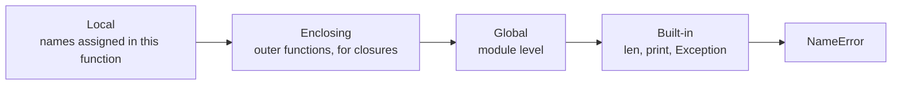
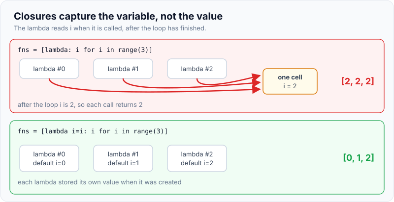
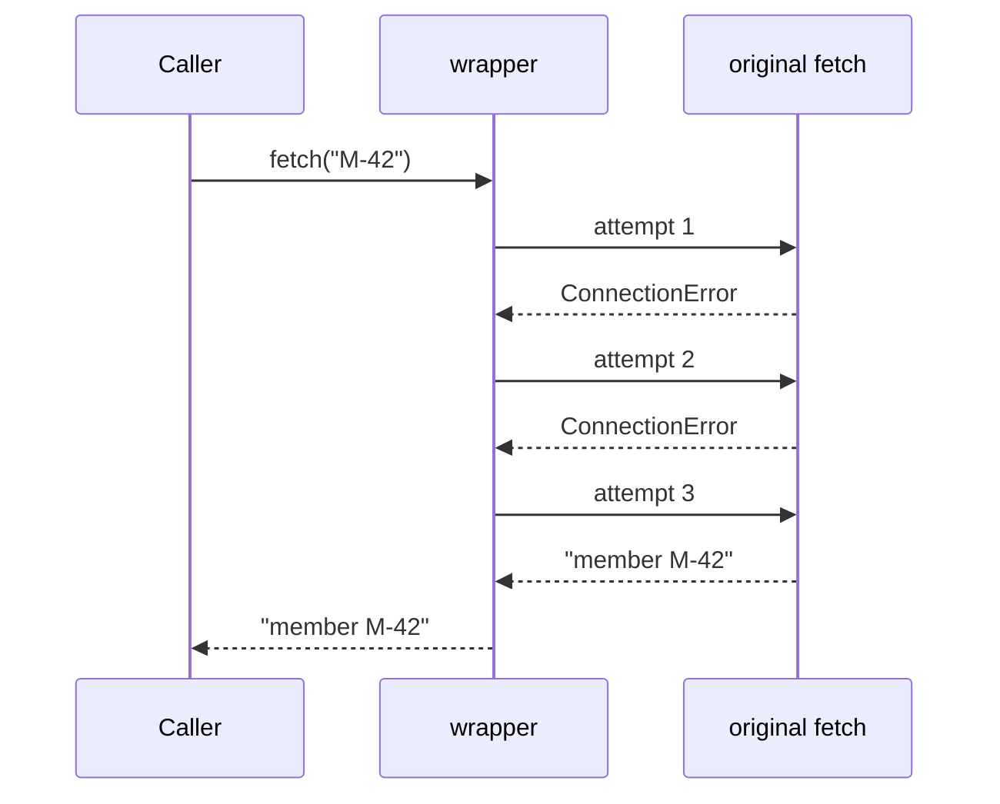
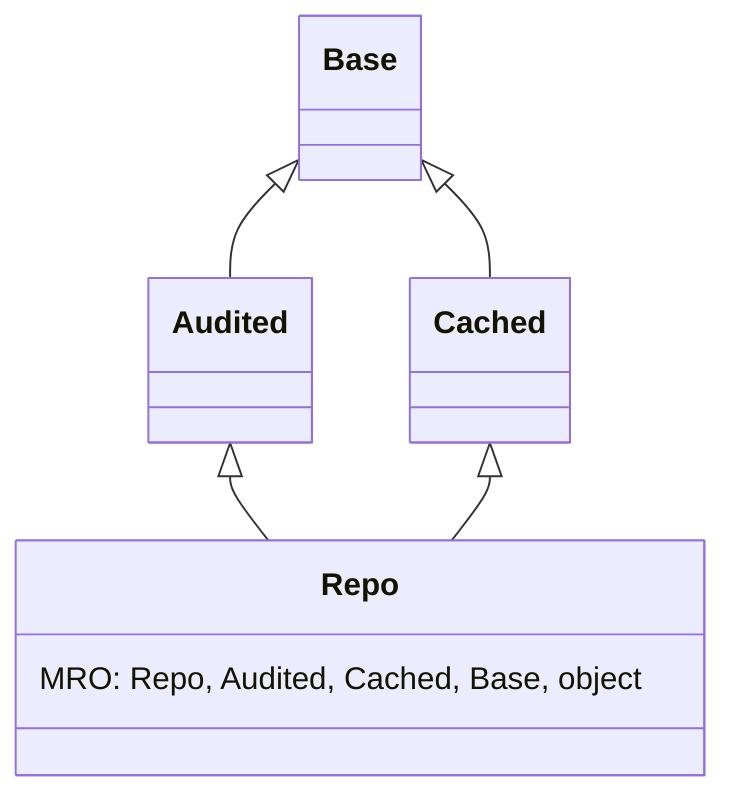

# Common Python Interview Questions

!!! abstract "Key takeaways"
    - Most Python "gotcha" questions come from one fact: **names point to shared objects**. Mutable default arguments, `[[0] * 3] * 3` and shallow copies are all the same bug: two places holding one mutable object.
    - **Defaults are evaluated once, at `def` time**; closures look up variables **when called**, not when created. Fix them with `None` sentinels and default-argument binding (`lambda i=i: i`).
    - `==` compares values (`__eq__`); `is` compares identity. Use `is` only for `None` and other singletons. Small-int caching (−5 to 256) is a CPython detail, never a contract.
    - Assigning to a name anywhere in a function makes it **local for the whole function** (`UnboundLocalError`). `global` and `nonlocal` change that.
    - Know the mechanics behind the syntax: decorators are `f = deco(f)` (always use `functools.wraps`), generators are single-pass, `super()` follows the **C3 MRO**, and defining `__eq__` without `__hash__` makes a class unhashable.

## Why it matters

A Python round for a Java engineer usually has two parts: a coding task, and a short burst of "what does this print?" questions. The second part is cheap for the interviewer and revealing: a wrong answer shows that the candidate's mental model is Java's, not Python's. The questions are remarkably consistent across companies, and the [official Programming FAQ](https://docs.python.org/3/faq/programming.html) answers half of them.

This page assumes the model from [Python essentials for Java developers](01-python-essentials-for-java-developers.md) (names, objects, the GIL). Standard-library drills for timed coding rounds live in [Python fluency for FDE](../fde-practical-coding/06-python-fluency-for-fde-scripting-data-wrangling-fastapi-serv.md); algorithm patterns live in the [DSA topic](../dsa/index.md).

## Core concepts

### Shared mutable objects: three faces of one bug

**Mutable default arguments.** A `def` statement evaluates default values once and stores them on the function object. Every call that omits the argument gets the *same* list.

```python
def add_tag(tag, tags=[]):          # default evaluated ONCE, at def time
    tags.append(tag)
    return tags

print(add_tag("a"))                 # ['a']
print(add_tag("b"))                 # ['a', 'b']  <- same list as the first call
print(add_tag.__defaults__)         # (['a', 'b'],)
```

{ loading=lazy }
*The default list lives on the function, not in the call, so it outlives every call.*

**List multiplication.** `[[0] * 3] * 3` copies the *reference* to one inner list three times.

```python
import copy
grid = [[0] * 3] * 3                 # three references to ONE inner list
grid[0][0] = 1
print(grid)                          # [[1, 0, 0], [1, 0, 0], [1, 0, 0]]
grid = [[0] * 3 for _ in range(3)]   # three separate lists
grid[0][0] = 1
print(grid)                          # [[1, 0, 0], [0, 0, 0], [0, 0, 0]]

orig = {"ids": [1, 2]}
shallow = copy.copy(orig)            # new dict, SAME inner list
deep = copy.deepcopy(orig)           # new dict, new list, recursively
orig["ids"].append(3)
print(shallow["ids"], deep["ids"])   # [1, 2, 3] [1, 2]
```

**Shallow copies.** `list(x)`, `x[:]`, `dict(x)`, `x.copy()` and `copy.copy` all copy the outer container only. That's the same as `new ArrayList<>(list)` in Java.

### Identity versus equality

```python
a = [1, 2]; b = [1, 2]
print(a == b, a is b)                # True False
x = 256; y = int("256")
print(x is y)                        # True: CPython caches -5..256
x = 1000; y = int("1000")
print(x is y)                        # False: implementation detail, never rely on it
```

It's Java's `Integer` cache (−128 to 127) in another form. The rule is the same in both languages: compare values with `==` (`equals`) and reserve `is` for `None`, `True`/`False` and sentinel objects.

### Scope: LEGB, UnboundLocalError and late binding

Python resolves a name by searching four scopes in order.


*Notice the decision is made at compile time: if a function assigns a name anywhere, that name is local throughout the function, even on lines before the assignment.*

```python
count = 0
def bump():
    count += 1                       # UnboundLocalError: the assignment makes count local

def counter():
    n = 0
    def inc():
        nonlocal n                   # rebind the enclosing function's n
        n += 1
        return n
    return inc
c = counter(); c(); print(c())       # 2
```

**Late-binding closures.** A closure captures the *variable*, not its value at creation time, and reads it when called. After the loop, `i` is 2, so every lambda returns 2.

```python
fns = [lambda: i for i in range(3)]
print([f() for f in fns])            # [2, 2, 2]

fns = [lambda i=i: i for i in range(3)]   # bind the value now, as a default
print([f() for f in fns])            # [0, 1, 2]
```

{ loading=lazy }
*Java avoids this by requiring captured locals to be effectively final; Python lets the variable change underneath the closure.*

### Functions: parameters and decorators

```python
def query(table, /, *cols, limit=10, **filters):
    return table, cols, limit, filters

print(query("claims", "id", "status", limit=5, region="west"))
# ('claims', ('id', 'status'), 5, {'region': 'west'})
```

Parameters before `/` are positional-only, `*cols` collects extra positionals into a tuple, anything after it (`limit`) is keyword-only, and `**filters` collects extra keywords into a dict.

**Decorators** are functions that take a function and return a replacement. `@retry(times=3)` above `def fetch` means `fetch = retry(times=3)(fetch)`. It's the hand-written version of what a Spring AOP proxy does for `@Retryable` or `@Transactional`.


*Notice the caller holds `wrapper`, not the original function. That's why `functools.wraps` matters: without it, logs, tracing and stack traces show `wrapper` instead of `fetch`.*

### Generators, iterables and iterators

An **iterable** can produce an iterator (`list`, `dict`, a file); an **iterator** has `__next__` and is consumed as it goes. Generators are iterators, so they're single-pass:

```python
squares = (n * n for n in range(4))   # generator: lazy, single pass
print(sum(squares))                   # 14
print(sum(squares))                   # 0: already exhausted
```

### Classes: MRO, super() and hashing

Python allows multiple inheritance and linearises the class graph with the **C3 algorithm** into the method resolution order (MRO). `super()` means "the next class in the MRO of the *instance's* class", not "my parent".


*Notice that `Audited.save()` calling `super().save()` reaches `Cached`, a sibling it has never heard of, when the instance is a `Repo`. That's how cooperative mixins chain.*

```python
class Base:
    def save(self): return ["Base"]
class Audited(Base):
    def save(self): return ["Audited"] + super().save()
class Cached(Base):
    def save(self): return ["Cached"] + super().save()
class Repo(Audited, Cached):
    def save(self): return ["Repo"] + super().save()

print([c.__name__ for c in Repo.__mro__])  # ['Repo', 'Audited', 'Cached', 'Base', 'object']
print(Repo().save())                       # ['Repo', 'Audited', 'Cached', 'Base']
```

Hashing follows Java's `equals`/`hashCode` contract, enforced harder: if a class defines `__eq__` but not `__hash__`, Python sets `__hash__` to `None` and instances can't go in sets or be dict keys (`TypeError: unhashable type`). A frozen dataclass generates both.

### Built-in complexity to quote

| Operation | Average cost | Note |
|---|---|---|
| `list.append`, `list.pop()`, index | O(1) | dynamic array, like `ArrayList` |
| `list.insert(0, x)`, `list.pop(0)`, `x in list` | O(n) | use `collections.deque` for a queue |
| `dict` / `set` get, set, `in` | O(1) | hash table; dicts keep insertion order (guaranteed since 3.7) |
| `sorted`, `list.sort` | O(n log n) | Timsort, **stable** |
| `s1 + s2` in a loop | O(n²) total | strings are immutable; use `"".join(parts)` |

## In practice: code & configuration

The decorator most interviewers ask you to write is a retry or a timer. The mistake is losing the wrapped function's identity.

=== "❌ Common mistake"
    ```python
    def retry(func, times=3):                # can't take arguments with @retry(times=5)
        def wrapper(*args, **kwargs):
            for _ in range(times):
                try:
                    return func(*args, **kwargs)
                except Exception:            # retries bugs too, and swallows the last error
                    pass
        return wrapper                       # fetch.__name__ is now "wrapper"
    ```

=== "✅ Correct approach"
    ```python
    import functools
    import time

    def retry(times: int = 3, delay: float = 0.0):
        def decorator(func):
            @functools.wraps(func)                   # keep __name__, __doc__ for logs and tracing
            def wrapper(*args, **kwargs):
                for attempt in range(1, times + 1):
                    try:
                        return func(*args, **kwargs)
                    except ConnectionError:          # only transient errors
                        if attempt == times:
                            raise                    # surface the final failure
                        print(f"{func.__name__}: attempt {attempt} failed")
                        time.sleep(delay)
            return wrapper
        return decorator

    calls = 0
    @retry(times=3)                                  # same as: fetch = retry(times=3)(fetch)
    def fetch(member_id: str) -> str:
        global calls
        calls += 1
        if calls < 3:
            raise ConnectionError("upstream reset")
        return f"member {member_id}"

    print(fetch("M-42"))      # two "attempt n failed" lines, then: member M-42
    print(fetch.__name__)     # fetch
    ```

In production, prefer a library (tenacity) with exponential backoff and jitter, the same reasoning as Resilience4j in Java.

## Real-world usage

- **Mutable defaults in request handlers** are a classic production leak: a `def handle(req, cache={})` quietly shares state across every request in a long-running worker. Linters flag it (Ruff rule `B006`, from flake8-bugbear).
- **Late binding** bites callback and task registration: `for name in queues: register(lambda: consume(name))` makes every callback consume the last queue.
- **Decorators** are the extension mechanism of the main frameworks: FastAPI and Flask routes (`@app.get`), pytest fixtures, `functools.cache`, Celery tasks.
- **Shallow copies** cause cross-request data bleed when a "copied" config or template dict is modified in place.

## Trade-offs & production gotchas

| Need | Choose | Avoid | Why |
|---|---|---|---|
| Fresh default per call | `None` sentinel, or `field(default_factory=list)` in a dataclass | `def f(x=[])` | Default is evaluated once |
| Independent nested copy | `copy.deepcopy` or rebuild explicitly | `x.copy()`, `x[:]` | Those are shallow |
| Capture loop value in a callback | `lambda v=v: ...` or `functools.partial(f, v)` | Bare closure over the loop variable | Late binding |
| Queue / sliding window | `collections.deque` | `list.pop(0)` | O(n) shift |
| Building a string | `"".join(parts)` | `s += part` in a loop | Quadratic copying |

!!! warning "Gotcha"
    `t = ([1], 2); t[0] += [3]` raises `TypeError: 'tuple' object does not support item assignment` **and** leaves `t` as `([1, 3], 2)`. `+=` first mutates the list in place, then tries to store it back into the tuple. It's in the official FAQ and a favourite trick question.

## How this connects to my experience

- **Where I used it:** not used directly in a resume project; Python is listed under Languages. Position this as a solid second language: the traps here map onto Java concepts I use daily (reference semantics, `equals`/`hashCode`, effectively-final captures, AOP proxies).
- **Talking points:**
    - "Mutable defaults and shallow copies are the Python version of sharing a mutable collection between threads or requests in Java: I treat shared mutable state as the bug class, not the syntax."
    - "A decorator is a hand-rolled proxy, the same idea as Spring AOP behind `@Transactional`, so I know to preserve identity and to be careful about what exceptions it swallows."
    - "As a reviewer and interviewer (I've conducted technical interviews), these are the questions I'd use to tell memorised Python from understood Python."
- **Likely follow-up chain:** "Why is `[]` a bad default?" → evaluated once at `def` → "How does a dataclass handle it?" → `field(default_factory=list)`; a mutable plain default raises `ValueError` → "Where else does this bite?" → shared caches in long-running workers, shallow-copied config.

## Interview questions

### Fundamentals

??? question "Q1. What does `def add(x, items=[])` do wrong, and how do you fix it?"
    **Answer:** The default list is created once when `def` runs and stored in `add.__defaults__`, so every call that omits `items` appends to the same list. Use `items=None` and create a new list inside the function (`if items is None: items = []`). In a dataclass, use `field(default_factory=list)`.

    **Interviewer listens for:** "Evaluated at definition time", the `None` sentinel, `is None` rather than `== None` or a falsy check.

    **Common wrong answer:** `items = items or []`, which also replaces a caller's intentionally empty list with a new one.

??? question "Q2. What's the difference between `is` and `==`? Predict `int('1000') is 1000`."
    **Answer:** `==` calls `__eq__` and compares values; `is` compares object identity. `int('1000') is 1000` is `False` in CPython because only −5 to 256 are cached, but that's an implementation detail, so the honest answer is "don't rely on either result". Use `is` only for `None` and singletons.

    **Interviewer listens for:** Identity versus equality, small-int caching labelled as an implementation detail.

    **Common wrong answer:** "`is` is the faster `==`."

??? question "Q3. What's the difference between a list and a tuple, beyond mutability?"
    **Answer:** Tuples are immutable and therefore hashable (if their elements are), so they work as dict keys and set members; they're the idiomatic type for fixed-shape records and multiple return values. Lists are for homogeneous, growing sequences. A tuple holding a list is still mutable inside, so it isn't hashable.

    **Interviewer listens for:** Hashability, intent (record versus collection), the "immutable container of mutable object" caveat.

    **Common wrong answer:** "Tuples are just faster lists."

### Intermediate

??? question "Q4. What does `[lambda: i for i in range(3)]` return when each lambda is called, and why?"
    **Answer:** `[2, 2, 2]`. Closures capture the variable, not its value, and look it up at call time, when the loop has finished. Fix it with a default argument (`lambda i=i: i`) or `functools.partial`. Java sidesteps this by allowing capture of effectively final variables only.

    **Interviewer listens for:** Late binding, a working fix, the Java contrast.

    **Common wrong answer:** `[0, 1, 2]`.

??? question "Q5. Why does this raise `UnboundLocalError`: `count = 0; def bump(): count += 1`?"
    **Answer:** The compiler sees an assignment to `count` inside `bump`, so `count` is local for the whole function. `count += 1` reads the local before it has a value. Declare `global count` (or `nonlocal` for an enclosing function's variable), or better, avoid the shared mutable global.

    **Interviewer listens for:** Scope decided at compile time, LEGB, `global`/`nonlocal`.

    **Common wrong answer:** "Python can't read global variables inside functions." It can; it can't rebind them without a declaration.

??? question "Q6. Write a decorator that times a function. What must it preserve?"
    **Answer:** An outer function takes `func` and returns a `wrapper(*args, **kwargs)` that records `time.perf_counter()`, calls `func`, logs the elapsed time in a `finally`, and returns the result. Decorate `wrapper` with `@functools.wraps(func)` to keep `__name__`, `__doc__` and `__wrapped__`. For arguments (`@timed(unit="ms")`) add one more level of nesting.

    **Interviewer listens for:** `*args, **kwargs`, returning the result, `wraps`, the extra level for parameters.

    **Common wrong answer:** Forgetting to return `func`'s result, so the decorated function returns `None`.

??? question "Q7. What's the difference between `@staticmethod` and `@classmethod`?"
    **Answer:** A `classmethod` receives the class as `cls`, so it's used for alternative constructors (`Claim.from_csv(line)`) that also work for subclasses. A `staticmethod` receives nothing implicit; it's a plain function namespaced in the class, like a Java static utility method. Instance methods receive `self`.

    **Interviewer listens for:** `cls` and subclass-friendly factories.

    **Common wrong answer:** "They're the same, like Java `static`."

### Senior

??? question "Q8. Explain the MRO and what `super()` actually calls."
    **Answer:** Python linearises the inheritance graph with C3 into `Class.__mro__`, which keeps each class before its parents and respects the order of bases. `super()` returns a proxy for the next class after the current one in the MRO of the instance's type, so in a diamond, `super()` inside `Audited.save` can call `Cached.save`. That enables cooperative multiple inheritance, provided every class calls `super()` and accepts `**kwargs`.

    **Interviewer listens for:** C3, "next in the MRO, not the parent", cooperative design.

    **Common wrong answer:** "`super()` calls the parent class."

??? question "Q9. You define `__eq__` on a class and now instances can't go in a set. Why, and what's the right fix?"
    **Answer:** Defining `__eq__` without `__hash__` sets `__hash__` to `None`, because the default identity hash would break the rule that equal objects have equal hashes. Implement `__hash__` over the same immutable fields used in `__eq__`, or use `@dataclass(frozen=True)`, which generates both. Never hash mutable fields: changing them after insertion loses the object in the set.

    **Interviewer listens for:** The equals/hashCode contract, immutability of hashed fields.

    **Common wrong answer:** `def __hash__(self): return id(self)`, which breaks equality-based lookup.

### Scenario-based

??? question "Q10. A Python worker serving requests slowly accumulates memory and leaks data between users. Where do you look first?"
    **Answer:** Shared mutable state that outlives a request: mutable default arguments used as caches, module-level dicts and lists, class attributes mutated through instances, and shallow-copied templates modified in place. Confirm with `tracemalloc` snapshots compared over time, fix by creating per-request objects (sentinel defaults, `deepcopy` or rebuilding), and bound any intentional cache (`functools.lru_cache(maxsize=...)` or Redis with a TTL). Add Ruff's bugbear rules to CI to catch the default-argument case.

    **Interviewer listens for:** Linking the leak and the data bleed to one cause, measurement before fixing, a bounded cache.

    **Common wrong answer:** "Python has a garbage collector, so it can't leak." Reachable objects are never collected.

## Cheat sheet

| Concept | Remember |
|---|---|
| Mutable default | Evaluated once at `def`; use `None` or `default_factory` |
| `[[0]*3]*3` | Three references to one list; use a comprehension |
| Copies | `copy`, `[:]`, `.copy()` are shallow; `deepcopy` recurses |
| `is` vs `==` | Identity vs value; `is` only for `None` and singletons |
| Small ints | −5..256 cached in CPython (detail, not contract) |
| Scope | LEGB; assignment makes a name local; `global`, `nonlocal` |
| Closures | Late binding; `lambda i=i: i` |
| Parameters | `f(a, /, b, *args, c, **kwargs)`: positional-only, normal, varargs, keyword-only, kwargs |
| Decorator | `f = deco(f)`; always `functools.wraps` |
| Generator | Lazy, single pass; second iteration yields nothing |
| `super()` | Next class in the instance's MRO (C3) |
| `__eq__` only | Class becomes unhashable |
| Complexity | dict/set O(1); `list.pop(0)` O(n); sort is stable Timsort |

## Sources
1. [Python Programming FAQ](https://docs.python.org/3/faq/programming.html): mutable defaults, late-binding lambdas, UnboundLocalError, the tuple `+=` puzzle, shared list references.
2. [Execution model: naming and binding](https://docs.python.org/3/reference/executionmodel.html): scope rules, `global`, `nonlocal`.
3. [Function definitions](https://docs.python.org/3/reference/compound_stmts.html#function-definitions): defaults evaluated once, `/` and `*` parameters, decorators.
4. [copy: shallow and deep copy operations](https://docs.python.org/3/library/copy.html): copy semantics.
5. [Integer objects (C API)](https://docs.python.org/3/c-api/long.html): the cached range −5 to 256.
6. [functools.wraps](https://docs.python.org/3/library/functools.html#functools.wraps): preserving metadata.
7. [The Python 2.3 method resolution order](https://docs.python.org/3/howto/mro.html): C3 linearisation.
8. [Data model: `__hash__`](https://docs.python.org/3/reference/datamodel.html#object.__hash__): `__eq__` without `__hash__` sets it to `None`.
9. [Python wiki: TimeComplexity](https://wiki.python.org/moin/TimeComplexity): built-in operation costs.
10. [Ruff rule B006: mutable-argument-default](https://docs.astral.sh/ruff/rules/mutable-argument-default/): linting the default-argument trap.
11. Luciano Ramalho, *Fluent Python*, 2nd ed. (O'Reilly, 2022): closures, decorators, MRO, data model.
