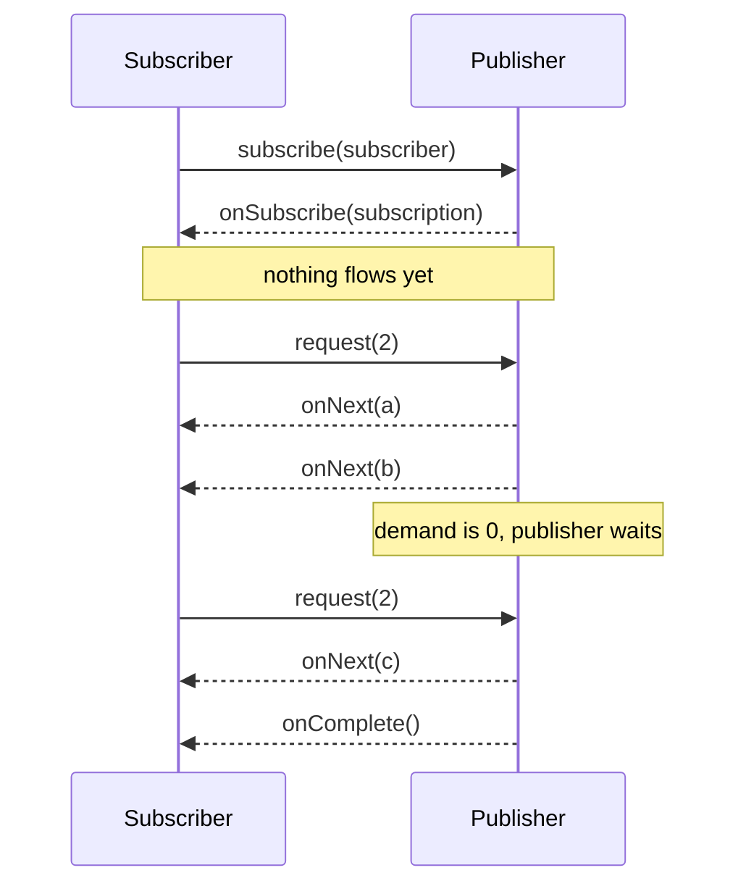

# Reactive Streams & Project Reactor (Mono/Flux)

!!! abstract "Key takeaways"
    - **Reactive Streams** is a tiny contract of four interfaces: `Publisher`, `Subscriber`, `Subscription`, `Processor`. Its point is **asynchronous streams with non-blocking backpressure**: the subscriber says how much it wants with `request(n)`. Java 9 copied it as `java.util.concurrent.Flow`.
    - **Reactor** is Spring's implementation. `Mono<T>` emits **0 or 1** item, `Flux<T>` emits **0..N**. Both end with exactly one terminal signal: `onComplete` or `onError`.
    - **Nothing happens until you subscribe.** Building the chain (assembly) does no work. In WebFlux the framework subscribes for you, so you return the publisher and never call `subscribe()` or `block()` yourself.
    - **Operators decide concurrency.** `map` is synchronous, `flatMap` runs inner publishers concurrently (unordered), `concatMap` one at a time (ordered), `switchMap` cancels the previous one.
    - **Threads are explicit.** Reactor runs on whatever thread emits. `publishOn` switches threads for operators **below** it. `subscribeOn` changes where the **source** runs, wherever you put it. Blocking calls go to `Schedulers.boundedElastic()`, never on an event loop.

## Why it matters

A thread-per-request server parks a thread while it waits for a database or an HTTP call. With platform threads that is expensive (see [executors and thread pools](../java-concurrency-jvm/04-executors-and-thread-pools.md)), so around 2013 engineers from Netflix, Pivotal, Lightbend and others defined **Reactive Streams**: a standard way for asynchronous libraries to pass data to each other **without blocking and without unbounded buffering**. RxJava 2, Akka Streams, Reactor and the MongoDB, R2DBC and Kafka reactive drivers all implement it, so they can be plugged together.

Spring adopted **Project Reactor** for Spring WebFlux (Spring 5, 2017). Since Java 21, [virtual threads](../java-concurrency-jvm/07-virtual-threads-and-structured-concurrency.md) solve the "parked thread is expensive" problem for blocking code, so the question in interviews has shifted from "how do I use Mono" to "do you understand the model well enough to know when it is worth it" (see [page 3](03-webflux-vs-mvc-vs-virtual-threads-when-to-choose.md)). You still need the basics: Spring Cloud Gateway, `WebClient`, Spring for GraphQL subscriptions and many SDKs expose `Mono` and `Flux`.

## Core concepts

### The four interfaces

| Interface | Methods | Role |
|---|---|---|
| `Publisher<T>` | `subscribe(Subscriber)` | Source of items. Can be subscribed many times. |
| `Subscriber<T>` | `onSubscribe(Subscription)`, `onNext(T)`, `onError(Throwable)`, `onComplete()` | Receives signals. |
| `Subscription` | `request(long n)`, `cancel()` | The link between one publisher and one subscriber. Carries **demand** upstream. |
| `Processor<T,R>` | both | A stage that is both subscriber and publisher. Rarely implemented by hand. |

The specification adds rules that make the contract safe. The ones interviewers quote:

- Signals follow the grammar `onSubscribe onNext* (onError | onComplete)?`. At most one terminal signal, and nothing after it.
- A publisher may never send more `onNext` calls than the total requested. That is backpressure (see [page 2](02-backpressure.md)).
- Signals to one subscriber are **serial**, never concurrent, so a subscriber needs no locking.
- `request(n)` with `n <= 0` must result in `onError(IllegalArgumentException)`. `null` items are forbidden.


*Notice that items only move after `request(n)`, and the publisher stops at zero demand. A terminal signal can arrive before the demand is used up.*

{ loading=lazy }
*Watch the demand counter: the publisher only emits while it is above zero.*

### Mono and Flux

Reactor adds two concrete publishers with hundreds of operators:

- `Mono<T>`: 0 or 1 item, for "one result or nothing", like a lazy `CompletableFuture`. `Mono<Void>` signals only completion.
- `Flux<T>`: 0..N items, possibly infinite (events, ticks, a streamed query result).

Three phases matter:

1. **Assembly.** `Flux.range(1, 5).map(...).filter(...)` builds a chain of objects. No data moves.
2. **Subscription.** `subscribe()` travels **upstream** to the source, then `onSubscribe` and `request(n)` flow back.
3. **Execution.** Items flow **downstream** through each operator.

Because of this, a publisher is a **recipe**, not a running task. A **cold** publisher (most: `WebClient` calls, `Flux.range`, R2DBC queries) repeats its work for every subscriber: subscribe twice to a `WebClient` `Mono` and you make two HTTP calls. A **hot** publisher (`Sinks.many().multicast()`, `share()`, a stream of UI events) emits whether or not anyone is listening, and late subscribers miss earlier items. `cache()` and `replay()` turn cold into hot-with-memory.

### The operators that matter

| Need | Operator | Behaviour |
|---|---|---|
| Transform each item synchronously | `map` | 1 to 1, same thread, no I/O |
| Call something async per item | `flatMap` | Subscribes to inner publishers **concurrently** (default concurrency 256), results **interleaved** |
| Same, keep order | `concatMap` | One inner at a time, ordered, slower |
| Concurrent but ordered output | `flatMapSequential` | Runs concurrently, buffers to restore order |
| Latest wins (search box) | `switchMap` | Cancels the previous inner when a new item arrives |
| Combine independent calls | `Mono.zip`, `Flux.zip` | Waits for all, fails fast on the first error |
| Side effect for logging/metrics | `doOnNext`, `doOnError` | Does not change the stream |
| Errors | `onErrorResume`, `onErrorMap`, `retryWhen(Retry.backoff(...))`, `timeout` | Error is a terminal signal; these replace or re-subscribe |
| Bridge a blocking call | `Mono.fromCallable(...).subscribeOn(boundedElastic())` | Moves the blocking work off the event loop |

An error is a **terminal signal**, not an exception that jumps up the stack. Once `onError` fires, the sequence is over. `retry` works by **re-subscribing**, which for a cold `WebClient` publisher means a new HTTP call.

### Threads and schedulers

Reactor is concurrency-agnostic: an operator runs on the thread that delivered the signal. In WebFlux that is usually a Reactor Netty event-loop thread (`reactor-http-nio-N`). Two operators change that:

- **`publishOn(scheduler)`** affects everything **after** it in the chain. You can use it several times.
- **`subscribeOn(scheduler)`** affects where the **subscription and the source** run, wherever it appears. If there are several, the one closest to the source wins.

| Scheduler | Threads | Use for |
|---|---|---|
| `Schedulers.parallel()` | One per CPU core | CPU-bound work |
| `Schedulers.boundedElastic()` | Up to 10 × cores, up to 100,000 queued tasks per thread | Wrapping **blocking** legacy calls |
| `Schedulers.single()` | 1 | Low-volume sequential work |
| `Schedulers.immediate()` | Caller's thread | Tests, default behaviour |

{ loading=lazy }
*`publishOn` splits the chain at its position; `subscribeOn` moves the source no matter where it is written.*

### Context instead of ThreadLocal

A reactive request hops threads, so `ThreadLocal` (MDC, security context, transactions) does not follow it. Reactor carries request data in the **`Context`**, written with `contextWrite` and read with `Mono.deferContextual`. Spring Security's `ReactiveSecurityContextHolder` and reactive transactions use it. For logging and tracing, Reactor 3.5.3+ can copy `ThreadLocal` values automatically through Micrometer's context-propagation library (`Hooks.enableAutomaticContextPropagation()`, or `spring.reactor.context-propagation=auto` from Boot 3.2).

## In practice: code & configuration

=== "❌ Common mistake"
    ```java
    @GetMapping("/members/{id}/summary")
    public Mono<Summary> summary(@PathVariable String id) {
        // 1. Subscribing inside the handler: a fire-and-forget call nobody waits for,
        //    errors are lost and it is not cancelled when the client disconnects.
        auditClient.record(id).subscribe();

        Member member = memberClient.get(id).block();   // 2. block() on the event loop: throws IllegalStateException in WebFlux
        List<Claim> claims = claimRepository.findByMember(id); // 3. blocking JDBC call on the event loop

        return Mono.just(new Summary(member, claims));  // 4. Mono.just evaluates eagerly: work already done at assembly
    }
    ```

=== "✅ Correct approach"
    ```java
    @GetMapping("/members/{id}/summary")
    public Mono<Summary> summary(@PathVariable String id) {
        Mono<Member> member = memberClient.get(id)              // WebClient: non-blocking, cold
            .timeout(Duration.ofSeconds(2));

        Mono<List<Claim>> claims = Mono
            .fromCallable(() -> claimRepository.findByMember(id))  // lazy: runs only on subscribe
            .subscribeOn(Schedulers.boundedElastic());             // blocking JDBC off the event loop

        return Mono.zip(member, claims)                         // both run concurrently
            .map(t -> new Summary(t.getT1(), t.getT2()))
            .flatMap(s -> auditClient.record(id).thenReturn(s)) // side effect is part of the chain
            .onErrorMap(TimeoutException.class,
                        e -> new UpstreamUnavailableException("member", e));
        // No subscribe(), no block(): WebFlux subscribes and writes the response.
    }
    ```

Concurrency-limited fan-out with ordered results, plus a test with `StepVerifier`:

```java
Flux<Price> prices(List<String> skus) {
    return Flux.fromIterable(skus)
        .flatMapSequential(sku -> pricingClient.price(sku)   // concurrent, output in input order
                .retryWhen(Retry.backoff(2, Duration.ofMillis(100))) // re-subscribes = new HTTP call
                .onErrorResume(e -> Mono.empty()),            // skip a failed SKU, keep the stream alive
            8);                                               // at most 8 calls in flight
}

@Test
void emitsPricesInOrder() {
    StepVerifier.create(service.prices(List.of("A", "B")))
        .expectNextMatches(p -> p.sku().equals("A"))
        .expectNextMatches(p -> p.sku().equals("B"))
        .verifyComplete();   // subscribes, asserts every signal, fails on a timeout or extra item
}
```

!!! tip "Debugging"
    Reactive stack traces show Reactor internals, not your call site. Add `.checkpoint("member-lookup")` at key points, or use the `reactor-tools` `ReactorDebugAgent` in production (cheap, bytecode-based) instead of `Hooks.onOperatorDebug()` (expensive, development only). Add **BlockHound** in tests to fail the build when something blocks a non-blocking thread.

## Real-world usage

- **Netflix** created RxJava to compose calls to many backend services in its API layer, and Zuul 2 moved its gateway onto non-blocking Netty. The Reactive Streams initiative grew from the same problem.
- **Spring Cloud Gateway** is built on WebFlux and Reactor Netty. Filters receive and return `Mono<Void>`.
- **Drivers**: R2DBC (PostgreSQL, MySQL, SQL Server), the MongoDB Reactive Streams driver, Lettuce for Redis, reactor-kafka. They let an entire request path stay non-blocking.
- **Healthcare and banking** examples: streaming large exports or audit feeds as `Flux` with Server-Sent Events, and gateways that fan out to many slow legacy systems.

## Trade-offs & production gotchas

| Option | Pros | Cons | Use when |
|---|---|---|---|
| Reactor (`Mono`/`Flux`) | Composable async, backpressure, streaming, few threads | Learning curve, poor stack traces, `ThreadLocal` breaks, every library on the path must be non-blocking | Streaming, gateways, heavy fan-out, already-reactive code |
| `CompletableFuture` | In the JDK, simple for a handful of async calls | No backpressure, no streams, eager | A few parallel calls in imperative code ([page](../java-concurrency-jvm/05-completablefuture-and-async-composition.md)) |
| Virtual threads + blocking code | Plain code, real stack traces | No built-in backpressure or streaming operators | Request/response services on Java 21+ |

!!! warning "Gotchas"
    - **Nested `subscribe()`** inside an operator loses errors, cancellation and backpressure. Use `flatMap`.
    - **`Mono.just(expensiveCall())`** runs the call at assembly, even if nobody subscribes. Use `Mono.fromCallable` or `Mono.defer`.
    - **Subscribing twice** to a cold `WebClient` publisher makes two HTTP calls. Use `cache()` if you really need to share it.
    - **`flatMap` loses ordering** and runs up to 256 inner publishers at once. Pass a concurrency argument to protect the downstream.
    - **An empty `Mono` is not an error.** `zip` with an empty `Mono` completes empty. Use `switchIfEmpty(Mono.error(...))` or `defaultIfEmpty`.

## How this connects to my experience

- **Where I used it:** Reactive programming is not named on the resume. The closest fit is the **GraphQL Consumer Service** on OptumRx Meteor, "the integration layer between 5 upstream systems and multiple downstream consumers". Combining several upstream calls into one response is the textbook `Mono.zip` / `flatMap` use case. Whether the service used `WebClient`, `CompletableFuture` or blocking clients is not stated *[confirm]*.
- **Talking points:**
    - "In an aggregation layer the shape of the work is: call N upstreams concurrently, apply a timeout and fallback to each, combine. In Reactor that is `zip` with per-call `timeout` and `onErrorResume`. In imperative code it is `CompletableFuture` or virtual threads with structured concurrency."
    - "The rule I would set for a team: return publishers, never `subscribe()` or `block()` inside the request path, and run BlockHound in tests."
    - If not used in production, say so: "I know the model and the failure modes; on Java 21 I would default to virtual threads for request/response and keep Reactor for streaming."
- **Likely follow-up chain:** "Mono vs Flux?" → "What does `flatMap` do differently from `map`?" → "How would you call 5 upstreams in parallel with a timeout each?" → "What happens if one fails?" → "Where do blocking calls go?" Answer with the operator, then the thread it runs on.

## Interview questions

### Fundamentals

??? question "Q1. What is Reactive Streams, and what problem does it solve?"
    **Answer:** A specification (2015, JVM) for processing asynchronous streams with **non-blocking backpressure**. It defines four interfaces: `Publisher`, `Subscriber`, `Subscription` and `Processor`, plus rules for signal order. The subscriber controls flow with `Subscription.request(n)`, so a fast producer cannot overwhelm a slow consumer, and libraries from different vendors can interoperate. Java 9 includes the same interfaces as `java.util.concurrent.Flow`.

    **Interviewer listens for:** backpressure via `request(n)`, interoperability, the four interfaces, the Flow API.

    **Common wrong answer:** "It is a library for async programming." It is a contract. Reactor and RxJava are libraries that implement it.

??? question "Q2. What is the difference between Mono and Flux?"
    **Answer:** Both are Reactor `Publisher`s. `Mono` emits at most one item then completes, or errors (or completes empty). `Flux` emits 0..N items, possibly infinitely, then completes or errors. Use `Mono` for single results (one HTTP response, one row), `Flux` for collections and streams. Conversions: `flux.collectList()` gives a `Mono<List>`, `mono.flux()` or `flatMapMany` go the other way.

    **Interviewer listens for:** cardinality, both are lazy, terminal signals, conversion operators.

    **Common wrong answer:** "Mono is synchronous and Flux is asynchronous."

??? question "Q3. What does \"nothing happens until you subscribe\" mean?"
    **Answer:** Writing a chain is assembly: it builds a description of the pipeline. Work starts only when a subscriber subscribes, which sends the subscription up to the source and `request(n)` back. A cold publisher repeats the work for each subscriber. In WebFlux the framework subscribes to the publisher your controller returns, so calling `subscribe()` yourself creates a second, unmanaged execution.

    **Interviewer listens for:** assembly vs subscription vs execution, cold re-execution, the framework subscribes.

    **Common wrong answer:** "Calling `webClient.get().retrieve().bodyToMono()` sends the request."

### Intermediate

??? question "Q4. map vs flatMap vs concatMap vs switchMap?"
    **Answer:** `map` applies a synchronous function, one item to one item. `flatMap` maps each item to a publisher and subscribes to them **concurrently** (up to 256 by default), merging results as they arrive, so order is lost. `concatMap` subscribes to one inner publisher at a time, preserving order but serialising the work. `flatMapSequential` runs concurrently and reorders. `switchMap` cancels the current inner publisher when a new item arrives, useful for "latest request wins".

    **Interviewer listens for:** concurrency and ordering, the concurrency parameter, a use case for each.

    **Common wrong answer:** "flatMap is for flattening lists." That is `flatMapIterable`.

??? question "Q5. publishOn vs subscribeOn?"
    **Answer:** `publishOn` changes the thread for the operators **after** it, so its position matters and it can appear several times. `subscribeOn` changes the thread on which the subscription happens, which decides where the **source** emits, regardless of where it sits in the chain; with several, the one closest to the source wins. Typical use: `Mono.fromCallable(blockingCall).subscribeOn(Schedulers.boundedElastic())` for a blocking source, `publishOn(Schedulers.parallel())` before CPU-heavy steps.

    **Interviewer listens for:** position matters only for `publishOn`, boundedElastic for blocking, parallel for CPU.

    **Common wrong answer:** "subscribeOn affects only the subscriber's code."

??? question "Q6. How are errors handled in Reactor?"
    **Answer:** An error is a terminal `onError` signal that travels downstream and ends the sequence. You handle it with operators: `onErrorReturn` (static fallback), `onErrorResume` (fallback publisher), `onErrorMap` (translate), `retry` / `retryWhen(Retry.backoff(...))` (re-subscribe), `timeout` (turn slowness into an error), `doOnError` (log). `try/catch` around the chain does not catch async errors. In a `Flux`, an error in one element kills the rest unless you handle it inside the `flatMap` for that element.

    **Interviewer listens for:** terminal signal, retry = re-subscribe, per-element error handling inside `flatMap`.

    **Common wrong answer:** "Wrap the chain in try/catch."

??? question "Q7. Hot vs cold publishers?"
    **Answer:** Cold publishers start fresh for each subscriber, so each gets the full sequence (an HTTP call, a DB query, `Flux.range`). Hot publishers emit independently of subscribers; late subscribers only see later items (a sensor feed, `Sinks.many().multicast()`, `share()`). `cache()` and `replay(n)` make a hot publisher that replays history. Getting this wrong causes duplicate HTTP calls (subscribing twice to a cold `Mono`) or missed events.

    **Interviewer listens for:** per-subscriber execution, duplicate side effects, Sinks/share/cache.

    **Common wrong answer:** "Hot means it is already running on another thread."

### Senior

??? question "Q8. How do you pass a trace ID or the security context through a reactive chain?"
    **Answer:** `ThreadLocal` does not work because the chain hops threads. Reactor has an immutable `Context` attached to the subscription and propagated **upstream** from the subscriber: write with `contextWrite`, read with `Mono.deferContextual`. Spring Security puts the `SecurityContext` there (`ReactiveSecurityContextHolder`) and reactive transactions keep their state there. For MDC and tracing, Micrometer context-propagation restores `ThreadLocal`s around each operator, enabled with `Hooks.enableAutomaticContextPropagation()` or Boot's `spring.reactor.context-propagation=auto`.

    **Interviewer listens for:** Context flows from subscriber up, contextWrite placement (below the reader), automatic propagation in recent Reactor.

    **Common wrong answer:** "Use `InheritableThreadLocal`."

### Scenario-based

??? question "Q9. A WebFlux endpoint sometimes sends an audit event twice and sometimes not at all. The code calls `auditClient.send(e).subscribe()` inside a `map`. What is wrong?"
    **Answer:** The nested `subscribe()` starts an independent execution outside the request's chain. Errors go nowhere, it is not cancelled when the client disconnects, and if the outer chain is retried or subscribed twice the inner call runs again. Fix: make the side effect part of the chain with `flatMap(x -> auditClient.send(e).thenReturn(x))`, or if it really must be fire-and-forget, hand it to a durable mechanism (outbox table or Kafka) instead of a detached subscription.

    **Interviewer listens for:** nested subscribe as an anti-pattern, retry re-subscription, durable alternative.

    **Common wrong answer:** "Add `.block()` to make sure it finishes."

## Cheat sheet

| Concept | Remember |
|---|---|
| Interfaces | `Publisher`, `Subscriber`, `Subscription`, `Processor`; Java 9 `Flow` |
| Signal grammar | `onSubscribe onNext* (onError \| onComplete)?` |
| Mono / Flux | 0..1 / 0..N; both lazy |
| Laziness | Assembly → subscription (upstream) → execution (downstream) |
| `Mono.just(x())` | Eager; use `fromCallable` / `defer` |
| `flatMap` | Concurrent (256 default), unordered; `concatMap` ordered |
| `publishOn` | Threads for operators below it |
| `subscribeOn` | Thread for the source; position irrelevant |
| boundedElastic | 10 × cores threads, 100k queued per thread; for blocking calls |
| Context | `contextWrite` / `deferContextual`, not `ThreadLocal` |
| Testing | `StepVerifier`, `withVirtualTime`, BlockHound |

## Sources

1. [Reactive Streams specification](https://github.com/reactive-streams/reactive-streams-jvm/blob/master/README.md): interfaces, signal rules, `request(n)` rules.
2. [Reactor reference: Introduction to reactive programming](https://docs.spring.io/projectreactor/reactor-core/docs/3.7.x/reference/html/reactiveProgramming.html): laziness, push-pull hybrid, hot vs cold.
3. [Reactor reference: Threading and Schedulers](https://docs.spring.io/projectreactor/reactor-core/docs/3.7.x/reference/html/coreFeatures/schedulers.html): `publishOn`, `subscribeOn`, boundedElastic caps.
4. [Reactor Schedulers Javadoc](https://docs.enterprise.spring.io/reactor-core/docs/3.5.23/javadoc-api/reactor/core/scheduler/Schedulers.html): 10 × cores and 100,000 tasks per thread defaults.
5. [Reactor reference: Context propagation](https://docs.spring.io/projectreactor/reactor-core/docs/3.7.x/reference/html/advancedFeatures/context.html): `Context`, automatic context propagation.
6. [Spring Framework reference: Spring WebFlux overview](https://docs.spring.io/spring-framework/reference/web/webflux/new-framework.html): Reactor as the WebFlux foundation, threading model.
7. [JDK `java.util.concurrent.Flow`](https://docs.oracle.com/en/java/javase/21/docs/api/java.base/java/util/concurrent/Flow.html): the JDK copy of the interfaces.
8. [BlockHound](https://github.com/reactor/BlockHound): detecting blocking calls on non-blocking threads.
