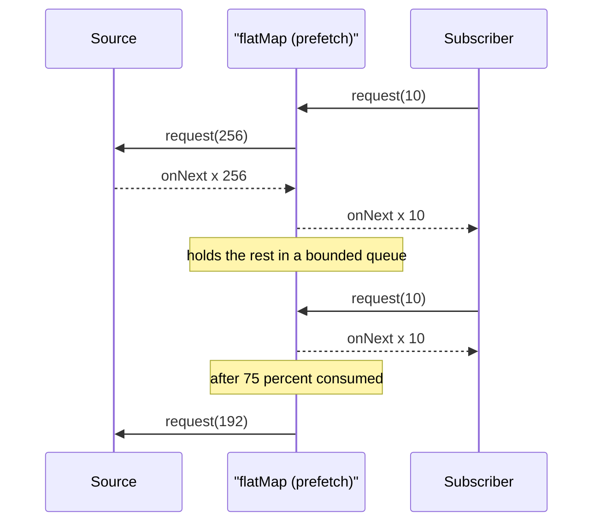
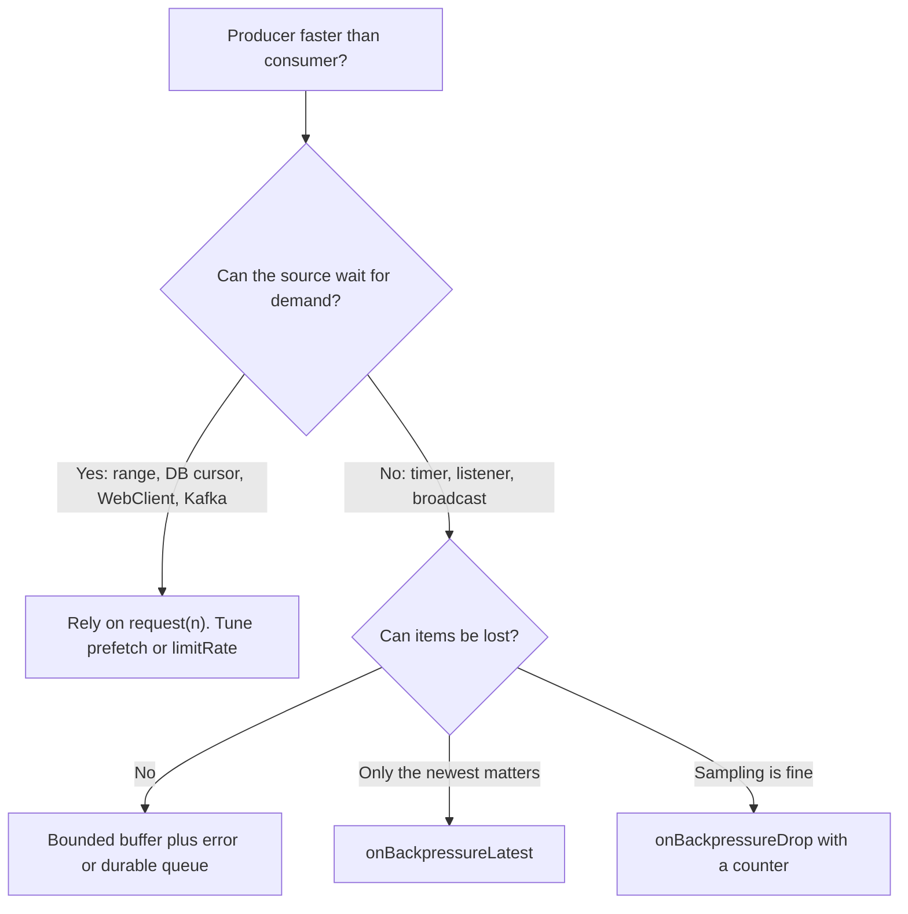

# Backpressure

!!! abstract "Key takeaways"
    - **Backpressure** = the consumer tells the producer how much it can take. In Reactive Streams that is `Subscription.request(n)`: the publisher may never emit more than the outstanding demand.
    - Reactor is a **push-pull hybrid**: the subscriber pulls by requesting, the publisher pushes when items are ready. Operators **prefetch** (`flatMap` inner 32, `publishOn` 256) and replenish at **75 %**; `limitRate(n)` sets this for you.
    - Some sources **cannot slow down** (timers, UI or market events, message listeners). For them you must pick an **overflow strategy**: buffer (bounded!), drop, keep latest, or error.
    - `flatMap(fn, concurrency)` is backpressure you will actually use: it caps how many downstream calls are in flight.
    - Over the network, `request(n)` is **not** sent on HTTP. Reactor Netty maps demand to reading the socket, and **TCP flow control** carries the pressure. RSocket is the protocol that sends `REQUEST_N` on the wire.

## Why it matters

Whenever a producer is faster than a consumer, something has to give. There are only four options:

1. **Buffer** the excess, which works until memory runs out.
2. **Drop** some items (sampling, keep the latest).
3. **Slow the producer down**, which is backpressure in the strict sense.
4. **Speed the consumer up** by scaling it out.

Without a plan you get option 1 by accident: an unbounded queue that grows until the JVM throws `OutOfMemoryError`, or latency that climbs for minutes as items wait. Reactive Streams made option 3 part of the contract so every stage in a pipeline can push back on the stage before it. The same idea applies to whole systems through queues, rate limiters and load shedding (see [message queues](../system-design/07-message-queues-and-async-processing.md) and [rate limiting](../system-design/08-rate-limiting-and-api-gateway-design.md)); this page is about backpressure **inside a process** and **across one connection**.

## Core concepts

### Demand, not events

Each `Subscription` tracks **outstanding demand**. `request(5)` adds 5, each `onNext` subtracts 1. At zero the publisher must stop and wait. Demand is cumulative and capped at `Long.MAX_VALUE`, which means "unbounded" (no backpressure). The plain `subscribe(item -> ...)` lambda requests unbounded, which is why naive code never sees backpressure.


*Notice that demand is renegotiated at each stage. An operator's prefetch can be larger than the final subscriber's request, but it is always bounded.*

### Prefetch and limitRate

Requesting one item at a time is correct but slow: each `request(1)` is a round trip. So operators that hand items across a queue (`publishOn`, `flatMap`, `concatMap`, `zip`) **prefetch**: they request a batch (256 for `publishOn` by default, 32 per inner publisher in `flatMap`) and request more once 75 % of it has been consumed. `limitRate(n)` adds the same behaviour anywhere in the chain: it requests `n` first, then `0.75 × n` each time that much has been used, which also stops a downstream `request(Long.MAX_VALUE)` from reaching the source.

### Sources that can slow down and sources that cannot

| Source | Honours `request(n)`? | Notes |
|---|---|---|
| `Flux.range`, `fromIterable`, `generate` | Yes | Pull-based: produces only on demand |
| R2DBC, MongoDB reactive driver | Yes | Fetches rows or batches as demand arrives |
| `WebClient` body as `Flux` | Yes, via TCP | Stops reading the socket when demand is zero |
| Kafka via reactor-kafka | Yes | Pauses partitions when the pipeline is full |
| `Flux.interval` | **No** | A timer cannot wait; it errors with `OverflowException` |
| `Flux.create` / `Flux.push` bridging a listener | **No** | The listener keeps calling you; default strategy is an unbounded `BUFFER` |
| `Sinks.many().multicast()` | Per subscriber | One slow subscriber can fill the buffer for all |

For the "No" rows, you choose an **overflow strategy**:

| Operator | When demand is zero | Use when |
|---|---|---|
| `onBackpressureBuffer(max, onOverflow, strategy)` | Queue up to `max`, then drop oldest, drop latest or error | Short bursts; every item matters |
| `onBackpressureDrop(dropped -> ...)` | Discard new items | Metrics, telemetry, sampling |
| `onBackpressureLatest()` | Keep only the newest | Prices, positions, status: only "now" matters |
| `onBackpressureError()` | Fail with `OverflowException` | Overflow is a bug and should be visible |

{ loading=lazy }
*The left buffer grows without limit; the right one is capped by demand and the producer waits.*

### Backpressure across the network

`request(n)` is an in-process method call. What happens at a boundary depends on the protocol:

- **HTTP/1.1 and HTTP/2 with Reactor Netty**: when downstream demand is zero, Netty stops reading from the socket. The kernel receive buffer fills, the TCP window shrinks to zero, and the sender's writes stall. On the server side, when the client reads slowly, the channel becomes "not writable" and WebFlux stops requesting from your `Flux`. So pressure does propagate, but at the granularity of **bytes and buffers**, not items.
- **RSocket** sends `REQUEST_N` frames, so item-level demand crosses the wire.
- **Kafka** consumers pull (`poll`), which is natural backpressure: a slow consumer just builds **lag** on the broker instead of filling memory (see [consumer lag](../kafka/12-performance-tuning-consumer-lag-and-monitoring.md)).
- **Server-Sent Events and WebSocket** to browsers: the server cannot slow a broadcast for one slow client, so per-client buffers need limits plus drop or disconnect rules.


*Notice that "unbounded buffer" is never a leaf. Every path ends either in demand control or an explicit loss or failure policy.*

{ loading=lazy }
*Same input, four policies: decide which loss or failure your domain can accept.*

## In practice: code & configuration

=== "❌ Common mistake"
    ```java
    // Fan-out with no concurrency limit and a timer that cannot be slowed down.
    Flux<Enriched> enrichAll(Flux<Claim> claims) {
        return claims
            .flatMap(c -> pricingClient.price(c));  // up to 256 concurrent calls per subscriber:
                                                    // the pricing service sees a spike and starts timing out
    }

    Flux<Quote> quotes() {
        return Flux.interval(Duration.ofMillis(1))  // emits every 1 ms no matter what
            .map(tick -> marketFeed.snapshot())
            .publishOn(Schedulers.boundedElastic())  // slow consumer below: 256-item queue fills
            .map(this::slowRender);                  // -> OverflowException "Could not emit tick"
    }
    ```

=== "✅ Correct approach"
    ```java
    Flux<Enriched> enrichAll(Flux<Claim> claims) {
        return claims
            .limitRate(100)                                      // pull from the source in batches of 100
            .flatMap(c -> pricingClient.price(c)
                    .timeout(Duration.ofSeconds(2)),
                8);                                              // at most 8 pricing calls in flight
    }

    Flux<Quote> quotes() {
        return Flux.interval(Duration.ofMillis(1))
            .onBackpressureLatest()                // only the newest snapshot matters for a quote screen
            .map(tick -> marketFeed.snapshot())
            .publishOn(Schedulers.boundedElastic(), 1)  // prefetch 1: don't queue stale work
            .map(this::slowRender);
    }
    ```

Bridging a callback API into a `Flux` with a bounded buffer and a visible overflow:

```java
Flux<DeviceEvent> events(DeviceBus bus, MeterRegistry meters) {
    Counter dropped = meters.counter("device.events.dropped");
    return Flux.<DeviceEvent>create(sink -> {
            Listener l = sink::next;                    // listener pushes regardless of demand
            bus.register(l);
            sink.onDispose(() -> bus.unregister(l));    // clean up on cancel/complete
        })
        .onBackpressureBuffer(10_000,                   // bounded: about 10k events of headroom
            ev -> dropped.increment(),                  // count every loss
            BufferOverflowStrategy.DROP_OLDEST);        // keep recent events
}
```

!!! tip "Measure it"
    Backpressure hides problems as latency. Track buffer sizes, dropped counts and queue wait time as metrics. Reactor's `Micrometer` integration (`.name("claims").tap(Micrometer.metrics(registry))`) gives request and onNext rates per stage.

## Real-world usage

- **Reactive Streams** itself came from Netflix, Pivotal, Lightbend (Typesafe) and others, who had all hit unbounded queues between async stages.
- **Kafka consumers** are the most common backpressure in enterprise systems: the broker stores the excess, lag is the signal, and autoscaling on lag adds consumers.
- **Gateways and aggregators** use concurrency limits (`flatMap` concurrency, bulkheads) so a burst of client requests cannot multiply into a burst against a fragile backend, such as a mainframe claims system or a core-banking API.
- **Market data and IoT dashboards** use latest-value semantics: a slow screen should show the newest price, not every intermediate one.

## Trade-offs & production gotchas

| Option | Pros | Cons | Use when |
|---|---|---|---|
| Demand (`request(n)`) | No loss, bounded memory | Needs a source that can wait | DB cursors, files, HTTP bodies, Kafka |
| Bounded buffer | Absorbs bursts | Adds latency, still overflows eventually | Short bursts with known peak |
| Drop / latest | Bounded memory and latency | Loses data | Telemetry, prices, status |
| Error | Makes overload visible | Fails the stream | Overflow means a bug |
| Durable queue (Kafka, SQS) | Absorbs hours of backlog | Extra infrastructure, async semantics | Business events that must not be lost |

!!! warning "Gotchas"
    - **`subscribe(lambda)` and `block()` request unbounded.** Backpressure only exists if something requests a bounded amount.
    - **`Flux.create` defaults to an unbounded buffer.** Set an explicit `onBackpressureBuffer(max, ...)` or `OverflowStrategy`.
    - **A multicast sink is as slow as its slowest subscriber**, or drops for everyone once the buffer fills. Isolate slow consumers.
    - **TCP backpressure is coarse.** Socket buffers and Netty buffers hold several MB per connection before the sender feels it.
    - **`publishOn` and `flatMap` prefetch** mean items are already pulled from the source before you process them; on cancel those items are discarded. Lower prefetch for expensive or non-idempotent sources.

## How this connects to my experience

- **Where I used it:** Reactor backpressure is not on the resume. The concept is: "Designed Kafka-based event-driven workflows with retry and DLQ handling" on OptumRx Meteor. A Kafka consumer group is a pull-based, backpressured system: the consumer only takes what it can process, and lag is the overflow signal. Details such as `max.poll.records`, consumer concurrency and lag alerting are not on the resume *[confirm]*.
- **GraphQL Consumer Service:** fan-out to 5 upstream systems is where an explicit concurrency cap matters, so one large query cannot open dozens of calls to a slow upstream *[confirm whether per-upstream limits or bulkheads existed]*.
- **Talking points:**
    - "Backpressure is a policy decision before it is an operator: wait, buffer, drop or fail. For healthcare events we never drop, so the answer was a durable topic and lag alerts, not an in-memory buffer."
    - "In code, the backpressure I use most is a concurrency limit on fan-out: `flatMap` with a concurrency argument, or a semaphore with virtual threads."
- **Likely follow-up chain:** "What is backpressure?" → "How does Reactor implement it?" → "What if the source cannot slow down?" → "Does it work across HTTP?" → "How do you handle a slow Kafka consumer?"

## Interview questions

### Fundamentals

??? question "Q1. What is backpressure?"
    **Answer:** A feedback mechanism where a consumer signals how much it can handle so a faster producer does not overwhelm it. In Reactive Streams it is `Subscription.request(n)`: the publisher may emit at most the outstanding demand, then must wait. The alternatives to slowing the producer are buffering, dropping or scaling the consumer, and a good design picks one explicitly.

    **Interviewer listens for:** `request(n)`, consumer-driven, the four options.

    **Common wrong answer:** "It is when the server returns 429." That is load shedding or rate limiting, a related system-level technique.

??? question "Q2. Is Reactor push or pull?"
    **Answer:** Both, a push-pull hybrid. The subscriber pulls by requesting `n`. Within that demand the publisher pushes items as soon as they are ready. If the subscriber requests `Long.MAX_VALUE` (the default for `subscribe(lambda)`), it behaves as pure push.

    **Interviewer listens for:** demand bounds push, unbounded request default.

    **Common wrong answer:** "Pure push, like an event listener."

??? question "Q3. What do prefetch and limitRate do?"
    **Answer:** Operators that queue items between threads or inner publishers request ahead to avoid one-by-one round trips: `publishOn` prefetches 256, `flatMap` 32 per inner publisher, and they replenish once 75 % is used. `limitRate(n)` applies the same batching anywhere: request `n`, then replenish by `0.75 × n`. It also shields the source from an unbounded downstream request.

    **Interviewer listens for:** batching for efficiency, 75 % replenish, limitRate as a guard.

    **Common wrong answer:** "limitRate limits items per second." That is a rate limiter; `limitRate` limits **outstanding requests**.

### Intermediate

??? question "Q4. Which sources cannot honour backpressure, and what do you do?"
    **Answer:** Time-based and event-driven sources: `Flux.interval`, listener callbacks bridged with `Flux.create`/`push`, hot sinks, UI or market events. They cannot wait, so you pick an overflow strategy: `onBackpressureBuffer` with a bound and an overflow action, `onBackpressureDrop`, `onBackpressureLatest`, or `onBackpressureError`. Without one, `interval` fails with `OverflowException` and `create` buffers without limit.

    **Interviewer listens for:** examples, the four strategies, `create` default buffer is unbounded.

    **Common wrong answer:** "Use `onBackpressureBuffer()` with no size."

??? question "Q5. How do you stop a reactive service from overwhelming a downstream API?"
    **Answer:** Cap concurrency: `flatMap(fn, n)` (or `flatMapSequential`) limits in-flight calls; combine with `timeout`, retries with backoff and jitter, and a circuit breaker. Size `n` from the downstream's capacity (Little's law: in-flight = rate × latency). The `WebClient` connection pool size is a second limit (`ConnectionProvider` max connections and pending-acquire queue).

    **Interviewer listens for:** flatMap concurrency argument, connection pool, Little's law, resilience operators.

    **Common wrong answer:** "Reactive is non-blocking, so the downstream will be fine."

### Senior

??? question "Q6. Does backpressure work across an HTTP call between two WebFlux services?"
    **Answer:** Not as `request(n)` messages. HTTP has no demand frame. Reactor Netty translates zero demand into not reading the socket, so the TCP receive window fills and the sender's writes block, which in turn stops the sender's `Flux` from being requested. It works, but coarsely: several MB of socket and Netty buffers absorb data before the sender reacts, and it only applies to streaming bodies. For item-level demand across the network use RSocket, which sends `REQUEST_N` frames, or a broker like Kafka.

    **Interviewer listens for:** TCP flow control, channel writability, coarse granularity, RSocket.

    **Common wrong answer:** "Yes, request(n) is sent to the other service."

??? question "Q7. How does a multicast sink behave with one slow subscriber?"
    **Answer:** `Sinks.many().multicast().onBackpressureBuffer()` keeps one buffer (default 256) and can only emit as fast as the slowest subscriber's demand. When the buffer fills, `tryEmitNext` returns `FAIL_OVERFLOW` (and `emitNext(x, FAIL_FAST)` throws), so the producer must slow down, drop or fail for everyone. `directBestEffort()` instead drops items for slow subscribers only. For many independent consumers at different speeds, give each its own bounded buffer or a durable topic.

    **Interviewer listens for:** slowest subscriber governs, emit results, per-consumer isolation.

    **Common wrong answer:** "Each subscriber gets its own independent queue automatically."

### Scenario-based

??? question "Q8. A reactive export endpoint streams 5 million rows to a client. Memory grows until OOM. What do you check?"
    **Answer:** Find where demand becomes unbounded. Common causes: `collectList()` before writing (buffers everything), a blocking JDBC call wrapped in `fromIterable(repo.findAll())` (loads all rows first), `onBackpressureBuffer()` without a bound, or `flatMap` with high concurrency on per-row lookups. Fix: use a streaming source that respects demand (R2DBC or JDBC with fetch size inside `Flux.using`/`generate`), write with `Flux` to the response (NDJSON or SSE) so Netty's writability drives demand, keep buffers bounded, and use `limitRate`. Verify with a heap dump and Reactor metrics per stage.

    **Interviewer listens for:** collectList and findAll as hidden buffers, streaming driver, response writability, measurement.

    **Common wrong answer:** "Increase the heap."

??? question "Q9. Your Kafka consumer cannot keep up during a daily peak. Is that a backpressure problem, and how do you handle it?"
    **Answer:** Kafka's pull model already provides backpressure: the consumer only polls what it can process, and the excess waits on the broker as lag, so memory is safe. The risks are different: processing slower than `max.poll.interval.ms` causes rebalances, and lag means stale data. Handle it by measuring lag, scaling consumers up to the partition count, increasing processing concurrency safely (per-key ordering), reducing per-record work, and tuning `max.poll.records`. Alert on lag and time-to-drain rather than on raw count.

    **Interviewer listens for:** pull model = backpressure, lag as the buffer, partition limit on scaling, rebalance risk.

    **Common wrong answer:** "Add an in-memory queue in front of the processing to absorb the peak."

## Cheat sheet

| Concept | Remember |
|---|---|
| Mechanism | `Subscription.request(n)`; emit ≤ outstanding demand |
| Unbounded | `request(Long.MAX_VALUE)`; `subscribe(lambda)` and `block()` do this |
| Prefetch | `publishOn` 256, `flatMap` inner 32, replenish at 75 % |
| `limitRate(n)` | Batches demand: `n`, then `0.75 × n` |
| Concurrency cap | `flatMap(fn, n)` |
| Can't wait | `interval`, `create`/`push`, hot sinks |
| Strategies | buffer (bounded), drop, latest, error |
| `Flux.create` default | Unbounded `BUFFER` |
| Network | HTTP: TCP window + channel writability; RSocket: `REQUEST_N` |
| Kafka | Pull model; lag is the buffer |

## Sources

1. [Reactive Streams specification](https://github.com/reactive-streams/reactive-streams-jvm/blob/master/README.md): demand rules (publisher rule 1, subscription rules 3.x).
2. [Reactor reference: Introduction to reactive programming](https://docs.spring.io/projectreactor/reactor-core/docs/3.7.x/reference/html/reactiveProgramming.html): backpressure, prefetch, push-pull hybrid.
3. [Reactor reference: Programmatically creating a sequence](https://docs.spring.io/projectreactor/reactor-core/docs/3.7.x/reference/html/producing.html): `generate`, `create`, `push`, `OverflowStrategy`.
4. [Reactor reference: Sinks](https://docs.spring.io/projectreactor/reactor-core/docs/3.7.x/reference/html/coreFeatures/sinks.html): multicast buffer, emit results, best-effort variants.
5. [Reactor `Flux` Javadoc](https://projectreactor.io/docs/core/release/api/reactor/core/publisher/Flux.html): `limitRate`, `onBackpressure*`, `flatMap` concurrency and prefetch.
6. [RSocket protocol](https://rsocket.io/about/protocol): `REQUEST_N` frames for network-level demand.
7. [Reactor Netty reference](https://docs.spring.io/projectreactor/reactor-netty/docs/current/reference/html/): event loops, connection pool, channel handling.
8. [Apache Kafka consumer configs](https://kafka.apache.org/documentation/#consumerconfigs): `max.poll.records`, `max.poll.interval.ms`.
